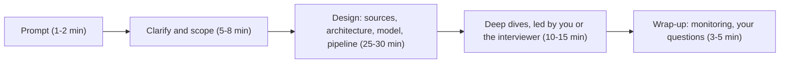

# How Data Engineering Design Interviews Work

Before you learn a framework for this round, you need to know what the round is actually testing. Candidates who prepare for the wrong test, usually a software engineering design interview with the nouns swapped, lose offers they were technically qualified for.

## The Problem

Priya has four years of experience. She has built Airflow DAGs, tuned Spark jobs, and owns a warehouse that 40 analysts query every morning. She has also watched a lot of system design videos, so she walks into her first data engineering design interview ready to talk about load balancers, API rate limits and sharding a user table.

The prompt: "Design a pipeline that powers a daily revenue dashboard for an online marketplace."

She spends ten minutes on a REST service that accepts orders, with a cache in front of it. The interviewer asks, "What happens when the payments team corrects an order from three days ago?" She has no answer, because nothing in her design was built to change numbers that had already been published. She never asked who reads the dashboard, how fresh it must be, or what it costs to recompute. She knows every tool she needs, but she prepared for a different exam.

That mismatch is the most common way strong engineers fail this round, and it is easy to fix once you know what the round is.

## What a Data Engineering Design Round Is

A **data engineering design round** is a 45 to 60 minute conversation where you are given a vague, open-ended prompt and design a data system on a whiteboard (or a shared drawing tool). The prompt names a business outcome, not a technology: "analytics for a music app", "keep the warehouse in sync with the orders database", "detect fraud as transactions happen".

Nobody expects a finished system. The interviewer is watching how you think: how you narrow a vague problem, how you choose between options, and how you react when they push on a weak spot. Two things are always true:

- **There is no single right answer.** Two strong candidates can draw different architectures for the same prompt and both pass.
- **The conversation is the product.** A perfect diagram you cannot explain scores lower than a rougher one you can defend.

## How It Differs From a Software Engineering Round

A software engineering (SWE) design round is about **serving requests**: a user taps something, a service answers in milliseconds, and the hard problems are traffic (queries per second, or QPS), latency, and keeping the service up. The unit of work is an API call.

A data engineering round is about **moving and shaping data so that someone can trust and use it**. The unit of work is a dataset: events, rows, files, tables. The hard problems are different, so the questions are different.

| Dimension | SWE design round | DE design round |
|---|---|---|
| Core question | Can it answer each request fast? | Can the right data arrive, correct, on time, and cheaply? |
| Who is the "user"? | An end user or another service calling an API | Consumers: analysts, dashboards, ML models, downstream teams |
| Main scale number | Requests per second | Events per second, and terabytes per day |
| What breaks | Latency spikes, outages | Silent wrong numbers, late data, duplicates, missing days |
| Where state lives | Operational databases and caches | Object storage, warehouses, streams, and the tables derived from them |
| Typical opening question | "What's the API?" | "Who reads this, and how fresh must it be?" |
| Cost | Mentioned late, if at all | A first-class constraint from minute one |

Four themes show up in nearly every DE round, and they are worth naming now because the rest of the course keeps returning to them.

**1. Data correctness.** A web service that returns a wrong answer fails loudly, because a user sees it. A pipeline that produces a wrong number often fails silently: the dashboard loads, the chart looks plausible, and a finance team makes a decision on it. Interviewers listen for whether you think about duplicates, late data (events that arrive after you have already published the numbers they belong to), and what happens when a job is run twice. A job is **idempotent** if running it twice gives the same result as running it once, and this property is the backbone of most correctness answers.

**2. Freshness.** **Freshness** is how old the newest data is compared with now. "Real time" is not a requirement; it is a word. A good candidate turns it into a number: "the dashboard can be 15 minutes behind" and "fraud scoring must happen within 2 seconds" lead to completely different designs, and the cost difference is large.

**3. Cost.** Streaming everything is easy to propose and expensive to run. Keeping five years of raw events in fast, expensive storage is easy to propose and expensive to pay for. SWE interviews let you hand-wave cost. DE interviews do not, because data volume is the cost driver and you are the one choosing what to keep, where, and for how long.

**4. Consumers over endpoints.** The design is judged by how well it serves whoever reads the data. An analyst who needs to slice revenue by country needs a different table shape than a model that needs one feature vector per user. When a candidate designs only the ingestion half and ignores who queries the output, the interviewer notices.

> [!NOTE]
> None of this means DE rounds ignore availability or scale. You still need your system to survive a broker failing. But in a data round those concerns serve the correctness, freshness and cost goals above, not the other way around.

## What Gets Scored

Interviewers usually score against a rubric with a handful of dimensions. Companies word them differently, but most rubrics reduce to these five. Knowing them tells you where to spend your 45 minutes.

| Dimension | What the interviewer is asking themselves | What it looks like when it goes well |
|---|---|---|
| **Problem navigation** | Did they turn a vague prompt into something designable? | You ask a few sharp questions, write down requirements, and agree on scope before drawing |
| **Technical breadth** | Do they know the building blocks and when each fits? | You pick a queue, storage layer and processing engine for stated reasons, not by habit |
| **Technical depth** | Can they go one level down and still be right? | When probed on duplicates or partitioning, you explain the mechanism and its limits |
| **Trade-off reasoning** | Do they see that every choice costs something? | You say what you give up: "batch is simpler and cheaper, but the data is an hour stale" |
| **Communication and ownership** | Could I work with this person? Do they drive? | You narrate, structure the conversation, check in, and take feedback without getting defensive |

Two observations from the other side of the table.

First, **the dimensions are not equally weighted by level**, which the next section covers. Second, **communication is scored on every dimension**. A candidate with strong knowledge who thinks silently for four minutes at a time gets marked down on breadth, depth and communication at once, because the interviewer cannot see any of it.

> [!TIP]
> The quickest way to improve your score is to say your reasoning out loud in one sentence per decision: "I'm choosing object storage as the raw layer because we need to replay history cheaply." That sentence gives the interviewer something to write in the rubric.

## Common Formats

Not every company runs the round the same way. You will see three formats most often. Ask the recruiter which one you are getting; they usually tell you.

| Format | What happens | What it rewards |
|---|---|---|
| **Open whiteboard design** | You get a one-line prompt and drive a 45 to 60 minute conversation, drawing as you go | Structure and self-direction. This is the main format this course trains |
| **Pipeline whiteboarding** | The prompt is narrower: "Here are three source systems and a report. Draw the pipeline, name the tables, say how it runs daily." The interviewer may ask you to write a table schema or a rough SQL query | Concrete detail: grain (what one row represents), keys, idempotent loads, scheduling, what happens on failure |
| **Take-home-style discussion** | You receive a short written scenario or a small design doc ahead of time, then spend the live round defending your solution. Sometimes the take-home is a small build and the live round reviews it | Preparation and defensibility. Expect "why this and not that?" about every choice |

A fourth variant is a **hybrid**: 15 minutes of SQL or data modeling, then 30 to 40 minutes of open design. The framework still applies; you just have less time per step.

The same lesson holds in all of them: the interviewer wants to hear requirements and trade-offs, not just see a final picture. Even when the prompt is narrow, spend a minute confirming what the output is for.

## How Levels Change Expectations

The prompt is usually identical across levels. What changes is **who drives the conversation, how deep you go, and how many things you notice without being told.** Use this to decide what to practice.

| Level | Breadth vs depth | Who drives | The bar on a typical prompt |
|---|---|---|---|
| **Mid-level** (about 2 to 4 years) | Solid breadth, one or two areas in real depth | You follow a clear structure; the interviewer may nudge you between steps | A working end-to-end design that meets the stated requirements; sensible tool choices; you handle duplicates and retries when asked |
| **Senior** (about 4 to 8 years) | Breadth plus depth in several areas, with explicit trade-offs | You drive the whole conversation and raise problems before they are asked | You surface late data, [backfills](../02-core-concepts/03-backfill-and-reprocessing.md) (re-running a pipeline over past data) and cost without prompting; you quantify; you choose deep dives yourself |
| **Staff+** (8+ years) | Judgment across systems, teams and time | You shape the problem itself and question the requirements | You discuss organization and evolution: ownership, migrations, how this design lives for three years, where it will hurt |

To make this concrete, take the prompt "keep the analytics warehouse in sync with the orders database."

- A **mid-level** answer picks change data capture (reading the database's change log instead of querying tables), a queue, and a loader, and handles duplicates when the interviewer asks "what if a message is delivered twice?"
- A **senior** answer raises that question first, then adds how deletes and schema changes flow through, how you backfill, and what the cost is of keeping the sync under a minute versus under an hour.
- A **staff+** answer asks which downstream teams depend on the sync, proposes a [data contract](../02-core-concepts/07-data-contracts.md) (a versioned agreement on a dataset's schema and meaning) so the orders team cannot break them silently, and discusses how to migrate consumers off an old nightly export without a flag day.

If you are mid-level, you do not need to perform staff-level organizational reasoning. You do need a clear structure and the ability to go deeper when pushed. If you are aiming for senior, the main habit to build is **raising things before you are asked**.

## In the Interview

Here is how the 45 to 60 minutes tends to flow, so nothing about the shape surprises you. The next lesson, [The Delivery Framework](02-delivery-framework.md), turns this into a step-by-step plan with timings.

Concretely:

- **Opening.** The interviewer states the prompt and often goes quiet. Silence is an invitation for you to lead. Start by restating the problem in your own words and asking who consumes the output.
- **Middle.** You draw while talking. The interviewer interrupts with questions. Treat each interruption as information about what they care about, not as an attack.
- **Deep dives.** In the last third the interviewer picks a spot and goes down. At senior level you are expected to steer toward the part of your design that is riskiest.
- **Close.** You get a few minutes for questions. Use them to ask something real about the team's data stack. It signals that you think like someone who will own this.

### Phrases that work

Interviewers hear a lot of rehearsed answers. These sound like an engineer thinking:

- "Before I draw anything, who reads this and how fresh do they need it?"
- "I'll assume about 1 billion events a day, so roughly 12,000 a second on average. Does that match your picture?"
- "I can do this in streaming or in hourly batches. Batch is cheaper and simpler; streaming gets freshness from an hour down to seconds. What does the business actually need?"
- "That's a correctness risk. If the job runs twice we double-count, so I'll make the write idempotent."
- "I'd like to dig into duplicates, because that's where this design is weakest. Does that work for you?"

That last one is a senior move. Naming your own weak spot makes you look like someone who would find it in production before it finds you.

### What interviewers listen for

- Do you ask about **consumers and freshness** before naming any tool?
- Do your numbers connect to decisions? Estimating 12,000 events a second matters only if it changes a choice. The math lesson, [Sources and Volume](04-sources-and-volume.md), covers how to do only the arithmetic that matters, and [Key DE Numbers](../02-core-concepts/10-key-de-numbers.md) holds the figures to memorize.
- Can you say **what you are giving up**?
- When challenged, do you **adjust or dig in blindly**? Changing your design with a good reason is a positive signal.

## Common Mistakes

> [!WARNING]
> **1. Treating it as a SWE round.** Opening with APIs, load balancers and a user-facing cache. Fix: open with "who consumes this data and how fresh must it be?"

> [!WARNING]
> **2. Jumping straight to tools.** Saying "Kafka, Spark, Snowflake" in the first two minutes. You have committed to an answer before you know the question. Fix: tools come after requirements and rough volume.

> [!WARNING]
> **3. Designing only the happy path.** A diagram where every event arrives once, in order, on time. Real data arrives twice, late, and malformed. Fix: say once, early, how duplicates, late data and reruns are handled.

> [!WARNING]
> **4. Ignoring cost.** Proposing real-time everything because it sounds modern. Fix: tie each freshness target to a business need and say what the cheaper alternative would cost you in staleness.

> [!WARNING]
> **5. Going silent while thinking.** The interviewer cannot score what they cannot hear. Fix: narrate, or say "give me thirty seconds to think about this" and then do exactly that.

> [!WARNING]
> **6. Memorizing an answer for the prompt.** Interviewers change a requirement halfway ("now the data must be queryable within a minute") to see whether you can reason or only recite. Fix: learn the reasoning steps, not a fixed architecture. The full list of failure modes is in [Top 15 Mistakes](10-top-15-mistakes.md).

## Key Takeaways

- A DE design round tests whether you can move and shape data so consumers can trust it. It is not a SWE round about request serving, and preparing for that one costs offers.
- Four themes carry most of the weight: **correctness, freshness, cost, and the consumers** of the data. Raise each yourself.
- You are scored on problem navigation, breadth, depth, trade-off reasoning, and communication. Communication counts on every dimension, so think out loud.
- The prompt is the same at every level; the expectations are not. Mid-level means a working, structured design. Senior means you drive and raise issues unprompted. Staff+ means you shape the problem and think about evolution across teams.
- Ask which format you will get (open whiteboard, pipeline whiteboarding, take-home discussion), then follow the same habit in all of them: requirements and trade-offs before pictures.

## Where to Go Next

- [The Delivery Framework](02-delivery-framework.md): the step-by-step plan with minutes per step.
- [Requirements Gathering](03-requirements-gathering.md): the first and most underrated step.
- [Top 15 Mistakes](10-top-15-mistakes.md): a fast checklist to return to before an interview.
- Related breakdowns: [Log Aggregation](../05-breakdowns-core/01-log-aggregation.md) and [E-Commerce Analytics Warehouse](../05-breakdowns-core/03-e-commerce-warehouse.md), two full answers to see the format end to end.
