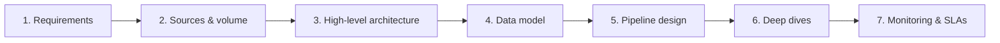
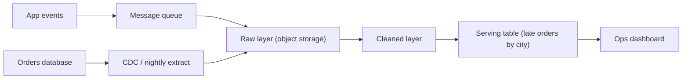

# The Delivery Framework

A design round gives you 45 to 60 minutes and a vague prompt. The delivery framework is the order in which you spend that time, so you always know what to do next and the interviewer always knows where you are. Every breakdown later in this course uses these same seven steps as its section headings.

## The Problem

Marcus gets the prompt: "Design the data pipeline behind a food-delivery app's operations dashboard." He is a good engineer and starts with what he knows best. In the first five minutes he picks Kafka and Flink, draws a stream processor, and starts describing windowed aggregations.

At minute 20 the interviewer asks: "What does the ops team actually look at on this dashboard?" Marcus realizes he never asked. The team wants late deliveries by city, refreshed every few minutes, with last month's numbers for comparison. Half of what he drew serves a use case nobody mentioned, and the other half cannot answer the monthly comparison. He now has 25 minutes to rebuild a design he is emotionally committed to.

Marcus had the knowledge but no order to apply it in. Without one, you do whatever feels familiar first, spend your time unevenly, and discover requirements by accident. With one, you discover them on purpose, in the first five minutes, when changing course is free.

## The Seven Steps

Here is the framework. Learn the names, the order and the rough minutes. The rest of this lesson explains why it looks like this.

| # | Step | What you produce | Taught in | Rough time (45-60 min round) |
|---|------|------------------|-----------|------------------------------|
| 1 | Requirements | Functional and non-functional requirements, plus a "below the line" list of what you are not building | [1.03](03-requirements-gathering.md) | ~5-8 min |
| 2 | Sources & volume | Inputs, outputs, and only the estimates that change the design | [1.04](04-sources-and-volume.md) | ~3-5 min |
| 3 | High-level architecture | Data flow first, then boxes and arrows built up one requirement at a time | [1.05](05-high-level-architecture.md) | ~10-15 min |
| 4 | Data model | Tables or topics, their grain, partitioning, shaped for the consumers | [1.06](06-data-model-design.md) | ~5 min |
| 5 | Pipeline design | Batch or streaming per path, idempotency, scheduling, failure handling | [1.07](07-pipeline-design.md) | ~5-8 min |
| 6 | Deep dives | Two or three areas explored in depth, led by you or the interviewer | [1.08](08-deep-dives.md) | ~10-15 min |
| 7 | Monitoring & SLAs | How you would know the system is healthy and on time | [1.09](09-monitoring-and-slas.md) | ~3-5 min |

Two definitions you will need straight away:

- **Below the line** means explicitly out of scope. You draw a literal line under your requirements list and write what you are *not* building underneath it ("no ML features, no per-user privacy tooling"). It protects your time and shows you chose the scope on purpose.
- A **deep dive** is a stretch where you go one level below the diagram on a single topic, such as "how do we avoid counting an order twice after a replay?"

The minutes add up to more than an hour if every step takes its maximum, and to less than 45 if every step takes its minimum. That is on purpose: you borrow from the steps the prompt makes easy to pay for the ones it makes hard.

## Why This Order

Each step feeds the next. If you swap two, the later one is built on a guess.

**Requirements before everything.** Every later choice (batch or streaming, which store, how many partitions) is a trade-off, and a trade-off needs a goal. "Freshness within 5 minutes" and "freshness by 7am" lead to different systems. You cannot defend a choice if you have not agreed on what it is for.

**Sources and volume before architecture.** Volume decides which boxes you can afford. 2,000 events a minute fits in one small database and a scheduled job. 200,000 events a second does not. You only need to know which side of a few big thresholds you are on. [Key DE Numbers](../02-core-concepts/10-key-de-numbers.md) has the thresholds.

**Architecture before data model.** This is the one that surprises people, so it gets its own section below.

**Data model before pipeline design.** The pipeline writes tables. Until you know what the tables look like (their grain, their keys, how they are partitioned), you cannot say what "idempotent" means for a load: it means "re-running this write gives the same rows", and you need to know which rows.

**Pipeline details before deep dives.** A deep dive needs a design to dig into. Interviewers also tend to probe the places where the pipeline looks fragile, so you want those places on the board already.

**Monitoring last, but never skipped.** It is the cheapest step and the one most candidates forget. Three minutes here is a clear senior signal: you think about the system after the launch party.

## Why the Data Model Comes After the Architecture

In a SWE design round the data model often comes first: define the entities, then build services around them. In a data round it usually should not, because **data systems have several models, one per layer, and you cannot model a layer you have not decided exists.**

Take the food-delivery prompt. A table's **grain** is what one row of it represents, such as "one app event" or "one city per five minutes". Before the architecture, "the data model" is a vague idea. After drawing a flow of raw events landing in object storage, being cleaned, then aggregated into a serving table, you can say precisely:

- **Raw layer:** the events as received, one row per event, kept append-only so you can replay. Grain: one app event.
- **Cleaned layer:** deduplicated, typed, with bad records separated out. Grain: still one event, but trustworthy.
- **Serving layer:** a table shaped for the dashboard, such as `late_orders_by_city_5min`. Grain: one city per five-minute window.

Three different models, each with a different grain, key and partitioning, and each only meaningful once its layer is on the board. If you model first, you end up designing one table that tries to be all three.

> [!TIP]
> When you move from step 3 to step 4, say it: "Now that we have raw, cleaned and serving layers, I'll model each one, starting with the serving table because that's what the consumers see." Working backwards from the consumer is almost always the right order within the step.

### When to flip it

Sometimes the model *is* the design. Flip steps 3 and 4 when:

- **The prompt is about a warehouse or reporting model.** "Design the warehouse for an e-commerce company" is largely a question about facts, dimensions and grain. The architecture (load a warehouse nightly) is the easy part. Start with the model.
- **The interviewer hands you the sources and the reports.** In pipeline whiteboarding, the question is "what tables, and how do they load?" Model first, then show how data gets there.
- **The consumers' queries are the hard constraint.** If the whole prompt is "analysts must filter by any of 30 attributes in under 2 seconds", the table design drives the storage choice, so model before you pick storage.

Flipping is fine as long as you say so: "This is mostly a modeling problem, so I'll start there and sketch the pipeline after." What you want to avoid is flipping by accident.

## One End-to-End Walk-Through

Here is the whole framework applied to Marcus's prompt, at outline depth. Notice how little each step needs. Later lessons teach depth; this is the shape.

**Prompt:** "Design the data pipeline behind a food-delivery app's operations dashboard."

**1. Requirements (~6 min).** You ask who looks at it (city ops managers), what they decide with it (send more couriers where deliveries are running late), and how fresh it must be ("within 5 minutes" beats "real time"). You write down:

- Functional: late-delivery count and rate by city; drill-down to individual orders; month-over-month comparison.
- Non-functional: data at most 5 minutes old; counts correct to within 0.1% after corrections; 13 months of history.
- Below the line: courier payroll, customer-facing tracking, ML-based ETA prediction.

**2. Sources & volume (~4 min).** Two sources: the app's event stream (order placed, courier assigned, delivered) and the orders database. Say 2 million orders a day, about 10 events per order, 500 bytes each. That is 20 million events a day, roughly 230 a second on average, maybe 1,500 a second at the dinner peak, and about 10 GB a day. The conclusion that matters: this is small. You do not need a big cluster, and you can say so.

**3. High-level architecture (~12 min).** Events go into a message queue, land as raw files in object storage, get cleaned and joined to order data (which arrives from the orders database through CDC, change data capture: reading its change log instead of querying its tables), and are aggregated into a table the dashboard reads. You build it one requirement at a time: first the 5-minute freshness path, then the month-over-month history.

**4. Data model (~5 min).** Raw: one row per event. Cleaned: one row per event, deduplicated by event ID. Serving: one row per city per 5-minute window, partitioned by date, with columns for orders, late orders and late rate. Order drill-down reads the cleaned layer, so the serving table stays small.

**5. Pipeline design (~6 min).** At 230 events a second a micro-batch job (a small batch run every minute or two) is enough; full streaming is unnecessary cost. A job that runs every 5 minutes would already miss a 5-minute freshness target, so the run interval has to be shorter than the target. Each run recomputes the current and recent 5-minute windows and overwrites them, so a rerun gives the same rows (idempotent). Late-arriving events are picked up because every run also recomputes the last hour of windows. A failed run retries automatically and alerts after three failures.

**6. Deep dives (~12 min).** The interviewer picks "what happens when an order is corrected three days later?" You discuss how corrections flow in from the orders database and trigger recomputation of affected windows, and what that costs. You raise a second one yourself: skew (one key getting far more data than the rest, so one worker is overloaded), because one city produces a third of the orders.

**7. Monitoring & SLAs (~4 min).** Freshness: the serving table was last refreshed under 5 minutes ago. Completeness: event count per city is within 5% of the same hour last week. Alert if either is breached for two consecutive runs.

Total: about 49 minutes, with room for the interviewer's detours. Notice what the volume step bought you: because the system is small, you did not spend minutes on partitioning schemes or cluster sizing. The framework let the prompt tell you where the hard part was.

## Adapting the Time

The minutes in the table assume a typical open prompt. Shift them when the shape changes.

| Situation | What to do |
|---|---|
| 45-minute round | Take the low end of every range. Cut step 7 to two minutes and name the SLAs in a sentence each. |
| Warehouse or reporting prompt | Flip steps 3 and 4. Spend your extra minutes on the model. |
| Narrow "draw this pipeline" prompt | Compress steps 1 and 2 into a three-minute confirmation, then spend the time on 4 and 5. |
| Streaming-heavy prompt (fraud, surge pricing) | Give step 5 and the deep dives more minutes, because correctness under late and duplicate events is the whole point. |
| Interviewer jumps ahead ("how do you handle duplicates?") | Answer, then say where it fits: "That's part of the pipeline design. I'll fold it in when we get there." Do not abandon the structure, and do not refuse the question either. |

> [!NOTE]
> At senior level, the interviewer may shorten your steps 1 to 5 on purpose to get you to the deep dives sooner. If they say "I'm comfortable with the high-level, let's go deeper," take the signal and move.

## In the Interview

**Say the plan out loud at the start.** After restating the problem, spend one sentence on structure: "I'll start with requirements, then rough volume, sketch the architecture, then model, pipeline, and we can deep-dive wherever you like. I'll finish with how I'd monitor it." It takes ten seconds, and it tells the interviewer you have a method, so they relax and let you drive.

**Narrate transitions.** One short sentence at each boundary: "I think the requirements are clear. Moving to volume." Interviewers use these to decide whether to interrupt. Without them, they cannot tell whether you forgot a step or skipped it on purpose.

**Time-box without a stopwatch.** Check the clock at the end of step 3. If you are past minute 25 and have not touched the data model, compress what is left rather than finishing the architecture perfectly. An 80% architecture plus a model and a pipeline beats a polished architecture and nothing else.

**Treat the framework as a spine you can bend.** Interviewers change the prompt midway ("now it must also support ad-hoc queries"). When that happens, go back to the step the change touches, redo just that step, and propagate it forward: new requirement, new architecture box, new table.

**Use the framework to take a punch.** If the interviewer pushes on a weak spot you skipped, "Good catch, that belongs in the pipeline design step. Let me add it now" is a perfectly good recovery.

## Common Mistakes

> [!WARNING]
> **1. Skipping steps 1 and 2 to "save time".** You will spend that time twice over fixing a design for the wrong problem. Even a two-minute version beats none.

> [!WARNING]
> **2. Treating the framework as a checklist to recite.** If you announce each step title and then fill it with generic content, the interviewer hears a script. Use the steps to organize *this* problem's specifics, like the 5-minute freshness target and the 230 events a second.

> [!WARNING]
> **3. Burning half the round on the architecture.** Step 3 is the biggest block, and it is the easiest to overrun because drawing is fun. Cap it, and leave the detail for the deep dives, where the interviewer can choose which detail matters.

> [!WARNING]
> **4. Forgetting the layers.** Drawing one box called "database" and modeling one table. The raw, cleaned and serving distinction is what makes replay, fixes and consumer-friendly tables possible.

> [!WARNING]
> **5. Dropping steps 5 and 7 when time runs short.** These are where correctness and operations live, and they are the steps that separate senior from mid-level answers. If you must cut something, shorten the architecture, not these.

## Key Takeaways

- The framework has seven steps, in order: Requirements, Sources & volume, High-level architecture, Data model, Pipeline design, Deep dives, Monitoring & SLAs. Each one feeds the next.
- Spend the first eight to twelve minutes on requirements and volume. That is when changing direction is cheapest.
- Data model comes after architecture because a data system has a model per layer (raw, cleaned, serving), and you cannot model layers you have not drawn. Flip the order only when the prompt is itself about the model, and say that you are flipping.
- Say your plan out loud, narrate transitions, and adapt the minutes to the prompt, but do not drop pipeline design or monitoring.
- Use the framework to organize the specifics of this problem.

## Where to Go Next

- [Requirements Gathering](03-requirements-gathering.md): step 1 in depth, and the question list that makes it quick.
- [Sources and Volume](04-sources-and-volume.md): step 2, and how to do only the math that matters.
- [Top 15 Mistakes](10-top-15-mistakes.md): the full list of ways this goes wrong.
- For the framework applied end to end at full depth, start with [Log Aggregation](../05-breakdowns-core/01-log-aggregation.md).
