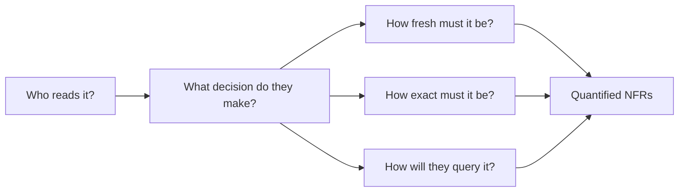

# Requirements Gathering

Requirements are the first five to eight minutes of the round, and they decide whether the next forty are spent on the right system. For a data system, "requirements" mostly means one thing: finding out what the people who read the data need from it, in numbers.

## The Problem

The prompt: "Design the data platform for a meal-kit company's analytics."

Dana, a candidate, hears "analytics" and starts drawing. She restates the prompt, asks "roughly how many orders a day?", gets "about 300,000", and moves on to the architecture. Fifteen minutes later the interviewer says: "Finance closes the month on the 3rd. Their revenue number has to match the payments system to the cent. How does your design do that?"

Dana's design counts events from the app as they stream in. App events are close to real time and are sometimes lost or duplicated, so they cannot be matched to the cent. She also never learned that marketing wants campaign results within the hour, that a data science team trains a churn model on two years of raw history, or that the company has a legal rule to delete customer data on request.

She asked one question, about size. The interviewer's prompt contained at least four different customers, each with a different need. Nobody told her because she never asked who the customers were.

Requirements gathering for a data system is mostly asking about the **consumers**: whoever reads the output, whether a person, a dashboard, a model or another team's pipeline. Each consumer wants something different, and the differences are what make the design hard.

## Functional vs Non-Functional, for Data Systems

You may know the split from other design rounds. Here is what it means for data.

A **functional requirement** is something the system must produce or do. In a data system, that is almost always an output: a table, a metric, a feed, a report, an API that answers a question. Phrase them from the consumer's side: "Marketing sees conversions per campaign." "Finance gets a daily revenue table."

A **non-functional requirement** (NFR) is a measurable quality of how well the system does it: how fresh, how complete, how correct, how long kept, how fast to query, how expensive. NFRs are where data designs differ from each other. Two systems can produce the identical "daily revenue table" and be completely different machines because one must be ready by 7am and the other must be right to the cent.

| | Functional | Non-functional |
|---|---|---|
| Answers | What does the consumer get? | How well, how fast, how reliably? |
| Looks like | "Revenue by campaign by day" | "Ready by 07:00, correct to 0.1%, kept 7 years" |
| Typical count in your list | 2 to 4 | 3 to 5 that matter for this prompt |
| If you skip it | You design a system that produces nothing useful | You design a system that is too slow, too wrong or too expensive |

Keep functional requirements short. Candidates rarely lose points for missing a fifth functional item. They lose them for leaving the non-functional ones vague.

## The Quantified NFRs

A non-functional requirement without a number is a wish. "Low latency" and "highly accurate" give you nothing to design against. The goal is to turn each into a figure the interviewer can agree with. These are the six that matter for data systems.

| NFR | The question to ask | A quantified answer | What it drives |
|---|---|---|---|
| **Freshness** | How old can the newest data be when someone reads it? | "At most 5 minutes behind the source" | Batch vs streaming, schedule frequency, serving store (the database or table the consumer reads from) |
| **Completeness** | How much of the data must have arrived before the number is trusted? | "99.9% of the day's events loaded before the report publishes" | How long you wait for late data, reconciliation checks (comparing your totals with the source system's) |
| **Correctness** | Does it need to be exact, or is approximate fine? Does it get corrected later? | "Matches the payments system to the cent; approximate OK on the marketing view" | Exactly-once effort, deduplication, whether you can use approximations |
| **Retention** | How far back must we keep it, and must we be able to delete it? | "Raw 30 days, aggregates 2 years, finance 7 years; delete a customer within 30 days of a request" | Storage tiers, cost, partitioning by date, deletion design |
| **Access patterns** | How will it be queried, by whom, how often? | "20 analysts running ad-hoc scans; a dashboard of 200 users refreshing every minute" | Table layout, serving store, caching, concurrency |
| **Cost** | Is there a budget, or is cost a tie-breaker? | "Under $15k a month" or "no cap, but justify spend" | How much redundancy and how big a cluster you can afford |

Three of these deserve a closer look because candidates confuse them.

### Freshness is not the same as latency

**Freshness** is how old the newest data is when read: if a dashboard shows data up to 10:55 and it is 11:00, freshness is 5 minutes. **Query latency** is how long the dashboard takes to answer: 800 ms. A system can answer in 50 ms and still show yesterday's numbers. When someone says "real time", ask which one they mean, then ask what decision is made with the number. A courier-dispatch screen that reroutes drivers needs freshness in seconds. A weekly business review does not, whatever the stakeholder first said. Our meal-kit marketing team said "real time" and meant "I check campaigns after lunch". Hourly is fine, and hourly is far cheaper.

### Completeness and correctness pull against freshness

**Completeness** is the share of expected data that has arrived. Events from a mobile app can show up hours after they happened (see [Late-Arriving Data](../02-core-concepts/08-late-arriving-data.md)). If you publish at 7:00 the instant the clock ticks, you publish incomplete numbers fast. If you wait until you are certain, they are late. You cannot maximize both, so ask the trade-off question directly: "Would you rather have the number at 7am with 99% of events and a correction later, or at 10am with 99.99%?" Interviewers love being asked this, because it is the real decision.

**Correctness** is about whether the number is right, and the useful follow-up is "right compared to what?" Revenue that must match a payments system is a reconciliation target, which means you need exact deduplication and a check against that source. A "visitors this hour" tile that is within 2% is approximate, and approximate is cheaper (see [Deduplication at Scale](../02-core-concepts/09-deduplication-at-scale.md)). Also ask whether published numbers can change. If an order can be corrected three days later, your design must be able to recompute history, and that is a requirement you only find by asking.

### Retention has two halves

Most candidates ask "how long do we keep it?" and stop. Add the second half: **must we be able to delete it?** A privacy rule such as "delete a customer's data within 30 days of a request" is hard in a design built on immutable files, because you then have to find and rewrite every file that holds that customer. Better to learn that at minute 4 than at minute 40. Retention also feeds straight into the cost math: raw volume times retention is your storage bill, and the numbers in [Key DE Numbers](../02-core-concepts/10-key-de-numbers.md) let you check it in a sentence.

## Asking the Consumers' Questions

You do not have the real stakeholders in the room, so you play the part of a data engineer interviewing them, and the interviewer plays all of them. The trick is to ask about **who**, then **what decision**, then **how**, in that order. The number comes out of the decision.

A question list that works for nearly any prompt:

1. **Who are the consumers?** People, dashboards, models, other pipelines? How many of each?
2. **What decision does each make with it?** This tells you how fresh and how exact it needs to be.
3. **What do they look at today?** An existing report or spreadsheet is the most honest requirements document there is.
4. **How fresh?** Offer two options to anchor them: "within a minute, or within an hour?"
5. **Can numbers change after publishing?** Corrections, refunds, late events.
6. **How far back, and any deletion rules?**
7. **How will they query it?** Few big scans or many small lookups? Ad hoc or fixed?
8. **Is there a budget or a team-size limit?**

You will not ask all eight in every interview. Pick the three or four whose answers would change your design for this prompt. Asking eight questions in a row feels like an interrogation; asking three sharp ones, with an offered assumption each, feels like an engineer who has done this before.

> [!TIP]
> Offer an assumption instead of an open question: "I'll assume revenue has to be exact and everything else can be approximate, and that the dashboard can be an hour behind. Does that sound right?" It saves time and shows judgment, and the interviewer corrects you only where it matters. If they say "assume whatever you like," write the assumption down and use it.

## Worked Example: The Meal-Kit Prompt

Dana's second attempt. She asks the questions above and the interviewer answers as the stakeholders. Her notes:

**Consumers and what they need**

| Consumer | Decision | Output |
|---|---|---|
| Marketing (6 people) | Which campaigns to pause or boost | Conversions and spend per campaign |
| Finance (4 people) | Month-end close, tax filings | Revenue by day, matching the payments system |
| Data science (3 people) | Training a churn model | Two years of raw customer events |
| Ops (12 people) | How many boxes to pack tomorrow | Orders by delivery slot |

**Functional requirements** (the four outputs, as above, phrased as tables).

**Non-functional requirements**

| NFR | Marketing | Finance | Data science | Ops |
|---|---|---|---|---|
| Freshness | 1 hour | Next day, by 07:00 | Daily is fine | 15 minutes |
| Completeness | 98% is fine | 100% of paid orders | n/a | 99% |
| Correctness | Approximate OK | Exact to the cent, reconciled | Exact raw copy | Exact for tomorrow's slot |
| Retention | 1 year | 7 years | 2 years raw | 30 days |
| Access | Dashboard, 6 users | Monthly scan, 4 users | Bulk read, a few times a month | Dashboard, refreshed every few minutes |

Cost: "reasonable, under about $20k a month."

**Below the line:** personalization and recommendations, customer-facing order tracking, supplier and inventory systems, real-time fraud checks.

Now look at what this table did. Without a single box drawn, you can already say several things:

- **There is no single freshness number.** Ops needs 15 minutes, finance needs next-morning, data science needs daily. One streaming system serving everyone would be wasteful for three consumers out of four.
- **Finance is the hard one, and it is not about speed.** Its requirement is exactness and reconciliation. That says "source the numbers from the payments database, not from app events".
- **Retention runs from 30 days to 7 years.** Raw events for data science, aggregates for marketing, and finance's seven years of daily totals are separate storage tiers with separate costs.

The architecture has not been drawn and it is already half decided. You can also see why volume comes next: with 300,000 orders a day, you estimate the numbers that remain undecided in [Sources and Volume](04-sources-and-volume.md).

## Below the Line

**Below the line** means explicitly out of scope; see [The Delivery Framework](02-delivery-framework.md) for where it sits. Scoping is a skill the interviewer scores. A data platform prompt is always bigger than 45 minutes, so someone has to cut it, and that should be you.

How to do it well:

- **Draw an actual line.** List your requirements, draw a horizontal line under them, and write the excluded items below. A visible list is harder to forget and easier for the interviewer to push back on.
- **Cut things that are real, not strawmen.** "Recommendations and customer-facing tracking" are real features that you could build. "Time travel" is not a cut, it is a joke.
- **Cut by consumer, not by technology.** "Not serving the support team's ticket dashboards" is a clear scope. "No Spark" is not.
- **Say why.** One clause: "...because they have their own pipeline and consume our tables read-only."
- **Invite the objection.** End with "tell me if any of this belongs above the line." If the interviewer moves something up, you have just been told what they care about.

> [!NOTE]
> Below the line is not permanent. If the interviewer says "actually, add real-time fraud checks," that is a new requirement. Say so, and revisit the steps it touches. Because you wrote the line, you can point to it when you re-plan.

## In the Interview

**Timing.** About five to eight minutes. Spend the first two on consumers and outputs, the next three on the NFRs, and one on the below-the-line list. If you finish in under four minutes, you probably skipped the NFRs.

**Say what you are doing.** "Before I design anything I want to understand who reads this and how fresh and exact they need it." It sets the expectation that questions are coming and are not stalling.

**Write requirements where both of you can see them.** The notes become your reference for the rest of the round. When the interviewer asks "why not streaming here?" you point at the row that says "freshness: 1 hour".

**Phrases that work**

- "Who are the consumers of this, and what decision do they make with it?"
- "Does that need to be exact, or is within a percent fine? Can it be corrected later?"
- "I'll assume hourly freshness for marketing. Is that fair, or do they act faster than that?"
- "I'm putting personalization below the line. Say so if you'd like it in."

**What interviewers listen for**

- Whether your questions are about consumers and decisions, not just about size.
- Whether the numbers you pick are consistent with each other (a 1-minute freshness target on a $500 a month budget should prompt a comment).
- Whether you notice conflicting needs and say so, rather than averaging them into one requirement.
- Whether you refer back to the requirements later when you justify choices.

## Common Mistakes

> [!WARNING]
> **1. Asking only about volume.** "How many events a day?" is the question everyone asks and the one that changes the least. Ask about consumers first; volume gets its own step next.

> [!WARNING]
> **2. Accepting "real time".** It almost never means what it says. Ask what decision is made with the number and how soon they act on it. If the answer is "after lunch", hourly will do.

> [!WARNING]
> **3. Non-functional requirements with no numbers.** "Fast", "reliable", "accurate" are not requirements. Write "under 5 minutes", "99.9% complete", "exact to the cent" and get a nod.

> [!WARNING]
> **4. One set of requirements for all consumers.** Marketing, finance and data science need different things. Collapsing them into a single freshness and correctness number produces a design that is too expensive for one and too weak for another.

> [!WARNING]
> **5. Forgetting corrections and deletions.** "Can published numbers change?" and "must we delete on request?" are the two questions that reshape a design the most, and the two that candidates ask least.

> [!WARNING]
> **6. Over-interrogating.** Eight questions in a row, each waiting for an answer, burns the clock. Offer assumptions, confirm them in bulk, and move on.

## Key Takeaways

- A data system's functional requirements are its outputs, stated from each consumer's side. Its non-functional requirements are where designs differ, so put numbers on them.
- The six NFRs to quantify are freshness, completeness, correctness, retention (including deletion), access patterns and cost. Each one maps to a design decision you will make in later steps.
- Find the numbers by asking who the consumers are and what decision each makes. Different consumers often need different numbers, and saying so is a strength.
- Challenge "real time", and ask whether published numbers can change.
- Draw the below-the-line list, say why for each item, and invite the interviewer to move things up. Keep the whole step to five to eight minutes.

## Where to Go Next

- [Sources and Volume](04-sources-and-volume.md): step 2, the estimates that follow from these requirements.
- [High-Level Architecture](05-high-level-architecture.md): turning requirements into boxes, one requirement at a time.
- [Monitoring and SLAs](09-monitoring-and-slas.md): the NFRs from this lesson become the SLAs you monitor.
- [Late-Arriving Data](../02-core-concepts/08-late-arriving-data.md): why completeness and freshness pull against each other.
- Related breakdowns: [Real-Time Operations Dashboard](../05-breakdowns-core/04-real-time-dashboard.md) and [E-Commerce Analytics Warehouse](../05-breakdowns-core/03-e-commerce-warehouse.md), both with a worked below-the-line list.
