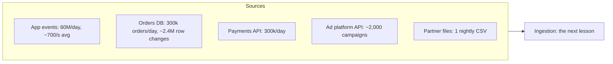

# Sources and Volume

Step 2 of the framework takes about four minutes: find out where the data comes from and how much of it there is. Done well, it settles half the architecture before you draw a box. Done badly, it is either skipped or turns into five minutes of arithmetic that changes nothing.

## The Problem

You have just finished requirements for the meal-kit company from [Requirements Gathering](03-requirements-gathering.md). The interviewer says: "OK, so how big is this?"

Dana, who has now learned to ask about consumers, answers: "300,000 orders a day, so... a few hundred thousand records. That's small. We can use whatever." She moves on.

The interviewer lets it go, then asks three questions over the next ten minutes. "Where do the orders come from, exactly: the app or the database?" "The payments provider's API only lets you read 100 requests a minute, and finance wants two years of history. How long does the backfill (the one-time load of that history) take?" "Your marketing events land every five minutes. How big are those files?"

Dana can't answer any of them, because "300,000 orders" was the only number she had. It was the least interesting one. The events the app produces are 200 times more numerous than the orders. The database can't be queried freely without hurting the website. The payments API's rate limit decides how you load history. None of that shows up unless you first list the sources, and only then do the math.

Two jobs, then:

1. **Name the sources**, and for each one, learn how its data can be read.
2. **Estimate volume**, but only the numbers that change a decision.

## Source Types

A **source** is any system your pipeline reads from but does not control. The type of source tells you how the data can be read, and that matters more than how big it is.

| Source | How you read it | What it gives you | The catch |
|---|---|---|---|
| **Operational database** (Postgres, MySQL) | Full snapshot, repeated queries on an `updated_at` column, or the change log ([CDC](../03-architecture-patterns/04-cdc-patterns.md)) | Current state of rows; with CDC, every change including deletes | Queries compete with the live application. Without CDC you miss deletes, and a row updated twice between runs shows only its last state. |
| **Event stream** (app and server events) | A collector service writes events into a log such as Kafka | Every action, with its event time (when it happened, not when it arrived) | At-least-once delivery means duplicates. Events arrive late and out of order. The schema is whatever the app team shipped. |
| **Files** (CSV or JSON drops, partner exports) | You poll a bucket or SFTP folder, or are notified when a file lands | Whole datasets, usually daily | Late or missing files, half-written files, columns that change without notice. |
| **Pull API** (a payments or ad platform) | You call it on a schedule and page through results | Records in the vendor's shape | **Rate limits** (a cap on requests per minute), pagination, and history only as fast as the quota allows. |
| **Push webhook** (a vendor calls you) | You expose an endpoint and they send events | Near-real-time notifications | If your endpoint is down, the vendor retries a few times, then gives up. You still need a pull path to repair gaps. |

Skip memorizing the table. Remember the four questions it answers, which work for any source:

1. **Push or pull?** Who decides when data moves? If you pull, you control the schedule but not the load you put on the source. If they push, you must be up when they call.
2. **Snapshot or changes?** Does the source hand you the full current state each time, or just what changed? Changes are cheaper, but only if deletes and corrections are included.
3. **What goes wrong with it?** Duplicates, late arrivals, gaps, reordering. Each has its own fix ([Late-Arriving Data](../02-core-concepts/08-late-arriving-data.md), [Deduplication at Scale](../02-core-concepts/09-deduplication-at-scale.md)), and you only need to name the problem here.
4. **Who owns it, and can it change under you?** A schema owned by another team is a risk. That is the idea behind [Data Contracts](../02-core-concepts/07-data-contracts.md).

> [!TIP]
> Say the source out loud with its type, not just its name: "The orders live in Postgres, so I'd read them with CDC, off a replica where the version allows it, so I don't load the production primary." One sentence shows the interviewer you thought about how the data is read.

## Only the Math That Changes the Design

Before any arithmetic, ask which decision it would change. For data systems, nearly every estimate feeds one of five decisions:

| Decision | The number that drives it | Where the line is |
|---|---|---|
| Is a message log (Kafka) needed, and how many partitions? | Peak MB/s into the system | Plan about 10 MB/s per partition, so a few MB/s fits in one. Hundreds of MB/s means a real cluster. |
| One machine, or a distributed engine? | GB per run, divided by per-core throughput | Tens of GB per run can fit on one machine. Terabytes per run cannot, comfortably. |
| What does storage cost, and which tier? | Daily volume times retention | Cheap object storage holds tens of TB for hundreds to low thousands of dollars a month. The expensive tier is serving, not the lake. |
| How big are the files? | Volume per write interval | Under about 128 MB per file you have a [small-files problem](../02-core-concepts/01-partitioning.md). |
| Where are the hot spots? | Share of traffic held by the biggest key | One key with 30% of the traffic overloads one partition no matter the total. See [Partitioning](../02-core-concepts/01-partitioning.md). |

If a number cannot move one of these, skip it. The full conversion tables (events per day to events per second, JSON to Parquet, Kafka and Spark rules) live in [Key DE Numbers](../02-core-concepts/10-key-de-numbers.md). Use them, don't reproduce them from memory.

The method is the same for every source:

1. **Count the unit.** Events, rows, files, requests per day.
2. **Convert to a rate.** A day is 86,400 seconds, call it 100,000 for speed, so per-day divided by 100,000 is a per-second figure that runs about 15% low. Use 86,400 when you want it tight. Multiply by 2 to 3 for a peak on steady traffic, 5 to 10 for spiky traffic.
3. **Multiply by size.** Bytes per record turns events into MB/s and GB/day.
4. **Multiply by retention.** Daily volume times days kept is stored volume. Divide by 5 if it ends up as Parquet (a compressed columnar file format).
5. **Say what it implies.** One sentence. This is the part that gets scored.

### Velocity, volume, growth

The three words interviewers use are separate questions:

- **Volume** is how much data exists or arrives: GB per day, TB in total.
- **Velocity** is how fast it arrives, and how spiky: events per second, average and peak.
- **Growth** is how the first two change over time.

Growth is the one candidates forget. Ask: "Is this growing, and how fast?" Then check whether your design survives **10x**. Most designs do, with configuration changes (more partitions, more workers). If yours needs re-architecture at 3x, say so. Growth also matters for partition counts: you can add partitions later but cannot remove them, and adding them changes which key goes to which partition.

## Worked Example: The Meal-Kit Sources

Continue from the requirements: 300,000 orders a day, two years of raw history for data science, a budget around $20k a month. Ask the interviewer for any numbers you don't have, and say "assume" when they don't know.

### Step 1: Name the sources

| Source | Type | What it feeds |
|---|---|---|
| App and website events (views, clicks, add-to-cart) | Event stream | Marketing campaign results, churn model |
| Orders database (orders, order lines, status changes) | Operational database | Ops packing counts, finance revenue |
| Payments provider | Pull API plus webhook | Finance reconciliation to the cent |
| Ad platforms (spend per campaign) | Pull API | Marketing spend per campaign |
| Warehouse partner (packed and shipped boxes) | Nightly file drop | Ops, delivery slots |

The diagram is deliberately only the left edge. The boxes after it come in [High-Level Architecture](05-high-level-architecture.md).

### Step 2: Estimate each source

**App events.** Assume 2 million daily active users at 30 events each: 60 million events a day, about 700 a second on average. Marketing sends a promo email to the whole list a few times a month and traffic spikes, so use 10x: **about 7,000 events a second at peak**. At 0.5 KB per JSON event, that is 3.5 MB/s at peak and **30 GB a day**.

**Orders database.** 300,000 orders a day, but each order touches several rows: the order, its lines, and a handful of status changes (paid, packed, shipped, delivered). Say 8 row changes per order, 1 KB each: 2.4 million changes and **about 2.4 GB a day**, under 30 changes a second. The existing table is about 200 GB; copying it once, from a replica at 100 MB/s, is roughly 35 minutes. The change rate is trivial, so what you say about this source should be about how to read it, not how big it is.

**Payments.** One record per payment, 1 KB: 300,000 a day, **about 0.3 GB**. The API has a **rate limit**: say 100 requests a minute, each returning up to 100 records.

**Ad platform.** About 2,000 active campaigns, one spend row each per hour: 48,000 rows a day. Negligible in size.

**Partner file.** One CSV, around 50 MB a night.

**Total: about 33 GB a day**, and roughly 90% of it is app events.

### Step 3: Read off the design implications

This is where the estimate pays for itself. Each line below changes something.

- **Ingest is small.** 3.5 MB/s at peak is well under the 10 MB/s planning figure for *one* Kafka partition. Streaming is available, not forced. The reason to pick it, if you do, is the 15-minute freshness requirement from ops, not the volume. Say that out loud: volume does not force streaming; freshness does.
- **Batch compute is trivial.** Reading 33 GB a day at about 20 MB/s per core is 33,000 / 20 = 1,650 core-seconds, under half a core-hour. A small cluster or even one machine does the nightly job. If the interviewer asks "do you need Spark?", the honest answer is "I'd want it for the two-year backfill, not the daily run".
- **Storage is a rounding error.** 33 GB a day for two years is about 24 TB raw. As Parquet, about 5x smaller: 5 TB. At roughly $23 per TB-month, that is about $110 a month, against a $20k budget. Do not spend interview time optimizing storage; spend it on correctness.
- **File size will bite.** Land events in object storage every 5 minutes and each write is 30 GB / 288 intervals, about 100 MB of JSON, or about 20 MB of Parquet. That is far below the 128 MB to 1 GB target. Either land hourly (about 250 MB of Parquet per file) or compact later (merge small files into big ones). The 15-minute freshness for ops can come from a separate small path.
- **The API rate limit decides the backfill.** Finance wants two years of payments: 730 days at 300,000 is about 219 million records. At 100 requests a minute with 100 records each, you read 10,000 records a minute, 14.4 million a day. **That is 15 days** of continuous pulling for the backfill, and it competes with the daily sync for the same quota. The design implication: ask the provider for a bulk export for history and use the API only for new data.
- **Hot spots are about campaigns.** One big launch campaign could carry a large share of clicks. Key by user or order, not campaign, or one partition gets the traffic of the whole promo.
- **Growth passes.** If the company grows 10x, app events become 600 million a day, about 7,000 a second on average and 70,000 at peak, or about 35 MB/s. That is still a few partitions and a small cluster.

The conclusion you would say aloud: "About 33 GB a day, peaks of 7k events a second. The volume is modest, so the hard parts will be correctness and the payments reconciliation, plus the backfill, not scale."

## Estimating the Output Side

The framework table says "inputs and outputs". Output volume is rarely the hard part, so spend ten seconds on it. Ask two things: how big are the served tables, and how many people query them at once?

Here: the serving tables are small. Orders by delivery slot is about 300,000 rows a day; campaign results are a few thousand rows. Twenty-five consumers in total, most refreshing a dashboard every few minutes. A warehouse answers queries over a few GB in 1 to 10 seconds ([Key DE Numbers](../02-core-concepts/10-key-de-numbers.md)). You can stop there. Output volume becomes a topic when the prompt says "serve millions of users" or "sub-second queries"; if the interviewer's prompt does, size it the same way.

## In the Interview

**When.** Right after requirements. Take 3 to 5 minutes. If you have spent more than six, you have drifted into over-precision.

**How.**

1. List the sources first, each with its type. Ask the interviewer to confirm.
2. Ask for the one or two numbers you need, usually users or orders per day. Don't ask for everything: "I'll assume 0.5 KB per event; tell me if it's very different."
3. Do the arithmetic aloud, round hard, and end every figure with what it implies.
4. Flag anything unusual: a rate limit, an event-size outlier, a spike pattern.

**What interviewers listen for:**

- You name sources by how they are read, not only by what they are.
- You notice which source dominates the volume, and which one dominates the *difficulty* (often a different one).
- Peak, not just average.
- You say when a number is a guess.
- The numbers change something you say next. If the estimate ends and the design is the same either way, it was filler.

**Phrases that work:**

- "That's the average. Promo days spike about 10x, so I'd size ingest for 7k a second."
- "The data is small enough that streaming isn't forced by volume. It's the 15-minute freshness requirement that would push me there."
- "Two years of history at this API's rate limit is about two weeks, so I'd ask for a bulk export."

> [!NOTE]
> If the interviewer says "assume it's huge", still do the math. "Huge" tells you which row of [Key DE Numbers](../02-core-concepts/10-key-de-numbers.md) to look at. Ask for the actual order of magnitude: millions a day, or billions?

## Common Mistakes

> [!WARNING]
> **Estimating only the business number.** "300,000 orders" is the headline. The events behind them, the row changes and the history are what you size. Estimate each source separately, then add.

> [!WARNING]
> **Treating every source as a table.** A pull API with a rate limit, a webhook that can miss a call, and a file that arrives late all behave differently from a table. Name the type.

> [!WARNING]
> **Sizing for the average.** 700 events a second on average and 7,000 at the promo peak are different systems.

> [!WARNING]
> **Math that changes nothing.** Computing storage to three digits when the answer is "a few hundred dollars" wastes minutes. Pick the numbers that can move a decision, and stop.

> [!WARNING]
> **Forgetting history.** The daily rate is not the whole story. The backfill (two years of data, loaded once) often has its own bottleneck, as in the rate limit above.

> [!WARNING]
> **Skipping growth.** One question, "how fast is this growing?", changes how much headroom you leave. Ask it once.

## Key Takeaways

- List the sources first and name each by type: database, event stream, file, pull API, webhook. The type tells you how it is read and how it fails.
- Estimate each source separately, convert to a per-second peak and a per-day volume, then multiply by retention. Use the conversions in [Key DE Numbers](../02-core-concepts/10-key-de-numbers.md); do not rebuild them.
- Do only the math that changes a decision: message log or not, one machine or a cluster, file sizes, storage cost, hot keys.
- End every number with its implication. Volume rarely forces streaming; freshness does. Rate limits, not volume, often decide backfills.
- Check growth once: does the design survive 10x with configuration changes?

## Where to Go Next

- [High-Level Architecture](05-high-level-architecture.md): step 3, turning sources and requirements into boxes and arrows.
- [Key DE Numbers](../02-core-concepts/10-key-de-numbers.md): the conversion tables and rules of thumb used above.
- [Ingestion Patterns](../02-core-concepts/02-ingestion-patterns.md): how each source type is read in practice.
- [CDC Patterns](../03-architecture-patterns/04-cdc-patterns.md): reading a database's change log.
- [Backfill and Reprocessing](../02-core-concepts/03-backfill-and-reprocessing.md): loading history safely.
