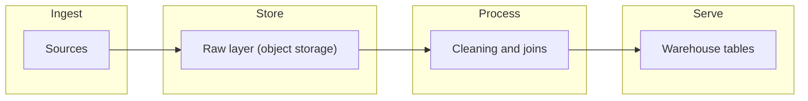
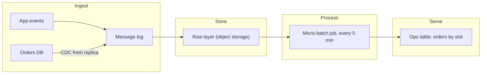
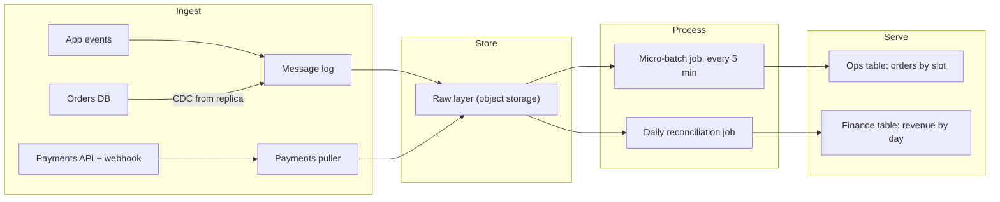
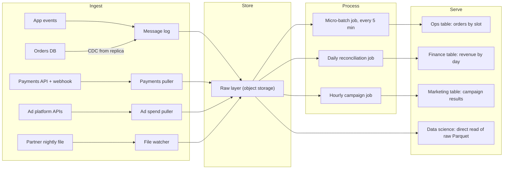

# High-Level Architecture

Step 3 is the one the interviewer remembers: the diagram. It gets 10 to 15 minutes, and it is where you either look like someone who has built these systems or someone reciting tool names. This lesson gives you a drawing method that works for almost any data prompt, and the Bad → Good → Great technique that every breakdown in this course uses to compare options.

## The Problem

Dana is back at the whiteboard for the meal-kit company. Requirements are written, the numbers are done: about 33 GB a day, peaks of 7,000 events a second, four consumers who want different things. The interviewer says, "Go ahead and design it."

Dana draws boxes labelled "Kafka", "Spark", "Snowflake" and "Airflow" across the top and connects them with arrows. Forty seconds later it looks professional.

The interviewer asks: "Which of these does finance's exact revenue table come from? And where does ops's 15-minute table come from?" Dana points at Snowflake for both. "So the same path serves a table that must be fresh in 15 minutes and a table that must be exact to the cent?" There is no good answer, because the diagram was built from tool names, not requirements. Nothing on it traces back to anything the consumers asked for.

The fix has two parts:

1. **Start from the flow of data, not from tools.** Every data system does the same four jobs. Name those first.
2. **Add boxes only when a requirement demands them.** Each box should have a sentence beginning "because ops needs...".

## The Four Stages

Almost every data system you will be asked to design does four jobs in order:

| Stage | Job | Typical boxes |
|---|---|---|
| **Ingest** | Get data out of the sources and into your control | A collector service, a CDC connector, an API puller, a file watcher, a **message log** (a durable, ordered, replayable queue such as Kafka) |
| **Store** | Keep a durable copy so you can reprocess later | **Object storage** (cheap, durable file storage such as S3, GCS or Azure Blob, where files are written whole, not edited in place), usually holding raw data as received |
| **Process** | Clean, join, deduplicate and aggregate | Batch jobs, stream processors, SQL transformations |
| **Serve** | Put the result where consumers can read it quickly | A warehouse table, a dashboard's backing store, an API, a feature store |

Two ideas make this more than a list.

**Raw first.** The store stage keeps data close to how it arrived (the "raw layer", or "bronze" in the [medallion](../03-architecture-patterns/03-medallion-architecture.md) pattern). It looks like waste, since you store the same events twice, once raw and once cleaned. It is the cheapest insurance in data engineering. When a bug in your cleaning logic is found three weeks later, you rerun from raw. Without it, you ask the source to resend, and some sources cannot. At the numbers from [Sources and Volume](04-sources-and-volume.md), two years of raw history is about 24 TB as JSON, or about 5 TB as Parquet, which costs roughly a hundred dollars a month.

**Serving is its own stage.** The place you process data is rarely the place consumers should read from. A serving table is shaped for one set of questions and kept small. If you skip this, consumers query your messy intermediate data directly and every one of your internal changes breaks someone.

## Drawing It: Flow First, Then Boxes

The method has four moves. Do them in this order, aloud.

1. **Say the data flow as a numbered list.** One sentence per hop, before drawing anything. This is a verbal contract that the interviewer can correct cheaply.
2. **Draw the skeleton** with the four stages as empty lanes.
3. **Add one requirement at a time.** Pick the requirement, add only the boxes and arrows it needs, and say why.
4. **Stop when every requirement is covered** and no box lacks a reason.

### Step 1: The numbered data flow

For the meal-kit company, the interviewer's first confirmation takes about 60 seconds:

1. The app sends events to a collector, which writes them to a message log.
2. The orders database is read through its change log (CDC) and those changes go into the same log.
3. The payments provider and the ad platforms are pulled by scheduled jobs. The warehouse partner's nightly file is picked up from a bucket.
4. Everything is written untouched into object storage (the raw layer).
5. Processing jobs clean, deduplicate and join the raw data into modeled tables.
6. The modeled tables are published to the warehouse, where each consumer reads their own table.

The list says nothing about streaming versus batch, partition counts or schemas. Those come later ([Pipeline Design](07-pipeline-design.md), [Data Model Design](06-data-model-design.md)). This step settles where data goes; how often and in what shape come later.

### Step 2: The skeleton

You could draw this for any prompt. It is the starting point, not the answer.

### Step 3: Build it one requirement at a time

Take the requirements from [Requirements Gathering](03-requirements-gathering.md) and add consumers in order of how much they constrain the design. Ops goes first: its 15-minute freshness is the tightest.

**Requirement 1: Ops sees orders by delivery slot within 15 minutes.** Two things change. Orders must arrive continuously, not nightly, so the orders database gets a CDC connector and the app events get a message log. And processing must run often, so a **micro-batch job** (a small batch job run every few minutes) recomputes the ops table. The *volume* here (about 30 row changes a second) does not force a message log. The 15-minute freshness does, by requiring continuous delivery with replay if a job fails.

**Requirement 2: Finance's revenue matches the payments system to the cent.** The word "matches" tells you which source to trust. Revenue comes from the payments provider, not from app events, and the two are reconciled. That adds a pull path for payments (plus a **webhook** receiver, an endpoint the provider calls when something happens), and a daily reconciliation job that compares paid orders against payments. It lands in its own finance table, with a different schedule and a different correctness bar from ops. Two ingest paths, two serving tables, deliberately not merged.

**Requirement 3: Marketing sees conversions and spend per campaign, hourly.** Conversions come from app events already in the raw layer. Spend comes from the ad platforms, which is a new pull source with a rate limit. A new job joins the two, hourly, because marketing said so.

**Requirement 4: Data science keeps two years of raw events.** This costs no new boxes. The raw layer already holds them, and the new work is giving the team read access and keeping files in a **columnar format** ([Parquet](../02-core-concepts/10-key-de-numbers.md): each column's values stored together, so scans read only the columns they need). If raw lands as JSON, a periodic job converts it to Parquet. Saying "no new box needed, the raw layer already satisfies this" shows you designed for reuse. Reading raw directly is the one deliberate exception to "serve from its own stage": data science wants raw.

Putting requirements 3 and 4 in:

Every box now traces to a sentence. If the interviewer points at the hourly campaign job, you say "marketing needs conversions and spend per campaign, hourly". If a box has no such sentence, delete it.

> [!TIP]
> Say the requirement out loud before each addition: "Now ops. Fifteen-minute freshness, so I need continuous ingest of orders." Interviewers can follow your logic even if they disagree, and redirect you early.

## Bad → Good → Great

Some boxes have no obvious right answer. "How do orders get from the database into the platform?" has several, and the best depends on what you need. Interviewers want to see you compare options and arrive at a choice.

The technique used in this course is a ladder of three answers for a single decision:

- **Bad**: works on a good day, and fails the requirement or hurts something else. You name it so you can say why you moved on.
- **Good**: meets the requirement and is what many working teams do. Reasonable, with known gaps.
- **Great**: closes the gaps of Good in a way that is worth its extra cost.

Don't memorize three answers per question. Practice saying *what is wrong with the simple option* and *what the improvement costs*. In the interview you rarely narrate all three; you go to Good or Great and mention what you ruled out. The breakdowns in this course write them out so you can see the reasoning.

Here is one ladder, for the ops requirement: **get orders from the production database into the platform, fresh within 15 minutes**.

#### Bad Solution: Query the production database directly, on a schedule

A job runs `SELECT * FROM orders` every 10 minutes against the production database and rebuilds the ops table.

The orders table is about 200 GB. Reading it at 100 MB/s takes roughly 35 minutes ([Sources and Volume](04-sources-and-volume.md)), so a run never finishes inside its own 10-minute interval. Those reads also compete with customers placing orders on the website, so the load that powers the dashboard can slow down checkout. And you keep no history: if the table changes between runs, the previous state is gone.

#### Good Solution: Incremental extract on `updated_at`, from a read replica

Every 5 minutes a job reads only rows where `updated_at` is later than the last run's high-water mark (the largest `updated_at` already copied), from a **read replica** (a copy of the database kept in sync for reading, so the production primary stays unloaded). New and changed rows are appended to the raw layer.

Only about 30 changes a second arrive, so each run reads a few thousand rows and finishes in seconds. The primary is untouched. Many teams run exactly this, and for a first version it is defensible.

Where it falls short. It cannot see **deleted rows**, because a deleted row has no `updated_at` to find. If a row changes twice between runs, you see only the final version, losing an intermediate state like "packed" that ops may want to time. It depends on every code path updating `updated_at` correctly. A forgotten update path means silently missing data, which is the worst kind of failure for a finance consumer.

#### Great Solution: CDC from the replica into the message log

A CDC connector (Debezium is the common open-source one) reads the database's change log and publishes every insert, update and delete as an event into the message log. A job lands those events in the raw layer, and processing rebuilds current state from them. Reading the log from a replica works on MySQL and on recent PostgreSQL versions (16 and later); on older setups the connector reads the primary, which is a light load. See [CDC Patterns](../03-architecture-patterns/04-cdc-patterns.md).

Every change is captured, deletes included, and the order is preserved, so you have the whole history of each order's status. No `updated_at` convention to trust. The log is replayable, so a failed job reruns from where it stopped rather than guessing. And the message log you are adding anyway for app events is now shared, which keeps the diagram smaller.

What it costs. Someone runs and monitors the connector. The initial copy of the existing 200 GB table (a **snapshot**) needs care so it lines up with the change stream. A schema change in the orders table has to be handled instead of ignored ([Data Contracts](../02-core-concepts/07-data-contracts.md)).

At 30 changes a second, Good is enough for ops alone. The case for Great is the combination: ops wants status timings, finance needs every cancellation reconciled exactly, and data science wants a faithful history. Say so: "For ops alone I'd take the `updated_at` extract. Finance's exactness and status history push me to CDC." Picking the most advanced option with no reason is a mistake too.

| Option | Meets 15-min freshness | Sees deletes and every change | Load on production | Operating cost |
|---|---|---|---|---|
| Bad: query production | No (35-min read) | No | High | Lowest |
| Good: `updated_at` extract from replica | Yes | No | None | Low |
| Great: CDC from replica | Yes | Yes | Almost none | Medium |

## In the Interview

**When.** After requirements and sources, with 10 to 15 minutes: one on the numbered flow, about ten building the diagram requirement by requirement, the rest checking it.

**How.**

1. State the data flow in numbered hops and ask, "Does this match how you picture it?"
2. Draw the four lanes. Label them Ingest, Store, Process, Serve if the board has room.
3. Add requirements in order of how much each constrains the design. Name each requirement as you add its boxes.
4. For any decision with real alternatives (how data is ingested, where the raw layer lives, one serving store or several), say two options and the one you pick. That is the Bad/Good/Great reasoning, compressed into a sentence.
5. At the end, walk one record end to end: "An order is placed. The app writes a row. CDC puts it in the log. The five-minute job picks it up. It shows in the ops table within about 6 minutes." That walk catches missing arrows.

**What interviewers listen for:**

- The diagram answers *this* prompt's requirements, and you can name the requirement behind each box.
- Different consumers get different paths when their needs differ, instead of one pipeline for everyone.
- Raw data is kept, and you say why.
- You choose a source of truth for each number ("revenue comes from payments, not events").
- You name tools by role first ("a message log, say Kafka").
- You keep the diagram readable: ten to fifteen boxes is plenty. If one corner takes a minute to explain, save it for a deep dive.

**Phrases that work:**

- "Before I draw, here's the flow in six hops. Tell me if I've got a source wrong."
- "Finance and ops need different things, so they get different paths rather than one table with two refresh rates."
- "No new box for data science. The raw layer already holds the two years."

> [!NOTE]
> A diagram is not a design document. Leave out retries, alerting, schemas and cluster sizes for now. They come in steps 4, 5 and 7.

## Common Mistakes

> [!WARNING]
> **Drawing tool names first.** "Kafka, Spark, Snowflake, Airflow" is a shopping list, not a design. Name the job each box does, then, if asked, the tool.

> [!WARNING]
> **One pipeline for every consumer.** If freshness and correctness differ across consumers, the paths should too. A single path sized for the strictest consumer is wasteful; one sized for the loosest fails someone.

> [!WARNING]
> **No raw layer.** If everything is cleaned on the way in, a bug in the cleaning is permanent. Keep the raw data; it costs little.

> [!WARNING]
> **Reaching for the biggest option.** CDC and streaming can both be right, and both can be overkill. If the requirement and the numbers don't call for it, say you'd start with the simpler Good option and what would make you move up.

> [!WARNING]
> **Boxes without reasons.** A cache, a second database or a metadata tool that no requirement asked for reads as cargo-culting. Every box needs a "because".

> [!WARNING]
> **Skipping the serving stage.** Pointing consumers at the intermediate tables couples them to your internals. Publish small, stable tables for them.

## Key Takeaways

- Every data design is four stages: ingest, store, process, serve. Start by saying the data flow as numbered hops, then draw the empty skeleton.
- Add boxes one requirement at a time and name the requirement each time. If a box has no requirement behind it, remove it.
- Keep a raw layer in object storage so you can reprocess and backfill. Give consumers with different needs different paths and their own serving tables.
- Bad → Good → Great compares options for one decision: name the failing option, the workable one, and the better one with its cost. Pick the level your requirements justify, not the highest one.
- Save batch versus streaming, schemas and failure handling for their own steps. The first diagram answers "where does data go".

## Where to Go Next

- [Data Model Design](06-data-model-design.md): step 4, the tables the serving layer holds.
- [Pipeline Design](07-pipeline-design.md): step 5, how often and how reliably each box runs.
- [Ingestion Patterns](../02-core-concepts/02-ingestion-patterns.md): the ingest stage in more depth.
- [Medallion Architecture](../03-architecture-patterns/03-medallion-architecture.md): the raw, cleaned, modeled layering in full.
- [E-Commerce Warehouse](../05-breakdowns-core/03-e-commerce-warehouse.md): a complete breakdown that uses this method with Bad/Good/Great ladders at each decision.
