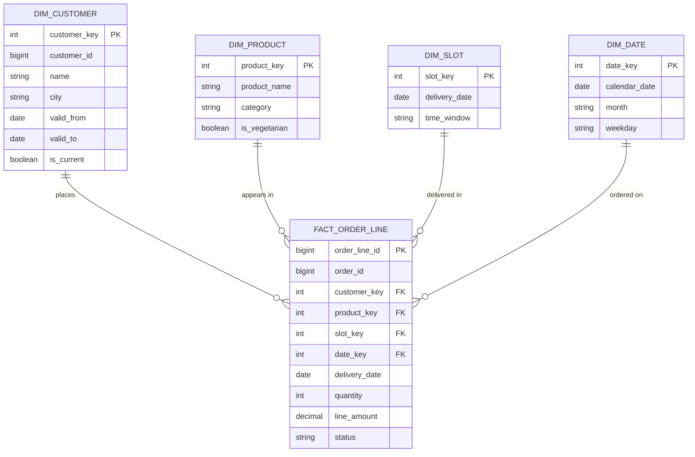
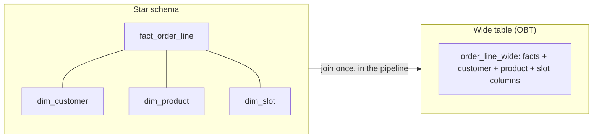

# Data Model Design

Step 4 gets only about five minutes, which makes it easy to skip. It is also where the interviewer finds out whether you build tables people can use. This lesson gives you a short list of decisions, in the order to make them: grain, facts and dimensions, history, shape, and layout.

## The Problem

Dana is at the whiteboard for the meal-kit company again. The architecture is drawn and the interviewer says, "Good. Now show me the tables ops and finance will read."

Dana writes one table: `orders`, with columns `order_id`, `customer_name`, `customer_city`, `item_name`, `item_price`, `quantity`, `delivery_slot`, `status`, `paid_at`. It looks reasonable. The interviewer asks three questions.

1. "What does one row in this table represent?" Dana hesitates. An order? An item in an order? If an order has four items, is `paid_at` repeated four times?
2. "A customer moves from Leeds to Bristol in March. Finance asks for revenue by city for last year. Which city do January's orders show?" Dana's table says Bristol for everything, because someone updated the customer's city in place. Last year's Leeds revenue has quietly moved to Bristol.
3. "Ops asks 'how many boxes for tomorrow's 6-8pm slot?' Walk me through the query." It scans two years of orders to find one day.

All three failures have the same cause: Dana designed the table around the data she had, not around the questions being asked. This lesson fixes that by modeling for the consumers.

## Model for the Consumers

A data model in an interview is the set of tables your **consumers** (the people and programs reading your output) will query, plus how they are laid out. It is not the schema of the source database. The source schema serves the application: many small writes, no duplicated data. Your tables serve analytical reads: big scans, grouping, and filtering by date.

Start from the requirements you wrote in [Requirements Gathering](03-requirements-gathering.md). Each row of the consumer table became a question. Pick one and write it as a sentence:

- Ops: "How many boxes do we pack for each delivery slot tomorrow?"
- Finance: "What was revenue by day, by customer city, last year?"

Those sentences tell you what the tables must contain. Everything below makes them correct and cheap to query.

> [!NOTE]
> You do not model the raw layer. Raw data is stored as it arrived, so its shape is the source's shape. Modeling happens in the cleaned and serving layers of the [previous lesson's](05-high-level-architecture.md) architecture. Say so: "Raw stays as received. I'll model the cleaned and serving layers."

## Grain: Decide What One Row Means

The **grain** of a table is what exactly one row represents. "One order line" is a grain. "One order" is a different grain. "One customer per day" is another.

Decide it first and say it aloud, because every other decision depends on it. At the wrong grain, you either double-count or lose detail you can never get back.

Back to Dana's table. A meal-kit order has several items: 300,000 orders a day at about four items each is 1.2 million order lines a day. If each row is an order line, then `paid_at` and `status` (which belong to the whole order) repeat on each line. Add up the "order total" column across lines and you count each order four times. If instead each row is an order, you cannot answer "how many of the vegetarian box were packed for the 6-8pm slot" because the items are folded away.

The rule of thumb: **choose the finest grain you will ever need to answer a question about, then aggregate upward.** You can always roll order lines up into orders, days or cities. You can never split an order total back into lines.

| Grain | One row is | Good for | Cannot answer |
|---|---|---|---|
| Order line | One item in one order | Items packed per slot, revenue by product | Nothing this platform asks |
| Order | One whole order | Revenue per customer, order counts | Which items were packed |

For the meal-kit platform, the main table gets the **order line** grain: one row per item in an order.

## Facts and Dimensions

Once the grain is set, you split columns into two kinds.

- A **fact** is a measurement of something that happened: quantity, price, amount paid. Facts are numbers you add up. A **fact table** has one row per event at the chosen grain, plus keys pointing at the dimensions.
- A **dimension** describes the thing the event involved: who the customer is, what the product is, what the delivery slot is. Dimension tables are small, wide and descriptive, and you filter and group by their columns.

Dana's single `orders` table mixed both. Splitting them gives this model:



This layout is called a **star schema**: one fact table in the middle with dimensions around it like points. The fact row also carries `delivery_date` so the table can be partitioned on it later. Ops's question is now one short query, and finance's is the same shape with `dim_customer` and `dim_date`:

```sql
-- Ops: boxes to pack, by slot, tomorrow
SELECT s.time_window, p.product_name, SUM(f.quantity)
FROM fact_order_line f
JOIN dim_slot s    ON f.slot_key = s.slot_key
JOIN dim_product p ON f.product_key = p.product_key
WHERE s.delivery_date = CURRENT_DATE + 1
GROUP BY s.time_window, p.product_name;
```

A **surrogate key** is an ID your warehouse makes up (here `customer_key`), separate from the **natural key** the source uses (`customer_id`). You need one as soon as a customer can have more than one row, which happens in the next section.

The star schema also tells you where each number lives. `line_amount` is a fact: you sum it. `city` is a dimension attribute: you group by it. When you are unsure which a column is, ask "would I add this up, or group by it?"

## Slowly Changing Dimensions: When a Dimension Changes

Dimensions are not frozen. Customers move, products get renamed, a product moves from "family boxes" to "premium". These are **slowly changing dimensions**, abbreviated **SCD**: dimension attributes that change rarely but whose changes matter. The question is what happens to old facts when an attribute changes.

Dana's second failure was this. The choice is between two techniques, called Type 1 and Type 2.

**Type 1: overwrite.** Update the row in place. The old value is gone.

| customer_key | customer_id | name | city |
|---|---|---|---|
| 10 | C-4417 | Priya | ~~Leeds~~ Bristol |

Cheap and simple. Every past order for Priya now shows Bristol. That is right if the old value was a mistake (a typo in a name), and wrong if you want history (revenue by city, as the city was at the time).

**Type 2: add a row.** Close the old row with an end date and insert a new row with the new value. Each version of the customer gets its own surrogate key.

| customer_key | customer_id | name | city | valid_from | valid_to | is_current |
|---|---|---|---|---|---|---|
| 10 | C-4417 | Priya | Leeds | 2024-01-12 | 2026-03-04 | false |
| 94021 | C-4417 | Priya | Bristol | 2026-03-04 | 9999-12-31 | true |

Orders placed before March 4 carry `customer_key = 10`, so they report Leeds. Orders after carry 94021 and report Bristol. Finance's question has the right answer without any special query, because the fact row already points to the version that was true at the time.

The cost is that the dimension grows. At 1.5 million customers where 5 percent change city in a year, that is about 75,000 new rows a year, which is trivial. Type 2 is cheap on storage for most dimensions. It is more work in the pipeline, since the load must close old rows and open new ones, and it must do this idempotently ([Pipeline Design](07-pipeline-design.md)).

| | Type 1 (overwrite) | Type 2 (new row) |
|---|---|---|
| Keeps history | No | Yes |
| Past facts show | The latest value | The value at the time |
| Use when | The old value was wrong, or nobody asks for history | A report must reflect what was true then |
| Load complexity | Low | Higher (close and insert) |

Say the choice per column, not per table. "Name corrections are Type 1. City and customer tier are Type 2, because finance reports revenue by city as it was."

> [!TIP]
> There are further types (3, 4, 6). Do not volunteer them. Types 1 and 2 cover almost every interview. If asked about Type 3, say it keeps one previous value in an extra column, good for "current and prior" only, and move on.

## Star Schema or One Big Table

A **wide table**, also called a **one big table** (OBT), flattens the facts and dimensions into one table by joining them ahead of time. Every row has the order line plus the customer's city, the product's category and the slot's time window in the same row.



Which one you serve depends on who reads it:

| | Star schema | Wide table (OBT) |
|---|---|---|
| Query shape | Joins at query time | No joins; filter and group |
| Who it suits | Analysts writing varied SQL | Dashboards, ML features, fixed questions |
| Storage | Small; dimension values stored once | Larger; dimension values repeated on every row |
| Changing a dimension | Update one small table | Rewrite many fact rows |
| Risk | Wrong join gives wrong numbers | Stale or inconsistent copies of dimension values |

At our scale cost does not decide this: two years of order lines are about 900 million rows, roughly 130 GB uncompressed, so even the wide copy is small. Who reads it decides. Ops opens one dashboard that asks the same question every few minutes. Give them a wide table and no joins. Finance and marketing analysts write new queries every week. Give them the star.

The strong answer uses both: "The cleaned layer holds the star, because it is the clean source of truth. For the ops dashboard I'd publish a wide serving table built from it, so the dashboard has no joins and cannot get a join wrong." The star is the modeled layer; the wide table is the serving layer for one consumer.

> [!NOTE]
> If asked "why not normalize?": the source database already is normalized. Analytics reads wide scans, and joins on large tables cost more than the duplicated bytes.

## Layout at a Glance: Partition and Cluster Keys

A model also has a physical layout, and one decision there changes cost and speed more than any other: how the fact table is split up on disk.

A **partition** key divides the table into separate slices, usually one folder or segment per value, so a query that filters on that key reads only the matching slices and skips the rest. A **cluster key** (also called sort key or clustering) orders the rows inside each slice so that related rows sit near each other, and queries that filter on it skip blocks of data. Partitioning is the coarse cut; clustering is the fine one.

Choose both from the access pattern, not from the data:

| Question | Pick |
|---|---|
| What do queries filter on almost every time? | Partition key (usually a date) |
| What do they filter or join on next? | Cluster key |
| Does the partition give files of a sensible size? | If not, use a coarser key |

For the order-line fact, ops always asks about one delivery date and finance asks about ranges of order dates. Those are different columns, which is a real tension. The usual answer: partition by the date most queries use (the delivery date, since ops runs every few minutes and finance only daily), and cluster by `product_key` or `customer_key`. Finance's range queries still work; they just read more.

Check the size, because it is easy to over-partition. (Layout syntax differs by engine, and some table formats and warehouses can manage clustering for you. The reasoning below does not change.) 1.2 million lines a day at roughly 150 bytes is 180 MB a day, about 40 MB once compressed as Parquet. A daily partition would produce files well below the 128 MB to 1 GB aim in [Key DE Numbers](../02-core-concepts/10-key-de-numbers.md), which is the small-files problem. At this volume, partition by month and cluster by date inside it, or let the warehouse's clustering do the work. Say the number aloud; that is the reasoning the layout question wants.

Hot keys, skew and picking keys for streaming are covered in [Partitioning](../02-core-concepts/01-partitioning.md). For step 4, you need only the table above and one sentence of justification.

## In the Interview

**When.** After the architecture, about five minutes. Do not write every column. Write the tables that matter, their grain, and the decisions that are not obvious.

**How.**

1. Say which layer you are modeling: "Raw stays as received. I'll model the cleaned layer and the serving tables."
2. For each key table, say the grain in one sentence: "`fact_order_line`: one row per item in an order."
3. Split into fact and dimensions. Draw the star with three or four dimensions, not twelve.
4. Name the dimension attribute that changes, and the SCD type: "City is Type 2, so revenue by city is as-of-then."
5. Say what each consumer reads: "Ops reads a wide table partitioned by delivery date. Analysts read the star."
6. State the partition and cluster keys and why, with the size check.

**What interviewers listen for:**

- You state the grain before you list columns, and the grain matches the question.
- You can tell a fact from a dimension without looking.
- You ask whether history matters before choosing an SCD type, and choose per column.
- You shape the serving table for the consumer instead of handing everyone the same structure.
- You choose partition keys from the filter that dominates the queries and check file sizes.

**Phrases that work:**

- "Before columns, the grain: one row per order line."
- "I'd keep the star as the source of truth and publish a wide table for the dashboard."
- "Does anyone need the city as it was at order time? Then it's Type 2."
- "Ops filters on delivery date, so I partition on that and cluster by product."

> [!TIP]
> If the prompt is a warehouse design ("design the data warehouse for an e-commerce company"), the model is the main answer and may deserve more than five minutes. Flex, as noted in [The Delivery Framework](02-delivery-framework.md). See the [E-Commerce Warehouse](../05-breakdowns-core/03-e-commerce-warehouse.md) breakdown for that case.

## Common Mistakes

> [!WARNING]
> **No stated grain.** If you can't say what one row is, you can't say whether a SUM is right. Say it first, every time.

> [!WARNING]
> **Mixed grains in one table.** Order-level columns (`order_total`, `paid_at`) sitting beside line-level columns get summed once per line. Keep each measure at the grain of the row it sits in.

> [!WARNING]
> **Overwriting a dimension that has a history question.** Updating the customer's city in place erases last year's Leeds revenue. Ask "will anyone report by this attribute as it was?" before choosing Type 1.

> [!WARNING]
> **Type 2 everywhere.** Versioning every column of every dimension grows complexity for no benefit. A corrected typo is Type 1. Apply Type 2 only to attributes someone reports on over time.

> [!WARNING]
> **Modeling the source's schema.** Copying the application's normalized tables into the warehouse hands consumers a join puzzle. Model the questions, not the app.

> [!WARNING]
> **Partitioning by a column nobody filters on, or at too fine a grain.** A partition per customer, or per hour for 40 MB a day, yields millions of tiny files. Partition by the dominant filter and check the size.

## Key Takeaways

- Model for the consumers: start from the questions in your requirements, and state the grain of each table (what one row means) before listing columns. Choose the finest grain you will need and roll up from there.
- Facts are the numbers you add up; dimensions are what you group and filter by. A fact table surrounded by dimension tables is a star schema.
- When a dimension attribute changes, Type 1 overwrites and loses history; Type 2 adds a row with validity dates and keeps it. Choose per column, based on whether anyone reports "as it was".
- Keep a star as the clean source of truth, and serve a wide table to consumers with fixed questions. The star wins on flexibility, and the wide table wins on predictability.
- Choose partition and cluster keys from the dominant query filter, and check file sizes against the numbers. Depth is in the partitioning lesson.

## Where to Go Next

- [Pipeline Design](07-pipeline-design.md): step 5, how these tables get loaded, including idempotent loads of SCD Type 2.
- [Partitioning](../02-core-concepts/01-partitioning.md): partition and cluster keys in depth, skew and hot partitions.
- [Late-Arriving Data](../02-core-concepts/08-late-arriving-data.md): what happens when a fact arrives after the dimension version it belongs to has changed.
- [Data Contracts](../02-core-concepts/07-data-contracts.md): keeping the serving tables stable for their consumers.
- [E-Commerce Warehouse](../05-breakdowns-core/03-e-commerce-warehouse.md): a full breakdown that models orders, customers and products.
