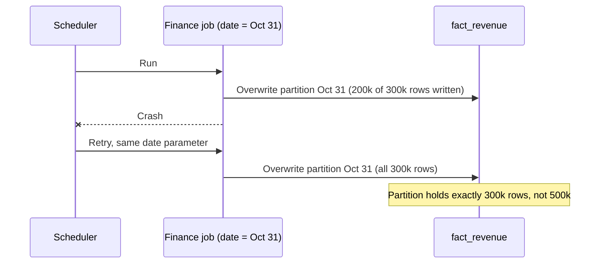
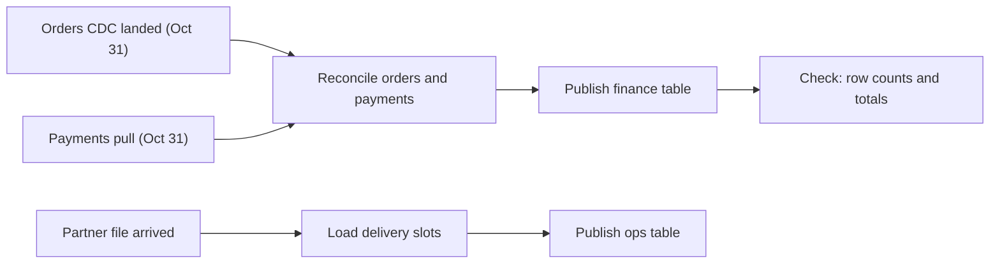
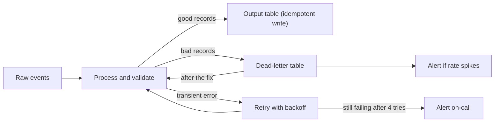

# Pipeline Design

Step 5 is where the boxes on your diagram start running, and where interviewers find out whether you have operated a pipeline or only drawn one. You get about five to eight minutes. This lesson covers the four decisions to make in that time: batch or streaming for each path, how to make a rerun safe, how jobs wait on each other, and what happens when something breaks.

## The Problem

Dana's architecture for the meal-kit company is drawn and the tables are modeled. The interviewer says, "Good. It's 2 a.m., the daily finance job dies halfway through. Walk me through what happens."

Dana says, "Airflow retries it." The interviewer nods and asks what the retry does. The job had already inserted the first 200,000 of that day's 300,000 order rows into the finance table. The retry starts from the top and inserts all 300,000 again. Revenue for the day is now 167% of the truth, nobody has been alerted, and finance will notice on Thursday.

The second question is worse. "The payments pull was late tonight. When does the finance job run?" Dana's job is scheduled for 2:00 a.m. It ran at 2:00 a.m. against yesterday's partial payments and reported a clean success.

Both failures have the same root: Dana designed the happy path. A pipeline design is mostly an answer to "what if it runs twice, runs early, or dies in the middle?"

## Batch or Streaming, Path by Path

Your architecture has several paths from source to consumer, and each can make its own choice. A **batch** job processes a bounded chunk of data (an hour, a day) and then stops. A **streaming** job runs continuously and processes events as they arrive. In between sits the **micro-batch**: a small batch run every minute or few minutes. It is how most "near real time" requirements are met.

Don't pick one for the whole system. Pick per path, starting from that path's freshness requirement from [Requirements Gathering](03-requirements-gathering.md), and choose **the slowest option that still meets it**. Slower is cheaper, simpler to debug and easier to rerun.

For the meal-kit platform:

| Path | Freshness needed | Choice | Why |
|---|---|---|---|
| Ops table (orders by slot) | 15 minutes | Micro-batch every 5 minutes | About 30 row changes a second is small. A 5-minute cycle leaves two more cycles of slack inside 15. |
| Finance revenue | Next morning, exact | Daily batch | Correctness matters, speed doesn't. The payments provider only settles once a day anyway. |
| Marketing campaigns | 1 hour | Hourly batch | Ad platforms refresh their numbers about hourly, so a faster job mostly rereads the same numbers. |
| Raw layer landing | Continuous | Streaming ingest (message log to files) | Cheap, always-on copying. No business logic to get wrong. |

Nothing here needs a stream processor with windows and state. Streaming earns its place when the freshness target is seconds, or when an action must follow the event (block a fraud payment, update a live leaderboard). It costs an always-on cluster, state to checkpoint and recover, and a harder way to fix mistakes. It pays off for sub-minute freshness with real business logic, not for fifteen minutes.

> [!TIP]
> Say the reasoning, not only the choice: "Ops wants 15 minutes. A 5-minute micro-batch meets that with a normal batch job, so I'm not paying for a stream processor." Interviewers hear a trade-off in that sentence, and you can switch if they say the target is actually 30 seconds.

## Idempotency: Make Every Rerun Safe

Back to Dana's 2 a.m. failure. Jobs fail, get retried, get rerun by hand, and get replayed after a bug fix. Your design must assume every step will run more than once.

An **idempotent** step gives the same end result whether it runs once or five times. This is the most important property of a pipeline, because it turns "the job failed halfway" from an incident into a non-event: just run it again.

The enemy is a plain `INSERT` that appends. Run it twice and you have two copies. There are three standard ways to avoid that.

### 1. Overwrite the partition

Make each run responsible for exactly one slice of the output, and make the run replace that slice. The finance job for 31 October does not "add October 31 rows". It does "make the October 31 partition equal to this result".

```sql
INSERT OVERWRITE fact_revenue PARTITION (revenue_date = '2026-10-31')
SELECT ... FROM raw_orders JOIN raw_payments ...
WHERE order_date = '2026-10-31';
```

(This is Spark and Hive syntax. The idea exists almost everywhere, with different spelling: Iceberg and Delta Lake tables accept it through Spark, Delta also has `replaceWhere` for a range, and BigQuery replaces a partition by loading into it with a truncate setting or by running `DELETE` and `INSERT` in one transaction. Check your engine's overwrite mode: Spark's default can overwrite the whole table when you give it no partition value.) Run it once or five times and the partition ends up identical. For dated batch outputs this is the simplest and best default, and the one to reach for first.

Two conditions make it work. The job's **input must be pinned** to its date range (October 31's orders), not "everything up to now", otherwise a rerun at a different time reads different data. And the **swap must be atomic**: consumers see the old partition or the new one, never half of it. Table formats (Iceberg, Delta Lake) give you this by committing the change as one new table version, and a warehouse partition replace is atomic too. With bare files, write to a staging path and then move it into place. That works where a directory rename is atomic (HDFS), but not on object storage, where a "move" is a copy followed by a delete and readers can see a half-finished state.

### 2. MERGE on a key (upsert)

Overwriting a partition fits when output is organized by date. It fits poorly when the output is a table of entities that change over time, such as the current state of each order. For that, use an **upsert**: write a row if its key is new, update it if the key exists. SQL calls this `MERGE`.

```sql
MERGE INTO orders_current t
USING new_changes s ON t.order_id = s.order_id
WHEN MATCHED THEN UPDATE SET status = s.status, updated_at = s.updated_at
WHEN NOT MATCHED THEN INSERT ...;
```

Apply the same batch of changes twice and the second pass finds every `order_id` already present, with identical values. Nothing doubles. The same trick makes SCD Type 2 loads from [Data Model Design](06-data-model-design.md) safe: key the new dimension version on `(customer_id, valid_from)`, and a rerun matches the row it already wrote instead of adding another.

One catch: if the same key appears twice with different values in a single batch, `MERGE` can fail or pick one at random. Take the latest change per key first.

### 3. Deterministic keys for streaming and append-only writes

A stream cannot overwrite "this hour" because it never knows the hour is over. Instead, give every output row a key derived from its content (such as the event's own ID) so that writing it twice lands on the same row, either through an upsert into the sink or through deduplication downstream. This is how an at-least-once stream behaves like exactly-once: duplicates arrive, but they collapse onto one key. How deduplication works at scale, and what it costs in state, is covered in [Deduplication at Scale](../02-core-concepts/09-deduplication-at-scale.md). In step 5, name the key and move on.

### Which to use

| Situation | Use | Watch out for |
|---|---|---|
| Daily or hourly batch output, partitioned by date | Partition overwrite | Pin the input range; swap atomically |
| Table of entities updated over time (order status, customer dimension) | MERGE on the business key | Duplicate keys inside one batch |
| Continuous stream, at-least-once source | Deterministic event key, upsert or dedup | State size of dedup; key must be stable across retries |

A bonus follows from this design. A job that takes its date as a parameter and overwrites that date's output is also a backfill tool: to fix three bad days, run it for those three days. Backfills have their own complications (cost, load on sources, downstream consumers) and are covered in [Backfill and Reprocessing](../02-core-concepts/03-backfill-and-reprocessing.md).



## Dependencies and Scheduling

The second half of Dana's problem: the finance job ran at 2:00 a.m. because a clock said so, and the data it needed wasn't there.

Jobs in a pipeline depend on each other. The finance reconciliation needs the day's orders (from CDC) and the day's payments (from the payments pull). Model this as a **DAG** (directed acyclic graph): a set of tasks with arrows meaning "must finish before", and no loops. An **orchestrator** (Airflow, Dagster, Prefect and similar) runs the DAG, tracks which tasks succeeded, and retries or reruns them.



Three rules for scheduling that interviewers like to hear:

- **Trigger on data, not only on time.** "Run at 2 a.m." assumes everything upstream finished by 2 a.m. A task that waits for its inputs (a *sensor*, or an event emitted when upstream finishes) runs when the data is really there. Keep a clock only as the earliest start time.
- **Give every wait a timeout and an alert.** If the partner's nightly file hasn't arrived by 04:00, the job should not wait forever, nor run with nothing. It should page someone, or publish yesterday's data marked as stale.
- **Work backwards from the deadline.** If finance needs the table by 07:00 and the job takes 40 minutes after the payments pull, the pull must finish by 06:00 at the latest. That arithmetic belongs in your SLA discussion; see [Monitoring and SLAs](09-monitoring-and-slas.md).

Each run should be tied to a **data interval** (the slice of event time it is responsible for, such as "October 31"), not to the wall-clock moment it started. That is what makes the partition overwrite above work, and why a rerun three days later still does the right thing.

## When Things Break

Don't try to list every failure. Sort them by what you do about them, because there are only a few responses.

| Failure | Example | Response |
|---|---|---|
| **Transient** (goes away on its own) | A source API returns a 503; a warehouse connection drops | Retry automatically |
| **Persistent for the whole job** | Source down for an hour; credentials expired | Retry a few times, then fail loudly and alert |
| **Bad records, good job** | One event has a null `order_id` or an unparseable timestamp | Set the record aside, keep processing the rest |
| **Bad data that looks fine** | Upstream starts sending prices in cents instead of dollars | Quality checks on output; stop publishing, alert |
| **Missing or late input** | Partner file doesn't arrive; payments pull is late | Wait with a timeout (sensor), alert, or publish marked stale |
| **Duplicate delivery** | The message log redelivers events after a consumer restart | Idempotent writes; dedup (see [Deduplication at Scale](../02-core-concepts/09-deduplication-at-scale.md)) |

### Retries

Retry transient failures, and do it politely: wait longer after each attempt (**exponential backoff**: say 1 minute, then 2, then 4) with a little random jitter so a hundred failed tasks don't all hit the recovering source at the same second. Cap it at three to five attempts, then fail the task and alert. Retrying forever turns an outage into a silent stall.

This is safe only because your steps are idempotent. Say it that way: "retries are safe because each write is a partition overwrite."

### Dead letters

A pipeline reading 7,000 events a second will sooner or later meet one event it cannot handle: a malformed JSON body, a missing key. Such an event is called a **poison message** because retrying it will fail the same way every time. You have three options, and two are wrong:

- Crash on it. One bad event now stops the whole stream.
- Skip it silently. You lose data and never learn why.
- **Send it to a dead-letter queue (DLQ).** The event goes, untouched and with the error reason and a timestamp, to a separate topic or table. The main flow continues.

Check the DLQ regularly. Alert on its size or rate (a sudden jump means an upstream change broke something), look at what is in it, fix the cause, and replay the fixed events through the normal path. Replay is safe because of idempotency again. Dead letters apply to batch too: a bad-records table beside the output table, with a count in the job's final check.

> [!NOTE]
> A tiny trickle in the DLQ (say, 0.01% of events) is normal. A spike to 5% is an incident. The alert threshold is part of the design.

### Putting it together



## In the Interview

**When.** After the data model, about five to eight minutes. If the high-level design already settled batch versus streaming, don't repeat it; say "as decided earlier" and spend your time on failure handling.

**How.**

1. For each path, name the cadence and tie it to the freshness number: "Ops: 5-minute micro-batch to meet 15 minutes."
2. For each write, name the idempotency mechanism: "Finance overwrites a date partition. Orders-current uses MERGE on `order_id`."
3. Describe dependencies by data, not by clock: "Reconciliation waits on both the orders partition and the payments partition."
4. Walk one failure end to end, as you would a postmortem: "Job crashes midway, retried with the same date, overwrite makes the result identical."
5. Name what happens to bad records, and what pages a human.

**What interviewers listen for:**

- You ask "what if this runs twice?" before they do.
- You choose batch, micro-batch or streaming from a freshness number, and can say why you did not pick faster.
- You can name an idempotency mechanism per write path, not just the word.
- Jobs wait on data rather than on a clock, and every wait has a timeout.
- Failures are sorted into retry, dead-letter, or alert, rather than "we'll add retries".

**Phrases that work:**

- "Every write here is keyed or overwritten, so a retry or a replay can't double-count."
- "I'd start with micro-batch. If the target tightens to under a minute, this path moves to a stream processor."
- "The job takes its date as a parameter, so rerunning a day is the same as backfilling it."
- "A bad record goes to a dead-letter table with the reason. I'd alert if more than 0.1% of a run lands there."

> [!TIP]
> Keep it short when the system is simple. For a nightly job with one source, "date-partitioned overwrite, retry three times, alert on failure" is a full answer. Save the longer walk for the paths where the interviewer pushes.

## Common Mistakes

> [!WARNING]
> **"Airflow retries it" as the whole answer.** A retry of a non-idempotent job duplicates data. The retry is only safe because of the write pattern underneath, so describe the write pattern.

> [!WARNING]
> **Streaming everywhere.** Putting every path on a stream processor because it sounds modern adds cost and failure modes where a 5-minute batch would meet the target. Match the cadence to the freshness number.

> [!WARNING]
> **Scheduling by the clock alone.** "Runs at 2 a.m." quietly reports success on partial inputs. Wait on the data, with a timeout, and alert when the wait ends.

> [!WARNING]
> **Reading "everything up to now".** A job whose input range floats gives a different answer each time it runs, so reruns and backfills cannot reproduce results. Pin the input to the run's data interval.

> [!WARNING]
> **Crashing or dropping on a bad record.** Crashing makes one malformed event an outage; dropping silently hides data loss. Dead-letter it, count it, and alert on the rate.

> [!WARNING]
> **Unbounded retries.** Retrying forever hides an outage and hammers a struggling source. Back off, cap the attempts, then alert.

## Key Takeaways

- Choose batch, micro-batch or streaming per path, from that path's freshness requirement, and pick the slowest option that meets it. Most "near real time" asks are a 5-minute micro-batch.
- Assume every step runs twice. Make it safe by overwriting a date partition, upserting with MERGE on a business key, or writing with a deterministic key.
- Pin each run's input to a data interval and take the date as a parameter. Reruns and backfills then become the same operation.
- Trigger jobs when their inputs are ready, not at a fixed time, and give every wait a timeout and an alert.
- Retry transient errors with backoff and a cap, send poison records to a dead-letter queue, and alert on the rates.

## Where to Go Next

- [Deep Dives](08-deep-dives.md): step 6, where the interviewer picks one of these (late data, correctness, failure) and goes deeper.
- [Deduplication at Scale](../02-core-concepts/09-deduplication-at-scale.md): keys, state and the cost of removing duplicates in a stream.
- [Backfill and Reprocessing](../02-core-concepts/03-backfill-and-reprocessing.md): rerunning history safely, and what it does to sources and consumers.
- [Late-Arriving Data](../02-core-concepts/08-late-arriving-data.md): what a date-partition overwrite does when events for October 31 show up on November 2.
- [Monitoring and SLAs](09-monitoring-and-slas.md): step 7, how you know these jobs are healthy and on time.
