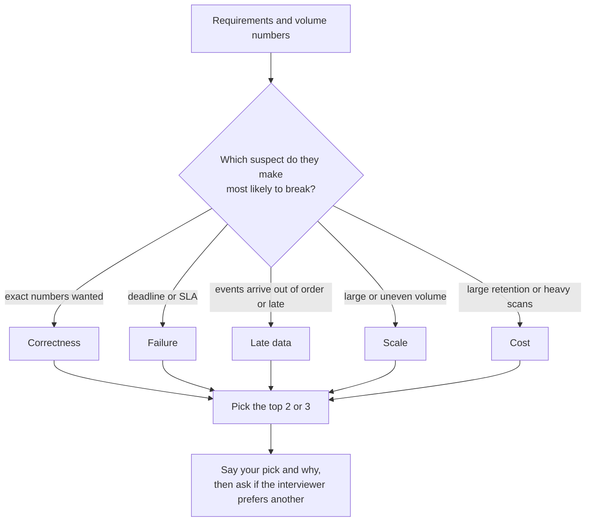

# Deep Dives

By step 6 your design is on the whiteboard and the interviewer stops asking "what's next?" and starts asking "what if?". This is the part of the round that separates candidates who can draw a pipeline from candidates who have run one. You get about ten to fifteen minutes, and you spend them on two or three topics, not on everything.

## The Problem

Dana has finished the meal-kit platform. Requirements, volume, architecture, tables and pipeline are all done, with a few minutes of margin. The interviewer says: "Where do you think this design is weakest?"

Dana pauses and says, "Maybe the Kafka cluster? We could add more partitions." The interviewer asks why. Dana says the volume might grow. But the volume she estimated herself was about 700 events a second on average and 7,000 at the promo peak, which a small cluster handles with room to spare. She picked the first scary-sounding component instead of the part of her design that could actually fail.

The interviewer tries a second angle: "Finance says the revenue number was off by 0.4% last month. How would you find out why?" Dana's design has no answer, because she never thought about reconciling against the payments system. Her minutes ran out on a problem nobody had.

Two things went wrong. She did not know which topics deserve depth, and she waited to be asked. A **deep dive** is a stretch where you go one level below the architecture diagram on one topic, for example how to avoid double-counting after a replay. This lesson is about choosing those topics and running the conversation.

## The Usual Suspects

Every data system can break in a handful of ways. Five of them cover most deep dives you will be asked, in nearly any prompt. Learn them as a checklist you run against your own design.

| Suspect | The interviewer's question | What to look for in your design |
|---|---|---|
| **Scale** | "What if volume grows 10x?" or "One customer is far bigger than the rest." | The component that breaks first; skew (one key getting far more data than the others) |
| **Correctness** | "How do you know the numbers are right?" | Duplicates, reconciliation against a source of truth |
| **Late data** | "An order is corrected three days later." | What a closed day or window does when new facts arrive |
| **Failure** | "The job dies halfway" or "the source is down for 6 hours." | Recovery path, blast radius, how you find out |
| **Cost** | "This is costing $40k a month." | The scan, the always-on cluster, the retention that dominates the bill |

Here is what each means in the meal-kit design, so the checklist is not abstract.

**Scale.** At 700 events a second on average (7,000 at peak) the load is easy. Ask where 10x lands, not whether it fits. If one city produces a third of all orders and you partition work by city, one worker holds a third of the data while the others idle. That is **skew**: uneven load across partitions or workers, which makes one slow task decide the speed of the whole job. The fix is usually a different or compound key (city plus a hash of the order ID), or splitting the heavy key into a few sub-keys and combining the results. Keys are covered in [Partitioning](../02-core-concepts/01-partitioning.md).

**Correctness.** Events arrive at least once, so some arrive twice. Counting them naively inflates revenue. The second half is **reconciliation**: comparing your output with an independent source of truth and investigating the gap. For finance, the daily revenue table is checked against the payments provider's settlement totals, and a difference over, say, 0.01% opens a ticket. Removing duplicates at scale is in [Deduplication at Scale](../02-core-concepts/09-deduplication-at-scale.md).

**Late data.** An order is refunded on 2 November for a purchase on 29 October. The October 29 partition was written four days ago and finance already read it. Do you overwrite it, store the correction as a new row, or both? Details are in [Late-Arriving Data](../02-core-concepts/08-late-arriving-data.md).

**Failure.** Beyond "the job retries", ask what a failure costs. If the payments pull is down for six hours, does the finance job wait (and alert), or does it run on partial data and report a clean success? How far does the damage spread, and how do you rerun history once the source is back ([Backfill and Reprocessing](../02-core-concepts/03-backfill-and-reprocessing.md))?

**Cost.** Say the 33 GB of events a day have been kept as raw JSON for two years, about 24 TB. A dashboard query that scans all of it on a scan-priced engine at roughly $5 to 6.25 per TB costs $120 to 150 per run. Refreshed hourly (720 runs a month), that is roughly $86,000 to 108,000 a month for one chart, a bill the architecture drawing never hinted at. The fix is a small serving table, or partition pruning, which is how the dashboard reads a day instead of two years. More in [Cost Optimization](../02-core-concepts/05-cost-optimization.md).

> [!NOTE]
> These five are a starting point, not a complete list. Prompts add their own: multi-tenancy for a platform, privacy for personal data, schema changes for anything with many producers. The method below works for those too.

## Choosing What to Dive Into

You cannot cover five suspects in twelve minutes, and you should not try. You pick the two or three that this system is most likely to fail on. Three questions rank the candidates.

1. **What did the requirements say matters most?** A requirement stated in numbers is a bet you made. "Exact to the cent" makes correctness a certain deep dive. "Ready by 07:00" makes failure and late data certain.
2. **What did the volume math show?** If the estimate said 700 events a second, scale is not your dive. If it said 7 GB per minute at peak, it might be.
3. **Which part of your own design are you least sure of?** Every design has one decision that rests on an assumption, like "source events are never reordered". That assumption is where interviewers will push, so push first.

For the meal-kit platform the numbers point clearly: finance wants exactness (correctness), corrections arrive after day-close (late data), and the nightly finance job has a morning deadline (failure). Volume is small, so scale is a one-sentence mention. A good answer to "where is this weakest?" is therefore:

> "Volume is small, so I'm not worried about scale. The risk is finance. Revenue has to match the payments system to the cent, and refunds land days after the day is closed. I'd like to go into how corrections flow in and how we reconcile. Does that work, or is there another area you'd rather see?"

That answer gave one sentence of reasoning, named two topics, and handed the interviewer a way to redirect, all in about twenty seconds.

## Running a Deep Dive

Once the topic is chosen, the same four moves work for any of them. Think of it as a small version of the delivery framework.

1. **Restate the problem with a number.** "Refunds arrive up to 30 days after purchase, about 2% of orders. The revenue table for a closed day can therefore change." A number turns a vague worry into a size.
2. **Show the naive answer and why it fails.** "If we only ever append new rows, a refund added on 2 November never changes 29 October's total, so that day's revenue is overstated."
3. **Present the options and their cost.** Two or three, in a table or a short ladder, the same way you did for architecture decisions ([High-Level Architecture](05-high-level-architecture.md)).
4. **Choose one, name what you give up, say how you would notice it going wrong.** The last part is what makes it senior-sounding. It connects to [Monitoring and SLAs](09-monitoring-and-slas.md).

### A worked example: late corrections

Dana's finance table has one partition per revenue date. Refunds arrive after that date has closed.

| Option | How it works | Falls short because | Cost |
|---|---|---|---|
| **Ignore it** | Day is final once written | Revenue for 29 October is wrong forever | None, and the number is wrong |
| **Recompute the old partition** | Refund triggers a rerun of that date's overwrite job | Finance sees a past number change, with no record of why | One extra job run per affected date |
| **Corrections as new rows (append-only adjustments)** | Refund lands as a negative row dated 2 November, linked to the original order; reports sum both | Reports must include the adjustments, "revenue as of the close" needs a cutoff filter | Slightly more complex queries |
| **Both** | Recompute for the live dashboard; keep the adjustment rows as an audit trail; freeze the month-end close | More moving parts | Worth it for finance, overkill for ops |

You would say: "For finance I'd keep adjustments as separate rows so a closed month never silently changes, and I'd recompute only the operational dashboard. The cost is that finance queries must include the adjustments table. I'd check it by reconciling the sum of both against the payments provider every morning."

It stayed on one problem, compared real options, and tied back to the requirement ("exact to the cent").

## Leading Versus Following

There are two ways a deep dive starts.

**Interviewer-led.** They pick the topic ("what if the source sends duplicates?"). Your job is to follow, answer the actual question, and avoid sliding into the topic you prepared. If you notice you are three minutes into something they didn't ask about, stop and ask: "Is this the direction you wanted, or would you like me to go back?"

**Candidate-led.** They say "pick whatever you think is riskiest." This is a gift. You get to show judgment about what matters, and you can steer toward the topic you know best (as long as it is a real risk). Most mid-level candidates wait for the interviewer to lead and then react well. Most senior candidates have already said, during the earlier steps, "I'll come back to this in the deep dives," and they do.

Here is a habit that makes this easy: while you design, keep a private list of **parked risks**. Each time you make an assumption, write it down: "assumes payments never revises a settled amount", "assumes city is a good partition key". When step 6 arrives, the list is your menu. Saying "I parked three things earlier, the one that worries me most is..." also shows the interviewer your process.

| Situation | What you do |
|---|---|
| Interviewer names a topic | Follow it. Use the four moves. Do not redirect. |
| Interviewer says "you choose" | Offer your top pick with the reason; name a second; invite redirect. |
| Interviewer interrupts mid-dive | Treat it as signal. Answer in a sentence, then ask if they want you to continue the previous point. |
| You do not know the answer | Say what you would measure or check first, then reason from principles. |

> [!TIP]
> When you do not know, the answer "I haven't run this at that scale, so I'd start by measuring X and Y to see which dominates" is much stronger than a confident guess. Interviewers are checking how you reason when the answer isn't memorized.

## Depth by Level

The topic can be the same at every level. What changes is how far down you go, who started it, and what you bring up that was not asked.

Take the question "the source sends the same order event twice."

| Level | What a good answer sounds like |
|---|---|
| **Mid-level** | "Deduplicate on the event ID before writing. The table is keyed by event ID, so a repeat is ignored." A correct mechanism, asked for, with a sensible tool. |
| **Senior** | Raises it before being asked. Explains where the dedup state lives, how long you keep IDs (a day? seven?), what happens to a duplicate arriving after that window, and how the daily reconciliation catches whatever slips through. Quantifies the memory or storage cost. |
| **Staff+** | Asks who produces the events and proposes making them idempotent at the source or adding the event ID to the producers' [data contract](../02-core-concepts/07-data-contracts.md). Weighs the engineering cost of dedup everywhere against fixing the source once. Plans for how this changes if a second producer is added next year. |

All three are good answers for their level. Do not try to answer at a level above the one you are interviewing for by adding length. A mid-level candidate who reaches for staff-level organizational reasoning in the middle of a mechanism question tends to leave the mechanism half answered. Get the mechanism right first, then add one more layer if there is time.

## In the Interview

**When.** After pipeline design, for about ten to fifteen minutes. If time ran short earlier, the interviewer may open with a deep dive and you can fold monitoring into it. Always leave three minutes at the end for [Monitoring and SLAs](09-monitoring-and-slas.md).

**How.**

1. Before step 6 begins, name your parked risks: "Three things I'd like to cover if there's time: late refunds, reconciliation with payments, and what the nightly job does when payments is late."
2. For each topic, use the four moves: size it, show the naive answer failing, compare options, choose and name the cost.
3. Keep each dive to four or five minutes. If you are going past six, ask whether the interviewer wants more or wants to move on.
4. Close each dive with how you would detect trouble: a check, a metric, an alert.
5. Finish by tying back to a requirement: "That keeps finance within the 0.01% reconciliation tolerance we set at the start."

**What interviewers listen for:**

- You can name the most likely failure of your own design without being asked.
- You choose depth over coverage: two topics well, not five lightly.
- Each answer includes a number: a size, a window, a threshold, a cost.
- You state what you give up, not only what you gain.
- You check for direction rather than monologue.

**Phrases that work:**

- "The simple version fails like so. Here are two fixes and what each costs."
- "I'm assuming the source never revises a settled amount. If that's wrong, this changes like so."
- "I'd know it was broken because the daily reconciliation gap would exceed 0.01%."
- "Is this the depth you wanted, or should I move to another area?"

## Common Mistakes

> [!WARNING]
> **Diving into the technology you like instead of the risk you have.** A ten-minute tour of Kafka internals for a system that peaks at 7,000 events a second uses your best minutes on your safest topic. Choose from the requirements and the volume math.

> [!WARNING]
> **Waiting to be asked.** If the first question about your design's weakness comes from the interviewer, you have told them you did not see it. Park your assumptions as you go and offer them at step 6.

> [!WARNING]
> **Covering five topics in a sentence each.** Breadth without a mechanism, a number or a trade-off sounds like a list of buzzwords. Two real dives beat five names.

> [!WARNING]
> **Presenting only the best answer.** Skipping the naive option and the comparison makes your choice look like an opinion. Show why the simple version fails and what the alternative costs.

> [!WARNING]
> **Defending instead of reasoning.** When the interviewer pushes back, they are testing whether you update. "That's a fair point, in that case I'd change X" is a better response than repeating your position.

> [!WARNING]
> **Ending a dive without a signal.** "And we'd monitor it" is not an ending. Name the check or metric and what it would show if the problem occurred.

## Key Takeaways

- A deep dive goes one level below the diagram on one topic. Expect two or three in ten to fifteen minutes.
- The usual suspects are scale, correctness, late data, failure and cost. Pick the ones your own requirements and volume numbers make most likely to break.
- Run each dive in four moves: size the problem, show the naive answer failing, compare options with their costs, then choose and name what you give up and how you would notice trouble.
- Lead when you can. Keep a list of parked risks while you design, and offer the top one before you are asked. When the interviewer leads, follow, and check direction.
- Level changes depth, not topic: mid-level gets the mechanism right, senior says what could still go wrong, and staff asks whether to fix it here or at the source.

## Where to Go Next

- [Monitoring and SLAs](09-monitoring-and-slas.md): step 7, how you present the checks that tell you each deep dive's problem has occurred.
- [Top 15 Mistakes](10-top-15-mistakes.md): the most common ways candidates lose points across all steps.
- [Late-Arriving Data](../02-core-concepts/08-late-arriving-data.md): the late-data suspect in depth.
- [Deduplication at Scale](../02-core-concepts/09-deduplication-at-scale.md): the correctness suspect in depth.
- [Partitioning](../02-core-concepts/01-partitioning.md): skew and keys, for the scale suspect.
- [Cost Optimization](../02-core-concepts/05-cost-optimization.md): the cost suspect in depth.
