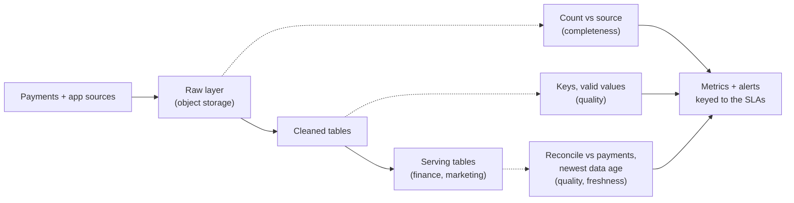

# Monitoring and SLAs

The last step of the round is also the one candidates skip when time runs short, and it is where an interviewer decides whether you have ever been woken up by a pipeline. You get about three to five minutes. In that time you turn the requirements from the start of the round into a handful of promises, and show how you would know when one of them is broken.

## The Problem

Dana has finished the meal-kit platform. The deep dives went well, and there are four minutes left. The interviewer asks: "How will you know this is healthy?"

Dana says, "We'd add monitoring. Dashboards in Grafana (a dashboarding tool), alerts on job failures, logs in a central place." The interviewer nods and asks a follow-up: "Last Tuesday the nightly job started at 02:00, ran in 40 seconds, and reported success. Finance opened the revenue table at 09:00 and it was empty for Monday. What did your monitoring show?"

Dana's monitoring showed green. The payments extract had returned zero rows because of an expired credential on the source side. The job did not fail. It happily loaded nothing, rebuilt the table from nothing and exited with code 0. Her alert was on job failures, and there were none.

Two things went wrong. She named tools instead of promises: she never said what "healthy" means in a number. And she watched the **pipeline** (did the job run?) instead of the **data** (is the table on time, complete and right?). Finance does not care that a job ran. Finance cares that the number is there by 07:00 and matches the payments system.

This lesson is about the data. You define what healthy means as a small set of **SLAs**, you say where each one is measured, and you say what happens when it is missed.

## The Three Data SLAs

You met the vocabulary in [Requirements Gathering](03-requirements-gathering.md), where freshness, completeness and correctness were quantified as requirements. Monitoring is where those numbers come back as promises. Three of them cover almost every system. "Quality" here is the correctness requirement plus basic validity checks on the values.

| SLA | The question it answers | Meal-kit example |
|---|---|---|
| **Freshness** | How old is the newest data a reader can see? | "The finance table is ready by 07:00 on 99% of days" |
| **Completeness** | Has all the data that should be there arrived? | "Every paid order in the payments system is in our table by 07:00; the daily count matches the provider's" |
| **Quality** | Is the data that arrived valid and correct? | "Daily revenue is within 0.01% of the payments provider's total" |

A few terms, because people mix them up:

- An **SLI** (service level indicator) is the number you actually measure, such as "minutes since the newest order was loaded".
- An **SLO** (service level objective) is the target for that number: "under 15 minutes".
- An **SLA** (service level agreement) is an SLO you have promised to someone, usually with consequences when missed.

In an interview, nobody expects you to police the difference. Say "SLA" for the promise and "metric" for the measurement, and make sure each SLA has a number, a consumer and a way to measure it.

### Freshness: measure from the data, not the clock on the job

The tempting freshness metric is "when did the job last finish?". That is exactly the metric that stayed green for Dana. A job can finish on time and write nothing new.

Measure the age of the **data itself**: the newest event time in the table, compared with now.

```sql
SELECT now() - MAX(order_placed_at) AS freshness
FROM serving.orders;
```

If the answer is 3 minutes, the table is fresh. If the answer is 9 hours at 09:00, the table is stale no matter what the scheduler says. For a daily table the same idea is "does the partition for yesterday exist, and does it have rows?".

One more wrinkle. A quiet table can look stale when nothing is wrong: no orders at 04:00 means a large gap between the newest order and now. For tables with gaps, compare against the **source's** newest record, not the wall clock. "We are 2 minutes behind the source" stays meaningful at 04:00; "we are 5 hours behind the clock" does not.

### Completeness: you need something to compare against

"All the data" means nothing without a reference. Pick the best reference you have:

| Reference | Example | Catches |
|---|---|---|
| The source's own count | Payments reports 301,204 orders for Monday; we loaded 301,100 (99.97%) | Dropped rows, partial loads |
| A control total | Sum of order amounts equals the source's total | Silent truncation |
| History | Mondays usually bring 280,000 to 320,000 orders; today brought 4,000 | Empty or tiny loads when no source count exists |

The third row is the one that would have caught Dana's empty table. A rule as simple as "yesterday's row count must be at least 50% of the same weekday last week" costs one query and prevents the worst embarrassments. It is also the weakest check, so prefer a real source count when you can get one.

### Quality: a few rules, and one reconciliation

Quality is where candidates over-reach with fifty checks. Name the few that protect the requirements you wrote down:

- **Not null and unique** on the keys: `order_id` is never null and never repeated at the table's grain (one row per order).
- **Valid values:** `status` is one of the known values, amounts are not negative, timestamps are not in the future.
- **Reconciliation**, the strongest check you have: compare the daily revenue with the payments provider's settlement total, as in [Deep Dives](08-deep-dives.md), and fail the check if the gap passes 0.01%.

Reconciliation catches errors none of the other checks can see, because it is the only one that compares you against an independent opinion.

## Where the Checks Sit

Checks belong at the boundaries between stages, not only at the end. A problem caught at the raw layer is a re-pull. The same problem caught by finance on Thursday is a day of trust lost.



Three checkpoints are enough to draw. The solid line is your data flow from earlier in the round; the dotted lines are the new part. Say it out loud as you draw: "completeness at raw, quality at cleaned, freshness and reconciliation at serving."

## Writing an SLA You Can Defend

A good SLA has four parts, and each one blocks a different objection.

1. **A metric.** "Freshness of `serving.orders`", not "the data is fast".
2. **A threshold.** "Under 15 minutes."
3. **A rate of success.** "On 99% of days." Not 100%, because nothing meets 100%.
4. **A consumer.** The SLA exists because someone acts on the data. If you cannot name them, you do not need the SLA.

Two worked ones from the meal-kit design:

- Finance: "`serving.daily_revenue` for day D exists by 07:00 on day D+1, on 99% of days, and reconciles to payments within 0.01%."
- Marketing: "`serving.campaign_stats` is no more than 60 minutes behind the app events, 99% of the time."

They differ, as they did in the requirements. One freshness number for everybody is the same mistake as in step 1.

### What 99% costs

Pick the percentage deliberately. For a daily deadline, 99% of days allows about 3 to 4 misses a year (365 × 1%, roughly 3.65). 99.9% allows less than one. Each extra nine usually costs real money: a standby extract, a second region, someone on call at 06:00. Your interviewer will respect a candidate who says "99% is fine here, because a late finance table is annoying, not dangerous. For payments-facing numbers I'd ask for more."

That allowance is called an **error budget**. If you have already missed twice this quarter, you stop shipping risky changes and fix reliability. You will rarely need it in a 3-minute answer, but one sentence on it signals experience.

## When a Check Fails: Block, Warn or Quarantine

An SLA is a number. A check is a gate. The question that separates experienced engineers is what the pipeline does when a gate fails.

| Behavior | What it does | Use it when |
|---|---|---|
| **Block** | Stop. The serving table keeps yesterday's version and the alert fires | Wrong data is worse than late data (finance, billing, anything audited) |
| **Warn** | Publish, but flag the table and notify the owner | Late data is worse than slightly wrong data (a marketing dashboard) |
| **Quarantine** | Publish the good rows and set the bad rows aside for inspection | A few bad records should not hold up millions of good ones |

For Dana's empty table, the right answer was **block**. The count check ("fewer than half of last Monday's rows") fails, the job refuses to overwrite the table, finance keeps seeing the prior good version with a banner that says "Monday is delayed", and someone is paged at 02:05 rather than discovered at 09:00. Records that cannot be parsed go to the dead-letter queue from [Pipeline Design](07-pipeline-design.md).

Choosing block or warn per consumer is a good use of your three minutes. It shows you thought about what a failure costs each consumer.

## What Observability Means Here

You will hear **observability** as a catch-all. For this lesson, it means being able to answer "why is it unhealthy?" without guessing. Four things get you most of the way:

- **Metrics per stage:** rows in, rows out, rows rejected, run duration, age of the newest data. Rejected rows are the most overlooked and the most telling.
- **Run history:** each run records its inputs, row counts and result, so "what changed since Friday?" has an answer.
- **Lineage:** which tables feed which, so when `cleaned.orders` is broken you know the finance table and two dashboards are affected before they tell you. See [Data Lineage](../02-core-concepts/04-data-lineage.md).
- **Logs** with a run ID, so one failure traces through the stages.

That is as far as you go in the round. How to choose what to alert on, thresholds, and avoiding on-call fatigue are mechanics, covered in [Monitoring and Alerting](../02-core-concepts/06-monitoring-and-alerting.md). In the interview, the one rule to state is: **alert on SLAs at risk, not on every task failure.** A retry that succeeded is not an incident. A freshness SLA that will miss its 07:00 deadline is.

## In the Interview

**When.** Step 7, the last three to five minutes. If you are short on time, still say three sentences: the SLAs, the one check that matters most, and what happens when it fails.

**How.**

1. Pull your requirements back up: "From the start, finance needs the number by 07:00 and within 0.01% of payments, marketing needs hourly."
2. Turn them into SLAs, one line each, with a number and a success rate.
3. Show where each is measured. Draw the three checkpoints or point at your diagram.
4. Say what happens on failure, per consumer: block for finance, warn for marketing.
5. End with the alert rule: "I'd page on a missed or at-risk SLA, not on individual job failures. The details of alert design are a topic of their own."

**What interviewers listen for:**

- Healthy is defined in numbers, tied to a named consumer.
- You measure the data (newest event time, row counts), not just whether the job ran.
- At least one reconciliation against an independent source.
- A stated behavior on failure, and a reason for it.
- Brevity. This is a summary of design you have already made, not a new design.

**Phrases that work:**

- "I'll write the requirements back as three SLAs: freshness, completeness, quality."
- "I'd measure freshness from the newest event in the table, because the job finishing tells me nothing about whether it wrote anything."
- "For finance I'd block the publish on a failed check. Wrong is worse than late."
- "Last night's row count versus the same weekday last week is a cheap way to catch an empty load."
- "I'd page on an SLA at risk, not on every retry."

**By level.** Mid-level: name the three SLAs with numbers and one check each. Senior: add where each is measured, block versus warn per consumer, and the cost of an extra nine. Staff: ask who owns each SLA, how consumers are told about a miss, and whether the SLA should be enforced at the source with a data contract. See [Data Contracts](../02-core-concepts/07-data-contracts.md).

## Common Mistakes

> [!WARNING]
> **Naming tools instead of promises.** "Prometheus, Grafana and PagerDuty" answers none of "what are you monitoring, and what number is a problem?" Tools are one clause at the end of the answer.

> [!WARNING]
> **Monitoring that the job ran, not that the data is right.** A job that succeeds with zero rows is the commonest silent failure in data work. Measure newest data age, row counts and reconciliation.

> [!WARNING]
> **A single SLA for every consumer.** Finance, marketing and data science want different things. One "data is fresh within 5 minutes" promise is too costly for two of them and not strict enough on correctness for the third.

> [!WARNING]
> **Promising 100%.** It signals you have not run production. State 99% or 99.9%, and say what the miss budget is.

> [!WARNING]
> **Fifty checks, no priority.** A long list sounds thorough and reads as unfocused. Choose the five that protect your stated requirements, and say which one blocks.

> [!WARNING]
> **Leaving out the failure behavior.** Detecting a problem is half the answer. If your check fires and the bad data publishes anyway, the check only tells you how wrong the table was.

## Key Takeaways

- Healthy means three promises, each with a number and a consumer: freshness (how old), completeness (how much), quality (how right).
- Measure the data, not the job. Newest event time, row counts against a reference, and a reconciliation against an independent source catch what a green scheduler cannot.
- Put checks at stage boundaries, and decide per consumer whether a failed check blocks the publish, warns, or quarantines the bad rows.
- A good SLA has a metric, a threshold, a success rate below 100%, and a named consumer. Each extra nine has a price.
- Alert on SLAs at risk, not on every task failure; the mechanics of alerts live in the core concepts module.

## Where to Go Next

- [Monitoring and Alerting](../02-core-concepts/06-monitoring-and-alerting.md): what to measure, alert design, and keeping on-call quiet.
- [Data Lineage](../02-core-concepts/04-data-lineage.md): knowing what a broken table affects.
- [Data Contracts](../02-core-concepts/07-data-contracts.md): enforcing quality at the source instead of discovering it downstream.
- [Top 15 Mistakes](10-top-15-mistakes.md): the most common ways candidates lose points across all seven steps.
- [Deep Dives](08-deep-dives.md): where the reconciliation and failure-handling checks come from.
- Related breakdowns: [Data Quality Monitoring Platform](../05-breakdowns-core/09-data-quality-monitoring.md) and [Real-Time Operations Dashboard](../05-breakdowns-core/04-real-time-dashboard.md), for monitoring and SLA sections in full.
