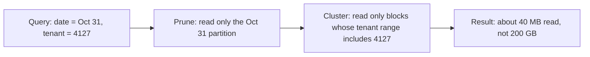

# Partitioning

Partitioning is the first physical decision in almost every data design, and interviewers use it as a quick test: do you know how data gets split up, and what goes wrong when it is split badly? This lesson covers why to partition, how to choose the key, and the three ways a good idea turns into a slow or expensive one.

## The Problem

Your team runs a clickstream pipeline for a B2B analytics product. About 5,000 customers (tenants) send events, and the pipeline lands about 200 GB a day of Parquet files in object storage. After a year, that is roughly 73 TB, the same figure used in [Key DE Numbers](10-key-de-numbers.md).

A support engineer asks: "Show me yesterday's events for tenant 4127." The files were written with no thought about layout, so the engine has to open every file to find out what is inside. It scans all 73 TB. On a scan-priced engine (one that bills per TB read, such as Athena or BigQuery on-demand) at about $5 per TB, that single question costs about $365 and runs for minutes.

Yesterday's data for a typical tenant is maybe 40 MB (200 GB over 5,000 tenants). The answer was small. The cost came from not being able to *skip* the rest.

Two more things go wrong at the same time:

- The nightly job that rebuilds the daily summary reads everything, because nothing says which files belong to which day.
- One tenant produces 40 percent of all events. Whichever worker gets that tenant's data finishes an hour after the others.

Partitioning fixes all three. It also introduces new ways to fail, which is why interviewers ask about it.

## What a Partition Is

A **partition** is a slice of a dataset, chosen by a key, that can be stored and processed on its own. In a lake or warehouse that usually means one folder per key value:

```text
events/
  event_date=2026-10-30/   part-0001.parquet  part-0002.parquet ...
  event_date=2026-10-31/   part-0001.parquet  part-0002.parquet ...
```

In a stream such as Kafka, a partition is one ordered log, and the key decides which log an event goes to. The idea is the same in both: **a key maps each record to a slice, and slices can be read, written and moved independently.**

Partitioning buys you two different things, and it helps to keep them apart:

1. **Skipping data (storage side).** A query that filters on the partition key reads only the matching folders. This is called **partition pruning**: the engine prunes (drops) every partition that cannot match, before reading any data.
2. **Spreading work (compute side).** Different partitions go to different workers, so a job runs in parallel. This works only if the slices are about the same size.

Most partitioning mistakes come from optimizing one and breaking the other.

## Choosing the Key

You choose a partition key from the **access pattern**, meaning the filters your consumers use on almost every query. This is the same rule as in [Data Model Design](../01-the-framework/06-data-model-design.md), which gave the short version. Here is the longer one.

There are three common kinds of key.

| Key | Looks like | Good at | Bad at |
|---|---|---|---|
| **Time** | `event_date=2026-10-31` | Time-range queries, retention (drop an old folder), reruns of one day | Queries with no time filter; "all events for tenant X" across a year |
| **Tenant / entity** | `tenant_id=4127` | Per-customer queries, per-customer deletes, isolation | Many small tenants (tiny files); one giant tenant (a hot partition) |
| **Hash** | `bucket = hash(user_id) % 64` | Even sizes; joins on the same key; spreading load | Range queries; humans reading the layout |

**Time is the default for batch data**, because nearly every analytical question has a date range and because pipelines run per day. It also makes reruns cheap: to redo October 31, you overwrite that one partition and leave the other 364 alone (the **partition overwrite** pattern from [Pipeline Design](../01-the-framework/07-pipeline-design.md)).

**Tenant** is tempting when queries are per customer, but it only works when tenants are few and similar in size. With 5,000 tenants it creates the over-partitioning problem described below.

**Hash** is the answer when you need even slices more than you need to find a particular value. A hash function turns a key into a number; taking it modulo N sends each record to one of N buckets, and because hashes are close to random, buckets come out about the same size. Kafka does this to pick a partition. Warehouses and Spark do it to split a join across workers.

### Combine, but carefully

You can use more than one level, such as `event_date` then `tenant_bucket`. Each level multiplies the number of partitions. Before adding a level, do the arithmetic in the next section.

For the clickstream, the sensible layout is this: **partition by event date, and handle tenant with clustering (below), not with a folder per tenant.** Say that, then justify it with numbers.

## Pruning in Action

Back to the support engineer's question, now with `event_date` as the partition key:

```sql
SELECT *
FROM events
WHERE event_date = DATE '2026-10-31'
  AND tenant_id = 4127;
```

The engine reads the folder names, sees that only `event_date=2026-10-31` can match, and ignores the other 364. It scans about 200 GB instead of 73 TB: 365 times less, or about $1 instead of $365.

Pruning only works if the engine can tell, from the query alone, which partitions to read. Two habits break it:

- **Wrapping the partition column in a function.** `WHERE DATE_FORMAT(event_date, 'yyyy-MM') = '2026-10'` hides the column from the planner in many engines. Write the range instead: `event_date >= '2026-10-01' AND event_date < '2026-11-01'`. Some table formats (Iceberg, for one) derive partitions from a column for you and prune on plain filters; do not assume your engine does.
- **Filtering on a different column that merely correlates.** If the table is partitioned by `event_date` but the user filters on `received_at`, nothing is pruned. Late data makes the two diverge. Pick the column people really filter on, or give them a view that exposes the partition column.

> [!TIP]
> When you propose a partition key, say what query it makes cheap: "I partition by `event_date` because the support queries and the nightly rebuild both filter on one day." Interviewers listen for the *because*.

## Over-Partitioning and Small Files

Now suppose a well-meaning teammate says: "Support is per tenant, so partition by date, hour *and* tenant."

Do the arithmetic aloud.

- 200 GB a day over 24 hours is about 8 GB an hour.
- Over 5,000 tenants, that is about 1.7 MB per tenant per hour.
- That is 24 x 5,000 = **120,000 partitions a day**, about 44 million a year, each holding one tiny file.

Object storage is priced and limited per request, and every request pays a 10 to 100 ms floor, as the numbers lesson explains. Reading 100 files one at a time at 50 ms is already 5 seconds before any data moves. Reading 120,000 files is mostly a listing problem. Writing them costs about $5 per million requests, and the engine's metadata (the list of partitions and files) grows until planning a query takes longer than running it.

This is the **small-files problem**: too many tiny files make listing and opening them dominate the query. The mirror image, too few giant partitions, kills parallelism. The target is the middle:

- **Files of 128 MB to 1 GB** for analytical data (the number from [Key DE Numbers](10-key-de-numbers.md)).
- **Partitions big enough to hold at least a few such files**, so a daily partition of 200 GB is about 800 files of 256 MB. That is healthy.

A quick test for any proposed key: **data per day divided by number of partitions per day.** If the answer is under about 1 GB, you have too many partitions.

| Layout | Partitions per day | Data per partition | Verdict |
|---|---|---|---|
| Date only | 1 | 200 GB | Good. About 800 files of 256 MB. |
| Date + hour | 24 | ~8 GB | Fine if you query by hour; otherwise unnecessary. |
| Date + hour + tenant | 120,000 | ~1.7 MB | Over-partitioned. Tiny files everywhere. |

### Two fixes when small files appear anyway

Small files do not only come from over-partitioning. A streaming job that commits every minute writes a small file per commit even into a sensibly partitioned table.

1. **Write bigger files**: buffer longer, or commit less often if freshness allows. Ask what freshness is needed before accepting a 1-minute commit.
2. **Compact**: a scheduled job rewrites many small files into fewer large ones. Table formats such as Iceberg and Delta Lake provide this as a maintenance operation; see [Apache Iceberg](../04-technology-deep-dives/07-iceberg.md).

## Clustering: Skipping Inside a Partition

Date-only partitioning solved the 73 TB scan, but the support query still reads 200 GB to find 40 MB for one tenant. You want a finer cut without the folder explosion.

**Clustering** (also called sorting) orders the rows *inside* each partition by another column, here `tenant_id`. Columnar files like Parquet store min and max values for each block of rows. If rows are sorted by tenant, tenant 4127's events sit in a few blocks, and the engine reads only the blocks whose min/max range includes 4127. Everything else is skipped using the statistics, with no extra folders.



Partitioning is the coarse cut and clustering is the fine one. A good rule: **partition on the column with a few dozen to a few thousand values that nearly every query filters on; cluster on the next most common filter, even if it has thousands or millions of values.**

If queries filter on two columns equally often, plain sorting favors the first one. **Z-ordering** (and similar space-filling-curve layouts) interleaves the sort order of several columns so that rows close in *both* tenant and, say, device type end up near each other. It gives decent skipping on either column, at the price of being less sharp than a dedicated sort on one. Mention it as the answer to "what if they filter on both?" and move on. How each engine implements it belongs to the technology lessons.

> [!NOTE]
> Clustering decays. New writes arrive unsorted, so tables need periodic re-clustering or compaction to keep skipping effective. Some managed warehouses do this for you, and newer table-format features (Delta Lake's liquid clustering, for example) maintain it incrementally; say so if you assume it.

## Hot Partitions and Salting

Now the third problem. Suppose events also flow through Kafka before landing, keyed by `tenant_id` so a tenant's events stay in order. The peak ingest is 35 MB/s (from the clickstream estimate), and one tenant sends 40 percent of everything.

- That tenant's share at peak: 0.4 x 35 = **14 MB/s**.
- Kafka's planning figure is about 10 MB/s per partition.
- All of that tenant's events hash to one partition, so one partition and one consumer carry 14 MB/s while the other partitions carry a fraction of that.

That is a **hot partition**: a slice that gets far more traffic than the others, because the key is **skewed** (unevenly distributed). The whole pipeline is only as fast as its busiest slice. The same skew shows up in batch: a Spark job that groups by `tenant_id` sends 40 percent of the data to one task, and the job takes as long as that task. (Adaptive query execution can split skewed join partitions at runtime in recent Spark versions, but not a skewed group-by key, so you still design for it.)

**Salting** fixes this by adding a small random piece to the key so one big key becomes several smaller ones:

```text
before:  key = "tenant_4127"                      -> 1 partition, 14 MB/s
after:   key = "tenant_4127#" + (hash(event_id) % 8)  -> up to 8 partitions, ~1.75 MB/s each
```

The salt is the `# 0..7` suffix. Now the big tenant spreads over 8 partitions at about 1.75 MB/s each.

Salting has a cost you must say out loud:

- **Readers must combine the salts.** A query for tenant 4127 now reads 8 slices and merges them. Aggregates are done in two steps: partial sums per salt, then a final sum.
- **Order is lost across salts.** Events are ordered within each salted slice but not across them. If you need strict per-tenant order, salt by something that preserves it (for instance, by session) or do not salt.
- **Salt only the keys that need it.** Salting all 5,000 tenants multiplies small slices. Apply it to the known big ones, or use a larger fixed bucket count for everyone and accept the cost.

| Fix for skew | When | Cost |
|---|---|---|
| Salt the hot key | A few known giant keys | Readers merge several slices; order lost across salts |
| Choose a different key | The key is the problem (e.g. `country` when 80 percent is one country) | May lose the query pattern the old key served |
| Hash buckets instead of values | You need even load, not value lookup | No range or point lookups by value |
| Give the giant its own pipeline/partition | One tenant is a different workload | Operational overhead; fine for one or two |

> [!WARNING]
> Adding partitions to a Kafka topic later is possible, but it changes which partition each key maps to. Events for one tenant can then land on a new partition while older ones sit on the old one, breaking ordering for a while. Size the partition count with headroom up front, as the numbers lesson suggests.

## In the Interview

**When.** Partitioning belongs in step 4 (data model, physical layout) and again in deep dives. See [Data Model Design](../01-the-framework/06-data-model-design.md) and [Deep Dives](../01-the-framework/08-deep-dives.md). If sources are streams, bring up the Kafka key at the architecture step.

**A pattern that works** (about 90 seconds):

1. Name the access pattern. "The common queries filter on one day, and sometimes on one tenant."
2. Pick the key and give the reason. "Partition by `event_date`; it matches the filters and makes reruns a single-partition overwrite."
3. Check the size. "200 GB a day is about 800 files of 256 MB per partition, so no small-files problem."
4. Name the finer cut. "Cluster by `tenant_id` inside each day so tenant queries skip most blocks."
5. Name the failure mode. "The risk is skew: one tenant is 40 percent of traffic. I'd salt that tenant's key into 8 buckets in Kafka and merge on read."

**What interviewers listen for:**

- The key follows from a query, not from habit.
- You do the file-size arithmetic unprompted.
- You know the failure modes by name: small files, hot partition, skew.
- You state the cost of your fix (salting complicates reads).

## Common Mistakes

> [!WARNING]
> - **Partitioning by a high-cardinality column** (user ID, order ID). Cardinality means the number of distinct values; millions of values means millions of tiny partitions. Use hash buckets or clustering instead.
> - **Partitioning on a column nobody filters on.** It costs you files and gives you no pruning.
> - **Choosing the key from the data, not the queries.** "Country is a nice natural split" is not a reason.
> - **Forgetting that streaming writes create small files**, and having no compaction plan.
> - **Salting without saying what readers must now do.**
> - **Hiding the partition column inside a function** in the filter, so pruning silently stops working.

## Key Takeaways

- A partition key lets engines skip data (pruning) and spread work in parallel; choose it from the filters nearly every query uses.
- Time is the default key for batch data; tenant works only with few, evenly sized tenants; hash buckets give even load at the price of range queries.
- Check file size: data per day divided by partitions per day should stay above about 1 GB, with files of 128 MB to 1 GB. Otherwise you have the small-files problem.
- Use clustering (and Z-order for two filter columns) for the finer cut inside a partition rather than adding more folder levels.
- A skewed key creates a hot partition. Salting spreads it, and you must state the read-side cost.

## Going Further

- Partition evolution: changing the layout of a live table without rewriting history.
- Bucketed joins: pre-hashing both sides of a big join on the same key.
- Partitioning in the serving store, which follows different rules from the lake.

Related lessons: [Data Model Design](../01-the-framework/06-data-model-design.md), [Key DE Numbers](10-key-de-numbers.md), [Ingestion Patterns](02-ingestion-patterns.md), [Cost Optimization](05-cost-optimization.md), [Apache Iceberg](../04-technology-deep-dives/07-iceberg.md).

Related breakdowns: [Log Aggregation](../05-breakdowns-core/01-log-aggregation.md), [Surge Pricing](../05-breakdowns-core/10-surge-pricing.md).
