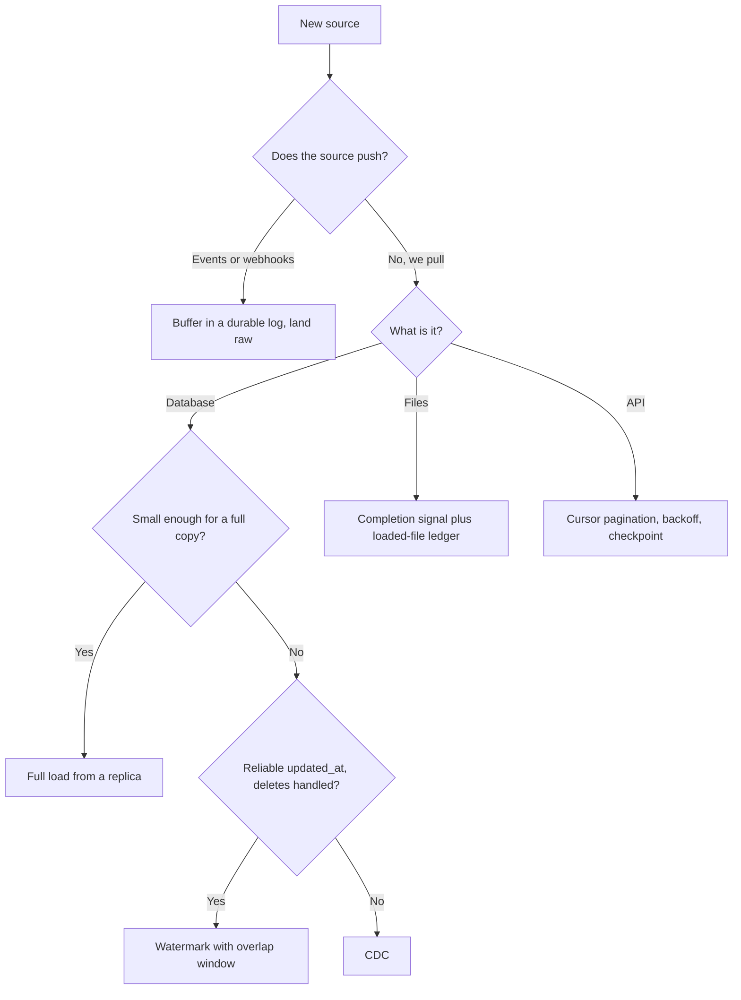

# Ingestion Patterns

Ingestion is the step where data leaves someone else's system and enters yours. Every pipeline starts here, and most 3 a.m. pages start here too. This lesson gives you five ways to read data in, the failure each one hides, and a quick rule for choosing between them. [Sources and Volume](../01-the-framework/04-sources-and-volume.md) taught you to name a source by its type. This lesson says what to do once you have.

## The Problem

A meal-kit company wants its orders in the warehouse by 6 a.m. each day. The orders table in Postgres has 20 million rows, about 20 GB, and the app team says "just copy it every night."

It works for a month. Then the nightly copy starts at midnight, runs 17 minutes (20 GB at about 20 MB/s through one connection), and the app's checkout page slows down during it, because the copy and the customers share one database. The team switches to "only copy rows changed since last night." Now the job is fast, but finance notices that cancelled orders never disappear from the warehouse, and that about one order in a thousand is missing. Nobody can say which ones.

Both versions were reasonable. Each one trades something away, and the trade-off was never stated. Ingestion is mostly about knowing, for each source, which trade-off you are making.

## Push or Pull

Start with one question: **who decides when data moves?**

- **Pull**: your pipeline goes and gets the data, on a schedule you control. Querying a database, listing a folder, calling an API are all pulls. You control timing and retries, but you also control the load you put on the source, and you only find out something changed when you look.
- **Push**: the source sends data to you when something happens. A webhook (the vendor calls an HTTP endpoint of yours), an app publishing events to Kafka, a partner dropping a file in your bucket. Data arrives sooner, but you must be listening when it comes.

Neither is better. A pull that runs every five minutes can feel like a push, and a push into a durable log (a queue that keeps messages until you read them) can be consumed like a pull, at your own pace. The practical rule: **put a durable buffer between the outside world and your processing**, so that "they sent it while we were down" cannot lose data.

## Full vs Incremental Loads

For anything you pull, the next question is how much to read each time.

A **full load** reads the whole source each run and replaces your copy. An **incremental load** reads only what is new or changed since the last run.

| | Full load | Incremental load |
|---|---|---|
| Work per run | Proportional to the whole table | Proportional to the change |
| Deletes | Handled for free: a row gone from the source is gone from the copy | Missed, unless the source marks deletes or you use [CDC](../03-architecture-patterns/04-cdc-patterns.md) |
| Correctness | Hard to get wrong | Easy to get subtly wrong |
| Fails when | The table grows past your window or hurts the source | Rows change without leaving a trace |

Do not dismiss the full load. For a 20 GB table with a nightly window, it is the right answer: a few lines of code, no state to corrupt, deletes handled. The 17 minutes from the opening scenario is not a problem on its own; the problem is where it ran. Run it against a read replica (a copy of the database kept in sync, used for reading so the primary is not touched) and the checkout page never notices.

Move to incremental when the full load stops fitting: the table is hundreds of GB, you need data every 15 minutes, or the source cannot take the read. A rough line: if a full copy takes more than about a quarter of your schedule interval, switch.

## Watermark Columns

The most common incremental method uses a column that only moves forward, usually `updated_at`. The pipeline remembers the largest value it has seen (this stored high-water mark is the **watermark**, and the column it tracks is the **watermark column**), and each run asks only for rows beyond it:

```sql
SELECT * FROM orders
WHERE updated_at > :last_watermark   -- e.g. '2026-10-31 02:00:00'
  AND updated_at <= :run_start;      -- fixed upper bound, so a run is repeatable
```

After a successful load, the pipeline stores the new maximum as the next `:last_watermark`. Two details make this safe: bound the query above with the run's start time so the same run reads the same rows if retried, and load into the target with an [upsert](../01-the-framework/07-pipeline-design.md) (insert the row, or update it if its key already exists) keyed on the primary key so rerunning is harmless.

> [!NOTE]
> This "watermark" is a stored value in your ingestion job. It is not the stream processor's event-time watermark from [Late-Arriving Data](08-late-arriving-data.md). Same word, different mechanism.

The pattern fails in three ways, and each is a good interview answer:

1. **Hard deletes are invisible.** A deleted row has no `updated_at` to find. Fixes: soft deletes (a `deleted_at` column) in the source, a periodic full comparison of primary keys, or CDC.
2. **Late commits are skipped.** A transaction that started at 01:59 and committed at 02:03 carries timestamps from 01:59. If your run read up to 02:00 in between, the row never qualifies again. This is the missing one-in-a-thousand from the opening scenario. The fix is an **overlap window**: each run starts from `last_watermark` minus a few minutes (say 10) and relies on the upsert to absorb the repeats.
3. **The column is not trustworthy.** Some code paths update rows without touching `updated_at` (a bulk SQL fix, a migration). You can only discover this by asking the source team, or by comparing counts. Say so out loud; it shows you have been burned before.

An auto-incrementing ID works as a watermark for append-only tables (a log of payments, never edited). It breaks for anything that is updated.

If the interviewer pushes on deletes or on exactness, that is the cue to move to change data capture. That is the whole of [CDC Patterns](../03-architecture-patterns/04-cdc-patterns.md); here you only need to know when to reach for it.

## Event Streams

When the source is an app emitting events, you are on the push side. A collector service validates the event and writes it to a log such as Kafka; your ingestion job is a **consumer**, which reads at its own pace and records its position (the **offset**) so it can resume after a crash.

What you need to know for ingestion:

- **Delivery is at-least-once.** A consumer that crashes after processing but before saving its offset will read some events again. Land the raw data first, deduplicate downstream ([Deduplication at Scale](09-deduplication-at-scale.md)).
- **Land raw before you transform.** Write the events as they arrived into object storage or a raw table, and build everything else from that. If a transformation has a bug, you replay from raw instead of asking the app team to resend ([Backfill and Reprocessing](03-backfill-and-reprocessing.md)).
- **Retention is your safety margin.** If the log keeps 3 days, a pipeline that is down for 4 loses data. Size retention for your slowest realistic recovery, not your average day.
- **The schema belongs to someone else.** Validate on the way in and set bad events aside rather than failing the whole stream ([Data Contracts](07-data-contracts.md)).

Rates and partition counts come from [Key DE Numbers](10-key-de-numbers.md): plan about 10 MB/s per Kafka partition, and size for the peak, not the average.

## Files and SFTP

Partners still send CSV files, and often only through SFTP (a file-transfer protocol that runs over SSH). The hard part is knowing the file is **complete, new, and not already loaded**.

Typical failures:

- You read a file while the partner is still writing it, and load half the rows.
- The partner re-sends yesterday's file with the same name, or the same data under a new name.
- A file is late, or never comes, and nothing complains.
- A column is added, renamed or reordered without warning.

A sturdy pattern has four parts:

1. **A completion signal.** Ask the sender to write to a temporary name and rename on finish, or to add a marker file (such as `_SUCCESS`) or a manifest listing the expected files and row counts. Without one, you only read files whose size has stopped changing.
2. **A ledger of loaded files.** Record each file's name and checksum (a fingerprint of its content) in a table. Skip a file you have seen. The ledger makes loading idempotent.
3. **Land untouched, then parse.** Copy the file as-is into your raw zone before parsing. When parsing fails, you still have the original.
4. **An expectation of arrival.** "The daily file should land by 05:00" is a [freshness](06-monitoring-and-alerting.md) check, and a missing file should alert the same way a failed job does.

## APIs and Rate Limits

SaaS tools (ad platforms, payment providers, CRMs) expose data through APIs. You pull from them page by page, and the limiting factor is almost never your hardware.

A **rate limit** is the vendor's cap on requests, for example 100 per minute. Suppose an ad platform returns 100 records per request and you need 50 million records of history:

- Throughput: 100 requests x 100 records = 10,000 records a minute.
- Backfill: 50,000,000 / 10,000 = 5,000 minutes, about 3.5 days of continuous calling, if nothing fails.

No cluster makes that faster. So ask for a bulk export, ask for a higher quota, or spread the job over the days you have, and say which. This is the point made in [Sources and Volume](../01-the-framework/04-sources-and-volume.md): rate limits, not volume, decide the backfill.

Practices that keep an API ingestion alive:

- **Respect the limit with backoff.** When the API answers "too many requests" (HTTP 429), wait and retry, doubling the wait each time, with a bit of randomness so parallel workers do not retry in lockstep. Honor any retry-after header.
- **Prefer cursor pagination to page numbers.** A cursor is a bookmark the API gives you for "continue from here". With page numbers, rows added during your run shift the pages, and you skip or repeat records.
- **Checkpoint the cursor.** Save progress after each page, so a failure on page 4,000 resumes at 4,000.
- **Use the API's own incremental filter**, such as `modified_since`, which is a watermark with the same caveats as above.
- **Webhooks need a pull behind them.** Vendors retry a failed delivery a few times and then stop. Accept the call, write it straight to a durable queue, answer 200 quickly, and process later. Add a periodic pull of recent history to repair gaps.

## Choosing per Source

In the interview you will rarely have one source. Pick per source, and give a reason each time.



For the meal-kit company that gives:

| Source | Pattern | Reason |
|---|---|---|
| Orders (Postgres, 20 GB, deletes matter) | CDC, or nightly full load from a replica if freshness is daily | Cancellations must propagate; avoid hitting the primary |
| App events (about 700/s average, 7k/s peak) | Kafka, raw to object storage | Push source; peak sizing; replay from raw |
| Courier partner (daily CSV on SFTP) | Marker file, ledger, raw landing | Late and partial files are the real risk |
| Ad platform (API, 100 req/min) | Incremental by `modified_since`, one-time bulk export for history | Rate limit decides backfill time |

Whatever the pattern, finish with the same two checks: **can I run it twice safely** (idempotent writes, so retries and [backfills](03-backfill-and-reprocessing.md) do not duplicate), and **would I know if it silently stopped** (a freshness or row-count alert).

## In the Interview

**When.** Ingestion comes up in step 3, the high-level architecture ([High-Level Architecture](../01-the-framework/05-high-level-architecture.md)), as the first box in your diagram, and again in deep dives when the interviewer asks "what if the source is huge, late, or changes?"

**A pattern that works** (about 60 seconds per source):

1. Name the source type and push or pull. "Orders are in Postgres; we pull."
2. Pick full or incremental and justify with size and freshness. "20 GB, daily is fine, so a full load from a replica."
3. Name the failure mode of your choice. "If we need 15 minutes of freshness, a watermark would miss deletes and late commits, so I'd move to CDC."
4. Say how a rerun stays safe. "Upsert on order ID."

**What interviewers listen for:**

- You choose per source, not one tool for everything.
- You know what an `updated_at` watermark misses, unprompted.
- You protect the source: replica, rate limit, off-peak.
- You land raw data before transforming it.
- You treat missing or late data as a normal event with an alert.

**Phrases that work:**

- "I'd start with the simplest thing that fits: a full load from a replica. Past about 100 GB, or 15 minutes, I'd go incremental."
- "The watermark re-reads the last ten minutes and the upsert absorbs the repeats."
- "That API gives 10,000 records a minute, so 50 million records of history is days, not hours."

## Common Mistakes

> [!WARNING]
> **Incremental by default.** An incremental load is more code and more ways to be wrong. If the table is small, take the full load.

> [!WARNING]
> **Trusting `updated_at` blindly.** It misses deletes, late commits and code paths that forget to set it. State the gaps and the fix.

> [!WARNING]
> **Reading from the production primary.** A heavy query on the live database becomes the application's outage. Use a replica, or the change log.

> [!WARNING]
> **Loading files without a completion signal or ledger.** You will load a half-written file, or the same file twice.

> [!WARNING]
> **Ignoring the rate limit until the backfill.** The daily load fits and the two-year history takes a month. Compute it up front.

> [!WARNING]
> **Transforming on the way in.** If the raw data is not kept, every bug in the transformation becomes a data loss.

## Key Takeaways

- Ask who decides when data moves (push or pull), then how much to read (full or incremental). Put a durable buffer between the outside world and your processing.
- A full load is simple and handles deletes. Move to incremental only when size, freshness or load on the source forces it.
- A watermark column misses hard deletes, late commits and untouched `updated_at`. Use an overlap window, an upsert, and CDC when exactness matters.
- Event streams are at-least-once: land raw, deduplicate later, size retention for your slowest recovery.
- Files need a completion signal and a loaded-file ledger. APIs need cursors, backoff and checkpoints, and their rate limit decides the backfill.
- Choose per source, and end each with idempotent reruns and an alert for silence.

## Going Further

- [CDC Patterns](../03-architecture-patterns/04-cdc-patterns.md): reading the database change log, for deletes and exactness.
- [Backfill and Reprocessing](03-backfill-and-reprocessing.md): loading history without duplicates.
- [Deduplication at Scale](09-deduplication-at-scale.md): cleaning up at-least-once delivery.
- [Data Contracts](07-data-contracts.md): who owns the schema of what you ingest.
- Related breakdowns: [Log Aggregation](../05-breakdowns-core/01-log-aggregation.md), [CDC Replication](../05-breakdowns-core/05-cdc-replication.md).
