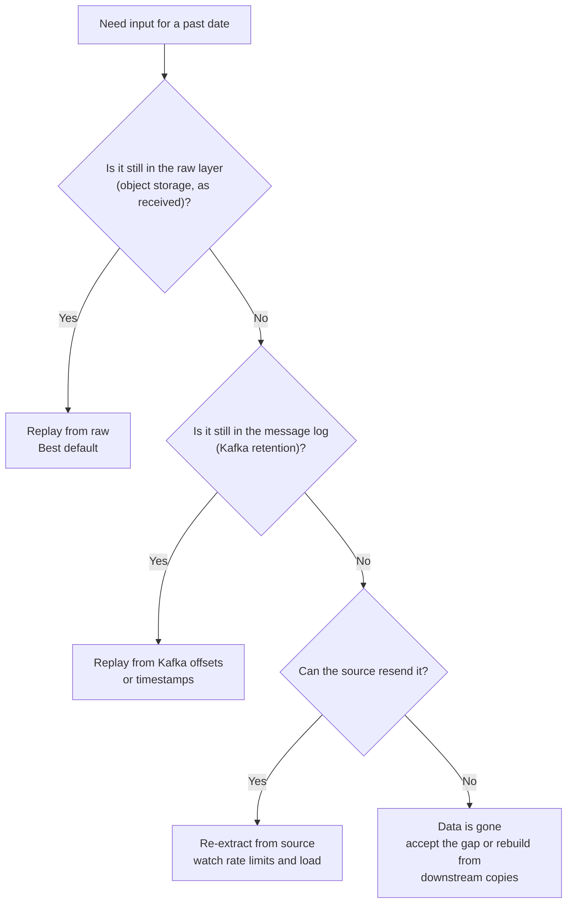
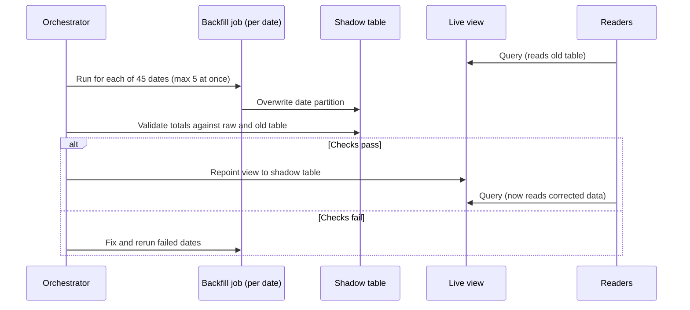

# Backfill and Reprocessing

Every pipeline you design will eventually need to redo past work: a bug is found, a source resends data, a new column is requested. Interviewers ask "how would you fix the last six weeks?" because the answer shows whether you designed for change or only for the happy path. This lesson gives you a safe way to rerun history, and the limits that decide how.

## The Problem

On a Monday, an analyst notices that European revenue looks about 8% too low. After a day of digging, the team finds the cause: 45 days ago a change to the currency-conversion step started using the previous day's exchange rate for any order placed after 22:00 UTC. The error is small per order but real, and finance has already sent reports to the board.

The code fix takes ten minutes. The hard part is the 45 days of wrong output already sitting in `fact_revenue`, plus every table built on top of it: the daily dashboard, the monthly finance rollup, a feature table that a pricing model trains on.

Two bad instincts show up here:

- **Hand-patch the wrong rows with an `UPDATE`.** It is fast, nobody can reproduce it, and the next code change quietly reintroduces the bug.
- **Rerun the pipeline over the date range and hope.** If the jobs append, you now have both the wrong and the right rows. If the source only keeps 7 days of history, the rerun cannot even see the old input.

A **backfill** is rerunning a pipeline over a past time range to fill in missing data or correct wrong data. **Reprocessing** is the wider idea of running already-stored data through new logic, whatever the trigger. In interviews the two words are used almost interchangeably, and so can you. Doing it safely comes down to four questions:

1. Can I rerun a slice without damaging what is there? (idempotency)
2. Where does the input come from now? (replay sources)
3. What will it cost, and can the system take it? (resources)
4. Who reads the output while I do it? (isolation)

## Why Backfills Happen

Plan for them. The common causes:

| Cause | Example | What you redo |
|---|---|---|
| **Bug in your logic** | The currency bug above | The transform and everything downstream |
| **Late or missing source data** | A partner's file for 12 October arrives on 20 October | Only the affected dates |
| **New business rule** | "Refunds now count against the month of the original order" | The transform over all affected history |
| **New column or metric** | Add `device_type` to the clickstream facts | Re-derive from raw; old rows lack the value |
| **Migration** | Moving from a nightly full copy to CDC | Usually one big historical load |
| **Outage catch-up** | The pipeline was down for 6 hours | A short window |

The first four are why you keep the original data. If you stored only transformed output, a wrong rule would be baked into the only copy you have. The **raw layer** (the first stored copy of data, close to how it arrived) is the input you can replay. See [Medallion Architecture](../03-architecture-patterns/03-medallion-architecture.md).

## Make Reruns Safe: Idempotent, Partition-Scoped Jobs

[Pipeline Design](../01-the-framework/07-pipeline-design.md) owns idempotency and the partition-overwrite and upsert patterns; read it first. That property is what makes a backfill boring. This section adds only what changes when the rerun is for old dates.

**The job takes its data interval as a parameter and overwrites exactly that interval's output.** Run `fact_revenue` for `2026-09-17` and it makes the 17 September partition equal to the result of the current code on 17 September's raw input. Nothing else is touched. Fixing 45 days means running the same job 45 times with 45 different dates.

```sql
-- the same statement for today's run and for a backfill; only :run_date changes
INSERT OVERWRITE fact_revenue PARTITION (revenue_date = :run_date)
SELECT ...
FROM raw_orders o
JOIN fx_rates r ON r.rate_date = :run_date
WHERE o.order_date = :run_date;
```

Two details decide whether this holds up in a backfill:

- **Pin everything the job reads to the run's date.** Notice the `fx_rates` join: it uses the run date, not "latest rate". If a job reads `now()` or "the current dimension row", the backfill produces today's answer for a past date. If the true answer depends on how a dimension looked back then, read the dimension as of that date (see SCDs in [Data Model Design](../01-the-framework/06-data-model-design.md)).
- **Partition by the same date you rerun by.** If the output is partitioned by `revenue_date` and your unit of rerun is a day, a day rerun rewrites one partition and nothing else. If the output is one unpartitioned table, a rerun means rewriting everything or running a risky `DELETE ... WHERE`. See [Partitioning](01-partitioning.md). Each overwrite must also swap atomically, as Pipeline Design explains.

For entity tables updated by key (current state per customer), the equivalent is an upsert on the business key, which is idempotent for the same reason. One trap: replaying old changes through an upsert can overwrite a newer value with an older one. Keep the source's `updated_at` or version in the `MERGE` condition (`WHEN MATCHED AND s.updated_at > t.updated_at`), or rebuild the table from a full snapshot instead.

> [!TIP]
> The phrase that answers most backfill questions: "Every job takes its date as a parameter and overwrites that date's partition, so a backfill is the same job run for a range of dates."

### Order matters downstream

`fact_revenue` is only the first table. The monthly rollup and the feature table read it. After you fix 45 days of the fact table, rerun the dependents **in dependency order** and only for the affected dates (the monthly rollup for the two months that contain them). An orchestrator handles this: it can start a backfill run per date, respect the DAG, and mark which dates are done. Use the orchestrator's backfill or clear-and-rerun feature rather than a hand-written loop, because it records what was rerun.

## Where Does the Input Come From?

Idempotent jobs need input to read. For a year-old date, the live source usually cannot provide it. Walk this list in order:



### 1. Replay from the raw layer (the default)

Keep an immutable copy of what arrived, partitioned by arrival or event date, on cheap object storage. A backfill then reads files, not a source system. It puts no load on the application database, is not limited by an API, and gives the same input every time.

The cost of keeping it is small. At the volumes in [Key DE Numbers](10-key-de-numbers.md), a billion 1 KB events a day is about 1 TB of raw JSON, or roughly 200 GB as Parquet (a compressed columnar format). At about $23 per TB-month, keeping a year of Parquet (73 TB) is under $1,700 a month; a year of raw JSON would cost about five times that, which is why many teams keep JSON for a shorter window. A rebuild without raw data is not possible at any price.

### 2. Replay from the message log

A **replay** means re-reading stored events from an earlier point and processing them again. Kafka lets a consumer rewind to an earlier offset (a message's position in the partition) or to a timestamp, so the same pipeline code can process history. A **consumer group** is the set of consumers that share a topic's partitions and track their own position, so a replay in its own group does not move the live job's position. Two limits:

- **Retention.** A topic keeps data for a configured period (7 days is the Kafka default; 3 matches the sizing in Key DE Numbers), because broker disk is expensive. A 45-day bug cannot be replayed from Kafka. Tiered storage (offloading old segments to object storage, available in recent Kafka versions and managed services; check yours) can stretch this, but the raw layer, fed by the same stream, is the usual way to extend the window. See [Kafka](../04-technology-deep-dives/02-kafka.md).
- **Competing with live traffic.** Say live load is 12 MB/s on a 12-partition topic. A replay of 3 days (about 3 TB raw) at 30 MB/s per partition across 12 partitions is 360 MB/s, so it finishes in a little over 2 hours (3,000,000 MB / 360). But 360 MB/s is more than the 100 to 300 MB/s a single broker handles, and the brokers also serve live consumers. Throttle it to, say, 100 MB/s and it takes about 8 hours, which is usually the right trade. Run it with its own consumer group, quotas on the replay's bandwidth, and its own output location (more on that below).

### 3. Re-extract from the source

Last resort. Check three things before you promise it:

- **Rate limits.** If a vendor API allows 100 requests a minute at 500 rows per page, that is 50,000 rows a minute. Re-pulling 45 days at 5 million rows a day (225 million rows) takes 4,500 minutes, about 75 hours, and you share that quota with the live job. See [Ingestion Patterns](02-ingestion-patterns.md).
- **Load on the source.** A multi-hour scan on the production database hurts customers. Use a read replica, and run off-peak.
- **Does the source still hold the old values?** A table with `updated_at` shows today's state of a row, not what it looked like 45 days ago. History that was overwritten at the source is gone.

> [!NOTE]
> This is the strongest argument for the raw layer in a design: re-extraction is slow, rate-limited, and sometimes impossible, while replay from raw is fast and repeatable.

## Cost and Resource Limits

Backfills are the work you do not do daily, so the capacity is often not sized for it. Do a quick estimate before you promise a timeline. For the currency bug, reprocessing 45 days of raw JSON:

- **Volume:** 45 days x 1 TB = 45 TB of input (raw JSON; Parquet input would be about a fifth of that).
- **Compute:** at about 20 MB/s per core, 45,000,000 MB / 20 = 2.25 million core-seconds, about 625 core-hours. A heavy join may run nearer 10 MB/s, which doubles it, so call it 625 to 1,250 core-hours. (Per-core throughput varies about 5x by job; treat these as guesses.)
- **Time:** on 500 cores, about 1.25 to 2.5 hours of pure compute. Add startup, shuffle and retries, and plan on half a day.
- **Money:** at about $0.05 per vCPU-hour, 625 to 1,250 core-hours is roughly $30 to $65. On a warehouse billing 4 credits an hour at $3 a credit ($12/hr), a 10-hour rewrite is about $120. The compute is cheap. What bites is the following:

| Limit | What goes wrong | What you do |
|---|---|---|
| **Shared cluster capacity** | The backfill takes the cores the daily jobs need, and today's report is late | Separate queue or cluster for backfills; cap parallelism (say 5 days at once, not 45) |
| **Source and API limits** | Re-extraction trips rate limits or slows the app database | Raw layer first; throttle; run off-peak |
| **Small files** | 45 reruns each write thousands of tiny files | Write 128 MB to 1 GB files; run [compaction](../04-technology-deep-dives/07-iceberg.md) afterward |
| **Downstream recompute** | Every dependent table rebuilds 45 days | Rerun only the affected dates and tables, in order |

Cap concurrency, process **oldest-first or newest-first on purpose** (newest-first gets the dashboards right sooner while history catches up), and track progress per date. For more on cost levers see [Cost Optimization](05-cost-optimization.md).

## Isolation: Don't Break Readers

While a backfill is running, people are reading the table. Three levels of care, from simplest to safest:

1. **Overwrite in place, one partition at a time.** Each partition swaps atomically, so a reader never sees half a day. During the run, though, some days are fixed and others are not, and a monthly total spanning both is briefly inconsistent. Acceptable for a minor correction, not for numbers the board is looking at.
2. **Write to a shadow table, validate, then switch.** The backfill writes to `fact_revenue_v2` while consumers keep reading `fact_revenue`. You compare the two (row counts, totals per day, a diff on a few days), then flip a view or rename so readers move in one step. Old and new sit side by side, so you can roll back by flipping again. This costs double storage for a while and is the right answer for high-stakes tables.
3. **Table-format snapshots.** Iceberg and Delta Lake keep prior table versions, so after a bad backfill you can roll back to the version before it. Treat this as a safety net, not a substitute for validating first.



Two more isolation points:

- **Tell downstream owners.** A fixed history changes numbers people have already quoted. Announce the date range and the expected change ("EU revenue up about 8% for 17 Sept to 31 Oct") before it lands. Table owners, dashboard owners and the finance team all need to hear it; a [data contract](07-data-contracts.md) is the formal version of that promise.
- **Keep the live pipeline running.** Today's partitions must keep flowing while history is rebuilt. This is why the backfill uses its own queue and, for streaming, its own consumer group and sink: replaying into the same sink the live job writes can interleave old and new events. Write replay output to a separate location, or use keyed upserts with version checks.

> [!WARNING]
> **Streaming sinks that are not idempotent.** If your stream writes by appending, replaying produces duplicates. Give each output row a deterministic key so the replay lands on the same rows, and see [Deduplication at Scale](09-deduplication-at-scale.md).

## In the Interview

**When it comes up.** In the pipeline design step ("what if this job fails or the logic changes?"), or as an interviewer probe: "A bug was live for a month. Walk me through the fix." Raise it yourself in two sentences even if not asked.

**Walk-through to give (about two minutes):**

1. Restate the blast radius: which tables, which dates, who has consumed them.
2. Show the rerun is safe: "Jobs take a date and overwrite that partition, so rerunning 45 days is 45 safe runs."
3. Name the input: "From the raw layer, since Kafka keeps 3 days and the source API cannot give us history."
4. Size it: "About 45 TB, roughly 600 to 1,200 core-hours. Hours, not days, if I cap it at 5 dates in parallel on a separate queue."
5. Protect readers: "Write to a shadow table, validate daily totals against raw, then switch the view."
6. Close the loop: "Rerun downstream tables for the affected dates in order, then tell the consumers what changed."

**What interviewers listen for:**

- You fix with reproducible code plus a rerun, not hand patches.
- You know where the old input lives and what limits it (retention, rate limits).
- You think about cost and load on shared systems, not only correctness.
- You protect readers and communicate changes.
- You validate before you switch.

**Phrases that work:**

- "A backfill here is just the normal job run for old dates. If it can't be, the job isn't idempotent yet, and I'd fix that first."
- "I'd replay from the raw layer. Kafka only holds 3 days."
- "The backfill gets its own queue, so it can't starve today's run."
- "I validate the shadow table against raw totals before the view flips."

## Common Mistakes

> [!WARNING]
> **Appending jobs.** An `INSERT` that appends makes a backfill produce duplicates. Overwrite the partition or upsert on a key before you ever need to backfill.

> [!WARNING]
> **Jobs that read "now".** A job using the latest dimension row, the current time, or "everything since the watermark" gives a different answer in a backfill than it did at the time. Pin every input to the run's date.

> [!WARNING]
> **Not keeping raw data.** If only transformed output is stored, a logic bug cannot be corrected, because the original facts are gone. Keep raw for as long as you might need to reprocess.

> [!WARNING]
> **Backfilling on the live cluster at full blast.** Forty-five days in parallel starves today's run and hammers the source. Cap concurrency and use a separate queue.

> [!WARNING]
> **Forgetting downstream tables.** Fixing `fact_revenue` while the monthly rollup and feature table still hold the old numbers leaves the company with two answers. List the dependents and rerun them in order.

> [!WARNING]
> **Silent restatement.** Changing history without telling consumers erodes trust faster than the original bug. Announce the range and the size of the change.

## Key Takeaways

- Backfills are normal: bugs, late data, new rules and new columns all cause them. Design for them from the start.
- Idempotent, date-parameterized jobs that overwrite one partition make a backfill the same job run for old dates.
- Pin every input to the run's date. Anything reading "now" or "latest" breaks reproducibility.
- Input comes from, in order of preference: the raw layer, the message log (if retention allows), the source (if it still has the data and can take the load).
- Estimate before promising: volume, core-hours, parallelism cap, and the limits on shared clusters and source APIs matter more than the dollar figure.
- Protect readers with a shadow table, validation and a single switch; rerun dependents in order; tell consumers what changed.
