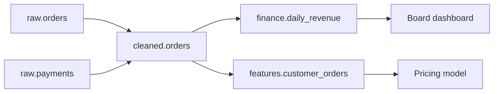
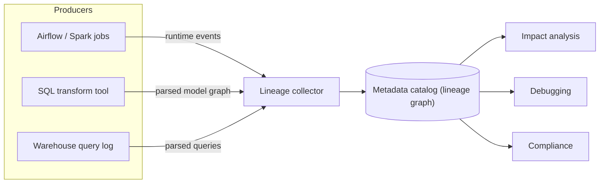

# Data Lineage

Sooner or later in a design round the interviewer asks "a table is wrong, what else is affected?" or "how would you prove which systems touched this customer's data?" Lineage is the answer to both. It is also one of the cheapest ways to look senior: most candidates never mention it, and you can cover it in three sentences.

## The Problem

It is 09:10 on a Tuesday. The `cleaned.orders` table loaded a 2 hour old snapshot overnight because an upstream export was late. You know it is wrong. Now three questions arrive in the incident channel:

1. Which dashboards and tables are showing bad numbers right now?
2. Who do I tell? (Finance closes the month on Thursday.)
3. Once the source is fixed, which tables do I rebuild, and in what order?

Without a record of what reads what, you answer from memory and a search through the orchestrator's code. Someone remembers the finance rollup but forgets the pricing-model feature table that also reads `cleaned.orders`. That table keeps feeding stale features for two more days.

**Data lineage** is a record of where data came from and what was built from it: which sources feed which tables, which jobs produced them, and which tables, dashboards and models read them. Drawn as a graph, tables (or columns) are nodes and the jobs that move data between them are the edges. "Upstream" means everything a table is built from. "Downstream" means everything built from it.



If `cleaned.orders` is bad, walking this graph downstream gives you the finance rollup, the board dashboard, the feature table and the pricing model in seconds.

## Table-Level vs Column-Level

Lineage comes at two levels of detail, and the difference is a common interview follow-up.

| | Table-level lineage | Column-level lineage |
|---|---|---|
| **Records** | `cleaned.orders` feeds `finance.daily_revenue` | `daily_revenue.revenue_eur` is computed from `orders.amount` and `fx_rates.rate` |
| **Answers** | "What breaks if this table is late or wrong?" | "What breaks if this column changes? Where does this PII field end up?" |
| **Cost to capture** | Low. Jobs declare inputs and outputs | Higher. Needs the logic inside each query |
| **Weak spot** | Over-warns: the table is flagged even if the broken column is never used | Hard to get right with dynamic SQL, `SELECT *` and code in Python or Spark |

Take a concrete case. A producer team wants to rename `orders.amount` to `orders.amount_gross`. With table-level lineage you learn 14 downstream tables read `orders`. You have to ask 14 teams whether they use `amount`. With column-level lineage you learn exactly 3 tables use that column, and you talk to 3 teams.

Column-level lineage matters most for two jobs: **impact analysis for schema changes** and **tracking sensitive fields**. If `email` is personal data, column lineage shows every table it flowed into, including the three derived tables nobody remembers.

> [!NOTE]
> Start with table-level lineage. It covers most incident questions and costs far less. Add column-level when you have a real need such as renames or privacy rules, and say so in the interview.

## How Lineage Is Captured

There are three ways to get the graph. Real systems combine them.

### 1. Parse the code

Read the SQL (or the transformation definitions) and work out which tables and columns it reads and writes. A tool takes `INSERT INTO daily_revenue SELECT SUM(o.amount * r.rate) ... FROM orders o JOIN fx_rates r ...` and produces edges from `orders.amount` and `fx_rates.rate` to `daily_revenue.revenue_eur`.

- **Strength:** it works before anything runs, so you see the graph at code review time, and it needs no changes to the jobs.
- **Weakness:** it only sees what the parser understands. `SELECT *`, SQL assembled as a string at runtime, user-defined functions and logic written in Python or Scala all break or blur the result. Each SQL dialect also needs its own parser.

A framework like dbt gets table-level lineage almost for free this way: a model refers to its inputs with `ref('cleaned_orders')`, so the dependency graph is written into the code.

### 2. Emit events at runtime

Have each job report what it actually did. When a job starts and finishes, it sends a small structured message: job name, run ID, status, the datasets it read, the datasets it wrote. A collector stores these and builds the graph from them.

**OpenLineage** is an open standard for exactly this message format. Integrations for common tools (Airflow, Spark, dbt and others) send events in that shape, so lineage from many tools lands in one place. The sketch below is trimmed and illustrative, not a complete valid event: a real one also carries a `producer` (the code that emitted it), a `schemaURL`, and optional `facets` (extra metadata attached to the run, job or a dataset, such as schemas or column-level lineage).

```json
{
  "eventType": "COMPLETE",
  "eventTime": "2026-10-27T02:14:09Z",
  "job":  { "namespace": "airflow", "name": "build_daily_revenue" },
  "run":  { "runId": "b1c2d3e4-0000-4000-8000-000000000042" },
  "inputs":  [ { "namespace": "warehouse", "name": "cleaned.orders" },
               { "namespace": "warehouse", "name": "ref.fx_rates" } ],
  "outputs": [ { "namespace": "warehouse", "name": "finance.daily_revenue" } ]
}
```

- **Strength:** it records what really happened, including Python and Spark jobs that no SQL parser can read, and it ties each edge to a run, so you can say "this table was built by that run at 02:14".
- **Weakness:** only jobs with an integration emit events. A cron script with no integration is invisible. Column-level detail is optional and depends on the integration.

### 3. Read the platform's own logs

Warehouses record every query: who ran it, what it read, what it wrote. Mining that query history gives you lineage for everything in the warehouse, including ad hoc queries and BI tools, with no changes to any job. It is a good safety net. It sees only that one platform, and it needs the same parsing as option 1 to get column detail.

### Which to say in the interview

| Situation | Reasonable choice |
|---|---|
| Mostly SQL transforms in one warehouse | Parse the code (or use the transformation tool's graph) plus query history |
| Mixed Airflow, Spark and SQL jobs | Runtime events, so every tool reports in one format |
| Need to catch things nobody registered | Add query-log mining as a backstop |

All three feed one place: a **metadata catalog** (a searchable inventory of datasets, owners and descriptions) that stores the graph, shows it in a UI and serves it by API. You do not need to name a product. Say "a catalog that stores lineage, owners and schemas".



## What You Use It For

### Impact analysis (what breaks if...)

Walk the graph downstream from a node. Use it before a change ("if I drop this column, what breaks?") and during an incident ("this table is bad, who is affected?"). Combined with owners stored in the catalog, the output is a list of teams to notify. This is also what makes a [data contract](07-data-contracts.md) enforceable: a contract says what a producer promises, and lineage tells the producer who is relying on that promise.

### Debugging (where did this number come from?)

Walk the graph upstream. A dashboard shows revenue of 1.2M and finance expects 1.3M. Upstream, you see `daily_revenue` reads `cleaned.orders`, which reads `raw.orders` and `raw.payments`. With run-level lineage you also see that `cleaned.orders` was last built from a run that read a partial `raw.payments` partition. You go straight to the bad link instead of reading every job.

Lineage also tells you the order to rebuild once you find the problem. A [backfill](03-backfill-and-reprocessing.md) of `cleaned.orders` must be followed by its dependents, in dependency order, for the affected dates only. The graph is that dependency list.

### Compliance (prove where the data went)

Two common requests: "a customer asked us to delete their data" and "auditors want to know how this regulatory report was produced". For deletion, column-level lineage on the fields that hold personal data lists every copy that must be handled. For audit, upstream lineage gives you the chain from the report back to the original sources, with the job runs in between.

> [!TIP]
> The interview-ready summary: "Lineage gives me three things: impact analysis downstream, debugging upstream, and an audit trail for sensitive fields."

## In the Interview

Lineage is almost never a main component. It is a one-minute add-on that signals you have run a real platform. Know where it fits and stop there.

**Where to mention it**

- **Monitoring step:** when you list freshness, completeness and quality checks, add "and lineage, so a failed check tells us which downstream tables to hold or rebuild". See [Monitoring and SLAs](../01-the-framework/09-monitoring-and-slas.md) for how that step is framed, and [Monitoring and Alerting](06-monitoring-and-alerting.md) for how the alerts are built.
- **Data model step:** when you split raw, cleaned and serving layers, say lineage is how you keep track of what feeds what across them. See [Medallion Architecture](../03-architecture-patterns/03-medallion-architecture.md).
- **Deep dive on a bug, schema change or privacy requirement:** this is where you go one level deeper (see below).

**How deep to go**

| Level | What to say |
|---|---|
| **Mid-level** | Define lineage. Give impact analysis and debugging as uses. Say the orchestrator and warehouse can supply a table-level graph. |
| **Senior** | Distinguish table vs column level and pick one for the requirement. Name the capture options (parsing vs runtime events) with their weak spots. Tie it to incident response and schema changes. |
| **Staff+** | Treat it as platform work: one event standard across tools, ownership stored in the catalog, lineage used as a gate in CI ("this PR changes a column with 6 downstream consumers, require approval") and to scope compliance deletes. Say what you would not build yet. |

If the prompt has personal data, financial reporting or many producing teams, move lineage up. If it is a single-team pipeline with ten tables, one sentence is enough.

**What interviewers listen for**

- You connect lineage to a decision (who to notify, what to rebuild, what a rename breaks), not just "we track it".
- You know it has gaps: parsers miss dynamic SQL, runtime events miss unregistered jobs.
- You are not proposing a six-month metadata project to answer a ten-table question.

## Common Mistakes

> [!WARNING]
> **Treating lineage as a diagram you draw once.** A hand-drawn lineage slide is stale within a month. Say it is captured automatically from jobs or code. A graph that depends on people updating a wiki does not survive.

> [!WARNING]
> **Promising column-level lineage everywhere.** It breaks on `SELECT *`, dynamic SQL and custom code. If you claim it, say what you do about the cases it cannot see: usually, fall back to table-level for those jobs and flag them.

> [!WARNING]
> **Confusing lineage with monitoring.** Lineage says what is connected. It does not say that something is broken. Pair it with freshness and quality checks, and use lineage to widen an alert into "these 5 downstream tables are affected".

> [!WARNING]
> **Forgetting the consumers outside the pipeline.** Dashboards, notebooks, ML models and exports are consumers too. If your graph stops at the last table, impact analysis tells you about the tables and misses the board dashboard. Capture BI tools and model training jobs, or at least register them as nodes by hand.

> [!WARNING]
> **Building it before you need it.** On a small system, a clear naming scheme and a transformation tool's dependency graph give you most of the value. Offer the bigger setup as the next step when teams or tables multiply.

## Key Takeaways

- Lineage is a graph of what feeds what. Walk it downstream for impact analysis and upstream for debugging.
- Table-level lineage is cheap and answers most incident questions. Column-level lineage answers "what breaks if this column changes" and "where does this personal field go", at higher cost and with blind spots.
- Capture it automatically: parse the code, emit runtime events (OpenLineage is the open standard), or mine the platform's query logs. Each has a gap, so real setups combine them in a metadata catalog.
- In interviews it is a short, well-placed add-on to monitoring and data-model discussions, scaled to the prompt: more for personal data and many teams, less for one small pipeline.
- Always tie it to an action: who to notify, what to rebuild, what a change breaks.

## Related Lessons

- [Monitoring and SLAs](../01-the-framework/09-monitoring-and-slas.md): where lineage sits in the observability story.
- [Monitoring and Alerting](06-monitoring-and-alerting.md): turning checks into alerts, with lineage widening the blast radius.
- [Backfill and Reprocessing](03-backfill-and-reprocessing.md): lineage gives the rebuild order.
- [Data Contracts](07-data-contracts.md): lineage shows who depends on a contract.
- [Medallion Architecture](../03-architecture-patterns/03-medallion-architecture.md): the raw, cleaned and serving layers lineage traces across.
