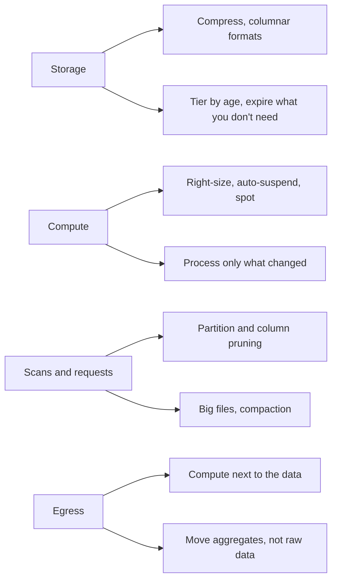
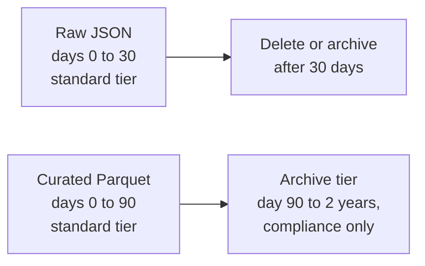

# Cost Optimization

Every design costs money, and in the last ten minutes of a round the interviewer often asks, "What will this cost, and how would you bring it down?" Candidates who can name the four places a data bill comes from, and pull the cheapest lever first, stand out. Most people say "use cheaper storage" and stop.

## The Problem

Your team's analytics platform ingests 1 billion events a day. That is about 1 TB of raw JSON, or about 200 GB a day once landed as Parquet (see [Key DE Numbers](10-key-de-numbers.md) for the conversions). Finance forwards the monthly cloud bill with one line highlighted: it grew 4x in a quarter, and nobody launched anything.

You open the bill expecting storage to be the culprit. It isn't. A year of Parquet is 73 TB, roughly $1,700 a month, and that line hasn't moved much. The growth is in three other places:

- A dashboard refreshes every 15 minutes and scans the whole 30-day events table each time.
- A nightly Spark cluster of 20 machines runs 4 hours but is left on all day.
- A job copies a derived dataset to another cloud provider every week.

None of these is a bug. Each is a default nobody questioned, and together they show the pattern: **storage is the cheap line; the bill grows through what you read, what you keep running, and what you move.**

## Where the Money Goes

Four buckets cover almost every data bill. The prices below are the rough 2026 figures from [Key DE Numbers](10-key-de-numbers.md#rough-cloud-costs); they are order-of-magnitude, not quotes.

| Bucket | What you pay for | Rough price | The usual way it explodes |
|---|---|---|---|
| **Storage** | Bytes kept, per month | ~$23 per TB-month on object storage | Keeping every copy and every version forever |
| **Compute** | Machine-hours or warehouse credits | ~$0.35 to 0.40 per hour for an 8 vCPU VM | Clusters and warehouses that are on while nothing runs |
| **Scans and requests** | Bytes read by scan-priced engines, and per-file API calls | ~$5 to 6.25 per TB scanned; ~$5 per million writes | Reading far more data than the question needs; millions of tiny files |
| **Egress** | Data leaving a cloud or crossing zones | ~$0.05 to 0.09 per GB out; ~$0.01 per GB across zones | Copying big datasets between clouds, regions or zones |

> [!NOTE]
> **Scan-priced** means the engine bills for the bytes it reads, not for the time it runs (Athena and BigQuery on-demand work this way). A warehouse with its own cluster bills compute time instead, but reading less still finishes sooner and so costs less.

The levers map directly onto the buckets:

The rest of the lesson walks through them in the order I would reach for them: read less first, then run less, then keep less, then move less.

## Lever 1: Read Less

Reading is where the biggest multipliers hide, because a query's cost is the bytes it touches, not the bytes in its answer. Three techniques stack.

**Format and compression.** Raw JSON repeats every field name in every record. A **columnar format** like Parquet stores each column together, so repeated values compress well. JSON to Parquet is about 5x smaller (1/5 to 1/10; use 5x when asked for one number), and zstd or snappy compression is already part of that figure. You pay for 200 GB instead of 1 TB, and every scan reads a fifth as much.

**Partition pruning.** If the table is partitioned by `event_date` and the query filters on it, the engine skips every other day before reading anything. [Partitioning](01-partitioning.md) covers choosing the key and the ways pruning silently breaks.

**Column pruning.** Because Parquet stores columns separately, a query that selects 3 of 50 columns reads only those columns' bytes. With `SELECT *`, it reads everything. This is the one that costs nothing to apply: it is a habit, not a design.

Here is the dashboard from the opening, on a scan-priced engine at about $5 per TB. The table holds 30 days of Parquet: 30 x 200 GB = 6 TB.

| Query shape | Bytes read | Cost per run | At 96 runs a day (every 15 min) |
|---|---|---|---|
| No date filter, `SELECT *` | 6 TB | $30 | ~$2,900 a day |
| Filter on yesterday's partition | 200 GB | $1 | ~$96 a day |
| Same, plus only the 3 columns it displays | ~12 GB (3/50 of the bytes, if columns are equal width) | ~$0.06 | ~$6 a day |

Same dashboard, same answer, 500x cheaper, with no hardware change.

A fourth technique goes beyond reading less: **don't run the query at all.** A dashboard showing "revenue by campaign by day" doesn't need to touch 200 GB of events 96 times. Compute that aggregate once an hour into a small summary table of a few MB and point the dashboard at it. This is the serving-layer idea from [High-Level Architecture](../01-the-framework/05-high-level-architecture.md): consumers read small, pre-shaped tables, not the raw layer.

### Big files, not many files

Object storage charges per request and adds 10 to 100 ms of latency to each one. A million tiny files costs more to write (about $5 per million writes) and far more to read than one large file of the same bytes. Aim for 128 MB to 1 GB per file. The causes (over-partitioning, frequent streaming commits) and the two fixes are in [Partitioning](01-partitioning.md#over-partitioning-and-small-files).

One cost point is new here: **compaction is not free.** It reads and rewrites the data, so you pay compute and request fees to save on every later read. Compact each partition once, after it stops receiving writes (yesterday's partition at 02:00, not today's partition every five minutes). Rewriting hot data repeatedly can cost more than the small files did.

## Lever 2: Run Less

Compute is billed by the hour, and most of the waste is idle hours. Three habits fix most of it.

**Right-size and turn it off.** Take the nightly Spark job: 20 VMs at 8 vCPU each, about $0.375 per hour per VM, so $7.50 per hour for the cluster.

| How it runs | Hours | Cost per day |
|---|---|---|
| Always on | 24 | ~$180 |
| Created for the job and deleted after | 4 | ~$30 |
| Same, on spot capacity (60 to 70 percent cheaper) | 4 | ~$10 |

Warehouses are the same story: a medium warehouse (4 credits an hour, $2 to 4 per credit) used 8 hours a day costs about $65 to 130 a day, and left running around the clock about three times that. Set **auto-suspend** (the warehouse stops itself after a few idle minutes), and give heavy jobs their own warehouse that exists only while they run.

**Spot capacity** is spare cloud capacity sold at a discount, with the catch that the cloud can reclaim it at short notice. That is fine for a job that can be retried or resumed, which a well-designed batch job is (see [Backfill and Reprocessing](03-backfill-and-reprocessing.md) on idempotent reruns). It is a bad fit for the single node that holds state you can't rebuild.

**Right-size to the work.** Size by the bottleneck, using the Spark rules of thumb in [Key DE Numbers](10-key-de-numbers.md#spark-sizing-rules-of-thumb): if tasks are 128 to 256 MB each, a 200 GB day is about 800 to 1,600 tasks, and the cluster's 160 cores run 160 tasks at a time, so they work through that in roughly 5 to 10 rounds. Doubling it to finish sooner only makes sense if someone is waiting on the answer.

### Incremental over full

The largest compute saving is usually not doing the same work twice. Compare two ways to refresh a 500 GB orders table every night:

- **Full load.** Read all 500 GB from the source, rewrite the copy. Work grows with the table, every night, forever.
- **Incremental load.** Read only the roughly 5 GB of rows that changed since the last run. That is 100x less to read, move and write.

The same logic applies downstream. If the daily revenue table is partitioned by date, recompute only yesterday's partition (an idempotent partition overwrite), not the last three years. Full recomputes are for fixing logic, not for the daily run. [Ingestion Patterns](02-ingestion-patterns.md) covers the trade-offs of incremental reads (missed deletes, late commits), and you should say them when you propose it.

## Lever 3: Keep Less, and Keep It Cheaper

Storage is the cheap line, but it is the one that grows without anyone doing anything: data piles up every day and nobody deletes it. Two moves: **expire** what has no value, and **tier** the rest.

A **storage tier** is a price/speed class for the same object storage. Standard costs about $23 per TB-month and reads instantly. Archive tiers cost about $1 to 5 per TB-month but retrieval is slow or carries a fee, which suits data kept for compliance and almost never read.

Put the policy in the storage system's **lifecycle rules** (rules that move or delete objects by age automatically), not in a cron job someone must remember. A worked example with the volumes above:

- Raw JSON, 1 TB a day. Kept 30 days: 30 TB, about $690 a month. Kept a year: 365 TB, about $8,400 a month. The raw layer exists so you can replay after a bug, and a bug is nearly always found within weeks, so 30 days is a defensible default.
- Curated Parquet, 200 GB a day. Two years on standard storage is 146 TB, about $3,400 a month. Moving everything older than 90 days to an archive tier at roughly $3 per TB-month saves most of that, at the price of slow retrieval for old-data queries.

Two cautions. Data you delete can't be backfilled, so deletion rules need the owner's sign-off and must respect the retention requirement you set in [Requirements Gathering](../01-the-framework/03-requirements-gathering.md). And archive tiers often have minimum storage durations and per-GB retrieval fees, so don't archive data you will re-read monthly.

## Lever 4: Move Less

Moving data costs money that has nothing to do with how big it is on disk. Moving 100 TB out of a cloud to the internet or another provider costs about $5,000 to 9,000 in egress. Cross-zone traffic is about $0.01 per GB each way, so a stream replicated across three zones pays it on every byte.

Three rules cover most designs:

1. **Compute where the data lives.** Run the Spark job in the same region as the lake rather than reading 50 TB across regions.
2. **Move the aggregate, not the raw data.** If another team or tool needs daily revenue by campaign, ship the 50 MB summary, not the 200 GB of events behind it.
3. **Check what crosses zones.** A consumer in a different zone from its Kafka brokers pays the cross-zone rate on every message; many managed services let consumers read from a nearby replica.

In an interview, "where does data cross a boundary in this design?" is a fast question to ask of your own diagram. If the answer is "the raw layer, daily, to another cloud", you have found your first cost cut.

## Cost Versus Everything Else

Cost is never free of trade-offs, and saying so is the senior move:

| Cheaper choice | What it costs you |
|---|---|
| Shorter raw retention | Can't replay or backfill further back |
| Archive tier | Slow, sometimes fee-bearing retrieval |
| Spot capacity | Jobs get interrupted and must retry |
| Pre-computed summaries | Staleness, and a second table to maintain |
| Hourly instead of 5-minute landing | Freshness (a streaming path may still need its own small files) |
| Bigger files and compaction | Compaction compute, plus a lag before data is optimized |

The right answer depends on the requirement. A 15-minute-freshness ops dashboard justifies spending on an always-on small cluster. A weekly finance report does not.

## In the Interview

**When to bring it up.** After the high-level design, as part of the data model and pipeline discussion, and again in deep dives if the interviewer asks about scale. Do not open with cost; the design has to work first. But state one cost-aware choice early (columnar format, partitioning by date), so it doesn't look like an afterthought.

**How to frame it.** Treat cost as a non-functional requirement with a number, like freshness. "The budget is roughly $10k a month; storage is under $2k of it, so the real risks are scans and idle compute."

What to say aloud:

- "Storage is the cheap line here, about $1,700 a month for a year of Parquet. What I'd watch is scans and always-on compute."
- "The dashboard hits a pre-aggregated table, not the events table, so a refresh reads megabytes instead of terabytes."
- "Nightly jobs run on spot capacity with retries. They are idempotent, so an interruption just reruns the partition."
- "Raw data lives 30 days on standard storage, then expires. Curated data moves to an archive tier after 90 days."

> [!TIP]
> Interviewers listen for ordering. The strong answer goes: measure where the money goes, take the cheapest, lowest-risk lever first (stop reading what you don't need), and only then talk about tiers and spot. The weak answer is a list of every cost trick, none tied to this system's bill.

**What interviewers probe.**

- "The bill doubled. How do you find out why?" Look at the bill by bucket and by tag or team, then at the top queries by bytes scanned and the clusters with low utilization. Fix the biggest line first.
- "Would you do this on a bigger cluster to finish faster?" Only if someone is waiting; otherwise a smaller cluster for longer is often cheaper, because idle cores cost the same as busy ones.
- "What's the downside of that saving?" Always have one ready from the trade-off table.

## Common Mistakes

> [!WARNING]
> - **Optimizing storage first.** Compressing and tiering saves a few hundred dollars while a `SELECT *` dashboard burns thousands in scans. Find the biggest line before choosing a lever.
> - **Saying "use cheaper storage" as the whole answer.** It's the smallest of the four buckets in most designs.
> - **Leaving clusters and warehouses on.** Idle hours bill exactly like busy ones. Auto-suspend, or create the cluster per job.
> - **Full reloads and full recomputes as the daily default.** The work, and the bill, grow with history instead of with change.
> - **Compacting hot data over and over.** Compaction costs compute; do it once, on partitions that have stopped changing.
> - **Ignoring egress.** Cross-cloud and cross-zone copies are invisible in the diagram and obvious in the bill.
> - **Cutting cost without naming the trade-off.** "Spot instances" with no mention of interruptions, or "30-day retention" with no word on backfills, sounds like a slogan, not a decision.
> - **Quoting exact prices.** Say "roughly $23 per TB-month". Prices vary by region and contract, and nobody is checking the decimals.

## Key Takeaways

- Four buckets: storage, compute, scans and requests, egress. Storage is usually the smallest; scans, idle compute and data movement are where bills surprise people.
- Read less first: columnar format, partition pruning, column pruning, pre-aggregated serving tables. A filter and a column list can cut a query's cost by 100x or more.
- Run less: create compute per job, auto-suspend, use spot for retryable work, and process only what changed instead of reloading everything.
- Keep less: expire what has no value, tier the rest with lifecycle rules, and compact big files once, on cold data.
- Every saving has a price (replay window, retrieval speed, staleness). Say what it is.

Related lessons: [Key DE Numbers](10-key-de-numbers.md), [Partitioning](01-partitioning.md), [Ingestion Patterns](02-ingestion-patterns.md), [Backfill and Reprocessing](03-backfill-and-reprocessing.md), [Sources and Volume](../01-the-framework/04-sources-and-volume.md), [Apache Iceberg](../04-technology-deep-dives/07-iceberg.md).

Related breakdowns: [Log Aggregation](../05-breakdowns-core/01-log-aggregation.md), [IoT Sensor Pipeline](../06-breakdowns-advanced/10-iot-sensor-pipeline.md).
