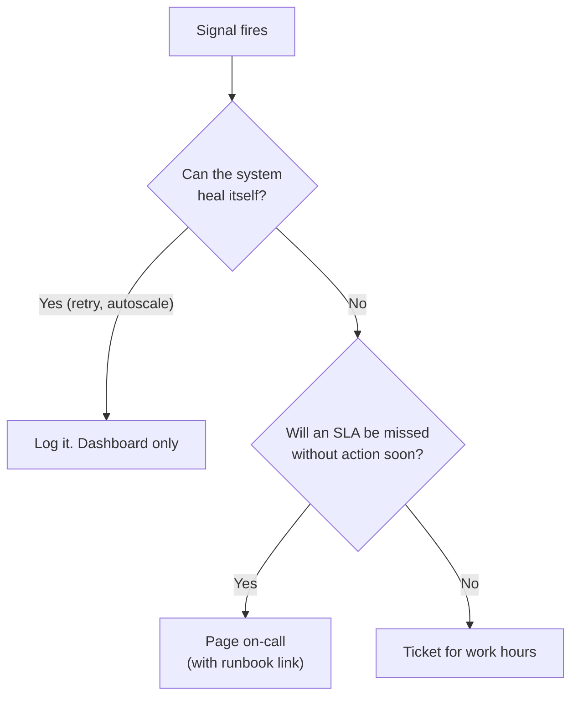

# Monitoring and Alerting

[Monitoring and SLAs](../01-the-framework/09-monitoring-and-slas.md) tells you what to promise and how to say it in three minutes. This lesson is the next question an interviewer asks when you sound credible: "Okay, so what exactly do you measure, what wakes someone up, and what do they do when it does?" Answer that well and you sound like someone who has carried a pager.

## The Problem

It is 02:07. Priya, the on-call data engineer for the meal-kit platform, is woken by her phone. By 02:20 it has buzzed 41 times:

- 14 alerts of "task failed, retrying" that all succeeded on the next attempt.
- 12 alerts of "table X is stale", one for each downstream table of a single late extract.
- 9 alerts of "row count outside range" on tables that are always quiet at 02:00.
- 5 alerts of "disk 80% full" on a cluster that is autoscaled.
- 1 alert that matters: the payments extract returned 0 rows.

Priya does what every on-call does after a few weeks of this. She mutes the channel. Three weeks later the real zero-row extract arrives in the same channel, with the same red color, and nobody reads it. Finance finds out at 09:00.

Two skills are missing: **measuring the right things**, so a zero-row extract is detectable at all, and **alerting on few things**, so a buzz matters. Both are mechanics, not tools: a few SQL queries and a scheduler can do all of it. This lesson turns the SLAs from the framework lesson into signals, alerts and runbooks.

## What to Measure: Five Signals

A pipeline can fail in many ways, but the table at the end only changes in five ways you can observe. Check these and you catch most incidents without fifty rules.

| Signal | The question | Meal-kit example of a failure |
|---|---|---|
| **Freshness** | How old is the newest data? | Newest `order_placed_at` is 9 hours old |
| **Volume** | Did the expected amount of data arrive? | 4,000 rows on a Monday that normally brings 300,000 |
| **Schema** | Did the shape change? | The source renamed `amount` to `amount_cents` and a column went missing |
| **Distribution** | Do the values look like they usually do? | Average order value jumps from $62 to $6,200, because cents were loaded as dollars |
| **Nulls** | Are required values present? | `customer_id` is null in 18% of rows, up from 0.1% |

Freshness and volume answer "did it arrive?". Schema, distribution and nulls answer "is it still the same data?". The second group catches the failures that look healthy on a dashboard: the job ran, rows landed, and every number is wrong.

Freshness is defined in [Monitoring and SLAs](../01-the-framework/09-monitoring-and-slas.md): measure the age of the newest event time, not the clock on the job. The rest are worth a closer look.

### Volume

Compare today's row count with a reference. A rule of "at least 50% of the same weekday last week" costs one query:

```sql
SELECT
  COUNT(*) AS rows_today,
  (SELECT COUNT(*) FROM serving.orders
    WHERE order_date = CURRENT_DATE - 8) AS rows_last_week
FROM serving.orders
WHERE order_date = CURRENT_DATE - 1;
```

Use the same weekday, not "yesterday": a rule against yesterday fires every Monday. Check for too much volume as well. A doubled count usually means a retried load wrote twice; see [Deduplication at Scale](09-deduplication-at-scale.md).

### Schema

A schema check compares today's column names and types with what you expect. It catches a dropped or renamed column before the transform job crashes with a confusing error or, worse, fills the column with nulls and carries on. It is one query against the table's metadata, or a comparison of a file's header with a stored list. Checking after the fact is the fallback. The stronger fix is to agree the schema with the producer and reject changes before they land; that is [Data Contracts](07-data-contracts.md).

### Distribution

A distribution check says "this column's values look like they did before". The cheap version tracks one summary number per important column. Examples:

- Average `order_total` stays between $45 and $80.
- `status = 'refunded'` is between 1% and 4% of rows.
- The maximum `order_placed_at` is not in the future.

Pick the five to ten columns that feed a financial or customer-facing number.

### Nulls

For each required column, track the **null rate**: nulls divided by rows.

```sql
SELECT
  AVG(CASE WHEN customer_id IS NULL THEN 1.0 ELSE 0 END) AS null_rate_customer_id
FROM serving.orders
WHERE order_date = CURRENT_DATE - 1;
```

Alert on the rate, not the count: 500 nulls is a disaster in a 1,000-row table and noise in a 300-million-row one.

Job metrics (duration, retries, consumer lag) help *diagnose* a problem but rarely belong in paging rules. The rule: **page on data symptoms, diagnose with pipeline metrics.**

## Deciding What "Abnormal" Means

Every check above needs a threshold, and the first instinct is a fixed number: "alert if rows < 100,000". That works for about a month. Then the business grows, or a holiday arrives, and the number is wrong in one direction or the other.

There are three ways to set a threshold. Most data teams should stop at the second.

| Method | How it works | Good for | Breaks when |
|---|---|---|---|
| **Fixed threshold** | A number you choose: `null_rate < 1%`, `rows > 0` | Hard rules: keys never null, row count never zero, amounts never negative | Volume trends up or has a weekly cycle |
| **Seasonal baseline** | Compare with the same hour or weekday in recent weeks, with a tolerance | Anything with a weekly shape: orders, traffic, logins | A one-off event (a sale, an outage on the source) shifts the whole day |
| **Statistical band** | Flag values far from the recent typical value, measured in standard deviations | Many tables where hand-set limits are impractical | History is short or already contains incidents |

### A seasonal baseline, worked through

For the last 4 Mondays the order counts were 291,000, 305,000, 288,000 and 312,000. The average is 299,000. The largest gap from the average is about 13,000, roughly 4%.

You do not need statistics to turn that into a rule. Choose a tolerance wide enough that normal days pass: **alert if today is more than 20% below or 30% above the 4-week average for the same weekday**. For Monday that is under 239,000 or over 389,000. Today's 4,000 trips it by a mile. A holiday Monday of 250,000 does not.

### A statistical band, in one paragraph

Take the last 28 days of a metric and compute its average and **standard deviation** (how far values typically sit from the average). A value more than 3 standard deviations away is unusual by chance alone, about 1 day in 370 if the data were normally distributed. Real data is not so well-behaved, so tune it. Compare Mondays with Mondays, or weekends trip it every week, and remember that a past incident in the history widens the band. If you are asked about **anomaly detection** (automatically flagging values that differ from the usual pattern) in an interview, this is the level to cover: a baseline, a tolerance, and a seasonality adjustment. You do not need to name algorithms.

> [!TIP]
> Say out loud when *not* to use statistics: "For keys and zero-row loads I'd use hard rules, because those are never acceptable. I'd only use a baseline where normal varies, like volume."

Mind the arithmetic of false alarms: a 3-standard-deviation band fires about once a year per metric on healthy data, so 500 metrics give more than one false alarm a day. Use anomaly detection on a short list of high-value metrics, and send its alerts to a ticket first, not a pager.

## Alert Design: Who Gets Told, and How Loudly

An **alert** is a message that something needs a human. A **page** is the loudest kind: it wakes someone. The skill is routing each problem to the quietest channel that still gets it fixed in time.

| Level | Delivery | Use for | Meal-kit example |
|---|---|---|---|
| **Page** | Phone call or push, any hour | An SLA will be missed unless a human acts soon | Finance table at risk of missing 07:00 |
| **Ticket** | Created in the team's queue, handled in work hours | Real problem, no deadline pressure | Null rate on `coupon_code` rose from 2% to 6% |
| **Dashboard** | No notification | Context for diagnosis, trends | Retries per task, consumer lag, run duration |

Three rules for what earns a page:

1. **It is about a symptom a consumer would feel**, not a cause inside the system. "The finance table will be late" is a symptom. "Task `extract_payments` retried" is a cause, and most causes fix themselves.
2. **It needs a human, now.** If the system can retry its way out, let it. If it can wait for Monday, make it a ticket.
3. **It has a clear first action.** An alert nobody knows how to act on teaches people to ignore it.

### Alert on the SLA at risk, not on the failure

The finance table is due at 07:00. The extract normally finishes by 03:00 and the transform needs 90 minutes, so the table is ready by about 04:30. Think of the 07:00 deadline as a budget: you have 2.5 hours of slack.

- A failed task at 02:05 that retries and succeeds by 02:15 costs 10 minutes of slack. Nobody is woken.
- If at 05:00 the extract still has not produced data, only 2 hours remain against a 90-minute transform. The SLA is **at risk**. Page now, while there is still time to fix it.

A failure-based rule pages Priya at 02:05 for something that heals itself, and may stay silent at 05:00 because no task has failed; the scheduler is just waiting. The deadline-based rule is quieter and catches more.



Most alerts end at the first box.

### Group alerts by root cause

Priya's 12 "table X is stale" alerts were one problem: a late extract, and 12 tables downstream of it. Page once, on the **root cause**, and list the affected tables in the message. [Data Lineage](04-data-lineage.md) helps here: the dependency graph tells you which alerts are symptoms of an alert already firing. Silence the children while the parent is open.

Without lineage, alert on the sources and serving tables only.

### Three settings that remove noise

These are typical starting values, not standards; tune them to your pipeline.

- **Wait before firing.** Require the condition to hold for a period (say 10 minutes) before alerting. A spike that clears itself never reaches a human.
- **Retries first.** Let a task retry 2 to 3 times with a delay before it counts as failed, as in [Pipeline Design](../01-the-framework/07-pipeline-design.md). Alert on the exhausted retries.
- **Deduplicate.** An open alert stays one alert. It does not re-page every 5 minutes; at most it reminds every hour or two.

## Alert Fatigue: Measuring Your Own Noise

**Alert fatigue** is what happens when a team gets so many alerts that it stops acting on them, including the real ones. It is the failure mode of a monitoring setup, and it is measurable.

Take the last 30 pages and sort each into one of three buckets:

| Bucket | Meaning | Action |
|---|---|---|
| Needed a human and had a fix | The alert worked | Keep |
| Fixed itself before anyone acted | Noise | Add a wait or retries, or delete |
| Nobody knew what to do | Missing runbook, or the wrong signal | Write the runbook, or move to ticket |

Aim for **most pages needing action**. As a rule of thumb, not a standard: if fewer than about half of your pages lead to someone doing something, the pager is lying to you. Also count pages per on-call shift. Another common rule of thumb is no more than about 2 pages a night on average; well beyond that, the rotation tends to burn people out. When you are asked how you keep on-call sane, "I review the last month's pages every sprint and delete or demote anything that did not need a human" is a strong answer.

## Runbooks: What the Person at 02:07 Needs

A **runbook** is a short document that says, for one alert, what it means, how to confirm it, and what to do. It exists because the person on call is tired, might not be the author of the pipeline, and should not have to read code to start.

A good runbook is one page with the same five parts every time:

1. **What fired and why it matters.** "Finance table `daily_revenue` is at risk of missing 07:00. Finance closes the month on Thursday."
2. **How to confirm.** The exact query or dashboard link. "Run `SELECT COUNT(*) FROM raw.payments WHERE ingest_date = CURRENT_DATE`. Zero means the extract produced nothing."
3. **Likely causes, most common first.** Expired source credential; source API down; schema change; upstream job late.
4. **Fix for each.** Rotate the credential and re-run the extract task; wait and watch the source status; roll back the transform.
5. **Escalation and communication.** Who owns the source, when to wake them, and what to tell finance ("Monday's numbers will arrive by 10:00").

Write it after the first incident, from what you actually did. Add a standing safety rule: before re-running anything, check the step is idempotent, as in [Backfill and Reprocessing](03-backfill-and-reprocessing.md), or a panicked re-run double-loads the table. An alert with no runbook gets one, or becomes a ticket.

After a serious incident, hold a short **blameless postmortem**: what happened, how it was detected, how long the gap was, and what check or alert would have caught it sooner. The output is always one of three things: a new check, a better threshold, or a clearer runbook. This loop is how monitoring improves, and it is the answer to "how do you know your alerts are good?"

## In the Interview

**When.** In the monitoring step, or as a deep dive when the interviewer asks "tell me more about alerting". For the SLA definitions, go back to [Monitoring and SLAs](../01-the-framework/09-monitoring-and-slas.md); do not re-derive them.

**How.**

1. Name the signals: "Beyond job success, I'd track freshness, volume, schema, distribution and null rates on the serving tables."
2. Say how you set thresholds: hard rules for keys and zero-row loads, a same-weekday baseline for volume.
3. Say what pages: "An SLA at risk. A retry that succeeds is not an incident."
4. Say how you keep it quiet: group by root cause using lineage, route low-urgency items to tickets, review noisy alerts regularly.
5. Close with the human side: "Every page links to a runbook, and after incidents we add the check that would have caught it sooner."

**What interviewers listen for:**

- You alert on consumer-visible symptoms, not task failures.
- You know the difference between a page, a ticket and a dashboard.
- You treat alert noise as a problem to be measured.
- You mention runbooks and learning from incidents, a sign of production experience.

**Phrases that work:**

- "I'd page on the SLA being at risk: if the extract isn't done by 05:00, we won't make 07:00."
- "Every page links to a runbook, and every incident ends with a new check."

**By level.** Mid-level: the five signals, and page-versus-ticket. Senior: the at-risk deadline alert, root-cause grouping through lineage, and a seasonal baseline. Staff: noise as a metric owned by the team, runbook discipline, and pushing checks to the producer through [Data Contracts](07-data-contracts.md) so fewer problems reach you at all.

## Common Mistakes

> [!WARNING]
> **Paging on every task failure.** Most failures heal on retry. Page on the SLA at risk, and keep task failures on a dashboard.

> [!WARNING]
> **One fixed threshold forever, or comparing with yesterday.** A number right in January is wrong by June, and Mondays differ from Sundays. Use a same-weekday baseline for anything that grows or has a weekly shape.

> [!WARNING]
> **Alerting on counts instead of rates.** Alert on the null rate, not "500 nulls".

> [!WARNING]
> **Twelve alerts for one cause.** Page once on the root cause, or the alert that matters is buried among eleven copies.

> [!WARNING]
> **No runbook, no owner.** An alert that nobody knows how to handle is a bell that wakes people for nothing. Each page needs a runbook and a named owner.

## Key Takeaways

- Five signals cover most data failures: freshness, volume, schema, distribution and nulls. Measure the data, then use pipeline metrics to diagnose.
- Use hard rules for things that are never acceptable (null keys, zero rows). Use a same-weekday baseline with a tolerance for numbers that vary. Keep statistics simple.
- Page only on a consumer-visible symptom that needs a human soon, ideally an SLA at risk against its deadline. Everything else is a ticket or a dashboard.
- Group alerts by root cause using lineage, wait before firing, and review the last month's pages for noise. Fewer pages means each one is read.
- Every page has a runbook with confirm, causes, fixes and escalation, and every incident ends with a new check.

## Where to Go Next

- [Monitoring and SLAs](../01-the-framework/09-monitoring-and-slas.md): defining the promises these alerts protect, and presenting them in the round.
- [Data Lineage](04-data-lineage.md): grouping alerts and finding what a broken table affects.
- [Data Contracts](07-data-contracts.md): stopping bad data at the producer.
- [Backfill and Reprocessing](03-backfill-and-reprocessing.md): the safe way to fix data after an alert.
- [Deduplication at Scale](09-deduplication-at-scale.md): what to do when the volume check shows double.
- Related breakdowns: [Data Quality Monitoring Platform](../05-breakdowns-core/09-data-quality-monitoring.md), [Real-Time Operations Dashboard](../05-breakdowns-core/04-real-time-dashboard.md).
