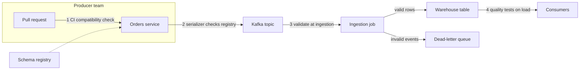
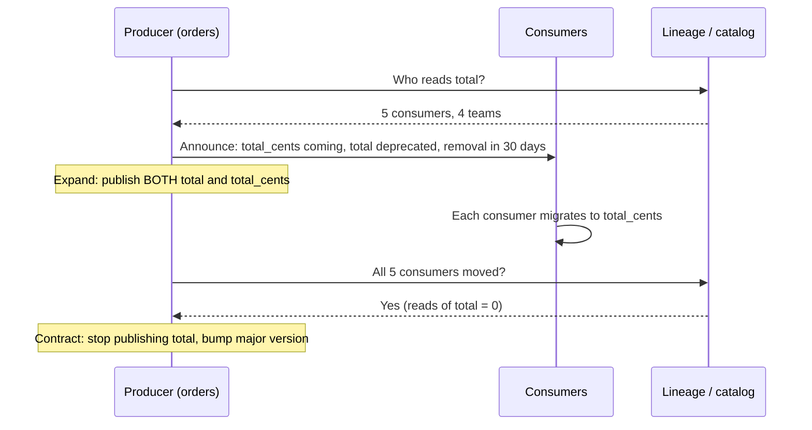

# Data Contracts

Sooner or later an interviewer asks, "What happens when the team that owns the source changes it?" Candidates who answer "we'd monitor for schema drift" are describing how you find out after the damage. Candidates who talk about contracts are describing how you stop the damage, and that is the answer that sounds like someone who has been burned.

## The Problem

The meal-kit platform's orders service publishes an `order_placed` event to Kafka. Downstream, a pipeline loads it into a warehouse table, `orders`, and five things depend on that table: the finance revenue report, the demand-forecast model, a fraud dashboard, a marketing attribution job, and a weekly board metric.

On a Tuesday, a backend engineer on the orders team cleans up the event. The field `total` held dollars as a decimal (`62.40`). It confuses people, so she renames it `total_cents` and stores integers (`6240`). Her unit tests pass. Her service deploys at 14:00. Nobody told the data team, because nobody knew the data team read that field.

What happens next depends on which of two things she did:

- **She renamed the field.** The pipeline's transform reads `total`, finds nothing, and either crashes or loads nulls. The [schema check](06-monitoring-and-alerting.md) fires at 14:30. You lose an afternoon, but you know about it.
- **She kept the name `total` and changed the unit to cents.** Every check goes green. The schema is identical, the field is a number, no nulls. Revenue is reported as 100 times too high and the board metric goes out on Friday.

The second failure is the dangerous one. The root cause is the same in both: **the producer (the team that owns the source and writes the data) and the consumers (everyone who reads it) have an agreement that exists only in people's heads.**

A **data contract** writes that agreement down, versions it, and checks it automatically before a change ships. It turns "the orders team broke us" into "the orders team's CI refused to merge a change that would have broken us".

## What a Contract Contains

A contract is not just a schema. A schema says the field is a `double`. A contract says what it means and what is promised around it.

| Part | What it states | Meal-kit example |
|---|---|---|
| **Schema** | Field names, types, which fields may be null | `total_cents`: integer, required |
| **Semantics** | What a field means: units, time zone, allowed values | "Order total in cents, tax included, in the order's currency" |
| **Quality rules** | Checks the data must pass | `order_id` unique; `total_cents >= 0`; `currency` in a fixed list |
| **Delivery** | How fresh and how complete | "Events arrive within 5 minutes, 99.9% complete per day" |
| **Ownership** | Who to ask, who gets told | Owning team, on-call channel |
| **Change policy** | How changes are versioned and announced | "30 days' notice before removing a field; additive changes any time" |

Here is the shape it usually takes, as a file that lives in the producer's repository next to the code:

```yaml
contract: orders.order_placed
version: 2.1.0
owner: team-orders
schema:
  - name: order_id      # string, unique per order
    type: string
    required: true
  - name: total_cents   # integer, tax included
    type: long
    required: true
  - name: currency
    type: string
    required: true
    allowed: [USD, EUR, GBP]
quality:
  - total_cents >= 0
delivery:
  max_delay: 5m
change_policy:
  breaking_change_notice: 30d
```

Do not memorize the format; there is no single standard. What interviewers want is that you know a contract has more than a schema in it, because the semantic part (units, meaning) is the part that fails silently.

## Schema Compatibility: What Counts as a Breaking Change

"Breaking" depends on **who upgrades first**. Say version 1 of the schema has `order_id` and `total_cents`, and you add an optional `coupon_code` to make version 2. Two cases:

- If **consumers** are upgraded to v2 before the producer starts sending it, they must still cope with old v1 messages that lack `coupon_code`. If they handle that by using a default value, the change is safe in that direction.
- If the **producer** starts sending v2 while consumers still run v1 code, those consumers receive a field they have never heard of. If they ignore unknown fields, the change is safe in that direction too.

Which direction needs to be safe, and for how many past versions, is exactly what a compatibility mode chooses.

### The compatibility modes

A **schema registry** (Confluent Schema Registry, AWS Glue Schema Registry and Apicurio are common ones) is a service that stores every version of every schema, usually one per Kafka topic or "subject". When a producer tries to register a new version, the registry compares it with earlier versions and rejects it if it violates the **compatibility mode** configured for that subject.

The names confuse everyone, so anchor them on one question: *who can read whose data?*

| Mode | Guarantee | Typical safe changes | Upgrade order |
|---|---|---|---|
| **BACKWARD** | Readers using the **new** schema can read data written with the **previous** version | Add a field with a default; delete a field | Consumers first, then producers |
| **FORWARD** | Readers using the **previous** schema can read data written with the **new** schema | Delete a field that had a default; add a field | Producers first, then consumers |
| **FULL** | Both of the above, against the previous version | Add or delete only fields that have defaults | Any order |
| **BACKWARD_TRANSITIVE** | BACKWARD, checked against **all** earlier versions, not just the last | Same as BACKWARD | Consumers first |
| **FORWARD_TRANSITIVE** | FORWARD, checked against all earlier versions | Same as FORWARD | Producers first |
| **FULL_TRANSITIVE** | FULL, checked against all earlier versions | Same as FULL | Any order |
| **NONE** | No check at all | Anything | You are on your own |

Two details to get right:

**1. Non-transitive modes compare only with the latest version.** A chain of changes can each look fine against its predecessor while v3 is incompatible with v1. That does not matter if every consumer is always on the latest version. It matters a lot when a consumer **replays** a topic from the beginning, because that topic holds v1, v2 and v3 messages together. Reading all history with the newest schema requires BACKWARD_TRANSITIVE. The same applies to a table in a warehouse that holds years of data written under old versions.

**2. BACKWARD is the usual default, and it fits Kafka well.** (Confluent Schema Registry defaults to BACKWARD, which is why you see it everywhere.) Consumers upgrade first, then the producer starts writing the new shape. You can also rewind a consumer without surprises, as long as you choose the transitive variant.

> [!NOTE]
> The rules above are the Avro ones, the format registries are most often used with. Details (for example, what counts as a default) vary by serialization format: Protobuf and JSON Schema each differ. The "who can read whose data" framing is stable across them. If an interviewer pushes on a format-specific case, say so and reason from that framing.

### A worked example

Version 1 of `order_placed`: `order_id`, `total_cents`.

| Change | BACKWARD | FORWARD | FULL |
|---|---|---|---|
| v2 adds `coupon_code`, **with a default** of null | Allowed: new readers fill the default for old messages | Allowed: old readers ignore the extra field | Allowed |
| v2 adds `coupon_code`, **required, no default** | Rejected: new readers cannot read old messages that lack it | Allowed: old readers ignore it | Rejected |
| v2 removes `total_cents` (it had no default) | Allowed: new readers just ignore it in old messages | Rejected: old readers still expect it | Rejected |
| v2 changes `total_cents` from `long` to `string` | Rejected | Rejected | Rejected |
| v2 renames `total_cents` to `amount_cents` | Rejected: a rename is a delete plus a required add | Rejected | Rejected |

Notice the last two rows. A rename or retype is a breaking change in every mode. And notice what the table cannot show: changing `total` from dollars to cents while keeping the same type passes **every** mode. A registry checks structure, not meaning. That gap is what the rest of the contract (semantics, quality rules) and the enforcement points below are for.

## Enforcement Points: Where the Contract Is Checked

A contract nobody checks is documentation. Enforcement works best at several points, each catching what the earlier one cannot. The earlier the check, the cheaper the fix.



1. **At the producer's pull request (CI).** The cheapest place. The contract file or schema is compared against the registered version, and the build fails if the change is incompatible. The engineer finds out in minutes, before anything ships. This is the control that would have stopped our Tuesday rename. It also needs the producer's team to run it, which is a people problem as much as a technical one.
2. **At publish time (the registry).** The producer's serializer registers or looks up the schema and the registry refuses an incompatible one. This is the safety net if CI was skipped. It only protects you if producers must go through the registry-aware serializer (auto-registration locked down, or the registry or broker enforcing it); a producer writing raw bytes bypasses it.
3. **At the ingestion boundary.** Your job validates each event against the contract: types, required fields, allowed values. Events that fail go to a **dead-letter queue** (a side topic or table that holds rejected events for inspection and replay) instead of failing the whole stream or polluting the warehouse. This is the first point that can check rules expressed as data checks, such as `total_cents >= 0`, which a registry cannot see. See [Ingestion Patterns](02-ingestion-patterns.md).
4. **At the table.** Table formats such as Iceberg and Delta Lake can reject a write whose schema does not match (called **schema enforcement**), and transformation tools can assert column names, types and tests on the model that consumers read. This protects the consumer-facing table even if the earlier checks were bypassed.

The last line of defence is the [monitoring](06-monitoring-and-alerting.md) you already designed. Contracts reduce how often it fires but cannot replace it: a unit change like the cents example still needs a [distribution check](06-monitoring-and-alerting.md) to be caught (average order value jumping from $62 to $6,200).

## The Breaking-Change Workflow

Sometimes a breaking change is the right thing to do. `total` really should be in cents. The question is how to do it without a Tuesday afternoon of fire-fighting. The standard answer is **expand and contract**: never replace in place; add the new shape next to the old one, move everyone over, then remove the old one.



The steps:

1. **Find who is affected.** Use [lineage](04-data-lineage.md) or the catalog to list the consumers and their owners. Without this step you are guessing, and you will miss the marketing job that nobody remembers.
2. **Announce a deprecation date** that matches the change policy in the contract (here, 30 days).
3. **Expand.** Publish `total_cents` alongside the old `total`. This is an additive change, allowed under every compatibility mode, so nothing breaks.
4. **Migrate consumers.** Each team switches at its own pace within the window. Track progress by checking which consumers still read the old field.
5. **Contract.** Once nobody reads `total`, stop publishing it and bump the major version.

When a change is too big to express as added fields (a new key structure, a different event grain), use the same idea one level up: publish to a new topic or table version (`order_placed_v2`) in parallel, migrate consumers, then retire v1. It costs double storage and writes during the overlap, a fair price for no outage.

### Versioning the contract itself

Use **semantic versions** (MAJOR.MINOR.PATCH) on the contract: a patch fixes documentation, a minor adds something optional, a major breaks something. The change policy then has teeth: a major bump needs the migration window and consumer sign-off.

## Who Owns What

The reason contracts fail in practice is rarely technical. Two rules keep them alive:

- **The producer owns the contract.** They write it, version it, and run the check in their CI. If consumers have to police producers, it will not happen. Consumers contribute by stating what they rely on (a field, a unit, a freshness window); the producer decides what to promise.
- **Not every dataset needs one.** Put contracts on the **boundaries** where one team's output becomes another team's input, especially source events and published tables other teams build on. An internal staging table that only your own job reads does not need a contract.

This is also the bridge to [data mesh](../03-architecture-patterns/06-data-mesh.md), where each domain team publishes data products with explicit contracts. If an interviewer takes you there, you already have the vocabulary.

## In the Interview

**When.** Contracts come up in three places: when you list sources and one belongs to another team ("who controls this schema?"), in the pipeline step when you design ingestion, and as a deep dive on "how do you handle upstream changes?". Raise it yourself once, briefly, when you draw an ingestion box fed by an external team's events.

**How to say it.**

1. Name the risk with a case: "If the orders team changes a field's unit and the type stays the same, no schema check catches it."
2. Say what you'd do: "I'd agree a contract with the producer: schema plus semantics plus freshness, versioned, with an owner."
3. Say where it's enforced: "Compatibility check in the producer's CI, the registry as a backstop, validation with a dead-letter queue at ingestion, and tests on the serving table."
4. Name the mode and justify it: "BACKWARD transitive, because we replay history and consumers upgrade first."
5. Describe the change workflow: "Additive first, deprecate, migrate consumers using lineage, then remove."

**What interviewers listen for:**

- You know that a schema check misses semantic changes, and say how you'd catch them.
- You can explain the compatibility modes by *who reads whose data*, not by reciting names.
- You put enforcement as far upstream as possible and keep monitoring as the fallback.
- You treat a breaking change as a coordinated migration, not a deploy.

**Phrases that work:**

- "The registry checks structure; the contract has to cover meaning."
- "I'd start with BACKWARD, and go transitive if consumers replay from the beginning of the topic."
- "Expand, migrate, contract. We never rename in place."

> [!TIP]
> If you only have 30 seconds: "A contract is the producer's versioned promise about schema, meaning and freshness. It is checked in their CI and at the registry, validated again at ingestion, and breaking changes ship as add-then-remove with a deprecation window."

**By level.** Mid-level: why contracts exist, a schema registry, BACKWARD versus FORWARD in plain words. Senior: transitive modes and replay, layered enforcement, expand/contract with lineage. Staff+: ownership and incentives, choosing which boundaries deserve a contract.

## Common Mistakes

> [!WARNING]
> **Treating the schema as the contract.** A registry cannot see that dollars became cents. Add semantics (units, allowed values) and quality rules, and keep a distribution check in monitoring.

> [!WARNING]
> **Mixing up BACKWARD and FORWARD.** BACKWARD means *new* readers can read *old* data, so consumers upgrade first. Candidates often reverse this. Say it as "who can read whose data".

> [!WARNING]
> **Using non-transitive compatibility on a topic you replay.** Each version passes against the previous one, yet a consumer reading from offset 0 hits v1 data it cannot decode. Replayed or long-retained data needs the transitive variant.

> [!WARNING]
> **Renaming or retyping in place.** There is no compatibility mode under which that is safe. Add the new field, migrate, then remove the old one.

> [!WARNING]
> **Consumers policing producers.** If the only check is a downstream alert, the producer finds out last. Put the check in the producer's pipeline and give the producer ownership.

## Key Takeaways

- A data contract is a producer-owned, versioned agreement covering schema, meaning, quality and delivery. The schema alone is not enough, because the worst breaks (a changed unit) keep the schema identical.
- Compatibility modes answer "who can read whose data": BACKWARD (new reader, old data; consumers upgrade first), FORWARD (old reader, new data; producers first), FULL (both). Transitive variants check against every earlier version, which you need for replay and long-lived tables.
- Enforce at several points, as far upstream as possible: producer CI, schema registry, ingestion validation with a dead-letter queue, then table-level checks. Monitoring is the fallback.
- Ship breaking changes as expand, migrate, contract, using lineage to find consumers and a deprecation window to give them time.
- Put contracts on team boundaries, owned by the producer, not on every internal table.

## Where to Go Next

- [Monitoring and Alerting](06-monitoring-and-alerting.md): the fallback that catches what contracts miss.
- [Data Lineage](04-data-lineage.md): finding the consumers affected by a change.
- [Ingestion Patterns](02-ingestion-patterns.md): validating events and dead-lettering at the boundary.
- [Data Mesh](../03-architecture-patterns/06-data-mesh.md): contracts as the interface of domain-owned data products.
- [Data Quality Monitoring](../05-breakdowns-core/09-data-quality-monitoring.md): a full design where contract checks are one layer.
