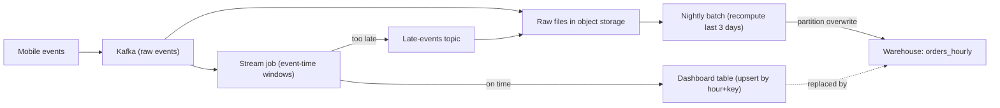

# Late-Arriving Data

Every real pipeline receives data that shows up after you thought you were done with that hour, that day, or that customer. Interviewers ask about it because the textbook answer ("use a watermark") is easy to recite and easy to get wrong, and because your answer reveals whether you have ever had to explain a changed number to a finance team.

## The Problem

A food-delivery company shows a live dashboard of orders per hour. At 11:15 the 10:00 to 11:00 bucket reads 41,200 orders, and a manager screenshots it. At 13:10 someone opens the same bucket and it reads 41,950. Nobody changed the code. What happened?

About 750 events came from phones in a tunnel, in a basement or on a flaky network. The app buffers events locally and uploads them when the connection returns. Those orders happened at 10:40, but the pipeline did not see them until 13:00.

The same problem shows up in batch, in two other forms:

- **A fact arrives before the thing it refers to.** An order row references `customer_id = 88213`, but the customer row hasn't reached the warehouse yet. The join finds nothing.
- **A whole file arrives days late.** A courier partner's CSV for 12 October lands on 20 October, after the daily jobs for those dates finished long ago.

None of these come from broken code. Networks are slow, systems sync on their own schedule, and partners send files when they send them. Your design has to say, up front, what happens to data that is late, and how late is too late.

## Two Clocks: Event Time and Processing Time

**Event time** is when something actually happened, as recorded by the source (the order was placed at 10:40). **Processing time** is when your system handles it (the pipeline read the event at 13:00). Processing time is always later, and the gap between them is the **lateness** of that event.

Here is the tunnel story as a timeline. Four orders, one pipeline:

| Order | Event time (happened) | Processing time (pipeline saw it) | Lateness |
|---|---|---|---|
| A | 10:12 | 10:12:02 | 2 seconds |
| B | 10:40 | 10:40:01 | 1 second |
| C | 10:41 | 13:00 | 2 h 19 min (phone in a tunnel) |
| D | 11:02 | 11:02:03 | 3 seconds |

Order C is **out of order** (it arrives after D, though it happened before) and it is **late** (the 10:00 to 11:00 bucket has been reported for two hours). Out of order and late are related, but they are different problems. A few seconds of disorder is normal and easy to absorb. Two hours of lateness forces a decision.

Which clock should a metric use? For "orders per hour", **event time**: you want orders that happened in that hour, no matter when the network delivered them. If you bucket by processing time, the tunnel order is counted at 13:00 in the wrong hour. The number is stable and reproducible, but it describes your pipeline, not your business. Processing time is fine for questions about the pipeline itself ("how many events did we ingest this minute?").

> [!NOTE]
> Storing both timestamps on every row (`event_time` from the source, `ingested_at` set by you) costs almost nothing and makes lateness measurable. Without `ingested_at`, you cannot answer "how late is our data?" with anything other than a guess.

## Watermarks: When Is a Window Done?

Counting by event time creates a new problem. When the pipeline sees an event at 11:02, can it finalize the 10:00 to 11:00 count? Maybe order C is still in a tunnel. A streaming system needs a rule for "I don't expect more events for this window".

That rule is the **watermark**: the stream processor's running estimate of how far event time has progressed. The usual choice is the largest event time seen so far, minus a fixed allowance for disorder:

```
watermark = (max event time seen so far) - 10 minutes
```

A **window** is a slice of event time (here, the hour 10:00 to 11:00) for which the processor keeps a running aggregate. The processor emits the result for a window and discards its state once the watermark passes the end of the window. With a 10-minute allowance:

| Processing time | Event just seen | Max event time | Watermark | What happens |
|---|---|---|---|---|
| 10:58 | order at 10:57 | 10:57 | 10:47 | 10:00 window still open |
| 11:02 | order D at 11:02 | 11:02 | 10:52 | still open: an order from 10:55 could arrive |
| 11:11 | order at 11:10:30 | 11:10:30 | 11:00:30 | watermark passes 11:00, so the 10:00 window **closes** and emits 41,200 |
| 13:00 | order C at 10:41 | 12:59 | 12:49 | C is behind the watermark: it is **late** |

The result for 10:00 to 11:00 came out at about 11:10, not at 11:00. The watermark delay is a latency cost you pay for completeness. And C, two hours late, was not covered by the 10-minute allowance, so something else must handle it.

> [!NOTE]
> This is the stream processor's watermark. It is unrelated to the "watermark column" from [Ingestion Patterns](02-ingestion-patterns.md), a stored `updated_at` value that tells a batch load where it stopped last time. Same word, different mechanism. Say which one you mean.

### Choosing the allowance from data

The delay is a trade-off with no free setting: a short delay gives fast results and more late events, a long one gives fewer late events and slower results. Don't pick 10 minutes because it sounds nice. Measure the lateness distribution from the two timestamps you stored:

| Percentile of events | Lateness |
|---|---|
| p50 | 1 second |
| p95 | 20 seconds |
| p99 | 8 minutes |
| p99.9 | 3 hours |

A 10-minute allowance catches about 99% of events. Waiting 3 hours to catch the last 0.1% means every dashboard tile is 3 hours stale to protect roughly 1 order in 1,000. For a live dashboard that is the wrong trade. You choose the short allowance and handle the tail another way.

### Allowed lateness: a second chance after the window fires

Many engines let a window be emitted early and then fixed. **Allowed lateness** keeps a window's state around for an extra period after the watermark passes it. If a late event arrives within that period, the window is recomputed and a corrected result is emitted. After it, state is dropped and the event is truly "too late".

With a 10-minute watermark delay plus one hour of allowed lateness, the 10:00 window emits 41,200 at 11:10, and emits an update if an order from that hour shows up before about 12:10. This costs state memory: you hold open windows for longer. With 20,000 events/s and per-window counts by city and restaurant, an extra hour of open state is usually manageable. Keeping full event lists per window for a day is not.

Apache Flink and Spark Structured Streaming both implement watermarks. Flink adds allowed lateness and a side output for too-late events as built-in window features; see [Flink](../04-technology-deep-dives/08-flink.md). Spark has no allowed-lateness setting: its watermark is the cutoff, events behind it may be dropped, and in append output mode a window is emitted only once, after the watermark passes its end. Details vary by engine and version, so state the concept first and the tool second.

> [!WARNING]
> A watermark that moves only when events arrive can stall. In Flink, the watermark of a job reading many Kafka partitions is the **minimum** across them, so one quiet or idle partition holds every window open. Flink has an idle-source setting for this; Spark instead derives one watermark from the maximum event time it has seen. Mentioning it unprompted is a strong signal.

## What To Do With Data That Is Too Late

An event behind the watermark and past allowed lateness is not a rare edge case. At 99.9% coverage on 20,000 events/s that is still about 20 events per second, or 1.7 million a day. Your options:

| Strategy | How it works | Cost | Use when |
|---|---|---|---|
| **Drop and count** | Discard; increment a "dropped late events" metric | Numbers are slightly low forever | Approximate metrics (live counters, trends) |
| **Side output** | Route late events to a separate stream or table instead of dropping | Extra storage; someone must consume it | You want a correction path or an audit trail |
| **Update the result** | Re-emit the window with the new count; the sink upserts by `(window, key)` | Downstream sees numbers change; needs a keyed sink | Dashboards that can tolerate revisions |
| **Batch correction** | Stream gives a fast, approximate answer; a batch job recomputes from the raw event log and overwrites | Two code paths to keep equal | Numbers someone finance-related will quote |
| **Wait longer** | Larger watermark delay | Staleness for every consumer | Rarely right on its own |

Most mature designs combine the middle three: **stream for speed, batch for truth**.



Read it left to right. Everything lands in a durable raw log first, so nothing is truly lost. The stream job publishes fast results from on-time events and sends the rest to a side topic. A nightly job recomputes the last few days from the raw data, including late events, and overwrites those partitions. The dashboard shows the stream number with a "provisional" label, and reports read the warehouse. This is the same idea as the [Lambda architecture](../03-architecture-patterns/01-lambda-architecture.md), used here for a narrow purpose. Because the nightly job overwrites whole partitions, running it twice gives the same answer (see [Backfill and Reprocessing](03-backfill-and-reprocessing.md)).

If events can also be duplicated on their way in (they usually can, and a phone that retries an upload will do it), the correction path needs [deduplication](09-deduplication-at-scale.md) before counting.

## Late Data in Batch

Batch jobs don't have watermarks, but they have the same decision in a different shape: which date does a row belong to, and when do you stop looking for stragglers?

**Partition by event date, not arrival date.** If a file lands on 20 October and holds orders from 12 October, a partition per arrival day puts them in the wrong place and every date-range query is silently wrong. Partition by the event's own date, and the late rows go where they belong.

**Reprocess a lookback window.** Keep each daily run idempotent, then have it also re-run the previous N days, where N comes from your lateness data. If 99.5% of rows arrive within 2 days, a 3-day lookback (today plus the 3 previous days) is cheap, because each run rewrites 4 partitions with a partition overwrite, and it catches nearly everything. Cost is roughly 4x the compute of a one-day run, which is usually small compared with the cost of a wrong number.

**Close the books on purpose.** Even with a lookback, a file for 12 October may show up on the 20th. Decide in advance: "Daily revenue is final after 7 days. Later arrivals are loaded into a correction table and a monthly adjustment is reported." Finance teams already work this way, and saying it shows you know that a number needs an owner and a closing time. For truly late arrivals, trigger a targeted [backfill](03-backfill-and-reprocessing.md) of the affected dates and tell downstream consumers the partition changed.

### Late-arriving dimensions

The other batch form is a fact that references a dimension row (a customer, a product) that has not been loaded yet. A **dimension** is a descriptive table, such as `customers`, that facts join to; see [Data Model Design](../01-the-framework/06-data-model-design.md). A fact arriving first is also called an early-arriving fact, the same problem seen from the fact's side.

A plain inner join drops those orders. A left join keeps them but with null customer attributes, which then break `GROUP BY country`. Three ways to handle it:

| Approach | How it works | Trade-off |
|---|---|---|
| **Inferred member** | Insert a placeholder dimension row for `customer_id = 88213` with unknown attributes, flagged `is_inferred = true`. When the real row arrives, update it in place | Facts always join and are never lost. Reports show "Unknown" until it is fixed |
| **Quarantine and retry** | Park unmatched facts in a holding table; re-run the join each hour until the dimension arrives or a limit passes | Facts are late but never wrong. Needs a retry loop and an alert when the quarantine grows |
| **Default key** | Join to a single "unknown" row (key `-1`) | Simplest. Loses the link, so you need a repair job to restore it |

I'd choose the inferred member for the usual warehouse case: the fact is kept, the key is correct from day one, and only attributes are provisional.

If the dimension is an **SCD Type 2** (a table that keeps old versions with validity dates), late data gets harder. Suppose a customer moved from Pune to Mumbai on 1 October, but the change reaches you on 5 October. Orders from 1 to 4 October were joined to the Pune row. To be correct you must close the old version at 1 October and re-join those four days of facts. That is a small backfill, and it is the main reason to design dimension loads with a lookback too.

## In the Interview

**When it comes up.** Almost always in the deep-dive step ([Deep Dives](../01-the-framework/08-deep-dives.md)) after you draw a streaming path. The interviewer says, "What if events arrive late?" It also comes up earlier if the prompt mentions mobile apps, IoT devices, partners or cross-region data. Raise it yourself once, in the requirements step, as a number: "How late can an event be, and how wrong may the dashboard be in the meantime?" See [Requirements Gathering](../01-the-framework/03-requirements-gathering.md).

**A strong answer, in order:**

1. Name the clock. "We aggregate by event time, because the business question is when the order happened."
2. Give the mechanism and a number. "A watermark with a 10-minute delay, picked from our measured lateness: that covers about 99% of events. Windows close roughly 10 minutes after their end."
3. Say what happens to the rest. "Late events within an hour update the window. Beyond that they go to a late-events topic, and a nightly job recomputes the last 3 days from raw data."
4. State the user-visible contract. "The dashboard is provisional for 24 hours. The warehouse table is final after 3 days."
5. Offer the monitoring. "I'd track late-event rate and p99 lateness. If the late rate doubles, an upstream problem is likely." More on this in [Monitoring and Alerting](06-monitoring-and-alerting.md).

**What interviewers listen for:**

- You treat lateness as a trade-off with numbers, not as a flag to turn on.
- You know "late" and "out of order" are different, and that waiting longer costs freshness.
- You keep the raw data, so correction is always possible.
- You say who is told when a number changes.

> [!TIP]
> If the prompt says "real-time and exactly correct", point out the tension. You can have fast, or complete, or both with revisions. A good answer picks a lane per consumer: the live view is fast and provisional, the finance report is slower and final.

For a worked example with a live dashboard, see [Real-Time Dashboard](../05-breakdowns-core/04-real-time-dashboard.md).

## Common Mistakes

> [!WARNING]
> **Aggregating by processing time and calling it event time.** It is easy: `GROUP BY date_trunc('hour', now())`. It gives stable numbers that answer the wrong question, and replays then put old events in today's buckets.

> [!WARNING]
> **Setting the watermark delay by feel.** "Five minutes should be fine" fails when the p99 is 8 minutes. Measure lateness first, and show you'd keep measuring.

> [!WARNING]
> **Silently dropping late events.** If you drop, count and alert on it. A dropped-events metric that nobody sees is a data-loss bug with a nicer name.

> [!WARNING]
> **Partitioning batch data by arrival date.** Late files then land in the wrong partition, and nothing fails. Partition by event date and use a lookback.

> [!WARNING]
> **Forgetting dimensions.** Candidates handle late events and then use an inner join to a dimension, silently losing facts whose customer row hasn't arrived. Say what the join does with a missing key.

## Key Takeaways

- Event time is when it happened; processing time is when you saw it. Aggregate by event time, and store both timestamps so lateness can be measured.
- A watermark is the stream processor's estimate of event-time progress. It closes windows, and its delay trades freshness for completeness. Pick the delay from the measured lateness distribution, not by guessing.
- Events beyond the watermark are normal. Drop-and-count, side output, update-in-place and batch correction are your tools, and the common design is stream for speed with a batch recompute for truth.
- In batch, partition by event date, rerun a lookback window idempotently, and decide when a number is final.
- Facts that beat their dimension are handled with inferred members or quarantine, never with a silent inner join.

## Going Further

- Retractions and changelog streams, for downstream systems that must delete or replace an earlier result rather than overwrite it.
- Session windows, whose boundaries move when late events arrive.
- Bitemporal tables, which record both when a fact was true and when you learned it.

Related lessons: [Ingestion Patterns](02-ingestion-patterns.md), [Backfill and Reprocessing](03-backfill-and-reprocessing.md), [Deduplication at Scale](09-deduplication-at-scale.md), [Monitoring and Alerting](06-monitoring-and-alerting.md).
