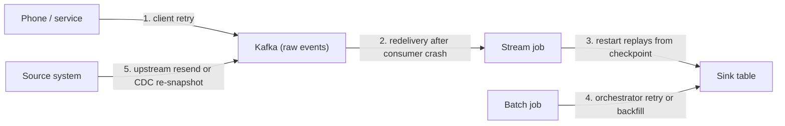
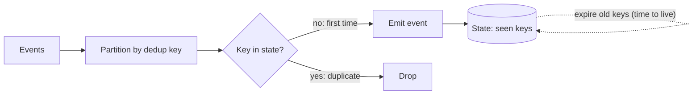
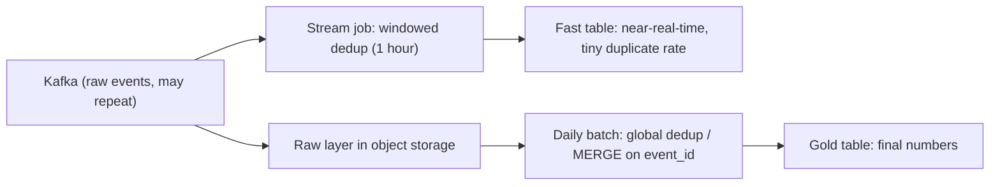
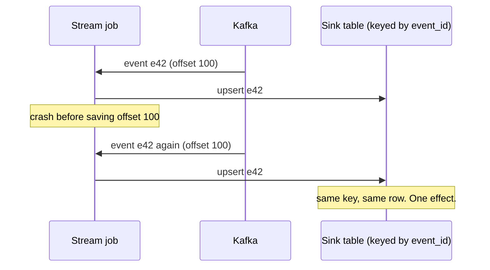

# Deduplication at Scale

Every pipeline built on retries, replays or message logs produces duplicates sooner or later, and interviewers know it. They ask about deduplication to see whether you can answer three questions with numbers: what makes two records "the same", how long you remember what you have seen, and what that memory costs.

## The Problem

A payments app counts completed purchases for a finance dashboard. On Monday the dashboard says 1,000,000 purchases. The payment provider's own report says 997,400. The 2,600 extra (0.26%) are not a bug in anyone's arithmetic. They are the same purchases, counted twice.

Nobody wrote a bad line of code. Every piece of plumbing that promises not to lose data does it by sending data again when unsure.

**Deduplication** (dedup) means collapsing records that describe the same real-world event into one. It sounds like `SELECT DISTINCT`. At 1 billion events a day it is a different problem, because "have I seen this before?" requires remembering everything you have seen.

## Where Duplicates Come From

Know which source you are fixing; each leaves a different kind of duplicate.



| # | Source | Example | What the duplicate looks like |
|---|---|---|---|
| 1 | **Client retry** | A phone sends an event, the response times out, the app sends it again. The server had received the first. | Same event ID, arrives seconds to hours apart. |
| 2 | **At-least-once delivery** | A consumer crashes after processing but before saving its position, so it re-reads recent messages. | Identical copies, close together in time. |
| 3 | **Replay after failure** | A stream job restarts from its last checkpoint and reprocesses events it had already written. | A burst of copies of the last few seconds or minutes. |
| 4 | **Batch retries and backfills** | An append-only job fails halfway and is rerun, or a backfill overlaps data already loaded. | A whole partition's rows appear twice. |
| 5 | **Upstream resends** | A partner sends yesterday's file again, or CDC (change data capture) re-snapshots a table after a connector reset. | Copies days apart, sometimes with changed values. |

[At-least-once delivery](02-ingestion-patterns.md) is the default for event streams, so rows 1 to 3 are not edge cases. They are the normal state of a healthy system under occasional failure.

Duplicates are not always identical: a retried event may carry a new `received_at`, and a resent file may hold a corrected value. "Same event" is a rule you define.

## The Dedup Key

To drop duplicates you need a rule for "same". That rule is the **dedup key**: the column or set of columns that identifies one real-world event. Two records with the same key are the same event.

Good keys, best first:

1. **An ID created at the source, once, before any retry.** The phone generates a UUID (a random 128-bit identifier, 16 bytes) when the user taps "buy", and every retry carries that same ID. This is the only key that survives all five sources above.
2. **A natural business key.** `(order_id, line_number)` or `(device_id, sensor_timestamp)`. Fine when the source guarantees it is unique.
3. **A hash of the content.** Hash every field that defines the event, such as `sha256(user_id, item_id, event_time, amount)`. Works when no ID exists, but any field that changes between retries (a `received_at` stamp, a session counter) makes the hash differ and the duplicate slips through.

The trap is a key *generated downstream*. If your ingestion service stamps each event with a fresh ID on arrival, a retried event gets a different ID the second time and the copies look like two events. The ID must come from the producer's side of the retry.

> [!TIP]
> In an interview, ask early: "Does each event carry a unique ID generated at the source?" If yes, say "that's my dedup key." If no, say you would ask the producing team to add one, and fall back to a content hash in the meantime. That question is worth more than any algorithm in this lesson.

## Batch Deduplication

Batch is the easy case, because all the data is at rest and you can look at all of it. Two patterns cover nearly everything.

**Pattern 1: keep one row per key with a window function.** When a table has accumulated duplicates, rewrite it keeping the first (or latest) row per key:

```sql
SELECT * EXCEPT (rn)
FROM (
  SELECT *,
         ROW_NUMBER() OVER (
           PARTITION BY event_id
           ORDER BY received_at ASC     -- keep the earliest copy
         ) AS rn
  FROM raw_events
  WHERE event_date = '2026-11-01'
) AS t
WHERE rn = 1;
```

(`SELECT * EXCEPT` works in BigQuery and Databricks; Snowflake and DuckDB spell it `EXCLUDE`; Postgres and most others need the column list. The `ROW_NUMBER` idea is the same everywhere.) Scope it to one partition at a time and write the result with a partition overwrite, so it is idempotent (see [Pipeline Design](../01-the-framework/07-pipeline-design.md)).

**Pattern 2: `MERGE` into a deduplicated target.** When new batches arrive over time, merge them into a table keyed by the dedup key, from the same pipeline-design lesson:

```sql
MERGE INTO purchases t
USING (SELECT * FROM staging_purchases
       QUALIFY ROW_NUMBER() OVER (PARTITION BY purchase_id
                                  ORDER BY received_at DESC) = 1) s
ON t.purchase_id = s.purchase_id
WHEN MATCHED THEN UPDATE SET status = s.status, amount = s.amount
WHEN NOT MATCHED THEN INSERT *;
```

(`QUALIFY` filters on a window function without a wrapping subquery. It works in Snowflake, BigQuery, Databricks and DuckDB, but not in Postgres or MySQL, where you use the subquery from Pattern 1. `INSERT *` is Spark/Delta/Iceberg shorthand; BigQuery and Snowflake want an explicit column list.)

The inner query is not optional. `MERGE` needs *at most one source row per key*, so you dedupe inside the batch first and let `MERGE` handle duplicates against what is already stored. Skip it and many engines raise an error or, worse, pick one row arbitrarily.

**Cost.** Both patterns shuffle the data by the key, which at 1 TB a day is a normal nightly job. Limit the `MERGE` with a partition filter on the target (for example the last 7 event dates), or the engine scans the whole target to look for matches. That is the batch version of the state-size question below: how far back do I look?

## Streaming Deduplication: Windowed vs Global

A stream has no "all the data". It has the event in front of it and whatever it remembered. To tell whether an event is new, the job keeps **state**: data the job holds between events, here the set of keys it has already seen. It lives in the job's memory or in a local embedded store such as RocksDB, and is saved periodically in **checkpoints** (snapshots of state plus input position) so a restart does not lose it. Flink, Spark Structured Streaming and Kafka Streams all work roughly this way.



Two things in the diagram matter. Events are **partitioned by the dedup key first**, so all copies of one event land on the same worker and that worker's state is enough to spot them (the same idea as in [Partitioning](01-partitioning.md)). And old keys **expire**, which sets how much state you carry.

### Windowed dedup

**Windowed dedup** remembers each key for a fixed period, say 24 hours, then forgets it. It catches any duplicate that arrives within the window and misses any duplicate that arrives later.

### Global dedup

**Global dedup** remembers every key ever seen, forever. It catches everything, and its state grows without bound.

### How big is the state?

Do this estimate aloud; interviewers want to hear it. Use the numbers from [Key DE Numbers](10-key-de-numbers.md): 1 billion events a day is about 12k events/sec on average.

Each remembered key costs the key itself (16 bytes for a UUID) plus a timestamp for expiry and storage overhead. Call it about **50 bytes per key**.

| Dedup scope | Keys held | State size | Where it can live |
|---|---|---|---|
| 1 hour window | ~42 million | ~2 GB | Memory, one machine could do it |
| 24 hour window | 1 billion | ~50 GB | Local NVMe disks across a handful of workers (each owns a share of the keys) |
| 7 day window | 7 billion | ~350 GB | Same, spread across more workers; checkpoints get slower |
| Global, 1 year | ~365 billion | ~18 TB | Not stream state. Use a lookup against a keyed store, or dedup in batch. |

State grows linearly with *window length x event rate*. Halving the window halves the bill. Global dedup on a high-volume stream almost never belongs inside the stream job.

### Choosing the window

Do not pick "24 hours" by habit. The window must cover **how late a duplicate can arrive**, which follows from the sources above:

- Consumer redelivery and checkpoint replays arrive within minutes.
- Client retries arrive within the retry horizon of the app. A phone that was offline can retry hours later; this is the same tunnel scenario as in [Late-Arriving Data](08-late-arriving-data.md).
- Upstream resends can arrive days later.

Measure it: compare event IDs in a day of raw data and plot the gap between first and second copy. If 99.9% of duplicates appear within 30 minutes, a 1-hour window removes nearly all of them at 1/24th of the state of a day-long window. A second layer, described next, catches the rest.

### Two layers is the usual answer

Streaming dedup is an optimization for freshness; batch dedup is the guarantee:



The stream layer keeps the live dashboard nearly right. The raw layer keeps every copy, and the nightly job dedups it with `MERGE` over the last N days, so the final number is exact. This is the same two-path shape as the late-data correction in [Late-Arriving Data](08-late-arriving-data.md) and [Lambda architecture](../03-architecture-patterns/01-lambda-architecture.md) at small scale. Because you keep the raw copy, a duplicate that slips past the window is a wrong number for a few hours, not forever.

### When the state is too big: probabilistic filters

A **Bloom filter** answers "have I seen this key?" with "definitely not" or "probably yes". For 1 billion keys at a 1% false-positive rate it needs about 1.2 GB, against 50 GB for exact state. The catch: a false positive drops a genuinely new event. That is fine for "approximately unique visitors", not for payments. Offer it only when the business can tolerate losing about 1% of events.

## Exactly-Once vs Effectively-Once

Interviewers like to ask: "Does Kafka give you exactly-once?" The honest answer has three parts.

**Delivery is at-least-once.** A network cannot tell "the message was lost" from "the acknowledgement was lost", so a reliable sender resends when unsure, and the receiver may get the message twice. No system avoids this.

**What you can have is exactly-once *effect*.** The result looks as if each event was processed once. Systems build this from at-least-once delivery plus one of two things: an idempotent write (writing twice lands on the same row, like the `MERGE` above), or a transaction that makes the output and the "I consumed up to here" marker commit together. People call this **effectively-once**, since messages may still travel twice.

**Where the guarantee stops matters.** Kafka's idempotent producer removes duplicates caused by the producer's own retries. Kafka transactions go further: they commit the output messages and the consumer's position atomically, so a read-process-write job from Kafka to Kafka is exactly-once, provided downstream consumers read only committed data (`isolation.level=read_committed`). A Flink job with checkpoints is exactly-once for its own state. Flink extends that to a sink only if the sink is idempotent or takes part in a **two-phase commit** (the sink stages writes, then commits them only once the checkpoint succeeds); the Kafka sink and some file sinks can, and results become visible only at checkpoint time. Neither system reaches an arbitrary external system: if your job calls a payments API or appends to a warehouse table, a replay after a restart calls it again. Connector support differs by version, so check yours before claiming more.



Delivery happened twice; the effect happened once, because the write was idempotent. That is the answer to "how do you get exactly-once?": **at-least-once delivery plus an idempotent write keyed by the dedup key**.

| Approach | How it avoids duplicate effects | Cost | Use when |
|---|---|---|---|
| Idempotent sink (upsert / `MERGE` on event ID) | The second write replaces the first | Needs a unique key; sink must support upserts | Default for tables of entities and most facts |
| Windowed stream dedup | Drops repeats seen within the window | State of window x rate | Live counts and metrics that tolerate tiny error |
| Transactional write (Kafka transactions, two-phase commit sinks) | Output and progress commit atomically | Output visible only after commit; the sink must participate | Kafka-to-Kafka, or a sink with transaction support |
| Batch dedup of the raw layer | Window function or `MERGE` over stored data | Compute on a schedule | You need exact final numbers |

## In the Interview

**When it comes up.** Any time your design has a message log, retries, or a backfill. Bring it up yourself during pipeline design: "The source is at-least-once, so I'll make writes idempotent on the event ID. For the live path I'll dedup in a window; the nightly job dedups for real."

**A model answer** to "how do you avoid counting an event twice?":

1. "Each event gets a UUID at the client, before any retry. That's my dedup key."
2. "Delivery is at-least-once, so I keep the raw copies and make every write idempotent: `MERGE` on that ID, with a partition filter."
3. "For the real-time path I add a streaming dedup with a 1-hour window. At 12k events a second that's about 2 GB of state. A day-long window would be about 50 GB, fine on a few workers, but I'd only pay for it if the duplicate gap data says I need it."
4. "The nightly batch job is the source of truth. It catches what the window missed, and finance reads that table."

That answer names the key, the guarantee, the state cost and the fallback.

**Follow-ups to expect.**

- "What if there is no event ID?" Content hash of the fields that define the event, excluding anything that changes between retries; accept that you will occasionally merge two truly identical events (two coffees bought in the same second by the same card). Ask whether that loss matters.
- "What if the same ID arrives with different values?" Decide a rule: keep the latest by `updated_at` for entities, keep the first for immutable events. It is a correctness decision, not a technical one.
- "Why not just `DISTINCT`?" In a stream it needs unbounded memory: the state-size problem above.
- "How do you know duplicates are being handled?" Monitor the duplicate rate (dropped / total) per source. A jump means a retry storm or replay; a drop to zero on a source that always had some means your key changed. See [Monitoring and Alerting](06-monitoring-and-alerting.md).

For this in a full design, see the exactly-once counting discussion in [Ad Clickstream](../06-breakdowns-advanced/08-ad-clickstream.md).

## Common Mistakes

> [!WARNING]
> **Saying "we use exactly-once" and stopping.** Interviewers hear a label, not a design. Say which hop, and how (idempotent write on which key). If you cannot name the key, you do not have it.

> [!WARNING]
> **A dedup key generated after the retry.** A fresh UUID assigned in your ingestion service makes every retry look new. Create the ID at the producer before the first send.

> [!WARNING]
> **Global dedup in stream state.** "We'll remember every ID" at 12k events/sec is 18 TB in a year. Pick a window from the measured duplicate gap and back it with batch dedup.

> [!WARNING]
> **`MERGE` with duplicates inside the source batch.** The merge assumes at most one source row per key. Dedup the batch first with `ROW_NUMBER`, and filter the target to recent partitions.

> [!WARNING]
> **Window shorter than the retry horizon.** If clients retry up to 6 hours later and your window is 1 hour, those duplicates sail through and only the nightly job catches them. Fine if you labeled the live number provisional; a bug if you did not.

## Key Takeaways

- Duplicates are normal: retries, at-least-once delivery, replays and backfills all create them.
- The dedup key must be created at the source before any retry. Ask for it first in the interview.
- In batch, use `ROW_NUMBER` to dedupe and `MERGE` into a keyed table; dedupe the batch before merging and filter the target by partition.
- In streaming, state grows with window length x event rate: about 50 GB for 24 hours at 1 billion events a day. Choose the window from measured duplicate gaps, and let the raw layer plus a batch job be the guarantee.
- Exactly-once means at-least-once delivery plus an idempotent write or a transaction, at a stated hop. Say effectively-once, name the key, and move on.

Related lessons: [Late-Arriving Data](08-late-arriving-data.md), [Ingestion Patterns](02-ingestion-patterns.md), [Backfill and Reprocessing](03-backfill-and-reprocessing.md), [Pipeline Design](../01-the-framework/07-pipeline-design.md), [Key DE Numbers](10-key-de-numbers.md), [Kafka](../04-technology-deep-dives/02-kafka.md), [Flink](../04-technology-deep-dives/08-flink.md).
