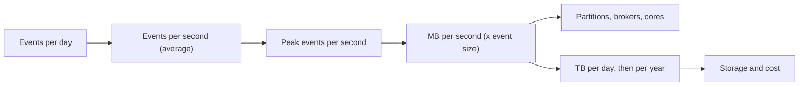

# Key DE Numbers

Every design you draw in an interview rests on a few numbers: events per second, terabytes, partitions, dollars. You need the right order of magnitude, fast, so you can tell the interviewer "that fits on a small Kafka cluster" or "that's too big for one machine" and be right. Every other lesson in the course takes its numbers from here.

> [!NOTE]
> Everything below is a **rule of thumb, accurate to within a factor of 2 to 3 for 2026 hardware and cloud pricing**. Real numbers depend on instance type, region and configuration. In an interview, say "roughly" and move on. Nobody checks your third digit; they check that you don't confuse megabytes with terabytes.

## The Problem

You are 12 minutes into an interview. The prompt says "the platform ingests about a billion events a day." The interviewer asks: "So what does that mean for your Kafka cluster?"

One candidate freezes, because nothing connects "a billion a day" to anything concrete. Another says "we'll need a big cluster" and keeps drawing boxes. Neither has made a decision the interviewer can evaluate.

The fix is a small set of numbers you can chain together:

Each arrow is one multiplication or division using a number from the tables below. This chain is the "only the math that changes the design" from [Sources and Volume](../01-the-framework/04-sources-and-volume.md).

Units are decimal (1 KB = 1,000 bytes); the few-percent gap to binary units is noise here.

## Volume Conversions

You will use these in every interview. There are **86,400 seconds in a day**. Round it to **about 100,000** (10^5) when you want speed; that makes your per-second answer about 15 percent too low, which is harmless.

| Events per day | Average events per second | Rule |
|---|---|---|
| 1 million | ~12 | 1M/day is about 10/sec |
| 10 million | ~115 | |
| 100 million | ~1,200 | |
| 1 billion | ~11,600 | 1B/day is about 12k/sec |
| 10 billion | ~116,000 | |
| 100 billion | ~1.2 million | |

Going the other way: **1,000 events/sec is about 86 million/day**, and **1 million/sec is about 86 billion/day**.

- **Peak versus average.** Plan for a peak of **2 to 3 times the average** for a global consumer product, and **5 to 10 times** for spiky traffic (a sale, a match, a push notification). Size ingestion for the peak and storage for the average.
- **Bytes per event to bytes per day.** At **1 KB per event, 1 billion events a day is 1 TB a day**. Typical sizes: a small clickstream event is 0.3 to 1 KB as JSON, a CDC row change is 0.5 to 2 KB, an application log line is 0.2 to 1 KB, an IoT reading is 50 to 200 bytes.

For longer spans: a month is about 2.6 million seconds, a year about 31.5 million (call it 3 x 10^7).

## Storage, Memory and Network Throughput

**Throughput** is data moved per second (MB/s or GB/s). **Latency** is how long one operation takes. **IOPS** is separate read or write operations per second. **Sequential** access reads one long run of bytes; **random** access jumps around and is far slower on every device.

### Throughput per component (one machine unless noted)

| Component | Sequential throughput | Notes |
|---|---|---|
| Spinning disk (HDD) | 150 to 250 MB/s | ~100 to 200 random IOPS. Rare for new designs except archives. |
| Network block volume (cloud SSD) | 125 MB/s to 1 to 2 GB/s | You provision (and pay for) throughput; default tiers start at 125 MB/s. Easy to bottleneck on. |
| Local NVMe SSD | 2 to 7 GB/s per drive | Hundreds of thousands of IOPS. Lost if the instance stops. |
| Memory (RAM) | 50 to 500 GB/s | Per server, across all channels; one thread gets roughly 10 to 20 GB/s. |
| Network, per cloud instance | 10 to 100+ Gbit/s = 1.25 to 12.5+ GB/s | Mid-size instances: 10 to 25 Gbit/s; small ones only burst that high. Divide by 8 for GB/s. |
| Object storage, one connection | 50 to 100 MB/s | Slow per stream. |
| Object storage, a cluster reading in parallel | 10s of GB/s aggregate | Scales with parallel readers. |

**Memory is 100x or more faster than a network disk. Object storage is slow per connection but nearly unlimited in aggregate**, which is why a data lake works at all.

### Latency per operation

**p99** is the latency that 99 percent of requests beat; the slowest 1 percent are worse.

| Operation | Typical latency | Why you care |
|---|---|---|
| Memory read | ~100 ns | In-process state is effectively free. |
| Local NVMe read | 10 to 100 microseconds | Stream state kept on local disk (in RocksDB, an embedded key-value store) stays fast. |
| Round trip, same availability zone (AZ: one data center in a region) | 0.1 to 0.5 ms | Calling a service next door. |
| Round trip, across AZs, same region | ~1 to 2 ms | Replication to another AZ costs this per hop. |
| Round trip, across regions | 20 to 200 ms | Cross-region replication is never "real time". |
| Kafka produce, acknowledged by replicas | 5 to 50 ms (p99) | Acks from replicas set the floor for streaming latency. |
| Object storage, time to first byte | 10 to 100 ms (tail to ~200 ms) | Every small read pays this: 100 files read one by one at 50 ms is 5 seconds. |
| Fast single-zone object storage tier | single-digit ms | Costs several times more per GB; for latency-sensitive reads. |
| Warehouse query on a few GB | 1 to 10 s | Interactive dashboards. |
| Warehouse query on a TB-scale scan | 10 s to minutes | Depends on cluster size and pruning. |

### Object storage request limits

Object storage (S3, GCS, Azure Blob) is priced and limited **per request**, not just per byte:

- Expect **thousands of requests per second per key prefix** (a prefix is the leading part of an object's path; S3 publishes about 5,500 reads and 3,500 writes per second). Spreading data across many prefixes multiplies that.
- Every request has a 10 to 100 ms floor and a fee, so **a million 1 KB files is far worse than one 1 GB file.** This is the small-files problem. Aim for **128 MB to 1 GB per file** for analytical data.

## Kafka Numbers

These assume a typical 1 KB message and a replication factor of 3 (every partition is stored on 3 brokers).

| Quantity | Rule of thumb | Notes |
|---|---|---|
| One partition, planned write rate | ~10 MB/s | 50+ MB/s is possible with large batches; plan on 10. |
| One partition, one consumer | ~20 to 50 MB/s | Usually limited by the consumer's own processing. |
| One broker, ingress | 100 to 300 MB/s | Usually network- or disk-bound. |
| Typical small production cluster | 3 to 6 brokers, a few hundred MB/s in | A million 1 KB messages/sec is ~1 GB/s: still only about 6 to 12 brokers. |
| Partitions per broker | ~2,000 to 4,000 comfortable | KRaft (Kafka's built-in metadata layer, the only mode since Kafka 4.0) raises cluster-wide limits; each partition still costs memory, files and recovery time. |
| Default max message size | ~1 MB | Put large payloads in object storage and send a pointer. |
| Compression on JSON (lz4, zstd codecs) | ~3x with lz4, 4 to 6x with zstd, on the wire and on disk | Batches compress better than single messages. |

Two derived rules:

- **Partition count** is the larger of (peak MB/s divided by 10) and (the parallelism you want in consumers), then rounded up with headroom. You can add partitions later but you cannot remove them, and adding them changes key-to-partition mapping. See [Partitioning](01-partitioning.md).
- **Disk needed** = raw ingress rate x retention x replication factor, divided by the compression ratio. 30 MB/s for 3 days with replication factor 3 is about 30 x 259,200 x 3 = 23 TB before compression. Long retention is what makes Kafka expensive; see [Kafka](../04-technology-deep-dives/02-kafka.md).

## Spark Sizing Rules of Thumb

Starting points only; joins, skew and data format change the real shape.

| Question | Rule of thumb |
|---|---|
| Cores per executor | 4 to 5. Many more means long garbage-collection pauses in one JVM. |
| Memory per executor | 4 to 8 GB per core, so 16 to 40 GB per executor, plus overhead for shuffle-heavy jobs. |
| Input partition (task) size | 128 to 256 MB of input per task. |
| Tasks per stage | 2 to 4 times the core count, so no core sits idle behind one slow task. |
| Shuffle partitions | 100 to 200 MB each after the shuffle. The default count of 200 is too low for TB-scale jobs; adaptive query execution (AQE, on by default since Spark 3.2) merges small ones at runtime, so set it high. |
| Throughput per core | Roughly **10 to 50 MB/s** of input for typical parsing and transforms; closer to 5 to 20 MB/s when a heavy shuffle or join is involved. |
| Cluster size from a deadline | Data size / (per-core throughput x deadline in seconds) = cores needed. |

Be most careful with throughput per core: it varies 5x with the job, so call it a guess. For internals, see [Spark Internals](../04-technology-deep-dives/01-spark-internals.md).

## Compression and Format Ratios

A **columnar format** (such as Parquet) stores each column's values together instead of one row at a time, so similar values compress well and queries read only the columns they need.

| Format | Size relative to raw JSON | Notes |
|---|---|---|
| Raw JSON | 1x (baseline) | Field names repeat in every record. |
| JSON, gzipped | ~1/5 to 1/8 | Not splittable: one gzip file is read by one task. Not columnar. |
| CSV | ~1/2 to 1/3 | No types, no nested data. |
| Avro (row-based, with schema) | ~1/2 to 1/3 | Good for streaming and Kafka payloads. |
| Parquet with snappy or zstd | **~1/5 to 1/10** | Plan on 1/5 to be safe, 1/10 for repetitive data with many low-cardinality (few distinct values) columns. |

Use **5x smaller** for "JSON to Parquet" if you need one number. The bigger win is often speed: column pruning means a query touching 3 of 50 columns reads only a small slice of the file.

## Rough Cloud Costs

> [!WARNING]
> **Order of magnitude, 2026, list prices in US regions.** Discounts, region, reserved capacity and negotiated contracts shift these by 2x either way. Use them to compare options and to notice when a design costs $100 versus $100,000 a month, never to quote a price.

| Item | Rough price | Back-of-envelope use |
|---|---|---|
| Object storage, standard | ~$20 to 25 per TB-month | 100 TB is about $2,300 a month. |
| Object storage, archive tiers | ~$1 to 5 per TB-month | Retention for compliance. Retrieval is slow or extra. |
| Object storage requests | ~$5 per million writes, ~$0.40 per million reads | 100 million small writes is $500. Files, not bytes, drive this. |
| Network block volume | ~$80 per TB-month | 3 to 4x object storage, billed on what you provision, not what you use. |
| Compute VM | ~$0.04 to 0.06 per vCPU-hour; 8 vCPU / 32 GB is about $0.35 to 0.40 per hour | Spot capacity (which the cloud can reclaim at short notice) is often 60 to 70 percent cheaper. |
| Data transfer, internet egress (data leaving the cloud) | ~$0.05 to 0.09 per GB | Moving 100 TB out is about $5,000 to 9,000. |
| Data transfer, across AZs | ~$0.01 per GB each way | 3x replication across zones pays it on every byte. |
| Data transfer, within an AZ | ~free | |
| Cloud warehouse storage | ~$20 to 40 per TB-month | Near object storage; on-demand plans sit at the high end. |
| Cloud warehouse compute | ~$2 to 4 per credit (Snowflake-style billing unit; the smallest cluster burns 1 credit/hr, each size up doubles it) | A medium warehouse (4 credits/hr) running 8 hours a day is about $65 to 130/day. |
| Scan-priced query engine (Athena, BigQuery on-demand) | ~$5 to 6.25 per TB scanned | Partitioning and column pruning pay back directly. |
| Managed Kafka, small | hundreds to low thousands of dollars a month | Hundreds of MB/s is tens of thousands. |

Storage is the cheap line; **requests, scans, egress and always-on compute** are where bills surprise people. For strategies, see [Cost Optimization](05-cost-optimization.md).

## A Worked Estimate

**Prompt:** "A consumer app has 20 million daily active users. Design the clickstream pipeline." Say each step out loud.

**1. Events per day.** "Assume 50 events per user per day: opens, clicks, scrolls. 20M x 50 = 1 billion events a day."

**2. Average rate.** "A billion a day is about 12,000 events a second on average."

**3. Peak.** "Evening peaks, say 3x. Call it 35,000 events a second at peak."

**4. Bandwidth.** "About 1 KB per event as JSON. So 12 MB/s average and 35 MB/s at peak."

**5. Kafka.** "At about 10 MB/s per partition, 35 MB/s needs at least 4 partitions. I'd take 12 for consumer parallelism and headroom. That's three or four brokers; ingest isn't the hard part here." For retention: 1 TB a day raw, about 330 GB after lz4 compression, kept 3 days, times replication factor 3 is **about 3 TB of broker disk**.

**6. Daily volume and storage.** "1 TB a day of raw JSON. Landed as Parquet at about 5x smaller, that's 200 GB a day, or about 73 TB a year. At roughly $23 per TB-month, year-one storage ends near $1,700 a month. I'd keep raw for 30 days, curated for 2 years, and compact files to 256 MB or more."

**7. Batch compute.** "A nightly job reads 1 TB of raw JSON. At 20 MB/s per core, that's 1,000,000 MB / 20 = 50,000 core-seconds, about 14 core-hours. On 100 cores, around 8 minutes plus startup. At 128 MB per task that's about 8,000 tasks, or 80 waves (rounds of 100 tasks at once) on 100 cores. So even a 15-minute batch is comfortable; volume doesn't force streaming, freshness would."

**8. Conclusion.** "None of this volume is exotic. The hard parts will be late events, deduplication and the schema."

That takes about two minutes and ends in a **design statement** the interviewer can push on.

## In the Interview

**When to estimate.** Right after requirements, before the architecture, in 3 to 5 minutes; see [Sources and Volume](../01-the-framework/04-sources-and-volume.md). Estimate only what changes the design: ingest rate (does one machine suffice?), daily volume and retention (cheap object storage or expensive serving?), and per-key hot spots.

> [!TIP]
> Say your assumption, do the arithmetic aloud, round aggressively, and **state what the number implies**: "That's 12k events/sec, so one small Kafka cluster is fine and we don't need to shard by region."

**What interviewers listen for:**

- Right order of magnitude. Off by 10x is a flag; off by 30 percent is nothing.
- Peak versus average awareness.
- Unit discipline: bits versus bytes, MB versus GB, per second versus per day.
- The numbers change the design. Computing 35 MB/s and then proposing a 50-node cluster shows they don't.
- Saying when a number is a guess: "I'd verify per-core throughput with a quick test."

**Phrases that work:**

- "I'll assume about a kilobyte per event, and tell me if it's very different."
- "At that rate, this is a storage and cost question, not a throughput question."

If the interviewer corrects a number ("our events are closer to 5 KB"), redo the one affected multiplication; adjusting quickly is part of what's being tested.

## Common Mistakes

> [!WARNING]
> **Mixing bits and bytes.** Network speeds are quoted in Gbit/s, storage in MB/s or GB/s. A 10 Gbit/s link moves about 1.25 GB/s at best. Divide by 8.

> [!WARNING]
> **Sizing for the average.** A system that handles 12k events/s on average and falls over at the 35k evening peak has failed.

> [!WARNING]
> **Forgetting replication and retention.** Raw volume is only the start. Multiply by replication factor (usually 3) and retention before saying it fits.

> [!WARNING]
> **Ignoring file counts.** "It's only 200 GB" means little if it is 20 million 10 KB files. Object stores and query engines pay per file.

> [!WARNING]
> **False precision.** "We'll need 17.3 brokers" shows you don't see how rough the inputs are. Round, give a range, add headroom.

## Key Takeaways

- Memorize **86,400 s/day (about 10^5)**: 1 billion events a day is about 12k events a second, and 1 KB x 1 billion is 1 TB a day.
- Size ingestion for **peak** (2 to 3x average, more for spiky traffic), storage for the average, and always multiply disk by retention and replication.
- Planning figures: **about 10 MB/s per Kafka partition**, **128 to 256 MB per Spark task**, **4 to 5 cores per executor**, **JSON to Parquet about 5x smaller**.
- Object storage: cheap per byte (about $23 per TB-month), slow per request (10 to 100 ms), so use big files. Costs hide in requests, scans, egress and idle compute.
- End every estimate with a **design implication**, and say that your numbers are rules of thumb.

Related lessons: [Partitioning](01-partitioning.md), [Cost Optimization](05-cost-optimization.md), [Sources and Volume](../01-the-framework/04-sources-and-volume.md), [Kafka](../04-technology-deep-dives/02-kafka.md), [Spark Internals](../04-technology-deep-dives/01-spark-internals.md).
