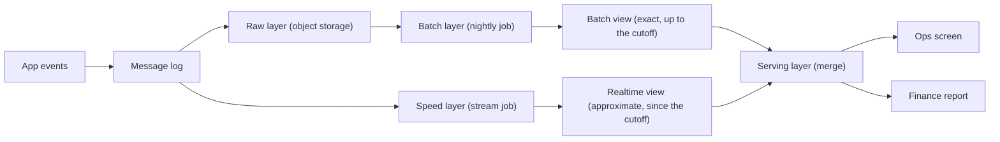

# Lambda Architecture

Lambda is the pattern interviewers mean when they ask, "How do you get real-time numbers that are also exactly right?" You will rarely be asked to build it today. You will often be asked to explain it, say why people stopped building it, and say what you would do instead.

## The Problem

A food-delivery app sends about 500 million events a day: orders placed, couriers assigned, deliveries completed. At 1 KB each that is roughly 500 GB a day, about 5,800 events a second on average. Two groups want numbers from the same events.

- **City operations** watch a screen of orders and revenue per city per minute. They want it within 30 seconds, because they dispatch couriers from it. They can live with a number that is a little off.
- **Finance** wants yesterday's revenue per city, exact to the cent, every morning. They can wait until 06:00. They cannot live with a number that is off.

The first team needs speed. The second needs correctness. A nightly batch job gives finance what they want, but ops would see numbers 24 hours old. A stream job gives ops what they want, but a stream job has to answer fast, which means it answers before late events, duplicates and bugs have been sorted out (see [Late-Arriving Data](../02-core-concepts/08-late-arriving-data.md) and [Deduplication at Scale](../02-core-concepts/09-deduplication-at-scale.md)).

Lambda architecture is the answer from the period when stream processors were not trusted to be exact: **run both, and let each do the job it is good at.**

## How It Works

The pattern has three parts.

- **Batch layer.** A scheduled job that recomputes results from the full, immutable raw data, in object storage. It is slow (hours) but can be made exactly right: it sees every late event, dedups across the whole day, and can be rerun after a bug fix.
- **Speed layer.** A stream job that reads the same events from the message log and computes approximate, up-to-the-second results. It is fast (seconds) and it keeps only the data since the last batch cutoff, which is a day or so.
- **Serving layer.** The place consumers read from. It combines the batch layer's results with the speed layer's results so the consumer sees one answer.

Follow one event. A courier completes a delivery at 14:03:12. It goes to the message log, and from there two things happen in parallel:

1. The speed layer adds it to the 14:03 per-minute count for that city. The ops screen shows it about 10 seconds later.
2. The raw layer stores it. At 02:00 the next night the batch layer recomputes all of yesterday from raw files, including events that arrived hours late and with duplicates removed. Finance reads that result at 06:00.

Both layers read the same events, so their outputs can be compared.

### The merge: how the two views become one answer

The serving layer cannot just add the two views, or it would count the same event twice. It uses a **cutoff**: the time up to which the batch view is complete.

- For time before the cutoff, use the batch view.
- For time after the cutoff, use the speed layer's view.

Say the batch job last finished at 02:40 and covers everything up to midnight (00:00). Today's 14:03 minute comes from the speed layer. Last night's 23:59 minute comes from the batch layer, even though the speed layer also computed it. Once the batch result for a day lands, the speed layer's copy of that day is discarded. Each day therefore has an approximate version for the first day or so, then an exact version permanently.

> [!NOTE]
> This hand-over is the heart of the pattern, and it is the same idea as the nightly correction in [Late-Arriving Data](../02-core-concepts/08-late-arriving-data.md): fast and provisional first, slow and final later, with a stated point where the number changes. Lambda applies it to the whole system instead of to one late-data fix.

### Reconciliation: do the two layers agree?

You now have two implementations of "revenue per city per minute". They will disagree. The causes are ordinary:

- **Late events.** The speed layer gave up waiting after a 10-minute watermark; batch included them.
- **Duplicates** that passed the stream job's dedup window and were removed by the batch job's full-day `MERGE`.
- **Logic drift.** Someone changed the refund rule in the batch SQL and not in the stream code.

**Reconciliation** here means comparing the speed layer's number for a finished day with the batch layer's number for the same day, and watching the gap. A gap of 0.2 percent from late events is normal and tells you your watermark is about right. A gap of 3 percent means the two codebases have drifted, or one of them has a bug. Track it per day and alert on it, the way [Monitoring and Alerting](../02-core-concepts/06-monitoring-and-alerting.md) describes. This is the same word as comparing your output to an outside source of truth (see [Deep Dives](../01-the-framework/08-deep-dives.md)), pointed at your own two layers.

### Why batch is the safety net

The batch layer earns its cost in one situation: a bug. Suppose the speed layer double-counted promotions for two days. You fix the code and rerun the batch layer from raw data, using the idempotent, partition-by-partition approach from [Backfill and Reprocessing](../02-core-concepts/03-backfill-and-reprocessing.md). The serving layer now shows correct history, and the speed layer only has to be right about the time since the cutoff. In classic Lambda the batch layer is the source of truth, and the speed layer is allowed to be wrong.

## The Cost: Two Codebases

Here is why people stopped building new systems this way. Count what you now own:

| | Batch layer | Speed layer |
|---|---|---|
| Code | Spark or SQL job | Stream job (Flink, Spark Structured Streaming, Kafka Streams) |
| Runs | Once a night | Continuously |
| Tests | Fixture files | Fixture streams, time, state |
| On-call | Fails at 03:00, someone reruns | Falls behind at peak, needs scaling |
| Business logic | "What counts as a completed order?" | **The same question, written again** |

The business rule lives in two places, in two programming models, owned by two sets of habits. Every change is made twice and tested twice, and then you also have to keep reconciling the two outputs. The second cost is subtler: the two layers differ in how they treat time, state and nulls, so even with identical intentions, the results differ in small ways that someone has to explain to finance.

Three developments made the trade look worse:

- **Stream processors became exact.** Engines with [event-time windows](../02-core-concepts/08-late-arriving-data.md), checkpointed state and transactional or idempotent sinks can deliver [effectively-once results](../02-core-concepts/09-deduplication-at-scale.md). The original reason for batch ("streams can't be exact") weakened a lot.
- **Message logs got long retention and cheap tiered storage**, so replaying the log became a realistic way to reprocess. That is the [Kappa](02-kappa-architecture.md) idea: one streaming codebase, and reprocessing means replaying.
- **Warehouses and lakehouse table formats got good at incremental updates.** A [micro-batch](08-micro-batch-vs-streaming.md) job every one to five minutes can feed one table that is both fresh and corrected, which removes the need for two separate views.

> [!TIP]
> A good interview sentence: "Lambda solved a real problem, which was that streams could not be trusted to be exact. Today I would try to avoid two codebases first, and only accept them if a constraint forces me."

## When Lambda Still Fits

Lambda has a narrow use now. Reach for it when at least one of these is true:

1. **The fast and exact paths really are different computations.** For example the speed layer produces an approximate unique-user count from a sketch (a compact structure trading accuracy for memory), while the batch layer computes exact distinct counts over a full day. Different algorithms are a reason for different code, not an accident.
2. **The streaming engine cannot do the exact version.** A fraud score that needs a 90-day join against history, a model retrained nightly, or a logic step that must see the whole day before it can be correct. These are batch problems at heart, with a thin fast layer for freshness.
3. **The stream cannot be replayed far enough.** If the message log keeps seven days and you need to recompute a year, you need the raw layer in object storage as your source of truth, and a batch job to read it.
4. **You inherit it.** Many companies have a Lambda system running. Know how to say what it is, why it is that way, and how you would simplify it without a big-bang rewrite.

Where it does not fit: a team of three with no on-call for two stacks, a metric where 30 seconds of freshness is not worth a second codebase, or a prompt where a single micro-batch job meets the freshness requirement. If ops says "five minutes is fine", you do not need a speed layer at all. See [High-Level Architecture](../01-the-framework/05-high-level-architecture.md), where a micro-batch every few minutes was enough for a 15-minute requirement.

## Lambda vs the Alternatives

| | Lambda | Kappa | Single pipeline with micro-batch |
|---|---|---|---|
| Codebases | Two (batch and stream) | One (stream) | One (batch-style SQL, run often) |
| Freshness | Seconds (speed layer) | Seconds | 1 to 15 minutes |
| Exactness | Batch layer is the exact one | Stream job must be exact itself | Rerun the recent window each time |
| Reprocessing | Rerun batch from raw | Replay the log with new code | Rerun partitions from raw |
| Main cost | Duplicate logic, reconciliation | Log retention, replay cost | Freshness floor of minutes |
| Choose when | Different algorithms, or stream cannot be exact | Stream-native team, replayable log | "A few minutes" is fresh enough |

The [Kappa lesson](02-kappa-architecture.md) covers the stream-only route and its limits in detail. [Micro-batch vs Streaming](08-micro-batch-vs-streaming.md) covers the third column.

## In the Interview

**When it comes up.** In the architecture step, when requirements contain both "real-time" and "exact". Also as a direct question: "Would you use Lambda here?", or "Your streaming numbers don't match the warehouse, why?" The second one is a reconciliation question wearing a disguise.

**A strong answer, in order:**

1. Split the requirement by consumer. "Ops needs 30-second freshness and tolerates small error. Finance needs exact numbers by 06:00. Those are two different contracts."
2. Check whether one path can serve both. "If the stream job can be exact with event-time windows and idempotent writes, I'd run one stream job and fix history by replay. If ops can tolerate five minutes, one micro-batch job is simpler still."
3. If you need both layers, say what each is for. "The speed layer owns the time since the last batch cutoff and is allowed to be approximate. The batch layer recomputes each day from raw and owns the history."
4. Describe the hand-over. "The serving layer reads batch before the cutoff and the speed layer after it. When the nightly job lands, it replaces that day's speed numbers."
5. Name the costs and how you contain them. "Two codebases is the price. I'd keep the business rules in shared code or in one SQL definition, and alert when yesterday's speed number differs from batch by more than 0.5 percent."

**What interviewers listen for:**

- You can explain why the pattern exists, beyond naming its three boxes.
- You say out loud that it is two copies of the logic, and you have a plan for that.
- You know the merge happens at a cutoff and that the speed layer's copy is thrown away.
- You can name what replaced it, and the circumstances where it didn't.

**Follow-up questions to expect:**

- "How do you stop the two layers from drifting apart?" Share the business logic: one library or SQL macro used by both, plus a daily comparison with an alert threshold.
- "What does the user see during the hand-over at midnight?" Say which of two options you pick: label the closing day provisional until batch lands, or keep the speed number visible and swap in the batch number silently. Either is fine if you choose on purpose and tell finance.
- "The batch job fails at 03:00. What happens?" The speed layer's view for that day stays in the serving layer past its usual expiry, a flag marks it provisional, and on-call reruns the idempotent job. Nothing is lost because raw data is untouched.
- "Could you do this with only streaming?" Yes, see [Kappa](02-kappa-architecture.md); the limits are replay cost and log retention.
- "Where is the cutoff if the batch job takes 4 hours?" The cutoff is the end of the last completed batch window, not a clock time. Say the job starts at 02:00 and finishes at 06:00. Until it finishes, the speed layer must still cover everything since the previous midnight cutoff: the full day waiting for its batch result, plus the 6 hours to 06:00, so roughly 30 hours. Size the speed layer's state and the serving layer's overlap for that worst case, just before the batch lands.

For a worked example of a live number and a final number side by side, see [Real-Time Dashboard](../05-breakdowns-core/04-real-time-dashboard.md).

## Common Mistakes

> [!WARNING]
> **Adding both views.** Summing batch and speed results without a cutoff counts overlapping time twice. Each time range comes from exactly one layer.

> [!WARNING]
> **Proposing Lambda by reflex.** "Real-time plus historical, so Lambda" is the textbook answer that sounds dated. State the requirement that justifies two paths, and say what you checked first (one stream job, or micro-batch).

> [!WARNING]
> **Letting the speed layer be the source of truth.** If the speed layer is wrong and there is no batch layer or replay to fix it, you have a fast pipeline you cannot repair. Whatever the architecture, raw data stays recoverable.

> [!WARNING]
> **Ignoring reconciliation.** Two layers with no comparison means nobody learns they have drifted until finance finds out. Name the check and the tolerance.

> [!WARNING]
> **Calling it obsolete.** Candidates swing from "always Lambda" to "Lambda is bad". It is an expensive tool for specific cases, and a strong answer names them.

## Key Takeaways

- Lambda runs a slow, exact **batch layer** and a fast, approximate **speed layer** over the same events, and a **serving layer** merges them at a cutoff.
- Each time range is answered by one layer: batch for finished history, speed for the recent past. The batch result replaces the speed result.
- The cost is the same business logic in two codebases, plus reconciliation to catch drift. That cost is why newer designs avoid it.
- Prefer one pipeline (a stream job that can be exact, or micro-batch) when the requirements allow. Choose Lambda when the fast and exact computations genuinely differ or the stream cannot be exact or replayed far enough.
- In an interview, split the requirement by consumer, test the simpler options out loud, and then justify the second path if you still need it.

## Going Further

- Approximate algorithms (sketches) for the speed layer
- Sharing business logic between batch and stream code
- Serving stores that can merge two views at query time
