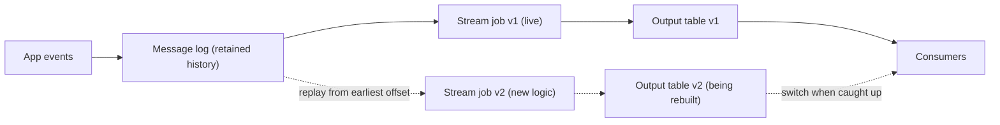

# Kappa Architecture

Kappa is Lambda with the batch layer removed: one streaming pipeline does everything, and when the logic changes you fix history by replaying the log through the new code. Interviewers ask about it to see whether you can say what you gain, and where it stops working.

Read [Lambda Architecture](01-lambda-architecture.md) first. This lesson does not repeat how Lambda works. It starts at the point where Lambda's cost, two copies of every business rule, becomes the thing you want to get rid of.

## The Problem

A ride-hailing company produces about 1 billion events a day: trip requested, driver matched, trip started, trip completed, payment captured. At 1 KB each that is roughly 1 TB a day, about 11,600 events a second, about 12 MB/s (see [Key DE Numbers](../02-core-concepts/10-key-de-numbers.md)). The team has a stream job that computes trips and revenue per city per minute. It works.

Then three things happen in one quarter.

1. A bug is found. The job counted trips cancelled within 10 seconds as completed. It has been wrong for 11 days.
2. Finance changes the definition of "completed trip" to exclude trips with a refunded payment. The history must be recomputed.
3. Someone asks why the streaming numbers should be trusted at all, since the "real" numbers come from a nightly batch job that nobody wants to keep maintaining.

With a Lambda design you rerun the batch layer for history and patch the stream job for the future, in two codebases, and then check that they agree. The question Kappa asks is: **what if the stream job were the only job, and fixing history just meant running it again over old events?**

That works only if the stream job can be exact (see [Late-Arriving Data](../02-core-concepts/08-late-arriving-data.md) and [Deduplication at Scale](../02-core-concepts/09-deduplication-at-scale.md)) and the old events are still available to read. Both conditions come back below.

## How It Works

Kappa has two ideas.

- **Everything is a stream.** All data enters a durable, ordered, replayable **message log** (Kafka is the common one). The log is the source of truth for events. There is no separate batch path.
- **Reprocessing is a replay.** To change logic, you start a *new version* of the same stream job, point it at the log from the beginning (or from the date you need), let it catch up, and then switch consumers to its output. Nothing runs on a nightly schedule.

Follow the bug fix from the example.

1. The team fixes the rule and deploys it as **job v2**, with its own consumer group (or checkpoint), which is how a job tracks its own position in the log, so it does not disturb v1, and its own output table, `trips_per_minute_v2`.
2. v2 starts from the offset (a message's position in the log) of the earliest event you need to recompute: 11 days back, where the bug started. Meanwhile v1 keeps serving the live dashboard.
3. v2 reads at maximum speed through those 11 days of history, then reaches the head of the log and keeps going in real time. This is "catching up".
4. When v2's output matches expectations for the replayed range (you spot-check against a known day or a payments total), consumers are pointed at v2's table. v1 and its table are shut down and deleted.

There is no cutoff and no merge, because there is only one result. Compared with Lambda you get one codebase, one set of tests, and nothing to reconcile between layers.

> [!NOTE]
> The old and new tables must be separate during the rebuild. If v2 wrote into v1's table, you would interleave old and new results. See the replay rules in [Backfill and Reprocessing](../02-core-concepts/03-backfill-and-reprocessing.md).

### What the stream job must guarantee

Kappa moves the burden Lambda gave to the batch layer onto the stream job. To replace the batch layer, the stream job must itself be:

- **Event-time based.** Windows are computed from when events happened, using a **watermark** (the engine's estimate of how far event time has progressed), not from when they arrived. Otherwise a replay at 100x speed would put 11 days of events in the same few minutes of processing time. A replay produces the right answer only if the job ignores the clock on the wall.
- **Idempotent or transactional at the sink.** Replays reread events, so the writes must be safe to repeat (an upsert on a business key, or a partition overwrite). See [Deduplication at Scale](../02-core-concepts/09-deduplication-at-scale.md).
- **Deterministic.** The same events through the same code give the same result. A job that calls an external API for each event, or reads "current" reference data, gives a different answer on replay than it did live.

That last point catches people out. If the live job enriched each trip with the driver's rating *at that moment* by calling a service, a replay a month later enriches it with today's rating. The history changes without any bug. Either keep reference data versioned and joined by event time, or accept that the replay is a new interpretation of history.

## The Limits: Retention and Replay Cost

Kappa runs into two practical numbers. Be ready to compute both.

### Limit 1: Does the log still have the events?

Kafka keeps data for a configured period; 7 days is the default, and 3 days matches the sizing in Key DE Numbers. Broker disk is expensive: at 12 MB/s, 3 days with replication factor 3 is about 9 TB of disk before compression; a year is about 365 TB of data, several times that with replication. Few teams keep a year of events on broker disks just to make replay possible.

So the 11-day-old bug in the example is fine at 14 days of retention but not at 3. Your options:

| Option | How it works | Catch |
|---|---|---|
| Long retention on the log | Set retention to 30 or 90 days | Disk cost grows linearly; the cluster is sized for history, not for traffic |
| Tiered storage | The log offloads old segments to object storage and reads them back transparently. In Apache Kafka it is production-ready from 3.9 and needs a storage plugin; managed services offer it directly (version-dependent, check yours) | Old reads are slower, the replay reads through the object store, and it does not apply to compacted topics |
| Keep a raw copy in object storage and replay from there | A sink writes every event to Parquet files; a batch-style read feeds the same job logic | You now have a second input path, which is Lambda's batch layer again, if you write different code for it |
| Log compaction | Keeps only the latest record per key, forever | Right for state (one row per customer), wrong for events. You lose the history you wanted to replay |

For a year of history in object storage the cost is modest: 365 TB of JSON is about 73 TB as Parquet (roughly 1/5), about $1,700 a month at $20 to 25 per TB-month. That is why teams keep a raw copy even when they run Kappa: [the raw layer](../02-core-concepts/03-backfill-and-reprocessing.md) is the cheap long-term memory, and the log is the short-term one.

### Limit 2: Can you afford to replay?

Replay is reading, not magic. Say finance wants its new "completed trip" definition applied to the last 30 days, and retention has been raised to cover them: 30 TB of events.

- **Read throughput.** The replay competes with live traffic for the same brokers. At 12 partitions and 30 MB/s per partition the maximum is 360 MB/s, so 30,000,000 MB takes 30,000,000 / 360 = about 83,000 seconds, a little over 23 hours. But on a small cluster (3 to 6 brokers handling 100 to 300 MB/s each) that is a large share of total capacity, and the live consumers share those brokers. Throttle the replay (a consumer quota does it) to 100 MB/s and it takes 3.5 days. Plan for that.
- **Compute.** To get 30 TB through in one day you need about 350 MB/s of processing. At 10 to 50 MB/s per core, that is roughly 7 to 35 cores for a day, plus the live job. That is tens of dollars of compute at the prices in Key DE Numbers, not a catastrophe. A stateful job with big joins is slower and needs more.
- **State.** Windowed state on replay looks different from live. At 100x speed, many windows open and close in quick succession, and a keyed join may need to hold far more state than it ever does live.
- **Time to repair.** If every logic change takes days to catch up, the team will avoid making changes. The batch layer in Lambda, run on a big cluster, can sometimes redo the same history in hours because it is not throttled by the live Kafka brokers.

Kappa swaps *code* complexity for *infrastructure and time* complexity. That swap is a good one when your history is short or your logic seldom changes, and a bad one when you keep needing to recompute a year.

## When to Use It, and When Not To

| | Use Kappa when | Do not use it when |
|---|---|---|
| Logic | The same computation is right for fresh and historical data | The fast answer and the exact answer are different algorithms (an approximate distinct count live, an exact one daily) |
| Exactness | The stream engine can produce exact results with event-time windows and idempotent sinks | The exact version needs a whole-day view or a long join the stream cannot hold |
| History | Needed history fits in log retention, or you have tiered storage plus a raw copy | You recompute a year of data often and the log cannot serve it |
| Team | Stream-native team that already runs the log and the engine | Team knows SQL and a warehouse, and "within 15 minutes" is fresh enough |
| Sources | Events are the source of truth (clickstream, IoT, payments events) | The source is a database table of current state, with updates and deletes, and no event history |

The last row matters. A stream of events replays naturally. A table that changes in place (customer addresses) has no history to replay unless you capture its changes with CDC (see [CDC Patterns](04-cdc-patterns.md)).

Kappa is also not the only route out of Lambda. If your freshness requirement is minutes, not seconds, a single [micro-batch](08-micro-batch-vs-streaming.md) job is simpler than either. Kappa is for requirements that really need a continuously running stream.

## Kappa vs the Alternatives

| | Lambda | Kappa | Micro-batch on a lakehouse |
|---|---|---|---|
| Codebases | Two | One | One |
| Reprocess by | Rerunning batch from raw | Replaying the log | Rerunning partitions from raw |
| Freshness | Seconds (speed layer) | Seconds | 1 to 15 minutes |
| Where history lives | Raw layer in object storage | The log (plus tiered storage or a raw copy) | Raw layer in object storage |
| Main limit | Duplicate logic, reconciliation | Retention, replay cost, a stream job that must be exact | Freshness floor of minutes |

In practice most teams end up in a hybrid that interviewers accept: a stream job as the one pipeline for live results, and a raw layer in object storage that holds history for replay beyond the log's retention. Say it plainly, "I'd run Kappa with the raw layer as the long-term replay source", and you have covered both limits.

## In the Interview

**When it comes up.** In the architecture step, when a prompt wants fresh numbers *and* corrections ("we occasionally fix business rules and recompute"). Also as the follow-up to Lambda: "Is there a way to avoid two codebases?" Or from a different angle: "Your stream job had a bug for two weeks. How do you fix the data?"

**A strong answer, in order:**

1. State the premise. "If the stream job can be exact, with event-time windows and idempotent writes, I'd run one pipeline and not two."
2. Say how you fix history. "I'd deploy the new version beside the old one, replay from the log into a separate table, and switch consumers when it has caught up."
3. Raise the limits before being asked. "That needs the events to still exist. Kafka keeps 3 to 7 days here, so I'd keep a raw copy in object storage as the long-term replay source."
4. Do the replay math out loud. "30 days is about 30 TB. Throttled to 100 MB/s on the shared brokers that takes about three and a half days, so I'd plan replays rather than treat them as free."
5. Name when you would not. "If the fast and exact computations differed, or the exact one needed a view of the whole day, I'd accept a batch layer."

**What interviewers listen for:**

- You can describe the replay procedure step by step, including a separate output and a switch-over.
- You know why event-time processing and idempotent sinks are prerequisites, not details.
- You treat retention as a number to compute and design around.
- You do not present Kappa as "Lambda but better". It trades one cost for others.

**Follow-up questions to expect:**

- "The replay finished, but its numbers differ from the old table for dates the bug didn't touch. Why?" The usual causes are non-determinism (enrichment at processing time, not event time), different late-event handling during replay, or a changed dedup window. Compare per day, find the first day that differs, and ask what that day's inputs had in common.
- "How do you avoid double counting while the replay runs?" Separate output table and consumer group, so replay output never mixes with live output; switch only when caught up. If you must write into one table, key by business key and use upserts with a version check.
- "What if the log only keeps 7 days?" Raw copy in object storage as the replay source, or tiered storage. Mention that the raw copy can be read by the same job logic through a source connector, so you keep one codebase.
- "How do you know the replay is correct before the switch?" Compare totals against an independent source for a day or two (payments totals, a raw-layer count), and compare the new table to the old one on days the change should not touch.
- "Isn't a replay just batch with extra steps?" Fair point. It is the same job run over old data. The difference is you maintain one program, not two, and its batch behaviour is just it running faster.
- "When would you choose Lambda over this?" When the exact computation really is different from the fast one, or when the stream engine cannot hold the state the exact version needs. See [Lambda Architecture](01-lambda-architecture.md).

For a worked live-plus-corrected example see [Real-Time Dashboard](../05-breakdowns-core/04-real-time-dashboard.md).

## Common Mistakes

> [!WARNING]
> **Saying "just replay Kafka" without checking retention.** The interviewer's next question is "How far back does it go?" Have the number ready, and a second source (raw layer or tiered storage) for anything beyond it.

> [!WARNING]
> **Treating replay as free.** It competes with live traffic on the same brokers, and it needs compute and state of its own. Compute the throughput and the hours, and throttle it.

> [!WARNING]
> **Replaying into the live table.** Old and new results interleave, and consumers see a mix. Rebuild into a separate table and switch at the end.

> [!WARNING]
> **Using processing time in the job.** A replay then puts weeks of events into a few minutes of windows. Windows must come from event time.

> [!WARNING]
> **Presenting Kappa as strictly better than Lambda.** It is simpler in code and harder in infrastructure. The accurate position is that it fits when the stream can be exact and history is within reach of the log.

## Key Takeaways

- **Kappa** is one streaming pipeline over a replayable log. Reprocessing means running a new version of the job from an earlier offset into a new output, then switching consumers.
- It removes Lambda's second codebase and the reconciliation between layers. In return the stream job must be exact: event-time windows, deterministic logic, idempotent writes.
- Retention is the first limit. Broker disk makes long retention expensive (about 9 TB for 3 days at 12 MB/s with replication factor 3), so history beyond a few days comes from tiered storage or a raw copy in object storage.
- Replay cost is the second. 30 TB at a throttled 100 MB/s takes about three and a half days; compute the time before you promise a fix.
- In an interview, state the premise, describe replay with a separate output, raise retention and cost yourself, and say when you would choose Lambda or micro-batch instead.

## Going Further

- Versioned reference data so replays reproduce history
- Tiered storage in the message log
- Choosing between a stream job and incremental SQL for the one pipeline
