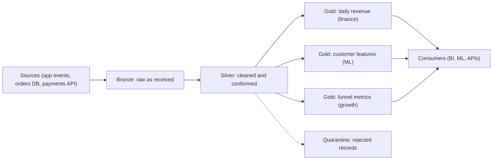

# Medallion Architecture

Medallion is a naming convention for storing data in three stages of increasing quality: bronze, silver and gold. Interviewers like it as shared vocabulary, and because "what goes in which layer, and why" tests reprocessing, data quality and consumers at once.

You have already met the idea under plainer names. The earlier lessons talk about a **raw layer**, a **cleaned layer** and a **serving layer** (see [High-Level Architecture](../01-the-framework/05-high-level-architecture.md) and [The Delivery Framework](../01-the-framework/02-delivery-framework.md)). This lesson gives those layers their industry names, a set of rules for each, and an honest look at where the pattern is overused.

| Plain name used so far | Medallion name | One-line job |
|---|---|---|
| Raw layer | **Bronze** | Keep what arrived, untouched |
| Cleaned layer | **Silver** | Make it trustworthy: typed, deduplicated, conformed |
| Serving layer | **Gold** | Shape it for the people and tools that read it |

One wrinkle: [Data Model Design](../01-the-framework/06-data-model-design.md) puts the star schema (fact and dimension tables) in the cleaned layer and a wide per-consumer table in the serving layer. Medallion teams split this two ways: a shared, enterprise-wide star in silver, or domain-specific stars in gold. Either is defensible. Say which you picked.

## The Problem

An online shop sends about 1 TB a day of order, payment and app events as JSON, around 11,600 events a second (see [Key DE Numbers](../02-core-concepts/10-key-de-numbers.md)). The first version of the pipeline is one Spark job that reads the JSON, fixes it up and writes a single `orders` table. Everyone reads that table: finance, the growth team, a dashboard, a machine learning job.

Within three months, four things go wrong.

1. **A cleaning bug.** The job treated a timezone offset wrongly, so about 2% of orders landed on the wrong day. The raw JSON was overwritten by the job's output, or deleted after 7 days. Nobody can recompute.
2. **Everyone's rules are baked into one table.** Finance wants refunds netted out. Growth wants gross orders. Each fix for one team breaks the other's numbers.
3. **Nobody trusts the table.** It holds some deduplicated rows, some not, and a few malformed records the job silently dropped. Analysts ask "is this clean or raw?" and no one can answer.
4. **A source adds a field.** The job crashes at 3 a.m. and the dashboard is stale until someone fixes it.

The common cause: **one table is doing three jobs**: preserving what arrived, enforcing quality, and answering business questions. Those jobs change for different reasons and at different speeds. Medallion separates them into layers so that each one can change without damaging the others.

## How It Works

Data moves one way through three layers, each stored as tables (usually in object storage with a table format such as Delta Lake or Iceberg, which gives you transactions and schema changes on top of files; see [Delta Lake](../04-technology-deep-dives/06-delta-lake.md) and [Apache Iceberg](../04-technology-deep-dives/07-iceberg.md)).

The shape is **one bronze, one silver, many golds**, because consumers want different things.

### Bronze: keep what arrived

Bronze holds the data as close to the source as you can get it, appended and never edited.

- **Content.** The original payload (often kept as a raw string or minimally parsed columns), plus metadata you add on the way in: ingestion time, source name, the file or batch it came from.
- **Rules.** Append-only. No deduplication, no filtering, no business logic. If the source sends a malformed record, bronze stores it anyway.
- **Why.** Insurance. When a bug is found three weeks later, you rerun from bronze instead of asking the source to resend (some cannot). It is also an audit trail: what exactly did we receive on the 14th?
- **Grain.** One row per event or record received, duplicates included.

Cost check: 1 TB a day of JSON lands as roughly 200 GB a day in Parquet (about 5x smaller), which is about 73 TB after a year. At $23 per TB-month that is about $1,700 a month by the end of year one. Cheap enough that "keep everything" is the default.

> [!NOTE]
> Bronze is the right place to *land* data, not to *query* it. It is messy by design. If analysts query bronze directly, they inherit every quality problem you wanted to hide from them.

### Silver: make it trustworthy

Silver turns bronze into one clean version of each entity or event. It is still *detailed* (one row per event), but now you can believe it.

- **Typed.** Strings become timestamps, decimals and enums. Nested JSON is flattened where that helps.
- **Deduplicated.** The same event arriving twice becomes one row, by a business key such as `event_id`. See [Deduplication at Scale](../02-core-concepts/09-deduplication-at-scale.md).
- **Conformed.** The same concept looks the same everywhere: one currency code format, UTC timestamps, one customer ID across the orders system and the app. "Conformed" means made consistent across sources.
- **Validated.** Records that fail checks (null order ID, negative price, impossible date) go to a **quarantine table**, a side table of rejected rows with the reason attached, so nothing disappears silently. It is the [dead-letter queue](../01-the-framework/07-pipeline-design.md) idea applied to tables.
- **Grain.** Usually the same as bronze: one row per event, but unique and valid.

Here is the example with numbers. Of 1 TB a day of bronze events, about 3% are duplicates and about 0.5% fail validation. Silver keeps about 96.5% of the rows. Quarantine takes 0.5% of 1 billion events, which is 5 million rows a day: small enough that a person (or a ticket) can look at the top failure reasons each morning.

### Gold: shape it for the consumer

Gold is where business meaning is added. Each gold table answers a family of questions for a particular audience.

- **Content.** Joins across silver tables, aggregates, business definitions ("net revenue = gross minus refunds"), dimensional models (see the wrinkle above), wide feature tables for ML.
- **Grain.** Chosen per table: "one order per row", "one product per day", "one customer".
- **Size.** Far smaller than silver. The shop's daily revenue by product and country is a few hundred thousand rows, a few MB a day, against about 200 GB a day in bronze. Small tables are fast to query and cheap to serve.
- **Contract.** Gold tables are the interface consumers depend on. Treat their columns like an API: change them with notice, version them. See [Data Contracts](../02-core-concepts/07-data-contracts.md).

### What belongs where

The questions you will actually be asked are placement questions. Use this table.

| Thing | Layer | Reason |
|---|---|---|
| Original JSON payload, ingestion timestamp, source file name | Bronze | Needed to replay and audit |
| Deduplication | Silver | Everyone needs it, so do it once |
| Casting `"2026-03-04T23:50:00+05:30"` to a UTC timestamp | Silver | Same for every consumer |
| Rejecting rows with a null `order_id` | Silver (to quarantine) | Quality rule, not a business rule |
| "Net revenue excludes refunds" | Gold | A business definition that finance owns and growth may define differently |
| Joining orders to the customer dimension | Silver if it is plain conformance, gold if it is a modeling choice | Judgment call; say which you chose and why |
| Masking an email address | Silver, with bronze access restricted | Bronze holds the raw value, so lock it down; downstream layers never see it |
| Daily aggregates for a dashboard | Gold | Shaped for one reader |

The rule behind the table: **push shared work down (towards bronze and silver), push opinionated work up (towards gold).** If three teams would each write the same cleaning code, it belongs in silver. If two teams disagree on the definition, it belongs in gold, once per team.

### Reprocessing: why the layers pay for themselves

Go back to the timezone bug. In the medallion version:

1. Fix the conversion in the silver job.
2. Rerun silver for the affected dates, reading bronze. Write each date's partition as an overwrite so the rerun is idempotent (running it twice gives the same result). See [Backfill and Reprocessing](../02-core-concepts/03-backfill-and-reprocessing.md).
3. Rerun the gold tables that depend on those dates.

Bronze is never touched, the source is never asked for anything, and consumers keep reading the old gold tables until the new ones are ready. The rerun costs only compute: reading 200 GB a day of Parquet for, say, 14 affected days is 2.8 TB, which a modest cluster handles in well under an hour.

Because each layer reads only the layer before it, the dependency chain is also your [lineage](../02-core-concepts/04-data-lineage.md): if a gold number looks wrong, you know to check silver, then bronze, in that order.

## Batch, Streaming, and the Layers

Medallion is about storage stages, not about batch versus streaming. Each hop can be either.

- **Batch:** a scheduled job reads new bronze partitions and writes silver, then gold. Freshness is the schedule interval plus run time, typically 15 minutes to a few hours.
- **Streaming:** a stream job reads bronze continuously and writes silver in small batches every minute or so. Freshness is about 1 to 5 minutes, at the cost of a long-running job and small files that need regular compaction (rewriting many small files into fewer big ones).

Every hop adds delay. A "dashboard within 10 seconds" requirement probably can't survive three hops, so the fast path may skip layers (see below). Medallion also doesn't replace [Lambda](01-lambda-architecture.md) or [Kappa](02-kappa-architecture.md): those decide how fresh and corrected results are produced, and medallion decides how the stored tables are organized. A Kappa design with a raw copy in object storage is, in effect, a bronze layer.

## Criticisms: A Convention, Not a Law

Say these out loud in an interview. They mark you as someone who has run these systems.

- **The names are arbitrary.** Bronze, silver and gold come from one vendor's lakehouse (a lakehouse is a data lake with warehouse-style tables and transactions on top). Teams elsewhere call the same stages raw, staging and marts, or landing, curated and consumption. The idea is the layering, not the metal.
- **Three layers is not a rule.** Some pipelines need two layers (a small, clean source needs no silver). Some need four or five: a "platinum" layer of curated metrics, or a split silver (cleaned, then conformed and joined). Add a layer only if it has a distinct owner, rule set, or reader.
- **Every layer is a copy.** Bronze and silver each hold a near-full copy, so storage is roughly double, and each hop is a job to run, monitor and pay for. At 200 GB a day that is trivial; at 100 TB a day, a full-size silver copy is a real line on the bill.
- **Silver becomes a junk drawer.** Every "just this once" transformation lands in silver until it is a second gold. Keep silver to cleaning and conforming, and send business rules to gold.
- **Gold sprawl.** Fifty gold tables with overlapping definitions of "active user" are no better than one messy table. Give each an owner, a grain and a definition.
- **It adds latency.** More hops, more lag. For a sub-minute requirement, write a small serving table straight from the stream and let the layered path supply exact numbers later.

## When to Use It, and When Not To

| Use medallion when | Skip or shrink it when |
|---|---|
| Many sources feed many consumers with different needs | One source, one consumer, a small clean table |
| You need to reprocess after bugs or rule changes (almost always true) | Data is tiny and the source can resend on demand |
| Quality problems are expected: duplicates, schema drift, bad records | The source is already a clean, contracted warehouse table |
| Several teams will share cleaning work | The latency requirement is seconds and cannot afford extra hops |
| You want clear ownership (platform owns bronze and silver, domain teams own gold) | The team is two people who share every table anyway |

Even in the "skip" column, keep the *principle*: **never overwrite your only copy of the raw data.**

## In the Interview

**When it comes up.** Almost every design with a data lake or lakehouse includes it, usually without the names: you draw a raw layer, a cleaned layer and a serving layer. Naming them bronze, silver and gold is a shortcut the interviewer will understand. It is also the main subject of [Design a Medallion Data Lake](../05-breakdowns-core/06-medallion-data-lake.md).

**A strong answer, in order:**

1. Name the layers and their jobs in one sentence each. "Bronze keeps what arrived, append-only. Silver deduplicates, types and validates. Gold is shaped per consumer."
2. Tie each layer to a requirement. "Bronze lets us reprocess after a bug. Silver means cleaning is done once. Gold keeps finance's definition of revenue out of growth's."
3. Say the grain of each layer. "Bronze and silver are one row per event, gold is one row per product per day."
4. Describe a bad record's path. "Bad records go to a quarantine table with a reason code. We alert if the rejection rate passes, say, 1%."
5. Explain how a fix flows. "Fix silver, rerun the affected partitions from bronze as idempotent overwrites, then rerun gold."
6. Mention the cost and when you'd shorten it. "For a sub-minute dashboard I'd write a small serving table directly from the stream and use the layered path for the exact numbers."

> [!TIP]
> Map the names to the plain terms you use in the rest of the answer once: "raw, which I'll call bronze". Interviewers sometimes use bronze/silver/gold and sometimes raw/cleaned/serving, and you want both to land.

**What interviewers listen for:**

- You can say what is *not* allowed in a layer (no business logic in bronze, no raw payloads in gold).
- You place deduplication, validation and business rules in the right layers, and can defend the edge cases.
- You treat bronze as replayable truth and silver and gold as rebuildable outputs.
- You do not treat three layers as mandatory, and can say when you would use fewer.

**Follow-up questions to expect:**

- "Where do you deduplicate?" In silver, by a business key. Bronze keeps duplicates so you can see what really arrived. If dedup state is too big for a stream job, dedupe per partition in batch.
- "A source adds a column. What happens?" Bronze takes it (store the raw payload, or enable schema evolution). Silver ignores it until someone maps it, so nothing downstream breaks. Then add it deliberately. A [data contract](../02-core-concepts/07-data-contracts.md) with the producer makes this a conversation and not a surprise.
- "How do you handle PII?" Restrict bronze access to a few service accounts, mask or tokenize in silver, and keep gold free of raw identifiers. Deleting one user's data on request means deleting from bronze too, which is why PII-heavy bronze often uses a user-keyed delete job or encryption keys per user.
- "Silver has a bug that went unnoticed for two weeks. What now?" Fix the logic, rerun silver for those dates from bronze, then every gold table downstream, using the lineage to find them. Switch consumers over when the rebuild is verified. Retention of bronze must cover the bug window.
- "How do you know each layer is healthy?" Row counts reconcile between layers (bronze minus duplicates minus quarantined equals silver), plus freshness per layer, quarantine rate, and schema checks on gold. See [Monitoring and Alerting](../02-core-concepts/06-monitoring-and-alerting.md).

## Common Mistakes

> [!WARNING]
> **Cleaning data on the way into bronze.** The moment you dedupe or fix values before storing, your replay source is no longer what the source sent. A cleaning bug is then unrecoverable. Bronze is append-only and unjudged.

> [!WARNING]
> **Putting business rules in silver.** "Net revenue" in silver means every consumer gets finance's definition whether they want it or not. Silver is for facts everyone agrees on. Definitions belong in gold.

> [!WARNING]
> **Letting consumers read bronze or silver "just this once".** Once a dashboard depends on silver, you can no longer change silver without breaking it. Consumers read gold; that is the layer with a contract.

> [!WARNING]
> **Dropping bad records silently.** A filter that discards malformed rows makes counts disagree with the source and hides producer bugs. Quarantine them with a reason and watch the rate.

## Key Takeaways

- **Medallion** is a convention for layering stored data: **bronze** (raw, append-only), **silver** (typed, deduplicated, conformed, validated), **gold** (shaped for consumers). It is the same as the raw, cleaned and serving layers from earlier lessons.
- The reason is separation of jobs. Bronze enables reprocessing and audit, silver does the shared cleaning once, and gold carries business definitions that differ by consumer.
- Push shared work down and opinionated work up. Business logic in bronze or silver and raw payloads in gold are the classic placement errors.
- A fix flows forward: correct the logic, rerun the affected partitions from the layer below as idempotent overwrites, then rerun what depends on them.
- It is a convention, not a law. Layers cost storage, compute and latency, so use as many as you have distinct owners and rules for, and be ready to skip a layer for a latency-critical path.

## Going Further

- Domain-owned gold tables as data products: [Data Mesh](06-data-mesh.md)
