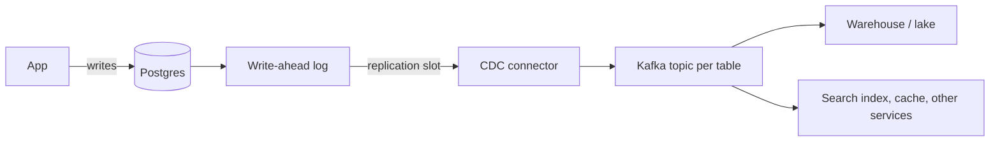
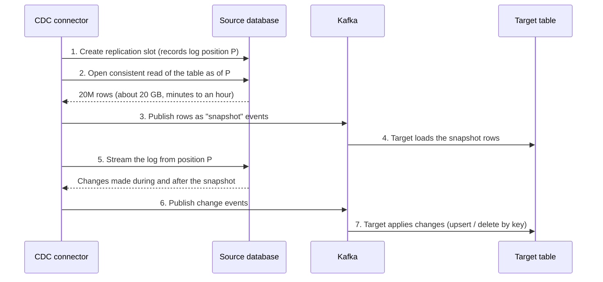
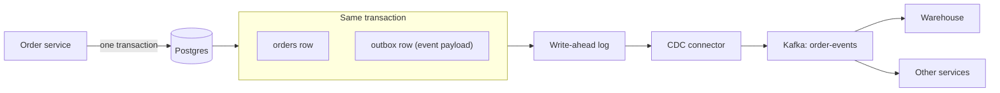

# CDC Patterns

Change data capture (CDC) means reading a database's own record of what changed and streaming those changes to other systems, instead of repeatedly querying the tables. Interviewers bring it up the moment you say "copy the orders table into the warehouse" and then ask "what about deletes?" This lesson covers the three ways to capture changes, how to start from a full copy and follow the stream without gaps, and the four traps that make an answer sound like experience.

[Ingestion Patterns](../02-core-concepts/02-ingestion-patterns.md) told you when to reach for CDC. This lesson is the how. Specific tools (Debezium, managed services) are in [Debezium and CDC Tools](../04-technology-deep-dives/09-debezium-and-cdc-tools.md); here you learn the pattern so you can use any of them.

## The Problem

A meal-kit company keeps orders in Postgres: 20 million rows, about 20 GB, around 200 writes a second (new orders, status changes, cancellations). The analytics team wants those orders in the warehouse, no more than a minute or two behind.

The first idea: every minute, `SELECT * FROM orders WHERE updated_at > :last_run`. It breaks in three ways.

- **Deletes vanish.** A deleted row has no `updated_at` to find. Finance sees cancelled orders still counted as revenue.
- **Intermediate states are lost.** An order goes `placed`, `packed`, `shipped` within 40 seconds. A poll sees only `shipped`. Nobody can compute "how long did packing take."
- **The primary pays for it.** A query every minute against the table that serves checkout adds load to the one database you least want to slow down.

All three share a cause: the poll sees the table's *current state*, but you need the *history of changes*. The database already keeps that history for crash recovery and its own replicas. CDC reads it.

200 writes a second is about 17 million changes a day. At about 1 KB per change event (see [Key DE Numbers](../02-core-concepts/10-key-de-numbers.md)), that is roughly 17 GB a day, around 0.2 MB/s. That is small for a stream; the hard part of CDC is correctness, not volume.

## Three Ways to Capture Changes

| Method | How it works | Sees deletes | Sees every intermediate state | Load on source | Needs source changes |
|---|---|---|---|---|---|
| **Query-based** | Poll with a watermark column (`updated_at`) or compare snapshots | No (unless soft deletes) | No | A query per poll | A reliable `updated_at` |
| **Trigger-based** | A database trigger writes each change into an audit table | Yes | Yes | Extra write inside every transaction | Triggers on every table |
| **Log-based** | Read the database's transaction log | Yes | Yes | Small and constant | Log settings and a read-only role |

**Query-based** is the ingestion lesson's watermark pull. Use it when the source is not a database you can get a log from, or when freshness of hours is fine and you can live with the gaps.

**Trigger-based** puts a trigger on `orders` that, on every insert, update or delete, writes a row into `orders_audit` in the same transaction. You then read the audit table. It captures everything, but it lengthens every write transaction on the source, and someone has to maintain triggers on every table and migrate them with every schema change. Use it when log access is not allowed and the write overhead is affordable.

**Log-based** reads the **write-ahead log** (WAL): the file where a database writes every change *before* applying it, so it can recover after a crash. Postgres calls it the WAL, MySQL calls its version the binlog, and most databases have an equivalent. Replicas stay in sync by reading it. A CDC connector is a replica that, instead of storing the data, turns each log entry into an event.



This is the default interview answer: it sees deletes and every intermediate state in commit order, adds almost no load, and needs no application change.

### What a change event looks like

Each log entry becomes a small event. The exact format depends on the tool, but they all carry the same parts:

```json
{
  "op": "u",
  "table": "orders",
  "key": {"order_id": 8812},
  "before": {"order_id": 8812, "status": "packed", "total": 54.90},
  "after":  {"order_id": 8812, "status": "shipped", "total": 54.90},
  "source_ts": "2026-11-02T08:14:03.120Z",
  "log_position": "0/3A4F2B8"
}
```

`op` is insert, update or delete. `before` and `after` are the row images (a delete has only `before`). Postgres sends the full old row only if the table is set to `REPLICA IDENTITY FULL`; by default `before` is empty for updates and holds only the key for deletes. `log_position` is where this change sits in the log (the LSN, converted to a 64-bit integer for comparison so it sorts correctly); it is what you use for ordering and for resuming.

> [!WARNING]
> **Log-based CDC on Postgres has an operational cost.** The connector reads through a **replication slot**, a bookmark that tells the database "keep log files from this point until the reader confirms it has them." If the connector stops, the slot stays, the database keeps every log file since then, and the primary's disk fills. A dead CDC connector can take down the source database. Alert on slot lag in bytes, and say so in the interview. Postgres 13 and later can cap this with `max_slot_wal_keep_size`: past the cap the database drops the slot to protect itself, and you re-snapshot. MySQL has no slot; it simply deletes old binlog files on a retention schedule, so a long outage there means a re-snapshot too.

## Snapshot Plus Stream

The log only has recent changes, so it cannot give you the 20 million rows that already exist. A new CDC pipeline must therefore do two jobs: copy what is there now (the **initial snapshot**), then follow every change after it, with no gap and no duplicate between the two.

The trap is the handoff. Copy first and *then* read the log, and changes made during the copy are missed. Read the log first and copy afterwards, and the copy may already contain changes you also see in the log. The standard solution is to record the log position first, copy a consistent view of the table, then start streaming from the recorded position.



Two properties make this safe.

1. **The snapshot and the log meet at position P.** The snapshot shows the table exactly as it was at P. The log shows everything after P. Nothing is missed and nothing is counted twice.
2. **Applying a change by key is idempotent.** If a change made during the snapshot also appears in the log, the target upserts the same row twice and ends in the same state. This is why the sink must be an upsert, not an append (see [Deduplication at Scale](../02-core-concepts/09-deduplication-at-scale.md)).

A snapshot loads the source while it runs: 20 GB at about 20 MB/s through one connection takes around 17 minutes; 2 TB takes about 28 hours. Large tables are snapshotted in parallel chunks by primary-key range, ideally from a read replica, or incrementally while streaming (tools differ; see the tools lesson). Mention this when the table is big.

The snapshot comes back later too: if the connector is down longer than the log is retained, you re-snapshot. Upserts make that repeatable.

## The Four Traps

### Ordering

Changes to the *same row* must be applied in the order they happened. If `shipped` is applied and then the older `packed` arrives, the warehouse shows the wrong status forever.

Kafka only guarantees order within a partition, so the rule is: **partition by the primary key**. All changes to order 8812 land in the same partition, in log order. Changes to different orders can be processed in parallel and out of order relative to each other, which is fine because they are different rows.

Add a second defence: the target keeps the highest `log_position` applied per key and drops any event with a lower one. That also protects against a retry that replays old events.

### Deletes

A delete is an event with `op = "d"` and only the old row. The target decides what it means:

- **Hard delete in the target** (`DELETE ... WHERE order_id = 8812`). Simple, but you lose history and cannot answer "how many orders were cancelled last week."
- **Soft delete** (set `is_deleted = true`). The default for analytics: the row stays, queries filter on the flag, and a replayed delete is harmless.

Many CDC tools (Debezium by default) also emit a **tombstone** after a delete event: a message with the same key and an empty value. Kafka's log compaction keeps only the latest message per key, so the tombstone replaces the delete event, and after `delete.retention.ms` (24 hours by default) it is removed too and the key is gone. Without tombstones, a compacted topic keeps the last event for every deleted key forever. The catch: a consumer that is offline longer than that retention window can miss the delete entirely, so rebuild such a consumer from a fresh snapshot.

### Schema change

The app team adds a column. Then renames one. Then changes `total` from integer cents to decimal.

- **Adding a nullable column** is the easy case. The connector emits the new field, and the target adds a column. Most pipelines handle this automatically.
- **Renaming or dropping a column** looks like a drop plus an add, so consumers reading the old name break.
- **Changing a type** can break serialisation or silently truncate in the target.

The defence is the one from [Data Contracts](../02-core-concepts/07-data-contracts.md): put a schema registry between producer and consumers with a compatibility rule, so a breaking change fails loudly at the source instead of silently downstream. Also keep raw change events untouched in the bronze layer (see [Medallion Architecture](03-medallion-architecture.md)) so you can reprocess after a fix, and agree with the app team that renames and type changes use expand-and-contract: add the new column, write both, move readers, drop the old.

### Transactions

One database transaction can change rows in three tables. Applied one by one, a reader can briefly see an order without its line items. Most pipelines accept this: the target is correct once the last event lands. Say "eventually consistent across tables" and move on, unless the prompt demands otherwise.

## Landing the Changes

The stream is a *log of changes*; consumers usually want *current state*. Keep both:

1. **Change table (bronze)**: append every event as it arrives, with `op`, `log_position`, and `source_ts`. This is your audit trail and your replay source.
2. **Current-state table (silver)**: the latest version of each row, built by a MERGE.

```sql
MERGE INTO orders_current t
USING (
  SELECT * FROM (
    SELECT *, ROW_NUMBER() OVER (
      PARTITION BY order_id ORDER BY log_position DESC) AS rn
    FROM orders_changes
    WHERE ingested_at >= :last_run
  ) WHERE rn = 1
) s
ON t.order_id = s.order_id
WHEN MATCHED AND s.op = 'd' AND s.log_position > t.log_position THEN UPDATE SET is_deleted = TRUE, log_position = s.log_position
WHEN MATCHED AND s.log_position > t.log_position THEN UPDATE SET ...
WHEN NOT MATCHED AND s.op <> 'd' THEN INSERT ...;
```

The inner query keeps the latest change per key in the batch, so the MERGE sees one row per key. The `log_position` guard on both branches makes reruns safe and stops a late delete overwriting a newer row. It is the ordering and delete handling above in about ten lines, worth being able to sketch.

Run the MERGE as often as freshness needs; the change table lets you choose without changing the capture.

## The Outbox Pattern

Now the other direction: your own service must *publish* an event when it changes its database. Placing an order should write the row *and* send an `OrderPlaced` message to Kafka. Doing both in service code is a **dual write**, and it has no safe ordering.

- Write the DB, then publish: the service crashes between them, and the order exists but the event never does.
- Publish, then write the DB: the transaction rolls back after the event was sent, and downstream systems react to an order that does not exist.

The **outbox pattern** removes the second write. Add an `outbox` table to the same database. In *one* transaction, write the order row and an outbox row containing the event. A CDC connector reads the log, sees the outbox insert, and publishes it. The database's atomic commit gives you what two systems could not: either both the order and its event exist, or neither does.



For a data engineer, the outbox yields *business events* (`OrderPlaced`, with chosen fields) instead of raw row changes. Row-level CDC leaks the source's internal schema to every consumer, and a column rename breaks them. An outbox event is a deliberate, versioned interface owned by the producing team, which is what a data contract wants.

Three details to know: key each event by the entity it belongs to (the order ID) so one entity's events stay in order within a partition; clean old outbox rows with a scheduled delete, since the log already captured the insert; and expect **at-least-once** delivery (a connector restart can republish), so give every event a unique ID and deduplicate on it.

This is also the cleanest bridge to [Event Sourcing](05-event-sourcing.md). CDC derives events from *state* that a database already holds. Event sourcing makes the events the source of truth. The outbox sits between: the database is still the truth, but it emits real events.

## When to Use It, and When Not To

| Situation | Choice |
|---|---|
| Operational database, need deletes and intermediate states, minutes of freshness | Log-based CDC |
| Daily freshness, small table, deletes via `is_deleted` | Query-based pull is enough |
| Cannot get log access (managed service restriction, vendor-owned database) | Query-based, or trigger-based if you own the schema |
| Source emits its own events already (Kafka, webhooks) | Use those, not CDC |
| Own service must publish events reliably | Outbox + CDC |

Do not use CDC because it sounds modern. It adds a connector, a log retention concern and a snapshot procedure. For a 50 MB reference table loaded nightly, it is a bad trade.

## In the Interview

**When it comes up.** "Replicate this database into the warehouse." "How do you keep the search index in sync?" "Cancellations are missing from the report." Or the follow-up to ingestion: "What about deletes?"

**A strong answer, in order:**

1. Name the problem with polling. "A watermark misses hard deletes, collapses intermediate states, and queries the primary."
2. Choose log-based CDC in one breath. "Reads the WAL, so no table load, and sees every change including deletes, in commit order."
3. Describe the start. "Snapshot at a recorded log position, then stream from it, so there is no gap."
4. Cover ordering. "Partition by primary key, carry the log position, drop events older than what's applied."
5. Say where it lands. "Raw changes appended to bronze, MERGE into a current-state table, deletes as soft deletes."
6. Raise the operational risk. "Monitor replication slot lag so a stuck connector doesn't fill the primary's disk."

**What interviewers listen for:** a snapshot-to-stream handoff explained without hand-waving, schema change raised before they ask, and a connector treated as something that fails, with a named metric to watch.

**Follow-up questions to expect:**

- "The connector was down for two days. What happens?" If the log was retained, it resumes from its saved position and catches up. If the slot was dropped or the log recycled, you re-snapshot into the same tables with upserts and then resume.
- "Why not just use triggers?" They lengthen every source transaction and need per-table upkeep.
- "How do you know the target matches the source?" Compare row counts and a checksum per key range on a schedule, and alert on drift.
- "How do you ship a change to a column type safely?" Expand and contract: add the new column, write both, move readers, drop the old one, behind a compatibility rule.

## Common Mistakes

> [!WARNING]
> **Saying "we'll use Debezium" and stopping.** A tool name is not a design. Say what it reads, how it starts, how it orders, and what it does with deletes.

> [!WARNING]
> **Ignoring deletes in the target.** Appending change events into a table and querying it as if it were current state double-counts every updated row and keeps every deleted one.

## Key Takeaways

- **CDC** reads the database's change log instead of querying tables. Log-based is the default: it sees deletes and every intermediate state, in order, with little load. Query-based misses deletes; trigger-based taxes every write.
- A new pipeline needs a **snapshot plus stream**: record the log position, snapshot as of it, then stream from it. Upserts by key make the overlap harmless.
- The four traps are ordering (partition by primary key, compare log positions), deletes (soft delete, tombstones), schema change (registry and compatibility rules, expand-and-contract), and transactions (eventual consistency across tables).
- Land raw changes in a change table, then MERGE into a current-state table. Monitor replication slot lag and end-to-end freshness.
- The **outbox pattern** solves the dual write: write the row and the event in one transaction, let CDC publish the event. It gives consumers deliberate events, not raw table changes.

## Going Further

- Tool internals and managed CDC services: [Debezium and CDC Tools](../04-technology-deep-dives/09-debezium-and-cdc-tools.md)
- Events as the source of truth: [Event Sourcing](05-event-sourcing.md)
- Keeping the landed tables correct: [Deduplication at Scale](../02-core-concepts/09-deduplication-at-scale.md), [Late-Arriving Data](../02-core-concepts/08-late-arriving-data.md)
- Related breakdowns: [CDC Replication](../05-breakdowns-core/05-cdc-replication.md), [E-Commerce Analytics Warehouse](../05-breakdowns-core/03-e-commerce-warehouse.md)
