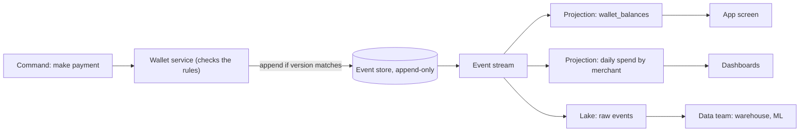

# Event Sourcing

Event sourcing means you store every change as an immutable event and treat the current state as something you calculate from them, not something you keep. As a data engineer you rarely build it, but you will be handed the events it produces, and interviewers use it to test whether you understand the difference between "a log of what happened" and "a table of what is true now."

[CDC Patterns](04-cdc-patterns.md) ended on a bridge: CDC derives events from state a database already holds, event sourcing makes the events the source of truth. This lesson walks across it.

## The Problem

A payments app keeps prepaid wallets in a Postgres table: `wallets(wallet_id, balance, updated_at)`. There are 2 million wallets. A customer writes in: "My balance says 40.00. It should be 90.00. Where did my 50 go?"

Support opens the table. It says `balance = 40.00`. That is all it says. The row holds the *result* of every top-up, payment and refund this customer ever made, and none of the steps that led there. Three things follow.

- **No audit trail.** To answer the customer you need to know what happened, in order. The table threw that away on every `UPDATE`.
- **No fixing the past.** Engineering finds a bug: refunds in March were applied twice to wallets that also had a pending top-up. You can correct today's balances only by guessing which ones were affected.
- **No new questions.** Product asks, "how many wallets dropped to zero and then topped up within an hour?" The table cannot say. It only knows who is at zero now.

You could bolt on a `wallet_history` table with triggers. That is CDC-style capture of *state changes*. It tells you the balance went 90 to 40, but not *why*: was it a payment, a fee, a chargeback?

Event sourcing starts from the opposite end: store what happened, and calculate the balance.

## The Core Idea

For each wallet, keep an append-only list of events. Each event is a fact in the past tense, named for a business happening, with a version number that counts up per wallet:

| wallet_id | version | event | data | at |
|---|---|---|---|---|
| w-7 | 1 | `WalletOpened` | currency=EUR | Mar 02 |
| w-7 | 2 | `ToppedUp` | amount=100.00 | Mar 02 |
| w-7 | 3 | `PaymentMade` | amount=60.00, merchant=m-31 | Mar 09 |
| w-7 | 4 | `PaymentRefunded` | amount=60.00, payment=3 | Mar 10 |
| w-7 | 5 | `FeeCharged` | amount=10.00, reason=refund_fee | Mar 10 |
| w-7 | 6 | `PaymentMade` | amount=50.00, merchant=m-90 | Mar 14 |

The balance is not stored. You get it by **folding** the events: start at 0 and apply each one in order. 0 + 100 - 60 + 60 - 10 - 50 = 40.00. The customer's question is now answerable: the 50 left on March 14, as a payment to merchant m-90 that they may not recognise.

Three rules make this work.

1. **Events are immutable.** You never update or delete one. A mistake is fixed by appending a correcting event (`PaymentRefunded`), not by editing history.
2. **Events are facts, not commands.** `PaymentMade` records something that happened and was accepted. "Please make a payment" is a command, and it can be rejected. Only accepted commands produce events.
3. **The event log is the source of truth.** Every other copy of the data, including the balance, is derived and can be thrown away and rebuilt.

### How a write works

When a payment request arrives, the service loads the wallet's events, folds them to get the balance (40.00 for w-7), checks the rule ("balance must cover the payment"), and appends a new event if the rule passes.

Two payments for the same wallet can arrive at the same moment. Both read version 6, both see enough money, both try to write version 7. The store protects against this with **optimistic concurrency**: an append says "write this as version 7, but only if the wallet is still at version 6." The second one fails the check, reloads, sees the new balance, and decides again. This is a unique constraint on `(wallet_id, version)`, nothing more exotic.

The wallet's events together are called its **aggregate**: the unit you load, fold and protect with the version check. Folding 6 events is instant. Folding 40,000 events for a very busy wallet is not, so the service periodically saves an **aggregate snapshot**: "at version 39,000 the balance was 812.40." Loading then means the snapshot plus the events after it. This is an optimisation for the write side only. It is not the same thing as the snapshot in a CDC pipeline.

### Reading: projections

The event log is good at one question, "what happened to wallet w-7," and bad at most others. "Show me the top 100 wallets by balance" would mean folding 2 million wallets' worth of history on every request.

So you build **projections**: read-optimised tables, calculated from the events by a process that subscribes to the log and updates them as new events arrive. One log can feed many projections, each shaped for a question:

- `wallet_balances` for the app screen (one row per wallet).
- `daily_spend_by_merchant` for the finance dashboard.
- A search index of payments for support.
- A fraud model's feature table.

Splitting the model into a write side (events, with rules) and a read side (projections, for queries) is often called **CQRS** (command query responsibility segregation). You will hear the two terms together. It is enough to know that event sourcing produces the split on its own.

Because projections are calculated, they are disposable. Found a bug in the balance logic? Fix the code, empty `wallet_balances`, and replay the log through the new code. This is the same trick as [Kappa Architecture](02-kappa-architecture.md), applied to an application's state instead of an analytics result. And it has the same cost.

### What a rebuild costs

Say each wallet averages 5 events a day. That is 10 million events a day, about 115 a second. At 0.5 KB per event (see [Key DE Numbers](../02-core-concepts/10-key-de-numbers.md)) the log grows by about 5 GB a day, 1.8 TB a year. Three years is roughly 11 billion events and 5.5 TB.

Replaying 5.5 TB through one reader at 50 MB/s takes about 30 hours. Split by `wallet_id` across 20 parallel readers (events for different wallets are independent), it is about 1.5 hours. That is fine for a planned rebuild and unacceptable for "the app is down, rebuild the balances." So you do not replay from zero in an emergency. You keep **projection checkpoints** (the last event position applied) and periodic copies of the projection, and you replay only the tail.

### Eventually consistent reads

A projection lags the log by seconds. A customer taps "pay," then immediately opens the balance screen and sees the old number. This is the price of the split, and it is the first thing a sceptical interviewer will raise. The usual answers: have the screen read the aggregate (fold the wallet's own events, as in the write path) right after a write, show the result of the command directly in the response, or accept a one-second lag where it doesn't matter.

## How It Differs From CDC

Both give you a stream of changes, so people mix them up. The difference is *what is the source of truth*.

| | CDC | Event sourcing |
|---|---|---|
| Source of truth | The current-state table | The event log |
| Where the events come from | Derived afterwards by reading the database log | Written deliberately by the application |
| What an event says | "Row 8812 changed from `packed` to `shipped`" | "`OrderShipped` by carrier X" |
| Carries the reason? | No. You see the change, not the intent. | Yes. Event names and fields are designed. |
| Can the state be rebuilt from it? | Not reliably. It holds changes, not the rules. | Yes, by definition. |
| Who adopts it | The data team, with no app change | The app team, as an architectural decision |
| Failure to watch | Slot lag, snapshots, schema drift | Event schema evolution, rebuild time |

A good one-line answer: **CDC reconstructs events from state. Event sourcing derives state from events.** The [outbox pattern](04-cdc-patterns.md#the-outbox-pattern) sits in the middle: the database stays the source of truth, but the service writes deliberate business events next to its data. Many teams get most of the benefit that way, with none of the rebuild machinery.

## Where Data Teams Meet It

You will almost never be asked to design an event-sourced application. You will be asked how to handle the *output* of one. Three situations come up.

**The events are your best raw layer.** An event-sourced system hands you immutable, ordered, named facts with the reason attached. Land them untouched in the bronze layer of a lake (see [Medallion Architecture](03-medallion-architecture.md)) and build silver and gold tables from them. You get history for free, the same way a raw CDC change table does, but with business meaning.

**You are another projection.** The warehouse's `daily_spend_by_merchant` is just a projection that happens to live in your pipeline. The same rules apply as for the app's own projections: idempotent writes, a checkpoint, and the ability to replay. This is why event-sourced thinking and a replayable ingestion layer fit together.

**The event schema is a contract.** Events are stored forever, so a field renamed in 2026 has to be read by code that processes 2023 events. Event producers evolve schemas by adding optional fields and **upcasting** old events on read (converting a version-1 event into the version-2 shape in code before it is used). Put a schema registry and compatibility rule in front of the stream, as in [Data Contracts](../02-core-concepts/07-data-contracts.md). Never "migrate" stored events in place.

> [!NOTE]
> **Kafka as the event store?** A Kafka topic is a durable, ordered log, so it is tempting. It works well for *distributing* events and for replay. As the *store* for an aggregate it is awkward: you cannot cheaply load "all events for wallet w-7," and the optimistic-concurrency check ("append only if at version 6") is not a native operation. Most event-sourced services keep events in a database table with a unique `(stream_id, version)` and publish them to Kafka, often via the outbox pattern.

## Hard Parts to Admit To

These are the honest costs. Name them in an interview before you are asked.

- **Deleting data.** Privacy law lets a user demand erasure, but events are immutable and copied into lakes and caches. The usual answer is **crypto-shredding**: store personal fields encrypted with a per-user key, and delete the key. The events stay; the personal data in them becomes unreadable.
- **Schema evolution.** Covered above. It is a permanent tax, because old events never go away.
- **Rebuild time and cost.** Covered above. Plan checkpoints before you need them.
- **Querying.** There is no `SELECT` on current state until a projection exists. Every new question may mean a new projection and a replay.
- **Team learning curve.** Folding, versions, replays and eventual consistency are unfamiliar to most developers. A team that gets it wrong ends up with a slow, confusing CRUD app.

## When to Use It, and When Not To

| Situation | Choice |
|---|---|
| History and audit are the product (ledgers, payments, inventory movements, regulated records) | Event sourcing fits |
| You need to answer "why" and "what was true at time T" | Event sourcing fits |
| Many different read models from the same facts | Event sourcing fits |
| Ordinary CRUD (profiles, settings, catalogue) | Plain tables. Add CDC if analytics needs the changes. |
| You just need reliable events for other systems | Outbox + CDC |
| Team is small and has not run a replay before | Avoid. The rebuild and schema work will cost more than it returns. |
| Strong, instant consistency across many entities is required | Be careful. Cross-entity rules are awkward. |

Event sourcing is an application architecture decision. A data engineer's job in the interview is to describe what changes in the pipeline, not to argue the app team into it.

## In the Interview

**When it comes up.** "Design an audit log for payments." "How would you rebuild the balances if the logic was wrong?" "Our service stores events, not state: how do you load it to the warehouse?" Or the follow-up to CDC: "What if the events were the source of truth?"

**A strong answer, in order:**

1. State the idea in one line. "The log of events is the source of truth. Current state is a projection."
2. Give a concrete example. "A wallet's balance is the sum of its `ToppedUp`, `PaymentMade` and `Refunded` events, so we can answer why it is what it is."
3. Show the two sides. "Writes append with a version check. Reads come from projections that subscribe to the log."
4. Compare with CDC. "CDC derives events from state after the fact. Here they are deliberate and carry intent."
5. Say what it costs. "Eventual consistency on reads, schema evolution forever, and rebuild time. I'd checkpoint projections and replay in parallel by key."
6. Place yourself as the data engineer. "I'd land the events raw, build warehouse tables as another projection, and put a schema registry in front."

**What interviewers listen for:**

- You can say plainly how it differs from CDC without calling them the same thing.
- You mention costs unprompted: delete requests, schema change, replay time.
- You don't push it for ordinary CRUD.
- You treat the warehouse as one more projection, with replay and idempotency.

**Follow-up questions to expect:**

- "How do you stop two payments overdrawing the same wallet?" Version check on append: the second writer fails and retries on fresh state.
- "A projection has a bug. What do you do?" Fix the code, build the corrected projection beside the old one by replaying the log, then switch readers. Parallelise by key; resume from a checkpoint.
- "How do you handle a GDPR (EU privacy law) delete?" Crypto-shredding: delete the user's key so the stored personal data is unreadable. Mention that derived copies in the warehouse need the same treatment.
- "An event's shape has to change. Now what?" Add an optional field, or write version 2 of the event and upcast version 1 on read. Never edit stored events.
- "Why not just use CDC and keep the table as truth?" You can, and for most systems you should. You lose intent and the ability to rebuild, which matters only when history is the product.

## Common Mistakes

> [!WARNING]
> **Calling CDC "event sourcing."** CDC reads the changes of a table that is still the truth. If you can delete the log and lose nothing, it isn't event sourcing.

> [!WARNING]
> **Recommending it for ordinary CRUD.** An event-sourced settings page is a way to turn a one-day feature into a two-month project. Say when you wouldn't.

> [!WARNING]
> **Editing or deleting events.** If a bad event is "fixed" in place, every projection and downstream copy built from it is silently wrong. Append a correction.

> [!WARNING]
> **Forgetting that projections lag.** "The user pays and the balance doesn't change" is the classic failure. Say how the read after a write is handled.

> [!WARNING]
> **No plan for a full rebuild.** "We can replay" is not a plan until you have said how long it takes and what you do while it runs.

## Key Takeaways

- **Event sourcing** stores immutable, business-named events as the source of truth and calculates current state by folding them. The state is derived and can be rebuilt.
- Writes append events with a version check (optimistic concurrency). Reads come from **projections**, which are disposable tables built by subscribing to the log.
- The difference from CDC is the source of truth: CDC derives events from state after the fact, event sourcing writes them deliberately and keeps their intent. The outbox pattern is the middle ground.
- The costs are real: eventually consistent reads, permanent event schema evolution, rebuild time, and delete requests (crypto-shredding).
- As a data engineer you consume the events: land them raw, treat your warehouse as another projection, and put a schema contract in front.

## Going Further

- Command query responsibility segregation (CQRS) in more depth, including when to use it without event sourcing
- Sagas: coordinating a business process across several event-sourced services
- Applying the pattern's ideas to analytics: [Kappa Architecture](02-kappa-architecture.md) and [Backfill and Reprocessing](../02-core-concepts/03-backfill-and-reprocessing.md)
