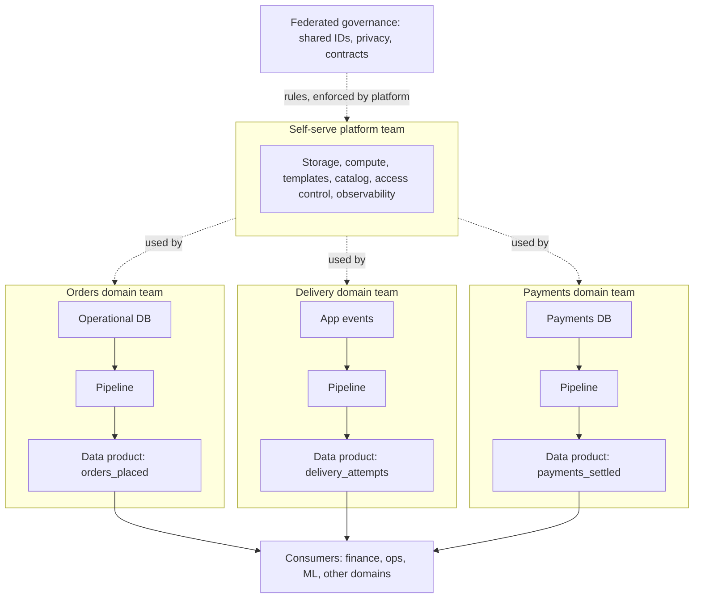

# Data Mesh

Data mesh is an organisational pattern more than a technical one: the teams that create data own it end to end, and a small platform team makes that ownership cheap. Interviewers raise it to see whether you can tell a real organisational problem from a tooling problem, and whether you will say "you probably don't need this" when it is true.

## The Problem

A meal-kit company has 12 product teams: orders, subscriptions, delivery, payments, marketing, supply and more. One central data team of 6 engineers builds every pipeline and owns every table in the warehouse.

Here is a normal Tuesday in that company.

- The delivery team adds a "failed attempt reason" to its app. It wants the field in the warehouse so ops can see why drivers fail. It files a ticket. The queue is 40 tickets long; the wait is about 11 weeks.
- The central team gets the ticket. Nobody on it knows what the delivery app's `status = 7` means, so an engineer spends two days chasing the delivery team on chat to find out.
- Finance notices a revenue number is wrong. Is it the orders team's bug, the payments team's bug, or a pipeline bug? The central team is asked first, because it owns the pipeline. It owns the pipeline but understands none of the business rules.

Nobody on that team is slow or unskilled; the structure causes the trouble:

- **The people who know the data don't own the pipeline.** Meaning is lost at every handoff.
- **The people who own the pipeline don't know the data.** They guess, and they get it wrong.
- **One team is a bottleneck for twelve.** Adding headcount makes the queue shorter, not the structure better.

Pushing the central team harder doesn't work. At some size, a single team that owns all data cannot also understand all of it. Data mesh is one answer: move the ownership to where the knowledge is.

## The Core Idea

Data mesh rests on four principles. Each one exists to fix a failure of the one before it, so learn them in order.

### 1. Domain ownership

A **domain** is a part of the business with its own team and vocabulary: orders, delivery, payments. **Domain ownership** means the domain team is responsible for the analytical data it generates, not only its operational database. The delivery team owns the delivery tables in the warehouse the way it already owns its API.

This fixes the "who knows what `status = 7` means" problem. The team that wrote the status writes the table.

### 2. Data as a product

Once a domain team owns data, other teams depend on it. If it is treated as a by-product, you get twelve teams' leftovers. So each domain publishes **data products**: datasets treated as a product with an owner, consumers and a quality bar. A data product is more than a table. It comes with:

- **An owner** you can page, and a named list of consumers.
- **A contract**: schema, meaning, quality and freshness promises. See [Data Contracts](../02-core-concepts/07-data-contracts.md), which is exactly the interface a data product exposes.
- **Discoverability**: it is registered in a [metadata catalog](../02-core-concepts/04-data-lineage.md) with a description, so a stranger can find it and trust it without asking the team.
- **Service levels**: for example "`delivery_attempts` is updated within 30 minutes, 99% of the time" (see [Monitoring and Alerting](../02-core-concepts/06-monitoring-and-alerting.md)).

The delivery team's marketing colleagues are now consumers of its dataset, with the right to complain when it breaks.

### 3. Self-serve data platform

There is a trap in the first two principles. If twelve domain teams each need to learn Spark, set up orchestration, configure access control and build monitoring, you have swapped a bottleneck for twelve half-built, inconsistent platforms. Delivery's engineers are app developers; they will not become data infrastructure specialists.

So a **platform team** (this is where your central team goes) builds a **self-serve data platform**: shared tooling that lets a domain team publish a data product without being a data infrastructure expert. In practice that means templates, pipelines they can configure rather than write, storage, a catalog, access control and observability, all behind a simple interface. The measure of success is how fast a domain team gets from "we have data" to "it is published as a product". A good target is days, not the 11 weeks above.

The platform team stops building pipelines for the business and starts building the thing that lets others build them. Building that platform is a breakdown of its own: see [Design a Data Mesh Platform](../06-breakdowns-advanced/09-data-mesh-platform.md).

### 4. Federated governance

Twelve independent teams create a new problem. Can finance join `orders` to `payments`? Only if both use the same customer ID format. Who decides what counts as personal data, and how long it is kept? If every team decides alone, the data cannot be combined, and combining data is the point.

**Federated governance** answers with a small group that includes domain representatives and the platform team and that decides the rules everyone follows: identifier formats, naming, privacy classification, minimum quality and contract standards. "Federated" means the rules are agreed by the domains, not imposed by a central authority. The platform **enforces them automatically** (for example, a publish step refuses a dataset with no owner or no classified personal-data columns), because rules that depend on people remembering them don't last.

> [!NOTE]
> Governance is the least glamorous principle and the one that decides whether mesh works. Without it you have many well-meaning datasets that cannot be joined.

## How It Fits Together

The flow of data stays much like any other design: sources, storage, transformation, consumers. What changes is who owns each part. The diagram shows three domains that each publish products, with shared platform capabilities underneath and the rules applying to everyone.

Each domain's pipeline is built and run by the domain team using platform tooling. Consumers, including other domains, read the products, never a domain's internal tables. Lineage across products is recorded in the catalog.

### What a data product looks like

Here is the `delivery_attempts` product as its owner would publish it. Notice that most of it is metadata, not data.

| Property | Value |
|---|---|
| Owner | Delivery team, on-call rota `delivery-data` |
| Grain (what one row means) | One row per delivery attempt |
| Schema | `attempt_id`, `order_id`, `driver_id`, `attempted_at`, `outcome`, `failure_reason` (enum, values documented) |
| Freshness | Updated within 30 minutes, 99% of the time |
| Quality | `attempt_id` unique, `order_id` always present and matches `orders_placed` |
| Classification | `driver_id` is personal data, masked for non-ops consumers |
| Compatibility | BACKWARD_TRANSITIVE; breaking changes get 60 days' notice |
| Consumers | Ops dashboard, finance (refunds), ML (late-delivery model) |

Two products from different domains are joinable because the governance rules say `order_id` is the same type and format everywhere. That shared key is the "mesh" in data mesh.

## Is It Right for You?

Data mesh solves a coordination problem between many teams. It adds real cost: every domain needs data skills, every product needs an owner, and the platform is a product in its own right. That cost only pays for itself in one situation.

| Signal | Mesh fits | Mesh is overkill |
|---|---|---|
| Number of domain teams producing data | Roughly 10 or more, with different vocabularies | A handful, or one |
| Central data team | A queue weeks long, bottleneck for many | Keeps up with requests |
| Data skills in domain teams | Some engineers can own a pipeline, or can be trained | None, and no appetite to hire |
| Leadership | Backs a multi-year change in ownership | Wants a quick fix |
| Platform budget | Can staff a platform team of several engineers | Cannot |
| Cross-domain joins | Common (finance spans orders and payments) | Rare |

In short: **mesh is for large organisations whose data team has become the bottleneck and whose domains can staff data ownership.** A 40-person company with one data engineer is not a mesh candidate. It needs a warehouse and some good [medallion layers](03-medallion-architecture.md).

### The in-between that most companies actually do

Most real organisations take only parts of the idea, and an interviewer will respect you for saying so:

- Keep a central platform and warehouse, but give each domain **ownership of its own transformation models and tests** (the SQL that builds its tables; the "domain-owned models on a shared platform" approach).
- Add **contracts at team boundaries** and a **catalog with owners**, and nothing more. This is where most of the benefit lives.
- Move one or two high-pain domains first, prove the platform works, then expand.

> [!TIP]
> Say it as a spectrum: "Fully central, central platform with domain-owned models, full mesh. I'd pick the middle one at this size and keep the option to go further."

## In the Interview

**When it comes up.** Mesh appears in three ways: as a named prompt ("design a data platform for a company with 30 teams"), as a follow-up when you say "a central data team owns everything" ("what happens when that team becomes the bottleneck?"), and as a deliberate trap ("would you use data mesh here?").

**How to say it.**

1. Start with the organisational problem, not the technology: "The central team doesn't know the domains' data and can't keep up. The fix is to move ownership to the domains."
2. Name the principles in a sentence: "Domains own their data, publish it as products with contracts, on a self-serve platform, under shared governance that is enforced automatically."
3. Say what it costs: "Each domain needs data ownership skills, and we need a platform team. That is a multi-year change."
4. Judge it against the prompt: "At 30 teams with a long queue, yes. At 5 teams, a central warehouse with domain-owned models is enough."

**What interviewers listen for:**

- You treat it as an organisational pattern, and say whether the organisation is ready.
- You can state all four principles and say why each one is needed, in particular that self-serve and governance exist to stop the first two from creating chaos.
- You connect it to concrete mechanisms you already know: contracts at the product interface, a catalog and lineage for discovery, monitored service levels.
- You say when it is overkill without being asked.

**Phrases that work:**

- "Mesh moves ownership to where the knowledge is. The platform keeps that from becoming twelve copies of the same work."
- "A data product is a dataset with an owner, a contract and a service level, not just a table in a shared schema."
- "Governance has to be enforced by the platform. If it depends on people remembering, it fails."

**Follow-up questions to expect:**

1. **"How is this different from a data lake?"** A lake is where data is stored. Mesh is about who owns and publishes it. You can build a mesh on a lake, a warehouse or both.
2. **"How do consumers find data?"** A catalog with product descriptions, owners and lineage; a data product that is not discoverable doesn't exist.
3. **"What stops two domains defining 'active customer' differently?"** Shared definitions agreed through governance for the few concepts that cross domains, kept small on purpose. Everything else stays local.
4. **"How do you handle a breaking change?"** The contract workflow from [Data Contracts](../02-core-concepts/07-data-contracts.md): add the new version beside the old, give consumers a deprecation window, then remove.
5. **"How is it different from data fabric?"** Mesh reorganises *people and ownership*; fabric tries to unify access using *metadata and automation* over data wherever it sits. They are not exclusive. See [Data Fabric](07-data-fabric.md).

> [!TIP]
> If you only have 30 seconds: "Data mesh makes domain teams own their analytical data as products with contracts, on a self-serve platform, with federated governance enforced by that platform. It solves a central-team bottleneck at large scale and is overkill for a small organisation."

**By level.** Mid-level: define the four principles and give the delivery example. Senior: say when it is overkill and describe the in-between option, plus how contracts and a catalog make a product real. Staff+: sequencing the migration, staffing the platform team, and handling the cross-domain concepts that governance must standardise.

## Common Mistakes

> [!WARNING]
> **Treating mesh as a technology to buy.** Nobody sells you ownership. A candidate who answers with a product list instead of ownership and team structure has missed the pattern.

> [!WARNING]
> **Doing domain ownership without the platform.** If every domain builds its own stack, you have rebuilt the problem twelve times with worse quality. The self-serve platform is not optional.

> [!WARNING]
> **A "data product" that is just a table.** No owner, no contract, no freshness promise and no catalog entry means a table with a new name.

> [!WARNING]
> **Governance by committee, not by code.** A wiki page of naming rules is ignored within a month. Put the rule in the publish step so a non-compliant dataset cannot be released.

> [!WARNING]
> **Recommending mesh by default.** Suggesting it for a 20-person startup is a red flag. The right answer to "would you use mesh?" often starts with "how many teams, and is the central team the bottleneck?"

## Key Takeaways

- **Data mesh** moves ownership of analytical data to the domain teams that know it, because a central team that owns everything becomes a bottleneck that doesn't understand the data.
- Four principles, each fixing the one before: domain ownership, data as a product (owner, contract, discoverability, service levels), a self-serve platform so domains don't each build infrastructure, and federated governance enforced automatically so products can be combined.
- A data product's interface is its contract. Contracts, a catalog and lineage are what make the pattern work day to day.
- It is an organisational change with a real cost, worth it only with many domains, a long central queue, and the means to staff both domain ownership and a platform team.
- Most companies adopt part of it: a central platform with domain-owned models and contracts at team boundaries. Offering that middle option shows judgment.

## Where to Go Next

- [Data Contracts](../02-core-concepts/07-data-contracts.md): the interface every data product exposes.
- [Data Lineage](../02-core-concepts/04-data-lineage.md): how products stay discoverable and changes stay safe.
- [Data Fabric](07-data-fabric.md): the metadata-driven alternative, and how to compare it honestly.
- [Medallion Architecture](03-medallion-architecture.md): the layering each domain's pipeline can follow inside the mesh.
- [Design a Data Mesh Platform](../06-breakdowns-advanced/09-data-mesh-platform.md): building the self-serve platform in full.
