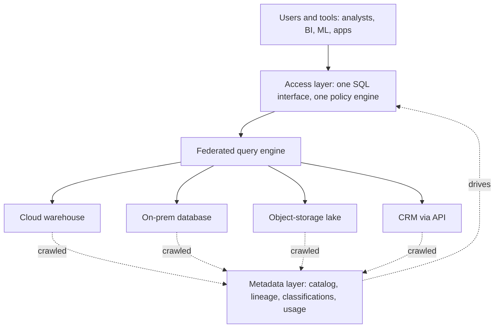

# Data Fabric

Data fabric is the answer to "our data is scattered across a dozen systems and nobody can find or combine it" that says: don't move or reorganise anything, put a layer of metadata and automation on top. Interviewers bring it up to see whether you can separate an idea that is useful from a label that is mostly marketing, and whether you can discuss it without either swallowing it or sneering at it.

## The Problem

A retailer has grown by acquisition. Its data now lives in five places:

- A cloud warehouse with online orders, about 4 TB.
- An on-premises database with in-store sales from an acquired company.
- An object-storage lake with clickstream files, around 60 TB.
- A CRM (customer relationship management) system with customer records, reachable only through its API.
- Spreadsheets and a marketing tool owned by the marketing team.

An analyst is asked: "What did customers who saw the spring campaign spend in store and online?" Here is what happens.

- She spends two days finding which systems hold the pieces. There is no inventory.
- Each system names the customer differently: `cust_id`, `customer_no`, an email address. Nobody has written down the mapping.
- To join in-store sales with online orders, someone copies a table between systems. The copy is stale by Thursday.
- Access is requested separately from five owners.

The pain has four parts: **finding** data, **understanding** it, **reaching** it and **combining** it. Data fabric attacks all four without first rebuilding the estate into one warehouse.

## The Core Idea

A **data fabric** is a metadata-driven layer that sits across your existing data systems and gives people one place to discover, understand, access and govern data wherever it physically lives. The key word is *metadata*: data about data, such as schemas, owners, usage, lineage and classifications. The claim is that if you collect enough metadata and automate enough on top of it, you get a unified view without a big migration.

Fabric is a loose collection of capabilities, not one product. When someone describes one, they usually mean these five.

### 1. A unified metadata catalog

A crawler connects to every system and records what exists: tables, columns, types, sizes, who queries them. The result is a [metadata catalog](../02-core-concepts/04-data-lineage.md), a searchable inventory. This alone fixes the two-days-of-hunting problem, and it is the most valuable part.

### 2. Automated metadata collection and enrichment

Typing descriptions by hand does not scale to 40,000 columns. The fabric profiles values to guess that `cust_id` and `customer_no` hold the same kind of key, tags columns that look like email addresses as personal data, and harvests [lineage](../02-core-concepts/04-data-lineage.md) from query logs. Vendors call this "active metadata" or machine learning. Mostly it is profiling, pattern matching and log parsing, with a human confirming the uncertain cases.

### 3. A virtual access layer

**Data virtualization** means querying data where it lives, through one SQL interface, instead of copying it first. A query engine with connectors to each system receives one query and splits it into pieces, one per source, then combines the results. Trino is a well-known open-source example of this style of **federated query**.

```sql
-- One query, three physical systems
SELECT c.segment, SUM(s.amount) AS store_spend, SUM(o.amount) AS online_spend
FROM crm.customers c
JOIN onprem.store_sales s ON s.customer_no = c.customer_no
JOIN warehouse.online_orders o ON o.cust_id = c.customer_id
GROUP BY c.segment;
```

The analyst sees what looks like one database. Behind it the engine pulls rows from the CRM's API, the on-premises database and the warehouse, and joins them in its own memory.

### 4. Central policy and access

Rules such as "mask email addresses for everyone outside support" are defined once and applied by the access layer on every source. One request for access, not five.

### 5. Automation and recommendations

The layer suggests joins, flags unused tables, proposes classifications and can generate integration pipelines. This part varies most between products and carries the most hype.

## How It Fits Together



## An Honest Assessment

**Fabric is mostly a vendor framing, not an architecture.** There is no agreed technical definition. Each vendor describes fabric as a bundle of whatever it sells: a catalog, a virtualization engine, a governance tool, an integration tool. Look closely and nearly every piece is an older, well-understood component with a new label. A catalog is a catalog. Virtualization has existed for decades. Lineage capture is lineage capture. The name is a way to sell them as one purchase.

The goals behind it are sound, though. Three of the ideas are worth using:

- **A catalog covering all your systems** is close to essential once you have more than a few.
- **Metadata captured automatically**, rather than maintained by hand, because hand-maintained documentation goes stale.
- **Policy defined once** and enforced at the access point, instead of reimplemented per system.

The weak part is the promise that you can skip the hard work. Virtualization has limits you should say out loud.

| Claim | Reality |
|---|---|
| "Query everything where it lives" | Fine for a few thousand rows from a CRM, painful for joining a 60 TB lake to a 4 TB warehouse. The engine must move data across the network to join it. |
| "No pipelines needed" | Heavy or repeated queries put load on operational systems built for something else. A dashboard hitting the in-store database every minute can slow checkout. |
| "Consistent view" | A federated query reads each source at a slightly different moment. Totals can disagree with each source's own reports. |
| "Automatic understanding" | Inference proposes that `cust_id` matches `customer_no`. A person still has to decide whether it is true, and the business rules (what counts as "active") are not in the metadata. |
| "Unified governance" | Policy works only where the access layer is the only way in. Anyone with a direct connection to the source bypasses it. |

The honest rule: virtualization suits **exploration and light, occasional joins**. For anything large, frequent or latency-sensitive, you still copy the data into a place built for analytics, with a pipeline, as in the [medallion](03-medallion-architecture.md) layers. A fabric that works in practice is usually a catalog plus a warehouse or lakehouse, with virtualization used sparingly at the edges.

## Fabric vs Mesh

Both show up in "our data is a mess" conversations, so they get confused. [Data mesh](06-data-mesh.md) is covered in its own lesson; here is only the contrast.

| | Data mesh | Data fabric |
|---|---|---|
| Diagnosis | Ownership: a central team can't understand the data | Fragmentation: data is scattered and hard to find or combine |
| Main lever | Organisation: domain teams own data products | Technology: metadata and automation |
| Failure mode | Chaos if platform and governance are missing | A tool nobody trusts because the metadata is wrong or empty |

They are not rivals. A mesh needs a catalog and automated lineage so products can be found and trusted, which are fabric capabilities. A fabric needs owners behind the data, or the catalog fills with unowned tables, which is mesh's point. If pressed to choose, say: "Fabric helps people find and reach data; mesh decides who is accountable for it. At a small company I'd need the first much more than the second."

## When to Use It, and When Not To

| Situation | Reasonable response |
|---|---|
| Many source systems, few people know what exists | Yes: start with a catalog and automated lineage |
| Analysts need occasional joins across a lake and a warehouse | Yes: a federated query engine for ad-hoc use |
| Data can't be moved for legal or contractual reasons | Yes: virtualization is a legitimate answer here |
| Heavy, repeated, latency-sensitive joins | No: build a pipeline and store the joined result |
| One warehouse already holds nearly everything | No: you have no fragmentation problem to solve |
| Real problem is that nobody owns or trusts the data | No: a tool won't fix it; see [Data Contracts](../02-core-concepts/07-data-contracts.md) |

## In the Interview

**When it comes up.** Rarely as a prompt. More often as a follow-up ("how is this different from data mesh?"), as a question about a vendor term the interviewer's company uses, or when your design has several heterogeneous sources and they ask how people will discover and join them.

**How to say it.**

1. Define it by what it does: "A metadata layer across existing systems for discovery, governance and federated access, so you don't have to migrate everything first."
2. Separate the useful parts from the label: "The catalog, automated lineage and central policy are worth having. 'Fabric' as a single thing you buy is mostly packaging."
3. State the limit: "Federated queries are fine for exploration. For heavy joins I'd land the data in the warehouse with a pipeline."
4. Place it next to mesh: "Mesh is ownership; fabric is access and metadata. They combine well."

**What interviewers listen for:**

- You can explain it without buzzwords, and say what each capability is concretely.
- You name what is good and what is oversold, without sneering or swallowing the pitch.
- You know the limits of virtualization (network movement, load on sources, consistency).

**Phrases that work:** "I'd take the catalog and the lineage from that idea and leave the rest." "Virtualization is for exploration; anything repeated gets materialised." "A catalog with no owners is a very well-indexed mess."

**Follow-up questions to expect:**

1. **"Why not just virtualise everything and skip the ETL?"** Because joins across systems move data over the network at query time, every query re-pays that cost, and you load operational systems. Copying once into an analytics store pays it once.
2. **"How does fabric differ from a data lake?"** A lake stores data. Fabric doesn't store much; it describes and routes access to data stored elsewhere, including the lake.
3. **"Where does the metadata come from?"** Crawling schemas, profiling values, parsing query logs and emitting lineage events from jobs, with humans confirming ambiguous cases. See [Data Lineage](../02-core-concepts/04-data-lineage.md).
4. **"Can fabric and mesh coexist?"** Yes: domains own products; the fabric layer is where they are found and governed.
5. **"What would you build first?"** The catalog with owners attached to every entry. It is cheap, it helps immediately, and it exposes which datasets nobody owns.

> [!TIP]
> If you only have 30 seconds: "Data fabric means a metadata and access layer across your existing systems: catalog, automated lineage, central policy and federated query. The pieces are useful, the packaging is largely vendor framing, and federation suits exploration, not heavy joins. It complements mesh, which is about ownership."

**By level.** Mid-level: define it and contrast it with mesh. Senior: give the limits of virtualization and the parts you would adopt. Staff+: phasing (catalog, then lineage, then policy) and how you keep the metadata trustworthy.

## Common Mistakes

> [!WARNING]
> **Treating fabric as a product that fixes data problems.** Buying a layer does not create owners, definitions or quality. State what organisational work it needs.

> [!WARNING]
> **Virtualising large, frequent joins.** Cross-system joins on tens of terabytes, run every few minutes, will be slow and will hurt the source systems. Materialise them.

> [!WARNING]
> **Dismissing it entirely.** "It's just marketing" ends the conversation badly. Name what is useful, then what is oversold.

> [!WARNING]
> **Trusting inferred metadata blindly.** A guessed key match or a guessed personal-data tag is a suggestion. A wrong one in a join or a masking rule causes real errors.

## Key Takeaways

- **Data fabric** is a metadata-driven layer over existing systems for discovery, understanding, access and governance, without first moving everything into one store.
- Its components are familiar: a catalog, automated metadata and lineage, federated query (data virtualization), and central policy. "Fabric" is largely a vendor bundle label, not a distinct architecture.
- Take the catalog, automation and central policy. Be cautious about virtualization: it moves data across networks per query, loads source systems, and gives slightly inconsistent snapshots.
- Use federation for exploration and light joins; use pipelines and stored tables for anything heavy, frequent or latency-sensitive.
- Mesh changes who owns data; fabric changes how data is found and reached. They complement each other.

## Where to Go Next

- [Data Mesh](06-data-mesh.md): the ownership-first alternative, and how it differs from this.
- [Data Lineage](../02-core-concepts/04-data-lineage.md): the metadata catalog and lineage capture a fabric depends on.
- [Data Contracts](../02-core-concepts/07-data-contracts.md): how to make data trustworthy at the boundary, which metadata alone does not do.
- [Medallion Architecture](03-medallion-architecture.md): where heavy joins belong once you materialise them.
- Related breakdowns: [Data Mesh Platform](../06-breakdowns-advanced/09-data-mesh-platform.md), [Company-Wide Medallion Data Lake](../05-breakdowns-core/06-medallion-data-lake.md).
