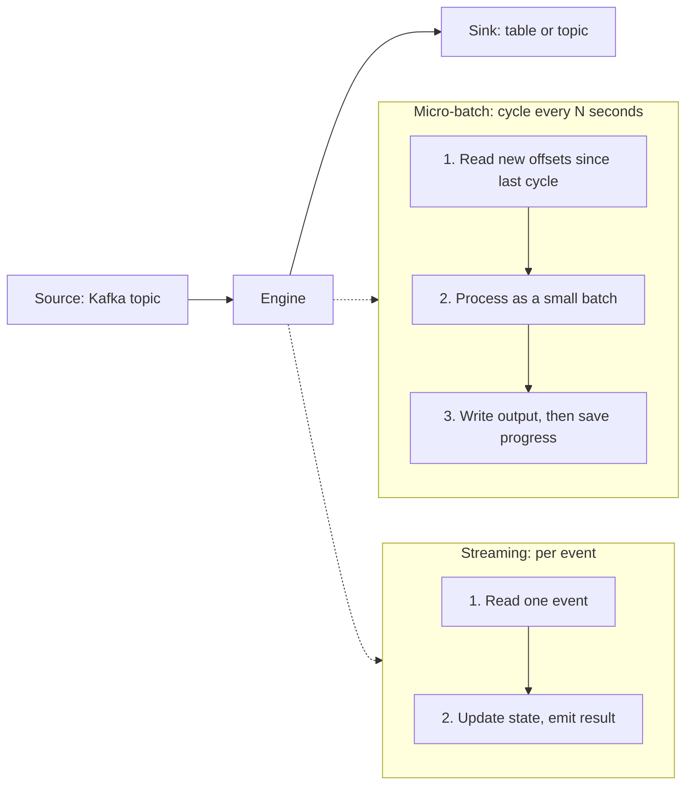
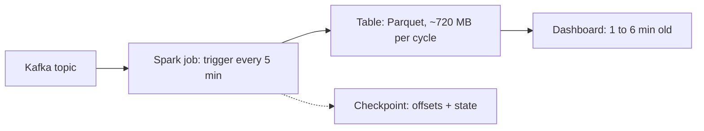

# Micro-Batch vs Streaming

"Should this be real time?" comes up in nearly every pipeline design interview, and the lazy answer is always yes. This lesson gives you the better one: a way to turn the freshness requirement into a processing model, and to say what each model costs.

[Pipeline Design](../01-the-framework/07-pipeline-design.md) told you to pick the slowest option that meets the freshness target. This lesson explains what sits between "nightly batch" and "true stream", and where the lines fall.

## The Problem

An online retailer wants a dashboard of orders per minute by region. The product manager says, "It has to be real time." You ask what they will do with it. The answer: the operations team watches it during sales and calls the warehouse if a region spikes. A human glancing at a screen and picking up a phone does not need a 200-millisecond update. A 1-minute-old number is fine.

A second team, fraud, wants to block a payment when one card is used in three countries within a minute. Here the decision happens while the customer waits at checkout, and a number that is a minute old is a number that arrived after the goods shipped.

Both teams said "real time". They need different systems. The first is well served by a job that wakes up every minute. The second needs a process that is always running and reacts to each event. Getting this wrong in either direction is expensive: the first team pays for an always-on cluster they do not need, and the second blocks nothing.

## Three Models, One Spectrum

Terms first. A **batch** job reads a bounded chunk of data, processes it, and exits. A **streaming** job runs continuously and handles events as they arrive. A **micro-batch** job is a streaming job in disguise: it runs a tiny batch every few seconds or minutes, remembers where it stopped, and picks up from there.

| | Batch | Micro-batch | Record-at-a-time streaming |
|---|---|---|---|
| Unit of work | A day or hour of data | The events since the last cycle | One event |
| Typical end-to-end latency | Hours | Seconds to minutes | Milliseconds to seconds |
| Process lifetime | Starts, finishes, exits | Long-running, wakes on a timer, or starts and stops per cycle | Always running |
| Compute while idle | None | Little to none | Full cluster, all day |
| Typical engines | Spark, warehouse SQL | Spark Structured Streaming, warehouse incremental jobs | Flink, Kafka Streams |

These are points on a line, not three separate technologies. The same Spark code can run as a daily batch, a 5-minute micro-batch or a continuously triggered one by changing one setting. That is the most useful fact in this lesson: you can start slow and move left on the table when requirements tighten, without a rewrite.

"End-to-end latency" here means the time from an event happening to its result being readable by a consumer. It includes every hop, not only the processing step. A Kafka write acknowledged by replicas already costs 5 to 50 ms at p99 (the latency 99 percent of requests beat; see [Key DE Numbers](../02-core-concepts/10-key-de-numbers.md)), so "single-digit milliseconds end to end" is not on offer for an ordinary pipeline, however it is processed.

## How Micro-Batch Works (Spark Structured Streaming)

Spark Structured Streaming is the micro-batch engine you are most likely to be asked about, so know its moving parts.

Each cycle, the engine asks the source "what is new since my last cycle?", turns that range into an ordinary Spark batch job, writes the result, and then records two things in its **checkpoint** (a directory in durable storage): the source offsets it consumed, and any operator state such as running counts. If the job crashes, it restarts from the checkpoint, re-reads the same offsets, and produces the same batch again. Combined with a sink that ignores a repeated batch (a table format commit keyed by batch ID, or an idempotent upsert), this gives exactly-once results. The mechanism is the one in [Deduplication at Scale](../02-core-concepts/09-deduplication-at-scale.md): at-least-once delivery plus an idempotent write.

How often a cycle starts is the **trigger**. These are the modes, with the version where each applies:

| Trigger | What it does | Use it for |
|---|---|---|
| Default (no trigger set) | Starts the next cycle as soon as the previous one finishes | "As fresh as possible" micro-batch; latency is roughly the batch duration, often 1 to several seconds |
| Fixed interval (`processingTime`, such as 5 minutes) | Starts a cycle every N; if one overruns, the next starts right after it | The usual choice for "near real time" with a stated target |
| Available-now (`availableNow`, Spark 3.3 and later) | Processes everything currently available, in several size-limited batches, then stops | Incremental batch: schedule it from Airflow, pay for compute only while it runs |
| Once (`once`) | Processes one batch, then stops | Deprecated since Spark 3.4. Use available-now instead |
| Continuous (`continuous`) | Long-running tasks process records as they arrive, about 1 ms latency | Experimental since Spark 2.3 and still limited: map-style operations only, no aggregations or joins, at-least-once, few sources and sinks. Not a production default |

The available-now mode is the one to remember for interviews. It makes the lines between batch and streaming blurry in a useful way. You write a streaming query, but run it on a schedule, so the job keeps the checkpoint (no re-reading data) and the incremental logic of streaming while paying for compute only for the minutes it runs. For a 15-minute freshness target this is often the cheapest correct design.

> [!NOTE]
> **Real-time mode (version-dependent).** Spark's micro-batch design sets a latency floor of around a second at best, and the experimental continuous mode never became the answer. Since 2025, Databricks has shipped a "real-time mode" for Structured Streaming that targets latencies from tens to a few hundred milliseconds while keeping the same API, and the work has been proposed for open-source Spark. Treat its availability as depending on your Spark or platform version and check before you promise it. In an interview, say "newer Spark versions are closing this gap, but for hard sub-second needs I'd reach for Flink", and move on.

## How True Streaming Works (Flink-Style)

Record-at-a-time engines such as Flink do not wake up on a timer. Operators are always running; each event flows through, updates in-memory state (kept on local disk if large, which is why it stays fast), and any result is emitted immediately. There is no batch boundary, so latency can be in the tens of milliseconds.

Durability works differently. Instead of checkpointing between batches, the engine periodically injects markers into the stream and each operator snapshots its state when the marker passes. After a crash, the job restores the last complete snapshot and replays the source from that point. The details belong in the [Flink deep dive](../04-technology-deep-dives/08-flink.md). One consequence matters for design: if the output is a transactional sink, results become visible only when a checkpoint completes. A checkpoint interval of 10 seconds therefore sets a floor of roughly 10 seconds on exactly-once output latency, no matter how fast each record is processed. You tune that interval against recovery time and overhead, a trade-off micro-batch handles by construction.

## Choosing From the Freshness Requirement

This is the core skill. Start from the number in the requirement and walk right.

| Freshness target | Model | Why |
|---|---|---|
| Hours or a day | Scheduled batch | Cheapest, simplest, trivially rerunnable |
| 5 to 60 minutes | Micro-batch, ideally available-now on a schedule or a fixed trigger | One normal job; compute can switch off between runs |
| 30 seconds to 5 minutes | Micro-batch with a short trigger | Still one job; check file-size and commit overhead (below) |
| 1 to 30 seconds | Micro-batch with the default trigger, or a stream processor | Overlap zone: choose on state size, team skills and what already runs |
| Under a second, or an action must follow the event | Record-at-a-time streaming | Fraud blocks, live bidding, alert-on-event |

Throughput rarely decides this. What matters is what happens between events and who pays for the quiet time.

### Worked example: cost of one pipeline, three ways

Take the clickstream from [Key DE Numbers](../02-core-concepts/10-key-de-numbers.md): 1 billion events a day, about 12k events/s, 12 MB/s on average, 35 MB/s at peak. At roughly 20 MB/s per core, the average load needs a bit over half a core and the peak under two. Sizing for peak and headroom, say a small cluster of 16 vCPUs.

- **Always-on stream.** 16 vCPUs at about $0.04 to 0.06 per vCPU-hour is about $0.64 to 0.96 an hour, or roughly **$470 to 700 a month** around the clock, before Kafka and monitoring. It must stay up because events never stop.
- **5-minute micro-batch, cluster kept up.** Each cycle reads 12 MB/s x 300 s = 3.6 GB. At about 16 cores x 20 MB/s = 320 MB/s, that is about 11 seconds of work plus a few seconds of overhead. The cluster is idle more than 90 percent of the time, yet if it stays up you pay the same $470 to 700. Micro-batch alone does not save money.
- **15-minute available-now, cluster released between runs.** Each run processes 10.8 GB, takes under a minute of work (10.8 GB at 320 MB/s is about 34 seconds) plus 1 to 2 minutes to start and finish, and the cluster exists for about 3 of every 15 minutes. That is about 20 percent of the always-on cost, roughly **$95 to 140 a month**, about a 5x saving for a freshness target that was only ever 15 minutes. Slower starts (cluster spin-up time) are the price, which is why this suits targets of 10 minutes and up.

Streaming is not inherently expensive; **you pay for waiting**. A mostly idle system should be switched off, and only a freshness requirement shorter than a cluster start-up forces you to keep it on.

### The cost nobody puts on the slide: small files

Micro-batch has a quiet failure mode when you tighten the trigger. Each cycle writes files, and each commit to a table format adds metadata. At 12 MB/s of JSON and about 5x compression to Parquet, a 1-second trigger writes roughly 2.4 MB per cycle, which is at least 86,400 tiny files a day (more if several tasks each write one), against a target of 128 MB to 1 GB per file. Readers slow down, listing and request costs climb (see object storage request limits in Key DE Numbers), and you now need a compaction job. A 5-minute trigger writes about 720 MB per cycle, a few hundred cycles and files a day, and the problem largely disappears.

> [!TIP]
> A trigger shorter than about a minute on a lake table is a smell. Either the freshness is not really that tight, or the sink should be something built for fast small writes (a serving store, a topic), not a data lake file layout.

## Complexity: What You Take On with a Stream

Cost and latency are the visible trade. Experienced interviewers probe the hidden one, complexity.

- **State.** Anything remembering across events (running counts, joins, deduplication) needs state that must be stored, checkpointed, sized and recovered. A daily batch re-derives its state from scratch every run; a stream carries it forever.
- **Late data.** A batch simply waits until the day is over. A stream must decide when a window is complete using a watermark, and what to do with events after it. This is the whole subject of [Late-Arriving Data](../02-core-concepts/08-late-arriving-data.md). Micro-batch inherits it, because Structured Streaming uses the same watermark idea, but a coarse batch cycle makes lateness less visible.
- **Fixing mistakes.** A batch bug is fixed by rerunning the affected partitions ([Backfill and Reprocessing](../02-core-concepts/03-backfill-and-reprocessing.md)). A stream bug means replaying the log into a new output and switching over, with the retention and cost limits from [Kappa Architecture](02-kappa-architecture.md).
- **Operations.** A batch failure is a missed deadline you can retry. A stream failure is lag growing every second, and someone is paged. Plan an on-call.

Micro-batch with available-now sits close to batch on every line above: bounded runs, simple retries, no always-on state servers. That makes it a good default.

## In the Interview

**When it comes up.** In the pipeline step, when you assign a model to each path. Also as a challenge: "You said batch. Why not real time?" or the reverse, "Why are you running Flink for this?"

**A strong answer, in order:**

1. Anchor on the freshness number. "Ops needs 15 minutes, so I'm asking what is the cheapest design that meets it."
2. Name the model and the setting. "A Spark Structured Streaming job with an available-now trigger every 10 minutes, with a checkpoint on object storage."
3. Say what it costs and what you declined. "The cluster only exists for a few minutes each run. I'm not using a continuous stream because nothing here acts on a single event."
4. State the trigger to upgrade. "If the target drops under a minute or an action must follow the event, that path moves to a stream processor, with the others untouched."

**What interviewers listen for:**

- You tie the choice to a stated freshness number, not to "real time sounds better".
- You know micro-batch is a spectrum you can slide along, not a separate system.
- You raise small files, idle cost and late-data handling before being asked.
- You can name where record-at-a-time streaming is the right answer, and give a reason (a decision depends on one event).

**Phrases that work:**

- "Real time is a cost. Which consumer actually changes its behavior in under a minute?"
- "Micro-batch every 5 minutes meets the 15-minute target with two cycles of slack."
- "I'd keep this as one pipeline and tune the trigger, rather than build a second one for the fast path."
- "Hard sub-second needs push me to Flink; Spark's micro-batch has a latency floor around a second."

> [!TIP]
> If the interviewer says "assume it must be real time", ask "for which output, and what happens if it is two minutes late?" Most of the time the real requirement is a subset of the system, and only that path needs a stream.

**Likely follow-ups, with short answers:**

- *"Is micro-batch just slower streaming?"* In latency, yes. In guarantees, no: the checkpoint and a repeatable batch make exactly-once results straightforward with an idempotent sink.
- *"What if the micro-batch takes longer than the trigger interval?"* The next cycle starts as soon as the current one ends, lag grows, and you scale the cluster or lengthen the interval. Alert on batch duration versus interval.

## Common Mistakes

> [!WARNING]
> **Equating "real time" with "streaming engine".** Many "real-time" asks are 1 to 5 minutes, which a micro-batch meets with one normal job. Reach for a stream processor only when the requirement or an event-triggered action demands it.

> [!WARNING]
> **Believing micro-batch saves money by itself.** An idle cluster costs the same as a busy one. The saving comes from releasing compute between runs (available-now on a schedule), not from the batch being small.

> [!WARNING]
> **Setting a very short trigger on a lake table.** One-second cycles produce tens of thousands of tiny files a day. Lengthen the trigger, write to a store built for small writes, or budget a compaction job.

> [!WARNING]
> **Promising Spark's continuous or real-time modes without a caveat.** Continuous mode is still experimental and narrow; real-time mode depends on platform and version. Flag the version, or choose Flink for hard sub-second needs.

## Key Takeaways

- Batch, micro-batch and streaming are a spectrum; choose the slowest point that meets the freshness number, and say what you rejected.
- Micro-batch (Spark Structured Streaming) runs small batches with a checkpoint of offsets and state. Triggers set the cadence: fixed interval for "near real time", available-now for scheduled incremental runs where compute is released between them.
- Cost comes from waiting. Always-on clusters cost the same busy or idle, so releasing compute between runs is the real saving; a 15-minute available-now job can cost about a fifth of an always-on stream.
- True streaming wins when an action must follow a single event or the target is under a second. Know that Spark's continuous mode is experimental, that real-time mode depends on version, and that exactly-once output latency includes the checkpoint interval.
- Tight triggers on lake tables create small files; stream state, late data and replay cost are the complexity you accept when you leave batch.

## Related Lessons

- [Pipeline Design](../01-the-framework/07-pipeline-design.md): batch vs streaming per path, and idempotent writes.
- [Lambda Architecture](01-lambda-architecture.md) and [Kappa Architecture](02-kappa-architecture.md): the two-path and stream-only answers that micro-batch often replaces.
- [Late-Arriving Data](../02-core-concepts/08-late-arriving-data.md): watermarks and what to do with late events.
- [Spark Internals](../04-technology-deep-dives/01-spark-internals.md) and [Flink](../04-technology-deep-dives/08-flink.md): the engines behind each model.
- [Real-Time Dashboard](../05-breakdowns-core/04-real-time-dashboard.md): the freshness decision applied to a full design.

## Going Further

Exactly-once sinks in Flink (two-phase commit), adaptive batch sizing under backpressure, streaming materialized views in warehouses.
