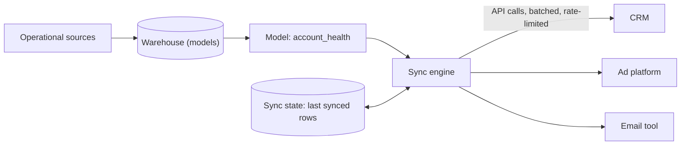
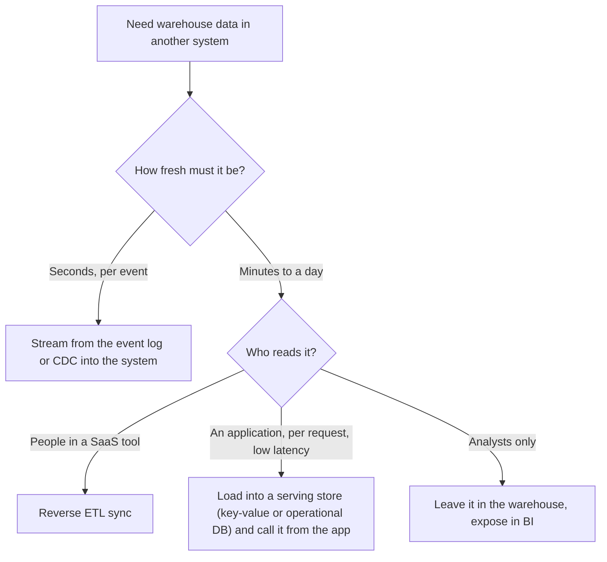

# Reverse ETL

Most of this course moves data into the warehouse. Reverse ETL moves the answers back out, into the tools where people and applications act on them. Interviewers raise it when your design ends with "the data is in the warehouse" and they ask, "and then how does the sales team actually use it?" This lesson covers how a sync works, the three things that make it harder than it looks (sync semantics, rate limits, idempotency), and when you should not use it at all.

## The Problem

A subscription software company has 40,000 customer accounts. The data team has built a table in the warehouse, `account_health`, with one row per account: a health score from 0 to 100, product usage over the last 30 days, and a flag `churn_risk`. It is rebuilt every night.

Nobody reads it. The customer success managers (CSMs) live in the CRM (customer relationship management tool, here the system where sales and support staff track every account). They will not open a BI dashboard to check a score. What they ask for: "put the health score on the account page in the CRM, and create a task for me when `churn_risk` flips to true."

The same pattern shows up everywhere: a "likely to buy" audience pushed to an ad platform, loyalty tier to the email tool, a lead score to the sales tool, a usage limit to the application's own database. In each case the warehouse holds the best version of the truth, and an *operational tool* (a system people or programs use to run the business day to day) needs a small slice of it. **Reverse ETL** is the pipeline that reads a table or query result from the warehouse and writes it into those tools through their APIs. It is called "reverse" because ETL loads data from operational systems into the warehouse, and this goes the other way.

You could write a nightly script that loops over rows and calls the CRM API. Many teams do, and the script fails on the first bad night: a half-finished run, duplicate records, a rate-limit error at row 31,000 and nobody knows which accounts were updated. Reverse ETL as a pattern is the set of answers to those failures.

## How It Works

A sync run does five things:

1. **Read** the model (a table or SQL query in the warehouse) that defines what to send.
2. **Diff** it against what was sent last time. The engine keeps a copy of the last synced rows (or a hash of each) in its own state store, often a schema in your warehouse, and works out which rows are new, changed or gone.
3. **Map** warehouse columns to destination fields (`health_score` to the CRM's `Health_Score__c`).
4. **Write** only the changed rows, in batches, within the destination's rate limit.
5. **Record** which rows succeeded, which failed and why.

Step 2 is what makes reverse ETL cheap. If 40,000 accounts exist but only 1,200 scores changed overnight, you send 1,200 records, not 40,000. Dedicated reverse ETL tools (Census, Hightouch and similar) do all five steps and ship connectors for common destinations. You can also build it with an orchestrator job plus a diff query; the design questions are the same.

### The destination is the hard part

Everything upstream is a SQL query. Everything downstream is somebody else's API, with their limits and failure modes. Three things decide whether the sync is correct: semantics, rate limits and idempotency.

## Sync Semantics

A **sync mode** says what the destination should look like after a run. The choice must match what the destination can do.

| Mode | What it does | Use for | Watch out for |
|---|---|---|---|
| **Upsert** | Create the record if its key is new, update it if it exists | Most syncs: scores, attributes, audiences | Needs a stable key the destination can match on |
| **Update only** | Only touch records that already exist | Enriching CRM accounts you do not want to create | Rows with no match are silently skipped unless you count them |
| **Insert only** | Create new records, never change old ones | Event-like records such as tasks or notes | A rerun creates duplicates unless the destination rejects them |
| **Mirror** | Make the destination set equal to the model, including removing records | Ad audiences: "these 80,000 people, no others" | Deletes in the destination; a bad model can wipe an audience |

Two decisions come with the mode.

**What is the key?** Upsert needs an identifier both sides agree on, such as the CRM account ID or an email address. If the key is an email and a customer changes it, the next sync creates a second record. Prefer an ID the destination assigned, loaded into the warehouse earlier by ingestion, over a value people can edit.

**What happens to deletes?** If an account leaves the model (churned, merged), a plain upsert never mentions it again and its old score stays in the CRM forever. Choose one: do nothing, set a flag field to "inactive", or delete it. Say which in the interview; "we mirror deletes" on a CRM full of sales history is a risky answer.

> [!TIP]
> Reverse ETL syncs **state** ("this account's score is 62"), not **events** ("this account's score dropped"). If the CSM needs a task when `churn_risk` flips to true, the sync has to detect the flip by diffing the new row against the last synced row, then create one task. A model that just says "all at-risk accounts" would create a new task every night.

### How fresh is it?

In practice reverse ETL is batch. The sync runs on a schedule (every 15 minutes to daily) or right after the upstream model finishes. Freshness is the model's freshness plus the sync interval plus the time to push. For a nightly health score, that is fine. For "the customer just abandoned a cart, email them now," the warehouse is the wrong place to start; see the next section. The trade-off between a fast cycle and a continuously running pipeline is the one in [Micro-Batch vs Streaming](08-micro-batch-vs-streaming.md).

## Rate Limits

[Ingestion Patterns](../02-core-concepts/02-ingestion-patterns.md) covers rate limits on *pulling* from vendor APIs, including backoff on HTTP 429 ("too many requests") and the retry-after header. The same limit applies to *pushing*, and it is often tighter because writes cost vendors more than reads. The same backoff rules apply here.

Suppose the CRM allows 100 requests a minute and each request can update up to 10 records (a batch endpoint).

- Throughput: 100 x 10 = 1,000 records a minute.
- Nightly delta of 1,200 records: about 1.2 minutes. Fine.
- First sync, or a full resend of 40,000 accounts: 40 minutes. Still fine.
- An audience of 5,000,000 emails to an ad platform that takes 1,000 per call at 10 calls a minute: 500 minutes, over 8 hours.

The first run is almost always the problem, because the diff has nothing to compare against and everything counts as changed. Do the arithmetic before you promise a schedule. What helps:

- **Send only the diff.** It is the main defence. A full resend every run is the common design flaw.
- **Batch.** Use the destination's bulk endpoint if it has one. One call with 10 records is ten times cheaper against the limit than ten calls. Many destinations also offer an asynchronous bulk import; use it for the first sync.
- **Share the quota.** The limit is usually per account, not per sync. The vendor's own integration or a colleague's script may spend it too, so cap your own rate below the limit.

Failures at this boundary are unavoidable, so treat them as normal. A sync that stops at the first failed row is wrong; a sync that skips failures silently is worse. The standard handling: retry transient errors (429, 5xx), and for permanent errors (a field value the destination rejects, a record that does not exist) log the row with the error, keep going, and surface a failed-row count that someone is alerted on. This is the [dead-letter](../01-the-framework/07-pipeline-design.md) idea applied to a sync: bad rows go aside, good rows go through.

## Idempotency

Retries are routine here, so the sync must be **idempotent**: running it twice must leave the destination in the same state as running it once. Here is the sequence that makes it matter. The engine sends a batch of 10 updates. The CRM applies them, but the response is lost on the network. The engine sees a timeout and, correctly, retries the batch. If the batch was "create 10 tasks," there are now 20.

Ways to get idempotency, from the safest:

1. **Upsert by a stable key.** Writing "account 8812 has score 62" twice gives the same result. This is the [upsert](../01-the-framework/07-pipeline-design.md) from pipeline design, applied over an API.
2. **Idempotency keys.** Some APIs accept a unique key per request and ignore a repeat. Derive it from the data, for example a hash of `(account_id, flag_name, flag_changed_at)`, so a retry of the same logical change reuses the key.
3. **Store the destination's ID.** After a create, record the ID the destination returned next to your key. The next run updates by ID instead of creating again.
4. **Check before creating.** Query the destination for the record, then create if absent. Slower and racy with parallel workers, so use it only when nothing else exists.

The "record what was synced" step needs the same care. Write the sync state in a way that a crash between "destination updated" and "state saved" cannot cause trouble. The safe order is: push, then save state. A crash then means the next run re-pushes the same rows, which is harmless because pushes are idempotent. Saving state first would mean a crash leaves rows marked as synced that never reached the destination, and they would not be retried. This is the same at-least-once-plus-idempotent-write rule from [Deduplication at Scale](../02-core-concepts/09-deduplication-at-scale.md).

> [!WARNING]
> Insert-only syncs of event-like things (tasks, notes, emails sent) are where duplicates reach customers. If you cannot make the write idempotent, say the risk out loud and put a guard in the sync, such as a unique key on the destination or a send log.

## When Not to Use Reverse ETL

The warehouse is built for scanning large tables, and it is fed in batches. That makes it wrong for some jobs that look similar.

| Situation | Better choice | Why |
|---|---|---|
| The application needs a value on every page load in under 50 ms | Push the table into a key-value store or operational database, and read from there | A warehouse query takes seconds and costs per scan; an app should never query it in the request path. The load into the store may well be a reverse ETL sync, but the app reads the store. |
| React to a single event within seconds ("cart abandoned") | Consume the event stream directly and call the tool from a stream job | A nightly or 15-minute sync is too slow; the data does not need to go through the warehouse first |
| The source of the value is an operational system already, and the destination is another one | Integrate them directly, or via [CDC](04-cdc-patterns.md) and a stream | Routing through the warehouse adds delay and a dependency for nothing |
| The destination has a tight limit or an expensive write API, and the data changes constantly | Send aggregates or a few key fields, or let the tool query the warehouse itself | You cannot fit 5 million changing rows through 100 calls a minute |
| Only analysts need the number | Keep it in the warehouse and BI | Every sync is a pipeline to monitor and a copy that can drift |

The second row is the "operational DB or API" answer from the opening. When an application is the consumer, the pattern is usually **warehouse, then a serving store, then the application**. The serving store is a database built for fast reads by key (a key-value store, or a regular operational database), the kind of store the application would read in its request path. Machine learning features follow the same path; see [Feature Store](../05-breakdowns-core/08-feature-store.md).

Also remember that data now exists in two places. The CRM score is a *copy*, and when someone edits it by hand in the CRM, it will drift from the warehouse. Decide up front which side owns each field. A sync that overwrites a field the sales team edits will be noticed by the sales team.

Last, watch for a loop. If CRM data is loaded into the warehouse, used to compute a score, and the score is synced back into the CRM, the model sees its own output the next day. Keep synced fields out of the model's inputs, or at least know they are there.

## In the Interview

Bring it up at the end of the pipeline, when you describe consumers: "Marketing needs the churn segment in their email tool, so I'd add a reverse ETL sync from the gold table ([Medallion Architecture](03-medallion-architecture.md)), nightly, upserting by customer ID." That sentence shows you know the warehouse is not the end of the line.

Then show you know what makes it break, using the same order as this lesson:

- **Semantics:** "Upsert on the CRM account ID. Deletes set an inactive flag rather than deleting records."
- **Rate limits:** "Diff against the last sync so only changed rows go out; batch; back off on 429. First load is 40,000 records at 1,000 a minute, so 40 minutes, and I'd use the bulk endpoint for anything bigger."
- **Idempotency:** "Pushes are upserts by key, and I save sync state after the push, so a retry is harmless."
- **Failure handling:** "Bad rows go to an error table with the reason, alert on failed-row count, the rest continue."

If an interviewer pushes on freshness, move the decision to the requirement: "If the minimum is a daily score, reverse ETL is right. If it's per-event, I'd skip the warehouse and consume the stream."

### Follow-up questions to expect

- "The sync ran twice by accident. What happens?" Nothing, because writes are upserts by key. If it was a task-creating sync, the idempotency key stops the duplicates.
- "The CRM went down for 6 hours. What now?" The sync retries with backoff, then fails the run and alerts. The next run diffs against the *last successful* state, so everything missed is included. Nothing is lost, only late.
- "How do you know the destination matches the warehouse?" Compare counts and a checksum of key fields periodically (reconciliation), and monitor sync success rate, failed-row count and sync lag. See [Monitoring and Alerting](../02-core-concepts/06-monitoring-and-alerting.md).
- "Someone changed the model and a column is now null for everyone." The sync would happily overwrite good scores with nulls. Add a guard: stop the run when the changed-row count exceeds a threshold (say 20% of rows), and require approval. A [data contract](../02-core-concepts/07-data-contracts.md) on the model catches the schema side of this.
- "Can the tool query the warehouse for you instead?" Some SaaS tools can read from the warehouse directly. That removes the sync, but the tool needs warehouse access and every user action may become a query on your bill.

## Common Mistakes

> [!WARNING]
> **Full resend on every run.** It burns the rate limit and, on a first load, takes hours. Diff, and send only changes.

> [!WARNING]
> **No stable key.** Syncing on email or name creates duplicates when the value changes. Use the destination's ID.

> [!WARNING]
> **Treating reverse ETL as real time.** It is a scheduled batch. Promising "instant" updates is a red flag.

> [!WARNING]
> **Silent failures.** Skipping rejected rows without a count means the CRM is wrong and nobody knows. Count, log and alert.

> [!WARNING]
> **No owner for each field.** If people edit synced fields by hand, either lock them in the destination or accept that the next sync overwrites them. Decide, and write it down.

## Key Takeaways

- Reverse ETL pushes warehouse results into operational tools such as a CRM, ad platform or email tool, so that people use the data where they work.
- A good sync reads a model, diffs it against the last sync, and writes only changed rows in batches. It syncs state, not events.
- Choose sync mode and key deliberately: upsert by a destination-assigned ID, and decide what happens to deletes.
- Plan for the destination's rate limit with arithmetic, especially the first full load. Retry transient errors, quarantine permanent ones, alert on failure counts.
- Make every push idempotent and save sync state after the push. For sub-second reads by an application or per-event reactions, use a serving store or a stream, not the warehouse.

## Going further

- Audience syncs and match rates on ad platforms
- Warehouse-native activation (SaaS tools reading the warehouse directly)
- Customer data platforms (CDPs) and how they overlap with reverse ETL

Related: [Medallion Architecture](03-medallion-architecture.md) (the gold tables you usually sync from), [CDC Patterns](04-cdc-patterns.md) (the direction operational data takes when seconds matter), [Pipeline Design](../01-the-framework/07-pipeline-design.md).
