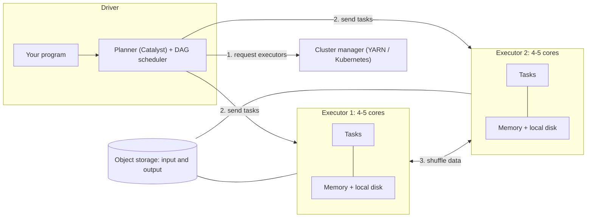
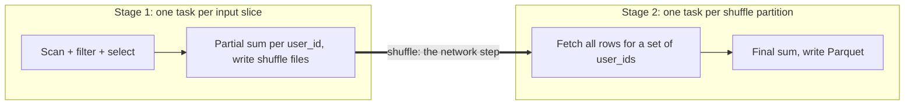

# Spark Internals

Spark is the batch engine you are most likely to name in a data engineering design, and "why is this Spark job slow?" is the most common follow-up. Interviewers care less about the API than about whether you can reason about where the data moves, because almost every Spark performance problem is a data-movement problem.

**What it is:** Apache Spark is a distributed engine that splits a dataset into pieces, processes the pieces in parallel across many machines, and keeps intermediate data in memory where it can. You write transformations in SQL, DataFrames, Python, Scala or Java; Spark turns them into a plan and runs it on a cluster. It also runs streaming jobs as small batches (covered in [Micro-Batch vs Streaming](../03-architecture-patterns/08-micro-batch-vs-streaming.md)). **Why it shows up:** it is the default answer for "transform terabytes of files in object storage" and for the compute layer of a lakehouse. This lesson is accurate for Spark 3.5 and 4.x; version differences are flagged.

## When to Use It (and When Not To)

Picture two jobs. Job A reads 2 TB of raw JSON events every night, cleans them, joins them to a 5 GB user table and writes Parquet. Job B answers "what is this one user's balance?" in 20 ms. Spark is a good fit for A and a terrible fit for B.

**Pick Spark when:**
- The data does not fit on one machine, or one machine is too slow. A rough line: past a few hundred GB per run, a single node starts to struggle; below that, a warehouse query or a single-node tool is simpler.
- The work is large scans, joins and aggregations over files (batch ETL, backfills, feature building). See [Backfill and Reprocessing](../02-core-concepts/03-backfill-and-reprocessing.md) for why backfills love elastic compute.
- You need custom logic that is awkward in SQL (parsing odd formats, ML preprocessing), or one engine for both batch and micro-batch streaming.
- You already run a lakehouse: Spark is the standard writer for Delta and Iceberg tables.

**Do not pick it when:**
- You need low-latency serving (milliseconds). Spark jobs have seconds of startup and scheduling cost. Use a serving store.
- You need true event-at-a-time streaming under a second. Use Flink.
- The data is small (megabytes to a few GB). A cluster adds cost and failure modes for no gain.
- The job is a set of SQL transformations on warehouse tables. A warehouse engine or dbt is simpler to run.

> [!TIP]
> In an interview, saying "Spark" is not a design decision. Saying "Spark, because the input is 2 TB of files and I need joins plus a Parquet output, and a warehouse load would cost more" is.

## How It Works

### The architecture

A Spark application has one **driver** and many **executors**. The driver is the process that runs your program, builds the plan and schedules work. Executors are worker processes (JVMs) on the cluster's machines; each has some CPU cores and memory, and runs the actual tasks. A **cluster manager** (YARN, Kubernetes, or Spark's own standalone manager) hands out the machines.



Three things to say out loud:
- **The driver is a single point of failure.** If it dies, the application dies. It also holds the plan and collects small results, so calling `collect()` on a large dataset pulls everything into one JVM and crashes it. That is the classic driver out-of-memory error.
- **Executors are disposable.** If one dies, the driver reschedules its tasks elsewhere.
- **Storage is separate from compute.** Data lives in object storage; executors read it, process it, and write back. Local disk on executors holds only temporary data (shuffle files, spill).

### From code to tasks: the DAG

Spark is **lazy**. Transformations such as `filter`, `select`, `join` and `groupBy` only describe work; nothing runs until an **action** (`write`, `count`, `collect`) asks for a result. Laziness lets Spark see the whole job and optimize it first. For DataFrames and SQL, the **Catalyst** optimizer rewrites your plan: it pushes filters down to the file scan, reads only needed columns, prunes partitions ([Partitioning](../02-core-concepts/01-partitioning.md) explains pruning) and picks join strategies. This is why DataFrames are usually faster than hand-written code on the older low-level RDD (resilient distributed dataset) API, which Spark cannot optimize.

The optimized plan is a **DAG** (directed acyclic graph: steps with arrows meaning "must finish before", no loops). Spark cuts it into **stages** at every shuffle, and each stage into **tasks**, one task per data partition. A **partition** here is one slice of the data that one task processes (not the same as a table partition on disk, though a table partition is where input slices come from).

Take a concrete job:

```python
(spark.read.parquet("events/")              # scan
   .filter("country = 'DE'")                # narrow
   .select("user_id", "amount")             # narrow
   .groupBy("user_id").sum("amount")        # wide: needs a shuffle
   .write.parquet("out/"))                  # action
```



- **Narrow transformations** (`filter`, `select`, `map`) work on each partition independently. They are chained together inside one stage for free.
- **Wide transformations** (`groupBy`, `join`, `distinct`, `repartition`, window functions) need rows with the same key in the same place. That forces a shuffle and a new stage.

### The shuffle

A **shuffle** is the redistribution of data across the cluster so that all rows with the same key end up in the same partition. It is the most expensive thing Spark does, because it writes to disk, sends data over the network and then reads it back.

How it works: at the end of stage 1, each task splits its output by the target partition (hash of the key) and writes those pieces to local disk on its executor. Stage 2 tasks then fetch their piece from every stage 1 task. With 1,000 map tasks and 1,000 reduce tasks, that is up to a million small fetches. Two consequences matter in interviews:

1. **Shuffle is a stage barrier.** Stage 2 cannot start until every stage 1 task finishes, so one slow task delays everything.
2. **Shuffle files are what let Spark recover from failures.** If an executor dies, Spark recomputes lost partitions from the lineage (the recipe of transformations), but it can reuse shuffle files still on disk. An external shuffle service (or on Kubernetes, shuffle-file migration) keeps those files alive when executors are removed.

The standard way to make a job faster is to **avoid a shuffle or shrink what goes through it**: filter and select columns before the wide step, broadcast the small side of a join (below), pre-aggregate, and keep joins on keys that the data is already partitioned by (or bucketed by, meaning pre-split into a fixed number of files by key when the table was written).

### Partitions and tasks

The partition count decides parallelism. Two numbers control it:

- **Input partitions:** when reading files, Spark makes slices of about 128 MB (`spark.sql.files.maxPartitionBytes`, default 128 MB). 1 TB of input is about 8,000 tasks.
- **Shuffle partitions:** after a shuffle, the count is `spark.sql.shuffle.partitions`, default **200**, regardless of data size.

Too few partitions means big tasks, too little parallelism and memory pressure. Too many means tiny tasks where scheduling overhead dominates. The planning figures from [Key DE Numbers](../02-core-concepts/10-key-de-numbers.md) are 128 to 256 MB per input task, 100 to 200 MB per shuffle partition, and 2 to 4 times as many tasks per stage as cores. With 100 cores, a stage of 8,000 tasks runs as 80 **waves** (rounds of 100 tasks).

Two operations change partition count, and people confuse them:
- `repartition(n)` does a full shuffle and can increase or decrease the count, producing even sizes. Use it to fix skewed or too-few partitions, and before a write to control file count.
- `coalesce(n)` only merges existing partitions, with no shuffle. Cheaper, but it can only decrease, and sizes may end up uneven.

### Joins

Join strategy is where interviews dig deepest, because it decides whether a job takes 5 minutes or 2 hours.

| Strategy | How it works | Use when | Cost |
|---|---|---|---|
| **Broadcast hash join** | Copy the small table to every executor; each task joins its slice of the big table locally | One side fits in memory (default cutoff 10 MB, `spark.sql.autoBroadcastJoinThreshold`; raise it to a few hundred MB) | No shuffle of the big side. Fastest |
| **Sort-merge join** | Shuffle both sides by join key, sort each, merge | Both sides large. The default for large joins | Two shuffles plus sorts |
| **Shuffle hash join** | Shuffle both sides, build a hash table from the smaller one | One side much smaller than the other but too big to broadcast | Needs memory for the hash table |

A **broadcast join** sends the small table to every executor so the big table never moves. Joining a 2 TB events table to a 5 GB user table is a broadcast candidate only if 5 GB fits comfortably in every executor, which it often does not; at that size you accept a sort-merge join, or you shrink the user table first (select needed columns, filter to active users). Broadcasting also passes through the driver, so a very large broadcast can blow up driver memory. Say the size caveat out loud.

### Skew and adaptive query execution

**Skew** means a few keys hold most of the rows. In a shuffle, all rows of a key go to one task, so one task gets 40 percent of the data while the others finish in seconds. The sign in the Spark UI is a stage where 199 of 200 tasks finish quickly and one runs for an hour. [Partitioning](../02-core-concepts/01-partitioning.md) covers why skew happens and the salting fix. Here is what Spark itself does about it.

**Adaptive query execution (AQE)** re-optimizes the plan at runtime, using the real sizes of shuffle output instead of estimates. It is on by default since Spark 3.2. It does three things:

1. **Coalesces small shuffle partitions.** Set `shuffle.partitions` high (say 2,000) and AQE merges the tiny results toward a target size (64 MB by default, `spark.sql.adaptive.advisoryPartitionSizeInBytes`). That is why the sizing advice is "set it high."
2. **Switches join strategy.** If, after a filter, one side turns out smaller than the broadcast threshold, a planned sort-merge join becomes a broadcast join.
3. **Splits skewed join partitions.** If a partition is much bigger than the median (default: more than 5 times the median and over 256 MB), AQE splits it into several tasks and replicates the other side's matching rows.

> [!WARNING]
> AQE's skew handling applies to **joins**, not to a `groupBy` on a skewed key. For a skewed aggregation, salt the key and aggregate in two steps (partial sum per salted key, then final sum), or pre-aggregate before the shuffle. Also, AQE cannot fix a single key that is itself too big for one task, such as a `NULL` key holding 30 percent of the rows. Filter or handle that key separately.

### Memory and spill

Each executor's JVM memory is split, simplified, into:

- **Unified memory** (about 60 percent of the heap by default, `spark.memory.fraction`): shared between *execution* memory (shuffles, sorts, joins, aggregations) and *storage* memory (cached data). Execution can evict cached data when it needs space, down to a protected storage share (`spark.memory.storageFraction`, 50 percent of unified memory); the percentage applies to heap minus a small reserve.
- **User memory**: your own data structures and Python/UDF objects.
- **Overhead**, outside the heap (default the larger of 384 MB or 10 percent of executor memory): off-heap buffers and, for PySpark, the Python worker processes. Running out here gets the container killed by YARN or Kubernetes with an "out of memory" or "container killed" message.

**Spill** is what happens when a task needs more execution memory than it has: it writes intermediate data to local disk and reads it back. The job still finishes, but slowly. Spill in the Spark UI is a symptom. The usual causes are too few shuffle partitions (each task's slice is too big), skew, or too little memory per core. The fixes, in order: raise the partition count so each task is smaller, fix the skew, then add memory per core. Rough sizing is 4 to 8 GB per core from Key DE Numbers; with 4 to 5 cores per executor that gives 16 to 40 GB per executor. Many more cores per executor means long garbage-collection pauses in one JVM.

### Caching

`df.cache()` keeps a DataFrame in executor memory (the default storage level spills to disk what does not fit) so later actions reuse it instead of recomputing the whole lineage. It only pays off when **one** expensive result is read **more than once** in the same application: an iterative algorithm, or one cleaned dataset feeding several outputs. Caching a dataset you read once wastes memory that the shuffle needed. Caches are lost if an executor dies and are not shared between applications; if you need to reuse a result across jobs, write it to storage as a table.

### Cluster and resource handling

- **Dynamic allocation** lets an application add executors when tasks queue up and release idle ones. It saves money on spiky jobs. Removing an executor must not destroy shuffle files other tasks still need, so it relies on an external shuffle service or on shuffle tracking (Spark 3.0 and later).
- **Speculative execution** (`spark.speculation`, off by default) re-launches a slow task on another executor and takes whichever finishes first. It helps with a sick machine, not with skew (the copy is just as big and just as slow).
- **Python cost.** PySpark runs the plan in the JVM, but Python UDFs ship each row to a Python process and back, which is often 10 times slower than built-in functions. Prefer built-ins; if you must use Python, use vectorized (pandas/Arrow) UDFs.

## Key Numbers

All of these are rules of thumb; the sizing set is the same as in [Key DE Numbers](../02-core-concepts/10-key-de-numbers.md).

| Item | Number |
|---|---|
| Cores per executor | 4 to 5 |
| Memory per executor | 4 to 8 GB per core, so 16 to 40 GB |
| Input task size | 128 to 256 MB (read default slice is 128 MB) |
| Tasks per stage | At least 2 to 4 times the core count |
| Shuffle partitions | 100 to 200 MB each; default count is 200 (too low for TB-scale), so set it high and let AQE coalesce |
| Throughput per core | 10 to 50 MB/s for parsing and transforms; 5 to 20 MB/s with heavy shuffle or join |
| Broadcast cutoff | 10 MB default; a few hundred MB in practice |
| Startup | tens of seconds to minutes to get executors, so not for interactive latency |

**Worked sizing.** A nightly job reads 1 TB and has a 15-minute budget with a shuffle-heavy join. At 10 MB/s per core: 1,000,000 MB / (10 x 900 s) is about 110 cores. With 5 cores per executor that is about 22 executors, around 30 GB each. At 128 MB per task that is about 8,000 input tasks, roughly 70 waves on 110 cores. Add headroom and say "about 120 to 150 cores, and I would verify per-core throughput with a test run."

## Interview Follow-ups

**"The job is slow. How do you find out why?"**
Open the Spark UI and find the slowest stage. Then check three things: is one task far slower than the median (skew), is the "spill" column non-zero (memory pressure or too few partitions), or are there thousands of tiny tasks (too many partitions or small input files)? Fix what the evidence shows, not what you guessed.

**"One task runs for an hour while the rest finish in seconds."**
That is skew. For a join, AQE skew handling may already split it; check it is on. For a `groupBy`, salt the key and aggregate in two steps. If one key is `NULL` or a placeholder like `unknown`, filter it out or process it separately.

**"When would you broadcast a table, and what can go wrong?"**
When one side of a join is small enough to fit in every executor's memory; the big side is then never shuffled. The risks are broadcasting something too big (driver or executor out of memory) and stale size estimates, which AQE helps with by deciding after the real sizes are known.

**"What is the difference between a narrow and a wide transformation?"**
Narrow: each output partition depends on one input partition (`filter`, `map`), so it runs in the same stage with no data movement. Wide: an output partition needs data from many input partitions (`groupBy`, `join`), so it needs a shuffle and starts a new stage.

**"What happens when an executor dies mid-job?"**
The driver notices, reschedules that executor's tasks on others, and recomputes lost partitions from lineage. Completed shuffle output on its disk is lost unless an external shuffle service keeps it. A driver death kills the application; recover by rerunning, which is why jobs must be idempotent ([Backfill and Reprocessing](../02-core-concepts/03-backfill-and-reprocessing.md)).

**"`repartition` or `coalesce`?"**
`coalesce` to reduce partitions cheaply with no shuffle (for example before a write); `repartition` when you need to increase partitions or even out sizes, accepting a full shuffle.

**"Why does my job write thousands of small files?"**
Each output task writes at least one file per table partition it holds data for, so 2,000 tasks times 100 date partitions can create up to 200,000 files. Repartition by the table partition columns before writing, or let the table format compact files later. Target 128 MB to 1 GB per file.

**"Should I cache this DataFrame?"**
Only if it is expensive to compute and read more than once. Otherwise caching steals memory from shuffles. Prefer writing a checkpoint table if the reuse spans jobs.

**"Can Spark do exactly-once?"**
For batch, writes should be idempotent (overwrite a partition, or merge on a key). For Structured Streaming, the checkpoint plus an idempotent or transactional sink gives exactly-once output; see [Micro-Batch vs Streaming](../03-architecture-patterns/08-micro-batch-vs-streaming.md).

## Alternatives

| Option | Choose it over Spark when | Pick Spark instead when |
|---|---|---|
| Warehouse SQL (Snowflake, BigQuery, Redshift) plus dbt | The data is already in the warehouse and the logic is SQL | You need to process raw files cheaply or use non-SQL logic |
| Flink | You need event-at-a-time latency under a second, large keyed state | Batch or micro-batch is fine |
| Trino or Presto | Interactive, ad-hoc SQL over lake files | You need to write large transformed outputs and recover from failures mid-query (Trino's fault-tolerant mode narrows this gap) |
| Single-node tools (DuckDB, pandas, Polars) | Data fits on one machine (up to a few hundred GB) | It does not fit, or you need cluster scale-out |
| Dask or Ray | Python-native distributed workloads, ML pipelines | You want SQL optimization and the lakehouse ecosystem |

The honest comparison in an interview: Spark's advantage is one engine for large batch, SQL, Python and micro-batch streaming; its costs are cluster tuning, JVM memory behaviour and startup time. Spark 4.0 turns ANSI SQL mode on by default (bad casts and overflow now raise errors instead of returning NULL). Spark Connect, a thin client protocol that separates your code from the driver, arrived in 3.4 and is much more complete in 4.x. Mention them only if asked, and say "version-dependent" if you are not sure which version the team runs.

## Key Takeaways

- Spark splits work into **stages at shuffles** and **tasks per partition**. Almost every performance question is "where is the shuffle, and how big is each task?"
- Reduce shuffles: filter early, select columns, broadcast small tables, pre-aggregate. Fix skew with AQE (for joins) or salting (for aggregations).
- Size with the Key DE Numbers: 4 to 5 cores and 16 to 40 GB per executor, 128 to 256 MB per task, 100 to 200 MB per shuffle partition, and set shuffle partitions high so AQE can coalesce them.
- Spill and out-of-memory errors come from tasks that are too big for their memory: shrink the partitions first, then add memory.
- Cache only a costly result that is reused within one application. Do not use Spark for millisecond serving, tiny data, or sub-second streaming.
