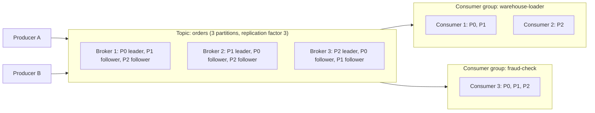
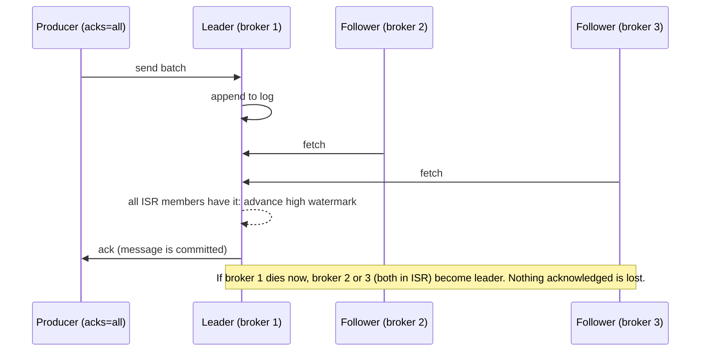

# Kafka

Kafka is the box you draw between "producers" and "everything downstream" in almost every streaming design, so interviewers use it to test whether you understand a message log or only know the name. The questions are always the same: how is order kept, what happens when a broker dies, what happens when a consumer dies, and what "exactly-once" really means.

**What it is:** Apache Kafka is a distributed, durable, replayable **message log** (a queue that keeps messages after they are read, so many readers consume at their own pace and can re-read). Producers append messages to named **topics**; consumers read them in order. **Why it shows up:** it decouples the systems that create events from those that consume them, absorbs bursts, and lets you replay history after a bug. This lesson targets Kafka 4.x, which runs only on KRaft (Kafka's built-in metadata layer, covered at the end); version differences are flagged.

## When to Use It (and When Not To)

Picture an app emitting 12,000 events a second: clicks, orders, payments. Five teams want them: fraud check, dashboard, warehouse loader, search indexer, ML feature job. Without a log, the app calls five systems and each outage becomes its problem. With Kafka, it writes once and each team reads at its own speed; a loader that is down for three hours resumes where it stopped.

**Pick Kafka when:**
- Several independent consumers need the same events, or you need to **replay** them (reprocess after a bug, rebuild a table). See [Kappa Architecture](../03-architecture-patterns/02-kappa-architecture.md) for replay as a design.
- Producers and consumers run at different speeds and you need a buffer. A spike of 35,000 events a second sits in the log; consumers catch up later.
- You need ordering per entity (all events for one order, one user, one account in sequence).
- You are carrying database changes ([CDC Patterns](../03-architecture-patterns/04-cdc-patterns.md)) or feeding a stream processor such as Flink or Spark.

**Do not pick it when:**
- You need a task queue with per-message acknowledgement, retries and delays ("process this job once, then delete it"). A queue such as SQS or RabbitMQ fits better; Kafka tracks a position per partition, not a status per message. (Newer 4.x releases add queue-style "share groups"; they are recent, so check your version before relying on them.)
- Volume is tiny (a few messages a second) and you have no replay need. A managed queue or a direct write is simpler.
- You need to query the data ("all events for user 42 last week"). Kafka reads by offset or time, not by value; land the data in a lake or serving store.
- You need request-reply latency of a few milliseconds. The replica acknowledgement alone costs 5 to 50 ms at p99.
- You expect years of history on broker disks. Keep a raw copy in object storage, or use tiered storage.

> [!TIP]
> "I'll put Kafka in the middle" is not a decision. "Kafka, because four consumers need the same events and I want to replay after bugs, keyed by `order_id` so each order stays in order" is.

## How It Works

### The architecture

A Kafka **cluster** is a set of servers called **brokers**. Data is organised into **topics**. A topic is split into **partitions**, and each partition is an append-only log: new messages go on the end, and each gets a sequential number called an **offset** (0, 1, 2, ...), its address within the partition. A consumer's whole state is "which offset I have read up to" per partition.

Three things to say out loud:
- **Partitions are the unit of everything:** parallelism, ordering, replication, storage. A topic with 12 partitions takes 12 parallel appends and feeds up to 12 consumers in one group.
- **Each partition has one leader** broker that handles its reads and writes, and followers that copy it. Leaders are spread across brokers to spread load.
- **Consumers pull.** The broker does not push or track per-message status; the consumer asks "give me messages from offset 4,200" and gets a batch.

It is fast because it only appends to files (sequential I/O), serves recent reads from the operating system's memory cache, and producers send compressed **batches** (they wait `linger.ms`, 5 ms by default from Kafka 4.0 and 0 before, to fill one).

### Producing: keys, partitions and ordering

A producer chooses the partition for each message:
- **With a key**, Kafka hashes it and takes the result modulo the partition count, so the same key always goes to the same partition.
- **Without a key**, the producer fills a batch for one partition, then moves to the next ("sticky" assignment), spreading load evenly.

State this rule precisely: **Kafka guarantees order only within a partition.** Across partitions there is no order. So "all events for order 8812 in sequence" is achieved by keying on `order_id`; "all events in the topic in global order" would need one partition, which caps you at about 10 MB/s. [CDC Patterns](../03-architecture-patterns/04-cdc-patterns.md) keys by the row's primary key for the same reason.

Ordering breaks silently in two ways:
- **Changing the partition count.** The hash modulo changes, so the same key may now map to a different partition. New events for a key can land on a new partition while old ones sit on the old one, so consumers see them out of order. Add partitions only when cross-change order does not matter; otherwise create a new topic and migrate.
- **Retries.** If batch 1 fails and batch 2 succeeds, the retry of batch 1 lands after batch 2. The idempotent producer (below) prevents this.

A **hot key** is the other classic trap: if one customer produces 40 percent of the traffic, keying by `customer_id` sends 40 percent of the load to one partition, one leader and one consumer. Use a more specific key (`customer_id` plus `session_id`) or a salted one; the options are in [Partitioning](../02-core-concepts/01-partitioning.md).

### Replication: ISR, acks and what survives a failure

Each partition is stored on **replication factor** (RF) brokers; RF 3 is the standard. One replica is the leader; the others are followers that continuously fetch from it. The **in-sync replicas (ISR)** are the leader plus every follower that is caught up (has fetched recently, within `replica.lag.time.max.ms`, 30 seconds by default). A message is **committed** only once every replica in the ISR has it; consumers can read only committed messages. The offset up to which messages are committed is the **high watermark**.

Durability is decided by three settings working together:

| Setting | Meaning | Recommended for important data |
|---|---|---|
| `acks` (producer) | How many acknowledgements the producer waits for. `0` none, `1` the leader only, `all` every ISR member | `all` (the default since Kafka 3.0) |
| `min.insync.replicas` (topic/broker) | With `acks=all`, the smallest ISR size that still accepts writes | 2, with RF 3 |
| `unclean.leader.election.enable` | Whether an out-of-sync replica may become leader when the ISR is empty | `false` (the default) |

With RF 3, `acks=all` and `min.insync.replicas=2`, you can lose **one broker with no data loss and no write outage**: the ISR shrinks to 2, which still satisfies the minimum. Lose a second broker and the ISR is 1, below the minimum, so the leader rejects writes (`NotEnoughReplicas`). Kafka picks consistency over availability: writes stop rather than acknowledge data that exists on one machine. With `acks=1`, a leader that dies right after acknowledging, before followers copy the message, loses it. That is the data-loss scenario to name.

Spread replicas across availability zones (AZs, via `broker.rack`) so a whole zone can fail; each cross-AZ hop adds 1 to 2 ms and is billed.

### Consuming: consumer groups, offsets and rebalances

A **consumer group** is a set of consumers sharing one `group.id` that together read a topic. Kafka assigns each partition to **exactly one consumer in the group**, so the group reads each message once between them. A different group reads the whole topic independently (the fraud-check group above), which is how one topic serves many teams.

Consequences:
- **Parallelism is capped by partitions.** With 12 partitions, a 13th consumer in the group sits idle. So pick the partition count for the parallelism you will need.
- **Each group tracks its own offsets.** Committed offsets live in an internal topic, `__consumer_offsets`, and a restarted consumer resumes from its group's. If there is none, `auto.offset.reset` decides: `latest` (only new data) or `earliest` (everything retained).
- **Commit timing sets your delivery guarantee.** Commit *after* processing and a crash replays the message: at-least-once, the safe default. Commit *before* and a crash loses it: at-most-once. Pair at-least-once with idempotent writes ([Deduplication at Scale](../02-core-concepts/09-deduplication-at-scale.md)).

A **rebalance** is the redistribution of partitions among a group's consumers when one joins, leaves or is declared dead. A **group coordinator** (a broker) tracks membership through heartbeats; a consumer that misses them for `session.timeout.ms` (45 seconds by default), or does not call `poll()` again within `max.poll.interval.ms` (5 minutes), is removed. Rebalances hurt in operations: with the classic "eager" protocol every consumer gives up all its partitions and waits for new assignments, so the whole group pauses, and a deploy that restarts ten consumers one by one can trigger ten pauses. Mitigations, in order of usefulness:
1. **Process faster than `max.poll.interval.ms`.** A slow batch (a long database call) gets the consumer kicked out and starts a rebalance loop. Lower `max.poll.records` or move slow work elsewhere.
2. **Static membership** (`group.instance.id`): a consumer that restarts within the session timeout keeps its partitions, so rolling deploys do not rebalance.
3. **Cooperative rebalancing** moves only the partitions that must move; the rest keep processing.
4. **The new consumer group protocol** (KIP-848; a KIP is a Kafka Improvement Proposal) is generally available in Kafka 4.0 and enabled per consumer with `group.protocol=consumer`. The broker does the assignment, incrementally, so there is no stop-the-world pause. It needs 4.0 brokers and a recent client, so say so if asked.

The number to watch is **consumer lag**: for each partition, the latest offset minus the group's committed offset. Rising lag means consumers are slower than producers; it is the main health metric (see [Monitoring and Alerting](../02-core-concepts/06-monitoring-and-alerting.md)).

### Retention and compaction

Kafka deletes by age or size, never by whether anyone has read the data. A partition is stored as **segments** (files of up to 1 GB or 7 days by default); retention removes whole closed segments. Two policies, set per topic with `cleanup.policy` (**log compaction** here is unrelated to the small-file compaction of table formats):

- **`delete` (the default)** drops segments older than `retention.ms` (7 days by default) or beyond `retention.bytes`. Use it for events: clicks, orders.
- **`compact`** keeps at least the **latest message per key** and eventually discards older ones. Use it for state: the current profile per user, the latest row per primary key, consumer offsets. A **tombstone** (a message with a key and an empty value) tells compaction to forget the key; [CDC Patterns](../03-architecture-patterns/04-cdc-patterns.md) covers the delete handling and the `delete.retention.ms` trap. Compaction is eventual and the topic grows with the number of distinct keys, so it is wrong when you need history to replay.

Retention makes replay possible and makes Kafka expensive: disk = ingress x retention x RF / compression. The options for longer history (long retention, tiered storage, a raw copy in object storage) are compared in [Kappa Architecture](../03-architecture-patterns/02-kappa-architecture.md); tiered storage in Apache Kafka is production-ready from 3.9 and skips compacted topics.

### Idempotent producer and transactions

Retries create duplicates: the broker writes a batch, the acknowledgement is lost, the producer resends. The **idempotent producer** (`enable.idempotence=true`, the default since Kafka 3.0) fixes that. The broker assigns each producer a producer ID, the producer numbers every batch per partition, and the broker discards a batch whose sequence number it has already written. The scope is narrow: **one producer session, one partition**. A restarted producer gets a new ID, so duplicates from your app re-sending after a crash slip through. Ordering also survives retries while `max.in.flight.requests.per.connection` is 5 or less (the default).

**Transactions** widen the scope. A producer with a `transactional.id` can write to several partitions and topics and, in the same transaction, commit the offsets of the input it just read. All of it becomes visible or none of it. A **transaction coordinator** broker tracks the state, and a producer **epoch** fences out an old instance of the same `transactional.id` (a "zombie" after a failover), so two copies cannot both commit. Consumers must set `isolation.level=read_committed` to hide uncommitted and aborted messages; the default, `read_uncommitted`, shows everything. Read-committed consumers read only up to the last stable offset, so an open transaction holds back every reader of that partition until it commits, aborts or times out (`transaction.timeout.ms`, 60 seconds by default).

That gives **exactly-once for read-process-write between Kafka topics**. It does not extend to a database or API that Kafka does not control: a stream job writing to a warehouse needs an idempotent write or a sink that joins the commit. The full argument, including the Flink case, is in [Deduplication at Scale](../02-core-concepts/09-deduplication-at-scale.md). "Kafka gives exactly-once" is true only inside Kafka.

### KRaft: the control plane

Every cluster needs agreement on its metadata: which topics exist, which broker leads each partition, which replicas are in sync. Older Kafka kept this in a separate ZooKeeper cluster. **KRaft** (Kafka Raft) moves it into Kafka: a small group of **controller** nodes, usually 3 (or 5), runs the Raft consensus protocol (elect a leader, replicate each change to a majority) and stores metadata in an internal log, `__cluster_metadata`, which brokers fetch. The active controller handles leader elections when a broker fails.

What to know for interviews:
- **ZooKeeper mode is gone in Kafka 4.0.** New clusters are KRaft only; older clusters had to migrate (via the 3.9 bridge release) before upgrading.
- **One system to run, faster failover, bigger clusters:** metadata is replicated as a log rather than reloaded from ZooKeeper, so controller failover and startup are quicker and the cluster-wide partition limit rises (per-broker partition cost is unchanged).

## Key Numbers

These match [Key DE Numbers](../02-core-concepts/10-key-de-numbers.md) and assume 1 KB messages and RF 3. They are rules of thumb.

| Item | Number |
|---|---|
| One partition, planned write rate | ~10 MB/s (50+ MB/s possible with large batches) |
| One partition, one consumer | ~20 to 50 MB/s, usually limited by the consumer's processing |
| One broker, ingress | 100 to 300 MB/s, network- or disk-bound |
| Small production cluster | 3 to 6 brokers, a few hundred MB/s in |
| Partitions per broker | ~2,000 to 4,000 comfortable |
| Default max message size | ~1 MB; put large payloads in object storage and send a pointer |
| Compression on JSON | ~3x with lz4, 4 to 6x with zstd |
| Produce latency, replica-acknowledged | 5 to 50 ms (p99) |
| Default retention | 7 days (3 is a common sizing assumption) |
| Replication | RF 3, `min.insync.replicas` 2, `acks=all` |

**Worked sizing.** The clickstream from Key DE Numbers: 1 billion events a day at 1 KB is about 12 MB/s average and 35 MB/s at peak.
- **Partitions:** 35 / 10 = at least 4 for throughput. Take 12 for consumer parallelism and headroom (partitions cannot be removed).
- **Brokers:** 35 MB/s is far below one broker's 100 to 300 MB/s, but RF 3 needs 3 brokers anyway. Replication triples internal traffic (about 105 MB/s), still modest.
- **Disk:** 12 MB/s x 259,200 s (3 days) = about 3.1 TB raw, x 3 for replication = 9.3 TB, / 3 for lz4 = **about 3 TB of broker disk**. At 7 days, about 7 TB.
- **Say the implication:** "Ingest is easy; retention drives cost, so I'll keep 3 days on the log and a raw copy in object storage."

## Interview Follow-ups

**"How does Kafka guarantee ordering?"**
Only within a partition. The same key hashes to the same partition, so I key by the entity whose order matters (`order_id`). Global order would need one partition and about 10 MB/s. Adding partitions changes the key mapping, so I pick the count up front.

**"A broker dies. What happens?"**
Partitions it led elect a new leader from their ISR within seconds, and clients refresh their metadata and carry on. With RF 3, `acks=all` and `min.insync.replicas=2`, nothing acknowledged is lost and writes continue. A second failure drops the ISR below 2 and writes are rejected: the intended trade of availability for consistency.

**"A consumer dies. What happens?"**
The coordinator notices missed heartbeats after the session timeout and rebalances: its partitions go to the remaining consumers, which resume from the last committed offset. Messages processed but not yet committed are processed again, so processing must be idempotent.

**"Consumer lag keeps growing. What do you do?"**
First find whether it is all partitions or one. All: consumers are too slow, so scale the group (up to the partition count), batch the sink writes or speed up the handler. One: a hot key or a stuck consumer. At one consumer per partition already, add partitions (accepting the key remapping) or make each consumer faster. Also check for a rebalance loop from slow polls.

**"Does Kafka give exactly-once?"**
Only inside Kafka: the idempotent producer removes retry duplicates, and transactions make read-process-write between topics atomic for `read_committed` consumers. Beyond Kafka I need an idempotent sink; see [Deduplication at Scale](../02-core-concepts/09-deduplication-at-scale.md).

**"How many partitions should the topic have?"**
The larger of peak MB/s divided by 10 and the consumer parallelism I want, with headroom. More partitions cost memory, open files and recovery time, so I do not pick 1,000 "just in case".

**"What happens with a poison message that always fails?"**
It blocks that partition, because the consumer cannot commit past it. Catch the error, send the message to a **dead-letter topic** with the error attached, move on, and alert on the dead-letter rate. [Data Contracts](../02-core-concepts/07-data-contracts.md) prevents bad shapes at the source.

## Alternatives

| Option | Choose it over Kafka when | Pick Kafka instead when |
|---|---|---|
| Managed log services (Kinesis, Pub/Sub, Event Hubs) | You are on one cloud and want no cluster operations (Event Hubs even speaks the Kafka protocol) | You need the Kafka ecosystem (Connect, stream processing, CDC tools), portability, or control over retention |
| Managed Kafka (cloud-provider or vendor-hosted) | You want Kafka semantics without running brokers | Cost or control pushes you to self-host; at hundreds of MB/s the managed bill is tens of thousands a month |
| Redpanda, Pulsar | You want the Kafka API without the JVM (Redpanda), or built-in multi-tenancy and geo-replication (Pulsar) | Ecosystem and team experience matter more |
| SQS / RabbitMQ | Task queue semantics: per-message ack, retry, delay, a few thousand messages a second | You need replay, ordering per key, or many independent consumers |

Kafka is the de facto standard, with the largest ecosystem and a simple model; it costs operations (partition planning, rebalances, upgrades) and disk under long retention. On one cloud with modest volume, a managed log is a defensible answer; name what you give up (portability, ecosystem). Pick from your stated requirements.

## Key Takeaways

- **Order exists only within a partition**, so key by the entity whose order matters, and treat the partition count as hard to change.
- RF 3, `acks=all` and `min.insync.replicas=2` survive one broker loss with no data loss, and stop writes rather than risk loss if two fail.
- A consumer group gives each partition to one consumer, so parallelism is capped by partitions. Commit after processing, make writes idempotent, and watch consumer lag and rebalances.
- Retention (7 days by default) sets how far you can replay and dominates disk cost. Compaction keeps the latest value per key: state, not history.
- The idempotent producer removes retry duplicates in one session and partition; transactions give exactly-once between Kafka topics with `read_committed`. Neither reaches an external system. Kafka 4.x is KRaft only.

Related lessons: [Partitioning](../02-core-concepts/01-partitioning.md), [Deduplication at Scale](../02-core-concepts/09-deduplication-at-scale.md), [Kappa Architecture](../03-architecture-patterns/02-kappa-architecture.md), [CDC Patterns](../03-architecture-patterns/04-cdc-patterns.md), [Key DE Numbers](../02-core-concepts/10-key-de-numbers.md), [Spark Internals](01-spark-internals.md), [Flink](08-flink.md).
