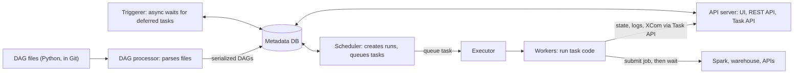
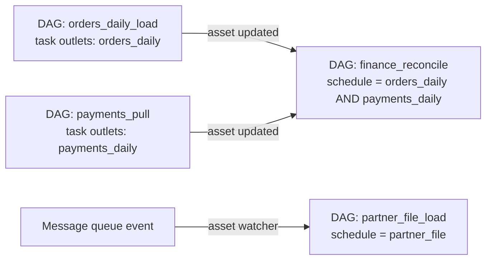

# Airflow

Interviewers assume you know Airflow's name and probe whether you know the machine: what the scheduler does, what a "run" is tied to, and why retries and backfills are safe or dangerous. The strongest answers also say what Airflow is *not* for.

**What it is:** Apache Airflow is a workflow orchestrator. You describe a pipeline as a **DAG** (directed acyclic graph: tasks with arrows meaning "must finish before", no loops; see [Pipeline Design](../01-the-framework/07-pipeline-design.md)) in Python. Airflow starts each task on time, waits for upstream tasks, retries failures, and records what ran. **Why it shows up:** every batch design needs something that runs step B after step A and says when it didn't; Airflow is the default answer. Accurate for Airflow 3.x (2026); where 2.x differed, it says so.

## When to Use It (and When Not To)

Picture a nightly pipeline: pull yesterday's payments from a partner API, wait for the orders CDC to land, run a Spark job and dbt models, publish a finance table, check row counts, all before 07:00. Cron and shell scripts cannot express "after those two things finished", cannot retry one step, and say nothing when it fails at 03:00.

**Pick Airflow when:**
- You have many batch jobs with **dependencies** across systems, and you need retries, alerting, history and a UI showing which step failed.
- Jobs are **scheduled by time or by data arrival**, in intervals (hourly, daily).
- You need to **rerun or backfill** past dates in a controlled way ([Backfill and Reprocessing](../02-core-concepts/03-backfill-and-reprocessing.md)).
- Your team already runs it. A managed offering (Cloud Composer, MWAA, Astronomer) removes most of the operational pain; the core ideas below are identical.

**Do not pick it when:**
- You need **streaming** or sub-minute latency. Airflow starts tasks in batches on a schedule; its overhead per task is seconds. Streams belong in Flink, Spark Structured Streaming or a Kafka consumer.
- You want it to **do the heavy work**. Airflow orchestrates; Spark, the warehouse or dbt compute. A worker that loads 50 GB into pandas is a design smell (more below).
- You have a handful of independent jobs. Scheduled queries or cron are simpler.
- The pipeline is mostly SQL transformations inside one warehouse. dbt's own DAG covers dependencies between models ([dbt](04-dbt.md)); you may only need Airflow to trigger it.

> [!TIP]
> Say it as a boundary: "Airflow decides *when* and *in what order*; Spark and the warehouse decide *how*. Tasks submit work and wait; they do not process data." That single sentence answers half the follow-ups below.

## How It Works

### The components

Airflow 3 splits into a few processes that all share one **metadata database** (Postgres is the usual choice), which stores every DAG definition version, run, task state and retry count.



- **DAG processor** parses your Python DAG files on a loop (each file at most every 30 seconds by default; new files are discovered about every 5 minutes) and stores the result. In Airflow 3 it is a separate, required process, not part of the scheduler.
- **Scheduler** is the brain. It decides when a DAG run should exist, which tasks in it are ready (all upstream succeeded), and hands those to the executor. You can run several for availability; they coordinate through database row locks.
- **Executor** is the pluggable "how do tasks get onto machines" layer. **Workers** are the processes or pods that run task code. See the table below.
- **API server** serves the UI and the REST API. In Airflow 3 it also serves the **Task Execution API**: workers no longer read and write the metadata database directly. They talk to the API server through the **Task SDK** (the `airflow.sdk` package you import `dag`, `task` and `Asset` from). Tasks are isolated from the database, and workers can run elsewhere.
- **Triggerer** runs **deferred** tasks (explained under sensors).

### DAG, DAG run, task, task instance

Interviewers notice when these four words are used loosely.

| Term | Meaning | Example |
|---|---|---|
| **DAG** | The definition: tasks plus dependencies plus a schedule | `orders_daily` |
| **DAG run** | One execution of the DAG for one data interval | the run for Oct 31 |
| **Task** | One node in the DAG definition | `load_partition` |
| **Task instance** | One task within one DAG run, with its own state and try number | `load_partition` for Oct 31, try 2, `success` |

Since 3.0, Airflow also keeps **DAG versions**: a run keeps the version it started with. In 2.x, editing a DAG mid-run changed the graph under your feet.

### Data intervals: what a run is "for"

The most important idea in Airflow, and the one juniors miss: a run is tied to a **data interval** (the slice of event time it is responsible for), not to the moment it started. A daily run for October 31 has the interval Oct 31 00:00 to Nov 1 00:00. The run for that interval starts *after* the interval ends, because the data for the day is only complete then.

Why it matters: your task reads `data_interval_start` and `data_interval_end` from its context instead of calling `now()`. Then a rerun three days later, or a backfill over last quarter, processes exactly the slice it should. This is what makes the partition-overwrite pattern in [Pipeline Design](../01-the-framework/07-pipeline-design.md) work in practice.

Here is a complete small DAG that does it right:

```python
import pendulum
from datetime import timedelta
from airflow.sdk import dag, Asset
from airflow.timetables.interval import CronDataIntervalTimetable
from airflow.providers.common.sql.operators.sql import SQLExecuteQueryOperator

orders_daily = Asset("warehouse://analytics/orders_daily")

@dag(
    # Explicit interval timetable: a bare "@daily" gives no real interval in 3.x by default.
    schedule=CronDataIntervalTimetable("0 0 * * *", timezone="UTC"),
    start_date=pendulum.datetime(2026, 1, 1, tz="UTC"),
    catchup=False,
    max_active_runs=1,
    default_args={"retries": 3, "retry_delay": timedelta(minutes=5)},
)
def orders_daily_load():
    SQLExecuteQueryOperator(
        task_id="load_partition",
        conn_id="warehouse",
        # Idempotent: delete this interval's rows, then insert them, in one transaction.
        sql="""
            BEGIN;
            DELETE FROM analytics.orders_daily
              WHERE order_date >= '{{ data_interval_start }}' AND order_date < '{{ data_interval_end }}';
            INSERT INTO analytics.orders_daily
              SELECT * FROM staging.orders
              WHERE order_ts >= '{{ data_interval_start }}' AND order_ts < '{{ data_interval_end }}';
            COMMIT;
        """,
        outlets=[orders_daily],
    )

orders_daily_load()
```

The `{{ ... }}` parts are **templates** (Jinja): Airflow fills them in per run just before the task starts.

> [!NOTE]
> Version-dependent: in Airflow 3, a plain cron string or preset like `"@daily"` uses a trigger-style timetable by default (`CronTriggerTimetable`), which fires at the cron time and has no real interval (start equals end). That is why the example passes `CronDataIntervalTimetable` explicitly; a config option can restore the old default, so check your deployment. In 2.x, cron strings always meant "interval that just ended". Also, `execution_date` was removed in 3.0; use `logical_date` or the interval fields.

### Idempotent tasks, retries and rerun safety

Airflow will retry a failed task for you (`retries=3` above), and a human will clear and rerun tasks. Both are only safe if each task is **idempotent**: it gives the same end result whether it runs once or five times. The mechanisms (partition overwrite, MERGE on a key, deterministic keys) are in [Pipeline Design](../01-the-framework/07-pipeline-design.md); the Airflow-specific rules are:

- **Key every write on the data interval**, as in the example. A task that appends "today's rows" with `now()` duplicates data on retry.
- **One task, one atomic effect.** If a task does "write 300,000 rows, then call an API, then write a marker", a failure after step 2 leaves a mess. Split it into separate tasks, or make the whole thing one transaction.
- **Retry transient errors, not logic bugs.** Retries with a delay handle network blips. A deterministic bug fails the same way three times, so keep retries to 2 or 3 and alert on final failure.
- **Set timeouts.** `execution_timeout` stops a hung call from holding a slot forever.

### Executors: where tasks run

| Executor | How tasks run | Strength | Cost |
|---|---|---|---|
| **Local** | Processes on the scheduler's machine | Trivial setup | One machine; development or small setups only |
| **Celery** | Long-lived worker processes pulling from a broker (Redis or RabbitMQ) | Tasks start in about a second; shared workers | You manage the worker fleet and its dependencies; one environment for all tasks |
| **Kubernetes** | One pod per task | Per-task images and resources; scales to zero | Pod startup adds seconds to tens of seconds per task |

Airflow 2.10 and later can run more than one executor in one deployment, picked per task with the `executor` argument. A common setup is Celery for many short tasks and Kubernetes for the few heavy or odd-dependency ones. The executor is a **scaling and isolation** choice, not a processing-power choice; the real processing happens in Spark or the warehouse.

### Catchup and backfill

Say the DAG's `start_date` is January 1 and you deploy it on March 1. Does Airflow run 59 daily runs immediately? With **catchup** on, yes: the scheduler creates a run for every missed interval. With it off, it only schedules the latest interval. Airflow 3 changed the default to off (`catchup=False`); in 2.x the default was on, which caused many surprise 59-run storms.

Catchup is for the *scheduler* creating missed runs. A **backfill** is you deliberately asking for runs over a date range, for example after fixing a bug. In 2.x backfill was a CLI command run outside the scheduler; since 3.0 it is a scheduler-managed feature you start from the UI, API or CLI, with options for which existing runs to redo (all, only failed, or only missing) and for ordering (oldest first or newest first). The theory and the cost controls (rate limits, cluster load, isolating readers) are in [Backfill and Reprocessing](../02-core-concepts/03-backfill-and-reprocessing.md). The Airflow-specific levers are:

- `max_active_runs` limits how many intervals run at once. Set it to 1 if run N reads what run N-1 wrote, and to something like 4 to 8 if runs are independent and the warehouse can take it.
- **Pools** cap concurrent tasks hitting a shared resource ("at most 5 queries against the source database"), across all DAGs.
- Set `depends_on_past` only when a run truly needs the previous run's output; it serialises everything and one failure blocks every later run.

### Sensors and deferrable operators

A **sensor** is a task whose only job is to wait for a condition: a file to exist in object storage, a partition to appear, another system to say "done". It connects to the interview rule from Pipeline Design: trigger on data, not only on time.

The cost is the waiting. A sensor in the default `poke` mode holds a worker slot while it checks every 60 seconds. Fifty sensors waiting overnight for partner files can occupy fifty slots doing nothing, and starve real work. Three ways to wait, from worst to best:

| Style | How it waits | Holds a worker slot? |
|---|---|---|
| **Poke** (default) | Sleeps inside the worker, checks every `poke_interval` | Yes, the whole time |
| **Reschedule** (`mode="reschedule"`) | Checks, then frees the slot and is rescheduled for the next check | Only during each check |
| **Deferrable** (`deferrable=True`) | The task hands the wait to the **triggerer**, a single asyncio process that can watch thousands of waits at once, then resumes on a worker when the event fires | No |

A **deferrable operator** is any operator that can suspend itself this way. It is also the right choice for long external jobs: "submit a Spark job, then defer until it finishes" instead of a worker polling for two hours.

Always set a `timeout` on sensors. The default is 7 days, which hides a missing file for a week. Set it to the point where the file is *late enough to page someone*, and alert on failure.

### Data-aware scheduling: assets

Time-based schedules have the problem from Pipeline Design: the 02:00 job assumes everything upstream finished by 02:00. **Data-aware scheduling** fixes it. A task declares that it updates an **asset** (a logical dataset, identified by a name or URI). Another DAG declares `schedule=[orders_daily]` and runs when that asset has been updated. This was called **datasets** in Airflow 2.4 to 2.x and was renamed **assets** in 3.0, along with an `@asset` decorator that defines an asset and the task that produces it in one place.



You can combine assets with `&` and `|` (the finance DAG above runs when *both* upstream assets are updated). Airflow 3 also adds **asset watchers**, which let an event from an external message queue (for example SQS or Kafka, via the common messaging provider; the supported queues depend on the provider version) mark an asset as updated, so a DAG can start when something happens outside Airflow instead of polling for it.

Assets are not data-quality guarantees. The event says "the producing task succeeded", not "the table is correct", so keep checks inside the producing DAG. Also, a consumer triggered by an asset event does not know *which* slice was updated; for date-partitioned data, pass the interval through the event metadata or read the partition explicitly.

### What not to do in Airflow

Every item here is a mistake people shipped.

- **Do not process data inside tasks.** Pulling millions of rows into a worker's memory with pandas fails at scale and makes retries expensive. Submit the work to Spark or the warehouse, and have the task wait for it.
- **Do not pass data through XCom.** XCom is Airflow's mechanism for passing small values (a file path, a row count, an ID) between tasks. It is stored in the metadata database by default. A 200 MB DataFrame in XCom bloats the database every scheduler depends on. Pass a *pointer* (an object-storage path) and keep data in storage. 
- **Do not put heavy code at the top level of a DAG file.** The DAG processor re-parses every file about every 30 seconds. A top-level API call or database query runs thousands of times a day and slows every DAG. Keep top-level code to imports and DAG definition; do the work inside tasks.
- **Do not use `now()`, `date.today()` or "latest" inside tasks.** They break reruns and backfills. Use the data interval.
- **Do not create one giant task or 50,000 tiny ones.** The first has no partial retry. The second makes the scheduler and the database the bottleneck: each task instance is a row with state transitions. Dynamic task mapping (`.expand(...)`) is fine for tens or hundreds of mapped tasks per run, with a default cap of 1,024; for 100,000 items, batch them into fewer tasks or push the loop into Spark.
- **Do not forget that Airflow itself is a production system.** Back up the metadata database, clean old runs and logs, and monitor the scheduler. Alert on missed SLAs; see [Monitoring and SLAs](../01-the-framework/09-monitoring-and-slas.md).

## Key Numbers

These are defaults and rules of thumb; they differ by version and deployment, so state them as such.

| Item | Typical number |
|---|---|
| Task start latency | ~1 to 5 s on Celery; ~10 to 60 s per task on Kubernetes (pod startup) |
| Global task concurrency (`parallelism`) | 32 by default; raise per deployment size |
| Concurrent tasks per DAG | 16 by default; concurrent runs per DAG: 16 |
| Default pool | 128 slots |
| DAG file parse interval | ~30 s per file |
| Sensor `poke_interval` / `timeout` defaults | 60 s / 7 days |
| Dynamic task mapping cap | 1,024 mapped tasks per task by default |
| XCom | Small values only: bytes to a few KB; use pointers for anything bigger |
| Realistic scheduling granularity | Minutes; Airflow is not for sub-minute schedules |

**Worked sizing.** A company runs 400 DAGs of 20 tasks each, mostly daily: 8,000 task instances a day. If 70 percent (5,600) land in the 02:00 to 04:00 window, that is under 1 per second, easy for the scheduler. What limits you is concurrency: at 32 slots and a 10-minute average task, you finish 32 x 6 = 192 task instances per hour, so 5,600 would take over 29 hours. Raise slots, defer waiting tasks, and spread DAGs through the night. Size Airflow by **slot-hours of occupied workers**, not by task count.

## Interview Follow-ups

**"What happens when the scheduler dies mid-run?"**
Task state lives in the metadata database, not in the scheduler's memory. Running tasks continue on workers. With one scheduler, new tasks wait until it restarts and picks up from the database; with two or more schedulers, another takes over immediately. A task whose worker died is detected by missed heartbeats and marked failed (then retried).

**"A task failed halfway. Is it safe to retry?"**
Only if it is idempotent. I write by data interval with a partition overwrite or MERGE, so the retry replaces the partial output. If a task has non-idempotent effects (sending an email, calling a payment API), I isolate it in its own task with its own dedup key so it is not repeated.

**"How do you backfill three months of data?"**
Trigger a backfill over the date range, with a cap on concurrent runs sized to what the source and warehouse can take, and a pool for the source. Confirm the tasks key on the data interval, so each run touches only its slice. Run newest-first if people need recent data fixed sooner. Watch the downstream load; see [Backfill and Reprocessing](../02-core-concepts/03-backfill-and-reprocessing.md).

**"Your DAG should start when the partner file arrives, not at 02:00."**
A deferrable sensor on the file path (or an event from the storage notification mapped to an asset), with a timeout and an alert at the point where lateness matters. The 02:00 schedule stays as the earliest start; the sensor gates the real work.

**"How do two DAGs depend on each other?"**
Prefer assets: the producer declares the asset it updates, the consumer schedules on it. The older alternatives are a sensor on the other DAG's task state, or an explicit trigger task. Assets avoid clock coupling and show the dependency in the UI.

**"Why did my DAG run twice for the same day, or not at all?"**
Check the data interval semantics and the timezone first. A daily run for Oct 31 starts after midnight on Nov 1, so people often misread it as "missing" or "off by one". Then check catchup, `start_date`, and whether a manual trigger created an extra run with a different interval.

## Alternatives

How to choose in an interview is in [Orchestrator Comparison](10-orchestrator-comparison.md). Short version:

| Option | Choose it over Airflow when | Pick Airflow instead when |
|---|---|---|
| Dagster | You want to model *data assets* as the primary object, with strong local testing and lineage | You need the largest ecosystem of provider integrations and a hiring pool that knows it |
| Prefect | You want a lightweight, Python-first flow with dynamic runtime behaviour | You want a scheduler built around dated intervals, backfills and a mature UI |
| Managed Airflow (Composer, MWAA, Astronomer) | You want Airflow without running its scheduler, database and workers | You need full control over deployment and cost |

## Key Takeaways

- Airflow decides **when and in what order**; Spark, the warehouse and dbt do the processing. Tasks submit work and wait. Never process large data on a worker or pass it through XCom.
- A run is tied to a **data interval**, not to the clock. Read `data_interval_start` and `data_interval_end`, never `now()`, and retries and backfills become safe.
- Retries and reruns are only safe with **idempotent** tasks: write by interval (partition overwrite or MERGE), one atomic effect per task.
- Components to name: DAG processor, scheduler, executor and workers, API server and Task SDK (Airflow 3), triggerer, and the metadata database that holds all state.
- Wait cheaply: **deferrable** operators and sensors do not hold a worker slot. Always set a timeout and an alert.
- **Assets** (called datasets before 3.0) let a DAG run when upstream data was updated instead of when a clock says so; they signal "the producer succeeded", not "the data is correct".
- Airflow 3 changes worth stating: `catchup` off by default, trigger-style cron timetable by default, DAG versioning, scheduler-managed backfills, no `execution_date`. Say "version-dependent" if unsure which version the team runs.
- Size by concurrent slot-hours, keep top-level DAG code light, and treat the Airflow metadata database as a production system.
