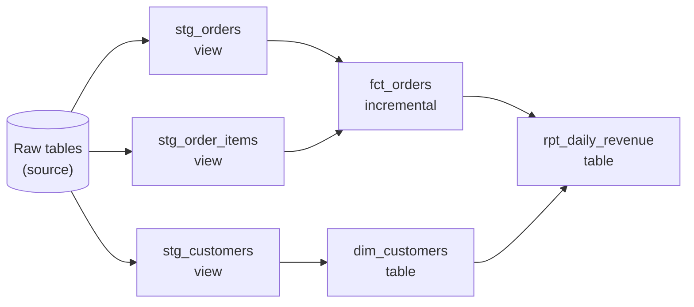

# dbt

dbt is the tool you name when the data is already in a warehouse and the question is "how do we manage the SQL that turns raw tables into trustworthy ones?" Interviewers rarely ask you to write dbt. They ask whether you know what it does for you (dependency order, tests, incremental builds, history) and where it stops.

**What it is:** dbt (data build tool) is a command-line tool that compiles a project of SQL `select` statements and runs them inside your warehouse in dependency order, turning each one into a view or table. It does the **T** in ELT: the data is already loaded, and dbt transforms it in place. The warehouse does all the compute. **Why it shows up:** it turns a pile of SQL scripts into a versioned, tested, documented dependency graph, which is most of what a transformation layer needs. This lesson is accurate for dbt Core 1.9 and later; version differences are flagged.

## When to Use It (and When Not To)

A team has 140 SQL scripts in a scheduler. Nobody knows the order, one script silently duplicates rows, and a column rename broke three dashboards. They need dependencies, tests and builds of only what changed.

**Pick dbt when:**
- The data is already in a warehouse or lakehouse and the logic is SQL: cleaning, joining, modeling facts and dimensions ([Data Model Design](../01-the-framework/06-data-model-design.md)). It is the usual tool for the silver and gold layers of a [medallion architecture](../03-architecture-patterns/03-medallion-architecture.md) held in a warehouse.
- Several people edit transformations and you want code review, tests in CI and one place that says what depends on what.
- You need history on a mutable source table (snapshots, below).

**Do not pick it when:**
- You need to ingest data (call an API, read a Kafka topic, copy from a database). dbt starts after the load. Use an ingestion tool or [CDC](../03-architecture-patterns/04-cdc-patterns.md) for that.
- The logic is not SQL (binary parsing, model inference, heavy custom code). dbt can run Python models on some platforms, but then [Spark](01-spark-internals.md) is the more honest choice.
- You need results in seconds. dbt is a batch tool; a run every few minutes is the practical floor.
- You want an orchestrator. dbt orders its own models inside one run but has no real scheduler, retries across systems or sensors. Pair it with [Airflow](03-airflow.md) or the vendor's job scheduler.

> [!TIP]
> Say: "dbt owns transformation inside the warehouse; something else owns ingestion and scheduling."

## How It Works

### A project is SQL files plus Jinja

A dbt project is a folder. Each **model** is one `.sql` file holding a single `select`. You never write `create table`; dbt wraps your select in the right statement for the warehouse, based on the model's **materialization** (how the result is stored; covered below). Models are templated with Jinja: `{{ ... }}` calls a function, `` is control flow. The call you use most is `ref`.

```sql
-- models/marts/fct_orders.sql
select
    o.order_id,
    o.customer_id,
    o.ordered_at,
    sum(i.quantity * i.unit_price) as order_total
from {{ ref('stg_orders') }} o
join {{ ref('stg_order_items') }} i using (order_id)
group by 1, 2, 3
```

`{{ ref('stg_orders') }}` does two things. It compiles to the real table name (`analytics.staging.stg_orders`, with a different schema in dev and prod, so developers never overwrite production). And it tells dbt that `fct_orders` depends on `stg_orders`. `{{ source('shop', 'orders') }}` does the same for raw tables dbt does not build; it can carry freshness checks and is a root of the graph.

### Compile, build the DAG, run in order

dbt reads every file, finds all the `ref` and `source` calls, and builds a **DAG** (directed acyclic graph, as in [Pipeline Design](../01-the-framework/07-pipeline-design.md)): nodes are models, arrows mean "must finish before". It then renders the SQL and executes it against the warehouse, running independent models in parallel up to a thread limit (the `threads` setting).



Because the graph is explicit, you can run a slice of it: `dbt build --select fct_orders+` means "this model and everything downstream", `+fct_orders` means "this model and everything upstream". In CI you run only changed models plus their children (`--select state:modified+ --state <prod-artifacts>`, comparing against the manifest of the last production run). 

The compiled graph is saved as `manifest.json`, which tools read for lineage, documentation and orchestration.

### Materializations: how a model is stored

The materialization is the most-asked dbt internal, because it is a cost and freshness decision.

| Materialization | What dbt does | Cost per run | Use it for |
|---|---|---|---|
| **view** | `create view`; the query runs every time someone reads it | Nothing to build, full query cost at read time | Light staging models: renames, casts |
| **table** | Rebuilds the whole table (`create table as select`) on every run | Scans all inputs every run | Small or medium marts; anything where simple beats fast |
| **incremental** | Builds the table once, then each run processes only new or changed rows | Proportional to new data | Large fact tables and event data |
| **materialized view** | The warehouse maintains the result itself, refreshing as inputs change | Warehouse-managed; support and limits vary by adapter | Simple aggregations where the warehouse can refresh incrementally |

(An **adapter** is dbt's plugin for one warehouse: Snowflake, BigQuery, Databricks, Postgres and so on. Much of what follows is adapter-specific.)

Start with views for staging and tables for marts. Go incremental only when the rebuild is too slow or expensive: it adds bugs (drift, missed late rows) that a table never has. Warehouse cost scales with compute time or bytes scanned ([Cost Optimization](../02-core-concepts/05-cost-optimization.md)). With 800 million rows and 6 million arriving a day, a full rebuild scans about 130 times more than the new rows need.

### Incremental models and their strategies

An **incremental model** keeps its table between runs and only touches new or changed data. You write the select for the whole history, plus a filter that applies only on incremental runs:

```sql
{{ config(
    materialized='incremental',
    unique_key='order_id',
    incremental_strategy='merge',
    on_schema_change='append_new_columns'
) }}

select order_id, customer_id, status, updated_at, order_total
from {{ ref('stg_orders') }}

  -- 3-day overlap so late updates are caught
  where updated_at >= (select max(updated_at) - interval '3 days' from {{ this }})

```

`is_incremental()` is true when the target table exists and the run is not a full refresh. `{{ this }}` is the model's own existing table, so the filter is a **watermark** ([Ingestion Patterns](../02-core-concepts/02-ingestion-patterns.md)) read from the target itself. `dbt run --full-refresh` drops and rebuilds from scratch, which is your reset button and your backfill of last resort.

How the new rows are written into the existing table is the **incremental strategy**. Which ones you can use depends on the adapter. Defaults differ too (merge on Snowflake, BigQuery and Databricks; append on Postgres and Redshift), and insert_overwrite is not available on Snowflake, so name the strategy explicitly in a design answer.

| Strategy | What happens | Idempotent on rerun? | Needs | Watch out for |
|---|---|---|---|---|
| **append** | Insert the new rows. Nothing is checked | No: a rerun duplicates the batch | Nothing | Fine only for immutable event data with a filter that never overlaps |
| **merge** | `MERGE` on `unique_key`: update matching rows, insert new ones | Yes | `unique_key` | The new batch must be unique on the key, or the merge can fail or pick an arbitrary row (warehouse-dependent). Costs a join against the target |
| **delete+insert** | Delete target rows whose key appears in the new batch, then insert the batch | Yes | `unique_key` | Two statements, not atomic on every adapter; often faster than merge on very large tables |
| **insert_overwrite** | Replace whole partitions touched by the new data | Yes, if the batch covers each partition fully | A partitioned table | Overwrites the entire partition: if your new data holds only part of a day, the rest of that day is lost. Equivalent to [partition overwrite](../01-the-framework/07-pipeline-design.md) |
| **microbatch** | dbt splits the run into time batches (hour, day, month or year) and runs one query per batch | Yes: each batch replaces its own time slice | An `event_time` column | Needs dbt 1.9 or later and adapter support. See below |

Shorthand: **merge** and **delete+insert** suit entity tables keyed by an ID ("current state of each order"); **insert_overwrite** and **microbatch** suit time-sliced facts ("all events in a day"); **append** is fast and unsafe.

Some details worth knowing:

- Without a `unique_key`, merge and delete+insert behave like append. Always set the key.
- The overlap window in the filter (`max(updated_at) - 3 days`) is the dbt version of the lookback from [Late-Arriving Data](../02-core-concepts/08-late-arriving-data.md): reprocess a few days so late updates land, and let merge make the reprocessing harmless. The cost: a 3-day window rescans about 18 million rows instead of 6 million.
- Incremental models do not see **hard deletes** unless you handle them: if a row vanishes from the source, nothing in the filter notices. Options: a soft-delete flag in the source, a periodic `--full-refresh`, or a CDC feed with delete events.
- `on_schema_change` controls a changed column list: `ignore` (default; a new column is silently not added), `fail`, `append_new_columns`, or `sync_all_columns` (also drops removed columns). 
- **Drift.** An incremental table slowly diverges from what a full rebuild would give. Schedule an occasional full refresh and compare.

### Microbatch: the 1.9 strategy

The classic pattern puts the watermark logic in your SQL, and backfilling means running a giant query. **Microbatch** (new in dbt 1.9) moves that work into dbt. You declare an `event_time` column, a `batch_size`, a `begin` date (where a first or full-refresh run starts) and optionally a `lookback` (how many earlier batches to reprocess each run, default 1):

```sql
{{ config(
    materialized='incremental',
    incremental_strategy='microbatch',
    event_time='ordered_at',
    batch_size='day',
    lookback=3,
    begin='2025-01-01'
) }}

select * from {{ ref('stg_orders') }}   -- no is_incremental() filter needed
```

dbt then runs one query per daily batch, filtering this model and any upstream models that declare their own `event_time`. Each batch is independent, so batches can run in parallel and a failed batch can be retried alone. A backfill is a command (`dbt run --event-time-start ... --event-time-end ...`), not a hand-edited query. Each batch is written with a partition-replace or delete+insert style write, depending on the adapter.

Skip microbatch for entity tables with no natural time slice; merge fits those better.

### Tests: data checks as part of the build

A dbt **test** is a query that returns the rows that violate a rule; zero rows is a pass. (Since 1.8 these are called data tests in config; the older name `tests` still works.) Three kinds:

- **Generic tests** are reusable and declared in YAML next to the model. The four built in are `unique`, `not_null`, `accepted_values` and `relationships` (a foreign key check: every `customer_id` in orders exists in customers).
- **Singular tests** are a `.sql` file you write for a one-off rule, such as "no order has a negative total".
- **Unit tests** (1.8 and later) feed small hand-written input rows to a model's logic and compare to expected output, without touching real data. Use them for tricky logic, not data quality.

```yaml
models:
  - name: fct_orders
    columns:
      - name: order_id
        data_tests: [unique, not_null]
      - name: customer_id
        data_tests:
          - relationships: {to: ref('dim_customers'), field: customer_id}
```

Each test has a severity, `error` or `warn`, and can save failing rows (`store_failures`). `dbt build` runs models and their tests together in DAG order: if a test on `stg_orders` fails at error severity, dbt skips everything downstream of it. Bad data stops at the first model that fails instead of flowing into the dashboard table. This is the medallion validation step ([Medallion Architecture](../03-architecture-patterns/03-medallion-architecture.md)) applied to warehouse tables.

Know the limits. Tests run after the build, so downstream models are protected but the failed model holds the bad rows. They check data at rest and catch only what you thought to write. Volume checks (did today's load shrink by 60 percent?) need `dbt source freshness` (compares a `loaded_at_field` against thresholds), a package, or a monitoring tool ([Monitoring and Alerting](../02-core-concepts/06-monitoring-and-alerting.md)).

### Snapshots: SCD Type 2 from a mutable table

Back to the customer who moved from Leeds to Bristol (Type 1 and Type 2 are explained in [Data Model Design](../01-the-framework/06-data-model-design.md)). The operational database overwrites the city, so the history is gone unless someone kept it. A dbt **snapshot** keeps it by comparing the source to its own previous state on every run and writing a Type 2 table.

```yaml
snapshots:
  - name: customers_snapshot
    relation: source('shop', 'customers')
    config:
      schema: snapshots
      unique_key: customer_id
      strategy: timestamp
      updated_at: updated_at
```

(Before 1.9 a snapshot was a Jinja `` block; the YAML form above is the 1.9 recommendation.) On each run dbt compares the source rows to the snapshot's current rows. A changed row gets its old version closed and a new version inserted. dbt adds the bookkeeping columns itself:

| Column | Meaning |
|---|---|
| `dbt_valid_from` | When this version became current (the `updated_at` value for the timestamp strategy; the run time for check) |
| `dbt_valid_to` | When it was replaced; `null` for the current version (configurable to a far-future date) |


Two strategies decide how a change is detected:

- **timestamp**: the row changed if its `updated_at` is newer than the snapshot's last copy. Cheap and exact. Use it when the source has a trustworthy `updated_at`.
- **check**: compare the values of listed columns (`check_cols`, or all). Use it when there is no reliable timestamp. It is slower and gives `dbt_valid_from` as the time dbt noticed, not the time it happened.

> [!WARNING]
> A snapshot only sees the source **when it runs**. If a customer moves to Bristol on Monday and to Cardiff on Wednesday and you snapshot daily at midnight, you capture Bristol only if a run happens between the two. If you snapshot weekly, Bristol is never recorded. Snapshot frequency sets the resolution of your history, and dbt cannot recover changes it never observed. If you need every change, capture them at the source with [CDC](../03-architecture-patterns/04-cdc-patterns.md) and build the Type 2 table from the change log instead.

Treat snapshot tables as irreplaceable: their history exists nowhere else. Put them in their own schema with tighter permissions, back them up, and never let a cleanup job drop them. Snapshots also handle rows that disappear from the source through a `hard_deletes` setting (1.9 and later): `ignore` (default), `invalidate` (close the row) or `new_record` (insert a closing record with a deleted flag). Join facts to a snapshot on `dbt_valid_from <= ordered_at < dbt_valid_to` for point-in-time correctness.

### Running it in production

- **Where it runs.** dbt Core is the open-source command-line tool, run from an orchestrator task or CI. The hosted dbt platform (formerly dbt Cloud) adds a scheduler, CI and an IDE; the model code is the same.
- **With Airflow.** The simple pattern is one task running `dbt build`; it is coarse, but `dbt retry` resumes from the failed node. The finer pattern turns each model into its own task from the manifest: per-model retries, at the cost of a larger DAG. Either way, trigger dbt when its sources are loaded ([Airflow](03-airflow.md) covers data-aware scheduling).
- **Newer engine.** dbt Labs is rewriting the engine in Rust as Fusion, which parses large projects faster and checks SQL statically (for example, catching a bad column reference before any query runs). At the time of writing it was still rolling out and not equal to dbt Core on every adapter, so call it version-dependent and do not build your answer on it.

## Key Numbers

Rules of thumb. Warehouse figures follow [Key DE Numbers](../02-core-concepts/10-key-de-numbers.md).

| Item | Number |
|---|---|
| Models in a project | 100 to 300 for a single team; mature projects reach low thousands |
| Parallelism | `threads` setting, commonly 4 to 16; more threads, more concurrent warehouse queries |
| Incremental break-even | A full rebuild is fine for tables up to a few tens of millions of rows or a few minutes; consider incremental when a model takes more than 10 to 15 minutes or costs noticeably more than the rest of the run |
| Lookback window | 1 to 3 days for most event tables, sized to the 99th percentile of lateness ([Late-Arriving Data](../02-core-concepts/08-late-arriving-data.md)) |
| Test cost | Each test is a query: `unique` on a 1 billion row table is a full scan. Run expensive tests on a schedule |

**Worked example.** `fct_orders` has 800 million rows, 6 million new or changed per day, about 100 bytes per row. A full rebuild reads roughly 80 GB each run. An incremental merge with a 3-day lookback reads about 18 million rows (about 2 GB) plus the join against the target. A weekly full refresh to bound drift means 1 expensive run in 7, not 7 in 7.

## Interview Follow-ups

**"Why dbt and not a folder of SQL scripts in the scheduler?"**
Dependencies come from `ref`, so order cannot be wrong; tests run in the same build and stop bad data flowing downstream; the graph gives lineage and selective runs. A scheduler cannot tell you what a column rename breaks.

**"Which incremental strategy would you use for orders, and why?"**
Orders change status after creation, so they are entities: merge (or delete+insert on a very large table) on `order_id`, with a few days of overlap. For an immutable click event table, a time-sliced strategy (microbatch, or insert_overwrite on a date partition). Append only when the data cannot be revised and the filter cannot overlap.

**"Your incremental model's numbers no longer match a full rebuild."**
That is drift. Likely causes: a late row outside the lookback window, a hard delete the filter cannot see, a logic change that old rows never got, or a `unique_key` that was not unique so merge picked arbitrary rows. Diagnose by full-refreshing into a scratch schema and diffing. Fix the cause, then schedule a periodic full refresh.

**"How do you backfill a dbt model?"**
Table or view: just run it. Incremental: `--full-refresh` if cheap, otherwise microbatch with an event-time range, which also retries only failed batches. Never hand-edit the watermark filter in production. See [Backfill and Reprocessing](../02-core-concepts/03-backfill-and-reprocessing.md).

**"A test fails at 3 a.m. What happens?"**
With `dbt build`, the failed node and everything downstream of it are skipped, so the dashboard table keeps yesterday's data instead of today's wrong data. The failure alerts through the orchestrator. Stale but correct beats fresh and wrong; say who is paged and which freshness SLA is at risk.

**"How would you keep history of a customer's address?"**
A snapshot, which is dbt's SCD Type 2, with the caveat that it captures only the states it observes. For every-change fidelity, capture changes at the source with CDC. And protect the table, because it cannot be rebuilt.

**"Can dbt do streaming or near-real-time?"**
Not natively. Microbatch every few minutes or warehouse-maintained materialized views is the ceiling; seconds belong in a streaming engine.

## Alternatives

| Option | Choose it over dbt when | Pick dbt instead when |
|---|---|---|
| Warehouse-native SQL (stored procedures, scheduled queries, dynamic tables) | A handful of transformations, no team workflow needed | Dozens of models, shared ownership, tests and CI |
| Spark jobs ([Spark Internals](01-spark-internals.md)) | Data is files in object storage, or logic is not SQL, or volume exceeds what the warehouse handles economically | The data is in the warehouse and the logic is SQL |
| SQLMesh and similar SQL transformation frameworks | You want built-in state-aware planning and virtual environments, and accept a smaller ecosystem | You want the largest community, package ecosystem and hiring pool |

How a warehouse executes and prices a `merge` is covered in [Snowflake and Modern Warehouses](05-snowflake.md).

## Key Takeaways

- dbt compiles SQL models and `ref` calls into a DAG and runs it in your warehouse in order. It transforms; it does not ingest, schedule or stream.
- Materialization is a cost decision: views for staging, tables for marts, incremental only when the rebuild is too slow or too expensive.
- Incremental strategies: **append** is unsafe on rerun; **merge** and **delete+insert** fit entity tables with a `unique_key`; **insert_overwrite** and **microbatch** (1.9+) fit time-sliced facts. Availability and defaults vary by adapter, so name the strategy.
- Incremental models drift, miss hard deletes and need a lookback window and an occasional full refresh. Say so before the interviewer does.
- `dbt build` runs tests in DAG order, so a failure stops bad data from reaching downstream models. Tests are at-rest checks, not a monitoring system.
- Snapshots give SCD Type 2 only for the changes they observe; use CDC when every change matters, and protect snapshot tables because they cannot be rebuilt.
