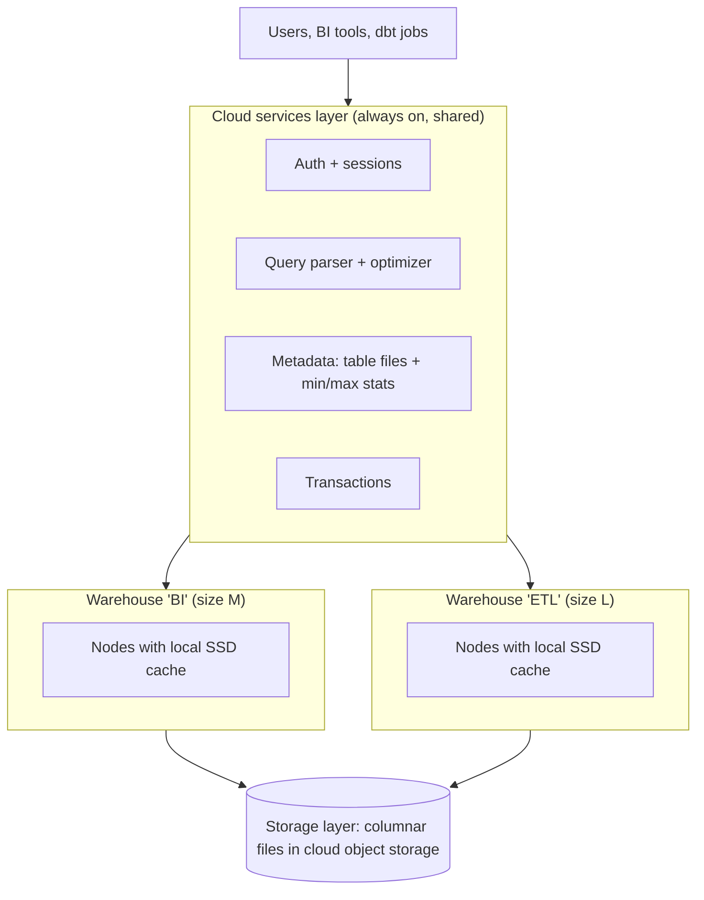
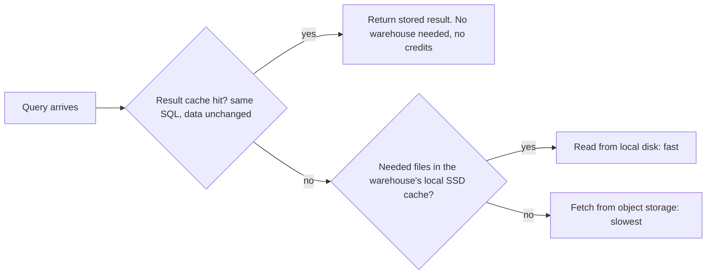

# Snowflake: How a Modern Cloud Warehouse Works

Almost every design with dashboards or a "serving layer for SQL" ends with a cloud warehouse, and the follow-up is rarely "which one". It is "why is this query slow?", "why is the bill $40,000?" and "what happens when 200 analysts log in at 9 a.m.?" You can answer all three if you understand four ideas: storage and compute are separate, data is cut into small immutable files with statistics, compute is rented in fixed sizes, and caches sit at three levels.

**What it is:** a cloud data warehouse is a managed SQL engine for analytics (OLAP: scanning and aggregating lots of rows). You load data, run SQL, and the vendor runs the machines. This lesson uses **Snowflake** as the worked example because its design is the clearest, and notes where **BigQuery**, **Redshift** and **Databricks SQL** differ. The ideas transfer; the knobs do not, so in an interview say "a warehouse such as Snowflake" and describe the mechanism. Details reflect the product as of 2026 and some defaults are plan-dependent; those are flagged.

## When to Use It (and When Not To)

Two requests. Request A: 150 analysts and a BI tool run aggregations over 20 TB of orders and events, with a dozen scheduled dbt jobs overnight. Request B: a mobile app needs "this customer's last 10 orders" in 20 ms, 5,000 times a second. A cloud warehouse is the right tool for A and the wrong one for B.

**Pick a cloud warehouse when:**
- The workload is SQL analytics: large scans, joins, aggregations, ad hoc exploration by many people.
- Several teams need isolated compute over the same data (finance reports must not slow because data science ran a heavy job).
- Consumers speak SQL. Semi-structured JSON lands in a `VARIANT` column (Snowflake's flexible JSON type). The [dbt](04-dbt.md) lesson covers the transformation layer that usually sits on top.

**Do not pick it when:**
- You need millisecond lookups at high request rates. A warehouse query costs hundreds of milliseconds at best and each concurrent query holds compute. Use a serving store; see [Reverse ETL](../03-architecture-patterns/09-reverse-etl.md) for pushing warehouse results there.
- You need sub-second freshness. Warehouses ingest in small batches, with seconds to minutes of delay, not per event. Put a stream processor in front.
- The data is mostly unstructured files, or needs heavy non-SQL processing (ML pipelines, custom code). A lakehouse with [Spark](01-spark-internals.md) fits better.
- You must keep data in open formats under your own control. Native warehouse storage is a proprietary format (open table formats can be queried by most vendors now, with trade-offs; see [Alternatives](#alternatives)).

> [!TIP]
> Strong framing: "The warehouse serves analysts and BI. Raw data lands in object storage, transformed models live in the warehouse, and low-latency lookups get copied out to a serving store."

## How It Works

### Storage and compute are separate

Older warehouses kept data on the machines that ran queries, so storing more meant buying more compute. Modern cloud warehouses split the two:



Three layers:
- **Storage:** all table data sits in cloud **object storage** (S3, GCS or Azure Blob underneath), in compressed columnar files you never manage. You pay a flat per-TB-month rate.
- **Compute:** a **virtual warehouse** is a cluster of machines you start and stop, which reads from storage and runs queries. (Name clash: here "warehouse" means the compute cluster, not the product.) Many can read the same tables at once.
- **Cloud services:** the always-on brain: it authenticates users, parses and optimizes SQL, keeps the metadata, and coordinates transactions.

Why this matters in a design:
- **Isolation.** The BI warehouse and the ETL warehouse read the same tables but never compete for CPU. This answers "how do you stop the nightly load from slowing dashboards?"
- **Cheap copies.** Because files are immutable, a **clone** of a table is just a new set of pointers to the same files, so cloning a 10 TB table takes seconds and costs nothing until the copy diverges. The same file immutability gives **time travel**: you can query a table as of an earlier moment (default 1 day of history, up to 90 days on Enterprise edition and above), then a further 7-day fail-safe that only the vendor can recover from.

The price of separation: a cold read crosses the network from object storage, which is why caching matters.

### Micro-partitions and pruning

Snowflake does not ask you to define partitions. As rows are loaded, it cuts each table into **micro-partitions**: immutable, columnar, compressed files holding roughly 50 to 500 MB of data before compression (so tens of MB on disk), in the order the rows arrived. For every micro-partition and every column, the metadata layer stores statistics: the **min and max value**, the count of distinct values, and the null count.

When a query runs, the optimizer reads this metadata first, not the data:

```sql
SELECT SUM(amount)
FROM orders
WHERE order_date = '2026-03-14' AND country = 'DE';
```

If `orders` has 40,000 micro-partitions and the optimizer sees that only 300 have a `order_date` range that includes March 14, the other 39,700 are never read. That is **pruning**, the same idea as [partition pruning and clustering](../02-core-concepts/01-partitioning.md) with the difference that the warehouse does it for you at file level. Add **column pruning** (columnar storage reads only the named columns): 3 of 50 columns and 1 percent of the files is well under 1 percent of the table.

Pruning only helps when the min/max ranges barely overlap, i.e. the data is **naturally ordered** by the filter column. Rows load roughly in time order, so `order_date` is well clustered by default: each micro-partition covers a narrow date range. `customer_id`, by contrast, is scattered: every micro-partition contains some of every customer, so its min/max range spans everything and nothing is skipped.

### Clustering keys

When a large table (rule of thumb: multi-terabyte, so thousands of micro-partitions) is filtered often on a column that is not its load order, you define a **clustering key**. The warehouse then reorganizes data in the background so rows with similar key values share micro-partitions, which tightens the min/max ranges and restores pruning. A background service re-sorts data as new rows arrive and charges compute credits (defined below) for it, so clustering is a continuing cost.

Rules interviewers like to hear:
- Cluster only large tables with a **measured** pruning problem (check how many micro-partitions a query scanned out of the total in the query profile). On a small table, it only costs money.
- Choose filter and join columns of moderate cardinality, one or two of them (often a date plus a low-cardinality dimension). A unique ID makes maintenance never stop; a boolean gives almost no skipping.
- Tables loaded in the order you filter by (event logs by date) usually need no clustering key.

For needle-in-a-haystack lookups (find one order by ID in a 10 TB table), clustering is the wrong tool; vendors offer an additional index-like structure (Snowflake's *search optimization service*, with its own storage and credit cost). It narrows the gap to a serving store but does not close it.

### Virtual warehouses and concurrency

A virtual warehouse comes in **t-shirt sizes** (XS, S, M, L, XL... up to 6XL). Each size up doubles the machines and doubles the cost. The billing unit is the **credit**: the smallest warehouse burns 1 credit per hour of running time, M burns 4, L burns 8.

| Size | Credits per hour | Roughly at $3 per credit |
|---|---|---|
| XS | 1 | $3 per hour |
| M | 4 | $12 per hour |
| L | 8 | $24 per hour |
| 2XL | 32 | $96 per hour |

Billing is per second while the warehouse runs, with a 60-second minimum each time it starts. Two features turn this into a cost model:
- **Auto-suspend / auto-resume.** The warehouse stops after N seconds idle (often 60 to 300) and restarts on the next query in seconds. You pay for running time, not for being available.
- **Idle time is the leak.** A warehouse that is never idle long enough to suspend (a dashboard refreshing every 2 minutes against a 10-minute auto-suspend) bills 24 hours a day.

**Scaling up versus scaling out** is the question most likely to be asked:

| | Scale **up** (bigger size) | Scale **out** (multi-cluster) |
|---|---|---|
| What changes | One query gets more machines | More copies of the same-size warehouse run side by side |
| Fixes | A single slow, heavy query; **spill** to disk (see the note below) | **Queueing** when many users run queries at once |
| Does not fix | Many concurrent small queries | One slow query |

A scan-bound query on enough data finishes roughly twice as fast one size up and costs about the same in total credits (twice the rate, half the time). So "use a bigger warehouse for the nightly job" is often cost-neutral. A tiny query gains nothing from a bigger size.

For concurrency, each cluster runs a limited number of queries at the same time (the `MAX_CONCURRENCY_LEVEL` parameter defaults to 8, and it is tunable). Further queries **queue**. A **multi-cluster warehouse** (higher-tier plans) starts extra clusters automatically up to a maximum when queues build, and shuts them down as load falls. So for "200 analysts at 9 a.m.": a medium multi-cluster BI warehouse, min 1 and max 4 clusters, not one 4XL.

> [!NOTE]
> **Spill.** When a query's intermediate data (a big join, sort or aggregate) exceeds the warehouse's memory, it writes to local SSD, and if that fills, to remote storage. The query still finishes, but slowly; "bytes spilled to remote storage" in the query profile is the signal to go up one size or filter before the join. Compare the [Spark spill](01-spark-internals.md#memory-and-spill).

### The three caches

Three different caches exist, and mixing them up is a common mistake.



1. **Result cache (cloud services layer).** If the *exact same* query runs again and the underlying data has not changed, the stored result is returned in milliseconds, without running a warehouse at all. Results are kept for 24 hours, extended each time they are reused, up to a maximum of 31 days. It is shared across users. A query using non-deterministic functions (`CURRENT_TIMESTAMP`, `RANDOM`) will not be cached.
2. **Local disk cache (per warehouse).** Each running warehouse keeps recently read micro-partitions on its SSDs. Repeated queries over the same data skip the trip to object storage. **When the warehouse suspends, this cache is lost**, which is the trade-off against aggressive auto-suspend: a 60-second timeout saves idle credits but means the first queries after each resume are cold.
3. **Metadata cache.** Row counts and min/max live in the cloud services layer, so `SELECT COUNT(*)` on a whole table can often be answered without reading data.

Consequence: dashboards repeating the same SQL can be nearly free, and a per-user filter or "now" timestamp silently defeats the result cache.

### Cost model

You pay for three things:

| Item | Billed how | Order of magnitude |
|---|---|---|
| Storage | Compressed bytes, per TB-month | $20 to 40 per TB-month, similar to object storage |
| Compute | Credits for warehouse running time (and serverless features: clustering, search optimization, some ingestion) | $2 to 4 per credit |
| Data transfer | Egress out of the cloud or region | Same as other egress: $0.05 to 0.09 per GB |

These figures match [Key DE Numbers](../02-core-concepts/10-key-de-numbers.md) and are order-of-magnitude list prices, shifting about 2x with contracts, regions and plan. Compute dominates almost every bill: **100 TB of storage is roughly $2,000 to 4,000 a month, while one L warehouse running all day is 8 x 24 = 192 credits, around $400 to 800 a day.**

Worked example. A BI warehouse of size M (4 credits/hour) runs 8 hours a day on 22 days: 704 credits, about $1,400 to 2,800 a month. A forgotten 2XL warehouse (32 credits/hour) left running over a weekend is 32 x 48 = 1,536 credits, $3,000 to 6,000, from one setting. General cost strategy is in [Cost Optimization](../02-core-concepts/05-cost-optimization.md); the warehouse-specific levers are:

- **Auto-suspend short**, and size each warehouse for its own workload.
- **Resource monitors / budgets**: hard credit caps per warehouse that suspend or alert at a threshold.
- **Prune and select less**, and use incremental models ([dbt](04-dbt.md)) instead of full rebuilds.
- **Query timeouts** on ad hoc warehouses, so a runaway cross join cannot burn the budget.

## Key Numbers

Rule-of-thumb figures as of 2026; check current vendor documentation.

| Item | Rule of thumb |
|---|---|
| Micro-partition size | 50 to 500 MB uncompressed, tens of MB stored |
| Warehouse sizes | XS = 1 credit/hr; each size up doubles credits and nodes |
| Billing granularity | Per second, 60-second minimum per start |
| Credit price | ~$2 to 4 (plan and cloud dependent) |
| Storage price | ~$20 to 40 per TB-month, compressed |
| Concurrent queries per cluster | 8 by default (`MAX_CONCURRENCY_LEVEL`); extra queue |
| Resume time | Seconds |
| Result cache lifetime | 24 hours, up to 31 days if reused |
| Time travel | 1 day default, up to 90 days on Enterprise and above; plus 7-day fail-safe |
| Interactive query on a few GB | ~1 to 10 s; TB-scale scan 10 s to minutes (see [Key DE Numbers](../02-core-concepts/10-key-de-numbers.md)) |
| Clustering worth considering | Multi-TB tables, thousands of micro-partitions |

**Worked sizing.** A nightly job scans 2 TB and takes 40 minutes on an M warehouse: 4 x (40/60) = 2.7 credits. On an L it often takes about 20 minutes at 8 credits/hr, also 2.7 credits: same cost, half the wait. Say "I would try one size up and compare credits per run," then confirm in the query profile.

## Interview Follow-ups

**"A dashboard query is slow. How do you investigate?"**
Open the query profile. Check partitions scanned versus total (poor pruning: a clustering key, or a filter wrapping the column in a function), bytes spilled (warehouse too small, or a join without filters) and queue time (concurrency, so multi-cluster). Also check whether it ran cold after a resume.

**"How do you handle 200 analysts at 9 a.m.?"**
A separate multi-cluster BI warehouse, sized for a typical query and scaled out for concurrency, with auto-suspend short. Not one big warehouse: bigger size does not reduce queueing. Consider materializing the heavy dashboard models so each query is light.

**"The ETL load slows down the dashboards."**
They should not share a warehouse. Give each workload its own over the same tables; with storage and compute separated there is no data copy and no contention.

**"When do you add a clustering key?"**
When a multi-terabyte table is filtered regularly on a column that is not its load order, and the query profile shows most micro-partitions scanned. Pick low-to-moderate cardinality columns from the filters, accept the continuing re-clustering credits, and measure before and after. For an append-only table filtered by load date, never.

**"Why is the bill high? How do you reduce it?"**
Compute is the bill. Look at credits per warehouse per hour for idle time, oversized warehouses, repeated full rebuilds and runaway queries. Add resource monitors and timeouts, move transforms to incremental, right-size per workload. Storage is the small line, unless long time travel retention sits on tables that change constantly.

**"How do updates and deletes work with immutable files?"**
A change writes new micro-partitions with the modified rows and marks the old ones as replaced in metadata; old files are retained for time travel then removed. So many small updates produce many new files and degrade clustering. Prefer bulk `MERGE` on batches over row-by-row writes. The same idea underlies open table formats; see [Delta Lake](06-delta-lake.md).

**"How would you load 1 TB a day?"**
Land files (Parquet is typical) in object storage, then bulk load with `COPY INTO` or continuous file ingestion, aiming for files of about 100 to 250 MB compressed; many tiny files make loading slow. Load into a raw table, then transform ([Medallion](../03-architecture-patterns/03-medallion-architecture.md)).

## Alternatives

The same four ideas (separated storage and compute, columnar files with statistics, rented compute, caches) appear in every major cloud warehouse. The differences are in how compute is packaged and priced.

| | Snowflake | BigQuery | Redshift | Databricks SQL |
|---|---|---|---|---|
| Compute unit | Virtual warehouse, t-shirt sizes | Slots, shared pool or reserved | Provisioned cluster nodes, or serverless in RPUs (Redshift Processing Units) | SQL warehouse (sizes, serverless option), billed in DBUs (Databricks units) |
| Pricing basis | Credits per running second | On-demand: per TB scanned. Or reserved slots by capacity | Node-hours, or RPU-seconds | DBUs per hour plus cloud VM cost (classic) or bundled (serverless) |
| Data layout | Automatic micro-partitions, optional clustering key | Partition by date/integer plus up to 4 clustering columns | Distribution key (how rows spread over nodes) and sort key | Delta/Iceberg tables in your own object storage; liquid clustering or Z-order |
| Concurrency | Multi-cluster scale-out | Slots shared across queries; large concurrency by design | Concurrency scaling clusters | Warehouse auto-scaling clusters |
| Storage | Managed, proprietary format | Managed, proprietary format | Managed storage (RA3 and serverless) | Open table formats in your bucket |
| Standout | Isolation, clones, data sharing | No cluster to manage; pay per scan | Deep AWS integration, tunable | Same platform as Spark and ML |

How to compare in an interview:
- **BigQuery's on-demand model** charges for bytes scanned, not time. Pruning and column selection directly reduce the bill, while idle time costs nothing. A badly written `SELECT *` over a 50 TB table at $5 to 6.25 per TB is a $250 to 310 query; see [Cost Optimization](../02-core-concepts/05-cost-optimization.md). Heavy steady workloads tend to move to reserved slots.
- **Redshift** exposes more levers. Distribution and sort keys decide whether joins need to move data between nodes, which is what you tune. It behaves more like a database you tune.
- **Databricks SQL** is the odd one out because the data stays in open formats in your own storage and the same tables serve Spark jobs, ML and SQL. It is the natural choice when a lakehouse already exists ([Delta Lake](06-delta-lake.md), [Iceberg](07-iceberg.md)); The others can also read external open-format tables, usually slower than native storage.

> [!TIP]
> For a "which warehouse?" question: "Close enough on features that I would choose on what the company already runs, the cost model that fits the workload (steady versus spiky), and whether we want open formats in our own bucket."

## Common Mistakes

> [!WARNING]
> **Believing a bigger warehouse fixes everything.** Size fixes one slow, heavy query. It does not fix concurrency queueing (scale out) or a missing filter (prune). Diagnose first.

> [!WARNING]
> **Clustering everything.** On small or append-ordered tables it costs credits and gains nothing. Measure poor pruning first.

> [!WARNING]
> **Leaving warehouses running.** Idle time is the biggest hidden cost. Propose short auto-suspend, a resource monitor and a query timeout by default.

## Key Takeaways

- Storage (cheap, in object storage) and compute (rented, in warehouses) are separate, so you can isolate workloads on the same data and pause compute.
- Tables are cut into immutable columnar micro-partitions with min/max statistics; queries are fast when filters prune most of them, which depends on how well the data is ordered by the filter column. Add a clustering key only to large tables with measured poor pruning.
- Scale **up** for one heavy query or spill; scale **out** (multi-cluster) for concurrency and queueing.
- Compute credits dominate the bill: about 1 credit per hour for the smallest warehouse, doubling per size, at roughly $2 to 4 per credit. Control it with auto-suspend, right-sizing, monitors and incremental loads.
- Three caches (result, local disk, metadata) mean repeated identical queries can be almost free, and suspending a warehouse loses its local cache.
- All major cloud warehouses share this design; they differ in compute packaging (warehouses, slots, nodes) and pricing (time versus bytes scanned) and in whether data lives in an open format you own.
