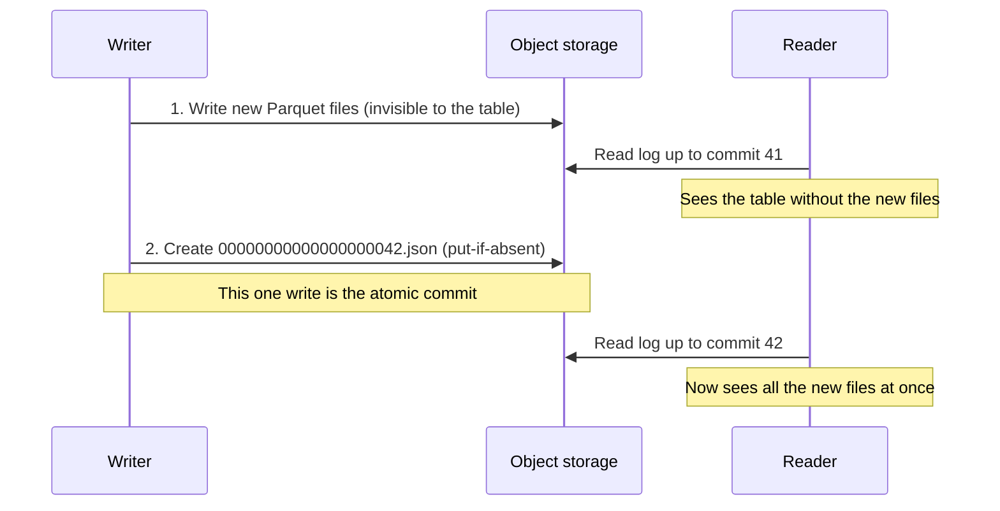

# Delta Lake

Delta Lake is the table format you will meet most often in Spark and Databricks shops. The interview follow-ups are predictable: "How can you have transactions on object storage?", "What happens when two jobs write at once?", "Why is my MERGE slow?" and "Why can't I time travel back 60 days?" Each has a short, mechanical answer once you know the one idea underneath: **the table is a log of changes to a list of files**.

**What it is:** Delta Lake is an open table format. It adds a transaction log next to ordinary Parquet files in object storage, and that log turns the pile of files into a table with atomic commits, schema enforcement, versions and efficient updates. It is not a server; it is a layout plus a protocol that engines (Spark first, others through connectors) follow. **Why it shows up:** it is the default storage layer of the lakehouse and of the silver and gold layers in [Medallion Architecture](../03-architecture-patterns/03-medallion-architecture.md). This lesson is accurate for Delta 3.x and 4.x; features that depend on the version or on the vendor runtime are flagged.

## When to Use It (and When Not To)

A nightly job rewrites `orders` as Parquet in object storage and crashes after 40 of 100 files. A dashboard query at 2:12 a.m. sees a half-written table, and a rerun may duplicate rows. Plain files have no notion of "committed".

**Pick Delta Lake when:**
- You write tables to object storage and need readers to see either the old table or the new one, never a mixture (atomic commits).
- You need row-level changes on a lake: upserts from CDC, GDPR deletes, late-arriving corrections. Plain Parquet cannot do these without rewriting whole partitions.
- You run Spark or Databricks. Delta is the best-supported format there, and Databricks builds its maintenance and governance features around it.
- You want to audit or undo: read the table as it was yesterday, or roll back a bad write.

**Do not pick it when:**
- You need millisecond lookups or thousands of small writes per second. A commit takes hundreds of milliseconds to seconds, so Delta is an analytics store, not an OLTP or serving store.
- The data is small and already in a warehouse, which does all this without file management.
- Your engines are mostly not Spark and you want broad, neutral support. Compare [Apache Iceberg](07-iceberg.md) first.
> [!TIP]
> Say it as a decision: "Silver tables as Delta on object storage, because the CDC feed needs upserts and dashboards need consistent reads. A warehouse would also work, but raw volume makes lake storage cheaper."

## How It Works

### The transaction log

A Delta table is a directory in object storage with two kinds of content:

```
orders/
  _delta_log/
    00000000000000000000.json      <- commit 0
    00000000000000000001.json      <- commit 1
    ...
    00000000000000000010.checkpoint.parquet
    _last_checkpoint
  order_date=2026-10-31/part-0001.parquet
  order_date=2026-10-31/part-0002.parquet
```

The data files are ordinary Parquet and never edited; `_delta_log` is the table's truth. Each commit is a numbered JSON file listing **actions**, the important ones being:

- `add`: this data file is now part of the table, with its size and **statistics** (min, max and null count per column).
- `remove`: this data file is no longer part of the table. The file is not deleted yet.
- `metaData`: the schema, partition columns and table properties.
- `protocol`: the minimum reader and writer versions (and enabled features) an engine must support to touch this table safely.
- `commitInfo`: who did what (operation, user, job), which is what `DESCRIBE HISTORY` shows.

**The table's current contents are defined as: replay the log from the start and keep every file that was added and not removed.** Replaying thousands of JSON files would be slow, so every 10 commits (default) the writer saves a **checkpoint**, a Parquet file holding the full list of live files at that version. A reader finds the newest checkpoint through `_last_checkpoint`, then replays only the few JSON commits after it.

An `UPDATE` therefore never changes a file. It writes new files containing the changed rows, then commits one JSON with `remove` entries for the old files and `add` entries for the new ones. This is called **copy-on-write**.

### Atomic commits on object storage

Object storage writes a single object atomically, but it cannot atomically write 100 objects. Delta's trick is to make **one tiny file the commit point**.



The data files are written first. They sit in the folder, but no commit references them. The commit is the creation of the next numbered log file, and it must be **put-if-absent**: if commit 42 already exists, the write fails. That single guarantee gives you:

- **Atomicity.** Crash before step 2 and the table is unchanged (VACUUM cleans up the orphan files). Crash after and the whole change is in.
- **Isolation for readers.** A reader works from one version of the log (a **snapshot**) and never sees a half-finished write.
- **Durability.** It is as durable as the object store.

The version-dependent part is how "put-if-absent" is obtained. Some object stores historically lacked an atomic conditional create. On S3, multi-cluster writes needed an extra coordination service (Delta ships a DynamoDB-backed log store) until S3 added conditional writes in 2024; recent Delta versions can use them. Newer releases also add coordinated commits, where a catalog service owns the commit instead of the storage layer. Check your storage and version.

### Concurrent writers: optimistic concurrency

Two jobs write to the same table. Delta uses **optimistic concurrency control**: assume nobody will conflict, do the work, and check at commit time.

1. Each writer reads the table at version N and does its work on that snapshot.
2. It tries to create commit N+1. If that succeeds, done.
3. If someone else got N+1 first, the writer checks whether the winning commit touched anything it read. If not (two appends, or changes to different files), it silently retries as N+2. If yes (both rewrote the same file), it fails with a conflict exception and you rerun the job.

| Two concurrent operations | Typical result |
|---|---|
| Append + append | Both succeed |
| Two MERGEs touching the same files | One fails with a conflict |
| OPTIMIZE + append | Both succeed |

The default isolation level is `WriteSerializable`: writes behave as if run one at a time, though in rare cases a read-then-write can see a state no strict ordering would produce. `Serializable` is stricter and conflicts more. Row-level concurrency (conflicts only when two writers change the *same rows*, not the same files) exists with deletion vectors and liquid clustering on newer versions and Databricks runtimes; treat it as version-dependent.

Practical rule: **make concurrent writers touch different partitions or key ranges, and put the partition in the MERGE condition**, so the conflict check can prove they do not overlap.

### MERGE: the upsert

`MERGE` is the operation interviews probe most, because it is how CDC lands in a lake. The pattern and its ordering and delete traps are in [CDC Patterns](../03-architecture-patterns/04-cdc-patterns.md); here is what Delta does underneath.

```sql
MERGE INTO orders_current t
USING orders_changes_batch s
  ON  t.order_date = s.order_date     -- partition predicate: lets Delta skip files
  AND t.order_id   = s.order_id
WHEN MATCHED AND s.op = 'd' THEN DELETE
WHEN MATCHED THEN UPDATE SET *
WHEN NOT MATCHED AND s.op <> 'd' THEN INSERT *;
```

A MERGE is two passes:

1. **Find touched files.** Join the source to the target (using partition filters and file statistics to skip files) and collect the files that contain at least one matching row.
2. **Rewrite them.** Read each touched file in full, apply the updates and deletes, write new files, and commit `remove` for the old and `add` for the new.

With a 2 TB target in 2,000 files of 1 GB, a batch updating 10,000 orders spread over three years can touch 800 files and rewrite 800 GB to change a few megabytes. The levers: put a partition or clustered column in the `ON` clause so only relevant files are candidates, cluster by the merge key (below) so matches share few files, and use deletion vectors.

Two correctness rules: the source must have **at most one row per target key**, or MERGE fails because multiple source rows match one target row (deduplicate with `ROW_NUMBER()` first, as in the CDC lesson). And MERGE is idempotent only by design: guard with a version or log position, or replaying a batch may overwrite rows with stale values.

### Deletion vectors

With **deletion vectors** (open-source Delta added them across 2.3 to 3.1: reads first, then DELETE, UPDATE and MERGE writes; opt in per table in open source, on by default in some Databricks runtimes), `DELETE`, `UPDATE` and `MERGE` stop rewriting whole files. Instead they write a small side file, a bitmap saying "rows 17, 902 and 4,310 in this Parquet file are deleted", and the `add` action for that file points to it. Readers drop those rows while scanning. An update becomes "mark the old row deleted, write the new row in a new file".

Writes get much cheaper (kilobytes of bitmap instead of a 1 GB rewrite); reads pay a small filtering cost until a later `OPTIMIZE` purges the marked rows. A deleted row still physically exists until that rewrite and a VACUUM.

### Time travel

Because old files are only logically removed, the log can answer "what did the table look like at version 30 or at 9 a.m. yesterday?"

```sql
SELECT * FROM orders VERSION AS OF 30;
SELECT * FROM orders TIMESTAMP AS OF '2026-10-31 09:00:00';
RESTORE TABLE orders TO VERSION AS OF 30;   -- roll back a bad write
DESCRIBE HISTORY orders;                    -- who changed what, when
```

Time travel needs two things to still exist: the **log entries** for that version and the **data files** it referenced. They expire separately:

| Setting | Default | Controls |
|---|---|---|
| `delta.logRetentionDuration` | 30 days | How long old commits stay in the log |
| `delta.deletedFileRetentionDuration` | 7 days | How long `remove`d data files are kept before VACUUM may delete them |

So the effective time travel window is **about 7 days by default**, set by the shorter of the two, not 30. This is the classic trap: the log still lists version 10 but the files are gone, and the query errors. Raising it costs storage: rewriting 5 percent of a 10 TB table daily keeps about 15 TB of extra files over 30 days.

Time travel is for debugging and rollback; for long-term history use [SCD Type 2](../01-the-framework/06-data-model-design.md) tables.

### OPTIMIZE, Z-order and liquid clustering

Streaming writes and frequent MERGEs produce many small files, the small-files problem from [Partitioning](../02-core-concepts/01-partitioning.md) and [Key DE Numbers](../02-core-concepts/10-key-de-numbers.md): every file costs a request and a 10 to 100 ms first byte. **`OPTIMIZE`** is compaction: it bin-packs small files into larger ones (target around 1 GB per file by default; some managed runtimes tune it by table size) and commits `remove`/`add` actions. It is safe to run while readers and appenders are active.

```sql
OPTIMIZE orders WHERE order_date >= '2026-10-01';       -- compact recent partitions only
OPTIMIZE orders ZORDER BY (customer_id);                -- compact and Z-order
```

**Data skipping** is what makes layout matter. Each `add` action carries min/max statistics for the first 32 columns by default (`delta.dataSkippingNumIndexedCols`; put filter columns early or raise it). A query with `customer_id = 4127` skips every file whose min/max range excludes 4127. But if every file spans the whole range, nothing is skipped. Layout is what narrows each file's range.

- **Partitioning** is the coarse cut by folder, with the rules from [Partitioning](../02-core-concepts/01-partitioning.md): low-cardinality columns, usually date, at least about 1 GB per partition. Over-partitioning is a common cause of tiny files on Delta.
- **Z-order** (`OPTIMIZE ... ZORDER BY`) co-locates rows that are close in the chosen columns (explained in the partitioning lesson). It is not incremental: each run re-sorts the data it touches, and new writes stay unsorted until the next run.
- **Liquid clustering** (`CLUSTER BY (customer_id)`; open-source Delta from 3.1 as a preview, generally available in later 3.x, with some capabilities Databricks-only, so check) replaces both partitioning and Z-order for new tables. You declare clustering keys at creation, `OPTIMIZE` clusters incrementally (skipping data already well clustered), and you can change the keys later without rewriting the table. It cannot be combined with partitioning or Z-order.

```sql
CREATE TABLE events (event_ts TIMESTAMP, tenant_id BIGINT, ...)
CLUSTER BY (tenant_id, event_ts);
```

Rule of thumb: date partition plus Z-order on older tables; liquid clustering on new ones if your runtime supports it, especially for high-cardinality keys, skew, or changing filters. Managed Databricks offers predictive optimization, which schedules OPTIMIZE and VACUUM for you; in open source you schedule both.

### VACUUM

Every rewrite leaves old files behind: `remove`d from the log but still in storage and still billed. **`VACUUM`** physically deletes files that are no longer referenced by the current version **and** older than the retention threshold (7 days by default).

```sql
VACUUM orders;                      -- default retention, 7 days
VACUUM orders DRY RUN;              -- list what would be deleted
```

It also removes orphan files from crashed writers. Three things matter:

- **VACUUM is what ends time travel.** After it runs, versions older than the retention period are unreadable.
- **Retention must exceed your longest-running reader or stream.** A 10-hour batch job on version 80 fails if VACUUM deletes a file it still needs. Delta blocks retention under 7 days unless you override a safety check; do not do so casually.
- **Nothing runs it for you** in open-source Delta, so a never-vacuumed table grows forever. Schedule it, typically weekly.

For GDPR "delete this user" requests: `DELETE`, then `OPTIMIZE` (with deletion vectors, to purge the rows), then `VACUUM` once the retention window passes. Until then the old file still holds the user's data.

### Change data feed (CDF)

How does a downstream job find out *what changed* in a Delta table without diffing it? With **change data feed**, enabled per table (`delta.enableChangeDataFeed = true`), Delta records row-level changes as part of each write and exposes them:

```sql
SELECT * FROM table_changes('orders_current', 41, 45);
```

Each returned row carries `_change_type` (`insert`, `update_preimage`, `update_postimage` or `delete`), `_commit_version` and `_commit_timestamp`. Streams can read it too (`readChangeFeed = true`), which makes a clean silver-to-gold incremental pipeline: gold processes only the changed keys instead of rescanning silver.

Limits: changes are recorded **only from the version where CDF was enabled**; VACUUM removes change data like any other file, so a consumer that falls behind the retention window loses its place; and it adds storage and write cost on update-heavy tables. It is the equivalent of [CDC Patterns](../03-architecture-patterns/04-cdc-patterns.md) events, but for changes *inside the lake*.

### Schema enforcement and evolution

Delta **enforces** the schema by default: an unexpected column or incompatible type fails the write, in line with [Data Contracts](../02-core-concepts/07-data-contracts.md). **Evolution** is opt-in (`mergeSchema` on a write, or schema evolution on a MERGE). Dropping and renaming columns need column mapping, and widening a type (say int to long) needs type widening, a newer feature that avoids rewriting files. Both raise the table's `protocol` version, so older engines cannot read it; enable features deliberately.

### Streaming with Delta

A Delta table can be a streaming **source** and **sink**; each micro-batch is one atomic commit and the stream checkpoint records which batch was written, giving exactly-once output ([Micro-Batch vs Streaming](../03-architecture-patterns/08-micro-batch-vs-streaming.md)). The cost is files: a commit every 10 seconds is 8,640 commits and tiny files per day. Use triggers of a minute or more, auto-compaction where available, and scheduled `OPTIMIZE`. A streaming read fails on non-append commits unless you read the change feed.

### UniForm

**UniForm** writes Iceberg (and optionally Hudi) metadata alongside the Delta log for the same Parquet files, so an Iceberg-speaking engine can read a Delta table without copying data. It is read-oriented and version-dependent. It answers to "what if another team's engine only reads Iceberg?"

## Key Numbers

Defaults, reasonable for Delta 3.x and 4.x; managed runtimes may differ.

| Item | Number |
|---|---|
| Checkpoint frequency | Every 10 commits (default) |
| OPTIMIZE target file size | About 1 GB (default max file size) |
| Good data file size | 128 MB to 1 GB (from [Key DE Numbers](../02-core-concepts/10-key-de-numbers.md)) |
| Stats collected | First 32 columns (default) |
| Time travel window (data files) | 7 days (`deletedFileRetentionDuration`) |
| Log retention | 30 days (`logRetentionDuration`) |
| VACUUM default retention | 7 days (168 hours) |
| Commit latency | Hundreds of ms to a few seconds; one commit per minute is comfortable for streams |
| Concurrent writers to one table | A few on disjoint partitions is fine; dozens on the same files mostly conflict |

**Worked MERGE sizing.** Target: 2 TB in 2,000 files of 1 GB, partitioned by day (about 2.7 GB per day). An hourly CDC batch updates 50,000 orders from the last two days. With `t.order_date >= current_date() - 2` in the `ON` clause, only about 6 GB is a candidate and the MERGE rewrites the 6 or so files it touches, a few minutes of work. Without it, Delta checks all 2,000 files and could rewrite hundreds of GB. Say: "I pin the merge to the last two days so each run touches gigabytes, not terabytes."

## Interview Follow-ups

**"How do you get ACID on object storage?"**
Immutable data files are written first; the commit is the atomic put-if-absent creation of the next log file. Readers use a log snapshot, so they never see partial writes.

**"What happens if two jobs write at the same time?"**
One creates the next log version first; the other checks whether the winner changed files it read. Appends and disjoint changes retry and succeed; overlapping rewrites conflict. Partition the work so writers do not overlap.

**"My MERGE takes two hours. Why?"**
It rewrites every file containing a matching row, and probably checks all file statistics because `ON` has no partition or cluster predicate. Add the predicate, cluster by the merge key, compact first, deduplicate the source, consider deletion vectors.

**"Can I time travel to 60 days ago?"**
Not by default: removed data files are kept 7 days, then VACUUM deletes them. Raise both retention properties and accept the storage cost, or keep dated snapshots.

**"Z-order or liquid clustering or partitioning?"**
Partition by a low-cardinality column (date) only when nearly every query filters on it. Cluster for the rest: liquid clustering on new tables, Z-order on existing ones. Never partition by a high-cardinality column.

**"How does a downstream job read only the changes?"**
Enable change data feed and read `table_changes` or a stream with `readChangeFeed`, or filter on a modification timestamp column. CDF is exact, including deletes, but only from when it was enabled and only within the retention window.

## Alternatives

| Option | Choose it over Delta when | Pick Delta when |
|---|---|---|
| Apache Iceberg | Many engines (Trino, Flink, Snowflake, Spark) must read and write the same tables, or you want hidden partitioning and partition evolution | Spark and Databricks are your main engines |
| Apache Hudi | Record-level upserts and incremental pulls on a streaming-heavy lake are the main workload | You want the broadest Spark tooling and managed support |
| Plain Parquet | The data is append-only and written by one job | You need atomic commits, updates or versions |
| A cloud warehouse table | SQL consumers only and no file management wanted | You need open files, non-SQL engines, or cheap raw storage |

The full Delta, Iceberg and Hudi comparison is in [Apache Iceberg](07-iceberg.md); read it before an interview where the format choice is the question. Short version: all three give ACID, snapshots and updates on object storage, and Delta's strength is its Spark and Databricks ecosystem.

## Key Takeaways

- Delta is Parquet files plus a `_delta_log`. The table is the replayed log (files added minus removed), with a checkpoint every 10 commits.
- ACID comes from writing data files first, then one atomic put-if-absent of the next log file. Optimistic concurrency: appends and disjoint changes pass, overlapping rewrites conflict.
- MERGE finds touched files and rewrites them whole. Keep it fast with partition or cluster predicates, a deduplicated source, and deletion vectors where available.
- Time travel lasts as long as the data files do: 7 days by default, ended by VACUUM. VACUUM, OPTIMIZE and (for streams) trigger intervals are your job in open-source Delta.
- Layout decides skipping: partition by date only, then Z-order or, on newer versions, liquid clustering for the rest. Use change data feed for incremental downstream reads, and name Iceberg as the alternative when engine neutrality matters.
