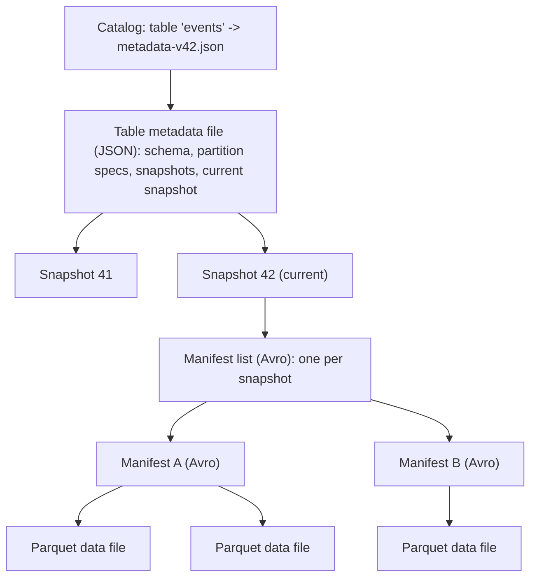
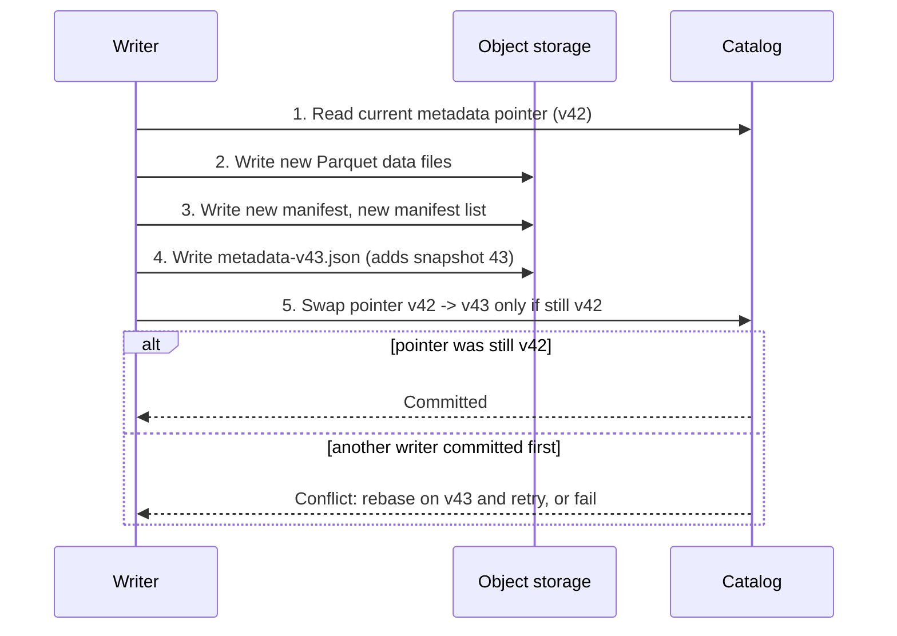

# Apache Iceberg

Two teams share one lake. The Spark team writes `events` as a Delta table; the analytics team queries from Trino and the finance team from Snowflake. Every new engine means a new connector, a new set of quirks, and a new argument about who owns the table. Apache Iceberg exists because of that argument: it is a table format designed so that **many engines can read and write the same table, and the table never depends on one engine's idea of how it should be laid out**.

**What it is:** Iceberg is an open table format. Like Delta ([Delta Lake](06-delta-lake.md)), it turns a pile of Parquet files in object storage into a table with atomic commits, snapshots, schema changes and row-level updates. It is a specification plus libraries, not a server. **Why it shows up:** it is the neutral choice when several engines touch the same data, and most warehouses and query engines can read it. This lesson is accurate for Iceberg spec v2 and v3 as of 2026; items that depend on spec version, engine support or catalog implementation are flagged, so check your versions.

This lesson **owns the Delta vs Iceberg vs Hudi comparison** (under Alternatives). Delta internals are in [Delta Lake](06-delta-lake.md).

## When to Use It (and When Not To)

**Pick Iceberg when:**
- **Several engines must share tables.** Spark for batch, Flink for streaming writes, Trino or a warehouse for queries. The contract is the spec plus a catalog, so each engine implements the same thing.
- **You do not want to be locked to one vendor's runtime.** The table is Parquet plus metadata files you own, in a bucket you own.
- **Partitioning decisions will change.** Hidden partitioning and partition evolution (below) let you fix a bad partitioning scheme without rewriting a petabyte.
- **Tables are huge.** Planning from a metadata tree avoids listing millions of objects.

**Do not pick it when:**
- **You are all-in on Spark and Databricks.** Delta is better integrated there, with managed maintenance and governance built around it.
- **You need low-latency serving.** A commit is several object writes. This is an analytics format, not an OLTP or key-value store.
- **You have no plan for maintenance.** Iceberg does not compact files or expire snapshots by itself. Without a scheduled job or a managed service, tables degrade (see below).

> [!TIP]
> Phrase it as a decision: "Iceberg, because Flink writes it, Trino and Snowflake read it, and we may change engines. If it were only Databricks I would use Delta."

## How It Works

### The metadata tree

A plain Parquet folder answers "which files make up this table?" by listing it. On object storage, listing is slow (a listing call typically returns at most 1,000 keys) and not atomic. Iceberg replaces listing with a tree of metadata files where every level summarizes the one below, so a query skips whole branches unopened.



Top to bottom:

1. **Catalog.** A small service or database that stores one fact per table: the location of its *current* table metadata file. Nothing else. It is the only mutable thing in the design.
2. **Table metadata file** (`metadata-v42.json`). The table's definition: the current and historical **schemas**, the **partition specs** (how the table has been partitioned over time), the list of **snapshots**, which snapshot is current, sort order and table properties. It is immutable; every commit writes a new one.
3. **Manifest list** (one per snapshot). A list of the manifest files in that snapshot. Each entry carries a summary: for every partition column, the lowest and highest value found in that manifest. A query on October 31 can discard every manifest whose date range excludes it, without opening them.
4. **Manifest files.** Each lists data files, and for each file records its partition values, row count, size, and per-column lower bounds, upper bounds and null counts. Delta keeps similar per-file statistics in its log; here they sit in a separate, prunable layer. A manifest is targeted at about 8 MB by default, which holds on the order of tens of thousands of file entries.
5. **Data files.** Immutable Parquet (ORC and Avro are also allowed by the spec, though Parquet is what you will meet).

**Worked planning example.** A table has 2 million data files (about 1 PB at 500 MB each), spread over 3 years of daily partitions in roughly 400 manifests. Query: `WHERE event_date = '2026-10-31' AND customer_id = 4127`.

1. Ask the catalog for the metadata file (one small read).
2. Read the manifest list for the current snapshot (one Avro file, 400 entries). Partition summaries eliminate 397 manifests.
3. Read the 3 remaining manifests. Date and `customer_id` bounds eliminate all but, say, 40 data files.
4. The engine opens only those 40 files.

Three or four metadata reads and no directory listing, instead of a listing of 2 million objects. At the 10 to 100 ms first-byte latency in [Key DE Numbers](../02-core-concepts/10-key-de-numbers.md), that is well under a second of planning.

### Commits and concurrency

A write never edits anything. It adds files and builds a new branch of the tree.



The atomic step is the **compare-and-swap of the catalog pointer**: "change `events` from v42 to v43, but only if it is still v42." Everything before it is invisible to readers. This is the same optimistic concurrency idea described in [Delta Lake](06-delta-lake.md), with a different commit point: Delta's commit is creating the next log file in storage, Iceberg's is swapping a pointer in the catalog. That is why the catalog matters so much in Iceberg (below).

On conflict, Iceberg re-reads the new metadata and checks whether the other commit touched files this one depends on. Two appends rebase and retry automatically (a few retries by default; configurable). Overwrites or deletes of the same files fail. As with Delta, make writers touch different partitions and put the partition in your MERGE condition so the conflict check can prove they do not overlap.

### Snapshots, time travel and branches

Every commit creates a **snapshot**: a complete, consistent view of the table, defined by one manifest list. Old metadata and data files are not deleted at commit time, so you can read any retained snapshot.

```sql
SELECT * FROM events FOR VERSION AS OF 8741092837;          -- by snapshot id
SELECT * FROM events FOR TIMESTAMP AS OF '2026-10-31 09:00:00';
CALL catalog.system.rollback_to_snapshot('db.events', 8741092837);
SELECT * FROM db.events.snapshots;     -- metadata tables: history, files, manifests...
```

(Spark syntax; other engines differ.) The **metadata tables** (`.snapshots`, `.files`, `.manifests`, `.history`) let you debug a table with plain SQL, for example `SELECT COUNT(*), AVG(file_size_in_bytes) FROM db.events.files` to spot a small-files problem.

Iceberg also has **tags** (a name pinned to a snapshot, such as `end-of-q3-2026`, kept beyond normal expiry) and **branches** (a named, writable line of snapshots, used to write, validate, then publish). Engine support for tags and branches is uneven.

As with Delta, time travel lasts only as long as the snapshots and files do. Expiring snapshots (below) ends it.

### Hidden partitioning

The partitioning lesson covers *why* you partition ([Partitioning](../02-core-concepts/01-partitioning.md)). The problem Iceberg solves is *how it leaks into queries*. In a Hive-style table you partition by a derived column `event_date` and users must remember to filter on it:

```sql
-- Hive-style table partitioned by a derived event_date column:
-- filtering only on event_ts prunes nothing and scans the whole table.
SELECT count(*) FROM events WHERE event_ts >= '2026-10-31 00:00:00';
```

**Hidden partitioning** removes the derived column. You declare a **transform** of a real column, and Iceberg applies it on write and on read:

```sql
CREATE TABLE events (
  event_ts TIMESTAMP, customer_id BIGINT, payload STRING
) USING iceberg
PARTITIONED BY (days(event_ts), bucket(16, customer_id));
```

The available transforms are `identity`, `year`, `month`, `day`, `hour`, `bucket(N, col)` (hash into N buckets) and `truncate(W, col)` (first W characters, or integer rounded down). A query filtering `event_ts >= '2026-10-31'` is automatically translated into a day-partition filter by the planner, and `customer_id = 4127` prunes to one of 16 buckets. Nobody has to know the partition layout.

### Partition evolution

Your table started partitioned by month, and months are now too big. In Hive-style tables, changing partitioning means rewriting every file. In Iceberg:

```sql
ALTER TABLE events ADD PARTITION FIELD hours(event_ts);
ALTER TABLE events DROP PARTITION FIELD months(event_ts);
```

This is a **metadata-only change**: the table gets a new partition spec with a new ID. Existing files keep their old spec; new writes use the new one. The planner prunes old files with the old spec and new files with the new one. You never rewrite history.

| Data written | Partition spec | Notes |
|---|---|---|
| Jan to Sep 2026 | `months(event_ts)` (spec 0) | Unchanged, still readable and prunable |
| Oct 2026 onward | `hours(event_ts)` (spec 1) | New writes use the finer layout |

Delta's closest equivalent is liquid clustering.

### Row-level changes: copy-on-write and merge-on-read

An update or delete must change files that are immutable. There are two strategies, and Iceberg lets you choose per operation (table properties such as `write.delete.mode`, `write.update.mode`, `write.merge.mode`).

- **Copy-on-write.** Rewrite every data file containing an affected row. Writes are expensive (one row rewrites a 500 MB file), reads are plain and fast. This is what Delta does without deletion vectors, shown in the Delta MERGE example.
- **Merge-on-read.** Write the change as a small **delete file** alongside the untouched data file. Readers apply the deletes when they scan. Writes are cheap, reads pay a filter cost until compaction rewrites the file.

Delete files come in two kinds in format v2:

- **Position deletes** say "row 17 of file X is deleted". Precise and cheap to apply.
- **Equality deletes** say "any row with `order_id = 5512` is deleted". They need no read of the table to write, which suits streaming CDC writers (Flink), but they are costly to apply on read and cause trouble if they pile up.

In spec **v3** (adopted by engines progressively through 2025 and 2026, so check support in your engines before relying on it), position deletes are replaced by **deletion vectors**: compact bitmaps (stored in Puffin files, Iceberg's format for auxiliary data blobs), the same idea as Delta's deletion vectors ([Delta Lake](06-delta-lake.md)). v3 also adds row lineage (a stable row identity, useful for incremental processing), a `variant` type for semi-structured data, default column values and nanosecond timestamps. Treat v3 as "in the spec, verify in your engine".

Rule of thumb: copy-on-write for read-heavy batch tables updated rarely; merge-on-read for streaming upserts or frequent small deletes, with compaction scheduled.

### Maintenance: the part nobody does until it hurts

Iceberg never cleans up after itself. Four jobs, on a schedule or by a managed service:

| Job | What it fixes | Spark procedure |
|---|---|---|
| **Compact data files** | Small files from frequent commits; merges delete files into data files | `rewrite_data_files` |
| **Rewrite manifests** | Many tiny manifests slowing planning | `rewrite_manifests` |
| **Expire snapshots** | Metadata and storage growing forever; ends time travel for old snapshots | `expire_snapshots` |
| **Remove orphan files** | Files left by failed writes, referenced by no snapshot | `remove_orphan_files` |

**Worked small-files example.** A Flink job writes to Iceberg with parallelism 20 and commits every minute, so each commit adds about 20 files of roughly 5 MB. That is 1,440 commits and 28,800 files a day, about 144 GB. Every file costs a request and a 10 to 100 ms first byte. After a week you have about 200,000 files of 5 MB (1 TB) where about 2,000 files of 512 MB would do. Compaction rewrites them toward the target file size (default 512 MB for Iceberg writes) and reduces the file count by about 100x. Without it, planning slows and cost climbs. This is the small-files problem from [Partitioning](../02-core-concepts/01-partitioning.md), and **compaction** is the fix: rewriting many small files into fewer, larger ones.

Two rules:

- **Compact only what changed.** Filter the rewrite to recent partitions.
- **Expire snapshots before you delete orphans, and keep orphan-removal's age threshold above your longest writer.** Removing "unreferenced" files that a slow in-flight write has not committed yet corrupts that write. The default minimum age for orphan removal is a few days for this reason.

Managed catalogs increasingly run these for you; self-managed Iceberg does not, so say who runs it.

### Catalogs and the REST catalog

Because the catalog holds the commit pointer, it is the table's single point of coordination, and choosing one is a real design decision. Options you will hear named: a **Hive metastore** (older, common in existing Hadoop-style estates), a managed cloud catalog (AWS Glue Data Catalog, the BigLake metastore on Google Cloud, or Unity Catalog on Azure Databricks), a **JDBC** catalog (a plain relational database; fine for small setups), **Nessie** (adds Git-like branching), and a **REST catalog**.

The **REST catalog** is an open HTTP API specification that any catalog can implement. Instead of each engine embedding catalog-specific client code, every engine speaks the same REST protocol to whichever catalog sits behind it. By 2026 it is the default direction of the ecosystem, and several open-source and vendor catalogs implement it (Apache Polaris, Unity Catalog, Lakekeeper and Gravitino among them; cloud providers also expose REST endpoints; compatibility and feature depth vary, so check). What the REST design buys you:

- **Engine neutrality for real.** Spark, Trino, Flink, DuckDB and Snowflake all point at one URL.
- **Server-side commits.** The catalog service performs the atomic pointer swap, so clients need no special storage features.
- **Credential vending.** The catalog hands each engine short-lived, scoped storage credentials, so access control is central instead of broad bucket access for every engine.
- **Central policy and auditing**, which ties into governance for [Data Mesh](../03-architecture-patterns/06-data-mesh.md).

Features such as multi-table commits, views and fine-grained access control depend on the catalog implementation, so confirm what your chosen catalog supports.

> [!WARNING]
> Never let two catalogs point at the same table. Each has its own pointer, so you get two diverging histories and lost writes. One table, one catalog.

### Engine neutrality in practice

Spark, Flink, Trino, Snowflake, BigQuery, Athena, Databricks and DuckDB can read Iceberg tables, to differing degrees. Support is uneven: write support, merge-on-read, v3 features, branches and maintenance vary by engine and version. Pick one primary writer, test the others as readers, and keep to a spec version everyone supports.

## Key Numbers

Defaults and rules of thumb for recent Iceberg versions; engines and managed services override many of them.

| Item | Number |
|---|---|
| Target data file size | 512 MB for writes (default `write.target-file-size-bytes`); good range 128 MB to 1 GB |
| Small-file warning level | Below about 32 MB average |
| Manifest target size | About 8 MB (tens of thousands of file entries) |
| Metadata reads to plan a query | A handful (catalog, metadata file, manifest list, a few manifests) |
| Commit cost | Several object writes plus a catalog swap: hundreds of ms to seconds; commit every minute or so for streams, not every second |
| Snapshot expiry default | Roughly 5 days when expiry runs with default settings (`history.expire.max-snapshot-age-ms`); set your own |
| Spec versions | v1 (append-only tables, basic), v2 (row-level deletes), v3 (deletion vectors, row lineage, variant) |

## Interview Follow-ups

**"How does Iceberg give you ACID on object storage?"**
Data and metadata files are immutable and written first. The commit is an atomic compare-and-swap of the catalog's pointer to the new table metadata file. Readers keep the snapshot they started with; concurrent writers retry or fail on conflict.

**"Why is Iceberg fast on huge tables?"**
Planning walks a tree of metadata with ranges and bounds at each level, so most of the table is eliminated before any data file is opened, with no directory listing.

**"What is hidden partitioning and why does it matter?"**
You partition by a transform of a real column, such as `days(event_ts)`. Users filter on the real column and still get pruning, which removes the "forgot to filter on the partition column" full scan.

**"We partitioned by month and now it is too coarse. What do we do?"**
Partition evolution: add the finer field. It is metadata-only; old files keep the old layout, new writes use the new one.

**"Our Iceberg queries got slower over three months. Why?"**
Almost always maintenance: small files, piled-up delete files, many manifests, unexpired snapshots. Check the `.files` and `.manifests` metadata tables, then schedule the four maintenance jobs.

**"Copy-on-write or merge-on-read?"**
Copy-on-write when reads dominate and updates are rare; merge-on-read otherwise, with compaction.

## Alternatives

### Delta Lake vs Iceberg vs Hudi

All three give you ACID, snapshots, schema evolution and row-level changes on object storage. They differ in how they keep metadata and who they were built for.

| Dimension | Delta Lake | Apache Iceberg | Apache Hudi |
|---|---|---|---|
| **Metadata design** | Linear transaction log of JSON commits plus Parquet checkpoints | Tree: catalog pointer, metadata file, manifest lists, manifests | A timeline of instants plus a metadata table indexing files |
| **Commit point** | Atomic creation of the next log file in storage | Atomic swap of the catalog's pointer | Atomic write of a timeline instant file |
| **Concurrency** | Optimistic, file-level (row-level on newer versions with deletion vectors) | Optimistic, snapshot-based validation | Optimistic or non-blocking concurrency control, with a lock provider for multi-writer |
| **Row-level updates** | Copy-on-write, or deletion vectors | Copy-on-write, or merge-on-read with delete files (v3: deletion vectors) | Copy-on-write and merge-on-read tables as a first-class choice |
| **Layout evolution** | Liquid clustering lets you change clustering keys | Hidden partitioning plus partition evolution | Partitioning fixed at creation (clustering is a table service) |
| **Table maintenance** | OPTIMIZE and VACUUM; automatic in managed Databricks | Compaction, manifest rewrite, snapshot expiry: you or your catalog service | Compaction, clustering and cleaning built in as table services, often run inline or async with the writer |
| **Engine support** | Strongest on Spark and Databricks; broad through connectors | Broadest neutral support, including warehouses and Flink | Spark and Flink strongest; narrower elsewhere |
| **Typical home** | Databricks and Spark lakehouses | Multi-engine lakes, warehouse-adjacent lakes | Streaming ingestion and heavy upsert workloads |

How to choose, in the order an interviewer expects:

1. **Which engines read and write the table?** One dominant engine, Spark or Databricks: Delta. Several engines, or a warehouse among them: Iceberg.
2. **Is the workload mostly record-level upserts from a stream, with incremental pulls downstream?** Consider Hudi, whose design started there. In practice many teams also get this from Iceberg with Flink or Delta with change data feed.
3. **Will layout change?** Iceberg's partition evolution or Delta's liquid clustering.

The formats are converging: Delta UniForm exposes Delta tables to Iceberg readers, translation tools sync metadata between formats, and Iceberg v3 adopted deletion vectors that Delta already had. Lock-in now sits mostly in the catalog and managed features, so spend design effort there.

Against a native warehouse table ([Snowflake](05-snowflake.md)), Iceberg buys open files and multiple engines at the cost of running your own file maintenance.

## Key Takeaways

- Iceberg is a table format: Parquet data files plus a tree of immutable metadata (table metadata file, manifest lists, manifests) that prunes at every level, so planning avoids listing files and scales to huge tables.
- The commit is an atomic swap of the catalog pointer to a new metadata file; readers see a consistent snapshot, writers use optimistic concurrency. The catalog is therefore the coordination point, and the REST catalog is the neutral, increasingly standard way to expose it.
- Hidden partitioning (transforms on real columns) and partition evolution (metadata-only layout change) are Iceberg's signature features, and the ones that distinguish it in an interview.
- Updates are copy-on-write or merge-on-read; v2 uses position and equality delete files, v3 adds deletion vectors. Verify v3 support per engine.
- Nothing is maintained for you in self-managed Iceberg: schedule compaction, manifest rewrite, snapshot expiry and orphan removal, or tables slow down and storage grows.
- Choose between formats by engines and ownership of maintenance: Delta for Spark and Databricks-centric stacks, Iceberg for multi-engine neutrality, Hudi for upsert-heavy streaming ingestion. Say that the catalog, not the file format, is where lock-in now lives.
