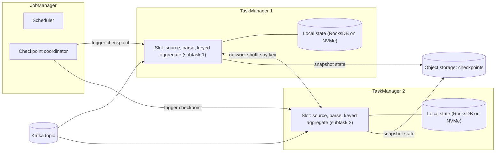
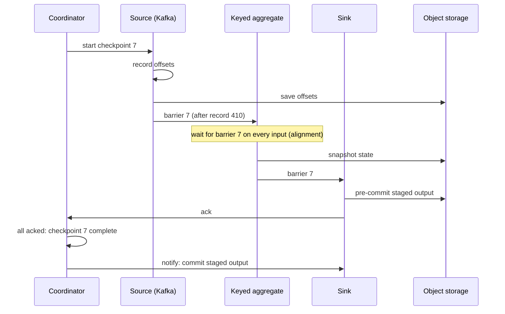
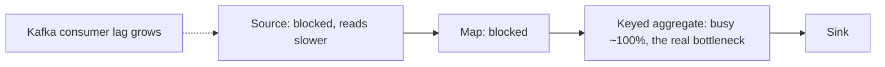

# Flink

Flink is the stream processor you name when the requirement says "seconds, not minutes" and the job has to remember things: per-user sessions, running counts, a stream joined to a stream. Interviewers rarely ask you to write Flink code. They ask what happens to your state when a machine dies, and whether the results are really exactly-once.

**What it is:** Apache Flink is a distributed engine that processes unbounded streams of events one record at a time, keeps per-key state next to the computation, and takes periodic consistent snapshots so it can recover without losing or double-counting anything. **Why it shows up:** it is the default answer for low-latency, stateful stream processing. This lesson targets Flink 1.20 and 2.x; version-dependent items are flagged. It assumes you have read [Micro-Batch vs Streaming](../03-architecture-patterns/08-micro-batch-vs-streaming.md), [Late-Arriving Data](../02-core-concepts/08-late-arriving-data.md) and [Deduplication at Scale](../02-core-concepts/09-deduplication-at-scale.md), and covers only how Flink itself does those things.

## When to Use It (and When Not To)

Picture a ride-hailing company. Fraud wants an alert within 5 seconds when a card is used in two cities within 10 minutes: memory of each card's last events, an answer in seconds, no lost or doubled alerts. A nightly revenue rollup that tolerates a 20-minute delay is the same company and a very different tool.

**Pick Flink when:**
- Latency must be well under a minute (tens of milliseconds to a few seconds) and the logic is stateful: sessions, pattern detection, enrichment from a changing table, stream-to-stream joins.
- State is large: hundreds of GB to TB spread across the cluster, kept on local disk and still fast.
- You need event-time correctness with controlled lateness handling, not just "when it arrived."
- The output must be exactly-once into Kafka or a lake table, and you can afford the commit-at-checkpoint latency described below.

**Do not pick it when:**
- Freshness of a few minutes is fine. Micro-batch or incremental batch is easier to run, cheaper, and has simple retry semantics.
- You lack a team to run it. Flink jobs are long-running services with state, upgrades and tuning. "I would use a managed Flink" is a fine answer.

> [!TIP]
> The sentence interviewers want: "Flink, because the 5-second alert needs per-card state and event-time windows." A tool name alone is not a decision.

## How It Works

### The architecture

A Flink cluster has one **JobManager** (the coordinator: it schedules tasks, triggers checkpoints and handles failures) and many **TaskManagers** (worker JVMs that run the tasks). Each TaskManager offers a fixed number of **task slots**, each a unit of parallel execution with a share of the TaskManager's memory. A job runs as a graph of **operators** (source, map, aggregate, sink). Each operator has a **parallelism**, say 8, meaning 8 parallel copies called subtasks. By default consecutive operators share slots, so a job with parallelism 8 needs 8 slots, each holding a whole pipeline slice.

Two points to make out loud:
- **Data flows between operators in memory and over the network, with no disk in the path.** That is why latency is milliseconds. Spark's shuffle writes to disk and starts a new stage ([Spark Internals](01-spark-internals.md)); Flink has no stage barrier.
- **State is local to the subtask.** Durability comes from snapshots to object storage, not from every write.

### Keyed streams and keyed state

`keyBy(card_id)` splits the stream so that all events with the same key go to the same subtask. That is a continuous, network-based shuffle, and it is what lets an operator keep **keyed state**: a small piece of state per key that the code reads and updates as each event arrives. It comes as a single value (last city seen for this card), a list (last 20 transactions) or a map (count per merchant).

Keys are first hashed into a fixed number of **key groups** (the **max parallelism**; if you do not set it, Flink derives a default of at least 128 from your parallelism), and key groups are assigned to subtasks. If you later rescale from 8 to 16 subtasks, whole key groups move, which is what makes restoring state at a new parallelism possible. The catch is that **max parallelism is baked into the state**. Set it too low and you can never run more subtasks than that without rebuilding the state. Set it generously, such as 1,024 or 4,096, before the first production run.

State size is keys times bytes per key: 100 million keys at about 100 bytes each is 10 GB (the arithmetic from [Deduplication at Scale](../02-core-concepts/09-deduplication-at-scale.md)), or 500 MB per subtask over 20 subtasks. **Unbounded state kills jobs slowly**: keep every key forever and checkpoints eventually take too long. Use **state TTL** (time-to-live: Flink drops an entry some time after its last write or read) or clear state yourself with a timer when a session ends.

### State backends: where state actually lives

A **state backend** decides how a subtask stores its keyed state while running.

| Backend | Where state lives | Strengths | Limits |
|---|---|---|---|
| **HashMap (heap)** | JVM objects in memory | Fastest reads and writes | State must fit in the heap; big state causes long garbage-collection pauses |
| **RocksDB** (embedded key-value store on local disk) | Serialized bytes on local disk, with caching in memory | State far larger than memory (hundreds of GB per node, see below); supports **incremental checkpoints** | Every access serializes and deserializes bytes, so it is several times slower per operation than heap; needs fast local SSD |
| **ForSt (disaggregated state)** | State files on remote object storage, with a local cache | Local disk no longer caps state size; rescaling and recovery need little or no state copy | Newer; part of the Flink 2.x line, and maturity depends on the exact version, so verify before you promise it in production |

**RocksDB** is the established answer for big state. Run it on local NVMe, not a network disk (local NVMe reads take 10 to 100 microseconds, per [Key DE Numbers](../02-core-concepts/10-key-de-numbers.md)). It stores data in sorted immutable files, merges them in the background (compaction), and caches hot blocks in memory.

**Disaggregated state** is the Flink 2.x idea. Classic Flink keeps working state on each worker and copies it to object storage only at checkpoints, so a big state means a long restore (the new worker downloads everything before processing a record) and capacity is capped by local disk. ForSt (a RocksDB-derived store on a distributed file system) makes remote storage the primary home of state, with local disk as a cache. Checkpoints then mostly record which files belong to the snapshot, and recovery can start before all state is fetched. The price is slower access to uncached keys, which an asynchronous state API offsets by keeping many lookups in flight. As of the 2.x releases it is new and was introduced as experimental, so check its status in your version, and say you would measure recovery time before relying on it.

### Event time and watermarks in Flink

[Late-Arriving Data](../02-core-concepts/08-late-arriving-data.md) explains watermarks, allowed lateness, side outputs and the idle-partition stall. Here is how Flink wires them up.

You give the source a **watermark strategy**: how to read the event timestamp from each record, and how much disorder to tolerate (the common choice is "bounded out of orderness," that is, watermark = max event time seen minus a fixed delay). Each subtask tracks its own watermark. The Kafka source goes one level finer: it tracks a watermark per partition and emits the minimum across the partitions that subtask reads. An operator with several inputs likewise uses the **minimum** of them, so one quiet Kafka partition freezes every window downstream. The fix is an idle-timeout on the strategy, which ignores an input silent for, say, 30 seconds; the cost is that events from a partition that wakes up later may land behind the watermark.

An **event-time timer** (a callback registered for "event time T") fires when the watermark passes T, which is how "close this session after 30 minutes of silence" works without a clock. For events that are still too late, Flink gives you window **allowed lateness** and a **side output**. Mention the side output in interviews: silently dropping late events is the failure being probed for.

### Windows

A **window** groups an unbounded stream into finite chunks you can aggregate. Three kinds cover almost every question:

| Window | Shape | Example |
|---|---|---|
| **Tumbling** | Fixed size, no overlap | Orders per city per hour |
| **Sliding (hopping)** | Fixed size, advances by a smaller step | Last 1 hour, updated every minute |
| **Session** | Gaps of inactivity close the window; length varies per key | A user visit, closed after 30 minutes of silence |

Each event in a sliding window belongs to size/slide windows: 60 for 1 hour sliding by 1 minute, but 3,600 if it slides by 1 second. Match the slide to the refresh rate the reader needs. Session windows keep one open window per active key and merge them as events arrive.

A window can hold the raw events until it fires (large) or an **incrementally aggregated** value such as a running count (tiny). Use the incremental form whenever the aggregate allows it.

Flink SQL expresses the same windows (`TUMBLE`, `HOP`, `SESSION`) and can turn CDC data ([CDC Patterns](../03-architecture-patterns/04-cdc-patterns.md)) into a continuously updated table. Streaming joins keep both sides' state, so give them a TTL or a time bound or the state grows forever.

### Checkpoints: how a stream job gets a consistent snapshot

The problem: operators run continuously on many machines, and you need a snapshot of all their state plus the input position, taken without stopping the job, so that restoring it gives a result as if nothing had failed.

Flink's answer is **checkpoint barriers**, markers injected into the stream. The checkpoint coordinator tells the sources to start checkpoint n. Each source records its position (for Kafka, the offsets) and inserts a barrier between records. Barriers flow through the graph with the data: everything before the barrier belongs to checkpoint n, everything after to n+1.

If an operator has multiple inputs, it must **align**: once barrier n arrives on one input, it holds back that input's further records until the barrier arrives on all other inputs, so n's snapshot contains exactly the records before the barrier. When all operators have acknowledged, the checkpoint is complete. After a failure, Flink restores state from the last complete checkpoint, rewinds the sources to the saved offsets, and replays. Records processed after the checkpoint are processed again, but their effect on state was rolled back, so state is exact. That is exactly-once **for Flink's state**; the next section covers the output side.

Three settings to know: the **checkpoint interval**, the **minimum pause** between checkpoints (so a slow one does not trigger another at once), and the **timeout** (a slower checkpoint is abandoned; repeated timeouts mean state is too big, storage is slow, or backpressure is delaying barriers).

Two variants for large state and heavy load:
- **Incremental checkpoints** (RocksDB, and the disaggregated backend by design): upload only the files that changed since the last checkpoint. A 400 GB state that changes 2 percent between checkpoints uploads gigabytes, not hundreds of gigabytes.
- **Unaligned checkpoints:** under backpressure, barriers sit behind long queues of records in the network buffers, and alignment can take minutes. With unaligned checkpoints the barrier overtakes the queued records, and those in-flight records are stored in the snapshot too. Checkpoints finish fast under load, at the cost of bigger snapshots and more I/O. A common compromise is aligned by default with a timeout that falls back to unaligned. Restrictions: they apply only to exactly-once checkpointing with one checkpoint in flight at a time, savepoints are always aligned, and some features (rescaling from an unaligned checkpoint, certain operators) depend on the Flink version, so check yours.

**Checkpoints versus savepoints** is a standard question:

| | Checkpoint | Savepoint |
|---|---|---|
| Purpose | Automatic crash recovery | Planned operations: upgrade code, change parallelism, migrate cluster, fork a job |
| Triggered by | Flink, on a timer | You, on demand |
| Owned by | Flink (cleaned up automatically unless retained) | You (kept until you delete it) |
| Format | May be incremental and backend-specific | Designed to be portable across code changes and backends |

In practice: stop the job with a savepoint, deploy the new version, start from that savepoint. Give operators stable, explicit IDs (`uid`) so state still matches after a topology change.

### Exactly-once into sinks

Checkpoints make Flink's own state exact. Output to an external system needs a mechanism too; [Deduplication at Scale](../02-core-concepts/09-deduplication-at-scale.md) compares the options. Flink supports two:

1. **Idempotent sink.** Replays overwrite the same rows (a keyed upsert, a deterministic file name). Cheap, but needs a natural key.
2. **Two-phase commit.** The sink writes output into a staged form. When the checkpoint barrier reaches the sink, it **pre-commits** (flushes and prepares, but nothing is visible). Only when the coordinator announces that the whole checkpoint is complete does the sink **commit**. If the job fails between pre-commit and commit, recovery re-runs the commit, because the pre-commit was recorded in the checkpoint. If it fails before the checkpoint completes, the staged data is aborted and the replay produces it again.

The Kafka sink, when set to exactly-once, uses Kafka transactions this way ([Kafka](02-kafka.md) covers them). File and lake sinks, such as the Iceberg sink, use the same shape: write data files during the checkpoint interval, commit a table snapshot when the checkpoint completes. Three consequences:

- **Latency floor.** Output becomes visible only when a checkpoint completes, so a 60-second interval means results lag by at least that much (the exactly-once latency floor from [Micro-Batch vs Streaming](../03-architecture-patterns/08-micro-batch-vs-streaming.md)). Shorter intervals cut latency but add overhead and small files.
- **Downstream readers must read only committed data.** Kafka consumers need `isolation.level=read_committed`, or they see records from aborted transactions.
- **Transaction timeouts must exceed checkpoint and recovery time.** If a Kafka transaction times out before Flink restarts and commits it, that data is lost. Set the transaction timeout (capped by the broker's maximum) comfortably above the worst-case checkpoint interval plus restart time.

> [!WARNING]
> "Flink is exactly-once" is true for state and for sinks that are idempotent or transactional. If the sink calls a REST API or does a plain insert into a database, a replay after restart sends the writes again. Say which kind of sink you have.

### Backpressure

Backpressure is what happens when one operator cannot keep up with the data arriving. Flink moves records between subtasks through bounded network buffers with credit-based flow control: a downstream subtask tells upstream how many buffers it can accept, and upstream sends no more. If a downstream operator slows down (a slow sink, a heavy window, a hot key), its buffers fill, upstream operators run out of credit and block, and the slowdown travels back to the source, which simply reads from Kafka more slowly. Nothing is dropped and memory stays bounded. The visible effect is rising consumer lag on the source topic.

Do not start at the source. Each task reports how much of each second it spent busy, idle and backpressured. The bottleneck is the first operator, going downstream, that is busy but not itself backpressured; everything upstream is blocked waiting on it. Typical culprits:

| Cause | Sign | Fix |
|---|---|---|
| Hot key | One subtask at 100 percent busy, the others idle | Pre-aggregate before `keyBy`, salt the key in two stages ([Partitioning](../02-core-concepts/01-partitioning.md) covers salting) |
| Slow sink | Sink busy, writes slow | Batch writes, raise sink parallelism, make writes async |
| Too little parallelism | All subtasks of one operator busy | Raise parallelism (within max parallelism) |
| Slow state access | RocksDB busy, high disk read | Faster NVMe, more memory for cache, smaller state, TTL |

Barriers travel with the data, so a backpressured job also checkpoints slowly, which is why unaligned checkpoints exist. Say that backpressure is a symptom: fix the bottleneck, not the source.

## Key Numbers

All of these are planning figures, not guarantees. They depend on record size, state backend, serialization and hardware.

| Item | Rough figure |
|---|---|
| Latency for record-at-a-time processing | Tens of milliseconds; end-to-end with exactly-once output is bounded below by the checkpoint interval |
| Checkpoint interval | 10 seconds to 5 minutes; 1 minute is a common default |
| Throughput per core (rough, varies several-fold with record size and logic; test it) | Tens of thousands of events/s for simple stateless work; 5,000 to 20,000 events/s with RocksDB-backed state |
| RocksDB state per TaskManager | Tens to a few hundred GB on local NVMe; much beyond that, restore time and compaction get painful |
| Cores per TaskManager | 4 to 8, with one slot per core |
| Kafka partition throughput | About 10 MB/s per partition (from [Key DE Numbers](../02-core-concepts/10-key-de-numbers.md)) |

**Worked sizing.** A clickstream of 50,000 events/s at 1 KB is 50 MB/s, so at 10 MB/s per partition the topic needs at least 5 partitions; take 12 for headroom. Sessionization by user is stateful, so at about 10,000 events/s per core the job needs 50,000 / 10,000 = about 5 cores. Use parallelism 12 to match the partitions, on 3 TaskManagers with 4 slots each. State: 10 million active sessions at 500 bytes each is 5 GB, about 400 MB per subtask, comfortable for RocksDB on local NVMe. Checkpoint every 60 seconds, incrementally. **Recovery:** restoring 400 MB per subtask from object storage at 50 to 100 MB/s per connection takes under 10 seconds. Then it replays up to one interval (60 seconds, 3 million events) and, catching up at several times the live rate, is current within a minute or two. Say "recovery in about two minutes, and I would test it." A 10-minute interval means ten times more to replay.

## Interview Follow-ups

**"What happens when a TaskManager dies?"**
The JobManager notices, restarts the job's tasks on new slots, restores each operator's state from the last complete checkpoint, and rewinds the sources to the saved offsets. Output since that checkpoint is recomputed.

**"Explain exactly-once in Flink."**
Checkpoints make state reflect every input record exactly once. For output, either the sink is idempotent, or it joins a two-phase commit tied to the checkpoint, so output becomes visible only when the checkpoint completes. A sink that is neither sees duplicates after a restart.

**"Checkpoint versus savepoint?"**
Checkpoint: automatic, Flink-owned, for crash recovery. Savepoint: manual, yours, portable, for upgrades and migrations.

**"Why are my checkpoints failing or very slow?"**
In this order: backpressure (barriers stuck in queues; fix the bottleneck, consider unaligned checkpoints), state size (incremental checkpoints, a TTL), slow object storage uploads, skew (one subtask holding far more state). Raising the timeout only hides it.

## Alternatives

| Option | Choose it over Flink when | Pick Flink instead when |
|---|---|---|
| Spark Structured Streaming | Team already on Spark, seconds-to-minutes latency is fine, one codebase for batch and stream | You need sub-second latency or very large keyed state with fine event-time control |
| Kafka Streams | The job is Kafka to Kafka, runs as a library inside your own service, and you do not want a cluster | You need non-Kafka sources and sinks, SQL, or state beyond what the app instances hold |
| Managed streaming SQL services | The logic is SQL and operations should be someone else's | You need custom logic, tight control over state and checkpoints |
| Micro-batch or incremental batch | Freshness of minutes is fine and retries should be trivial | Latency requirement is seconds, and state must persist between events |

The tradeoff: Flink has the strongest streaming semantics and lowest latency, and you operate the state. Use it for the one or two hot-path pipelines that need it, and keep everything else on batch or micro-batch.

## Key Takeaways

- Flink processes records one at a time with local keyed state and no disk in the data path, which gives tens-of-milliseconds latency.
- Consistent snapshots come from **checkpoint barriers**: restore state, rewind the source, replay. Use incremental checkpoints for big state and unaligned ones when backpressure slows alignment. Savepoints are the manual, portable version for upgrades.
- State backend: heap for small state, RocksDB on local NVMe for large state, disaggregated state (ForSt, Flink 2.x, check maturity) when restore time and local disk are the limits. Set max parallelism generously before the first run.
- Exactly-once output needs an idempotent sink or a two-phase commit sink, and output appears only when a checkpoint completes, so the checkpoint interval is your latency floor.
- Backpressure is a symptom: find the first busy operator downstream of the blocked ones and fix that, whether it is a hot key, a slow sink or too little parallelism.

Related lessons: [Micro-Batch vs Streaming](../03-architecture-patterns/08-micro-batch-vs-streaming.md), [Late-Arriving Data](../02-core-concepts/08-late-arriving-data.md), [Deduplication at Scale](../02-core-concepts/09-deduplication-at-scale.md), [Kafka](02-kafka.md), [Spark Internals](01-spark-internals.md), [Iceberg](07-iceberg.md), [Debezium and CDC Tools](09-debezium-and-cdc-tools.md).
