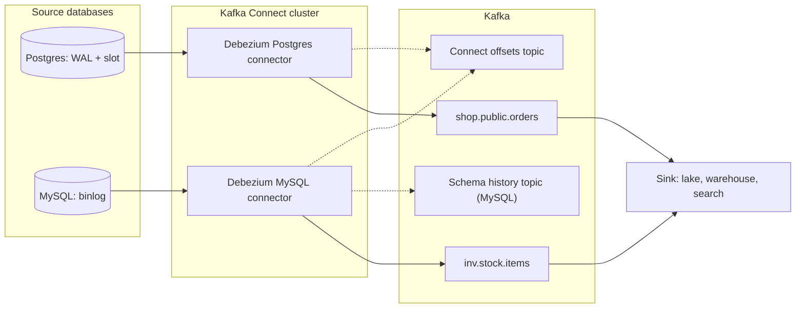
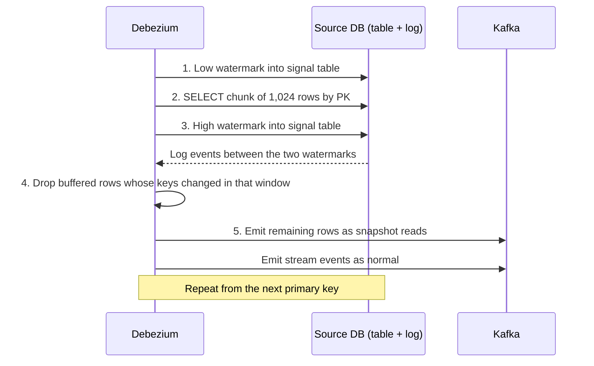

# Debezium and CDC Tools

You already know why you want log-based CDC. The follow-up is, "OK, what actually runs it, and what breaks at 3 a.m.?" This lesson is the tool half: how Debezium runs on Kafka Connect, how it snapshots, why it keeps a "schema history," what the alternatives look like, and the failures that take down a source database.

**What it is:** Debezium is an open-source set of CDC connectors. Each one reads a database's transaction log and publishes one change event per row change, usually into Kafka. **Why it shows up:** it is the default answer to "replicate this database into the lake or warehouse," and to the outbox pattern. This lesson assumes [CDC Patterns](../03-architecture-patterns/04-cdc-patterns.md) (log-based vs query-based, snapshot plus stream, ordering, deletes, replication slots) and [Kafka](02-kafka.md), and does not repeat them. It matches Debezium 2.x and 3.x; version-dependent settings are flagged.

## When to Use It (and When Not To)

Picture a marketplace with a Postgres `orders` database (about 200 writes a second, 20 GB) and a MySQL `inventory` database, both feeding the lake and a search index. The team already runs Kafka. One connector per database gives a Kafka topic per table, and everything downstream reads Kafka.

**Pick Debezium when:**
- You already run Kafka and several consumers want the same stream: lake, search index, cache, other services.
- You need open-source portability, control over tables, columns and delete handling, or the outbox pattern (Debezium ships an event router for it).

**Do not pick it when:**
- You have one source, one target and no Kafka. Running Kafka and Connect just to copy a database is heavy; a managed replication service is less work.
- Nobody can own the connector. It is a long-running service with state that can hurt your primary database.
- The source is a SaaS API or a database whose log you cannot read. Use [Ingestion Patterns](../02-core-concepts/02-ingestion-patterns.md) instead.

> [!TIP]
> The sentence interviewers want: "Debezium on Kafka Connect, one connector per source database, keyed by primary key, with slot lag and connector status alerting." Naming the tool with its two operational risks beats naming the tool alone.

## How It Works

### The architecture

**Kafka Connect** is the framework that runs connectors for Kafka. It is a cluster of worker processes. You do not write code: you POST a JSON config to its REST API and it runs a **source connector** (reads an external system, writes to Kafka) or a **sink connector** (reads Kafka, writes elsewhere). A connector splits its work into **tasks** that the workers spread across themselves, and Connect restarts a task on another worker if its machine dies. Connect keeps its own bookkeeping in Kafka: a config topic, a status topic, and an **offsets topic** where each source connector saves how far it has read.

Debezium is a family of source connectors, one per database: Postgres, MySQL, SQL Server, Oracle, MongoDB and others. Each knows how to read that database's log format.



A few facts that get probed:

- **One topic per table**, named `<topic.prefix>.<schema>.<table>`, and the message key is the row's primary key. That gives you the partition-by-key ordering from the CDC lesson for free.
- **One task per Postgres or MySQL connector.** A database has one log, read in order by one reader, so `tasks.max` above 1 does nothing. You scale by running one connector per database (or per set of tables in separate publications), not by adding tasks.
- **Delivery is at-least-once.** The connector saves its position (the log sequence number, LSN, in Postgres; file and position or a GTID in MySQL) periodically, not per event. Crash between two saves and it replays a few events on restart. Your sink must be idempotent: upsert by key, and ignore events whose log position is not newer. That matches the target-side rule in the CDC lesson.
- **Prerequisites on the source.** Postgres needs `wal_level=logical`, a role with `REPLICATION`, enough replication slots, and a publication. MySQL needs `binlog_format=ROW` and `binlog_row_image=FULL`. These often need a database restart and a change request, so they are the first thing that blocks a rollout.

### Events in Debezium

Debezium wraps each change in the **envelope** from the CDC lesson: `before` and `after` row images, `op` (`c`, `u`, `d`, or `r` for a row emitted by a snapshot) and a `source` block with log position, transaction id and commit time. After a delete it emits a tombstone by default (`tombstones.on.delete=false` turns that off). Most sinks want just the row, so the **`ExtractNewRecordState` transformation** (a single message transform, SMT, that rewrites each message inside Connect) flattens the envelope and can add a `__deleted` flag for soft deletes. Keep the raw envelope in bronze if you can; flattened events cannot answer "what was it before."

> [!WARNING]
> **Postgres TOAST columns.** Postgres stores large values (long text, JSON) out of line, and an update that does not touch them does not log them. Debezium then emits a placeholder string, `__debezium_unavailable_value`, in `after`. If your sink upserts blindly, it overwrites a real value with that placeholder. Fix it at the source with `REPLICA IDENTITY FULL` on the table (costs more WAL), or teach the sink to skip placeholders.

### Snapshotting

The CDC lesson covers why a snapshot exists and the handoff at position P. Here is how Debezium does it, and the modes you are expected to know. The mode is the `snapshot.mode` setting.

| Mode | What it does |
|---|---|
| `initial` (default) | First start: snapshot schema and data, then stream. Later restarts: stream from the saved position. |
| `initial_only` | Snapshot, then stop. A one-off backfill. |
| `always` | Snapshot on every start. Rarely what you want on a big table. |
| `when_needed` | Snapshot only if the saved position is gone (log purged, slot dropped). |
| `no_data` (`schema_only` before Debezium 2.6) | Capture structure, skip existing rows, stream from now. |
| `recovery` (`schema_only_recovery` before 2.6) | Rebuild a lost or corrupt schema history topic (connectors that keep one, such as MySQL). |

Older releases also had `never` (skip the snapshot, trust the saved position); recent releases fold it into `no_data` and mark it deprecated. There are also `configuration_based` and `custom` modes. Names changed across 2.x and 3.x and not every mode exists for every database, so in an interview state the intent and check your release for the string.

**The problem with the initial snapshot.** A 2 TB table is one long pass (about 28 hours at 20 MB/s). Streaming has not started, so log backlog grows; a failure at hour 27 means starting over; and adding one table later re-snapshots the whole connector.

**Incremental snapshots** fix this. They read a table in chunks *while streaming continues*, so you can backfill one table at any time, pause, and resume. Draw this mechanism in the interview.

You enable it with a **signal table**: a small table in the source database that Debezium captures and watches, named in `signal.data.collection`. (Signals can also arrive by other channels such as a Kafka topic, but the watermarks below are written to the table.) To start a backfill, you insert a row into it:

```sql
INSERT INTO debezium_signal (id, type, data) VALUES (
  'backfill-orders-1', 'execute-snapshot',
  '{"data-collections": ["public.orders"], "type": "incremental"}');
```

Debezium sees that row arrive through the log and starts working through `orders` in primary-key order, `incremental.snapshot.chunk.size` rows at a time (1,024 by default). For each chunk:

1. Write a **low watermark** marker into the signal table. It shows up in the log.
2. Read the chunk with a plain `SELECT ... WHERE pk > last ORDER BY pk LIMIT n`, and hold it in memory, not yet emitted.
3. Write a **high watermark** marker.
4. While streaming, watch the log between the two markers. Any key that was changed in that window is removed from the buffered chunk, because the log already has the newer version.
5. Emit what is left, as `op = r` events.



Why it is safe: a snapshot row is emitted only if no newer change to that key appeared in the log inside the window, so a stale row never lands after a fresher streamed one. It needs no table lock and no long transaction. The costs: tables need a primary key, the sink must still be an upsert (snapshot reads and stream events interleave), and it is slower than a bulk copy. Use the classic snapshot for the first load, incremental snapshots for everything after: a new table, recovering one table, re-running after a bug.

> [!NOTE]
> Snapshots load the source. MySQL's initial snapshot briefly takes a read lock to record the binlog position and schema. Postgres reads inside one long transaction, which holds back vacuum cleanup for the whole run. Point big snapshots at a read replica where possible, and run them off-peak.

### The schema history topic

Why does MySQL need a "schema history" at all? A binlog row event holds column *values* by position, not names or types. To turn `(8812, 'shipped', 54.90)` into a named, typed `after`, Debezium needs the table's structure *as it was at that point in the log*. The table may have been altered since. So the MySQL connector parses every DDL statement it sees and writes it to a dedicated Kafka topic, the **schema history topic**. On restart it replays that topic to rebuild each table's structure at its saved position.

Rules for that topic, each of which has caused outages:

- **One partition, infinite retention, no compaction, never shared between connectors.** Order matters and the history is irreplaceable. Treat it like a database. (Settings are `schema.history.internal.*` since Debezium 2.0, `database.history.*` earlier.)
- **Losing it breaks the connector.** The `recovery` mode rebuilds it from the current schema, which is correct only if no incompatible DDL happened since the saved position.
- **Unparseable DDL fails the task.** Debezium has its own DDL parser, and exotic statements can trip it.

Postgres does not need this topic. Its logical decoding stream (the `pgoutput` plugin) sends table structure ahead of the first change after any DDL, so the connector learns the schema from the stream itself. SQL Server, Oracle and Db2 use a schema history topic like MySQL.

### Debezium Server

**Debezium Server** is a standalone application that runs one connector and delivers events straight to a sink such as Kinesis, Pub/Sub, Pulsar, Redis, an HTTP endpoint or Kafka itself, with no Connect cluster. (An embedded-engine library does the same inside your own Java app.) Choose it when Kafka would be a new thing to operate just for CDC. The price: Connect gives you task redistribution, a REST API for status and restart, and standard metrics; with Debezium Server you run one instance under your own supervisor (a one-replica Kubernetes deployment, say) and failover is yours to arrange. Two instances on one slot fight.

### Failure modes

Every one of these is a likely follow-up. For each: the symptom, the cause, and what you do.

**1. Slot bloat fills the primary's disk (Postgres).** The CDC lesson has the mechanism; here are the arithmetic and the less obvious cause. Suppose the primary generates WAL at 5 MB/s on average, about 430 GB a day, and has 100 GB free. A dead connector fills the disk in 100 GB / 5 MB/s = 20,000 seconds, under 6 hours. The less obvious cause is a *healthy* connector on a *quiet* table: the slot only advances when Debezium confirms a position, and it only learns positions from events on tables it captures. If those tables are idle while others in the same Postgres instance write heavily, WAL piles up behind the slot with the connector looking fine. The fix is **heartbeats**: set `heartbeat.interval.ms` and a `heartbeat.action.query` that writes to a small heartbeat table, so the connector produces its own events and the slot keeps advancing.

Defences, in order: (a) alert on slot lag in bytes (`pg_current_wal_lsn()` minus the slot's `confirmed_flush_lsn` in `pg_replication_slots`) and on connector status; (b) set `max_slot_wal_keep_size` (Postgres 13+) so the database sacrifices the slot, not itself, and plan the re-snapshot; (c) drop slots of deleted connectors, because deleting a connector in Connect does not always drop its slot.

**2. Failover loses the slot.** A logical slot lives on the primary. Before Postgres 17 it is not carried to a standby, so after failover the connector cannot resume and you re-snapshot (HA tools such as Patroni can work around this by managing slots for you). Postgres 17 adds **failover slots**: a slot created with the `failover` option is copied to standbys that set `sync_replication_slots = on` (with `hot_standby_feedback` on and a physical slot between primary and standby). Debezium exposes this as `slot.failover` in recent 3.x releases; it is off by default, so check your version. Failover affects CDC as well as the database.

**3. Log purged while the connector was down** (MySQL, or a dropped Postgres slot). The saved position no longer exists. With `when_needed` Debezium re-snapshots by itself; otherwise the task fails and you choose. Keep binlog retention longer than your worst realistic outage (days) and alert on downtime well before it.

**4. Schema change breaks the pipeline.** Adding a nullable column is usually painless: new events carry the field. Dropping a column, changing a type, or renaming one (which consumers see as drop plus add) changes the event schema. With a schema registry in the path, an incompatible new schema is rejected on write, so the connector task goes to `FAILED` and stops reading. That is right (better than silently corrupting data), but the slot now holds WAL while you debug. Alert on `FAILED` tasks: Connect does not restart a failed task by itself (use the REST API after fixing). Prevent it upstream with expand-and-migrate and the practices in [Data Contracts](../02-core-concepts/07-data-contracts.md). MySQL adds a hazard: online schema-change tools copy a table and swap names, generating DDL on shadow tables, so use `table.include.list` to ignore them.

**5. Huge transactions and silent staleness.** One `UPDATE` touching 50 million rows produces 50 million events at commit, so lag tracks your largest transaction; batch big backfills at the source. A connector can also show `RUNNING` while stuck behind a long transaction, so alert on freshness (age of the newest event per table), not only status.

## Key Numbers

All figures are orders of magnitude, not benchmarks; tuning and hardware move them. Event sizes come from [Key DE Numbers](../02-core-concepts/10-key-de-numbers.md); the snapshot rate from the CDC lesson.

| Quantity | Typical value |
|---|---|
| CDC event size | 0.5 to 2 KB (200 changes/s is about 17 GB/day) |
| Latency, commit to Kafka | Sub-second to a few seconds when healthy |
| Throughput per connector | One log reader: thousands to low tens of thousands of events/s |
| Initial snapshot rate | About 20 MB/s: 20 GB in about 17 min, 2 TB in about 28 h |
| Incremental snapshot chunk | 1,024 rows by default (`incremental.snapshot.chunk.size`) |
| WAL growth behind a dead slot | Your write rate, e.g. 5 MB/s is about 430 GB/day |

Dashboard metrics: connector and task status (Connect REST API), `MilliSecondsBehindSource` (Debezium's JMX capture-lag metric), slot lag in bytes, whether a snapshot is running, and end-to-end freshness at the sink. See [Monitoring and Alerting](../02-core-concepts/06-monitoring-and-alerting.md) for turning those into alerts.

## Interview Follow-ups

**"The connector was down for two days. What happens?"**
Same answer as the CDC lesson, with the Debezium names: if the slot or binlog survived, it resumes and catches up (the risk is the disk). If `max_slot_wal_keep_size` dropped the slot or the binlog was purged, the saved position is gone: re-snapshot with upserts (or `when_needed`), then resume.

**"How do you add a table to a running pipeline, or backfill one table?"**
Add it to the include list and run an incremental snapshot for it via the signal table. No restart-and-resnapshot of everything, no downtime, and streaming continues meanwhile.

**"Is it exactly-once?"**
At-least-once: a crash replays events since the last saved position. Make the sink idempotent, as in [Deduplication at Scale](../02-core-concepts/09-deduplication-at-scale.md).

**"How do you scale it?"**
Not with tasks. Split by database or table group into separate connectors, keeping each key inside one connector so ordering holds.

**"A developer is going to drop a column. What do you do?"**
Treat it as a contract change: add the new shape, dual-write, migrate readers, then drop. If it happens anyway, the registry rejects the schema and the task fails; fix the consumers, then restart the task. The slot accumulates WAL meanwhile.

**"Would you read from a replica to protect the primary?"**
MySQL: yes, a replica that logs its replicated updates works and also moves snapshot load off the primary. Postgres: logical decoding on a standby arrived in version 16, but the publication must be created on the primary, the connector cannot write heartbeats to a read-only standby, and a standby can invalidate the slot when it replays cleanup from the primary. Say it works with caveats and depends on the version.

**"Debezium or a managed service?"**
See Alternatives. The short form: Debezium when several consumers want the stream or you need control and portability; managed when it is one source feeding one target and nobody wants to operate Connect.

## Alternatives

"CDC tool" covers very different shapes. Name the category first, products second.

| Option | Pick it when | Watch out for |
|---|---|---|
| **Debezium on Kafka Connect** | Many consumers, need for control, outbox, already on Kafka | You operate Connect, Kafka, connectors and the slot |
| **Debezium Server / embedded engine** | Target is a cloud messaging service or your own app | You own HA, restart and metrics |
| **Managed Connect** (Confluent Cloud, MSK Connect, Aiven-style) | Kafka-based CDC without running workers | You still own slots, schema changes, snapshots |
| **Cloud replication services** (AWS DMS, Datastream on Google Cloud) | One source, one target, minimal operations | Fewer knobs, per-GB pricing, lock-in, little control of event shape |
| **SaaS ELT with CDC** (Fivetran, Airbyte, Estuary-style; some use Debezium inside) | Analytics-only replication, small team | Per-row pricing at volume, one target, higher latency |
| **Flink CDC** (Debezium-based readers inside Flink) | You process changes in Flink anyway; see [Flink](08-flink.md) | Capture is coupled to the job lifecycle |
| **Database-native replication** (Postgres logical replication, "zero-ETL" into a vendor warehouse) | Same-vendor database to warehouse | Vendor-specific, few transformations, hard to fan out |

Compare on **who operates the connector**, **how many consumers** need the stream (one points to managed replication, many to Kafka), **event shape** (raw rows vs outbox business events), **latency** (seconds vs minutes) and **cost model** (your cluster time vs per-row fees at 17 GB a day versus 17 TB). Pick one and name what it gives up. The source-side risks never go away: every log-based tool holds a slot or log position on your database.

> [!TIP]
> If the prompt says "small team" or "one warehouse," lead with a managed service and say you would move to Debezium on Kafka when a second consumer or the outbox shows up. If it says "multiple downstream systems" or "need the events for services," lead with Debezium and Kafka.

## Key Takeaways

- **Debezium** is a set of CDC source connectors, normally on **Kafka Connect**: one topic per table, keyed by primary key, at-least-once delivery, so the sink is an idempotent upsert.
- Postgres and MySQL connectors run **one task**. Scale by splitting databases or table groups across connectors, not with `tasks.max`.
- **Incremental snapshots** use watermarks in the log and a signal table to backfill a table in chunks while streaming continues, with no lock and no restart. Use them for adding or repairing tables; know the `snapshot.mode` options for the first load.
- MySQL, SQL Server and Oracle connectors need a **schema history topic** (one partition, infinite retention, never lose it). Postgres reads structure from the stream.
- The failure modes to name: **slot bloat** (dead or idle-table connector; defend with lag alerts, heartbeats, `max_slot_wal_keep_size`), **slot lost on failover or log purge** (re-snapshot), **schema change** (task fails; alert on `FAILED`, plan expand-and-migrate), and **giant transactions** (lag spikes).
- Pick the category before the product, and say what each gives up: Debezium on Connect for many consumers, Debezium Server without Kafka, managed services when no one wants to operate it.

## Going Further

- Debezium's Oracle connector options (LogMiner vs XStream)
- Exactly-once source connector support in newer Kafka Connect versions
