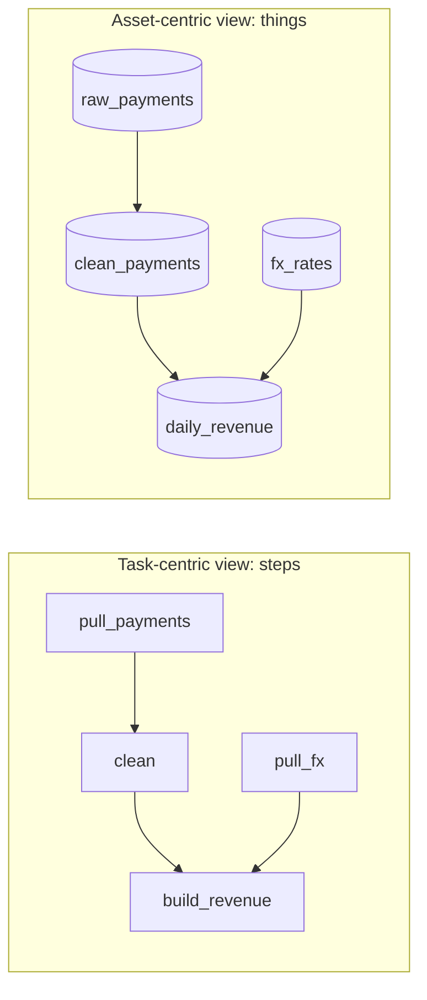
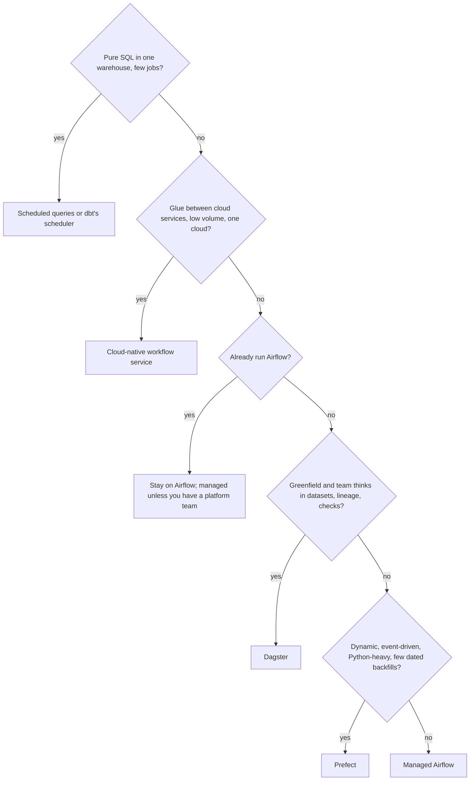

# Orchestrator Comparison

"Why Airflow?" is a fair interview question, and "because everyone uses it" is a weak answer. This lesson gives you the comparison an interviewer wants: what each orchestrator is built around, what that costs you, and a short rule for choosing.

**What it is:** a side-by-side of the orchestrators you will be asked about: Airflow, Dagster, Prefect, managed Airflow, and the workflow services each cloud sells. **Why it shows up:** every batch design has an orchestrator box, and a senior interviewer will ask why that one. It assumes [Airflow](03-airflow.md) (DAG, data interval, idempotent tasks, assets, executors) and does not re-explain it. Accurate for 2026 releases: Airflow 3.x, Dagster 1.x, Prefect 3.x. Version-dependent items are flagged.

## When to Use It (and When Not To)

Here "it" is the act of comparing. Use this lesson when the prompt says "design the batch pipeline" and you are about to draw one box labelled "orchestrator". Name a tool, give one reason, and move on. The comparison matters in three situations:

- The interviewer asks "why not X?" after you name one.
- The prompt is greenfield (a new team, a new platform), so nothing forces a choice.
- The prompt has a hard constraint: "no one wants to run servers", "the team is two people", "everything lives in one cloud".

Do not turn the orchestrator into the deep dive. The interesting parts of a pipeline design are idempotency, backfills and data quality. Spend 30 seconds on the choice unless asked.

> [!TIP]
> The honest default: "Airflow, managed, unless there is a reason not to." The reasons are listed in the decision guide below. Giving the reason out loud is what makes it a senior answer.

## How It Works

### The core split: task-centric vs asset-centric

Every orchestrator runs a graph of work. They differ in what a node in that graph *is*.

- **Task-centric** (Airflow's native model, Prefect's native model): a node is a **unit of work**, "run this function". You describe steps and the order between them. The data those steps produce is implicit; the orchestrator knows that `load_partition` succeeded, not what table it changed unless you add metadata.
- **Asset-centric** (Dagster's native model): a node is a **data asset**, "this table (or file, or model) should exist, and here is the function that builds it". The graph is a graph of things you care about. A run is "bring this asset up to date". The function that builds it is secondary.

A **software-defined asset** is Dagster's name for that: a Python function decorated so that Dagster knows it produces one named dataset, and which other assets it reads. You do not wire dependencies by hand; they come from the function's inputs.

Picture a finance mart: `raw_payments` -> `clean_payments` -> `daily_revenue`, plus `fx_rates` feeding `daily_revenue`. In a task-centric tool you write four tasks and arrows. In an asset-centric tool you declare four assets, and the arrows fall out of their inputs. Then ask the question operators actually ask at 09:00: "Is `daily_revenue` fresh? What does it depend on? Which upstream is stale?" The asset-centric tool answers from its own model. A task-centric tool answers "task `build_revenue` succeeded at 03:12", and you map that to the table yourself.

The two views describe the same pipeline. The difference is what the UI, the retries and the alerts are attached to: steps, or datasets.

> [!NOTE]
> The gap is narrower than the marketing suggests. Airflow 3 has assets (`@asset`, `schedule=[asset]`, covered in [Airflow](03-airflow.md)) and dbt gives you a model-level asset graph. Airflow's assets mark "this task updated that dataset"; they are not (yet) as complete a model of freshness, partitions and checks as Dagster's, and asset features are still evolving, so check your version. Say "Airflow is task-centric with assets bolted on, Dagster is asset-first", and do not claim Airflow cannot do data-aware scheduling.

### The five options in one table

This is the table to carry into the interview. Rows are what you would be asked.

| | **Airflow** (self-run) | **Dagster** | **Prefect** | **Managed Airflow** (MWAA, Composer, Astronomer) | **Cloud-native workflow service** (Step Functions, Cloud Workflows, Data Factory, Databricks Lakeflow Jobs) |
|---|---|---|---|---|---|
| **Core model** | Task graph (DAG) of operators, with assets added | Asset graph; also ops/jobs for non-asset work | Python flows and tasks; graph can be built at runtime | Same as Airflow | State machine or pipeline of cloud API calls |
| **Defined in** | Python files in Git | Python (decorators, plus YAML-based "components" in newer 1.x versions) | Plain Python functions with decorators | Python, same as Airflow | JSON/YAML/visual designer, sometimes SDK |
| **Time model** | Strong: data intervals, catchup, backfills, timetables | Partitions (daily, hourly, custom) attached to assets; backfills are per partition | Weak by design: schedules and parameters; no first-class data interval | Same as Airflow | Triggers and schedules; usually no interval concept |
| **Dependencies** | Task order, sensors, assets | Asset lineage; sensors; asset checks | Task order; events that trigger automations | Same as Airflow | Explicit state transitions |
| **Data awareness** | Moderate (assets, lineage events via OpenLineage, see [Data Lineage](../02-core-concepts/04-data-lineage.md)) | High: lineage, freshness policies, asset checks, metadata per materialization | Low to moderate | Same as Airflow | None; it orchestrates calls, not datasets |
| **Dynamic work** | Dynamic task mapping, capped at 1,024 by default | Dynamic partitions and multi-assets | Native: ordinary loops and branches at runtime | Same as Airflow | Map/parallel states, with limits |
| **Local dev and testing** | Improving; DAGs are harder to unit-test | Strong: assets are plain functions, resources are swappable | Strong: a flow runs as a normal Python script | Same as Airflow, plus remote parity gaps | Weak: you deploy to test |
| **Ecosystem** | Largest provider library and hiring pool | Large and growing; strong dbt and warehouse integrations | Smaller, enough for most stacks | Same as Airflow | Native to its own cloud only |
| **Who runs the servers** | You: scheduler, DAG processor, API server, DB, workers | You (open source) or the vendor's hosted offering | You, or the vendor's hosted control plane with your workers | The provider runs the control plane; you pay for it | The cloud provider; nothing to host |
| **Cost shape** | Infra plus on-call time | Infra, or per-credit hosted pricing | Infra, or per-seat/usage hosted pricing | Always-on environment fee plus workers | Per state transition or per activity run |
| **Biggest risk** | Operating it; DAG-file discipline | Smaller hiring pool; asset model needs buy-in | Backfills and interval reasoning are DIY | Slow environment updates; version lag | Lock-in; weak for complex data dependencies |

Treat the pricing and feature cells as rough 2026 shapes. Vendors change plans and add features often; if the interviewer cares about a specific cell, say "last I checked" and move on.

### Airflow: the strongest time model

You already know the machine. In comparison terms, Airflow's advantage is that **time is a first-class idea**. A run is for a data interval, catchup and backfill are built in, pools and `max_active_runs` throttle load, and the rerun-safe pattern from [Pipeline Design](../01-the-framework/07-pipeline-design.md) maps one-to-one onto it. Its other advantages are boring and decisive: the biggest library of provider integrations, the largest pool of engineers who have used it, and years of answers to every failure mode.

Its costs: it is a distributed system you must operate (or pay someone to), local testing is clumsier than the alternatives, and intervals and logical dates are a classic source of off-by-one confusion. It is task-centric, so "is this table fresh?" needs extra work.

### Dagster: assets, partitions, checks

Dagster's selling point is that the orchestrator knows your datasets. In practice that means:

- **Lineage for free.** The asset graph is the lineage graph ([Data Lineage](../02-core-concepts/04-data-lineage.md)); you do not bolt it on afterwards.
- **Partitions on assets.** A daily-partitioned asset has one partition per day. A backfill means "materialize (build and store) these partitions of this asset", and the UI shows which partitions are missing or stale. It serves the same job as Airflow's data interval, with the date attached to the dataset instead of the run.
- **Asset checks.** A check (row count, not-null, freshness) is declared next to the asset and shown with it. The pattern is the same as the validation gates in [Monitoring and Alerting](../02-core-concepts/06-monitoring-and-alerting.md), but in the orchestrator's own model.
- **Declarative automation.** Instead of writing a schedule or sensor per job, you attach a rule to an asset ("update me when any upstream changed, once all upstreams are fresh") and Dagster decides what to run. **Freshness policies** state how stale an asset may get and flag it when it breaches. Both have been reworked across 1.x releases (version-dependent: check the names in your version).
- **Resources.** Connections (warehouse, API client) are objects injected into assets, so a test can swap in a fake. This is a large part of why Dagster is pleasant to test locally.
- **Components.** Newer 1.x versions let you declare common assets (a dbt project, an ingestion sync) in YAML from reusable building blocks instead of hand-written Python. Treat it as version-dependent.
- **dbt fit.** Each dbt model can become an asset in the same graph as your Python and ingestion assets ([dbt](04-dbt.md)), so "ingest -> model -> dashboard extract" is one lineage graph rather than a handoff between tools.

Its costs: a smaller community than Airflow (still sizeable), fewer engineers who already know it, and the asset-first model needs a team to think in datasets. Work that is not about a dataset (send a report, call a deploy API) fits less naturally; Dagster has ops and jobs for it, but then you are using the less native half. The architecture is also a different set of long-running pieces (a web server, a daemon that handles schedules and sensors, and per-run processes launched by a run launcher), so it is still a system to operate unless you buy the hosted offering.

### Prefect: Python first, runtime graphs

Prefect's pitch is that a pipeline is just Python. You decorate a function as a **flow** and its helpers as **tasks**; run the file and it runs, locally, with no scheduler. Loops, `if` statements and dynamic fan-out are ordinary Python, so the graph can depend on data discovered at runtime. A **deployment** attaches a flow to a schedule and an infrastructure target; a **work pool** is a named queue plus infrastructure settings, and **workers** poll it and execute runs where you choose (a container, a Kubernetes job, a serverless task; some pool types launch serverless runs without a worker). In the hosted model the **control plane** (scheduling, UI, run history) is the vendor's, and your code and data stay on your compute.

Two Prefect 3 features matter for comparisons. **Events and automations**: runs, deployments and external systems emit events, and an automation reacts ("if this flow fails, trigger that one"; "when this event arrives, start a run"), which is how Prefect does event-driven work. **Transactions**: a group of tasks can run in a transaction with rollback hooks and persisted results, so a retry skips completed steps and a failure can undo side effects. It is task-level safety only: your writes still need to be idempotent.

What you give up: the interval model. Prefect schedules runs, but a run is not natively "for Oct 31". You pass the date as a parameter and own the idempotency discipline yourself. Backfills are loops over parameters that you write or trigger. For event-heavy and ML-style workflows with dynamic shapes it is a good fit. For a large warehouse estate full of dated partitions where backfills are routine, Airflow or Dagster models it more directly.

### Managed Airflow: same engine, different operator

A managed Airflow service (MWAA on AWS, Cloud Composer on Google Cloud, a managed Airflow offering on Azure, or Astronomer across clouds) runs the scheduler, API server, metadata database and workers for you. What you get: no database backups to babysit, integrated IAM and networking, support, and a console. What you do not get: relief from DAG design. A bad DAG is just as bad on a managed scheduler.

Trade-offs to state:

- **Always-on cost.** The environment is billed for being up, usually from the low hundreds of dollars a month for the smallest setups into thousands for busy ones, whether or not DAGs are running. Treat that as an order of magnitude.
- **Version lag.** Managed services trail upstream releases by months, so a feature you read about in the Airflow 3 notes may not be in your managed environment yet. Ask before promising it.
- **Slower change loop.** Dependency changes and plugin updates can mean an environment update that takes tens of minutes.
- **Lock-in is mild.** Your DAGs are Python. Moving between managed vendors, or back to self-run, is mostly an infrastructure project.

The 2026 default for a company that already has Airflow DAGs: stay on Airflow, pay someone else to run it.

### Cloud-native workflow services

Each cloud sells a **workflow service**: you define a state machine or pipeline of steps, and the service calls other cloud services, retries, waits and fans out. Examples: AWS Step Functions, Google Cloud Workflows, Azure Data Factory, and Databricks' own job scheduler (Lakeflow Jobs, formerly Workflows; inside one platform). 

They are good at **orchestrating cloud API calls with nothing to run**: start a job, wait for it, branch on the result, call the next service. Billing is per state transition or activity, so a small pipeline costs almost nothing. They are weak at what this lesson's other tools are strong at: no data intervals, no first-class backfill, thin lineage, and logic that lives in JSON or a visual designer rather than Git-reviewed Python. They also tie the workflow to one cloud. Databricks' job scheduler and similar platform schedulers are a special case: excellent when the whole pipeline lives inside that platform, awkward the moment a step lives outside.

Use them for: event-driven glue (a file lands, a few services run, done), application-style workflows with branches and human approval, and small teams whose whole stack sits in one cloud. Do not use them as the backbone for 300 interdependent dated data pipelines.

> [!WARNING]
> "Serverless workflow service" is not automatically cheaper or simpler for data pipelines. A pipeline with thousands of mapped steps can have a larger bill than a small always-on Airflow, and the missing backfill and interval tools get rebuilt as custom code.

## Key Numbers

Rules of thumb, not guarantees. They shift by version, plan and region.

| Item | Typical number |
|---|---|
| Airflow task start latency | ~1 to 5 s on Celery; tens of seconds per task on Kubernetes (see [Airflow](03-airflow.md)) |
| Dagster / Prefect run start | Seconds, driven by how you launch compute (process vs container vs pod) |
| Cloud workflow state transition | Tens to hundreds of milliseconds of overhead; the called service dominates |
| Managed Airflow always-on floor | Hundreds of dollars a month for the smallest environment; thousands for busy ones |
| Cloud workflow service cost | Fractions of a cent per state transition, so 10,000 transitions a day is a few dollars a month |
| Airflow environment update on managed service | Tens of minutes |
| Practical scheduling granularity, all of the above | Minutes. For seconds, use a stream processor, not an orchestrator |
| Dynamic mapping, Airflow default cap | 1,024 mapped tasks per task |

**Worked example.** A team runs 60 pipelines, 15 steps each, daily: 900 step executions a day. On a cloud workflow service billed per transition (say 2 transitions per step, 1,800 a day, around 54,000 a month), the bill is a few dollars at most (order of magnitude); the real cost is that you build backfills yourself. On managed Airflow the same load costs the environment fee whether it runs 900 steps or none. At 900 steps a day cost does not decide it; **operability and backfill tooling do.** At 900,000 steps a day, per-transition billing starts to matter and you would price both.

## Interview Follow-ups

**"Why Airflow and not Dagster?"**
Airflow's time model fits dated batch work: data intervals, catchup, backfills. It has the widest integrations and hiring pool. Dagster is a strong pick when the team is greenfield and wants lineage, partitions and checks as the core model. If this were a new platform team that thinks in datasets, I would lean Dagster. If the company already runs Airflow, I would not rewrite.

**"What does asset-centric buy you in practice?"**
Freshness and lineage questions get answered by the tool: which assets are stale, what depends on them, which partitions are missing. Backfill is "materialize these partitions". Checks live with the asset. The cost is that you model everything as datasets, which fits analytics pipelines better than action-style workflows.

**"We have two engineers and no platform team. What do you pick?"**
Something with no servers to run: a managed Airflow if the pipelines are many and dated, a cloud workflow service or a hosted Prefect/Dagster control plane if there are few and the stack is in one cloud. Never self-host a scheduler, database and workers for two people.

**"When is a cloud-native workflow service the right call?"**
When the work is glue between cloud services, event-driven, and low in volume: a file lands, three services run, a notification goes out. Not when you need dated backfills or cross-pipeline data dependencies.

**"How would you migrate off Airflow?"**
Run both side by side by pipeline, not big-bang. Keep the pipeline code (Spark jobs, dbt, SQL) unchanged, since the orchestrator only calls it; port the wiring, then compare outputs for a few cycles before cutting over. That works only because tasks were thin and idempotent, which is the argument for keeping orchestrators thin.

**"Do you even need an orchestrator?"**
Sometimes not. One warehouse, SQL only, a handful of scheduled queries or dbt run by a CI schedule can be enough. The moment you have cross-system dependencies, retries and a need to see what failed, you need one.

## Alternatives

Beyond the five rows above, you may hear of **Temporal-style durable-execution engines** (code-first workflows that survive crashes, built for application logic more than data), **dbt Cloud-style schedulers** (fine when the work is only dbt), and **plain cron plus scripts**. Name them as a boundary: durable execution for services, dbt's scheduler for pure-SQL, cron for the trivial. For data pipelines with dependencies, you are choosing among the five above.

### Decision guide for the interview

Walk this in order; stop at the first match.

Then say the reason in one sentence and the main cost of your pick. Example: "Managed Airflow: this is a dated batch estate with routine backfills and an existing Airflow skill set. The cost is an always-on environment fee and version lag, which I accept to avoid running a scheduler."

> [!WARNING]
> Mistakes to avoid: picking by hype ("Dagster is modern"), claiming a tool cannot do something it now can (Airflow has assets; Prefect has schedules), ignoring who gets paged, and spending five minutes of a 45-minute round on the logo.

## Key Takeaways

- **Task-centric** tools (Airflow, Prefect) model steps; **asset-centric** (Dagster) models datasets. The difference shows in freshness views, lineage, partitioned backfills and checks. Airflow 3 assets narrow the gap but do not close it.
- Airflow has the strongest time model (data intervals, catchup, backfills) and the biggest ecosystem; Dagster has the strongest data model; Prefect is the lightest Python-first option and leaves interval discipline to you.
- Managed Airflow removes operations, not bad DAG design. Expect an always-on fee and version lag.
- Cloud-native workflow services shine for glue between cloud services and are weak at dated backfills and data lineage.
- The default answer is "managed Airflow unless there is a reason not to." Say the reason and the cost of your choice, in one or two sentences.
- Whatever you pick, keep tasks thin and idempotent: the orchestrator decides when and in what order, and the compute engines do the work. That is also what makes switching tools possible.
