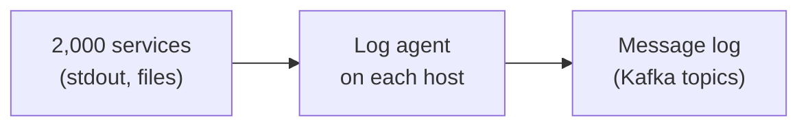
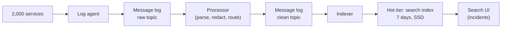
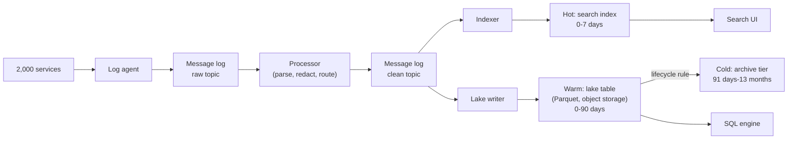
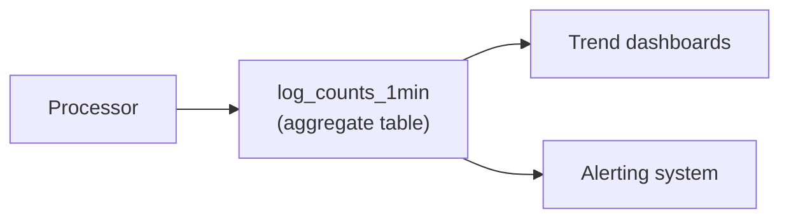
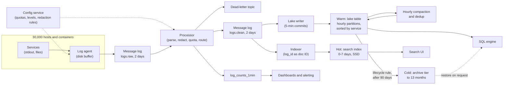

# Design a Log Aggregation Platform

This is the first full breakdown in the course, and it follows the seven steps from [The Delivery Framework](../01-the-framework/02-delivery-framework.md) in order, with rough minutes on each. Log aggregation is a good place to start: the pipeline itself is simple, so the interview turns on one question you can answer with numbers: **how long can you afford to keep logs fast?**

## Understanding the Problem

The prompt arrives in one sentence:

> "Our company runs about 2,000 services. Design a system that collects their application and infrastructure logs so engineers can search them and run analytics."

A **log** is a line of text a program writes about what it is doing: `2026-11-02T09:14:03Z ERROR checkout payment declined order=88123`. Every service writes them, to its standard output or to files, and today they sit on thousands of separate machines. When checkout breaks at 2am, the on-call engineer needs to search all of them from one place, in seconds.

Two kinds of user want different things from the same data:

- **Engineers during an incident** want "show me every ERROR from `checkout` in the last 30 minutes containing `payment declined`", fast. They search recent data, and they search by free text.
- **Analysts, SRE leads and auditors** want "error rate per service per release over the last quarter" or "every admin login from last March". They query older data, rarely, and can wait.

The central tension of this prompt is between them: **keeping logs instantly searchable is expensive per terabyte, and log volume is huge, so you cannot keep everything fast for long.** You will end up with **hot, warm and cold tiers**: storage at different price and speed points by age, with the newest, most-read data on the fastest and most expensive storage. The interview is about where you draw those lines and why.

Before diving in, say your plan in one sentence: requirements, volume, architecture, model, pipeline, deep dives, monitoring.

## Requirements

*About 6 minutes.* You ask who searches, what for, how far back, and what happens if a log is lost:

> **You:** "When engineers search during an incident, how far back do they usually look?"
> **Interviewer:** "Mostly the last few hours. Sometimes a week, when a bug started after last Tuesday's deploy."
> **You:** "And older than that?"
> **Interviewer:** "Occasionally a month back for a slow-burning bug. Security and compliance need audit logs kept for 13 months, but they rarely read them."
> **You:** "Is it acceptable to lose some logs under extreme load, say debug output during an outage?"
> **Interviewer:** "Debug, yes. Errors and audit logs, no."

That last answer is gold: not every log line is worth the same. You will use that in two deep dives, cost and overload.

### Functional requirements

1. **Collect** logs from every service and host (application output, Kubernetes and system logs, load balancer access logs) with consistent metadata: which service, which host, which environment.
2. **Search recent logs interactively**: filter by service, level, time range and trace ID, plus free-text search on the message, over the last 7 days.
3. **Search older logs**: up to 30 days back for debugging, and retrieve audit logs up to 13 months back.
4. **Analytics**: SQL over logs (error rates by service and release, top error messages) for 90 days, and long-term trends for 13 months.

A **trace ID** is an identifier attached to one user request as it passes through many services, so you can pull every log line that request produced.

**Below the line (out of scope):** metrics and distributed tracing systems (separate products), the alerting rules engine (we will feed it, not build it), security threat detection, ML anomaly detection on logs, and the search UI's design.

### Non-functional requirements

Scale first, then the qualities, each with a number:

- **Scale:** 2,000 services on about 30,000 hosts and containers, roughly 500,000 log lines a second on average (worked out in the next step).
- **Freshness:** a log line is searchable within 60 seconds of being written (p95, meaning 95% of lines meet it).
- **Search latency:** under 5 seconds (p95) for a typical incident query over the last 7 days; under a minute for 8 to 30 days; hours are acceptable for audit retrieval older than that.
- **Durability:** no loss of ERROR, WARN or audit logs. DEBUG and some INFO may be dropped or sampled under overload, visibly.
- **Isolation:** logging must never slow down or crash the services it collects from.
- **Retention and cost:** 7 days fast, 30 days searchable, 13 months kept. The interviewer adds: "Logging already costs too much. Keep the platform under about $100k a month." Write that down; it is the constraint that shapes everything.

> [!TIP]
> Don't write retention down as one number. Ask for it per use (incident search, debugging, compliance). The three answers become your three tiers.

## Sources & Volume

*About 4 minutes.* Sources are simple: standard output and log files on every host and container. A small set of services also emits **audit logs** (who did what, for compliance), which are lower volume but must never be lost.

Now the numbers, using the conversions in [Key DE Numbers](../02-core-concepts/10-key-de-numbers.md):

1. **Lines per second.** "30,000 hosts and containers, averaging about 17 lines a second each, is roughly 500,000 lines a second."
2. **Bytes.** "A log line with metadata is 0.2 to 1 KB. Call it 500 bytes. 500,000 × 500 bytes = 250 MB/s on average."
3. **Peak.** "Daily peaks of about 3x, so 750 MB/s. And incidents are spiky: a failing service can log 20x its normal rate, exactly when people need logs most."
4. **Per day.** "250 MB/s × 86,400 seconds ≈ 22 TB of raw logs a day."
5. **Compressed.** "Logs are very repetitive (the same message templates with different IDs), and fields like `level`, `service` and `env` have only a handful of distinct values, so columnar Parquet with zstd gets near the 10x end of the range: about 2.2 TB a day. If that's optimistic and it's 5x, the lake line doubles and stays cheap."

State what the numbers imply before you draw anything:

> "Ingest at 750 MB/s is a solid but ordinary message log, about ten brokers. The hard part is storage. 22 TB a day kept for 13 months is about 9 PB of raw text. Where that lives decides the cost."

A search engine that finds any word in seconds keeps an **inverted index**: a map from every word to the list of log lines that contain it, like the index at the back of a book. Assume the index plus the stored original lines together take about the raw size (real ratios run from about half to one and a half times raw, depending on what you index), and you keep one replica for availability: roughly **2x raw, on SSD**. Say it's an assumption; the table below only needs the order of magnitude.

| Keep it where | 7 days | 30 days | 13 months |
|---|---|---|---|
| Search index on SSD (~2x raw, ~$80/TB-month) | ~300 TB, ~$25k/month disk | ~1.3 PB, ~$105k/month disk | ~17.6 PB, ~$1.4M/month disk |
| Parquet on object storage (~1/10 raw, ~$23/TB-month) | ~15 TB, ~$350/month | ~66 TB, ~$1,500/month | ~880 TB, ~$20k/month (less with an archive tier) |

The index row counts disk only; the servers attached roughly double it. So 7 days of hot search fits the budget, 30 days blows it, and 13 months is fantasy. Object storage is about 70 times cheaper for the same logs, but it cannot answer "find this word" in under a second.

## High-Level Design

*About 12 minutes.* Start with the data flow, in numbered hops, before any boxes:

1. An agent on each host reads log lines and ships them off the machine.
2. A message log buffers them.
3. A processing step parses, cleans and routes them.
4. A hot search index serves the last 7 days.
5. A lake on object storage keeps everything for 13 months, for older search and analytics.
6. Small aggregate tables serve long-term trends.

"Does that match how you picture it?" Then build it one requirement at a time.

### 1. Collecting logs from 30,000 machines

A **log agent** (also called a log shipper) is a small program on every host that tails log files and container output, adds metadata (service, host, environment, pod), batches and compresses lines, and sends them on. Common ones are Fluent Bit, Vector and the OpenTelemetry Collector. The decision is where the agent sends them.

#### Bad Solution: Services send logs straight to the search cluster

Each service uses a logging library that posts lines over HTTP to the search cluster.

Under load, the search cluster slows down, the logging calls block, and now **checkout is slow because logging is slow**, which breaks the isolation requirement. If the cluster is down, the lines are lost.

#### Good Solution: An agent on each host ships to the search cluster

Services just write to standard output or a file. The agent reads them, buffers to local disk, and ships to the search cluster.

The service is now decoupled: if shipping stalls, the agent's buffer grows, not the service's latency. Where it falls short: the search cluster is the only destination, so it must absorb every spike directly, and the lake (for retention and analytics) would need a second shipping path from 30,000 agents. A bug in parsing means re-shipping data you no longer have.

#### Great Solution: Agents ship to a message log; everything downstream consumes from it

Agents send to a **message log** (Kafka, or a managed equivalent such as MSK, Confluent Cloud, Event Hubs). The search indexer and the lake writer are separate consumers of the same topics.

The message log absorbs the 20x incident spike, and each destination can fall behind or restart without affecting the others. Because the log keeps data for a couple of days, you can **replay**: fix a parsing bug and re-read yesterday's lines. The cost is one more system to run, about ten brokers at this volume. For a platform whose entire point is "logs are there when things break", that buffer is worth it. See [Kafka](../04-technology-deep-dives/02-kafka.md).



### 2. Searchable within 60 seconds, for 7 days

Raw lines are messy: some services log JSON, others free text, timestamps come in five formats. Add a **processing step** that consumes from the message log and, for each line:

- **Parses** it into fields: timestamp, level, service, message, trace ID, plus a map of extra attributes.
- **Redacts** secrets and personal data (card numbers, tokens, emails) with pattern rules, before anything is stored.
- **Routes** it: everything to the lake writer, and the searchable subset to the indexer.

**Structured logs** (each line a JSON object with named fields instead of free text) parse cheaply and reliably, so make them the default in the shared libraries and keep regex parsing as the fallback.

The processor writes cleaned records to a second topic. An indexer consumes it and writes to the **hot tier**: a full-text search store (OpenSearch or Elasticsearch are the usual names) on SSD, holding 7 days. Use one index per day, so dropping day 8 means deleting a whole index, which is instant, instead of deleting billions of documents one query at a time.

> [!NOTE]
> Worth one sentence: some log stores index only labels (service, level) and scan compressed text in object storage at query time. That is cheaper to ingest but slower for "find this word everywhere", which is the incident requirement.



### 3. Thirty days of search and 13 months of retention

This is the central decision, and the table in Sources & Volume already did most of the arguing.

#### Bad Solution: Keep everything in the search index

Set the index retention to 13 months and let engineers search anything.

It is the simplest design to explain, and it is about 17.6 PB of SSD, roughly $1.4 million a month in disk before a single server. Even trimmed to 30 days it costs around $105k a month in disk alone, past the budget. You would be paying premium prices to keep audit logs instantly searchable that someone reads twice a year.

#### Good Solution: Hot index for 7 days, a lake for everything else

The indexer keeps 7 days. A second consumer, the **lake writer**, writes every cleaned line as Parquet files into a table in object storage (an Iceberg or Delta Lake table, so files are added atomically and the table can be queried by any SQL engine). A SQL engine (Trino, Spark, Athena, or a cloud warehouse reading external tables) answers older searches and analytics.

Costs collapse: 13 months in the lake is about 880 TB, roughly $20k a month on standard storage.

Where it falls short. "Find request `abc123` from three weeks ago" becomes a scan. If the query covers three weeks of everything, that is about 46 TB of Parquet: around $230 on a scan-priced engine and many minutes, which misses the "under a minute" target for 8 to 30 days. And you are still paying standard storage prices for audit logs nobody reads.

#### Great Solution: Hot, warm and cold tiers, each matched to its access pattern

Keep the same two stores, but treat the lake as two tiers and make each tier good at its job:

| Tier | Age | Where | Query speed | Who uses it |
|---|---|---|---|---|
| **Hot** | 0 to 7 days | Search index on SSD | Seconds, full text | Incident response |
| **Warm** | 8 to 90 days | Lake, standard object storage, laid out for needle searches | 10 s to a minute, if scoped by service and time | Debugging, analytics |
| **Cold** | 91 days to 13 months | Lake files moved to an archive storage tier by lifecycle rules | Hours (restore first) | Audit, compliance |

The three retention answers from the requirements set the boundaries.

Two things make the warm tier fast enough. First, the lake table is partitioned by hour of event time and, within each hour, files are sorted by service. A query for one service in one hour reads a few files, not the hour's ~90 GB. Second, the Parquet files carry a **bloom filter** on `trace_id` (a compact structure that answers "is this value possibly in here?" with a definite no or a probable yes), stored per row group (a block of rows inside a file), so the engine skips almost every block that does not contain the ID. They must be enabled at write time (in Iceberg, a per-column table property); Spark and Trino use them on read, but check your engine version. Deep dive 3 does the math.

The cold tier uses **lifecycle rules** (storage rules that move or delete objects by age automatically) to move files older than 90 days to an archive class at about $1 to 5 per TB-month. Retrieval is slow and costs a fee, which matches "auditors, a few times a year". One catch: the table still lists those files, so a query touching a cold partition fails until they are restored. See [Cost Optimization](../02-core-concepts/05-cost-optimization.md).

Say the trade-off plainly: "I'm giving up instant search on anything older than a week. In exchange, all 13 months in the lake cost less than one extra week of hot search would."



The lake holds the last 7 days too, deliberately: it is the **source of truth**, and the hot index is a disposable, rebuildable copy of its last week.

### 4. Long-term analytics without scanning raw logs

"Error rate per service over 13 months" should not scan 880 TB. Most long-term questions are about counts, so compute them once. **Logs-to-metrics** means turning log lines into counters as they flow past: the processor counts lines per service, level and minute, and writes those counts to a small aggregate table. At most 2,000 services × 5 levels × 1,440 minutes is about 14 million rows a day, a few hundred MB, cheap to keep for years.



## Data Model

*About 5 minutes.* Model from the consumer backwards: the search index and lake table first, since that is what people query.

### The cleaned log record (shared by the topic, the index and the lake)

One schema everywhere, so a record means the same thing in every tier:

| Field | Type | Notes |
|---|---|---|
| `log_id` | string | Unique per line, set by the agent: hash of host, file and byte offset. Makes retries detectable. |
| `event_ts` | timestamp | When the line was written, from the line itself. |
| `ingest_ts` | timestamp | When the processor saw it. Kept because host clocks drift. |
| `service`, `env`, `host`, `pod` | string | Added by the agent; never trusted from the line. |
| `level` | string | DEBUG, INFO, WARN, ERROR, FATAL, normalized. |
| `trace_id` | string | Nullable; present for instrumented services. |
| `message` | string | The original line after redaction. Kept so you can re-parse later. |
| `attributes` | map of string to string | Parsed extra fields (`order_id`, `status_code`). |

The **grain** (what one row represents) is one log line, in every tier. Keeping `message` intact matters: if a parse rule was wrong, you can fix fields by reprocessing from the lake instead of losing them.

### Message log topics

- `logs.raw`: what agents send, partitioned with no key (the producer spreads batches across partitions). Order between lines from different hosts does not matter, and keying by service would make one chatty service a **hot partition** (one partition receiving far more data than the rest).
- `logs.clean`: the processor's output, same partitioning.
- Partition count: 750 MB/s peak at about 10 MB/s per partition needs at least 75. Take 192 for consumer parallelism and headroom, because you can add partitions later but never remove them ([Partitioning](../02-core-concepts/01-partitioning.md)).
- Retention: 2 days. Disk per topic = 22 TB/day ÷ 3 (lz4 compression) × 2 days × 3 replicas ≈ 44 TB, so about 90 TB across the cluster for both topics.

### Hot index

One index per day (`logs-2026-11-02`). `service`, `level`, `env` and `trace_id` are exact-match keyword fields; `message` is full-text indexed; `attributes` are indexed only for an allow-list of common keys, because every new field name joins the index's schema, and thousands of them from 2,000 services slow the cluster down.

### Lake table

```sql
CREATE TABLE lake.logs (
  log_id STRING, event_ts TIMESTAMP, ingest_ts TIMESTAMP,
  service STRING, env STRING, host STRING, pod STRING,
  level STRING, trace_id STRING, message STRING,
  attributes MAP<STRING, STRING>
)
PARTITIONED BY (hours(event_ts));
-- files sorted by (service, event_ts); bloom filter on trace_id
```

Why hourly and not daily plus service? About 2.2 TB a day of Parquet is roughly 90 GB an hour, which is around 350 files of 256 MB: comfortable. Adding `service` to the partition key would create 2,000 partitions an hour, most of them tiny files from small services (the **small-files problem**: so many files that opening them costs more than reading them). Sorting by service inside the hour gives most of the pruning without the tiny files. See [Partitioning](../02-core-concepts/01-partitioning.md) and [Iceberg](../04-technology-deep-dives/07-iceberg.md) for hidden partitioning by `hours(event_ts)`.

### Aggregate table

`log_counts_1min`: grain is one service, level and minute. Columns: `minute`, `service`, `env`, `level`, `line_count`, `bytes`. Partitioned by day. The `bytes` column is what deep dive 2 uses to show each team its own bill.

## Pipeline Design

*About 6 minutes.* The high-level design already chose streaming for the ingest paths; here is how each behaves and fails.

| Path | Mode | Why |
|---|---|---|
| Agent → message log | Continuous | Lines must leave the host quickly; a host can die at any time. |
| Processor and indexer | Streaming | The 60-second freshness target. |
| Lake writer | Micro-batch, commit every 5 minutes (Spark Structured Streaming with a 5-minute trigger, or Flink with 5-minute checkpoints) | Bigger files. Lake freshness of minutes is fine, since incidents use the hot tier. |
| Compaction and sorting | Batch, hourly, for the hour that just closed | Rewrite the writer's files into sorted 256 MB files. |
| Lifecycle to archive | Storage rule, daily | No job to maintain. |

A **micro-batch** is a small batch job run every few minutes, each picking up where the last one stopped ([Micro-Batch vs Streaming](../03-architecture-patterns/08-micro-batch-vs-streaming.md)). At 250 MB/s raw, about 25 MB/s compressed, a 5-minute commit writes about 7.5 GB: a few dozen reasonably sized files rather than thousands of tiny ones.

**Delivery and duplicates.** The agents deliver **at least once**: if an acknowledgement is lost, they resend, so some lines arrive twice. For logs, a rare duplicate in search is harmless; a doubled error count in analytics is a nuisance. Two cheap fixes, both keyed on `log_id`:

- The indexer uses `log_id` as the document ID, so a resent line overwrites itself instead of appearing twice. That makes indexing **idempotent** (same result however many times it runs).
- The hourly compaction drops duplicate `log_id`s within the hour it rewrites. Dedup across hours is not worth the cost here. See [Deduplication at Scale](../02-core-concepts/09-deduplication-at-scale.md).

The lake writer ties each file commit to its consumer offsets, so a crashed writer restarts without committing a batch twice. [Flink](../04-technology-deep-dives/08-flink.md)'s Iceberg sink, for example, commits each batch of files only when a **checkpoint** (Flink's periodic snapshot of its state and Kafka offsets) completes, and records the checkpoint ID in the table so a restart never commits them twice.

**Event time versus arrival time.** A host that lost its network for six hours flushes its buffer when it comes back, so lines for 03:00 arrive at 09:00. Partition by `event_ts` anyway, because that is what people filter on, and let compaction re-run for any closed hour that receives new files. Clamp obviously wrong timestamps (more than a day away from `ingest_ts`, from a broken clock) to `ingest_ts` and keep both fields. More in [Late-Arriving Data](../02-core-concepts/08-late-arriving-data.md).

**Failure behavior.**

- **Message log unreachable:** agents buffer to local disk. One host averages about 8 KB/s (250 MB/s ÷ 30,000), so a 1 GB buffer covers more than a day. When the buffer fills, the agent drops DEBUG first, then INFO, and counts what it dropped.
- **Search cluster down or slow:** the indexer stops; the message log holds 2 days; it catches up on recovery. The lake is unaffected.
- **Processor bug:** fix it and replay the raw topic for the last 2 days, or reprocess from the lake's `message` column for anything older. The hot index can be rebuilt from the lake for all 7 days.
- **Unparseable lines:** never dropped. They go to the lake with `level = 'UNPARSED'` and the original text, and their count is a monitored metric. A **dead-letter queue** (a side topic for records that cannot be processed, with the reason attached) holds lines that break the processor itself.

## Potential Deep Dives

*About 12 minutes.* Pick from these by what the interviewer cares about. If they say nothing, lead with the first one: it is where this design breaks first. How to choose and run them is in [Deep Dives](../01-the-framework/08-deep-dives.md).

### 1. "One service starts logging 20x its normal rate during an incident. What happens?"

A dependency fails, `checkout` logs a stack trace on every request, and its 5 MB/s becomes 100 MB/s while every engineer is searching.

#### Bad Solution: Nothing special; scale the cluster when it hurts

The message log absorbs the spike, but the indexer can only index so fast. Its lag grows from seconds to 20 minutes, and **every** service's logs are now 20 minutes stale, not just checkout's. One noisy service has blinded the whole company exactly when it needs to see.

#### Good Solution: Autoscale the processor and indexer on consumer lag

Scale consumers out when **consumer lag** (how far behind the latest message a consumer group is) passes a threshold. The message log buffers the burst; more consumers drain it.

This handles the daily peak and moderate spikes. It is slow to react (new search nodes take minutes to join and rebalance), and it pays for a 20x spike in compute you did not budget. It still treats a DEBUG line from a broken service the same as an ERROR from a healthy one.

#### Great Solution: Per-service quotas, with priority by level, and a lake that always gets everything

Give each service an ingest quota for the hot tier, based on its normal volume (say 3x its 7-day p95 rate). Above the quota, the processor keeps every ERROR, WARN and audit line, and **samples** the rest: it keeps, say, 1 in 20 DEBUG and INFO lines from that service and records how many it skipped. **Log sampling** means keeping a representative fraction of repetitive lines plus a count of what was skipped, so the shape is preserved without the full volume.

Three properties make this work:

- **Isolation:** checkout's storm cannot push other services' lag past the freshness target, because checkout cannot use more than its share of indexing.
- **No silent loss:** the lake writer is not quota-limited; object storage is cheap enough to take the full storm, so nothing is lost permanently. The hot tier shows a banner, "checkout sampled at 1:20 from 02:14", so engineers know.
- **The errors survive:** the lines you need to debug the incident are exactly the ones never sampled.

Quotas need an owner and an override, held in a small config service the agents and processor read. Mention it; don't build it.

### 2. "Finance says logging costs too much. Cut it in half."

This is the central tension asked directly. Start with where the money goes in the current design, monthly and roughly:

| Line item | Rough cost |
|---|---|
| Hot search tier: ~300 TB SSD plus the nodes to index and serve it | ~$45k to 50k |
| Message log: ~10 brokers, ~90 TB of disk (managed, at this throughput) | ~$20k to 30k |
| Processor and lake writer compute | ~$5k |
| Lake: 90 days standard plus 10 months archive | ~$5k to 8k |
| SQL engine scans | varies with use |

Total: about $80k to 90k a month, inside the $100k budget but not by much. Storage in the lake is not the problem. **The hot tier is, and it scales with the bytes you choose to index.**

So the lever is volume. Ask the interviewer for the mix, or assume a typical one: 30% DEBUG, 20% health checks and load-balancer access lines for routine `200 OK` responses, 40% INFO, 10% WARN and ERROR.

1. **Drop DEBUG in production by default.** A service can turn it on for an hour through the config service when someone is debugging. That's 30% off ingest.
2. **Turn health checks and access lines into metrics, then drop them from the hot tier.** Nobody searches "GET /health 200" but everyone graphs request rates. The counts go to the aggregate table; the lines still go to the lake. Another 20% off the hot tier.
3. **Shorten the hot window only if you must.** Five days instead of seven saves about 30% of the hot tier, but check with the interviewer: last Tuesday's deploy is just over a week ago.
4. **Show each team its bill.** The `bytes` column in `log_counts_1min` gives GB per service per day. Publishing "your service costs $3,000 a month in logs" (called **showback**) cuts volume more reliably than any rule, because teams find their own noisy loggers.

Steps 1 and 2 halve what reaches the hot tier, cutting it from about $45k to roughly $23k, and dropping DEBUG at the source takes about 30% off the message log too, roughly $7k. That's about $30k off an $85k bill: a third, not half. Say so, and offer steps 3 and 4 for the rest. And say what you gave up: DEBUG output from before someone turned it on is gone for good. The requirements said that was acceptable.

> [!WARNING]
> Don't start by cutting retention or switching the lake's file format. The lake is about 10% of the bill. Candidates who optimize the cheap line first show they did not do the math.

### 3. "An engineer needs every log line for request `abc123` from three weeks ago. How fast can they get it?"

This tests whether the warm tier really meets "under a minute". The query hits the lake:

```sql
SELECT event_ts, service, level, message
FROM lake.logs
WHERE trace_id = 'abc123'
  AND event_ts BETWEEN TIMESTAMP '2026-10-12 14:00:00' AND TIMESTAMP '2026-10-12 15:00:00';
```

Work through what each layer of the layout saves:

| What the query knows | Data read | Rough time and cost on a scan-priced engine |
|---|---|---|
| The trace ID and "sometime in the last 3 weeks" | 3 weeks ≈ 46 TB | Many minutes, about $230 per query |
| Plus a one-hour time range (**partition pruning**: skipping partitions that cannot match) | 1 hour ≈ 90 GB | ~20 to 60 s, about $0.50 |
| Plus bloom filters on `trace_id` | A handful of files, under 1 GB | A few seconds, a fraction of a cent |
| Or plus the service name, using the sort order | Tens of MB to a few GB, depending on the service | Seconds |

Two design choices follow. The search UI should **require a time range** for warm queries; a vague three-week search is a $230 accident. And if the engineer has no timestamp, offer a small **lookup table** written by the processor, `trace_id → (hour, service)`, which makes any trace findable in two steps for a few GB a day of extra storage.

### 4. "Someone logged customers' card numbers for two weeks. What now?"

A developer logs a whole request object, card number included. Redaction rules catch known patterns, not everything. The interviewer wants to know whether your immutable, multi-tier design can delete at all.

Walk through each tier:

- **Message log:** 2-day retention means it ages out on its own. Two weeks ago is already gone.
- **Hot index:** run a delete-by-query on the affected service and time range for the days still within the 7-day window, then force a merge, because deleted documents stay on disk until their segments are merged. Expensive but bounded.
- **Lake:** the table format makes this a row-level `DELETE ... WHERE service = 'payments' AND event_ts BETWEEN ...` (or an `UPDATE` that rewrites `message` with the number masked). Run it as copy-on-write (or compact right after), so the affected files are physically rewritten: a merge-on-read delete only hides the rows, and the card numbers stay in the original files. Then **expire old snapshots**, because time travel keeps the old files readable until you do. See [Iceberg](../04-technology-deep-dives/07-iceberg.md).
- **Cold tier:** archive files must be restored before they can be rewritten, which takes hours and costs retrieval fees. Another reason to keep the cold tier small and to fix leaks fast.

Then prevent the next one: add the pattern to the redaction rules, and push teams toward structured logs where sensitive fields are dropped by name. The same machinery answers "delete this user's data" requests, which is why user IDs belong in a known field. The logging schema is a contract between 2,000 producers and your platform ([Data Contracts](../02-core-concepts/07-data-contracts.md)).

## Monitoring & SLAs

*About 4 minutes.* Three SLAs, each tied to a requirement, and a few checks behind them. [Monitoring and SLAs](../01-the-framework/09-monitoring-and-slas.md) covers how to present these; [Monitoring and Alerting](../02-core-concepts/06-monitoring-and-alerting.md) covers alert design.

| SLA | Target | Measured by |
|---|---|---|
| **Freshness (hot)** | 95% of lines searchable within 60 s | Each agent emits a timestamped heartbeat line every 10 s; the time until it is searchable is the end-to-end delay |
| **Completeness** | 99.99% of ERROR/WARN/audit lines that agents sent reach the lake within 1 hour | Agents report lines sent per hour; compare with lake counts per host and hour |
| **Search latency** | p95 under 5 s (hot), under 60 s (warm, time-bounded) | Query logs from the search UI and SQL engine |

Behind them:

- **Consumer lag** on the indexer and lake writer, alerting when the indexer is more than 2 minutes behind for 5 minutes.
- **Dropped and sampled line counts** per service and reason (quota, buffer full, unparsed), visible on a dashboard. Drops are allowed by the requirements; *silent* drops are not.
- **Bytes per service per day**, compared with last week, which catches a new noisy logger before it hits the bill.
- **Cost per month by tier**, against the $100k budget.

One trap is specific to this system: **don't monitor the logging platform with the logging platform.** If the indexer is down, you cannot search for its error logs. Its health metrics go to the separate metrics system, and its alerts page through a path that does not depend on it.

## Final Design



Follow one line through it. At 02:14:03 `checkout` writes `ERROR payment declined order=88123 trace_id=abc123`. The agent adds metadata and a `log_id` and ships it to `logs.raw`. The processor parses it, increments checkout's ERROR count for 02:14, and checks the quota: checkout is over quota, but ERRORs are never sampled, so the line goes to `logs.clean`. The indexer writes it to `logs-2026-11-02`, where the on-call engineer finds it at 02:15. The lake writer commits it to the 02:00 partition within 5 minutes; compaction rewrites that hour at 03:05. Three weeks later it is found by trace ID in seconds. After 90 days it moves to the archive tier, and after 13 months it is deleted.

Total cost lands around $55k to 65k a month after the volume cuts from deep dive 2, well inside the budget, with the hot search tier the largest line by design: it is the part that buys speed when things are on fire.

## What's Expected at Each Level

### Mid-level

You produce a working pipeline with the right shape: agents, a message log as buffer, a search index for recent logs, object storage for long retention. You do the volume math and can explain why 13 months in the search index fails the budget. The interviewer leads the deep dives; you answer the overload question with buffering and autoscaling and know duplicates come from retries. Bar for this problem: the Good options in the high-level design, a sensible lake partitioning, and a freshness SLA.

### Senior

You drive, and let the cost table steer the design. You derive three tiers from three retention answers and price each with numbers. You raise the noisy-service problem before being asked and solve it with per-service quotas, level-aware sampling and a lake that never drops, so isolation and durability both hold. You lay out the lake for needle searches (hourly partitions, sort by service, bloom filters), and you know why service is not a partition key. You handle deletion across tiers, including snapshot expiry. Your monitoring counts drops instead of hiding them, and keeps the logging platform out of its own alert path.

### Staff+

You treat logging as a platform whose customers are 2,000 teams. You talk about cost governance: showback, default log levels in shared libraries, quotas as policy with an owner, and how you get 2,000 teams onto structured logging and a common schema (such as OpenTelemetry's log data model). You weigh build versus buy: hosted vendors usually charge per GB ingested, so at 22 TB a day the volume levers matter even more. You keep logs in the region that produced them, to avoid cross-region transfer fees, and query across regions instead. And you plan the migration from today's setup without a gap in incident search.

## Related Lessons

- Framework: [The Delivery Framework](../01-the-framework/02-delivery-framework.md), [Requirements Gathering](../01-the-framework/03-requirements-gathering.md), [Sources and Volume](../01-the-framework/04-sources-and-volume.md), [High-Level Architecture](../01-the-framework/05-high-level-architecture.md), [Deep Dives](../01-the-framework/08-deep-dives.md), [Monitoring and SLAs](../01-the-framework/09-monitoring-and-slas.md)
- Concepts: [Key DE Numbers](../02-core-concepts/10-key-de-numbers.md), [Cost Optimization](../02-core-concepts/05-cost-optimization.md), [Partitioning](../02-core-concepts/01-partitioning.md), [Deduplication at Scale](../02-core-concepts/09-deduplication-at-scale.md), [Late-Arriving Data](../02-core-concepts/08-late-arriving-data.md), [Data Contracts](../02-core-concepts/07-data-contracts.md), [Monitoring and Alerting](../02-core-concepts/06-monitoring-and-alerting.md)
- Patterns: [Micro-Batch vs Streaming](../03-architecture-patterns/08-micro-batch-vs-streaming.md)
- Technology: [Kafka](../04-technology-deep-dives/02-kafka.md), [Iceberg](../04-technology-deep-dives/07-iceberg.md), [Flink](../04-technology-deep-dives/08-flink.md)
- Next breakdown: [URL Shortener Analytics](02-url-shortener-analytics.md)
