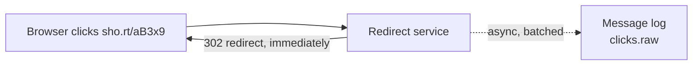
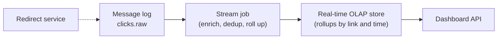
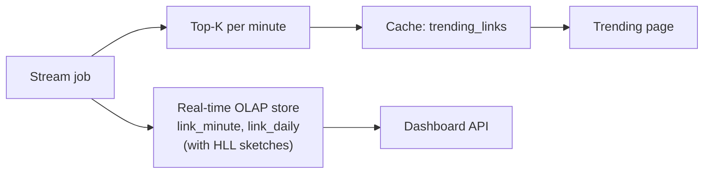
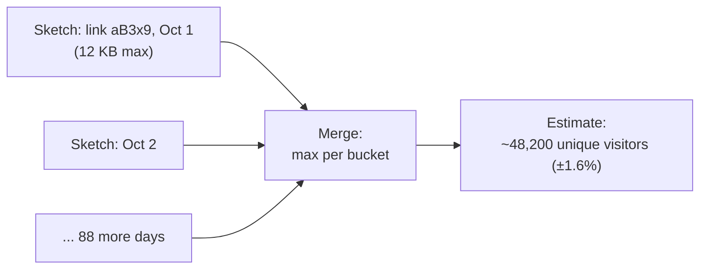
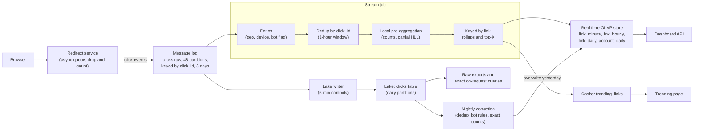

# Design Click Analytics for a URL Shortener

This breakdown follows the seven steps from [The Delivery Framework](../01-the-framework/02-delivery-framework.md), like every breakdown in the course. The pipeline is small by data engineering standards. What makes it a good interview question is that it hides three counting problems with very different costs: total clicks are trivial, the top links are easy if you think about where the counts live, and **unique visitors** are where candidates either reach for the right tool or quietly produce wrong numbers.

## Understanding the Problem

The prompt:

> "We run a URL shortener, a Bitly-style service. Design the analytics behind it: link owners want to see how their links perform, and we want a 'trending links' page."

A **URL shortener** turns a long address into a short one like `sho.rt/aB3x9`. When someone clicks the short link, the shortener's **redirect service** looks up the code and sends the browser on to the long address. Every one of those redirects is a **click**, and every click is an event you can count.

Two consumers want those counts:

- **Link owners** (marketers, creators, small businesses) open a dashboard for one link or their whole account: clicks over time, unique visitors, top countries, devices and referring sites.
- **The platform** wants a public "trending now" list: the most-clicked links in the last hour, refreshed every minute.

The central tension: **adding up clicks is cheap and exact, but counting distinct visitors is neither.** Distinct counts do not add up across days or links, exact versions need memory proportional to the number of visitors, and a viral link sends all its traffic to one key. You will decide where approximate is good enough and where it is not.

> [!NOTE]
> This is not the ad clickstream problem. There, clicks are money: you join clicks to ad impressions, attribute them, and need billing-grade exactly-once counts with reconciliation ([Ad Clickstream](../06-breakdowns-advanced/08-ad-clickstream.md)). Here the counts feed dashboards. Say that early; it permits approximation where it helps.

## Requirements

*About 6 minutes.* Ask what the dashboard shows, how fresh it must be, and what "unique" means to them.

> **You:** "When a link owner looks at unique visitors, do they pick arbitrary date ranges, or fixed periods like today and last 7 days?"
> **Interviewer:** "Arbitrary. Any range in the last 13 months, and also across all the links in their account."
> **You:** "How exact must that number be? If it says 48,210 and the truth is 48,600, is that a problem?"
> **Interviewer:** "Nobody would notice. But total clicks should be right, because customers export raw clicks and add them up."
> **You:** "Do clicks from bots count?"
> **Interviewer:** "Show them separately. Customers hate inflated numbers."

That second answer decides the deep dive on unique visitors before you have drawn a box. Write it down.

### Functional requirements

1. **Record every click** on a short link, with time, link, country, device type, referring site and a visitor identifier.
2. **Link and account dashboards:** total clicks and unique visitors for any date range in the last 13 months, clicks by hour and day, and breakdowns by country, device and referrer.
3. **Trending links:** the top 100 links by clicks in the last hour, platform-wide, refreshed every minute.
4. **Raw export:** a link owner can download their raw click events.

**Below the line (out of scope):** the redirect service itself and link creation, billing, fraud and click-spam detection beyond labelling bots, A/B testing, and cross-device identity (we do not know that a phone and a laptop are the same person).

### Non-functional requirements

Scale first:

- **Scale:** 400 million short links exist, about 20 million get clicked on a given day, and there are **1 billion clicks a day**. Traffic is very skewed: most links get a handful of clicks ever, and a viral link can take 50,000 clicks a second.

Then the qualities:

- **Isolation:** analytics must never slow down or fail a redirect. Redirect p99 stays under 20 ms whether or not analytics is healthy.
- **Freshness:** a click shows up in dashboards within 1 minute (p95); the trending list is at most 2 minutes old.
- **Correctness:** total clicks exact within a day (after the nightly correction). Unique visitors within about 2% of the exact count.
- **Query latency:** dashboard queries under 500 ms (p95), at a few hundred queries a second at peak.
- **Retention:** aggregates and raw clicks for 13 months, which is the export window too.

> [!TIP]
> Asking "how exact must unique visitors be?" is the best question you can ask in this interview. A number with a business tolerance attached ("within 2%") turns an approximate algorithm from a shortcut into the correct design.

## Sources & Volume

*About 4 minutes.* There is one source: the redirect service, which knows everything about the click at the moment it happens. Use [Key DE Numbers](../02-core-concepts/10-key-de-numbers.md):

1. **Rate.** "1 billion clicks a day is about 12,000 a second on average."
2. **Peak.** "Daily peaks of about 3x give 35,000 a second, and a viral link alone can add 50,000. I'll size ingest for 100,000 clicks a second."
3. **Bytes.** "A click event as JSON is about 500 bytes: IDs, timestamp, user agent, referrer, country. That's 500 GB a day raw, 50 MB/s at peak."
4. **Message log.** "50 MB/s needs at least 5 partitions at 10 MB/s each. I'll take 48 for consumer parallelism. Disk: 500 GB a day, about 170 GB after lz4, times 3 days times 3 replicas, is roughly 1.5 TB. Three brokers."
5. **Lake.** "As Parquet, about 100 GB a day, so 13 months is about 40 TB, under $1,000 a month in object storage."

Then the numbers that actually shape the design, about distinct visitors:

6. **Distinct pairs.** "Assume 70% of clicks come from a visitor's first click on that link that day. That's about 700 million distinct (link, visitor) pairs a day."
7. **A big link.** "A popular link might get 2 million distinct visitors a day. Exact uniques over 90 days means de-duplicating up to 180 million IDs for one query."

Say what it means: "Ingest is small and storage is cheap. The hard parts are distinct counts over arbitrary ranges at dashboard latency, and one viral link landing on one partition."

## High-Level Design

*About 12 minutes.* The data flow first:

1. The redirect service emits a click event for every redirect.
2. A message log buffers the events.
3. A stream job enriches them (country, device, bot flag) and maintains rolling counts.
4. A serving store holds pre-aggregated counts for dashboards.
5. The trending list is computed from recent counts.
6. A lake keeps every raw click, for exports and a nightly correction job.

Then build it one requirement at a time.

### 1. Capturing clicks without slowing redirects

#### Bad Solution: Increment a counter in the links database

The redirect service runs `UPDATE links SET clicks = clicks + 1 WHERE code = 'aB3x9'` before redirecting.

It is the first idea most people have, and it fails on every axis. At 100,000 clicks a second the database bottlenecks redirects. A viral link means 50,000 updates a second to **one row**, and each one waits for the previous one's row lock, so that link's redirects slow to a crawl, which breaks isolation. And a single counter cannot answer "unique visitors from Germany last Tuesday".

#### Good Solution: Write click events to a database table, aggregate later

Insert one row per click into a table and run reports over it. No row contention, and you keep the detail. But the redirect still waits on a database write, and 1 billion inserts a day into a transactional database is the wrong tool.

#### Great Solution: Emit events asynchronously to a message log

The redirect service puts a small event on an in-memory queue and returns the redirect immediately (an HTTP 302, not a cacheable 301, so browsers come back through the service on repeat clicks and every one is counted). A background thread batches events and sends them to a message log (Kafka, or a managed equivalent such as MSK, Confluent Cloud or Event Hubs). If the log is slow, the queue fills, and past a limit the service **drops events and counts the drops** rather than blocking a redirect. The redirect path never waits for analytics.

Two fields are set here, at the source, and never later:

- `click_id`: a random unique ID per redirect. It is the **dedup key** (the field that identifies one real event), so a retried send can be recognized downstream ([Deduplication at Scale](../02-core-concepts/09-deduplication-at-scale.md)).
- `visitor_id`: who clicked. The shortener sets a first-party cookie with a random ID on its own domain; when there is no cookie, it falls back to a keyed hash of IP address and user agent (a hash mixed with a secret key, so nobody can recover the IP by hashing guesses). Raw IPs are used only to look up the country and are never stored. Note that this identifier is already fuzzy (cleared cookies, shared office IPs); "unique visitors" was never an exact quantity.

### 2. Counts on the dashboard within a minute

A **stream job** (Flink, or Spark Structured Streaming) reads `clicks.raw` and, for each click:

- **Enriches** it: country from the IP, device type from the user agent, and a **bot flag** from a list of known crawler user agents and link-preview fetchers (chat apps fetch a link to draw its preview card, which is not a human click).
- **Drops duplicates** by `click_id` with a 1-hour **windowed dedup** (remember each ID for an hour, then forget it). That catches retried sends, which arrive within seconds.
- **Aggregates** into **rollups**: pre-computed counts at a fixed grain (per link per minute, per link per day), so a dashboard reads a few rows instead of millions of clicks.

Where do rollups live? The dashboard asks small questions about one link or one account, many times a second.

#### Bad Solution: Query raw clicks in the warehouse per dashboard view

`SELECT COUNT(*) ... WHERE link_id = ? AND ts BETWEEN ...` against the raw table. A popular link has tens of millions of rows in a quarter. Each view scans them, a warehouse query takes seconds, and a few hundred concurrent views need a large cluster running all day.

#### Good Solution: Rollup tables in the warehouse, refreshed every few minutes

Load the stream job's rollups into warehouse tables. Each query now reads hundreds of rows, not millions. Freshness is fine with a 1-minute load. What falls short is the serving profile: warehouses are built for fewer, bigger queries, so a few hundred small lookups a second means queueing or an always-on cluster sized for concurrency, and p95 latency of 1 to 3 seconds.

#### Great Solution: Rollups in a real-time OLAP store, sorted by link

A **real-time OLAP store** (ClickHouse, Apache Druid, Apache Pinot) is a columnar database built to ingest a stream continuously and answer many small aggregate queries in tens to hundreds of milliseconds. Sort and partition the rollup tables by `link_id` and time, so a dashboard query reads one small, contiguous slice. It ingests from the stream job within seconds, which meets the 1-minute freshness target. The cost is one more database to operate; at a few hundred queries a second with sub-second targets, it earns its place. (The warehouse still gets the same rollups daily, for internal analysts.)

### 3. Unique visitors over any range

This is the central decision, and it gets a full deep dive below. The short version for the high-level design: the stream job keeps, per link per day, a **HyperLogLog sketch** of visitor IDs, a 12 KB-at-most summary that can estimate how many distinct visitors it has seen within about 1%. Sketches for different days and links **merge**, so any date range is answered by merging a few dozen of them. The rollup table stores the sketch as a column next to the click count.

### 4. Trending links

The trending list is one query for the whole platform, not one per user. Two options are worth knowing.

#### Good Solution: Query the per-minute rollup every minute and cache it

A scheduled query sums `link_minute` over the last 60 minutes, sorts, keeps 100, and writes the result to a cache (Redis or similar) that the trending page reads. About 2 million links get clicked in a typical hour, so the query scans at most a few tens of millions of small rows: a second or two on an OLAP store, once a minute. Everyone shares the result.

This meets the requirement, and in an interview you should say so: "this is good enough for one global list". It stops being enough if the product wants trending per country (250 lists) or per category, or updates every 10 seconds.

#### Great Solution: The stream job maintains top-K continuously

The stream job, already keyed by link, keeps each link's per-minute counts for the last hour and emits a ranked list every minute. Deep dive 2 shows why this is exact and how it extends to many lists.

### 5. Exports and exact totals

Customers export raw clicks and add them up, so total clicks must match the raw data exactly. A **lake writer** consumes `clicks.raw` into a table in object storage (Iceberg or Delta Lake, so files are added atomically and the table can be queried with SQL), partitioned by day. Exports read from it.

The stream's counts are right to within a tiny duplicate rate, and bot rules improve over time. So a **nightly correction job** (Spark) re-reads yesterday's partition, removes every duplicate `click_id` across the whole day, applies the current bot rules, and **overwrites** yesterday's daily rollups in the OLAP store. After that, dashboard totals match an export exactly. The live numbers are fast; the overnight numbers are final.

> [!NOTE]
> Is this the Lambda architecture? A little: two paths compute the same rollups ([Lambda Architecture](../03-architecture-patterns/01-lambda-architecture.md)). Keep it cheap by writing the rollup logic once in SQL that both the stream job and the batch job run, and by making the batch job a correction of one day, not a parallel system.

## Data Model

*About 5 minutes.* Model from the dashboard backwards.

### The click event (topic and lake)

| Field | Type | Notes |
|---|---|---|
| `click_id` | string | UUID set by the redirect service. Dedup key. |
| `event_ts` | timestamp | Set by the redirect service when it redirects. |
| `link_id` | bigint | Internal ID of the short link. |
| `account_id` | bigint | Owner of the link, copied in so account rollups need no join. |
| `visitor_id` | string | Cookie ID or keyed hash; never the raw IP. |
| `country`, `device_type`, `referrer_domain` | string | Filled by enrichment. Referrer cut to its domain. |
| `user_agent` | string | Kept in the lake so bot rules can be re-applied. |
| `is_bot` | boolean | From enrichment; recomputed nightly. |

The grain is one redirect. The lake table is partitioned by day of `event_ts` (100 GB a day of Parquet is a few hundred well-sized files) and sorted by `account_id` within the day, so a customer's export reads a small part of each partition ([Partitioning](../02-core-concepts/01-partitioning.md)).

### Rollups in the OLAP store

| Table | Grain | Columns | Retention |
|---|---|---|---|
| `link_minute` | link, minute | `clicks`, `bot_clicks` | 48 hours |
| `link_hourly` | link, hour | `clicks`, `bot_clicks` | 13 months |
| `link_daily` | link, day | `clicks`, `bot_clicks`, `visitors_hll` | 13 months |
| `link_daily_dim` | link, day, dimension, value | `clicks` | 13 months |
| `account_daily` | account, day | `clicks`, `visitors_hll` | 13 months |

Sizes: 20 million clicked links a day gives 20 million `link_daily` rows. Most links have a few visitors, and a sketch with a few visitors is stored in a compact sparse form of tens of bytes, so the average row is about 150 bytes: 3 GB a day, about 1.2 TB for 13 months. Only the largest links carry the full 12 KB sketch.

`link_daily_dim` stores one row per value of each breakdown (`country = 'DE'`, `device = 'mobile'`). Referrers are a long tail, so keep the top 50 referrer domains per link per day and fold the rest into `other`.

`account_daily` exists because merging the sketches of a 50,000-link account across 90 days would read 4.5 million rows. Pre-merging per account per day makes it 90.

`trending_links` lives in the cache: `(window_end, rank, link_id, clicks)`, 100 rows, replaced every minute.

### Topic

`clicks.raw`, 48 partitions, 3 days of retention. Partitioned by `click_id` hash, not by `link_id`: deep dive 3 explains why.

## Pipeline Design

*About 5 minutes.* Most of this was settled above.

| Path | Mode | Why |
|---|---|---|
| Redirect service → message log | Continuous, async | Isolation; events leave the host quickly. |
| Stream job → OLAP store | Streaming, results flushed every few seconds | 1-minute dashboard freshness, 2-minute trending. |
| Lake writer | Micro-batch, commits every 5 minutes | Large files; exports can be minutes behind ([Micro-Batch vs Streaming](../03-architecture-patterns/08-micro-batch-vs-streaming.md)). |
| Nightly correction | Batch, 01:00 UTC for the previous UTC day | Exact totals and current bot rules. |

**Event time is easy here, and you should say so.** Clicks are timestamped by your own redirect servers at the moment of the redirect, so there are no phones replaying events from a tunnel. The only lateness is pipeline delay: if the stream job falls 10 minutes behind, its events are 10 minutes late, not hours. A **watermark** (the stream job's estimate of how far event time has progressed; see [Late-Arriving Data](../02-core-concepts/08-late-arriving-data.md)) of event time minus 30 seconds, with late events still updating the rollup row, is enough. The nightly job catches anything else.

**Idempotency.** The stream job takes **checkpoints**: periodic snapshots of its state and Kafka offsets together ([Flink](../04-technology-deep-dives/08-flink.md)). After a restart it replays from the checkpoint, and the rollup rows it rewrites must not double. Make every rollup write an **upsert** (insert, or replace the row with that key) of the full value for that `(link_id, minute)` key, not an increment, so writing it twice leaves the same row. The nightly job overwrites a whole day's partition, which is idempotent by construction.

**Failure behavior.**

- **Message log slow or down:** the redirect service's queue fills, then drops and counts. Redirects are unaffected. Drops are monitored; those clicks are lost, which dashboards accept.
- **Stream job down:** the log holds 3 days; the job catches up, dashboards go stale but not wrong. The trending page shows "updated 6 minutes ago" rather than an empty list.
- **OLAP store down:** the stream job backs up behind it; the log absorbs it. Dashboards show an error, redirects are fine.
- **Bad enrichment rule** (a new bot list flags real users): fix the rule and rerun the nightly job for the affected days from the lake.

## Potential Deep Dives

*About 12 minutes.* If the interviewer leaves it to you, start with the first: it is what this prompt is really about. How to choose and lead them is in [Deep Dives](../01-the-framework/08-deep-dives.md).

### 1. "A customer picks a 90-day range and asks for unique visitors. How do you compute that?"

Start with why this is harder than clicks. Clicks add: Monday's 1,000 plus Tuesday's 1,200 is 2,200. Unique visitors do not: if 400 people visited on both days, Monday-to-Tuesday unique visitors is 1,800, not 2,200. You cannot get the range answer from daily numbers. The same is true across links: an account's unique visitors is not the sum of its links' unique visitors.

#### Bad Solution: Store daily unique counts and add them up

The stream job computes an exact count of distinct visitors per link per day and stores it as an integer. The dashboard sums the days.

It is cheap, fast, and wrong. Every returning visitor is counted once per day they came back. For a newsletter link that the same 10,000 subscribers click every week, 90 days of sums says 130,000 unique visitors. The truth is 10,000.

#### Good Solution: Keep (link, day, visitor) rows and count distinct at query time

Store one row per distinct visitor per link per day (700 million rows a day, about 14 GB of Parquet) and run `COUNT(DISTINCT visitor_id)` over the range when asked.

It is exact. The cost scales with visitors, not with the answer: the popular link with 2 million visitors a day means up to 180 million IDs for a 90-day query, and the engine must hold the distinct set in memory, several GB for one dashboard view. An account-wide query for a large customer touches billions of rows. Fine for an occasional export, not for a few hundred dashboard queries a second at 500 ms.

#### Great Solution: HyperLogLog sketches per link per day, merged at query time

A **sketch** is a small, fixed-size data structure that summarizes a large stream and answers one question approximately. **HyperLogLog (HLL)** is the sketch for "how many distinct values have I seen?". How it works, at the depth interviews go:

1. **Hash every visitor ID** to a random-looking 64-bit number. The same visitor always gets the same hash.
2. **Look at leading zeros.** In random numbers, half start with a 0 bit, a quarter with 00, one in a thousand with ten zeros. If the longest run of leading zeros you have seen is 20, you have probably seen around a million distinct values (2^20). Repeats change nothing, because the same visitor produces the same hash.
3. **Use many buckets to cut the noise.** One longest-run is a wild guess. HLL splits hashes into m buckets by their first bits, keeps the longest run per bucket, and combines them with an averaging formula. The **standard error is about 1.04 / √m**.
4. **Merging is a per-bucket maximum.** Two sketches combine into the sketch of the union, exactly as if you had fed both streams into one sketch.

With m = 16,384 buckets of 6 bits each, a sketch is **12 KB and the standard error about 0.8%**, whether it has seen a thousand visitors or a billion. Roughly 95% of estimates land within ±1.6%, inside the 2% the interviewer gave you. Most implementations (HLL++, the common variant) keep a compact, near-exact list for small counts and switch to buckets only as the count grows, so a link with 37 visitors shows 37.

Now the 90-day query is: read 90 `visitors_hll` values for the link, merge them, estimate. At most about 1 MB read and a few milliseconds of work. Account-wide uses `account_daily`. Per-link daily state in the stream job is the sketch itself, a few GB across all active links.

Support is everywhere: Redis (`PFADD`, `PFCOUNT`, `PFMERGE`), BigQuery (`HLL_COUNT.INIT`, `HLL_COUNT.MERGE`), Snowflake (`HLL_ACCUMULATE`, `HLL_COMBINE`), Spark (`hll_sketch_agg` and `hll_union_agg`, since 3.5), and aggregate-state columns in ClickHouse, Druid and Pinot.

Say what you gave up, and how you cover it:

| Question | Answer from |
|---|---|
| Unique visitors, any range, on the dashboard | HLL merge, about ±1.6% |
| Exact unique visitors for a contract or an audit | The lake: exact `COUNT(DISTINCT)` as an on-request job, minutes not milliseconds |
| Total clicks | Exact sums of rollups, corrected nightly |

And one limit: HLL answers unions well and intersections badly. "Visitors who clicked both link A and link B" estimated from two HLLs by subtraction can have errors larger than the answer. If the product needs overlaps, that is a different sketch family (theta sketches) or an exact job on the lake.

> [!WARNING]
> Sketches from different libraries are not compatible. A Redis HLL cannot be merged with a BigQuery HLL. Pick one implementation and one bucket count (precision) for the whole pipeline, and store the sketches as bytes in that format. Changing precision later means rebuilding history from the lake.

### 2. "How do you compute the top 100 links in the last hour, and is it exact?"

The naive `GROUP BY link_id ORDER BY COUNT(*) DESC LIMIT 100` over an hour of raw clicks (40 to 100 million rows) works once, not every minute. The rollup query from the high-level design is fine for one global list. Here is the streaming version and why it is correct.

The stream job is keyed by `link_id` for its rollups, so **all clicks for a link are counted on one worker**. Each worker keeps, per active link, 60 per-minute counters (a sliding one-hour window, advanced every minute). About 2 million active links times 60 counters of 8 bytes is roughly 1 GB of state across the job.

Every minute, each worker computes its own local top 100. A single final step merges those lists and keeps the global top 100.

Why is that exact? Because every link's full count lives on exactly one worker. If a link is in the global top 100, then at most 99 links beat it anywhere, so it must be in its own worker's top 100 too. The candidate lists cannot miss it.

> [!WARNING]
> That argument fails if the counts are split across workers. If the job pre-aggregates on random workers before keying by link (deep dive 3), a link with 30,000 clicks split as 1,000 on each of 30 workers can be missing from every local top 100 and from the result. Merge local top-K lists only after the counts per key are complete.

Per-country lists (250) are the same job keyed by `(country, link_id)`: more state, same logic.

When does exactness get too expensive? When the key space is huge, such as "top referring pages across the platform" with hundreds of millions of distinct full URLs. Then a **Count-Min Sketch** helps: a small grid of counters where each key is hashed to one counter per row; its estimate is the smallest of its counters. It never undercounts, may overcount by a bounded amount, and fits in a few MB. Pair it with a heap of the current top candidates and you get an approximate top-K in fixed memory. For 2 million active links you do not need it, and saying so is a good signal: approximate algorithms are for when exact state does not fit.

### 3. "A link goes viral and gets 50,000 clicks a second. What breaks?"

If `clicks.raw` were partitioned by `link_id`, every click for that link lands on one partition: 50,000 × 500 bytes is 25 MB/s, well past the 10 MB/s planning figure, and one consumer has to process all of it while the other 47 sit idle. That is a **hot partition**, and dashboard and trending lag for every link on it.

#### Bad Solution: Add partitions

More partitions do nothing: one key always hashes to one partition. It also changes which partition every other key maps to.

#### Good Solution: Spread by `click_id`, then key by link in the stream job

Partition the topic by `click_id`, so load is even across all 48 partitions. The stream job then re-keys by `link_id` for counting, which moves the hot spot from Kafka into the job: one subtask (one parallel instance of an operator) still has to handle 50,000 events a second for that link. That is within reach for a simple counter, but it is the job's slowest task, and it raises **backpressure** (upstream operators slowing down because a downstream one cannot keep up) for everything sharing that subtask.

#### Great Solution: Pre-aggregate locally, then combine per link

Each subtask that reads from Kafka first accumulates partial results per link for a short interval, say 2 seconds: a click count and a partial HLL sketch. Then it sends one partial per link to the keyed step, which combines them. This is **local-global aggregation** (also called two-phase aggregation). With 48 readers, the viral link's keyed subtask receives about 24 partials a second instead of 50,000 events. Flink SQL does this for you once mini-batch is enabled (it buffers rows for a short interval) and the planner picks two-phase aggregation, for built-in aggregates and for user-defined ones (such as an HLL aggregate) that implement `merge`; in other engines you write it by hand.

It works because both aggregates merge: counts add, and HLL sketches merge by per-bucket maximum, so the partials combine into exactly what a single worker would have computed. A non-mergeable aggregate (an exact median, say) could not be split this way.

The windowed dedup still needs all copies of one `click_id` on the same worker, which partitioning the topic by `click_id` already gives you, so dedup runs before the local pre-aggregation.

### 4. "A customer says your click count is 35% higher than their own website analytics. Who is right?"

Probably both, and the interviewer wants the list before the defense.

1. **Bots and link previews.** Chat apps fetch a link to draw a preview card, and email security scanners fetch every link. These are redirects, not people. Check the `bot_clicks` share. This is why bots are counted separately rather than dropped: show both numbers, and re-apply improved rules to history from the lake.
2. **Clicks are not visits.** You count at the redirect. Their site counts when a page loads and a script runs, so closed tabs, ad blockers and slow pages shrink their number. Unique visitors compares better than total clicks.
3. **Different days.** Your days are UTC; theirs may be local. Hourly rollups let the dashboard pick a time zone for click charts; unique visitors stay per UTC day, and the dashboard should say so.
4. **Duplicates** that slipped past the 1-hour dedup window inflate the live count until the nightly job. Usually a fraction of a percent, not 35%.

Only then look for a pipeline bug: compare the dashboard total for that link with an exact lake count. If they match, the difference is definitional. The nightly reconciliation in the monitoring section runs that same check.

## Monitoring & SLAs

*About 4 minutes.* Three SLAs, matching the requirements. [Monitoring and SLAs](../01-the-framework/09-monitoring-and-slas.md) covers how to present these; [Monitoring and Alerting](../02-core-concepts/06-monitoring-and-alerting.md) covers alert design.

| SLA | Target | Measured by |
|---|---|---|
| **Freshness** | 95% of clicks visible in dashboards within 1 minute; trending under 2 minutes old | A synthetic click on a canary link every 10 seconds; time until it appears in `link_minute` |
| **Correctness** | After the nightly job, daily clicks equal exact lake counts; live counts within 0.5% of them | Nightly reconciliation per link-day between stream rollups and batch recount |
| **Query latency** | Dashboard p95 under 500 ms | Dashboard API logs |

Behind them:

- **Dropped events at the redirect service**, as a rate per host. Drops are allowed; unnoticed drops are not.
- **Consumer lag** on the stream job and the lake writer.
- **HLL accuracy check:** every night, compute exact unique visitors for a random sample of 1,000 link-days from the lake and compare with the sketches. The error should look like a ±1.6% spread centred on zero. A shift means a bug, such as two sketch formats mixed or visitor IDs being re-hashed differently.
- **Bot share** by day, against last week. A jump means a new crawler or a broken rule.
- **Busiest link's rate**, so a viral link shows up on a dashboard before it shows up as lag.

## Final Design

Follow one click. At 14:03:07 UTC someone in Berlin taps `sho.rt/aB3x9` in a chat app. The redirect service sends them on in 4 ms and queues an event with a new `click_id` and their cookie `visitor_id`. The chat app's preview fetcher had requested the same link a second earlier; that event gets `is_bot = true`. The stream job enriches both, finds no duplicate `click_id`, adds the human click to the 14:03 per-minute counter and to today's HLL sketch for the link, and the bot click to `bot_clicks`. Within seconds `link_minute` shows it, and at 14:04 the link's trending rank is recomputed. Five minutes later the lake writer commits it. At 01:00 the next night the correction job recounts the whole day for the link, and the dashboard's daily total becomes final. Three months later the owner picks a 90-day range, and the API merges 90 sketches in a few milliseconds.

The cost is modest: three brokers, a stream job of a few dozen cores, an OLAP cluster holding a little over a terabyte of rollups, and about 40 TB of lake.

## What's Expected at Each Level

### Mid-level

You get the shape right: asynchronous click events into a message log, a stream job that produces rollups, a fast store for dashboards, raw clicks in object storage. You reject the database counter with a reason (contention on a hot row). You notice that unique visitors cannot be summed across days once the interviewer pushes, and you can name HyperLogLog as the fix even if the interviewer leads you to it. The bar: correct rollup grains, exact click totals, a freshness SLA.

### Senior

You drive. You ask how exact unique visitors must be and use the answer to justify HLL, explain how it works and why it merges, and keep an exact path in the lake for audits. You compute trending with the right partitioning and can say why merging local top-K lists is exact only when counts are complete per key. You raise the viral link before being asked and fix it with local-global aggregation, noting that it works because counts and sketches are mergeable. Your writes are idempotent upserts, and your monitoring includes a nightly check of the sketches against exact counts.

### Staff+

You treat the numbers as a product customers argue with. You define "click" and "unique visitor" precisely, publish the definitions, and design the dashboard so that bot share, time zones and the approximate figures are visible rather than hidden. You think about privacy: visitor identifiers and IP handling, retention, and deletion requests across lake and rollups. You plan sketch format and precision as a long-lived decision with a migration path, and you know when to stop: a single global trending list does not need a streaming top-K, and you say so.

## Related Lessons

- Framework: [The Delivery Framework](../01-the-framework/02-delivery-framework.md), [Requirements Gathering](../01-the-framework/03-requirements-gathering.md), [Sources and Volume](../01-the-framework/04-sources-and-volume.md), [High-Level Architecture](../01-the-framework/05-high-level-architecture.md), [Deep Dives](../01-the-framework/08-deep-dives.md), [Monitoring and SLAs](../01-the-framework/09-monitoring-and-slas.md)
- Concepts: [Key DE Numbers](../02-core-concepts/10-key-de-numbers.md), [Deduplication at Scale](../02-core-concepts/09-deduplication-at-scale.md), [Partitioning](../02-core-concepts/01-partitioning.md), [Late-Arriving Data](../02-core-concepts/08-late-arriving-data.md), [Monitoring and Alerting](../02-core-concepts/06-monitoring-and-alerting.md)
- Patterns: [Lambda Architecture](../03-architecture-patterns/01-lambda-architecture.md), [Micro-Batch vs Streaming](../03-architecture-patterns/08-micro-batch-vs-streaming.md)
- Technology: [Kafka](../04-technology-deep-dives/02-kafka.md), [Flink](../04-technology-deep-dives/08-flink.md), [Iceberg](../04-technology-deep-dives/07-iceberg.md)
- Contrast: [Ad Clickstream](../06-breakdowns-advanced/08-ad-clickstream.md) (billing-grade counts and attribution)
- Previous breakdown: [Log Aggregation](01-log-aggregation.md). Next: [E-Commerce Warehouse](03-e-commerce-warehouse.md)
