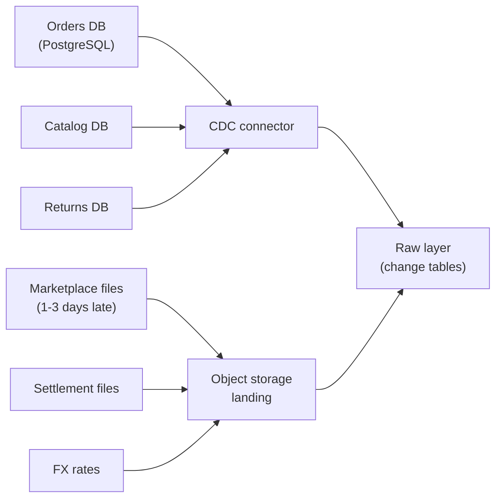
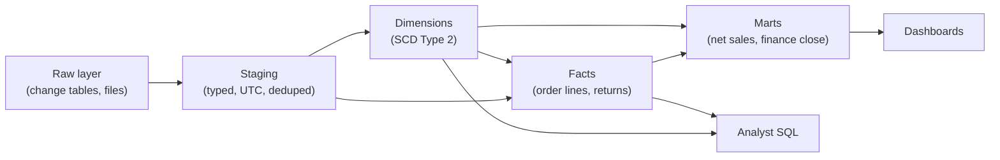
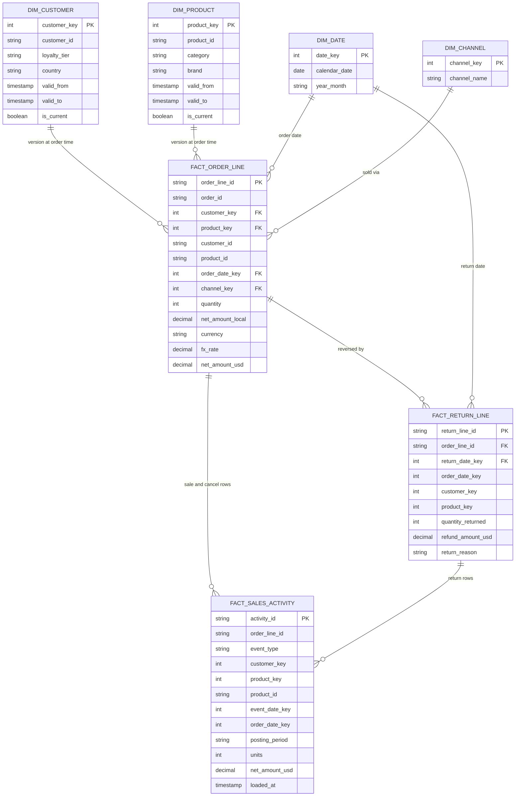
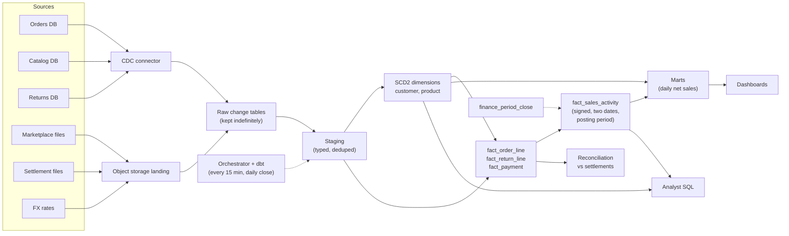

# Design an E-Commerce Analytics Warehouse

This breakdown is the framework's "flex" case. [The Delivery Framework](../01-the-framework/02-delivery-framework.md) puts the data model after the architecture, and says to flip that when the prompt is about a warehouse, because then the model *is* the design. This lesson keeps the usual section order so every breakdown reads the same, but the weight moves: the High-Level Design is short on purpose, and the Data Model section carries most of the answer. The question that decides the interview is not "can you move 200,000 orders a day?" (anything can) but **"when an order is returned six weeks later, or a product changes category, does last year's revenue still come out right?"**

## Understanding the Problem

The prompt:

> "We're an online store selling home goods in 12 countries. Design the analytics warehouse: finance, merchandising and marketing all want to report on sales."

An **analytics warehouse** here means the set of cleaned, modeled tables in a cloud warehouse (Snowflake, BigQuery, Redshift, Databricks SQL) that analysts and dashboards query, plus the pipelines that keep them loaded. The store's own databases (orders, customers, the product catalog, returns) are built to run the website, not to answer "net sales by category last quarter".

Three teams read the same sales, and each asks a question that sounds simple and isn't:

- **Finance** wants net sales per day and per month that match the money the payment provider actually settled. Once a month is closed, its numbers must never change.
- **Merchandising** (the team that buys and prices products) wants units, sales and return rates by product, category and brand. A product moved from "Kitchen" to "Dining" in June. Do last year's Kitchen numbers include it?
- **Marketing** wants customer cohorts and lifetime value by loyalty tier. A customer who was Silver when they ordered in March and Gold now: which tier gets March's order?

The central tension: **sales are not a single event.** An order is placed, paid, shipped, sometimes cancelled, and sometimes returned weeks later; the customer and product it refers to keep changing underneath it. The design is the set of tables that record all of that without rewriting history. The pipelines that load them are the standard part.

Say the plan, including the flex: "Requirements and volume first. The volume will be small, so I'll sketch the pipeline in a couple of minutes and spend most of the time on the model, because that's where this problem is hard."

## Requirements

*About 7 minutes.* Ask how each team defines its numbers, because the definitions become table design:

> **You:** "When a customer returns something, does finance count it against the month of the sale or the month of the return?"
> **Interviewer:** "The month of the return. And we close each month on the third business day of the next. After that, October is October."
> **You:** "And merchandising?"
> **Interviewer:** "They want return rate for products sold in October, so they tie the return back to the sale. Their numbers can keep moving."
> **You:** "Do any orders arrive late?"
> **Interviewer:** "About 15% of orders come from third-party marketplaces. They send daily files, one to three days late."

Two answers, two different dates for the same return. You will build that into the model.

### Functional requirements

1. **Finance reporting:** gross sales, discounts, cancellations, returns and net sales per day and month, by country, channel and currency, reconciled to the payment provider. Closed months are frozen.
2. **Merchandising reporting:** units, net sales and return rate by product, category and brand, both **as it was** (the category at the time of sale) and **as it is** (today's category applied to all history).
3. **Customer analytics:** new versus returning customers, cohorts by first-order month, sales by loyalty tier as of the order date, lifetime value.
4. **Self-serve access** for about 150 analysts writing SQL, plus about 40 dashboards.

**Below the line (out of scope):** website clickstream and funnel analytics (a separate event pipeline), inventory and supply chain, a seconds-fresh operational dashboard ([Real-Time Dashboard](04-real-time-dashboard.md) covers that), recommendations, and the BI tool itself.

### Non-functional requirements

- **Scale:** 200,000 orders a day on average, up to 1 million on Black Friday; 3 years of history; 20 million customers; 400,000 products.
- **Freshness:** intraday sales visible within 1 hour (p95). Yesterday's complete, reconciled numbers by 06:00 UTC.
- **Correctness:** daily net sales within 0.1% of the payment provider's settlement totals; exact at month close. A closed month never changes.
- **History:** every past version of the customer and product attributes that someone reports on.
- **Query latency:** dashboards under 5 seconds, typical ad-hoc queries under 30 seconds.
- **Cost:** "Our warehouse bill is about $15k a month. Don't double it."

> [!TIP]
> In a warehouse prompt, the most valuable requirement questions are about definitions: "What is net sales? Which date does a return belong to? Which category does an old sale report under?" Each answer turns into a column or a table. Volume questions matter less, as the next step shows.

## Sources & Volume

*About 3 minutes.* Six sources:

| Source | What it holds | How it arrives |
|---|---|---|
| Orders database (PostgreSQL) | Orders, order lines, customers, addresses | Changes captured continuously (decided below) |
| Product catalog service | Products, categories, brands | Its own database, captured the same way |
| Returns system | Return requests, received items, refunds | Its own database |
| Marketplace partners | Orders sold on third-party marketplaces | Daily files, 1 to 3 days late |
| Payment provider | Settled payments and refunds | Daily settlement file |
| FX rates | Daily exchange rates for 9 currencies | Daily file |

The numbers, using [Key DE Numbers](../02-core-concepts/10-key-de-numbers.md):

1. **Order lines.** "200,000 orders a day at about 2.5 items each is 500,000 order lines a day. Black Friday is 5x: 2.5 million."
2. **Change events.** "Each order changes status about six times (placed, paid, packed, shipped, delivered, sometimes cancelled), so with line and customer updates, roughly 2 to 3 million row changes a day. That's about 30 a second on average, 150 at peak. At ~1 KB each, 2 to 3 GB a day."
3. **The main fact table.** "A modeled order line is about 200 bytes: 500,000 × 200 bytes = 100 MB a day. Three years is about 550 million rows, about 110 GB raw, and 20 to 25 GB in columnar compressed storage at 1/5."
4. **Returns.** "About 8% of lines are returned: 40,000 return lines a day, arriving up to 90 days after the sale, most within 45."
5. **Dimensions.** "20 million customers and 400,000 products. Maybe 50,000 customer changes a day that matter."

Then say what they imply:

> "The largest table, after three years, is about 25 GB compressed. A cloud warehouse handles that on its smallest compute size. There's no throughput problem here: no Spark cluster, no stream processor. What's hard is that facts change after they happen and dimensions change under them. So I'll keep the pipeline simple and put the time into the model."

That is the flex, justified with numbers: the math says *don't* build big infrastructure ([Sources and Volume](../01-the-framework/04-sources-and-volume.md)).

## High-Level Design

*About 4 minutes, not the usual 12.* In the room, many candidates would now sketch the star schema first and draw these boxes after. Either order works if you say which one you're doing. The flow:

1. Capture changes from the operational databases and land files from partners, all unmodified, in a raw layer.
2. Clean and conform them: types, UTC timestamps, deduplication, one currency convention.
3. Build the dimensional model: dimensions first, then facts that point to them.
4. Publish serving tables (marts) for dashboards and finance.

This is the **medallion** layering (raw, cleaned, serving), applied inside a warehouse ([Medallion Architecture](../03-architecture-patterns/03-medallion-architecture.md)). Only one decision here deserves a ladder.

### 1. Getting data out of the orders database

#### Bad Solution: A nightly full export from the production database

At 02:00 a job runs `SELECT *` on every table and reloads the warehouse.

It misses the one-hour freshness target by a day and loads the production database while the store is open in other time zones. Worst for this problem: the warehouse sees one state per day. If an order went from "paid" to "cancelled" before 02:00, you never see that it was ever paid, and a customer's tier change between two exports is recorded at the wrong time or not at all.

#### Good Solution: Incremental extracts every 15 minutes from a read replica

Every 15 minutes, select rows whose `updated_at` is newer than the last run's high-water mark (the latest `updated_at` seen so far), from a **read replica** (a copy of the database that serves reads so production does not). An `updated_at` filter like this is an **incremental load**.

This meets freshness and spares production. It falls short in two ways that matter here. Hard deletes are invisible: a deleted row never shows up in "changed since", so cancelled-and-purged lines linger. And it still sees at most one version per row per run, so SCD history has 15-minute resolution and silently skips a value that changed twice within one. If the team has no CDC tooling, this is a defensible answer; say what it loses.

#### Great Solution: Log-based CDC into raw change tables

**Change data capture (CDC)** reads the database's own transaction log and emits every insert, update and delete as an event, in commit order. A connector such as Debezium, or a managed CDC connector from your cloud or ingestion vendor, publishes them to Kafka or straight to the warehouse's raw schema. You append every event to a **change table** (one row per change, with the operation, the source commit time and the log position) and keep it ([CDC Patterns](../03-architecture-patterns/04-cdc-patterns.md)).

You get every intermediate status and every delete, with exact commit times, at almost no load on the source. At 30 events a second this is a small connector, not a platform. The change tables are also what makes the SCD Type 2 dimensions in the next section accurate and rebuildable. The cost is one more moving part to run and monitor, and a schema change in the source can break it; [Debezium and CDC Tools](../04-technology-deep-dives/09-debezium-and-cdc-tools.md) covers both.

The catalog and returns databases use the same pattern. Partner, settlement and FX files land in object storage and load into raw tables as they arrive, each row tagged with its file name and load time.



### 2. Clean, model and serve inside the warehouse

At this volume, every transformation runs as SQL in the warehouse: staging models clean each source, then the dimensional models, then marts. A SQL transformation tool such as [dbt](../04-technology-deep-dives/04-dbt.md) manages the dependencies and tests, and an orchestrator such as [Airflow](../04-technology-deep-dives/03-airflow.md) runs it every 15 minutes and on file arrival. Loading raw data first and transforming it inside the warehouse is called **ELT** (extract, load, transform).



That's the whole architecture, deliberately boring. Everything interesting is inside the box labeled "Facts", which is why the next section is long.

## Data Model

*About 15 minutes: the core of the answer.* Here is why the model carries the weight here and not in, say, log aggregation. In a log platform, a wrong data model costs speed or money; in a sales warehouse, it produces a wrong revenue number that a finance director signs. The architecture above is the same one every company of this size uses, so the interviewer learns nothing from it. They learn a lot from whether your tables survive returns, late orders and changing dimensions.

[Data Model Design](../01-the-framework/06-data-model-design.md) already taught the tools with a single-fact example: grain, facts versus dimensions, the star schema, SCD Type 1 and Type 2, and star versus wide table. This section applies them to the parts that a single `fact_order_line` cannot handle. Start, as always, with the grain.

### Grain: one table per business process

The **business processes** here are the separate things that happen and get measured: placing an order, fulfilling it, returning items, settling payments. Each one gets its own fact table at its own grain, because the events happen at different times and carry different measures.

| Fact table | Grain (one row is) | Date it belongs to | Rows a day |
|---|---|---|---|
| `fact_order_line` | One item line in one order, as placed | Order date | ~500,000 |
| `fact_return_line` | One returned line in one return (may be part of the quantity) | Return date | ~40,000 |
| `fact_payment` | One settled payment or refund | Settlement date | ~250,000 |
| `fact_order_fulfilment` | One order line's journey, updated as it moves | Order date | ~500,000 new, many updated |

The last one is an **accumulating snapshot**: one row per item moving through a fixed process, with a timestamp column per milestone (`paid_at`, `shipped_at`, `delivered_at`) filled in as each happens. It answers "average days from order to delivery by country" in one scan, and it is the one fact table you update in place, because its question is about each line's current state.

### The two decisions the model is really about

Two facts are not obvious, and each gets a ladder: how sales and returns fit together, and where price lives.

#### Bad Solution: Mirror the orders table and update it as orders change

One `orders` table copied from the source, with a `status` column. When a line is returned, the pipeline sets `status = 'returned'` and `net_amount = 0`.

Every past number moves. October's revenue changes in December when an October order is returned, which breaks "a closed month never changes". You can't answer "returns processed this week" because the return has no row and no date of its own. Return reason and item condition have nowhere to go. And you can no longer see that the sale ever happened, so the return rate is uncomputable.

#### Good Solution: Separate, immutable facts for sales and returns

`fact_order_line` records each line as placed and never changes its amounts. `fact_return_line` records each return at its own grain and on its own date, with `return_reason` and `item_condition`. Each return row carries the `order_line_id` it reverses, plus a copy of the original line's `order_date_key`, `customer_key` and `product_key`.

Now both teams' questions work. Finance sums returns by return date; merchandising joins returns to the sales they came from by order date. Cancellations before shipping are a third case, handled the same way. The weakness is that every "net sales" query must combine two or three tables with the right signs and the right date, and 150 analysts will each write that union slightly differently.

#### Great Solution: Keep the process facts, and publish one signed sales activity table

Keep the Good facts as the detailed source of truth, and build one serving table from them, `fact_sales_activity`, at the grain **one financial event on one order line**: a sale, a cancellation or a return. Amounts are signed (a return is negative), and every row carries two dates:

- `event_date`: when this event happened (the return date for a return). Finance groups by this.
- `order_date`: when the original line was ordered. Merchandising and cohort analysis group by this.

```sql
-- Net sales by month, the way finance books it
SELECT d.year_month, SUM(a.net_amount_usd)
FROM fact_sales_activity a
JOIN dim_date d ON a.event_date_key = d.date_key
GROUP BY d.year_month;

-- Return rate for products sold in October, the way merchandising sees it
SELECT p.category,
       -1.0 * SUM(CASE WHEN a.event_type = 'return' THEN a.units END)
         / SUM(CASE WHEN a.event_type = 'sale' THEN a.units END) AS return_rate
FROM fact_sales_activity a
JOIN dim_product p ON a.product_key = p.product_key
JOIN dim_date d    ON a.order_date_key = d.date_key
WHERE d.year_month = '2026-10'
GROUP BY p.category;
```

The table is append-only for money: a late return, a late marketplace order, a cancellation are all *new rows*, and no amount, date or period on an existing row is ever edited. (The one exception, re-pointing a dimension key, is deep dive 3.) That property is what lets a closed month stay closed (deep dive 1), and it means "what did we know on 5 November?" is a filter on load time. The cost is one more table to build and keep consistent with its sources, and a reconciliation check that the two agree (Monitoring & SLAs).

> [!WARNING]
> **Never compute revenue from the product dimension's price.** Prices change daily. `quantity × dim_product.price` gives you today's price applied to last year's orders. The price paid is a fact of the sale: store `unit_price`, `discount_amount`, `tax_amount` and `net_amount` on the order line, in the order's currency, plus the FX rate used and the amount in the reporting currency. Store the rate, because rates are revised and you want the number the books used.

### Dimensions and which columns keep history

Four dimensions are shared by every fact table. A dimension used identically by several fact tables is a **conformed dimension**: "category" means the same thing whether you're counting sales, returns or delivery times, so the numbers line up when you put them side by side. A grid of which facts use which dimensions is called a **bus matrix**, and it fits on the whiteboard:

| | `dim_date` | `dim_customer` | `dim_product` | `dim_channel` |
|---|---|---|---|---|
| `fact_order_line` | order date | yes | yes | yes |
| `fact_return_line` | return date, order date | yes | yes | yes |
| `fact_order_fulfilment` | order, ship, delivery dates | yes | yes | yes |
| `fact_payment` | settlement date | yes | no | yes |

Choose the SCD type per column, as [Data Model Design](../01-the-framework/06-data-model-design.md) taught, using this prompt's requirements:

| Dimension | Type 2 (keep versions) | Type 1 (overwrite) | Never in the dimension |
|---|---|---|---|
| `dim_customer` | `loyalty_tier`, `country`, `segment` | `name`, `email`, `phone` | `days_since_last_order`, `lifetime_spend` |
| `dim_product` | `category`, `subcategory`, `brand` | `description`, `image_url` | `price`, `stock_level` |

The last column is the one candidates miss. `days_since_last_order` changes for every customer every day; as a Type 2 attribute it would add about 20 million versions a day. Values that change constantly belong in a fact (a daily customer snapshot) or are computed at query time, not versioned.

How big does Type 2 make these? Say loyalty tiers are recalculated monthly and 10% of 5 million active customers change tier: 500,000 new versions a month, about 6 million a year, on top of 20 million customers. Under 50 million rows after three years, which is small for a warehouse.

Each version gets its own surrogate key (`customer_key`), as in [Data Model Design](../01-the-framework/06-data-model-design.md). The fact row stores the key of the version current at order time, which makes "sales by tier as of the order date" a plain join. It also keeps the natural key (`customer_id`, `product_id`) for the "as it is" view in deep dive 2.

### The model on one page



`order_id` on the order line is a **degenerate dimension**: an identifier kept on the fact with no dimension table of its own, so you can group lines into orders without joining anything. `posting_period` is explained in deep dive 1.

### Serving tables and layout

Analysts query the star. Dashboards get a few **marts**: wide tables built from it for one audience, such as `mart_daily_net_sales` (date, country, channel, category, units, gross, returns, net), so a dashboard tile reads a few thousand pre-joined rows and cannot get a join wrong. 

Layout is short at this size. `fact_order_line` grows about 20 MB a day compressed, so a daily partition would make tiny files. Cluster it by `order_date` and let the warehouse prune, or partition by month if your engine needs explicit partitions. Cluster `fact_sales_activity` by `event_date`, since finance's filter dominates. See [Partitioning](../02-core-concepts/01-partitioning.md) and [Snowflake](../04-technology-deep-dives/05-snowflake.md).

## Pipeline Design

*About 5 minutes.* Everything is batch: every 15 minutes for the CDC-fed tables, on arrival for files, and a daily close run. Streaming would buy freshness nobody asked for.

| Path | Schedule | Idempotent by |
|---|---|---|
| CDC → raw change tables | Continuous append | Log position: a replayed event has the same position and is skipped |
| Raw → staging | Every 15 min | Rebuild changed keys from the change table, keep the latest by log position |
| Dimensions (SCD Type 2) | Every 15 min, before facts | MERGE on `(natural key, valid_from)` |
| `fact_order_line`, `fact_return_line` | Every 15 min, after dimensions | MERGE on `order_line_id` / `return_line_id` |
| Marketplace orders | On file arrival | MERGE on `(marketplace, external_order_line_id)` |
| `fact_sales_activity` and marts | Every 15 min; final daily run at 05:00 UTC | Insert only new events; `activity_id` is a hash of event type and source line ID, so a rerun finds it already there |

The order matters: dimensions load before the facts that look them up. In dbt that dependency falls out of the model references; in the orchestrator, the daily close waits on the settlement and FX files with a sensor (a task that waits for a condition, such as a file landing) and a deadline.

### Building SCD Type 2 from the change table

Because CDC keeps every change, you don't need to compare snapshots ([dbt snapshots](../04-technology-deep-dives/04-dbt.md) do that, and miss changes between runs). Instead, each run, rebuild the version chain for every customer touched since the last run:

```sql
WITH touched AS (
  SELECT DISTINCT customer_id FROM raw.customers_changes
  WHERE ingested_at >= :last_run
),
changes AS (   -- keep only events where a Type 2 column changed
  SELECT * FROM (
    SELECT c.*,
      LAG(tier)    OVER (PARTITION BY customer_id ORDER BY log_position) AS prev_tier,
      LAG(country) OVER (PARTITION BY customer_id ORDER BY log_position) AS prev_country
    FROM raw.customers_changes c JOIN touched USING (customer_id)
  ) WHERE prev_tier IS DISTINCT FROM tier OR prev_country IS DISTINCT FROM country
),
versions AS (
  SELECT customer_id, tier, country, source_ts AS valid_from,
         LEAD(source_ts, 1, TIMESTAMP '9999-12-31') OVER (
           PARTITION BY customer_id ORDER BY log_position) AS valid_to
  FROM changes
)
MERGE INTO dim_customer d
USING versions v
ON d.customer_id = v.customer_id AND d.valid_from = v.valid_from
WHEN MATCHED THEN UPDATE SET valid_to = v.valid_to,
  is_current = (v.valid_to = TIMESTAMP '9999-12-31')
WHEN NOT MATCHED THEN INSERT (customer_key, customer_id, loyalty_tier, country,
  valid_from, valid_to, is_current)
VALUES (HASH(v.customer_id, v.valid_from), v.customer_id, v.tier, v.country,
  v.valid_from, v.valid_to, v.valid_to = TIMESTAMP '9999-12-31');
```

Dialect note: `HASH` is Snowflake's; use `FARM_FINGERPRINT` in BigQuery or `MD5` elsewhere. `IS DISTINCT FROM` (a null-safe `<>`) and `MERGE` are standard SQL but not in every engine or version, so check yours (rewrite with `COALESCE`, or use delete-and-insert, if not). The raw column `tier` loads into `loyalty_tier`.

Three choices make it safe ([Pipeline Design](../01-the-framework/07-pipeline-design.md) has the general rules):

- **Rebuild the whole chain per touched key**, ordered by log position, rather than "close the current row, open a new one". An out-of-order or replayed event then produces the same chain, and running the job twice changes nothing.
- **Deterministic surrogate keys**: a hash of `(customer_id, valid_from)` instead of a sequence. Rebuild the dimension from scratch and every version gets the same key back, so facts that point at it stay correct. A sequence would renumber everything.
- **Type 1 columns** (email, name) are updated on every version of that customer, in a separate statement.

### Loading facts: point-in-time lookups

Each new order line looks up the dimension version that was current when it was ordered:

```sql
JOIN dim_customer c
  ON c.customer_id = o.customer_id
 AND o.ordered_at >= c.valid_from AND o.ordered_at < c.valid_to
```

The interval is half-open (`>=` start, `<` end), so a timestamp exactly on a boundary matches one version, not two.

If no version matches, the customer row hasn't arrived yet: a new customer's first order can reach the warehouse before their customer record does, since they are separate CDC streams. Insert an **inferred member**, a placeholder dimension row with the natural key and "Unknown" attributes, flagged `is_inferred`, and point the fact at it; when the real row arrives, it fills in that placeholder. Facts are never dropped by an inner join ([Late-Arriving Data](../02-core-concepts/08-late-arriving-data.md)).

### Failures

- **CDC connector down:** the raw tables stop growing, scheduled runs produce nothing new, and the freshness check fires. The database keeps its log for the connector, so it resumes where it stopped; watch that the database's retained log doesn't fill its disk.
- **A dbt test fails** (say, duplicate `order_line_id`): downstream models skip, dashboards keep yesterday's good data, and the on-call engineer gets the failing rows.
- **Settlement file missing at 05:00:** publish the day's numbers marked "unreconciled" rather than block everyone, and alert finance's data owner.
- **Logic bug found in last month's net sales:** rebuild from the raw change tables, which are kept indefinitely for exactly this. See [Backfill and Reprocessing](../02-core-concepts/03-backfill-and-reprocessing.md). For closed months, the fix goes through deep dive 1's adjustment process.

## Potential Deep Dives

*About 12 minutes.* If the interviewer doesn't pick, lead with the first: it is the central tension asked directly. How to run deep dives is in [Deep Dives](../01-the-framework/08-deep-dives.md).

### 1. "Finance closed October. On 5 November, 3,000 marketplace orders from 30 October and 40,000 returns of October sales land. What do the reports show?"

There are three dates in play: when the event happened, when the original order happened, and when the warehouse learned about it. Finance's rule (closed months don't change) is about the first and third together.

#### Bad Solution: Load them into October

Partition by event date and insert. October's net sales change on 5 November, after the finance director has signed the October report. The next time someone reruns the report, it disagrees with the signed one, and nobody can say why.

#### Good Solution: Freeze October by refusing late rows

After close, the pipeline rejects rows dated in October. October stays stable, but the 3,000 orders are never counted anywhere, and merchandising's October return rate is wrong forever.

#### Great Solution: A posting period on every activity row

Give every row in `fact_sales_activity` a `posting_period`: the accounting month it is booked in. When the row is loaded, it gets the month of its `event_date` if that month is still open, and otherwise the current open month. So the late 30 October orders get `event_date = 2026-10-30` and `posting_period = 2026-11`.

- **Finance** reports by `posting_period`. October is closed and nothing new can ever be posted to it. November shows the late orders, and finance can label them "prior-period adjustments" because `event_date` is still there.
- **Merchandising** reports by `order_date` and sees the late orders and returns in October, as they want. Their October numbers keep moving for 90 days, and the dashboard says so: "October return rate, 62% of the return window elapsed".
- **Audit:** `loaded_at` on every row answers "what did the October report contain when it was signed?" with a filter, no snapshot needed.

The close itself is a small table, `finance_period_close (period, closed_at, closed_by)`, that the loader reads. Closing a month is a row insert by finance, not a code deploy. The point to say aloud: "Two teams need two different answers to 'which month is this in', and both are right. The model stores both dates and lets each team choose."

### 2. "A product moved from Kitchen to Dining in June. The Dining manager asks for her category's sales last year. What does she get?"

This is the "as was" versus "as is" question from the requirements.

#### Bad Solution: Overwrite the category (Type 1)

The product is in Dining for all history. Last year's Kitchen total silently shrinks, and the Kitchen manager's reported year-over-year growth is wrong. Nobody gets "as it was".

#### Good Solution: Type 2 on category

Last year's sales point at the Kitchen version, so "as it was" is correct by default. But the Dining manager's real question is "how is my category doing compared to last year, with the same products", and she cannot get that: last year's sales of this product sit under Kitchen.

#### Great Solution: Type 2 for "as was", plus the natural key for "as is"

Keep Type 2, and keep the natural key `product_id` on the fact (it already is). Publish a view `dim_product_current` with one row per `product_id` holding the current attributes. Then:

- **As was:** join on `product_key` (the version). Kitchen keeps last year's sale.
- **As is:** join on `product_id` to `dim_product_current`. All history is restated into today's categories, which is what a like-for-like comparison needs.

Make the choice visible in the BI layer as two explicitly named fields ("Category (at time of sale)", "Category (current)"), because a manager who doesn't know which one they're looking at will get one of the two questions wrong. Ask the interviewer which one should be the default; for merchandising it is usually "current".

### 3. "A customer's Gold tier was backdated to 1 October, but the change reached the warehouse on 3 October. Which tier do their 1 and 2 October orders show?"

Loyalty tiers are computed by a batch job in the loyalty system, which writes `tier = 'Gold', tier_effective_from = '2026-10-01'` on 3 October. CDC's commit timestamp says 3 October. The business says 1 October.

#### Bad Solution: Use the CDC commit time as valid_from

Simple and consistent with the SQL above, but orders on 1 and 2 October report as Silver. Marketing's "Gold customers' October sales" is understated, and the loyalty team's own report disagrees with yours.

#### Good Solution: Use the business effective date for valid_from

Build the version chain from `tier_effective_from` when the source provides one. The dimension is now correct: Silver until 1 October, Gold after. But the facts for 1 and 2 October were already loaded pointing at the Silver version's key, and they still do.

#### Great Solution: Effective dates, plus re-keying facts in a lookback window

When a dimension change lands with an effective date in the past, find the facts for that natural key ordered on or after the effective date and re-run their lookup. Here that is a few orders for one customer. Two things keep it cheap: restrict re-keying to keys touched in this run, and to a bounded window (say 35 days, longer than the loyalty job's worst backdating). Anything older than the window goes to a review queue instead of silently rewriting old facts. Because `fact_sales_activity` copies the keys, its rows for those orders are re-keyed too. That is the only update the activity table ever receives: amounts and posting periods are untouched, so finance's net sales don't change, only which tier the orders report under.

Mention the general lesson, which also covers the inferred members above: dimension loads need a lookback, just like fact loads ([Late-Arriving Data](../02-core-concepts/08-late-arriving-data.md)).

### 4. "Finance says your October net sales are $41,000 off the payment provider's report. How do you find out why, and stop it happening again?"

At about 6 million orders a month and a $75 average order, October net sales are roughly $450 million, so $41,000 is about 0.01%: inside the daily tolerance, but month close must be exact. This is **reconciliation**: comparing your output with an independent source of truth and explaining every gap.

Comparing two totals tells you only that they differ. Reconcile at the grain where the two sides share a key: `fact_payment` holds one row per settled payment or refund with the provider's `payment_id`, and every order carries the `payment_id` it was paid with. A full outer join per day sorts every difference into a bucket:

| Bucket | Typical cause | Fix |
|---|---|---|
| In settlement, not in warehouse | Order captured at 23:58, CDC event loaded after the daily run | Timing; resolves the next day. Reconcile on settlement date, not order date |
| In warehouse, not in settlement | Payment authorized but never captured (cancelled order) | Count sales on capture, not on order placement |
| Both, amounts differ | FX: provider settles at its own rate | Compare in settlement currency; report FX difference as its own line |
| Refund in settlement, no return row | Goodwill refund issued by support, not through returns | A new activity type, `adjustment`, sourced from the payments data |

The last row is the typical discovery: a process the warehouse didn't model. Reconciliation is how you find the processes you missed. Run it daily as a check with a tolerance, keep the matched result as a table that finance can inspect, and make "unexplained difference = 0" a condition for closing the month.

## Monitoring & SLAs

*About 3 minutes.* Four SLAs, each tied to a requirement. How to present them is in [Monitoring and SLAs](../01-the-framework/09-monitoring-and-slas.md); alert design is in [Monitoring and Alerting](../02-core-concepts/06-monitoring-and-alerting.md).

| SLA | Target | Measured by |
|---|---|---|
| **Intraday freshness** | 95% of orders in `fact_sales_activity` within 60 minutes of placement | `loaded_at` minus `ordered_at`, per hour |
| **Daily close** | Yesterday's reconciled marts published by 06:00 UTC | Run completion time, with an alert at 05:30 if inputs are missing |
| **Completeness** | By 06:00 UTC, yesterday's order lines in the warehouse equal the source's count | Daily count query against the read replica, by day and channel |
| **Correctness** | Daily net sales within 0.1% of settlement; zero unexplained difference at month close | The reconciliation table from deep dive 4 |

Checks that protect the model itself, run as tests after each build ([Data Contracts](../02-core-concepts/07-data-contracts.md) for the source side):

- **One current version per natural key**, and no overlapping `valid_from`/`valid_to` ranges in any Type 2 dimension. A broken chain double-counts facts on joins.
- **Inferred members:** fewer than 0.1% of facts point at one, and none older than 24 hours. A growing count means a broken dimension feed.
- **Closed periods never change:** a stored total per closed `posting_period`, compared every day with a fresh sum. Any difference is a bug, by definition.
- **Activity table agrees with the process facts:** sales minus returns minus cancellations per day equals the activity table's net, exactly.

## Final Design



Follow one line through it. On 14 October a Silver customer in Germany orders a €120 serving bowl, product `P-551`, then in the Kitchen category. CDC carries the order to the raw layer within minutes; the next 15-minute run looks up the customer's Silver version and the bowl's Kitchen version, converts at that day's EUR rate, and writes an order line and a `sale` activity row with `posting_period = 2026-10`. On 4 November, the third business day, finance closes October. On 6 November the bowl comes back chipped: a return line and a `return` activity row of minus €120 land with `event_date = 2026-11-06`, `order_date = 2026-10-14`, `posting_period = 2026-11`. Finance sees it in November. Merchandising sees October's Kitchen return rate tick up. When the bowl is moved to Dining in December, "as was" reports keep it in Kitchen and "as is" reports move it, and no stored row changes.

Cost is modest: a small warehouse running the 15-minute builds for a minute or two each, a medium one during working hours for dashboards and analysts, and tens of GB of storage. At the rates in [Key DE Numbers](../02-core-concepts/10-key-de-numbers.md) that is a few thousand dollars a month of new spend, well inside the budget. Here the cost risk is badly written analyst queries, not data volume.

## What's Expected at Each Level

### Mid-level

You get the shape right: CDC or incremental extracts into a raw layer, ELT in the warehouse, a star schema. You state the grain of the order line fact, keep price on the fact rather than the dimension, and know that a customer's city or tier needs Type 2 if anyone reports on it as it was. With prompting, you model returns as their own rows instead of overwriting the sale. Bar for this problem: the Good options for extraction and for sales and returns, a correct point-in-time join, and a freshness SLA.

### Senior

You call the flex early, use the volume math to justify a small pipeline, and spend the time on the model. You split facts by business process, give returns their own grain and two dates, and choose SCD types per column, including what must never be versioned. You raise the closed-month problem before being asked and solve it with posting periods on an append-only activity table. You make SCD loads idempotent with deterministic keys and handle early-arriving facts with inferred members. Your monitoring includes reconciliation against settlements and integrity checks on the dimensions.

### Staff+

You treat the model as a contract with three departments: written, agreed definitions of net sales, return attribution and "as was" versus "as is", exposed as named fields so the BI layer can't mix them up. You plan how conformed dimensions stay conformed as new sources (a second marketplace, a physical store) join, and who owns each. You make restatements a governed process: who can reopen a closed period, and how a definition change is versioned and announced. You also cover privacy deletion requests (anonymizing a customer across every version of `dim_customer` without breaking fact totals) and keeping analyst query costs predictable.

## Related Lessons

- Framework: [The Delivery Framework](../01-the-framework/02-delivery-framework.md) (when to flip steps 3 and 4), [Requirements Gathering](../01-the-framework/03-requirements-gathering.md), [Sources and Volume](../01-the-framework/04-sources-and-volume.md), [Data Model Design](../01-the-framework/06-data-model-design.md), [Pipeline Design](../01-the-framework/07-pipeline-design.md), [Deep Dives](../01-the-framework/08-deep-dives.md), [Monitoring and SLAs](../01-the-framework/09-monitoring-and-slas.md)
- Concepts: [Late-Arriving Data](../02-core-concepts/08-late-arriving-data.md), [Backfill and Reprocessing](../02-core-concepts/03-backfill-and-reprocessing.md), [Partitioning](../02-core-concepts/01-partitioning.md), [Data Contracts](../02-core-concepts/07-data-contracts.md), [Monitoring and Alerting](../02-core-concepts/06-monitoring-and-alerting.md), [Key DE Numbers](../02-core-concepts/10-key-de-numbers.md)
- Patterns: [CDC Patterns](../03-architecture-patterns/04-cdc-patterns.md), [Medallion Architecture](../03-architecture-patterns/03-medallion-architecture.md)
- Technology: [dbt](../04-technology-deep-dives/04-dbt.md), [Snowflake](../04-technology-deep-dives/05-snowflake.md), [Debezium and CDC Tools](../04-technology-deep-dives/09-debezium-and-cdc-tools.md), [Airflow](../04-technology-deep-dives/03-airflow.md)
- Previous breakdown: [URL Shortener Analytics](02-url-shortener-analytics.md). Next: [Real-Time Dashboard](04-real-time-dashboard.md)
