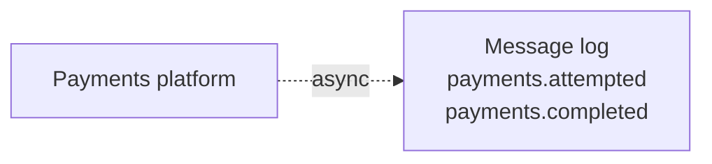
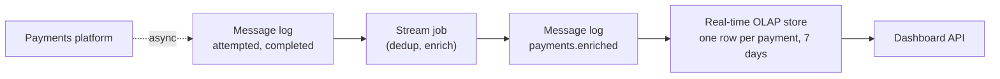
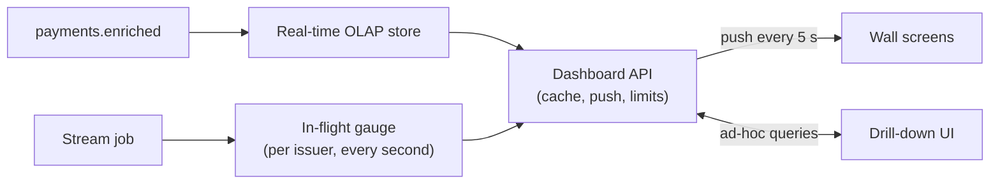
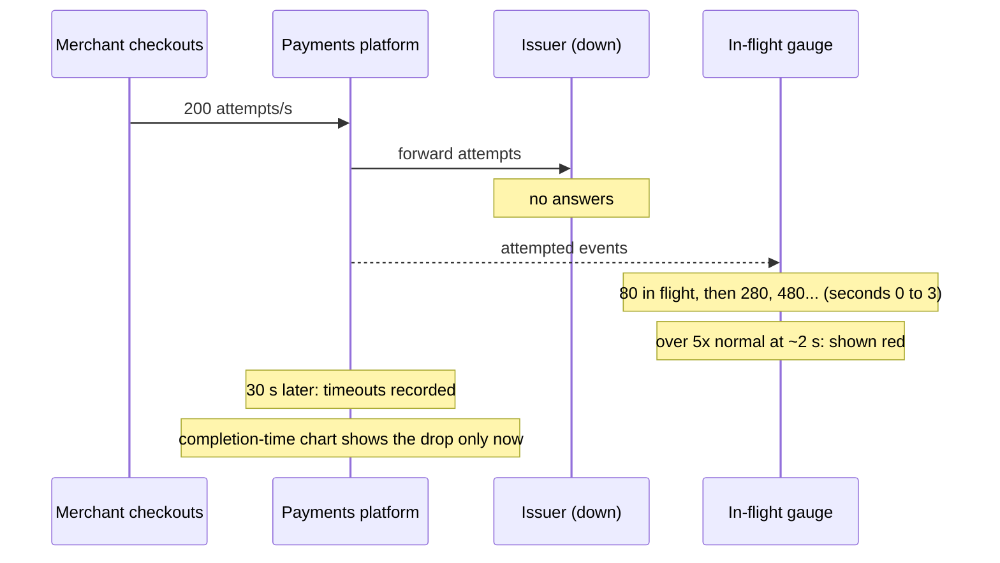
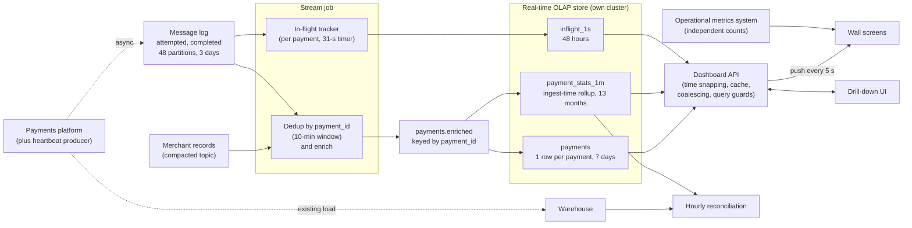

# Design a Real-Time Operations Dashboard

This breakdown follows the seven steps from [The Delivery Framework](../01-the-framework/02-delivery-framework.md). A live dashboard sounds like the easiest prompt in the course: count things, draw charts. It is a good interview question because "real time" hides three decisions candidates make by accident: **how fresh is fresh enough, where the aggregation happens, and what sits between the data and a few hundred screens refreshing every few seconds.**

## Understanding the Problem

The prompt:

> "We process card payments for about 2 million online merchants. Our operations team needs a live dashboard so they can spot problems, like a bank that stops approving cards, within a minute, and drill in to find the cause."

When a shopper pays by card, the payments platform forwards the **payment attempt** through an **acquirer route** (the bank connection it uses to reach the card networks) to the **issuer**, the shopper's bank, which approves or declines it, usually in under a second. If the issuer does not answer within 30 seconds, the platform records a **timeout**.

The metric everybody watches is the **approval rate**: approved payments divided by completed attempts. It normally sits around 90%. When it drops to 70% for one issuer in Brazil, either that bank is having an outage, or one of your routes to it is broken, and every minute costs merchants real sales.

Two kinds of use, from the same data:

- **The wall.** A big screen in the operations room and on a few hundred laptops: payments per second, approval rate and issuer response time, by country and card network, over the last hour, updating every few seconds. Everyone sees the same 40 charts.
- **The drill-down.** During an incident, an engineer asks questions nobody planned: "approval rate for Visa debit in Brazil, last 30 minutes, by issuer and decline reason, only for merchants on route 7". Any filter, any grouping.

The central tension: **the wall wants pre-computed answers served instantly, the drill-down wants raw-ish data it can slice any way, and both must be seconds fresh.** Pre-aggregating everything is impossible, aggregating everything at query time is expensive at a few hundred viewers, and the serving layer in between decides whether the dashboard survives the incident it was built for.

> [!NOTE]
> The [URL shortener breakdown](02-url-shortener-analytics.md) also serves counts from a real-time store, but to customers, and its hard problem is distinct counting. Here the viewers are an operations team mid-outage asking unplanned questions.

## Requirements

*About 6 minutes.* Ask what decisions the dashboard drives, how fast, and what "live" means to them.

> **You:** "When something breaks, how quickly do you need to see it?"
> **Interviewer:** "Today we find out from merchant complaints after 10 to 15 minutes. We want to see it within a minute."
> **You:** "So if a chart is 10 seconds behind, is that fine? What about 60?"
> **Interviewer:** "Ten seconds is fine. Sixty is too slow on a bad day."
> **You:** "Do these numbers go to finance, or to merchants?"
> **Interviewer:** "No. Finance reports come from the warehouse the next day. This is for operations only."

That last answer matters: the dashboard can be slightly approximate and provisional, because nobody is billed from it.

### Functional requirements

1. **Live wall:** payments per second, approval rate, timeout rate and issuer response time (p50 and p95), by country, card network and acquirer route, in 10-second buckets over the last hour, updating every 5 seconds.
2. **Ad-hoc drill-down:** filter and group by any dimension (country, card network, issuer, acquirer route, merchant, payment method, decline reason) over the last 7 days, at 10-second to 1-minute resolution.
3. **Baselines:** each chart can show the same hour last week, and trends go back 13 months at 1-minute resolution, for "is this normal for a Friday evening?"

**Below the line (out of scope):** the alerting rules engine (it will read the same data, but we don't build it), finance reporting and settlement, fraud scoring, merchant-facing dashboards, and looking up a single payment (support uses the payments admin tool for that).

### Non-functional requirements

Scale first:

- **Scale:** 400 million payment attempts a day, peaking near 40,000 a second during big sales. Worked out in the next step.

Then the qualities:

- **Freshness:** a payment outcome appears on the wall within 10 seconds (p95), and in drill-down queries within 15 seconds.
- **Query latency:** wall charts load in under 300 ms (p95). Drill-down queries over up to 24 hours return in under 2 seconds (p95); over 7 days, under 10 seconds.
- **Concurrency:** about 50 viewers on a normal day, **300 during an incident**, plus 20 to 30 engineers drilling down at once.
- **Correctness:** live counts within 0.5% of the warehouse's final counts for the same hour. Buckets may change for up to a minute after they close, and the dashboard must say so.
- **Availability:** the dashboard is needed most when the payments platform is in trouble, so it must not depend on the systems it watches, and it must make a stale chart obvious.

> [!TIP]
> Turn "real time" into a number before you draw anything, then ask what happens at twice the target. If the answer is "nothing much", you have slack to spend.

## Sources & Volume

*About 4 minutes.* The source is the payments platform itself. It already publishes events to a message log for other consumers, so the dashboard taps those topics. Two event types matter:

- `payment_attempted`: emitted when an attempt is sent to the issuer.
- `payment_completed`: emitted when the outcome is known: approved, declined (with a decline reason), or timed out after 30 seconds.

Use [Key DE Numbers](../02-core-concepts/10-key-de-numbers.md):

1. **Rate.** "400 million attempts a day is about 4,600 a second on average."
2. **Peak.** "Evening peaks are about 2.5x, so 12,000 a second. A big sale day can triple that. I'll size for 40,000 attempts a second."
3. **Events.** "Two events per payment, so 80,000 events a second at peak, 800 million a day."
4. **Bytes.** "A payment event as JSON is about 1 KB. That's 800 GB a day, 80 MB/s at peak."
5. **Message log.** "80 MB/s needs at least 8 partitions at 10 MB/s each. These topics already exist; I'd want at least 48 partitions for consumer parallelism. Disk: 800 GB a day, about 270 GB after lz4, kept 3 days with 3 replicas, is about 2.4 TB."

Now the numbers that shape this design:

6. **Rows the store must hold.** "One row per completed payment: 400 million rows a day. In a columnar store with about 20 mostly low-cardinality columns, a row compresses to roughly 50 to 100 bytes. Call it 80: about 32 GB a day, about 225 GB for 7 days, about 450 GB with two replicas."
7. **A drill-down query.** "The last 30 minutes at peak is up to 40,000 × 1,800 ≈ 70 million rows; on a normal evening, more like 20 million."
8. **Wall load.** "300 viewers × 40 charts, refreshed every 5 seconds, is 2,400 queries a second, almost all identical."

Say what it means:

> "Ingest is modest. A week of payments at full detail is a few hundred GB, small enough to keep in one fast analytical store. The hard parts are answering unplanned questions over tens of millions of rows in a second or two, and not letting 300 identical screens become 2,400 queries a second."

## High-Level Design

*About 12 minutes.* The data flow first:

1. The payments platform emits attempt and outcome events to the message log.
2. A stream job cleans, deduplicates and enriches them.
3. A serving store holds the enriched payments for fast aggregation.
4. A dashboard API answers queries, caches the wall's results and pushes updates to screens.
5. Longer history comes from rollups; the warehouse remains the source of truth for final numbers.

Then build it one requirement at a time.

### 1. Getting events out of the payments platform

The payments platform publishes to a message log (Kafka, or a managed equivalent) asynchronously, so a slow dashboard can never slow down a payment. Say that in one sentence and move on.

Agree two things with the payments team now, because they are hard to fix later:

- **Never the card number.** The event carries the **BIN** (the first 6 to 8 digits, which identify the issuer) already mapped to an `issuer_id`. The dashboard needs the bank, not the card.
- **Two timestamps on the outcome:** `attempt_ts` and `completed_ts`. Deep dive 1 shows why.

### 2. Seconds-fresh answers to planned and unplanned questions

This is the central decision: **where does the aggregation happen?** Raw events say "one payment, approved". The wall says "Brazil, Visa: 1,240 payments in the last 10 seconds, 91.2% approved". Something has to do that sum, either ahead of time or when someone asks.

#### Bad Solution: Query the warehouse

The payments platform already loads the warehouse. Point the dashboard at it and run `SELECT ... GROUP BY` per chart.

Warehouse data is usually 5 to 60 minutes behind, each query takes seconds, and warehouses are built for fewer, bigger queries: 2,400 a second is out of the question. It fails freshness, latency and concurrency at once.

#### Good Solution: Pre-aggregate in the stream job, serve from a key-value store

The stream job keeps counters per (10-second bucket, country, card network, acquirer route, outcome) and writes them to a fast key-value store such as Redis or Cassandra. The wall reads a few hundred small rows per chart. Fast, cheap and seconds fresh: for the wall alone, this works.

Where it falls short is the drill-down. Count the dimensions an engineer might filter or group by:

| Dimension | Distinct values |
|---|---|
| Country | ~200 |
| Card network | ~6 |
| Issuer | ~5,000 |
| Acquirer route | ~20 |
| Merchant | ~2,000,000 |
| Payment method | ~8 |
| Decline reason | ~60 |

To answer any filter-and-group question from pre-computed counters, you would need a counter for every **combination** of dimensions: with 7 dimensions, that is 2^7 = 128 groupings, and every event updates one counter in each, so 40,000 outcomes a second becomes about 5 million counter updates a second. The groupings that include merchant or issuer have hundreds of millions of keys. And the question you need during an incident ("route 7 only, by issuer and decline reason") is exactly the one you didn't think to pre-compute. Pre-aggregating everything is called building a **cube**, and at this cardinality it is the wrong tool.

#### Great Solution: A real-time OLAP store that aggregates at query time, with a few pre-aggregations on top

A **real-time OLAP store** (ClickHouse, Apache Druid, Apache Pinot; introduced in [URL Shortener Analytics](02-url-shortener-analytics.md)) ingests a stream continuously and answers many small aggregate queries in milliseconds. Store one row per completed payment, at full detail, for 7 days. Every question becomes a `GROUP BY` over a time slice.

Why this is fast enough: a query reads only the columns it needs; data is split by time into **segments** (the store's unit of data, a block of rows for a time range), so "last 30 minutes" touches only the newest ones; and low-cardinality columns plus indexes on columns like `issuer_id` skip rows that don't match. A cluster of a few nodes scans hundreds of millions of rows a second this way, so 20 to 70 million rows is a one- to two-second query.

Freshness comes from how these stores ingest: they read the topic directly, and Pinot and Druid make rows queryable as soon as they are consumed, before they are written into a finished segment. ClickHouse inserts arrive in small batches, typically a few seconds apart. Either way, a payment is queryable a few seconds after it lands in the topic.

**Pre-aggregate what you know you'll ask, and aggregate at query time what you don't.** The wall's 40 charts are known, so the API computes them once and shares them (step 4); long history becomes rollups (step 5); the OLAP store answers the unplanned questions.

Its costs: another distributed database to run, and more work per query than reading a counter. Acceptable for questions nobody wrote down.

### 3. The stream job: is it needed at all?

Real-time OLAP stores can ingest the raw topic directly and look up merchant attributes at query time (ClickHouse dictionaries, Druid lookups, Pinot lookup joins). If that covered everything, you would skip the stream job. Say so, to show you are not adding boxes by reflex. Here the stream job ([Flink](../04-technology-deep-dives/08-flink.md), or Spark Structured Streaming) earns its place with three jobs:

- **Deduplicate** by `payment_id`. The payments platform publishes at least once, so a retried send produces a duplicate. A short **windowed dedup** (remember each ID for 10 minutes, then forget it) catches retries, which arrive within seconds ([Deduplication at Scale](../02-core-concepts/09-deduplication-at-scale.md)).
- **Enrich** each outcome with merchant attributes (category, size tier, home country) from a **compacted topic** of merchant records (a topic that keeps only the latest record per key, so it holds the current state of every merchant). Two million merchants at about 200 bytes each is 400 MB, which fits easily in the job's state.
- **Track payments in flight**: attempts that have not completed yet, per issuer. This is the early-warning signal of deep dive 1, and it needs state that an ingest-only store cannot keep.

It writes `payments.enriched`, keyed by `payment_id`, which the OLAP store ingests.

### 4. Serving the wall to 300 screens

Browsers querying the store directly would make 2,400 queries a second, mostly the same 40. Put a **dashboard API** in between: it runs each wall query once every 5 seconds, caches the result and pushes it to every screen, 8 queries a second whatever the number of viewers. Drill-downs pass through it with limits. Deep dive 3 has the ladder.

### 5. Baselines and 13 months of history

"Same hour last week" and "every Friday for a year" are planned questions over long periods, so pre-aggregate them. A 1-minute rollup by every dimension except merchant and payment ID is about 50,000 rows a minute at peak (most issuers appear in only a few countries and routes), so at most 70 million rows a day, 28 billion over 13 months. At roughly 70 to 100 bytes a row including the latency histogram (below), that is a rough 2 to 3 TB, an upper bound since most minutes are below peak: fine for the same OLAP store. A **rollup** is a pre-computed aggregate at a fixed grain; here it is maintained by the store itself as data arrives, an **ingest-time rollup**: Druid rolls up rows at ingestion, and ClickHouse uses a materialized view into a summing table. Pinot's star-tree index pre-aggregates chosen dimension combinations inside each segment once it is sealed, so it speeds up queries rather than replacing a rollup table.

Merchant-level history beyond 7 days comes from the warehouse; nobody needs last March by merchant in seconds.

## Data Model

*About 5 minutes.* Model from the charts backwards.

### The enriched payment (topic and OLAP store)

| Field | Type | Notes |
|---|---|---|
| `payment_id` | string | Set by the payments platform. Dedup key. |
| `attempt_ts` | timestamp | When the attempt was sent to the issuer. |
| `completed_ts` | timestamp | When the outcome came back, or when the 30-second timeout fired. |
| `outcome` | string | `approved`, `declined`, `timeout`. |
| `decline_reason` | string | Normalized issuer code; null unless declined. |
| `issuer_id`, `card_network`, `country` | string | From the BIN, mapped by the payments platform. |
| `acquirer_route` | string | Which bank connection was used. |
| `merchant_id`, `merchant_category`, `merchant_tier` | string | Category and tier from enrichment. |
| `payment_method` | string | Credit, debit, prepaid, wallet. |
| `issuer_latency_ms` | int | `completed_ts` minus `attempt_ts`. |
| `amount_usd` | decimal | Converted at a daily rate; for "value at risk" charts, not for finance. |

The grain is one completed payment. Table settings: segments by hour of `completed_ts`, rows sorted by `(country, card_network, completed_ts, payment_id)` inside each segment, an inverted or bloom index on `issuer_id`, `acquirer_route` and `merchant_id`, and 7 days of retention. The sort order matches the wall's most common filters; the indexes serve the drill-down's.

### Store counts, never rates

Compute rates at query time: `sum(approved) / sum(completed)`. Averaging stored rates is wrong: a bucket of 10 payments at 50% and one of 10,000 at 92% do not average to 71%. Likewise, the p95 of two buckets is not the average of their p95s. For response-time charts over long ranges, the rollup stores a **latency histogram**: counts per fixed latency bucket (0 to 100 ms, 100 to 200 ms, and so on, about 20 buckets). Histograms add across buckets, dimensions and days, and an approximate p95 comes from the summed counts. It is the same mergeability idea as the sketches in [URL Shortener Analytics](02-url-shortener-analytics.md).

### Rollups

| Table | Grain | Columns | Retention |
|---|---|---|---|
| `payments` | one completed payment | as above | 7 days |
| `payment_stats_1m` | minute, country, network, issuer, route, method, outcome, decline reason | `payments`, `amount_usd`, latency histogram | 13 months |
| `inflight_1s` | second, issuer, country | `in_flight`, `attempts_started` | 48 hours |

### Topics

`payments.enriched`, 48 partitions, keyed by `payment_id`, 3 days of retention. Keying by `payment_id` spreads load evenly and keeps every copy of one payment on one partition, which the store's dedup needs (see Pipeline Design).

## Pipeline Design

*About 5 minutes.* Most of this is settled.

| Path | Mode | Why |
|---|---|---|
| Payments platform → message log | Continuous, async | Isolation; already exists. |
| Stream job | Streaming, record at a time, checkpoint every 30 seconds | 10-second freshness; in-flight tracking needs per-payment state. |
| OLAP ingestion from `payments.enriched` | Continuous, rows queryable within seconds | The store's native stream ingestion. |
| Ingest-time rollups | Maintained by the store as rows arrive | No separate job. |
| Wall refresh | Every 5 seconds, in the dashboard API | 40 queries, shared by all viewers. |
| Hourly reconciliation | Batch, hourly, against the warehouse | The 0.5% correctness check. |

Why streaming and not micro-batch? A 10-second target sits in the overlap zone of [Micro-Batch vs Streaming](../03-architecture-patterns/08-micro-batch-vs-streaming.md), so a short-trigger micro-batch could do it. The in-flight tracking, which holds state per payment and emits every second, tips it to record-at-a-time.

**Duplicates and restarts.** The stream job's dedup catches retried sends. But when the job restarts from a checkpoint, it re-emits everything since that checkpoint, up to 30 seconds of output, and the OLAP store sees those rows twice. Deep dive 2 explains why you don't fix that with an exactly-once sink here. Instead, the store deduplicates on `payment_id`:

- **Pinot** supports upsert tables: a newer row with the same primary key replaces the older one. It requires the topic to be partitioned by that key (it is) and keeps a map of keys in memory, so use a metadata TTL to forget keys after, say, an hour; duplicates arrive within minutes.
- **ClickHouse** with a `ReplacingMergeTree` table removes duplicates during background merges, so for a while both copies exist; queries that must be exact add `FINAL`, which costs some speed. It deduplicates on the table's sort key within a partition, so `payment_id` must be part of the sort key.
- **Druid** has no streaming upsert; you rely on the stream job and accept a rare duplicate.

The minute rollup cannot deduplicate in any of them, so a restart leaves a few seconds of doubled counts there, well inside the 0.5% tolerance.

These behaviors are version-dependent; say which store you assume. Without any dedup, payments per second would spike after every restart, which looks like a traffic surge.

**Event time.** All timestamps come from your own payment servers, so there are no phones replaying hours-old events. Lateness is bounded: pipeline delay plus at most 30 seconds between attempt and outcome. Deep dive 1 decides which timestamp the charts use.

**Failure behavior.**

- **Stream job down:** `payments.enriched` stops growing, the OLAP store has nothing new, charts freeze. The topic holds 3 days, so on restart the job catches up. Deep dive 4 makes sure a frozen chart is obvious.
- **OLAP store node down:** two replicas, so queries keep working on the other. Ingestion resumes from the stored offset on recovery.
- **Bad enrichment** (a wrong merchant category mapping): fix it, replay the last 3 days of the topics into a fresh table and switch over; older days come from the warehouse if needed.

## Potential Deep Dives

*About 12 minutes.* If the interviewer leaves the choice to you, start with the first: it is the one that bites every real-time dashboard, and few candidates see it coming. How to choose and run them is in [Deep Dives](../01-the-framework/08-deep-dives.md).

### 1. "The approval rate always dips at the right edge of the chart, then recovers. Why, and what do you do?"

Picture the approval-rate chart in 10-second buckets by `attempt_ts`. Most payments in the newest bucket have outcomes, but some have not come back yet, and its timeouts will not be known for 30 seconds. The chart is drawing a bucket that is still filling. This is [late-arriving data](../02-core-concepts/08-late-arriving-data.md) in miniature: the lateness is small and bounded, but a live dashboard always shows the incomplete part.

#### Bad Solution: Bucket by attempt time, divide by all attempts

Approval rate per bucket = approved ÷ attempts started in that bucket. For the newest bucket, attempts still in flight count in the denominator but not the numerator, so the rate reads 75% and climbs to 91% over the next 30 seconds as outcomes arrive. Every refresh, the right edge dips.

The real damage is human: the team learns that the right edge always dips and stops looking. Then a real outage starts there.

#### Good Solution: Bucket by completion time

Bucket by `completed_ts` instead: "of the payments that finished in this 10-second window, how many were approved?" A bucket is complete as soon as the window ends plus the pipeline delay of a few seconds, so the right edge is stable. This is what most operations wall charts should show.

Where it falls short: when an issuer stops answering, no outcomes come back for 30 seconds, then the timeouts arrive all at once. For half a minute the chart shows *fewer payments with a normal approval rate*, which looks calm. You see the outage 30 seconds late.

#### Great Solution: Completion-time charts, an in-flight gauge, and provisional buckets

Keep three views, each correct for its question:

1. **Wall charts by completion time**, as in the Good option. Stable, honest, no phantom dips.
2. **An in-flight gauge per issuer** from the stream job: attempts started minus attempts completed, emitted every second. Normally an issuer handling 200 payments a second with a 400 ms response time has about 200 × 0.4 = 80 payments in flight. If it stops answering, that number climbs by 200 a second and passes 1,000 within 5 seconds, long before the first timeout. Flag it at, say, 5x the issuer's normal in-flight level, and the dashboard shows the outage within seconds. This is the signal the ops team actually wanted.
3. **Attempt-time charts for analysis**, used after the fact ("of the payments started at 14:02, how many failed?"), with any bucket younger than 30 seconds plus the pipeline delay drawn grey and labelled "provisional". That boundary is a **watermark** (the pipeline's estimate of how far event time is complete): you know all outcomes for attempts older than it.

The state is small: tens of thousands of open payments normally, 1.2 million (about 100 MB) even if every issuer timed out at once. A 31-second timer per payment means a lost outcome event cannot leave it open forever.

> [!TIP]
> The strong answer here starts with "it depends which timestamp the chart uses". Naming the two timestamps, and saying which question each answers, is what interviewers listen for.

### 2. "You said 10 seconds. Could you get it to 1 second? Should you?"

Answer with a **freshness budget**: the end-to-end delay split into each hop's share.

| Hop | Typical delay | What sets it |
|---|---|---|
| Payments platform → message log | 10 to 100 ms | Producer batching (`linger.ms`) and replica acks |
| Stream job (dedup, enrich) | Under 1 s | Record at a time, if the sink does not wait for checkpoints |
| OLAP ingestion until queryable | 1 to 5 s | Pinot and Druid serve rows as consumed; ClickHouse insert batch interval |
| Wall refresh in the dashboard API | 0 to 5 s | The 5-second refresh cycle |
| Push to the browser | Under 1 s | An open connection |
| **Total** | **About 3 to 10 s typical** | The hops sum to about 1 to 12 s; the extremes rarely line up |

**The hidden latency floor.** If the stream job wrote to Kafka with exactly-once transactions, its output would become visible to consumers that read only committed data (`read_committed`, which the OLAP store would need) only when a checkpoint completes. With 30-second checkpoints, every event would wait up to 30 seconds, tripling the budget ([Flink](../04-technology-deep-dives/08-flink.md) explains why). So this design uses an at-least-once sink plus dedup in the store: exactly-once output costs a checkpoint interval of latency, and an ops dashboard would rather show a duplicate for a few seconds than show nothing for 30.

**Where 1 second would come from.** The refresh cycle and the store's ingestion are most of the budget, so 1 second means per-event pushes to browsers and sub-second ingestion settings, each costing money and complexity.

Then ask: **who acts faster than 10 seconds?** A human needs a few seconds to notice and act. Automated responses, such as moving traffic off a failing acquirer route, belong in the payments platform, deciding on each payment, not in a dashboard. "10 seconds is right for humans. If you want sub-second, you want automation, and that's a different system."

> [!WARNING]
> Don't promise "real time" by naming Flink. Freshness is the sum of every hop, including the store's ingestion and the browser's refresh. A sub-second stream job feeding a 5-second refresh is a 5-second dashboard.

### 3. "An incident starts, and 300 people open the dashboard at once. What happens?"

#### Bad Solution: Browsers query the OLAP store directly

300 screens running 40 queries every 5 seconds is 2,400 queries a second. Even at 20 ms each that is roughly 50 busy cores, for 40 different answers. Latency climbs, and the drill-down queries, the ones that find the cause, queue behind identical wall queries.

#### Good Solution: A dashboard API with a shared result cache

The API caches each result for 5 seconds. Two details make the cache hit:

- **Snap time to the bucket.** "Last hour" sent at 14:03:07.412 and at 14:03:08.901 are different queries unless the API rounds "now" down to 14:03:05 first. Without it, the cache key differs on every request and the hit rate is zero.
- **Coalesce requests.** When a cached result expires and 300 requests arrive for it at once, run the query once and let the other 299 wait for that result. This is **request coalescing**; without it, every expiry is a burst of 300 identical queries.

Now 300 viewers cost 40 queries per 5 seconds. What remains: screens still poll every 5 seconds, and one engineer's "group by merchant over 7 days" can still take over the store.

#### Great Solution: Push the wall, and fence off the drill-down

- **Push, don't poll.** A refresher in the API runs the 40 wall queries every 5 seconds and pushes the results to every open screen over server-sent events or WebSockets (connections the browser keeps open so the server can send updates without being asked). The store's load is fixed at 8 queries a second whether 5 or 5,000 people are watching.
- **Isolate the workloads.** Give wall queries and drill-down queries separate resource pools or priorities in the store (all three stores offer some form of query quotas, priorities or per-user resource limits), so the wall always gets its share.
- **Guard the drill-down.** In the API: queries on the raw `payments` table are limited to 24 hours unless the engineer explicitly asks for more, queries time out after 10 seconds, results are capped at a few thousand groups ("top 50 merchants, then other"), and each user can run 3 queries at a time. Longer ranges go to `payment_stats_1m`, which has no merchant column and is far smaller.
- **Run it separately from what it watches.** The dashboard's store, API and stream job run on their own cluster, not on the payments platform's infrastructure, so a payments outage that saturates shared capacity doesn't take the dashboard with it.

The guards will occasionally refuse a legitimate question. That beats a dashboard that times out during the outage.

### 4. "The wall shows payments dropping to zero in Germany. Is Germany down, or is your pipeline?"

An operations dashboard can fail in a way that sends people the wrong way: **a stale chart that looks normal, or a broken pipeline that looks like an outage.**

#### Bad Solution: Draw whatever the store returns

If the stream job stops, the store returns no rows for recent buckets, and the chart draws them as zero. Fifty people start debugging German acquirer routes. The actual problem is a stuck consumer.

#### Good Solution: Show data age on every chart, and draw missing as missing

- The API asks the store for the newest `completed_ts` it has and shows "data as of 14:03:05 (4 s ago)" on every chart. Past 30 seconds the chart turns grey with a banner: "data delayed".
- Buckets newer than the newest data are drawn as gaps, not zeros. Zero means "we know there were none"; a gap means "we don't know yet".

This catches a stopped pipeline, not a partly broken one: if some partitions are stuck, the newest timestamp still looks fresh while a share of payments is missing.

#### Great Solution: Heartbeats through the whole pipeline, plus an independent cross-check

- **Heartbeats.** A small heartbeat producer, running next to the payments platform, publishes one heartbeat event per partition every second (48 a second, nothing), marked so charts exclude it and carrying its partition number. The stream job forwards them to the output topic, and the store ingests them. The API tracks the newest heartbeat per partition: if any partition is more than 30 seconds behind, the wall says which share of data is delayed, and freshness is now measured end to end.
- **An independent count.** The payments platform already exports a simple payments-per-second counter per country to its operational metrics system, a different pipeline entirely. Show it as a small line on the wall. If the metrics system says Germany is processing 300 payments a second and your chart says zero, the pipeline is the suspect, not Germany.

The principle: **the dashboard must report its own health as clearly as the business's**, with a second opinion that doesn't share its failure modes (the same idea as in [Log Aggregation](01-log-aggregation.md)).

## Monitoring & SLAs

*About 4 minutes.* Four SLAs, one per non-functional requirement that can be measured. How to present them is in [Monitoring and SLAs](../01-the-framework/09-monitoring-and-slas.md); alert design is in [Monitoring and Alerting](../02-core-concepts/06-monitoring-and-alerting.md).

| SLA | Target | Measured by |
|---|---|---|
| **Freshness** | 95% of outcomes on the wall within 10 s | Heartbeat age per partition at the API, as seen by a screen |
| **Query latency** | Wall p95 under 300 ms; drill-down p95 under 2 s for 24 hours | Dashboard API logs, split by pool |
| **Correctness** | Hourly counts by country and outcome within 0.5% of the warehouse | Hourly reconciliation job comparing `payment_stats_1m` with the warehouse |
| **Availability** | Wall up 99.9%, and up during payments incidents | Synthetic check from outside both systems every 30 s |

Behind them:

- **Consumer lag** on the stream job and on the OLAP store's ingestion, per partition. Lag is where freshness goes first.
- **Duplicate rate** removed by dedup, against last week. A jump means retries upstream or a restart loop.
- **Cache hit rate** in the API. A falling hit rate usually means someone broke the time snapping.
- **Rejected drill-down queries**, and the **reconciliation drift trend**: a slow climb from 0.1% to 0.4% is a bug to find before it crosses 0.5%. The warehouse loads the same events by a separate path, so two systems agreeing are unlikely to be wrong the same way.

## Final Design

Follow one payment. At 20:14:03 a shopper in São Paulo pays with a Visa debit card. The payments platform publishes `payment_attempted` and sends the attempt to the issuer, which approves it 380 ms later; the platform publishes `payment_completed`. The stream job closes it in the in-flight tracker, finds no duplicate, adds the merchant's category and tier, and writes to `payments.enriched`. The OLAP store ingests it about 2 seconds later, and it lands in the `payments` table and in the 20:14 minute of `payment_stats_1m`. At 20:14:05 the API's refresher runs the 40 wall queries, and the Brazil–Visa approval-rate chart that every open screen receives at once includes this payment, about 5 seconds after it happened. At 21:00 the reconciliation job compares the 20:00 hour against the warehouse. After 7 days the full row expires; the minute rollup keeps the count for 13 months.

The bill is small: existing topics, a stream job of a few dozen cores, an OLAP cluster of perhaps 6 to 10 nodes holding several TB including replicas, and a few API instances. The engineering is in the details that keep it honest.

## What's Expected at Each Level

### Mid-level

You get the shape right: events through a message log, a stream job, a fast analytical store, an API in front of it. You turn "real time" into a number when asked, explain why the warehouse is too slow and too expensive for 300 viewers, and know that rates must be computed from counts. You may need the interviewer's help to see why pre-aggregating every combination fails. The bar for this problem: the real-time OLAP store with a reason, a cache in front of it, and a freshness SLA.

### Senior

You drive. You quantify freshness and load early and let them pick the design. You argue the central decision with the cube arithmetic. You spot the right-edge problem, name the two timestamps, and add an in-flight signal so an issuer outage shows up in seconds. You build the freshness budget hop by hop and know that an exactly-once sink adds a checkpoint interval of latency. Your API snaps time, coalesces requests, pushes the wall and guards the drill-down, and your charts distinguish "zero" from "unknown".

### Staff+

You treat the dashboard as part of incident response. You keep it independent of the systems it watches, with a second opinion and visible health. You push back on sub-second freshness for humans and move automated reactions into the payments platform. You make sure the dashboard, the alerting engine and the warehouse report define "approval rate" the same way, with one owner for each metric definition.

## Related Lessons

- Framework: [The Delivery Framework](../01-the-framework/02-delivery-framework.md), [Requirements Gathering](../01-the-framework/03-requirements-gathering.md), [Sources and Volume](../01-the-framework/04-sources-and-volume.md), [High-Level Architecture](../01-the-framework/05-high-level-architecture.md), [Deep Dives](../01-the-framework/08-deep-dives.md), [Monitoring and SLAs](../01-the-framework/09-monitoring-and-slas.md)
- Concepts: [Key DE Numbers](../02-core-concepts/10-key-de-numbers.md), [Late-Arriving Data](../02-core-concepts/08-late-arriving-data.md), [Deduplication at Scale](../02-core-concepts/09-deduplication-at-scale.md), [Monitoring and Alerting](../02-core-concepts/06-monitoring-and-alerting.md)
- Patterns: [Micro-Batch vs Streaming](../03-architecture-patterns/08-micro-batch-vs-streaming.md)
- Technology: [Kafka](../04-technology-deep-dives/02-kafka.md), [Flink](../04-technology-deep-dives/08-flink.md)
- Related breakdowns: [URL Shortener Analytics](02-url-shortener-analytics.md) (real-time OLAP for customer dashboards, distinct counts and top-K), [Log Aggregation](01-log-aggregation.md) (monitoring a platform independently of itself)
- Previous breakdown: [E-Commerce Warehouse](03-e-commerce-warehouse.md). Next: [CDC Replication](05-cdc-replication.md)
