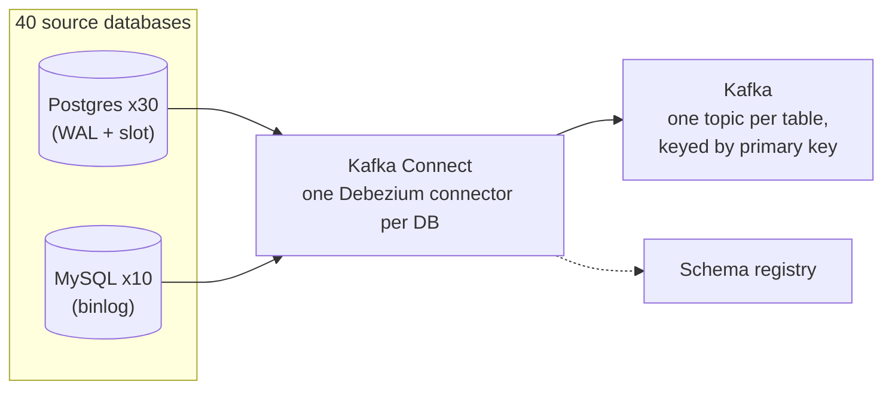
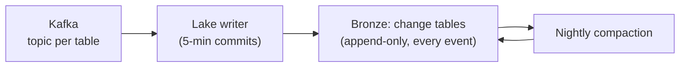
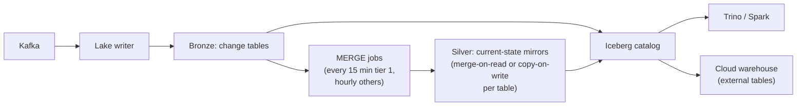
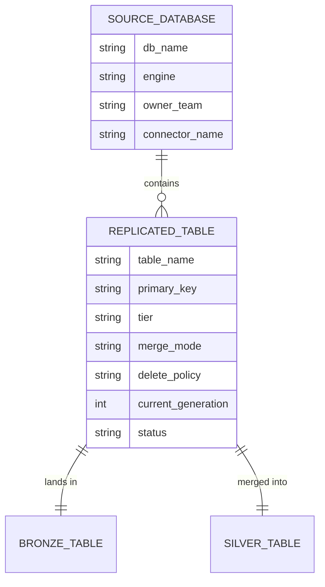
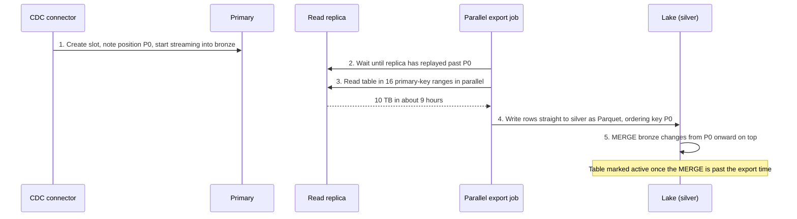
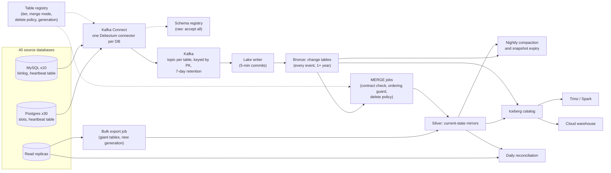

# Design CDC Replication from OLTP Databases into the Lake

This breakdown follows the seven steps from [The Delivery Framework](../01-the-framework/02-delivery-framework.md). "Replicate our databases into the lake" sounds like plumbing, and for one database it nearly is: [CDC Patterns](../03-architecture-patterns/04-cdc-patterns.md) covers the mechanism in one lesson. This prompt is harder because it says *forty* databases, owned by teams who will keep changing them. The interview is about four things that each look solved for one table and break at this scale: **ordering, deletes, schema change, and getting the existing 40 TB in without hurting production.**

## Understanding the Problem

The prompt:

> "We run about 40 production databases, mostly Postgres with some MySQL, owned by a dozen product teams. Analysts and finance want that data in our lake and warehouse, current to within minutes. Today we do nightly full dumps that take nine hours and sometimes fail. Design the replacement."

An **OLTP database** (online transaction processing) is the database an application reads and writes as users act: one row per order, updated as the order moves. It is built for many small writes, not for analytics, which is why you copy its data out.

The replacement is **change data capture (CDC)**: read each database's own log of changes and replay them into the lake. You will not re-explain how CDC works; the interviewer assumes you know the snapshot-plus-stream handoff and why log-based beats polling. What they want to see is that you can run it as a *platform*:

- **Ordering.** Two updates to the same row must land in commit order, through Kafka, a parallel lake writer and a batch MERGE, across restarts and failovers.
- **Deletes.** A deleted row must disappear from the current view, without erasing history analysts need, and without missing deletes that never produce a row event.
- **Schema change.** Forty databases means a schema migration somewhere almost every day. One team's rename must not stop replication for everyone else.
- **Initial snapshot at scale.** 40 TB of existing rows must be copied once, and again whenever something breaks, while the source keeps serving checkout.

Say your plan in one sentence and start with requirements.

## Requirements

*About 6 minutes.* You ask who reads the data, how fresh, and what "correct" means:

> **You:** "Do consumers need the current state of each table, the history of changes, or both?"
> **Interviewer:** "Mostly current state. But finance wants to see how a payment's status changed, and data science wants history for some tables."
> **You:** "When a row is deleted in production, should it disappear from the lake?"
> **Interviewer:** "From the current view, yes. But we have nightly jobs that purge old sessions from production, and analysts want to keep those."
> **You:** "Who changes the schemas, and is there any review?"
> **Interviewer:** "Each team runs its own migrations. No central review today."

Write down the second answer. "Delete" means two different things here, and a deep dive will turn on it.

### Functional requirements

1. **Current-state mirrors**: for every replicated table, a lake table that matches the source as of a few minutes ago, deletes included.
2. **Change history**: every insert, update and delete, with its commit time, kept for at least a year.
3. **Onboarding**: adding a new table or database is configuration, not a project, and does not disturb tables already flowing.
4. **Readable from the warehouse and the lake engines**, without maintaining two copies.

**Below the line (out of scope):** business models built on top (the gold layer, see [E-Commerce Warehouse](03-e-commerce-warehouse.md)), non-database sources (SaaS APIs, files), replication back into applications, sub-second serving to services, and publishing curated business events (the outbox pattern, mentioned at Staff+).

### Non-functional requirements

- **Scale:** 40 databases, about 3,000 tables, 60 TB on disk (about 40 TB of table data without indexes), about 20,000 row changes a second on average (worked out next).
- **Freshness:** change history queryable within 5 minutes; current-state mirrors within 15 minutes (p95) for the roughly 200 "tier 1" tables finance and dashboards use, within an hour for the rest.
- **Correctness:** mirrors match the source. Checked daily, with zero unexplained differences. No change silently lost or applied out of order.
- **Source safety:** replication must never slow down or endanger a production database. This is the constraint teams will hold you to; a CDC platform that once filled a primary's disk does not get a second chance.
- **Cost:** roughly in line with the current dump infrastructure, a few tens of thousands of dollars a month.

> [!TIP]
> Ask about deletes and schema ownership in the first five minutes. Both answers change the design, and asking shows you have run CDC before.

## Sources & Volume

*About 4 minutes.* Using [Key DE Numbers](../02-core-concepts/10-key-de-numbers.md):

1. **Change rate.** "Across 40 databases, say 20,000 row changes a second on average. Peaks around 3x, so 60,000."
2. **Bytes.** "A CDC event with before and after images is 0.5 to 2 KB. Call it 1 KB. That's 20 MB/s average, 60 MB/s peak."
3. **Per day.** "20,000 × 86,400 ≈ 1.7 billion changes, about 1.7 TB a day as JSON."
4. **The biggest database.** "Payments is the outlier: 15 TB on disk, about 10 TB of rows, averaging 4,000 changes a second and peaking at 12,000. It writes WAL, its change log, at about 8 MB/s, roughly 700 GB a day, because the log also records index changes."
5. **Existing data.** "40 TB of rows to copy once. At about 20 MB/s through one connection, that's 2 million seconds: 23 days. Payments alone is almost 6 days."

Then say what the numbers imply:

> "The stream is small: 60 MB/s at peak is a modest Kafka cluster. Volume isn't the problem. Three things are: 3,000 tables means 3,000 topics and 3,000 lake tables to keep healthy; one connector per database must keep up with payments' 12,000 changes a second; and the initial copy is weeks long if done naively, while the source holds its log for us the whole time."

That last clause matters. While a connector is snapshotting a table, the database keeps every WAL file since the snapshot started, so the replication can resume where the snapshot left off. Six days of payments WAL is about 4 TB on the primary's disk.

## High-Level Design

*About 12 minutes.* The data flow first:

1. A CDC connector per database reads its log and publishes change events.
2. A message log buffers them, one topic per table.
3. A lake writer appends every event to a raw change table (bronze).
4. A scheduled MERGE folds changes into a current-state mirror (silver).
5. The warehouse and lake engines read both through one catalog.

### 1. Capturing changes from 40 databases

#### Bad Solution: Faster dumps, or incremental queries

Keep the nightly dumps but run them more often, or switch to `WHERE updated_at > :last_run` queries every few minutes.

Full dumps of 60 TB cannot run every 15 minutes. Incremental queries miss hard deletes, collapse intermediate states and query the primary on a schedule; [CDC Patterns](../03-architecture-patterns/04-cdc-patterns.md) has the details. And 3,000 tables do not all have a trustworthy `updated_at`.

#### Good Solution: A managed replication service per database, straight into the warehouse

A cloud replication service (DMS, Datastream and similar) reads each database's log and writes into warehouse tables.

This is a reasonable answer for a small team with five databases and one target, and you should say so. At this scale it falls short: per-GB or per-row pricing on 1.7 billion changes a day adds up, you get little control over snapshots, ordering metadata and delete handling, and the requirement says lake *and* warehouse, with more consumers likely.

#### Great Solution: Log-based CDC connectors into Kafka, one topic per table

Run **one Debezium connector per database** on Kafka Connect (self-run, or managed Connect such as MSK Connect or Confluent Cloud). Each reads the WAL (Postgres) or binlog (MySQL) and publishes one event per row change to a topic per table, **keyed by primary key**. A **schema registry** stores each table's event schema. The details of connectors, tasks and snapshot modes are in [Debezium and CDC Tools](../04-technology-deep-dives/09-debezium-and-cdc-tools.md).

Two numbers to check aloud. A Postgres or MySQL connector is one reader, good for thousands to low tens of thousands of events a second, so payments' 12,000 at peak fits with modest headroom; if it grows, split its tables across two connectors, keeping each table in one. And Kafka is sized by partitions, not bytes: 3,000 topics, most with one partition, the 50 busiest with 6 to 12, is about 3,500 partitions, or 10,500 replicas at replication factor 3. At 2,000 to 4,000 replicas per broker that's 3 to 6 brokers, which is also far more than 60 MB/s needs.

### 2. Change history within 5 minutes

A **lake writer** (Spark Structured Streaming or Flink) consumes all topics and appends each event, unchanged, to a **bronze change table** per source table in Iceberg (Delta works the same way; see [Iceberg](../04-technology-deep-dives/07-iceberg.md) and [Medallion Architecture](../03-architecture-patterns/03-medallion-architecture.md)). Nothing is merged or filtered here. Bronze is the audit trail, the history finance asked for, and the replay source when anything downstream is wrong.

One trap is specific to 3,000 tables. If the writer commits every table every 5 minutes, that is 864,000 commits a day, and the quiet tables produce a tiny file each time: the **small-files problem**. So the writer commits a table when it has 5 minutes of data *and* something to write, a nightly job compacts bronze files, and snapshots older than a few days are expired. Most of the 3,000 tables see a few changes an hour; they cost almost nothing if you never write empty commits.

Bronze volume: 1.7 TB a day of JSON is about 350 GB a day as Parquet. A year is about 125 TB, around $3,000 a month on object storage. Cheap enough to keep everything.

### 3. Current-state mirrors within 15 minutes

Analysts want `SELECT * FROM payments WHERE status = 'failed'`, not a log of changes. Each mirror is built from bronze by a **MERGE** (an upsert: update rows whose key exists, insert the rest, act on deletes) that runs on a schedule. The MERGE's shape (keep the latest change per key, guard on log position, soft-delete) is in [CDC Patterns](../03-architecture-patterns/04-cdc-patterns.md). The decision here is how the lake table absorbs it, because the choice decides whether 15 minutes is affordable.

Take `users`: 200 million rows, about 500 GB in silver as roughly 2,000 files of 256 MB. Every 15 minutes about 300,000 users change (a `last_seen_at` column), spread evenly across all keys.

#### Bad Solution: Rebuild each mirror from bronze, or dedupe at query time

Either rebuild `users` from all of bronze every run, or skip silver and give analysts a view that picks the latest event per key over bronze.

The rebuild reads a year of history to apply 15 minutes of changes. The view pushes that cost into every query: each dashboard refresh sorts billions of events. Both work for a 50 MB table and fall over for `users`.

#### Good Solution: Copy-on-write MERGE every 15 minutes

Run the MERGE against an Iceberg or Delta table in copy-on-write mode: every data file containing a changed row is rewritten.

Reads stay fast and simple. But 300,000 random keys across 2,000 files touch essentially every file, so each run rewrites the whole 500 GB to change about 300 MB. At roughly 20 MB/s per core that is 25,000 core-seconds per run, about 7 core-hours, 96 times a day; on 64 cores it eats about 6 minutes of every 15-minute window. You also write 48 TB a day of new files, and the old ones stay on storage until snapshots expire. That is one table. Append-mostly tables like `ledger_entries`, where changes hit only recent files, are fine with copy-on-write; tables with updates scattered across all keys are not.

#### Great Solution: Merge-on-read for update-heavy tables, with scheduled compaction

Set update-heavy tables to **merge-on-read**: the MERGE writes the changed rows as new files plus small delete files that mark the old versions, and readers apply the deletes when they scan ([Iceberg](../04-technology-deep-dives/07-iceberg.md) covers delete files and v3 deletion vectors; [Delta Lake](../04-technology-deep-dives/06-delta-lake.md) does the same with deletion vectors). Each run now writes a few hundred MB. A nightly compaction rewrites `users` once, about 500 GB a day instead of 48 TB, and keeps the read penalty bounded.

Pick the mode per table from its update pattern, recorded in the table's config: copy-on-write for append-mostly and rarely updated tables, merge-on-read for the rest. Lay update-heavy tables out by a bucket of the primary key (Iceberg's `bucket(64, user_id)`), so compaction and MERGE work on a slice at a time.

> [!NOTE]
> A streaming alternative worth one sentence: Flink's Iceberg sink in upsert mode writes equality deletes directly from the stream, giving freshness of a minute or two. Equality deletes are expensive to read until compacted, so it needs the same compaction discipline. Choose it only if someone asks for minutes rather than a quarter of an hour.

### 4. One copy for warehouse and lake

Register bronze and silver in one Iceberg catalog. Trino and Spark read them directly; the cloud warehouse reads them as external Iceberg tables (most major warehouses can read them; write support varies by product and version, so check yours and treat the warehouse as read-only for these tables). That meets "no two copies". If a warehouse must hold native tables for performance, load from silver, never from a second CDC path, so there is one place where ordering and deletes are decided.

## Data Model

*About 5 minutes.* Three things to model: the events, the bronze change table, and the silver mirror. Plus a small control table that turns 3,000 tables into configuration.

### Topics and events

Topic per table, named `<database>.<schema>.<table>`; message key is the primary key; value is the Debezium envelope (`op`, `before`, `after`, `source` with log position and commit time). Events are Avro, with schemas in the registry. Retention is **7 days, delete-based, not compacted**: bronze holds the full history, and Kafka only needs to cover a lake writer outage plus a replay. Disk: 1.7 TB a day, about 3x smaller with lz4, kept 7 days at replication factor 3, is roughly 12 TB across the cluster.

### Bronze change table (one per source table)

| Column | Notes |
|---|---|
| `_op` | `c`, `u`, `d`, or `r` (row read by a snapshot) |
| `_ordering_key` | Sortable position of this change in the source log (see deep dive 2) |
| `_generation` | Snapshot generation: bumped when a database is re-snapshotted on a new log position (see deep dive 2) |
| `_source_ts` | Commit time at the source |
| `_ingested_at` | When the lake writer appended it |
| `_schema_version` | Registry version the event was written with |
| `before`, `after` | Row images, as captured |

Grain: one row change. Partitioned by `days(_ingested_at)`, because MERGE jobs and replays read "everything since my last run", which is an ingestion-time question.

### Silver mirror (one per source table)

The source columns, flattened, plus `_ordering_key`, `_generation`, `_source_ts`, `_is_deleted` and `_deleted_at`. Grain: one source row, by primary key. Analysts query a view that filters `_is_deleted = false`; finance can still see deleted rows. Layout per update pattern, as above: by `days(created_at)` for append-mostly tables, by `bucket(pk, N)` for update-heavy ones. See [Partitioning](../02-core-concepts/01-partitioning.md).

### Table registry (the control plane)

Every job reads its behaviour from here: which tables a connector includes, how often a MERGE runs, copy-on-write or merge-on-read, what a delete means, and whether a table is `active`, `snapshotting` or `paused`. Onboarding a table is a new row plus an incremental snapshot. That is requirement 3.

## Pipeline Design

*About 5 minutes.* The high-level design settled most modes:

| Path | Mode | Idempotency |
|---|---|---|
| Source → Kafka | Continuous, at-least-once | Duplicates expected after a connector restart |
| Kafka → bronze | Streaming, 5-minute commits | Offsets committed with the files; a duplicate event has the same `(_generation, _ordering_key)` and is dropped in the MERGE |
| Bronze → silver | Batch MERGE, every 15 min (tier 1) or hourly | Latest change per key by ordering key; update only if newer |
| Compaction, snapshot expiry | Nightly batch | Rewrites only |
| Reconciliation | Daily batch per table | Read-only |

An orchestrator such as Airflow runs the MERGE jobs per table with a cursor ("last `_ingested_at` processed"). Each job reads bronze from its cursor with a small overlap (a few minutes), because the guard makes re-applying a change harmless. See [Airflow](../04-technology-deep-dives/03-airflow.md) and [Pipeline Design](../01-the-framework/07-pipeline-design.md).

**Failure behaviour, with numbers:**

- **Connector stopped (crash, failed task, Kafka down).** The replication slot keeps WAL. Payments writes about 8 MB/s; with 1 TB free that's roughly 35 hours before the disk is full. Set `max_slot_wal_keep_size` (Postgres 13+) to about 500 GB, so after about 17 hours Postgres drops the slot instead of failing; then re-snapshot that database with incremental snapshots. Alert long before that: at 50 GB of slot lag.
- **Quiet tables, busy database.** A connector capturing only idle tables never advances its slot while the rest of the instance writes. Configure heartbeats so it does ([Debezium and CDC Tools](../04-technology-deep-dives/09-debezium-and-cdc-tools.md)). The heartbeat doubles as a freshness probe, below.
- **Database failover.** Before Postgres 17, logical slots do not move to the standby, so a failover means a re-snapshot. On 17 and later, use failover slots. Ask which version each team runs; it changes your recovery story.
- **Lake writer or MERGE down.** Kafka holds 7 days; bronze holds everything. Catch up, no data lost, no source impact.

## Potential Deep Dives

*About 12 minutes.* Each one is the central tension asked directly. If the interviewer gives no direction, lead with the snapshot: it's where real rollouts fail first. See [Deep Dives](../01-the-framework/08-deep-dives.md) for running them.

### 1. "How do you get the existing 40 TB in without hurting production, and how do you redo one table later?"

#### Bad Solution: Turn on every connector with the default initial snapshot

Each connector snapshots all its tables from the primary, then streams.

Payments takes almost 6 days in one pass. For that whole time, streaming has not started, the slot holds about 4 TB of WAL, Postgres holds one long transaction open (which blocks vacuum cleanup across the database), and a failure on day 5 starts over. Adding a table later re-snapshots the connector.

#### Good Solution: Incremental snapshots while streaming

Start every connector streaming immediately, then backfill tables with Debezium **incremental snapshots**: chunks of rows read by primary key, interleaved with live streaming, resumable, no long transaction ([Debezium and CDC Tools](../04-technology-deep-dives/09-debezium-and-cdc-tools.md) explains the watermark mechanism).

Streaming starts on day one, the slot stays current, and any table can be re-run alone. This is the right default for most of the 3,000 tables. It falls short on the giants: chunks are read through the one connector, from the primary, so payments' 10 TB still takes days, and those reads compete with checkout.

#### Great Solution: Bulk export the giants from a replica, incremental snapshots for everything else

For the handful of tables over about 100 GB, move the data path off the connector:

1. The connector starts streaming first, so position P0 is recorded and every change after it lands in bronze.
2. A Spark job reads the table from a **read replica** (a copy of the database kept current from the primary's log), in 16 primary-key ranges at once. At about 20 MB/s each, 320 MB/s moves 10 TB in about 9 hours, and the primary does no extra reads. The slot holds about 9 hours of WAL, around 250 GB. Use a replica dedicated to the export and keep each range query short (sub-ranges of a few GB): long queries on a Postgres standby either get cancelled by replay conflicts or, with `hot_standby_feedback` on, hold back cleanup on the primary.
3. The rows go straight to silver as Parquet, not through Kafka, tagged with the current `_generation` and an ordering key of P0, so every streamed change after P0 counts as newer.
4. The MERGE then applies bronze changes from P0 onward.

Why it's correct even though the 16 ranges were read at different moments, all after P0: each exported row reflects some state at or after P0, and bronze holds every change after P0 in order. Replaying those changes as full-row upserts walks each row forward to its latest state, and a change older than the exported row is overwritten again by the newer change that follows it in bronze. So the table may be briefly inconsistent while catching up, which is why it is marked `snapshotting` and hidden until the MERGE passes the export's end time. The argument needs **full row images** in update events; check for Postgres TOAST placeholders ([Debezium and CDC Tools](../04-technology-deep-dives/09-debezium-and-cdc-tools.md)).

Run the rollout in waves, smallest databases first, so the runbook is tested on tables nobody watches. Afterwards, incremental snapshots handle new tables and one-table repairs; the bulk path is kept for giants and disaster recovery.

### 2. "Two updates to the same payment arrive in the wrong order. Where can that happen, and how do you stop it?"

The pattern lesson's answer, partition by primary key, holds within Kafka. Walk the interviewer through the places it doesn't:

| Where order breaks | Why | Fix |
|---|---|---|
| Inside a micro-batch | The lake writer and MERGE read many partitions in parallel and shuffle; arrival order is gone | Never trust arrival order. MERGE sorts by `_ordering_key` and takes the latest per key |
| Adding partitions to a topic | The key-to-partition mapping changes; old events for a key sit in partition 3, new ones in partition 7 | Sorting by ordering key in the sink makes it harmless; still, size partitions up front |
| Connector restart | At-least-once replays events already applied | Guard: update only if the incoming ordering key is newer than the stored one |
| Re-snapshot or source failover | Positions from before and after may not compare: a MySQL binlog file and offset mean nothing on a different server | Compare `(_generation, _ordering_key)`; each re-snapshot bumps the generation |

#### Bad Solution: Apply events in the order the sink receives them

It works in a demo with one partition and one consumer. In production, a retried batch replays a `pending` after a `settled`, and finance reports a settled payment as pending until someone notices.

#### Good Solution: Primary-key partitioning plus a log-position guard

Partition by key, and make the MERGE update a row only if the incoming log position is greater than the stored one. This fixes reordering, retries and replays within one connector's lifetime.

#### Great Solution: A generation-scoped ordering key, enforced only at the sink

Define `_ordering_key` per engine from what the connector provides: the change's LSN in Postgres (a WAL position, which increases for successive changes to the same row), and `(binlog file, position, row number within the event)` in MySQL, compared as a tuple. Prefix it with `_generation`: a number set in the connector's config and stamped on every event by a single-message transform (Kafka Connect's `InsertField` with a static field, e.g. `transforms.gen.static.field=_generation`, `static.value=3`), mirrored in the registry's `current_generation` and bumped whenever a database must be re-snapshotted on a new slot, after a lost slot, a failover or a source migration. Anything from the new generation then beats anything left over from the old one, whose positions may not compare.

The design principle to say out loud: **ordering is guaranteed in one place, the MERGE, by comparing keys, not by trusting delivery order anywhere upstream.** Kafka partitioning by key is still worth having because it keeps a key's events together, but correctness doesn't depend on it.

Ordering *across* tables is a different question: a payment row and its ledger rows come from one transaction but land in different topics and different MERGEs. Say that mirrors are consistent per table and eventually consistent across tables, and offer a "consistent as of" timestamp per database (the minimum `_source_ts` all its tier-1 tables have reached) for reports that join them.

### 3. "The payments team renames a column on Tuesday afternoon. What happens?"

With 40 databases and no central review, this is weekly, not hypothetical.

#### Bad Solution: Strict compatibility on the CDC topics

Set the schema registry to backward compatibility on every topic. A rename looks like a drop plus an add, the registry rejects the new schema, and the connector task fails.

That protects downstream, but look at what stopped: the connector for the *whole payments database*, all its tables, because one connector reads one log. Its slot now holds WAL at 8 MB/s while someone debugs on a Tuesday afternoon. You turned a column rename into a source-safety incident.

#### Good Solution: Auto-evolve everything

Let schemas flow: the registry accepts every version, and the MERGE job adds and drops silver columns to match.

Capture never stops. But a rename silently becomes a new column full of values next to an old one that stops filling, dashboards on the old name show nulls from Tuesday onward, and a type change from integer cents to decimal can corrupt a revenue column without failing anything.

#### Great Solution: Never stop capture; enforce the contract at the silver boundary, per table

Split the two concerns:

- **Capture accepts everything.** Raw topics and bronze take any new schema version and record `_schema_version` on each event. Bronze is a faithful log of what happened, so nothing upstream of it ever blocks the slot.
- **Silver enforces a contract per table.** Before each MERGE, the job compares the new schema with the table's contract. **Additive changes** (a new nullable column) apply automatically; Iceberg adds a column as a metadata-only change. **Breaking changes** (drop, rename, type change) pause *that one table's* MERGE, mark it `paused` in the registry, and page the owning team. Its silver goes stale; its bronze keeps every event, so nothing is lost and the other 2,999 tables carry on.
- **Fix forward from bronze.** Once the owners decide (map the old column to the new, or accept the new shape), the MERGE resumes from its cursor. Because Iceberg tracks columns by ID, a silver rename is metadata-only too.
- **Prevent the next one.** Add a check to each team's migration CI that flags breaking changes to replicated tables, and ask for expand-and-contract (add the new column, write both, move readers, drop the old). That is [Data Contracts](../02-core-concepts/07-data-contracts.md) applied to database schemas.

> [!WARNING]
> One more source of schema events: MySQL online schema-change tools create and swap shadow tables. Exclude their shadow tables from capture, or a routine migration looks like a new table and a dropped one.

### 4. "A customer row is deleted in production. What happens in the lake, and what if the customer asked to be forgotten?"

The interviewer's earlier answer set this up: some deletes are business events, some are housekeeping, and some are legal.

#### Bad Solution: Mirror deletes as hard deletes

The MERGE deletes the silver row when a `d` event arrives. Simple, and wrong twice: the nightly session purge in production now deletes the analysts' history from the lake, and nobody can count "accounts closed last week."

#### Good Solution: Soft delete in silver

The MERGE sets `_is_deleted = true` and `_deleted_at`; the analyst view filters it out. History survives and replays are harmless. This is the pattern lesson's default.

It leaves three holes. Housekeeping purges still mark rows deleted that analysts want treated as live. Some deletes produce no row events at all. And soft delete is the opposite of what an erasure request requires.

#### Great Solution: A delete policy per table, reconciliation for invisible deletes, and a purge path

- **Classify deletes in the registry.** `delete_policy = business` soft-deletes. `delete_policy = retention` (sessions, old notifications) ignores `d` events in silver, because the source is shrinking its own window, not changing the facts. Ask the owning team which one each table is; it is their semantics, not yours.
- **Catch deletes that leave no trace.** `TRUNCATE`, dropping or detaching a Postgres partition, and MySQL's `TRUNCATE` produce no per-row delete events, and Debezium's `skipped.operations` setting defaults to `t` (truncate) in recent versions, so even a captured truncate is dropped unless you change it. The daily reconciliation (below) catches the gap: a key range whose source count is zero but whose silver count is millions. Then re-snapshot that table under a new generation and soft-delete every silver row still carrying the old generation: the re-snapshot rewrote every row that exists at the source, so the rest are gone.
- **Erasure is a separate path.** A "forget me" request must remove the person's data from silver *and* from bronze history, where every past version of their row lives. Run row-level `DELETE`s on both, rewrite the affected files (copy-on-write, or compact immediately after a merge-on-read delete), then expire old snapshots, because time travel keeps the old files readable until you do. The [Log Aggregation](01-log-aggregation.md) breakdown walks the same steps for leaked card numbers; [Iceberg](../04-technology-deep-dives/07-iceberg.md) covers snapshot expiry. Keep personal fields in known columns so a request is a predicate, not a search.

## Monitoring & SLAs

*About 4 minutes.* Four SLAs, one per non-functional requirement. Presenting them is covered in [Monitoring and SLAs](../01-the-framework/09-monitoring-and-slas.md), alert design in [Monitoring and Alerting](../02-core-concepts/06-monitoring-and-alerting.md).

| SLA | Target | Measured by |
|---|---|---|
| **Freshness (silver, tier 1)** | Each tier-1 table within 15 minutes of source, 95% of the time | A heartbeat table in each database updated every 10 s; its newest `_source_ts` in silver versus now |
| **Freshness (bronze)** | Every database within 5 minutes | Same heartbeat, in bronze |
| **Correctness** | Zero unexplained differences, checked daily | Reconciliation: row counts and a checksum per primary-key range, source replica versus silver |
| **Source safety** | Slot lag never over 100 GB on any primary | Slot lag in bytes from each database |

A connector can report `RUNNING` while stuck, and a quiet table's staleness looks the same as "no changes". A row that changes every 10 seconds gives every database an end-to-end freshness signal, from source commit to silver, that cannot be faked.

Behind the SLAs:

- **Connector and task status**, alerting on any `FAILED` task immediately: Connect does not restart failed tasks on its own.
- **Slot lag**, alerting at 50 GB, paging at 100 GB, well before `max_slot_wal_keep_size` drops the slot.
- **Paused tables** from schema contract violations, with owner and age. A table paused for three days is a conversation with its team.
- **Reconciliation drift** per table, and **snapshot progress** for tables in `snapshotting`.

[Reconciliation](../01-the-framework/08-deep-dives.md) compares against the source itself, the strongest possible check. Run it against the read replica in key ranges, so it never loads the primary, and compare ranges as of the same `_source_ts`.

## Final Design

Follow one change. At 14:02:11 the payments service updates payment 55120 from `pending` to `settled`. The Debezium connector for the payments database reads it from the WAL and publishes it to `payments.public.payments`, keyed by 55120, with its LSN. The lake writer appends it to bronze at 14:05. At 14:15 the payments MERGE picks up everything since its last cursor, finds two events for 55120 (the `settled`, and a replayed `pending` from a connector restart), keeps the one with the higher `(_generation, _ordering_key)`, and updates silver because it is newer than the stored row. A finance dashboard in the warehouse sees `settled` by 14:16. The heartbeat row for payments arrived at the same time, so the freshness SLA says 14 minutes. Overnight, reconciliation compares the payments table's key ranges on the replica with silver and finds no drift.

Cost, roughly per month: Kafka with 3 to 6 brokers and about 12 TB of disk, a few thousand dollars managed; Connect workers and the lake writer, a few thousand; MERGE jobs and nightly compaction, a few thousand more with merge-on-read; storage around $3,000 for bronze plus roughly $350 for silver (a rough assumption: 40 TB of rows compresses to about 15 TB of Parquet, at about $23 per TB-month). Well inside the budget, and the nine-hour nightly dump is gone.

## What's Expected at Each Level

### Mid-level

You choose log-based CDC over polling and explain why (deletes, intermediate states, source load). You draw connectors into Kafka, a bronze change table, and a MERGE into a current-state table, and you know the MERGE must be an upsert keyed by primary key with soft deletes. You do the volume math and notice the stream is small. The interviewer leads the deep dives; you can describe snapshot-plus-stream and partition-by-key ordering, and you name slot lag as something to monitor. Bar: the Good options throughout, and a correct MERGE.

### Senior

You drive, and you treat the four tensions as the design. You size the initial snapshot and see that 23 days is the real problem, then separate the giant tables from the long tail and explain why the bulk export plus bronze replay converges. You put the ordering guarantee in the MERGE, with a generation-scoped ordering key, and can list where arrival order breaks. You choose merge-on-read versus copy-on-write per table with numbers. You keep capture running through schema changes by enforcing contracts at silver, per table. You distinguish business from retention deletes and catch invisible deletes with reconciliation. Your failure story has numbers: hours until a stopped slot fills the disk.

### Staff+

You treat this as a platform with 40 customers. The table registry is the product: onboarding by configuration, tiers that set freshness and cost, and owners for every table's contract and delete policy. You push schema checks into teams' migration CI and expand-and-contract into their habits, and you know when to stop mirroring tables and ask for published business events instead (the [outbox pattern](../03-architecture-patterns/04-cdc-patterns.md)), because raw row CDC couples analytics to every team's internal schema. You plan for Postgres versions and failover slots across the fleet, a disaster-recovery story (rebuild silver from bronze, re-snapshot from replicas), and a build-versus-buy line: managed replication for the long tail of small databases, Debezium where control matters. And you plan the cutover from nightly dumps: run both, reconcile, then switch consumers table by table.

## Related Lessons

- Framework: [The Delivery Framework](../01-the-framework/02-delivery-framework.md), [Requirements Gathering](../01-the-framework/03-requirements-gathering.md), [Sources and Volume](../01-the-framework/04-sources-and-volume.md), [Pipeline Design](../01-the-framework/07-pipeline-design.md), [Deep Dives](../01-the-framework/08-deep-dives.md), [Monitoring and SLAs](../01-the-framework/09-monitoring-and-slas.md)
- Concepts: [Key DE Numbers](../02-core-concepts/10-key-de-numbers.md), [Ingestion Patterns](../02-core-concepts/02-ingestion-patterns.md), [Partitioning](../02-core-concepts/01-partitioning.md), [Data Contracts](../02-core-concepts/07-data-contracts.md), [Deduplication at Scale](../02-core-concepts/09-deduplication-at-scale.md), [Backfill and Reprocessing](../02-core-concepts/03-backfill-and-reprocessing.md), [Monitoring and Alerting](../02-core-concepts/06-monitoring-and-alerting.md)
- Patterns: [CDC Patterns](../03-architecture-patterns/04-cdc-patterns.md), [Medallion Architecture](../03-architecture-patterns/03-medallion-architecture.md)
- Technology: [Debezium and CDC Tools](../04-technology-deep-dives/09-debezium-and-cdc-tools.md), [Kafka](../04-technology-deep-dives/02-kafka.md), [Iceberg](../04-technology-deep-dives/07-iceberg.md), [Delta Lake](../04-technology-deep-dives/06-delta-lake.md), [Airflow](../04-technology-deep-dives/03-airflow.md)
- Related breakdowns: [E-Commerce Warehouse](03-e-commerce-warehouse.md) (CDC at small scale, feeding a star schema), [Log Aggregation](01-log-aggregation.md) (erasure across tiers)
- Previous breakdown: [Real-Time Dashboard](04-real-time-dashboard.md). Next: [Medallion Data Lake](06-medallion-data-lake.md)
