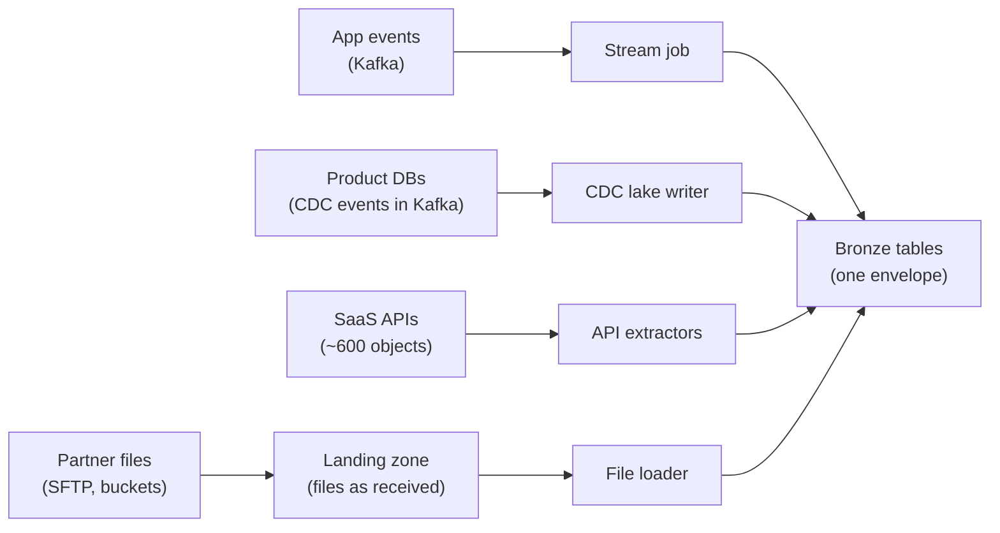
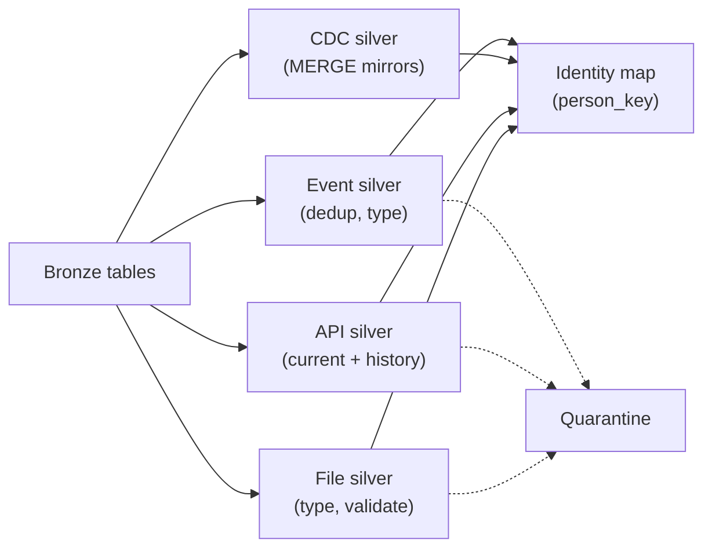
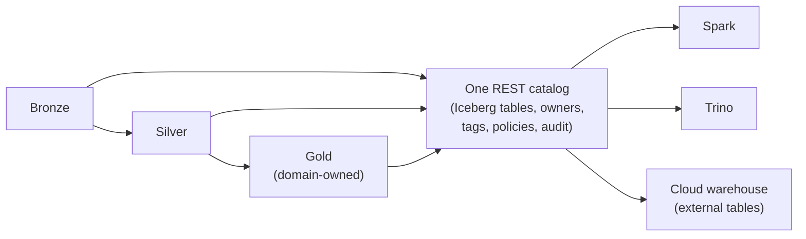
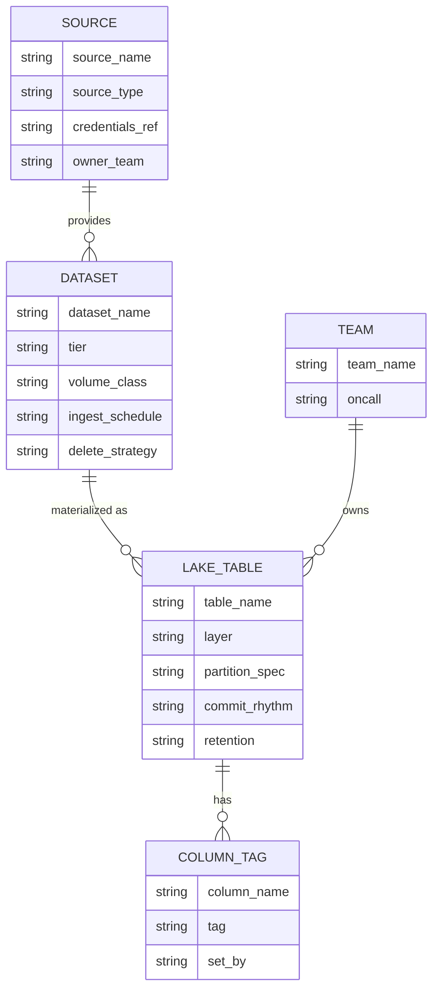
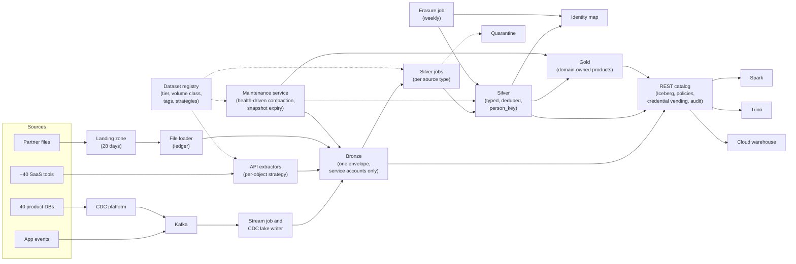

# Design a Company-Wide Medallion Data Lake

This breakdown follows the seven steps from [The Delivery Framework](../01-the-framework/02-delivery-framework.md). [Medallion Architecture](../03-architecture-patterns/03-medallion-architecture.md) teaches bronze, silver and gold for one pipeline; this prompt asks for a whole company: four kinds of source, about 4,000 source datasets, 60 teams and a lot of personal data. The interview is about what breaks at thousands: **what bronze and silver mean for each kind of source, one table format and catalog for everyone, who may see what, and small files.**

## Understanding the Problem

The prompt:

> "We're an online marketplace with about 25 million monthly users and 3,000 employees. Our data is everywhere: product databases, app events, forty-odd SaaS tools, files from partners. Every team has its own copies and nobody agrees on a number. Design the company data lake that replaces all of this."

A **data lake** here means tables stored as open files (Parquet) in object storage, organized with a [table format](../04-technology-deep-dives/07-iceberg.md) so they behave like database tables, and read by several query engines. People also call this a **lakehouse**: a data lake with warehouse-style tables and transactions on top.

What is different from a single-pipeline medallion design:

- **Sources differ in kind.** An app event is an immutable fact. A database row changes. A CRM API gives only current state, no history. A partner file may be partial, late or sent twice. "Bronze is raw, silver is clean" holds for all four, but the jobs that build each layer differ.
- **Scale is in table count, not bytes.** 4,000 datasets, most of them tiny, hurt in file counts, maintenance and permissions.
- **Many engines, many teams**, all reading the same tables.
- **Governance is a requirement.** Personal data flows in from a dozen sources, and legal wants access by need and erasure within 30 days.

## Requirements

*About 6 minutes.* Ask who uses it, which sources matter, and the rules on personal data:

> **You:** "Who reads the lake on day one, and what do they use today?"
> **Interviewer:** "Analysts in about 60 teams use a cloud warehouse and exported spreadsheets. Data science reads from production replicas. Finance runs its own scripts."
> **You:** "Which sources matter most?"
> **Interviewer:** "Product databases and app events, then payments and CRM. Then a long tail of SaaS tools and partner files."
> **You:** "Is there personal data, and rules about it?"
> **Interviewer:** "Lots: emails, phone numbers, delivery addresses. Legal says only teams with a reason see them, and we must honour deletion requests within 30 days."
> **You:** "Is anything already landing database changes?"
> **Interviewer:** "A CDC platform is being built. Assume it delivers change events to Kafka."

That answer saves ten minutes: reuse [CDC Replication](05-cdc-replication.md) for databases.

### Functional requirements

1. **Land every source** (app events, database changes, SaaS APIs, partner files) into the lake, with onboarding of a new source done by configuration.
2. **Clean, conformed silver**: one trustworthy version of each entity and event, with one customer ID across the app, payments, CRM and support systems.
3. **Gold data products** owned by domain teams, readable from Spark, an interactive SQL engine and the existing cloud warehouse, without copies.
4. **Governed access**: personal data visible only to approved roles, every access audited, and deletion requests completed within 30 days.

**Below the line (out of scope):** the CDC mechanics themselves ([CDC Replication](05-cdc-replication.md)), the framework teams use to write pipelines ([ETL Framework](07-etl-framework.md)), sub-minute serving, a feature store ([Feature Store](08-feature-store.md)), the data quality monitoring product ([Data Quality Monitoring](09-data-quality-monitoring.md)), log search, and BI tool choice.

### Non-functional requirements

- **Scale:** about 3.75 TB of raw data a day from about 4,000 source datasets; about 10,000 tables across all layers; 800 regular users (worked out in the next step).
- **Freshness, by tier:** tier 1 (about 200 business-critical tables plus app events) in silver within 15 minutes (p95, meaning 95% of the time); everything else within 2 hours of the source making it available; finance's gold tables ready by 06:00.
- **Correctness:** no silent loss. Every row from bronze is accounted for in silver as kept, deduplicated or quarantined.
- **Access:** personal columns masked by default; 100% of queries audited; erasure within 30 days of the request.
- **Cost:** the interviewer says "the current mess costs about $120k a month across tools and copies; don't make it worse." Keep the platform under that.

> [!TIP]
> Ask about personal data early. "Who may see emails" and "how fast must we delete" change the data model itself.

## Sources & Volume

*About 4 minutes.* Count by source type; each gets a different path. Numbers from [Key DE Numbers](../02-core-concepts/10-key-de-numbers.md):

| Source type | Examples | Datasets | Raw per day | How it arrives |
|---|---|---|---|---|
| App and web events | Clickstream, about 150 event types | 1 stream | 2 billion events × ~1 KB ≈ **2 TB** JSON | Pushed to Kafka, continuous |
| Product databases | 40 Postgres and MySQL databases | ~3,000 tables | ~1.7 billion changes ≈ **1.7 TB** | CDC events in Kafka, continuous |
| SaaS APIs | CRM, payments, support, ads, HR (~40 tools) | ~600 objects | ≈ **10 GB** JSON | We pull, hourly or daily, rate-limited |
| Partner files | Logistics partners, data vendors, bank statements | ~150 feeds, ~400 files a day | ≈ **30 GB** CSV | Dropped on SFTP or a bucket, mostly daily |

Work it aloud:
1. **Rate.** "2 billion events a day is about 23,000 a second, roughly 70,000 at a 3x peak. CDC's 1.7 billion changes a day is about 20,000 a second, 60,000 at peak. At about 1 KB each, that's 70 MB/s of events plus 60 MB/s of changes: about 130 MB/s into Kafka at peak. A modest cluster."
2. **Bronze bytes.** "About 3.75 TB a day of JSON and CSV, about 5x smaller as Parquet: roughly 750 GB a day, about 275 TB a year."
3. **Storage cost.** "Bronze plus silver, at most about 500 TB after a year (less once short raw retention applies, deep dive 3), is around $11,500 a month at $23 per TB-month. Storage is not the problem."
4. **Table counts and skew.** "4,000 bronze, 4,000 silver and about 1,500 gold tables from 60 teams: roughly 10,000. About 100 tables (clickstream, the busiest database tables) carry 95% of the bytes. The other 3,900 average about 10 MB a day."

Then say what it implies:
> "Throughput is ordinary. The pressure is the long tail: a 10 MB-a-day table committing every five minutes writes 35 KB files, 105,000 a year for 3.6 GB. Times 3,900. That's the small-files problem, and 10,000 tables to secure and maintain."

## High-Level Design

*About 12 minutes.* The data flow first:

1. Four ingestion paths, one per source type, land data in **bronze**.
2. Per-source-type jobs build **silver**, then a conformance step links entities across sources.
3. Domain teams build **gold** from silver.
4. Every table lives in one table format, registered in **one catalog**, which every engine reads through and which enforces access.

### 1. Landing four kinds of source in bronze

#### Bad Solution: Copy everything into folders as it arrives

Each source drops JSON or CSV into a folder such as `raw/<source>/<date>/` in object storage, and analysts point a query engine at the folders.

This is how a lake becomes a **data swamp**: files nobody can find, trust or query safely. Readers see half-written batches, schemas live in people's heads, and a re-sent partner file loads twice.

#### Good Solution: Parse everything into typed tables on the way in

Each ingestion job converts its source into a typed table (`order_id BIGINT`, `amount DECIMAL`) in a table format as it lands.

Bronze is now queryable and transactional, but judgment moved into landing: when a vendor changes `amount` from a number to a string, the load fails or casts it to null, and the original value is gone. That isn't "what arrived".

#### Great Solution: Four ingestion paths, one bronze contract

Each source type gets the ingestion pattern that fits it ([Ingestion Patterns](../02-core-concepts/02-ingestion-patterns.md)), but all write bronze tables in one table format with the same **envelope**: fixed metadata columns plus the payload as received.

| Source type | Ingestion | Bronze holds | One row is |
|---|---|---|---|
| App events | A stream job (Flink or Spark Structured Streaming) reads Kafka | Each event, payload as a raw JSON string plus a few extracted columns (`event_id`, `event_type`, `event_ts`) | One event received, duplicates included |
| Product databases | The CDC lake writer from [CDC Replication](05-cdc-replication.md) | Change events with before and after images | One row change |
| SaaS APIs | A scheduled extractor per object: cursor pagination, backoff, checkpoints | Each record from each pull, raw JSON, tagged with the pull it came from | One record version seen by one pull |
| Partner files | A file loader: completion signal, ledger of loaded files | The original file in a **landing zone** (a plain object-storage folder, kept as received), plus a bronze table with every column as a string | One line of one file |

The envelope is the same on every bronze table:

| Column | Meaning |
|---|---|
| `_source` | Which source and dataset (`crm.opportunity`, `partner_courier_a.deliveries`) |
| `_batch_id` | The pull, file or stream commit this row came from |
| `_ingested_at` | When the lake received it |
| `_schema_version` | The source schema version, where the source has one |
| `_payload` | The record as received (JSON or the raw CSV line) |

Why one contract? So every downstream tool (silver jobs, monitoring, retention, erasure) treats 4,000 bronze tables alike: "rows per batch per source" is one query, not four. And a source schema change never fails a load, because the payload is stored, not interpreted. People don't query bronze, so parsing JSON there is fine.

### 2. Silver: one clean version, built differently per source type

Silver's job is the same for all four (typed, deduplicated, validated, conformed). The shape of the work differs, and this is the part that shows you have run a real lake:

| Bronze holds | Silver builds | Key step |
|---|---|---|
| Immutable events | One table per event type, deduplicated | Drop repeats of `event_id` ([Deduplication at Scale](../02-core-concepts/09-deduplication-at-scale.md)), parse and type the payload |
| Row changes | A current-state mirror per table, with soft deletes | MERGE the latest change per key ([CDC Replication](05-cdc-replication.md)) |
| Successive API pulls | A current-state table, plus a history table built from successive versions | Detect changes and deletes between pulls (deep dive 4) |
| File lines | A typed table per feed | Cast, validate, de-duplicate re-sent files by checksum |

Every silver job sends rows that fail validation to a [quarantine table](../03-architecture-patterns/03-medallion-architecture.md) with a reason, so the row accounting in the requirements holds: bronze rows = silver rows + duplicates + quarantined.

**Conformance across sources** is what a single-pipeline design never needs. The same person is `user_id 88123` in the app database, `cus_8Hq...` in payments, a contact ID in the CRM and an email in support. Build one silver **identity map**: one row per known identifier, mapped to a `person_key`, a random surrogate key the lake assigns. The platform team owns and versions the matching rules (same verified email, payment customer linked at checkout). Every silver table that refers to a person gets a `person_key` column; gold joins on it, and deep dive 3 shows it is also what makes erasure possible.

### 3. One table format and one catalog for 10,000 tables

The engines are given: Spark for ingestion and data science, Flink for the event stream, Trino (or another interactive SQL engine) for analysts, and finance's cloud warehouse. The choice is how tables are stored and found.

#### Bad Solution: Plain Parquet files with a metastore

Write Parquet to folders and register them in a Hive-style metastore (a database of table names, schemas and folder paths).

No atomic commits, no row-level updates (so CDC mirrors and erasure mean rewriting partitions by hand), fragile schema changes. The swamp again, with nicer names.

#### Good Solution: A table format, chosen by each team

Let the data science group use Delta Lake with their Spark platform's catalog, and the analytics engineers use Iceberg in a cloud catalog.

Each team gets transactions, time travel and MERGE ([Delta Lake](../04-technology-deep-dives/06-delta-lake.md), [Iceberg](../04-technology-deep-dives/07-iceberg.md)). But with two catalogs, policies are written twice and drift apart, nobody can list "every table with an email column", and maintenance runs two ways.

#### Great Solution: One open table format, one catalog, every engine through it

Pick **one** table format for the whole lake and **one** catalog that every engine uses. With four different engines, including a warehouse and Flink, the format with the broadest neutral support is Iceberg, behind a **REST catalog** (an open HTTP API for catalogs that Spark, Flink, Trino and most warehouses speak). Alternative: if almost everything ran on one Spark platform, Delta Lake with that platform's catalog would be just as right, with UniForm exposing Iceberg metadata to other readers. The decision that matters is *one*, not *which*.

The catalog becomes the control point for the whole lake (how much of this a given catalog product provides varies, so verify before promising it):

- **Discovery and commits:** every table with its owner, layer, tier and column tags, and the atomic pointer swap behind each write.
- **Access:** engines get no bucket-wide credentials. The catalog checks the user's permission and hands the engine short-lived credentials scoped to that table's files (**credential vending**).
- **Audit:** every table access passes through it, so it is logged in one place.

### 4. Gold and ownership

Gold is where 60 teams' definitions live, so domain teams own it. The platform owns bronze and silver; finance owns `finance.daily_revenue`. Each gold table has an owner, a grain and a [data contract](../02-core-concepts/07-data-contracts.md), and consumers read gold, never silver. That is the platform-plus-domains split from [Data Mesh](../03-architecture-patterns/06-data-mesh.md), without the full reorganisation. Teams build gold with their usual tool (often [dbt](../04-technology-deep-dives/04-dbt.md)) as Iceberg tables. If a dashboard needs warehouse-native speed, the warehouse may hold a one-way copy, rebuilt from the lake, never edited in place.

## Data Model

*About 5 minutes.* Three things to model here: the bronze envelope (above), a layout policy driven by volume, and the registry that turns 10,000 tables into configuration.

### Layout by volume class

The partitioning rule from [Partitioning](../02-core-concepts/01-partitioning.md) is "at least about 1 GB per partition". With volumes this uneven, one default layout cannot satisfy it, so the registry assigns a **volume class** and the class sets the layout and commit rhythm:

| Volume class | Tables | Typical volume | Partitioning | Commit rhythm |
|---|---|---|---|---|
| Large | ~50 | Over 10 GB a day | `days(event_ts)` (`hours` for clickstream bronze), sorted by a common filter column | Every 5 minutes |
| Medium | ~50 | 1 to 10 GB a day | `days(...)` | Every 15 minutes or hourly, by tier |
| Small | ~3,900 | Under 1 GB a day, typically 10 MB | `months(...)`, or none under ~1 GB a month | Hourly or once per pull or file (15 minutes if truly tier 1) |

A table that grows changes class, and Iceberg's partition evolution changes its layout as metadata only. Silver event tables partition on `event_ts`, which analysts filter on; bronze on `_ingested_at`, because silver jobs ask "what arrived since my last run?"

### The dataset registry

Extractors, silver jobs, maintenance, policies and erasure all read their behaviour from here. Onboarding a source is a few rows and a reviewed config change.

## Pipeline Design

*About 5 minutes.* Most modes follow from the tiers:

| Path | Mode | Idempotency |
|---|---|---|
| Events → bronze | Streaming, 5-minute commits | Kafka offsets committed with the files |
| CDC → bronze → silver | As in [CDC Replication](05-cdc-replication.md) | Ordering-key guard in the MERGE |
| SaaS APIs → bronze | Scheduled pulls, hourly (tier 1) or daily | Each pull is a `_batch_id`; a retried pull overwrites its own batch |
| Files → bronze | Triggered when a completion marker lands | Ledger of file checksums; a re-sent file is skipped |
| Bronze → silver (events, APIs, files) | Micro-batch per table, 15 minutes for tier 1, hourly for the rest | Reprocess by `_batch_id` or `_ingested_at` range, written as overwrite or MERGE |
| Silver → gold | Batch, triggered when inputs are fresh | Partition overwrite per date |
| Maintenance | Continuous scheduler (deep dive 1) | Rewrites only |

**Scheduling.** With 10,000 tables, time-based schedules ("run gold at 05:00 and hope silver finished") break. Use **data-aware scheduling**: a gold job runs when the silver tables it depends on have committed data for the period it needs. Airflow's assets and Dagster's software-defined assets both do this ([Orchestrator Comparison](../04-technology-deep-dives/10-orchestrator-comparison.md)).

**Failure isolation.** A failure belongs to one dataset, not the platform. A vendor API down for six hours makes its extractor back off and its tables go stale; the other 3,999 datasets carry on. A partner file that fails validation still lands in bronze, with its rows quarantined in silver, so you fix and replay without asking for a resend. A breaking schema change pauses that one silver table and pages its owner, as in the CDC breakdown.

**Reprocessing.** Because every bronze row carries `_batch_id`, a silver fix replays exactly the affected batches ([Backfill and Reprocessing](../02-core-concepts/03-backfill-and-reprocessing.md)). Retention sets the limit: bronze for events, API pulls and files is kept 28 days (deep dive 3 explains why it's short), so older fixes reprocess from silver. CDC bronze keeps its full history, as in the CDC breakdown.

## Potential Deep Dives

*About 12 minutes.* Each is one of the four tensions asked directly. With no lead from the interviewer, start with small files: they quietly degrade a lake that looked fine at launch ([Deep Dives](../01-the-framework/08-deep-dives.md)).

### 1. "Six months in, a query on the refund events table takes 90 seconds for 3 GB of data. What happened?"

`silver.events_refund_requested` is one of the 150 event-type tables, and a small one: about 15 MB a day. All app events are tier 1, so the silver event job commits every 15 minutes, and its 12 writer tasks each write a file for every event type they hold rows for. Check the table's metadata (Iceberg's `files` and `snapshots` tables):

- 96 commits a day × 12 files ≈ 1,150 files a day of about 13 KB each.
- Six months ≈ 210,000 files and 17,000 snapshots, for about 3 GB of data.
- A query opens every file. At 50 ms first-byte latency with 128 parallel reads, that's about 80 seconds before any real work.

Now multiply by 3,900 small tables. That's the **small-files problem** at lake scale: the bytes are tiny, the file and snapshot counts are huge, and every query plan and every read pays per file.

#### Bad Solution: A nightly job that compacts every table

Loop over all 10,000 tables every night and compact them.

Most of the work is wasted on tables that didn't need it, busy tables degrade again by noon, and without snapshot expiry metadata keeps growing.

#### Good Solution: Fix the write side, then compact per table

First stop creating the files. Make the writer produce one file per partition per commit (Iceberg's `hash` write distribution mode sends each partition's rows to one task). And set commit rhythm from the volume class and the consumers' real need, not a blanket "events are tier 1": the refunds team needs "this morning's refunds by 10:00", so the table commits hourly. That takes it from 1,150 files a day to 24. Then schedule compaction and snapshot expiry per table. Better, but a calendar doesn't know which tables need attention.

#### Great Solution: Maintenance as a platform service driven by table health

Run maintenance as a service that measures every table and acts only on those that need it:

1. **Measure.** Every hour, read each table's metadata: files and average file size per partition, delete files, snapshots, manifests. These are cheap metadata queries.
2. **Queue.** A partition older than an hour with more than 20 files, or averaging under 32 MB per file while holding over 1 GB, joins a compaction queue, as do tables with piled-up delete files (from merge-on-read MERGEs or erasure). Tier 1 first.
3. **Act.** Compact only the queued partitions (`rewrite_data_files` filtered to them), rewrite manifests when needed, expire snapshots older than 7 days, then remove orphan files older than a few days ([Iceberg](../04-technology-deep-dives/07-iceberg.md) explains why that order matters). Publish each table's health next to its owner in the catalog.

Compute is cheap: 750 GB a day at 20 MB/s per core is about 10 core-hours, a few dollars. The hard part is knowing which 200 of 10,000 tables need attention today. Afterwards, the refund table's six months is 6 monthly files of about 450 MB plus 7 days of snapshots; the query opens 6 files instead of 210,000 and takes a couple of seconds.

> [!TIP]
> Say that "tier" (how fresh) and "volume class" (how big) are separate settings. Most small-file disasters give a small table a big table's commit rhythm because someone asked for "real time".

### 2. "Marketing analysts should see orders but not customer emails. Fraud analysts need the emails. Regional finance sees only its region. How do you enforce that across 10,000 tables?"

Count first: 10,000 tables of about 40 columns is 400,000 columns; at 3% personal, that's 12,000 columns built by 60 teams.

#### Bad Solution: Bucket permissions per folder

Grant each team's role read access to the storage paths it may see.

Storage permissions work on files, not columns or rows: marketing either can't see orders or sees every email. And anyone who can read the files can read them with any tool, bypassing everything else.

#### Good Solution: Table grants in the catalog, plus masked copies

Grant access per table in the catalog, and for tables with personal columns, publish a second, masked version (`orders_masked`) for broad use.

It works for a while. But 60 teams × 10,000 tables is up to 600,000 grants, every masked copy doubles a pipeline, and a new email column stays visible until someone notices.

#### Great Solution: Tag columns, write policies against tags, enforce in the catalog and engines

Separate *what the data is* from *who may see it*:

- **Tags describe data.** Columns carry classification tags: `pii.email`, `pii.phone`, `pii.address`, `pii.person_key`, `restricted.region`. Tags come from the source's contract at onboarding, from a scanner that samples new bronze columns for things that look like emails or phone numbers, and from **lineage**: a gold column computed from a tagged column inherits the tag unless its transform is declared as removing it (an aggregate, a truncation to postcode district).
- **Policies describe people.** About 30 policies, written against tags: "`pii.*` columns are masked (shown as a hash or `***`) unless the user is in a role approved for that domain"; "rows of tables with a `restricted.region` column are filtered to the user's region". A **masking policy** rewrites a column's values at query time; a **row filter** adds a `WHERE` to every query on the table.
- **The catalog and engines enforce them.** The query engine applies masks and row filters when it plans the query. That only holds if nobody reads the files directly: no human gets storage credentials, bronze is readable only by platform service accounts, and the catalog vends credentials only to engines it trusts to enforce policy. An engine that can't enforce masks or row filters (support varies by engine and catalog, so check yours) gets only tables with no such policy.
- **Exceptions are temporary.** Fraud analysts get the approved role through a request with an expiry, and every query that unmasks a column is in the audit log.

The arithmetic is the argument: about 10 tags and 30 policies instead of 600,000 grants, and a new email column is masked once the scanner tags it on its first day in bronze.

> [!WARNING]
> Don't forget bronze. It holds every personal field unmasked, and a single analyst "just checking the raw data" defeats every policy above. Bronze is for pipelines.

### 3. "A user asks to be forgotten. Their data is somewhere in 10,000 tables. How do you delete it within 30 days?"

The row-level mechanics (a `DELETE` by predicate, rewriting files, then expiring snapshots so time travel can't bring the data back) are in [Log Aggregation](01-log-aggregation.md) and [CDC Replication](05-cdc-replication.md). The lake-wide problems are *finding* the data and *affording* the deletes. Assume about 2,000 requests a month.

#### Bad Solution: Search every table for the email when a request arrives

Run a query for the email address across all tables that might contain it.

You miss tables where the person appears under a payment or CRM ID, you scan petabytes per request, and "did you find everything?" gets "we hope".

#### Good Solution: Use the tags and the identity map to delete everywhere

The identity map turns the request into one `person_key`. The tag `pii.person_key` lists every table that holds it, about 1,200 of them. Batch requests weekly (about 500 people per run) and run a `DELETE ... WHERE person_key IN (...)` on each table, then compaction and snapshot expiry.

Finding is solved; affording is not. Take silver clickstream: 2 billion events a day, about 400 GB a day of Parquet in files of 256 MB, each holding events from at least 100,000 different users. Assume events are not clustered by user, since the table is partitioned by time. A file with 100,000 distinct users has on average 100,000 × 500 / 25 million = 2 of the 500 people in it, so the chance it holds at least one is about 1 − e^(−2), around 86%. So a weekly erasure rewrites most of a table that grows by about 146 TB a year, every week. Merge-on-read deletes postpone the rewrite but don't avoid it, because the data is only gone once compaction removes it.

#### Great Solution: Keep identities out of the big tables, keep raw copies short, delete the rest

Design the data so that erasure touches little:

1. **Pseudonymize the big tables.** To **pseudonymize** is to replace identifying values with a key that only a separate, protected table can link back to a person. Silver event tables carry `person_key`, never an email, user name, raw user ID or IP address. Free-text fields that might hold personal details are dropped or scrubbed. The link from `person_key` to a real person lives in the identity map and the small personal tables (profiles, addresses, CRM contacts, support tickets): a few hundred GB in total.
2. **Erase the link and the personal tables.** The weekly job deletes the person's rows from the identity map and from the tables tagged as holding direct personal data (about 300, mostly small, plus the CDC bronze history of personal database tables, by primary key), then compacts and expires snapshots on those tables only. The billions of event rows now point to a key that maps to nobody. Whether that counts as erased depends on whether the rest could still identify someone, which is why step 1 removes IPs and free text. Pseudonymized data can still count as personal data under privacy law, so say "we'd confirm this with legal"; it's the honest answer. The alternative is **crypto-shredding**: encrypt each person's values with their own key and delete the key, at the price of a key service on every read. Include warehouse extracts and backups in scope.
3. **Keep raw copies you can't cheaply search shorter than the deadline.** Raw event bronze, raw API pulls and partner files in the landing zone hold identities as received, inside JSON payloads and CSV lines with no `person_key` to delete by. Keep them 28 days, inside the 30-day deadline, so they age out. The cost: silver is the reprocessing source for anything older.
4. **Prove it.** Log each request, the tables touched and when snapshots expired. Legal wants evidence.

The trade-off to say: "I'm giving up a long raw replay window for events, and accepting that analysts work with keys instead of identities. In exchange, erasure costs a few small rewrites a week instead of most of the clickstream table."

### 4. "The CRM API only returns current state. Sales ops wants weekly changes in their pipeline, and deleted opportunities keep showing up. Fix it."

This source type's bronze and silver work differently from events or CDC. The `opportunity` object has 2 million records; about 20,000 change each hour; the API returns 2,000 records per page, allows 100 requests a minute, and supports a `modified_since` filter.

#### Bad Solution: Incremental pulls, upserted into one table

Every hour, pull records modified since the last run and upsert them into `silver.opportunity`.

A deleted opportunity never appears in a `modified_since` pull, so it stays in silver forever: the bug sales ops sees. And each pull overwrites the last, so there is no week-over-week history.

#### Good Solution: Append every pull to bronze, add a nightly full pull to find deletes

Bronze keeps every record from every pull with its `_batch_id`, so history exists: each pull is a version. Silver builds a current-state table (latest version per ID) and a history table, an [SCD Type 2](../01-the-framework/06-data-model-design.md)-style table with `valid_from` and `valid_to` taken from the record's own modified timestamp. A nightly full pull (2 million ÷ 2,000 = 1,000 requests, 10 minutes at the rate limit) lists every live ID; IDs in silver but missing from the full pull are marked deleted.

This works for `opportunity`, but not for the CRM's `activity` object: 300 million records is 150,000 requests, 25 hours at 100 a minute.

#### Great Solution: A change-detection strategy per object, set in the registry

Pick per object by size, recorded as `delete_strategy` in the registry:

| Object size | Strategy | Example |
|---|---|---|
| Small (under ~5 million records) | Full snapshot daily, diff against the previous one for changes and deletes | `opportunity`, `user`, `campaign` |
| Large, vendor exposes deletes | Incremental by `modified_since`, plus the vendor's deleted-records endpoint or `is_deleted` flag | `activity`, `ticket_comment` |
| Large, no delete signal | Incremental, plus a weekly ID-only pull (fewer fields per request, often much faster) and an anti-join | Some ad platforms |

Two things to say. History's resolution is your pull interval: two changes inside an hour show up as one. If sales ops needs every change, use the vendor's webhooks or change stream, land them as events, and keep the pull as a repair path ([Ingestion Patterns](../02-core-concepts/02-ingestion-patterns.md)). And a diff can't tell a deleted record from one the API failed to return: if a full pull returns under, say, 95% of yesterday's IDs, skip the delete step and alert, rather than deleting 300,000 opportunities during a vendor outage.

## Monitoring & SLAs

*About 4 minutes.* One SLA per non-functional requirement. Presenting them: [Monitoring and SLAs](../01-the-framework/09-monitoring-and-slas.md); alert design is in [Monitoring and Alerting](../02-core-concepts/06-monitoring-and-alerting.md).

| SLA | Target | Measured by |
|---|---|---|
| **Freshness, tier 1** | Silver within 15 minutes, 95% of the time | Newest `_ingested_at` per table versus now; CDC heartbeats for databases |
| **Freshness, other tiers** | Within 2 hours of the source making data available; finance gold by 06:00 | Same, plus each gold table's committed-at time |
| **Completeness** | Every batch accounts for 100% of its rows | Per `_batch_id`: source count (API total, file manifest, Kafka offsets) = bronze rows; bronze = silver + duplicates + quarantined |
| **Table health** | 95% of partitions older than a day are compacted (under 20 files, or average file over 128 MB) | Maintenance service metrics |
| **Governance** | Erasure done within 30 days (target 14); every silver and gold table has an owner and a reviewed classification | Erasure ledger; catalog |

Behind them:
- **Quarantine rate per dataset**, alerting on a jump (0.1% to 2%): usually a source changed format.
- **Expected arrivals**: "courier A's file by 05:00". A missing batch is silent unless you expect it.
- **Unclassified columns** the scanner flagged and nobody reviewed within 3 days.
- **Cost per owning team**, published in the catalog: showback works on lakes too.

Running these checks over 10,000 tables is a product of its own: [Data Quality Monitoring](09-data-quality-monitoring.md).

## Final Design

Follow one customer. On Monday she signs up: a `signup` event lands in clickstream bronze through Kafka, her `users` row through CDC, and the identity map gives her `person_key` 7f3a…, which silver uses from now on. On Wednesday her support ticket arrives with the hourly pull, its `email` column tagged `pii.email`. On Friday the logistics partner's daily file records her return. The customer-experience team's gold table joins all three on `person_key`. A marketing analyst in Trino sees `***` for her email; a fraud analyst with an approved role sees it, and the audit log records that. A year later she asks to be forgotten: the weekly erasure job deletes her identity map row and her rows in the support, profile and address tables, compacts them and expires their snapshots. Her clickstream events remain, under a key that maps to nobody.

Cost, roughly per month: storage about $12k by the end of year one; ingestion and silver compute $20k to $30k; Kafka and the CDC platform up to low tens of thousands; maintenance and the catalog a few thousand. Comfortably under today's $120k, before counting the copies you switch off.

## What's Expected at Each Level

### Mid-level

You draw the layers and place the classic work correctly: raw payloads in bronze, dedup and validation in silver, business definitions in gold. You pick a table format for transactions and MERGE, match ingestion to source (CDC, API pulls, file landing with a ledger), and know small files need compaction. The interviewer leads the deep dives. Bar: Good options, a quarantine table, and partitioning that doesn't explode the file count.

### Senior

You drive, and you see the scale is table count. One bronze envelope for four source types, silver built per type (including API history and deletes), one format and one catalog argued from the engine list. You separate tier from volume class and run maintenance from table health, with numbers for files per query. Access lives in tags and policies the catalog and engines enforce, with bronze locked down. For erasure, you do the clickstream rewrite math and answer it with pseudonymous keys and short raw retention. Monitoring accounts for every row per batch.

### Staff+

You treat the lake as a product with 60 customer teams. You decide what platform and domains own, and how gold contracts are reviewed. You plan the migration: onboard sources by tier, run old and new numbers side by side, retire a copy only when its consumers have switched. You weigh build versus buy for the catalog, maintenance and policy enforcement, and you see that lock-in now lives in the catalog and its policy features, not the file format. You put a visible price on "real time" through tiers and showback, treat erasure's legal questions as a conversation with the privacy team, and know when a clean, contracted source can skip a layer.

## Related Lessons

- Framework: [The Delivery Framework](../01-the-framework/02-delivery-framework.md), [Requirements Gathering](../01-the-framework/03-requirements-gathering.md), [Sources and Volume](../01-the-framework/04-sources-and-volume.md), [Data Model Design](../01-the-framework/06-data-model-design.md), [Deep Dives](../01-the-framework/08-deep-dives.md), [Monitoring and SLAs](../01-the-framework/09-monitoring-and-slas.md)
- Concepts: [Key DE Numbers](../02-core-concepts/10-key-de-numbers.md), [Ingestion Patterns](../02-core-concepts/02-ingestion-patterns.md), [Partitioning](../02-core-concepts/01-partitioning.md), [Deduplication at Scale](../02-core-concepts/09-deduplication-at-scale.md), [Backfill and Reprocessing](../02-core-concepts/03-backfill-and-reprocessing.md), [Data Contracts](../02-core-concepts/07-data-contracts.md), [Data Lineage](../02-core-concepts/04-data-lineage.md), [Cost Optimization](../02-core-concepts/05-cost-optimization.md), [Monitoring and Alerting](../02-core-concepts/06-monitoring-and-alerting.md)
- Patterns: [Medallion Architecture](../03-architecture-patterns/03-medallion-architecture.md), [Data Mesh](../03-architecture-patterns/06-data-mesh.md), [CDC Patterns](../03-architecture-patterns/04-cdc-patterns.md)
- Technology: [Iceberg](../04-technology-deep-dives/07-iceberg.md), [Delta Lake](../04-technology-deep-dives/06-delta-lake.md), [dbt](../04-technology-deep-dives/04-dbt.md), [Orchestrator Comparison](../04-technology-deep-dives/10-orchestrator-comparison.md), [Kafka](../04-technology-deep-dives/02-kafka.md)
- Related breakdowns: [CDC Replication](05-cdc-replication.md) (the database path into this lake), [Log Aggregation](01-log-aggregation.md) (row-level erasure across tiers)
- Previous breakdown: [CDC Replication](05-cdc-replication.md). Next: [ETL Framework](07-etl-framework.md)
