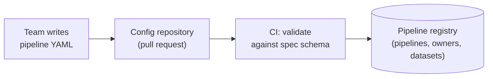
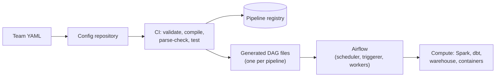
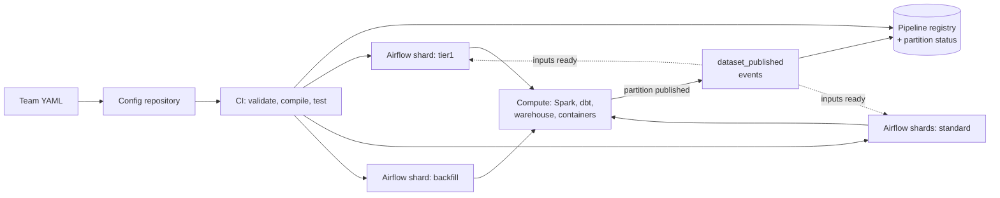
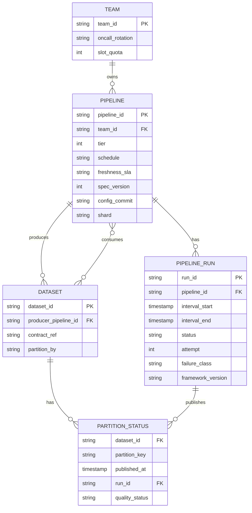
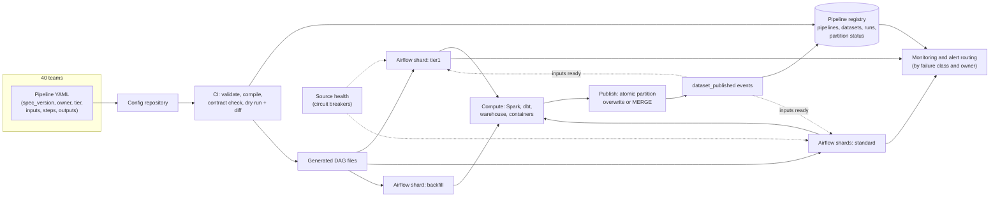

# Design a Config-Driven ETL Framework

Most breakdowns design a pipeline. This one designs the thing other people use to build pipelines: your users are 300 engineers on 40 teams, and every decision is multiplied by 5,000 pipelines. The interview turns on one question: **how much do you hide from the teams, and what do you do when what you hid breaks?**

## Understanding the Problem

The prompt:

> "We have about 40 data teams. Each one writes its own Airflow DAGs, and every team does retries, alerting and testing differently. Pipelines break in production, nobody knows who owns half of them, and a new pipeline takes two weeks. Design an internal framework so teams can ship pipelines by writing configuration instead of code."

A **config-driven pipeline** is one a team describes in a short declarative file ("read this table, run this SQL, check these rules, publish here, daily, owned by us") and a framework turns into a running, monitored pipeline. The team never writes orchestration code. The framework is the **platform**, the team that builds it is the **platform team**, and the 40 teams who use it are its customers.

What goes wrong today:

- Team A retries forever, so a dead source stalls silently for a day. Team B never retries, so a network blip pages someone at 03:00.
- Nobody can answer "what breaks if the `fx_rates` table is late?", because dependencies are hand-written sensors pointing at DAG names.
- A DAG file with a typo, merged on Friday, stops parsing and the pipeline quietly stops running.

The central tension: **a stronger abstraction makes pipelines consistent, safe and upgradable, but every team has one pipeline the abstraction can't express.** Hide too little and you have 3,000 snowflakes again. Hide too much and teams route around you. On top of that sit three platform problems you have to solve once for everyone: **multi-team ownership** (who owns and gets paged for what, and how one team can't hurt another), **testing** (how a change is proven before production), and **retries** (how failures are handled the same way everywhere).

## Requirements

*About 6 minutes.* For a platform prompt, ask about the users first, then the pipelines:

> **You:** "Who writes pipelines? Data engineers only, or analysts too?"
> **Interviewer:** "Mostly data engineers, about 300 of them. Some analytics engineers who mostly write SQL."
> **You:** "What do today's pipelines look like? Roughly what share are 'pull from a database or API, transform in SQL, publish a table'?"
> **Interviewer:** "Most of them. Maybe 85%. The rest are Spark jobs, ML feature jobs and odd things."
> **You:** "Streaming too, or batch only?"
> **Interviewer:** "Batch for now. Streaming jobs run on their own Flink platform."
> **You:** "Are teams expected to keep using Airflow, or is the orchestrator open?"
> **Interviewer:** "We run Airflow and we're not rewriting the world. But teams shouldn't care what runs underneath."

That 85% is the most useful number here: a few standard building blocks cover most pipelines, and the other 15% need a planned way out.

### Functional requirements

1. **Declare a pipeline in config**: sources, transformation steps, quality checks, output datasets, schedule, owner. The framework turns it into a running pipeline with no orchestration code from the team.
2. **Standard building blocks**: database and API ingestion, SQL/dbt transforms, Spark jobs, checks and publishing, plus an **escape hatch** for custom code that still gets the framework's scheduling, retries and alerts.
3. **Dependencies between teams' datasets**: a pipeline can say "I need `finance.fx_rates_daily`" and run when that partition is published, whoever produces it.
4. **Test before production**: a change is validated and run against real-shaped data before it merges.
5. **Self-serve operations**: retries and alerts behave the same everywhere, alerts go to the owning team, and teams can backfill their own pipelines.

**Below the line (out of scope):** streaming pipelines (a separate platform), the internals of each ingestion connector ([Ingestion Patterns](../02-core-concepts/02-ingestion-patterns.md)), the data quality platform itself (its own breakdown, [Data Quality Monitoring](09-data-quality-monitoring.md)), access-control policy, and the catalog UI.

### Non-functional requirements

Scale first, then the qualities:

- **Scale:** 40 teams, about 3,000 pipelines today and 5,000 within two years, about 60,000 pipeline runs and 460,000 task runs a day (derived in the next step).
- **Time to ship:** a standard pipeline goes from first commit to running in production in under a day (today: two weeks).
- **Isolation:** no team's load, bad config or failure can delay another team's pipelines. Concretely: a task becomes ready, and 95% of the time it starts within 60 seconds, even at the midnight peak.
- **Safety of change:** a bad config never reaches production, and a framework upgrade never breaks existing pipelines without warning.
- **Correctness by construction:** every generated pipeline is rerun-safe; retries and backfills cannot duplicate data.
- **Platform availability:** the scheduling layer is up 99.9% of the time, which allows about 43 minutes of downtime a month.

> [!TIP]
> On a platform prompt, "time to ship a new pipeline" and "one team can't hurt another" are real non-functional requirements. Say them with numbers. Most candidates forget them because they are not about data.

## Sources & Volume

*About 4 minutes.* The "sources" here are the configs and the people writing them; the "volume" is load on the scheduler, not bytes. Use the conversions in [Key DE Numbers](../02-core-concepts/10-key-de-numbers.md).

1. **Pipelines by schedule.** "Plan for 5,000 pipelines: say 70% daily (3,500), 25% hourly (1,250), 5% every 15 minutes (250)."
2. **Runs per day.** "3,500 × 1 + 1,250 × 24 + 250 × 96 = 3,500 + 30,000 + 24,000, about 57,500. Call it 60,000 runs a day."
3. **Task runs.** "A typical pipeline has about 8 tasks: wait for inputs, extract, land, transform, two or three checks, publish. 57,500 × 8 is about 460,000 task runs a day, about 5 a second on average."
4. **The peak.** "Average is misleading here. At 00:00 UTC every daily, hourly and 15-minute pipeline is due at once: 3,500 + 1,250 + 250 = 5,000 runs created in the same minute. That's 5,000 first tasks to queue in about a minute, roughly 80 a second, for a scheduler that averages 5."
5. **Worker slots.** "Most tasks submit work to Spark or the warehouse and wait. Say a task holds a worker for 3 minutes on average: 460,000 × 3 minutes is about 23,000 slot-hours a day, so about 960 busy slots on average and around 3,000 at the night peak. If each run also waited 30 minutes for its inputs while holding a slot, that adds 60,000 × 0.5 hours = 30,000 slot-hours, more than doubling the fleet just to sleep."
6. **Parsing.** "Airflow re-parses DAG files on a loop. If one generated DAG takes about 0.2 seconds to parse (a guess; I'd measure it), 5,000 DAGs is 1,000 CPU-seconds per pass. At the default 30-second loop that's over 30 cores doing nothing but re-reading files that only change when someone merges."
7. **Change rate.** "300 engineers, maybe 50 config pull requests a day. CI has to validate and test each in under 10 minutes or people will route around it."

Now say what the numbers imply:

> "None of this is a data-volume problem; Spark and the warehouse do the heavy lifting. The design pressures are the midnight burst of 5,000 runs, the waiting that would more than double the worker fleet, parse cost at 5,000 DAGs, and 50 changes a day that must not break anything. And with roughly 6 platform engineers for 300 users, anything that needs a human from the platform team per pipeline doesn't scale."

## High-Level Design

*About 12 minutes.* Data flow first, as numbered hops:

1. A team writes a pipeline config in a shared repository and opens a pull request.
2. CI validates it, compiles it into an orchestrator pipeline, and tests it.
3. On merge, the compiled pipeline is deployed and registered in a **pipeline registry** (the platform's own database of pipelines, owners and datasets).
4. The orchestrator runs it; tasks submit work to Spark, dbt or the warehouse.
5. Each successful run publishes a dataset partition and emits a "published" event that other pipelines can wait for.
6. Run results, failures and freshness flow to monitoring, and alerts go to the owning team.

Build it one requirement at a time.

### 1. What does a team actually write?

This is the central decision: how thick the abstraction is.

#### Bad Solution: A template repository teams copy

The platform publishes a "golden" example DAG. Teams copy it and edit it.

Day one, every pipeline looks the same. By month six there are 3,000 slightly different copies: one team removed the retries, another added a sensor with no timeout. Changing the retry policy now means editing 3,000 files the platform doesn't own.

#### Good Solution: A shared Python library of operators and DAG factories

The platform ships a library: `make_ingest_dag(source=..., target=...)`, a standard checks operator, a default-retries decorator. Teams still write Python DAG files, but they call the library.

Consistency improves, and a fix to the library reaches every pipeline on the next deploy. Where it falls short: teams still write arbitrary Python, so the platform can't validate a pipeline without running it, can't tell what it reads and writes, and can't stop someone putting a database call at the top of a file the scheduler parses every 30 seconds. Upgrades still mean reading everyone's code.

#### Great Solution: A declarative spec, a small set of step types, and one escape hatch

Teams write a YAML file against a **schema** the platform owns. Here is a complete one:

```yaml
spec_version: 2
pipeline: payments_settled_daily
team: payments-data
owner: payments-data-oncall      # an on-call rotation, not a person
tier: 1                          # 1 = business-critical, pages at night
schedule: daily
freshness_sla: "06:00 UTC"       # the output must be published by then
inputs:
  - dataset: raw.payments_db.transactions   # landed by the CDC platform
  - dataset: finance.fx_rates_daily         # another team's pipeline
steps:
  - type: dbt
    select: payments_settled
  - type: checks
    rules:
      - row_count_min: 100000
      - not_null: [payment_id, amount_cents]
      - unique: [payment_id]
outputs:
  - dataset: payments.settled_daily
    partition_by: settlement_date
    contract: contracts/payments/settled_daily.yaml
```

The framework provides about six **step types**: `ingest_db` (incremental pull from a database), `ingest_api`, `ingest_files`, `sql`/`dbt`, `spark_job` and `checks`. Publishing and waiting for inputs are implicit: every pipeline gets them. The framework turns the spec into the right tasks, with the waits, retries, alerts and publishing already wired.

The **escape hatch** is a seventh step type, `container`: the team supplies a container image, and the framework runs it with a fixed interface (the data interval and output location as arguments, a non-zero exit code on failure). Their code runs on the compute cluster, never inside the scheduler, and it still gets the framework's retries, alerts and lineage. Deep dive 3 covers it.

Why this wins:

- **The platform can read every pipeline.** Inputs, outputs, owner and schedule are fields, so validation, [lineage](../02-core-concepts/04-data-lineage.md) and impact analysis come for free.
- **Defaults are enforced.** Retries, timeouts and alert routing come from the framework; a team can tune values within bounds but can't delete them.
- **Upgrades are the platform's job.** Change how a `dbt` step compiles, recompile 5,000 specs, and every pipeline gets it.

The cost: someone has to design the spec carefully, because once 5,000 files depend on its shape, changing it is a migration (deep dive 4).

> [!TIP]
> Say the coverage target out loud: "Six step types should cover about 85% of pipelines with no code. I'd measure that, and when the same custom container shows up 20 times, it becomes a step type." It shows the abstraction is a product you'll keep developing.



### 2. Turning 5,000 configs into running pipelines

The orchestrator stays Airflow, as the interviewer said; the framework sits on top. See [Airflow](../04-technology-deep-dives/03-airflow.md) for the scheduler, DAG processor and data intervals this section relies on, and [Orchestrator Comparison](../04-technology-deep-dives/10-orchestrator-comparison.md) for when you'd choose differently. The question is *when* config becomes a DAG.

#### Bad Solution: One DAG file that loops over every YAML at parse time

A single Python file reads all 5,000 YAML files and builds a DAG for each. It's a popular pattern.

Two problems, both from the numbers. Parsing: that one file now does 1,000 CPU-seconds of work on every pass, so it times out or lags far behind. Blast radius (how much breaks when one thing breaks): if any YAML raises an exception during the loop, the whole file fails to import, and **all 5,000 pipelines disappear from the scheduler** at once. One team's typo takes out 40 teams.

#### Good Solution: Generate at parse time, one small file per team, with errors caught per pipeline

Split by team, catch errors per config so a bad one is skipped and reported, and raise the parse interval, since files only change on deploy.

Blast radius shrinks to a team. But you still find out a config is broken in the scheduler, after merge, and every parse still re-reads YAML thousands of times a day.

#### Great Solution: Compile in CI, deploy small generated files, and keep the parse trivial

A **compiler** runs in CI. It validates each spec and generates one small, plain DAG file per pipeline, already resolved: tasks, retries, pools and dependencies written out as literal values. CI runs the scheduler's own parser on the result before merge. The deployed files import nothing but the framework's thin runtime operators.

- A broken config **never reaches the scheduler**; CI rejects it.
- Each file is cheap to parse, and one bad file affects one pipeline.
- The pull request shows the diff of the generated DAG, so "what will my pipeline do?" has an answer.
- Recompiling everything is a CI job, which makes framework upgrades testable (deep dive 4).

Two more things the compiler does, both cheap and both from the volume math:

- **It spreads the midnight peak.** `schedule: daily` doesn't mean 00:00. The compiler picks a start minute between 00:00 and 01:59 from a hash of the pipeline name, so the 3,500 daily runs arrive at about 30 a minute instead of 3,500 in one. It only does this for pipelines whose inputs gate them anyway, which is nearly all of them (next section).
- **It makes every wait deferrable.** Input waits compile to deferrable sensors (handed to Airflow's triggerer, so they don't hold a worker slot), and long Spark or warehouse jobs compile to "submit, then defer until done". That removes the 30,000 slot-hours of sleeping from step 5 of the estimate.



### 3. Forty teams on one platform without hurting each other

Now ownership and isolation. One team starts a two-year backfill: 730 daily runs of a heavy pipeline. What happens to everyone else at midnight?

#### Bad Solution: One shared Airflow, first come, first served

All 40 teams share the same slots. The backfill fills the queue, and tier-1 finance pipelines wait behind it. A **noisy neighbour** (one tenant of a shared system using so much of it that others suffer) has broken the isolation requirement. (Here the tenants are internal teams; isolating external customers is harder and has its own breakdown, [Multi-Tenant Platform](../06-breakdowns-advanced/05-multi-tenant-platform.md).)

One Airflow per team is also bad: 40 deployments to upgrade and back up, and cross-team dependencies span deployments that can't see each other.

#### Good Solution: One shared deployment with per-team pools and priorities

Give each team a **pool** (Airflow's cap on concurrent tasks against a named resource) sized to its share, and set priority weights by tier. A team's backfill can only use its own pool. Tier-1 tasks jump the queue.

This solves the noisy neighbour for slots. It still leaves one scheduler and one metadata database for 460,000 task runs a day plus every backfill, and one bad Airflow upgrade or database incident stops everyone.

#### Great Solution: A few shards behind the framework, quotas per team, backfills apart

Run a small number of Airflow deployments (**shards**), for example:

| Shard | Holds | Why separate |
|---|---|---|
| `tier1` | ~400 business-critical pipelines | Smallest, upgraded last, most headroom, pages at night |
| `standard-a`, `standard-b` | the other ~4,600, split by team | Keeps each scheduler and database at a size that's easy to run |
| `backfill` | backfill runs of any pipeline | A two-year backfill can't touch production scheduling at all |

Teams never choose a shard. The `tier` field and the registry decide, and the compiler writes the files to the right one. Inside each shard, per-team pools still cap concurrency. A team's backfill request goes through the framework (a CLI command or a button), which runs it on the backfill shard with a concurrency cap derived from the team's quota. The mechanics of safe backfills are in [Backfill and Reprocessing](../02-core-concepts/03-backfill-and-reprocessing.md).

Sharding creates one problem: Airflow's assets only connect pipelines inside one deployment (each keeps its asset events in its own metadata database), and `payments.settled_daily` on `tier1` needs `finance.fx_rates_daily` on `standard-a`. So the framework owns dependencies itself. When a pipeline publishes a partition, the framework writes it to the registry's partition-status table and emits a `dataset_published` event on a small topic. Waiting pipelines on any shard watch for their inputs' events. A **deferrable sensor** polling the registry works everywhere; on Airflow 3, an asset watcher on that topic can do the same without polling, if the queue type is supported by your provider version. Either way the event only says "something was published"; the registry says which partition. The compiler also checks the cross-team graph for cycles at merge time, which no single deployment could do.

And ownership is a required field: `owner` must be an on-call rotation that exists in the paging tool, not a person, so it survives people leaving. CI rejects a spec without one.



> [!NOTE]
> "Why not Dagster, since it's asset-centric?" Fair on a greenfield platform. Here a rewrite is ruled out; the point is that **teams depend on the spec, not the orchestrator**, so swapping it later is a compiler change.

### 4. Every pipeline rerun-safe by construction

The framework has one advantage no individual team had: it writes the publish step for everyone. So it makes every output write idempotent ([Pipeline Design](../01-the-framework/07-pipeline-design.md) covers the patterns):

- Each output declares `partition_by`. The publish step writes to a staging location for the run's data interval, then **atomically overwrites that partition** in the target table. A retry or a backfill replaces the partition; it can't duplicate it.
- Entity outputs with no time slice must declare a `unique_key`, and publish becomes a MERGE on it.
- There is no "append" option without a key. CI rejects it.
- Steps receive `data_interval_start` and `data_interval_end` from the framework. The spec has no way to say "now".

Because teams can't write non-idempotent pipelines, the platform can retry and backfill without asking anyone.

## Data Model

*About 5 minutes.* The platform's own data: the registry that knows every pipeline, dataset and run. Model it for the questions it must answer: who owns this, what does it depend on, is it fresh, what's broken.



The "consumes" edge is a link table, `PIPELINE_INPUT (pipeline_id, dataset_id)`.

Choices worth saying:

- **`DATASET` has exactly one producer.** Two pipelines writing the same table is how silent overwrites happen; the compiler rejects a second producer. Data ownership then equals pipeline ownership.
- **`PARTITION_STATUS` is the dependency mechanism.** Grain: one dataset partition, for example `payments.settled_daily` for `2026-11-01`. "Are my inputs ready?" is a lookup on it, and so are freshness checks ("was it published by 06:00?"). At 5,000 datasets with mostly daily or hourly partitions, it grows by roughly 60,000 rows a day: small enough for an ordinary Postgres database.
- **`failure_class`** on each run (`transient`, `upstream_late`, `bad_data`, `user_code`, `platform`) is what makes alert routing and the platform's own SLA possible (see Monitoring).
- **`config_commit` and `framework_version`** answer "what code produced this partition?" during debugging and upgrades.

Git is the source of truth for configs; the registry is a queryable copy written by CI on merge. `contract_ref` points at a contract in the format from [Data Contracts](../02-core-concepts/07-data-contracts.md).

## Pipeline Design

*About 6 minutes.* Two pipelines matter here: the one that ships configs, and the shape of every generated pipeline at runtime.

**The change pipeline (CI/CD for configs).** Every pull request goes through the same stages, each cheaper than the next is expensive:

| Stage | Checks | Time |
|---|---|---|
| Validate | Spec schema, required fields, owner rotation exists, inputs exist in registry, one producer per dataset, no dependency cycle | Seconds |
| Compile | Generate DAG files, parse them with the real scheduler parser | Seconds |
| Contract | Output schema matches its contract; a breaking change needs a major version and consumer sign-off | Seconds |
| Dry run | Run the pipeline on sampled real data in an isolated schema (deep dive 1) | A few minutes |
| Deploy | On merge: write generated files to the right shard, update the registry | About a minute |

**The runtime shape.** Every generated pipeline has the same skeleton, so any on-call engineer can read any pipeline:

1. **Wait for inputs**: deferrable, on the partition-status table, with a timeout set from the freshness SLA.
2. **Run steps** in order, each submitting work and deferring until it finishes.
3. **Checks**: rules from the spec plus framework defaults (row count not zero, schema matches contract). A failing check stops the run before publish.
4. **Publish**: atomic partition overwrite or MERGE, then write `PARTITION_STATUS` and emit `dataset_published`.

Batch only, as agreed.

**Retries, decided once.** The framework classifies each failure and the class decides the response. The table from [Pipeline Design](../01-the-framework/07-pipeline-design.md) becomes code:

| Failure class | Example | Framework behavior |
|---|---|---|
| `transient` | Warehouse connection reset, API 503 | Retry with exponential backoff and jitter, 3 attempts, then fail and alert |
| `upstream_late` | Input partition not published | Keep waiting until the SLA-derived timeout; then alert the *producer's* owner, notify consumers |
| `bad_data` | A check failed | No retry (it would fail the same way); hold publish, alert owner |
| `user_code` | SQL error, container exits with a bug | No retry; alert owner with the error and a link to the generated task |
| `platform` | Worker lost, scheduler restart | Retry automatically; count against the platform's SLA, not the team's |

Teams may set retries between 0 and 5, never "forever", and never on `bad_data`.

## Potential Deep Dives

*About 12 minutes.* If the interviewer doesn't steer, lead with testing: it's the requirement candidates hand-wave most. How to pick and run deep dives is in [Deep Dives](../01-the-framework/08-deep-dives.md).

### 1. "How does a team know their pipeline works before it reaches production?"

A team changes the SQL in `payments_settled`. Today they find out it's wrong when finance does.

#### Bad Solution: Review the YAML and the SQL by eye

Reviewers catch typos and style, not a join that doubles rows on real data.

#### Good Solution: Static validation plus unit tests

CI validates the spec, compiles it, and runs unit tests: small hand-written input rows through the SQL with expected output ([dbt](../04-technology-deep-dives/04-dbt.md) supports these since 1.8). Fast and cheap, and good for tricky logic.

It falls short on the failures that hurt most: the ones that only show up on real data. A new upstream value, a skewed key, a null where none was expected, a 10x row increase from a bad join. Hand-written rows contain only what the author thought of.

#### Great Solution: Layered tests ending in a dry run against real-shaped data, with a diff

Keep the static checks and unit tests, then add two stages the platform provides for everyone:

1. **Dry run on sampled production data.** CI runs the changed pipeline for one recent data interval, reading production inputs (a sample of them, say 1% of rows by a hash of the key, so joins still match) and writing to an isolated per-PR schema that is dropped afterwards. Many warehouses and table formats can make a cheap **zero-copy clone** (a new table that shares the original's files until either side changes) for this. The pipeline's own checks run on the output. Budget: the 10-minute CI target and 50 PRs a day means sampling is required; a full run of a big pipeline 50 times a day would cost more than production.
2. **Data diff against production.** Compare the dry-run output with the same interval's production partition: row count change, keys added or lost, per-column null rates and sums. The PR gets a comment: "rows: -0.2%, `amount_cents` sum: +0.1%, 0 keys lost". A reviewer can't see a doubled join in SQL, but "rows: +98%" in the diff is hard to miss.

Then two guardrails after merge:

- **Contracts protect consumers.** If the output schema changes, the contract check from [Data Contracts](../02-core-concepts/07-data-contracts.md) decides whether it's compatible; a breaking change needs a new major version and a migration window.
- **First production run is watched.** For tier-1 pipelines, the first run after a logic change publishes only if its checks pass *and* row counts are within a band of the previous run, otherwise it holds and asks the owner.

> [!WARNING]
> Don't say "we'll have a staging environment that mirrors production." A full copy of production data and 5,000 pipelines is a second production to run, pay for and keep in sync. Per-PR dry runs on sampled data in throwaway schemas give you most of the safety at a small fraction of the cost.

### 2. "A shared source database is down for an hour. 300 pipelines read from it. What happens?"

The payments database that 300 pipelines extract from goes down at 02:10.

#### Bad Solution: Each pipeline retries on its own

Every pipeline does its 3 retries with backoff, then fails and pages its owner. That's 900 connection attempts against a recovering database and **300 pages to perhaps 25 teams**, all for one root cause, none of whom can fix it. When the database returns at 03:10, the 300 failed runs sit there until 25 people wake up and clear them.

#### Good Solution: Longer backoff and grouped alerts

Back off longer on connection errors and group alerts by error message. Fewer pages, but each pipeline still hammers the database on its own, and recovery is still manual.

#### Great Solution: Source health at the platform level, with automatic resume

The framework already knows which pipelines use which connection: it's a field in every spec. Use that:

- **A circuit breaker per source** (a switch that, after repeated failures, stops sending requests for a while instead of letting every caller retry). When a few pipelines fail to connect to `payments_db` within minutes, the framework marks the source unhealthy. New tasks for that source don't start; they wait in a deferred state, holding no slots.
- **One alert, to the right owner.** The owner of the *source* (here, the payments platform rotation) gets one page. The 25 consuming teams get a non-paging notice: "your pipeline is delayed by `payments_db` outage; ETA unknown". Their `failure_class` is `upstream_late`, not a failure on their side.
- **Probe, then resume.** A health check probes the source every minute; when it succeeds, the breaker lets a few tasks through, then the rest, with a concurrency cap so 300 pipelines don't all reconnect in the same second. Because every pipeline is idempotent per interval, resuming is safe, and nobody clears anything by hand.

Then check deadlines. The framework knows each pipeline's SLA and typical duration, so it alerts on the ones now at risk *before* they miss. Alerting on the SLA at risk rather than on each failure is explained in [Monitoring and Alerting](../02-core-concepts/06-monitoring-and-alerting.md).

### 3. "A team says the framework can't do what they need. What do you do?"

This is the central tension asked directly. The ML team needs a pipeline that calls a model-scoring service in batches, with a step type you don't have.

#### Bad Solution: Say no, or let them write a raw Airflow DAG beside the framework

"No" means they leave the platform and you're back to snowflakes, now invisible to the registry. A raw DAG next to the framework has no owner field, no standard retries and no lineage, and it breaks on the next Airflow upgrade.

#### Good Solution: Add a new step type for every request

The platform writes a `model_scoring` step, then `sftp_partner`, then `graph_export`. Two years later there are 60 step types and the spec is as complicated as Python but less flexible.

#### Great Solution: A container escape hatch with a strict contract, and a rule for promotion

The `container` step type from the high-level design: the team ships an image; the framework runs it on the compute cluster (for example as a Kubernetes job) with a fixed contract:

- **Inputs:** `--interval-start`, `--interval-end`, and the input dataset locations.
- **Output:** write to the given staging path; the framework does the publish, so idempotency still holds.
- **Exit codes:** 0 for success, a specific code for "transient, please retry", anything else is `user_code`.
- **Limits:** CPU, memory and a timeout from the spec, within the team's quota.

The team owns the code inside the container; the framework owns everything around it (scheduling, waits, retries, checks, alerts, lineage). That boundary is the answer: "you can run any code, as long as it behaves like a step".

Then manage the abstraction like a product:

- **Track escape-hatch use.** If the share of pipelines using `container` rises above about 15%, the step types are missing something.
- **Promote patterns.** When 20 pipelines run nearly the same container, build a step type and offer an automated migration.
- **Keep the spec small on purpose.** Every step type is supported forever, so each needs a sponsor, docs and tests before it ships.

### 4. "You need to change the spec, or upgrade Airflow. How do you avoid breaking 5,000 pipelines?"

Upgrading something 5,000 pipelines you don't own depend on is the platform's hardest regular job. Treat the spec like an API with consumers, which it is.

1. **Version the spec.** Every config has `spec_version`. Additive changes (a new optional field) don't bump the major version; removing or renaming a field does. The same compatibility rules as a data contract apply ([Data Contracts](../02-core-concepts/07-data-contracts.md)).
2. **Migrate configs with a tool, not with emails.** For a breaking change, ship an automated rewriter that opens pull requests against each team's configs, and support both versions for a deprecation window (say one quarter). 5,000 files changed by hand is 300 people's afternoon; by tool, it's one run plus review.
3. **Recompile everything and diff.** Because compilation is a CI job, you can compile all 5,000 specs with the old and new framework and diff the generated DAGs. An expected change (new retry default) shows up everywhere; an unexpected one (a pipeline lost a dependency) shows up as an outlier.
4. **Roll out by shard.** Upgrade the `backfill` shard first, then `standard`, then `tier1` last, with a soak of a few days between. The run table's `framework_version` column lets you compare failure rates before and after on the same pipelines.
5. **Keep the runtime boring.** Generated files import only a thin set of framework operators, so an Airflow upgrade (2.x to 3.x removed `execution_date` and changed default timetables; see [Airflow](../04-technology-deep-dives/03-airflow.md)) is fixed in one compiler, not 5,000 files.

## Monitoring & SLAs

*About 4 minutes.* The twist on a platform prompt is that there are **two sets of SLAs with different owners**. [Monitoring and SLAs](../01-the-framework/09-monitoring-and-slas.md) covers presenting SLAs; [Monitoring and Alerting](../02-core-concepts/06-monitoring-and-alerting.md) covers alert design.

**Platform SLAs, owned by the platform team:**

| SLA | Target | Measured by |
|---|---|---|
| **Task start latency** | 95% of ready tasks start within 60 s, including at the midnight peak | Time from "ready" to "running" per task, per shard |
| **Platform availability** | Schedulers up 99.9% | Scheduler heartbeats per shard |
| **Change lead time** | 95% of config PRs get a CI result in under 10 min; merged changes running within 15 min | CI and deploy timestamps |
| **Platform-caused failures** | Under 0.1% of runs fail with `failure_class = platform` | The run table |

**Pipeline SLAs, owned by each team, measured by the platform:** every spec declares `freshness_sla`, and the framework checks `PARTITION_STATUS.published_at` against it. A predicted miss (inputs still not ready, with less time left than the pipeline's typical duration) alerts the owner before the deadline, not after.

Behind these:

- **Alert routing by failure class.** `platform` pages the platform team. `user_code` and `bad_data` go to the pipeline's owner. `upstream_late` goes to the producer's owner and notifies consumers. Without this, the platform team becomes the 3am help desk for 40 teams' SQL bugs.
- **Scheduler health per shard:** DAG parse time, queue depth per pool, triggerer load, metadata database size. Parse time creeping up is the early warning that a shard needs splitting.
- **Adoption metrics:** share of pipelines on the framework, escape-hatch share, median time from first commit to first production run. These are the platform's product metrics.

Don't monitor the platform only with itself: if a scheduler is down, a freshness check running on it never fires. Scheduler heartbeats and "no publishes at all for 15 minutes" are checked from outside the orchestrator.

## Final Design



Follow one change through it. The payments team edits the SQL behind `payments_settled_daily` at 14:00. CI validates and compiles it for the `tier1` shard, dry-runs it on a 1% sample of yesterday's inputs, and comments "rows: -0.1%, 0 keys lost". It deploys by 14:20. That night the compiler-assigned start is 00:47; the run defers until `finance.fx_rates_daily` is published from a `standard` shard at 01:30. dbt runs in the warehouse, checks pass, and publish overwrites the `2026-11-01` partition at 02:05, well before the 06:00 SLA. Six downstream pipelines owned by three other teams start within a minute.

## What's Expected at Each Level

### Mid-level

You see that the answer is "config compiled into orchestrator pipelines" and can write a sensible spec with schedule, steps, checks and owner. You know generated pipelines must be idempotent and that retries need a limit, and you can explain why a DAG file that loops over every config is fragile. The interviewer leads the deep dives; on testing you get to unit tests and validation in CI. Bar for this problem: the Good options in the high-level design, a standard retry policy, and alerts that go to the owning team.

### Senior

You drive, and the scheduler-load math shapes the design: the 5,000-run midnight burst, deferrable waits that save thousands of slot-hours, parse cost at 5,000 DAGs. You compile in CI instead of generating at parse time, and say why (blast radius, early failure, diffable upgrades). You solve noisy neighbours with pools and separate the backfill path, and you handle cross-team dependencies through dataset partitions rather than cross-DAG sensors. You bring up testing with real-shaped data and a data diff, and you classify failures so one source outage produces one page. You make idempotency a property of the framework, not a request to teams.

### Staff+

You treat the framework as a product with customers and an API. You frame the abstraction boundary explicitly (a small spec, a container escape hatch with a contract, promotion of repeated patterns into step types) and you measure it with adoption and escape-hatch share. You plan spec versioning, automated config migrations and shard-by-shard rollouts before anyone asks about upgrades. You separate platform SLAs from pipeline SLAs and route alerts so the platform team isn't the help desk. You talk about migrating 3,000 existing hand-written DAGs without a freeze (start with the 85% that fit, leave the rest running, retire the old path by shard), and you note that because teams depend on the spec rather than on Airflow, the orchestrator becomes a replaceable detail.

## Related Lessons

- Framework: [The Delivery Framework](../01-the-framework/02-delivery-framework.md), [Requirements Gathering](../01-the-framework/03-requirements-gathering.md), [Sources and Volume](../01-the-framework/04-sources-and-volume.md), [Pipeline Design](../01-the-framework/07-pipeline-design.md), [Deep Dives](../01-the-framework/08-deep-dives.md), [Monitoring and SLAs](../01-the-framework/09-monitoring-and-slas.md)
- Concepts: [Key DE Numbers](../02-core-concepts/10-key-de-numbers.md), [Data Contracts](../02-core-concepts/07-data-contracts.md), [Monitoring and Alerting](../02-core-concepts/06-monitoring-and-alerting.md), [Backfill and Reprocessing](../02-core-concepts/03-backfill-and-reprocessing.md), [Data Lineage](../02-core-concepts/04-data-lineage.md), [Ingestion Patterns](../02-core-concepts/02-ingestion-patterns.md)
- Patterns: [Data Mesh](../03-architecture-patterns/06-data-mesh.md) (the self-serve platform idea this framework implements)
- Technology: [Airflow](../04-technology-deep-dives/03-airflow.md), [Orchestrator Comparison](../04-technology-deep-dives/10-orchestrator-comparison.md), [dbt](../04-technology-deep-dives/04-dbt.md)
- Related breakdowns: [Data Quality Monitoring](09-data-quality-monitoring.md) (the checks platform this framework would call), [Multi-Tenant Platform](../06-breakdowns-advanced/05-multi-tenant-platform.md) (isolation and noisy neighbours for external customers)
- Previous breakdown: [Medallion Data Lake](06-medallion-data-lake.md). Next: [Feature Store](08-feature-store.md)
