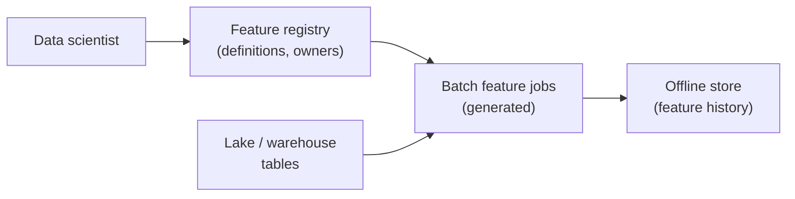
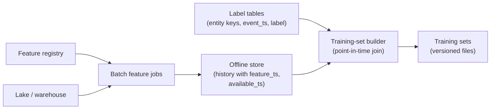
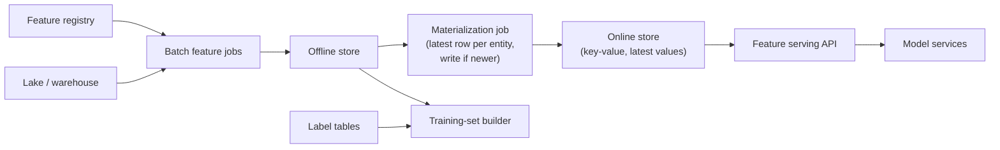
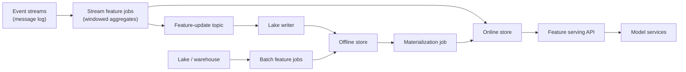
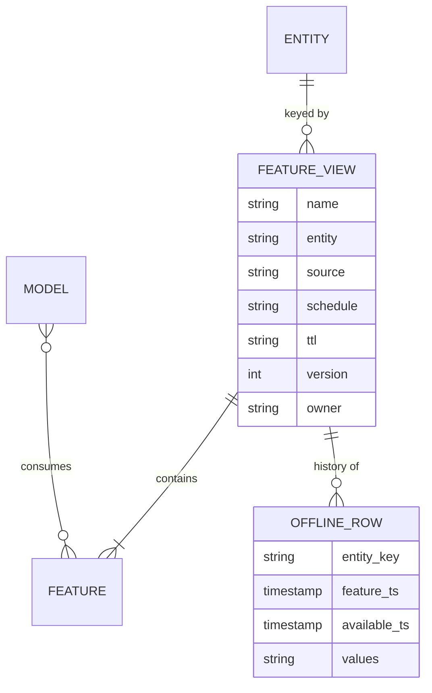
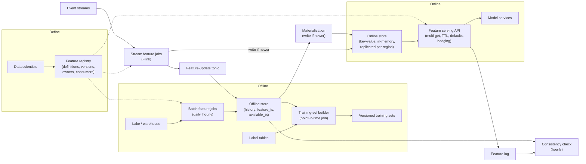

# Design a Feature Store for ML

A feature store holds a number a model reads in under 10 milliseconds, and the same number, as it was at some moment last March, inside a training set. The interview turns on one question: **can you guarantee that a model sees the same feature values in training as it sees in production, at every point in time, without making serving slow?**

## Understanding the Problem

The prompt:

> "We have about 40 machine learning models in production: ranking, fraud scoring, delivery-time estimates, churn. Every team builds its own features, in its own way, twice. Design a feature store so features are defined once, used for training and served to models in production."

A little ML vocabulary first, because the whole design hangs on it. A **model** learns from historical examples and then makes predictions on new ones. Each example is a row of **features** (input values that describe something, such as "orders this user placed in the last 7 days") plus a **label** (the outcome the model should learn to predict, such as "did this order turn out to be fraud"). Building those rows from history is **training**. Asking the trained model for a prediction while a user waits is **inference**, or **online serving**.

Features describe an **entity**: the thing a prediction is about, identified by a key. `user_id`, `item_id` and `merchant_id` are entities. A feature such as `user_orders_7d` belongs to the `user` entity.

Here is what "twice" means. A data scientist computes `user_orders_7d` in warehouse SQL over two years of history and trains a model. An engineer rewrites the logic in the application's language so it runs per request. One version counts cancelled orders, the other doesn't; one uses UTC days, the other a rolling 168 hours. The model is trained on one definition and served the other. That gap is called **training-serving skew**: any difference between the feature values a model saw in training and the values it gets in production. It is the most common reason a model that looked great offline disappoints in production, and nothing errors when it happens.

A **feature store** is the shared system that fixes this. It has two halves:

- An **offline store**: the full history of every feature value with timestamps, in cheap storage, used to build training sets.
- An **online store**: only the latest value of each feature per entity, in a fast key-value store, read by models at inference time.

Plus the machinery that keeps the two agreeing: one definition per feature, and pipelines that **materialize** it (compute it and load it) into both halves.

The central tension has three parts, and they pull against each other:

1. **Offline/online consistency.** Both halves must hold the same values for the same entity and time.
2. **Point-in-time correctness.** A training row for an event last March must use feature values as they were *then*, not today's values.
3. **Serving latency.** The online read has a budget of a few milliseconds, at tens of thousands of requests a second.

Products exist (Feast, Tecton, the clouds' managed feature stores), but the interviewer wants the design. Say your plan in a sentence and start.

## Requirements

*About 6 minutes.* Ask who uses it, how fresh features must be, and how fast the read has to be:

> **You:** "How fresh do features need to be? Is yesterday's value good enough?"
> **Interviewer:** "For most, yes. Fraud and ranking also want signals from the last few minutes: how many cards a user tried in the last 10 minutes, what they clicked just now."
> **You:** "What latency budget does a model have for the whole prediction?"
> **Interviewer:** "About 50 ms end to end for ranking and fraud. The feature fetch can't eat most of it."
> **You:** "When a model team trains, how far back do they go, and how big are their training sets?"
> **Interviewer:** "A year or two of history. The largest are around 500 million rows."

Three answers, three design drivers: two kinds of feature (batch and streaming), a serving budget, and a big batch join offline.

### Functional requirements

1. **Define a feature once**, in a registry that teams can search and reuse, and have the platform compute it for both training and serving.
2. **Build point-in-time correct training sets**: given a table of labelled events with timestamps, attach each feature's value as of that event's time.
3. **Serve the latest feature values online** for a list of entity keys, to models at inference time.
4. **Support batch features** (recomputed daily or hourly from the lake or warehouse) and **streaming features** (updated within a minute from event streams).

**Below the line (out of scope):** training the models, the model-serving service itself, experiment tracking, vector search over embeddings, and how each team produces its labels. You will read labels; you won't build them.

### Non-functional requirements

- **Scale:** 40 models, about 2,000 features, 50 million users, 5 million items, 1 million merchants. Up to 60,000 prediction requests a second at peak.
- **Serving latency:** p99 under 10 ms for one request's feature fetch (p99 means 99% of requests are faster), leaving the rest of the 50 ms for the model.
- **Freshness:** streaming features reflect an event within 1 minute (p95); daily batch features for day D are online by 06:00 on day D+1.
- **Consistency:** for a sample of served predictions, the logged online values match the offline store's value for the same entity and time in at least 99.9% of checks.
- **Availability:** online reads 99.95%. If the store can't answer in time, the model gets defined default values, never an error.
- **Training-set build:** a 500-million-row training set builds in under 2 hours.

> [!TIP]
> Ask for freshness per feature, not per system. "Most daily, a few within a minute" justifies two materialization paths and stops you building everything as streaming.

## Sources & Volume

*About 4 minutes.* Sources, then the few numbers that change the design, using [Key DE Numbers](../02-core-concepts/10-key-de-numbers.md):

- **Lake and warehouse tables** (orders, payments, user profiles, already landed by CDC and batch pipelines). Most batch features are aggregates over these.
- **Event streams** in a message log: clicks, searches, payment attempts. About 100,000 events a second on average at about 1 KB each, so 100 MB/s, roughly 300 MB/s at peak.
- **Label tables**, owned by model teams: one row per thing that was predicted, with the entity keys, the prediction time and the outcome.

Now the numbers:

1. **Online store size.** "50 million users × 200 features × about 8 bytes is 80 GB. With keys, timestamps and encoding, call it 2 KB per user: about 100 GB, plus under 10 GB for items and merchants. With in-memory store overhead, about 200 GB, and 400 GB with one replica."
2. **Online read rate.** "60,000 requests a second at peak. A typical request needs features for about 10 entities (one user, a merchant, a handful of items) from 2 feature groups each, so about 20 key reads per request: **1.2 million key reads a second** at peak." This number sizes the online store, not the 200 GB.
3. **Offline store size.** "The daily batch writes one row per user per day: 50 million × 1.6 KB of values is 80 GB a day raw, about 16 GB as Parquet at 1/5. Two years is about 12 TB, roughly $280 a month on object storage." Storage is cheap; the cost on the offline side is the join compute.
4. **Training-set build.** "500 million labels, each joined to the right row of a two-year history. That is a large shuffle join, sized in deep dive 2."
5. **Feature logging** (introduced in deep dive 1). "If we log the features of every served prediction: 20,000 requests a second on average × 2 KB is 40 MB/s, about 3.5 TB a day raw, 350 to 700 GB a day as Parquet."

State what the numbers imply before you draw:

> "Online is a throughput problem: 1.2 million reads a second over small data. Offline is a correctness problem: history is cheap, and the hard part is joining it at the right point in time."

## High-Level Design

*About 12 minutes.* The data flow in numbered hops:

1. A data scientist **defines** a feature once, in a registry.
2. **Batch jobs** compute batch features from the lake and append them, with timestamps, to the offline store.
3. **Training-set builds** join label tables to the offline store, point in time.
4. A **materialization job** loads the latest values into the online store.
5. **Stream jobs** compute fresh features and write them to both stores.
6. Models read the online store at inference time.

Then build it one requirement at a time.

### 1. Defining a feature once

#### Bad Solution: Each team writes training SQL and serving code separately

This is today's world. The training query lives in a notebook, the serving logic in the application. Every model team re-implements `user_orders_7d`, with slightly different filters and time zones, and every pair of implementations is a skew bug waiting to be found. Nobody can tell which of the four versions in the company is correct.

#### Good Solution: Shared feature tables, computed once in batch, read by everyone

A platform team builds feature tables in the lake: one table per entity, recomputed daily, documented. Training reads them, and a nightly job copies the latest row per entity to a key-value store for serving.

One shared computation removes most skew. It falls short in two places: streaming features are still hand-written in a separate system, and nothing records what a feature *is* (owner, freshness, source, which models use it).

#### Great Solution: A declarative feature definition and a registry

A data scientist writes a short definition, and the platform compiles it into every job that needs it:

```yaml
feature_view: user_order_stats        # a group of features computed together
entity: user                          # key: user_id
source: lake.orders                   # batch source table
timestamp_field: order_ts
features:
  - name: user_orders_7d
    aggregation: count
    window: 7d
    filter: "status != 'cancelled'"
  - name: user_avg_basket_30d
    aggregation: avg(order_total)
    window: 30d
schedule: daily
online: true
ttl: 2d                               # a value older than this is treated as missing
owner: team-risk
```

A **feature view** (also called a feature group) is a set of features on one entity, from one source, computed and materialized together. It is the unit of scheduling and storage. The **feature registry** is the catalog of all feature views: definitions, owners, freshness, lineage to source tables, and which models consume them. It is what turns 2,000 features into something teams can search and reuse.

The definition is the only place the logic lives. The platform generates the batch job, the materialization job and, for streaming views, the stream job from the same text, so skew from two implementations is gone by construction. The cost is expressiveness; keep an escape hatch where a team supplies its own SQL, while the platform still owns timestamps, storage and materialization.



### 2. Training sets that are correct at every point in time

A fraud team has a label table: 500 million card payments from the last year, each with `user_id`, `event_ts` (when the payment happened) and `is_fraud`. They want `user_orders_7d` attached to each row.

#### Bad Solution: Join labels to the current feature table

`JOIN user_features USING (user_id)`. Every payment from last March gets today's `user_orders_7d`.

This is **data leakage**: training rows that contain information the model could not have had at prediction time. A user who was flagged for fraud in April had their account frozen, so today their `user_orders_7d` is 0. The model learns "zero recent orders means fraud", scores beautifully offline, and fails in production, where fraudsters are active users at the moment of payment. Leakage is the most dangerous bug in this whole lesson, because offline metrics get *better*.

#### Good Solution: Daily snapshots, joined on the day before

Keep a snapshot of the feature table for every day, and join each label to the snapshot from the day before its event: `ON s.user_id = l.user_id AND s.snapshot_date = DATE(l.event_ts) - 1`.

No future information leaks in. But it only works for daily features (a value that changes every minute doesn't fit one row a day), it is staler than production was (at 23:00 the online model already had today's 03:00 load; the training row uses yesterday's), and "the day before" is a rule every query must remember.

#### Great Solution: Timestamped feature history and a point-in-time join

Store every feature value with two timestamps:

- `feature_ts`: the time the value describes ("orders in the 7 days up to 2026-03-14 00:00").
- `available_ts`: the time the value actually became readable online (the daily job for that day finished loading at 03:10).

A **point-in-time join** (also called an as-of join) attaches, to each label row, the most recent feature value whose `available_ts` is at or before the label's timestamp. "As of the moment of this payment, what was the newest value the online store could have returned?" That is exactly what production saw, so training matches serving.

| Label: payment at | Feature rows for this user (`available_ts` → value) | Value the join picks |
|---|---|---|
| 14 Mar 02:30 | 13 Mar 03:10 → 4, 14 Mar 03:10 → 5 | **4** (the 14 Mar row did not exist yet) |
| 14 Mar 09:00 | same rows | **5** |
| 20 Mar 12:00 | last row 14 Mar 03:10 → 5, then the job broke for a week | **missing**: older than the 2-day `ttl`, so the model gets its default, as it did in production |

The **TTL** (time to live) on the feature view is how old a value may be before it counts as missing. Both paths must measure age from the same timestamp (here, when the value became available), so training sees the same "missing" that serving saw.

The platform exposes this as one call, so data scientists never write the join. Deep dive 2 runs it at 500 million rows.



### 3. Serving 1.2 million key reads a second

#### Bad Solution: Models query the offline store or warehouse per request

The model service runs `SELECT ... WHERE user_id = ?` against the warehouse for each prediction.

A warehouse query takes about 1 to 10 seconds (from [Key DE Numbers](../02-core-concepts/10-key-de-numbers.md)) and is priced for scans, not 1.2 million point lookups a second. It misses the 10 ms budget by three orders of magnitude. [Reverse ETL](../03-architecture-patterns/09-reverse-etl.md) makes the same point: an application never queries the warehouse in its request path; it reads a serving store that was loaded from it.

#### Good Solution: A key-value online store, loaded nightly

After the daily batch job, a **materialization job** reads the latest row per entity from the offline store and writes it to a key-value store. Models read by key.

Reads are now a millisecond or two. Structurally this is a reverse ETL-style load into a serving store, with a stricter rule: values must match the offline rows exactly, timestamps included. It falls short on freshness, since everything is up to a day old.
#### Great Solution: One online store, two writers, timestamps on every value

Keep the key-value store, store `feature_ts` next to each value, and accept writes from two materialization paths: the daily batch load and the stream jobs from step 4. Every write is conditional: **only overwrite if the incoming `feature_ts` is newer than the stored one**. That one rule makes writes **idempotent** (rerunning a load leaves the same result) and stops an old backfill from overwriting a fresher streaming value.

The choice of store: an in-memory key-value store (Redis or a managed equivalent) for this size, or a disk-backed one on SSD (Cassandra, DynamoDB, Bigtable, ScyllaDB) when the online data reaches terabytes and RAM gets expensive. At 200 GB, memory is affordable and gives the lowest tail latency. Deep dive 3 sizes it.



A thin **feature serving API** sits between models and the store. Models ask for "`user_order_stats` and `item_stats` for these keys"; the API knows the key layout, applies the TTL, fills defaults and logs what it returned.

### 4. Features that are fresh within a minute

Fraud wants `user_card_attempts_10m`: payment attempts by this user in the last 10 minutes. A daily job is useless here.

A **stream feature job** consumes the payment events from the message log and keeps a sliding-window count per user, using keyed state and event-time windows in [Flink](../04-technology-deep-dives/08-flink.md) (or a similar stream processor). Every few seconds, for users whose count changed, it writes the new value with its `feature_ts` to the online store, and appends the same record to a feature-update topic. A lake writer turns that topic into the feature view's offline history, setting `available_ts` to when the online write happened.

The key point: **a streaming feature's offline history is the record of what the stream wrote online**, not a batch recomputation, so training sees what production saw. Deep dive 4 covers history the stream never wrote.



> [!NOTE]
> Events arrive late and out of order. The stream job emits on the watermark with a short allowed lateness, and anything later lands in the next update. Training reads the logged history, which behaves the same way. See [Late-Arriving Data](../02-core-concepts/08-late-arriving-data.md).

## Data Model

*About 5 minutes.* Four structures: the registry, the offline history, the online layout, and the training set.



### Offline store: one history table per feature view

```sql
CREATE TABLE features.user_order_stats_v3 (
  user_id             BIGINT,
  feature_ts          TIMESTAMP,   -- the time the values describe
  available_ts        TIMESTAMP,   -- when they became readable online
  user_orders_7d      INT,
  user_avg_basket_30d DOUBLE
)
PARTITIONED BY (days(available_ts));
-- files sorted by user_id within each day
```

The **grain** (what one row represents) is one entity at one computation. For a daily view that is one row per user per day; for a streaming view, one row per update the stream wrote. It is an Iceberg or Delta Lake table on object storage, so files are added atomically and any engine can read it.

Partition by `available_ts`, the column the point-in-time join filters on, and sort by `user_id`, the column it joins on ([Partitioning](../02-core-concepts/01-partitioning.md)). The version (`_v3`) is part of the name: changing a feature's logic creates a new version rather than rewriting old values, so a model trained on v2 can keep being served v2 until it is retrained.

### Online store: one key per entity per feature view

| Key | Value |
|---|---|
| `user_order_stats_v3:user:88123` | `{user_orders_7d: 5, user_avg_basket_30d: 41.2, feature_ts: 2026-11-01T00:00Z, available_ts: 2026-11-01T03:10Z}` |
| `card_velocity_v1:user:88123` | `{user_card_attempts_10m: 2, feature_ts: 2026-11-02T14:03:20Z, available_ts: 2026-11-02T14:03:22Z}` |

`feature_ts` decides write-if-newer; `available_ts` (when the value was written) is what the serving API measures the TTL from, the same timestamp the training join uses.

All features of a view sit in one value, so a request reads one key per entity per view, not one per feature: 20 reads instead of hundreds. Values are a compact binary encoding, not JSON, to keep the 2 KB per user. Each key gets a store-level expiry a little longer than the view's TTL, so entities that went inactive (a deleted account) disappear on their own.

### Training sets

A training-set build writes versioned Parquet files with one row per label: the label columns, the entity keys, the label timestamp, and one column per requested feature. Its metadata records the label table snapshot, the feature views and versions, and the build time, so a model can say exactly what it was trained on and the build can be rerun to produce the same file.

## Pipeline Design

*About 5 minutes.* The high-level design already picked batch or streaming per path:

| Path | Mode | Schedule and behavior |
|---|---|---|
| Batch feature jobs | Batch (Spark or warehouse SQL) | Daily or hourly per view, after their source tables are ready; append one row per entity |
| Batch materialization | Batch | Right after each batch job; latest row per entity, conditional writes, throttled |
| Stream feature jobs | Streaming (Flink) | Continuous; emit changed keys every few seconds |
| Feature-update lake writer | Micro-batch, 5-minute commits | Turns the update topic into offline history |
| Training-set builds | Batch, on request | Point-in-time join, minutes to an hour |
| Consistency check | Batch, hourly | Deep dive 1 |

An orchestrator schedules the batch side from the registry: each feature view's job waits for its source tables, not a clock. See [Pipeline Design](../01-the-framework/07-pipeline-design.md).

**Idempotency.** Rerunning a failed batch run replaces that run's rows (an overwrite keyed on the run) instead of appending duplicates. Runs that already completed are never rewritten; deep dive 2 explains why. The materialization rerun is harmless because of the write-if-newer rule. The stream job writes to the online store with the same rule, so a replay after a crash cannot move a value backwards in time.

**Setting `available_ts` honestly.** For batch views it is when materialization finished writing the run, not when the batch job started. If materialization retries and finishes at 07:30, training rows between 03:00 and 07:30 correctly get the previous day's values, as production did.

**Failure behavior.**

- **Batch job fails:** the online store keeps yesterday's values; models keep working with a day-older value. Once a value is older than the TTL, the serving API returns defaults and the freshness alert has already fired.
- **Stream job falls behind:** the message log buffers while values go stale. The API returns `feature_ts` with each value, so a model like fraud can treat a stale velocity feature as missing.
- **Online store node fails:** replicas take over; reads that still miss the deadline get logged defaults. A worse prediction beats an error that breaks checkout.
- **Bad feature values shipped:** re-materialize the previous run's rows with a logged force flag, the only write allowed to bypass newer-wins.

## Potential Deep Dives

*About 12 minutes.* If the interviewer doesn't steer, lead with the first: it is the central tension, and it is where real feature stores fail quietly. How to run deep dives is in [Deep Dives](../01-the-framework/08-deep-dives.md).

### 1. "A model scored well offline and worse in production. How do you find training-serving skew, and how do you prevent it?"

Name the causes in one breath: two implementations (fixed by single definitions), leakage in the training join (point-in-time joins), different freshness online and offline (`available_ts`), and plain bugs, such as a null filled with 0 in training and -1 in serving.

#### Bad Solution: Compare overall accuracy, offline versus online

You notice the gap but learn nothing about which of 300 features caused it, and label delay (fraud chargebacks take weeks) means you notice late.

#### Good Solution: Compare feature distributions between training data and production

For each feature, compare the distribution in the latest training set with the distribution in production traffic over the last day: null rate, mean, percentiles. Alert when they drift apart.

This catches broken features without waiting for labels. But distributions can match while values don't: read `user_orders_7d` from the wrong user's key and the distribution looks fine while every value is wrong.

#### Great Solution: Log served features and check them row by row against the offline store

**Feature logging** means the serving API writes, for every prediction (or a sample), the request ID, entity keys, timestamp and the exact feature values it returned. That log goes through the message log into the lake: about 350 to 700 GB a day as Parquet, kept 30 days in full and sampled after that: a few hundred dollars to $1k a month of storage.

Then an hourly **consistency check** takes a sample of logged predictions, runs the point-in-time join for the same keys and timestamps against the offline store, and compares value by value. A match rate per feature view is the consistency SLA: 99.9% or better. A view at 94% points you to the exact feature and time when the paths diverged.

Feature logs have a second use: **log and wait**. A team joins logged features to labels as they arrive, so training rows are exactly what production served. The catch: a new feature has no logged history, so it waits weeks or is backfilled with a point-in-time join. Mature teams use both: logs for features in production, point-in-time backfill for new ones.

> [!WARNING]
> Don't answer "how do you prevent skew?" with "use the same code". That fixes one of the causes. The interviewer wants to hear how you would *detect* skew you didn't prevent, and the honest answer is logging what you served and comparing.

### 2. "Walk me through the point-in-time join for 500 million labels. What makes it slow, and what makes it wrong?"

Start with the query the builder generates, for one feature view:

```sql
WITH candidates AS (
  SELECT l.label_id, l.user_id, l.event_ts, l.is_fraud,
         f.user_orders_7d, f.user_avg_basket_30d,
         ROW_NUMBER() OVER (
           PARTITION BY l.label_id
           ORDER BY f.available_ts DESC
         ) AS rn
  FROM labels l
  LEFT JOIN features.user_order_stats_v3 f
    ON  f.user_id = l.user_id
    AND f.available_ts <= l.event_ts
    AND f.available_ts >  l.event_ts - INTERVAL '2' DAY   -- the view's TTL
)
SELECT * FROM candidates WHERE rn = 1;
```

For each label it finds the user's feature rows that were readable at the label's time and not older than the TTL, and keeps the newest. The `LEFT JOIN` keeps labels with no valid feature row; their features come back null and the builder fills the same defaults the serving API uses. Some engines have a native `ASOF JOIN` that does this more efficiently (Snowflake, DuckDB and ClickHouse do; check others and versions); on Spark you write it like this or use the feature store's built-in implementation.

**What makes it slow.** Without the TTL bound, each label joins to every history row of its user: two years of daily rows is 730 candidates per label, so 500 million labels become 365 billion candidate rows before the `ROW_NUMBER`. With the 2-day bound, a daily view gives at most 2 candidates per label. **The TTL is a correctness rule and also the reason the join finishes.** For a streaming view that updates every few seconds, use a tighter bound, or pre-aggregate history to one row per entity per minute.

Then size it. Read only the columns requested (column pruning) and only the partitions in the labels' time range plus the TTL (partition pruning). Say 30 of 200 features over one year: about 1 TB of Parquet, roughly 5 TB once decompressed and shuffled. At about 10 MB/s per core for a shuffle-heavy join, 5 TB ÷ (10 MB/s × 200 cores) is 2,500 seconds, about 40 minutes per large feature view. Three large views take about an hour on 400 cores. Sorting history by `user_id` (and bucketing labels the same way) spares re-shuffling the big side; see [Spark Internals](../04-technology-deep-dives/01-spark-internals.md).

**What makes it wrong.** Three traps, each a real leakage bug:

- **Joining on `feature_ts` instead of `available_ts`.** The value for "the 7 days up to midnight" was not readable until 03:10. Joining on `feature_ts` hands every label between midnight and 03:10 a value production didn't have yet. For fraud, three hours of future information is plenty.
- **Using the label time instead of the prediction time.** The join key must be when the prediction *would have been made* (the payment's timestamp), not when the label became known (the chargeback, six weeks later).
- **Late source data recomputed into old rows.** If an order from 13 March arrives on 20 March and you rerun the 13 March batch job, the rewritten row now contains data that wasn't there at 03:10 on the 14th. Either never rewrite old feature rows (append a correction with a new `available_ts`), or accept that history is slightly "better" than production was and measure it with the consistency check. The first is the safer default. [Late-Arriving Data](../02-core-concepts/08-late-arriving-data.md) covers lookback windows; here a lookback rewrites history, so it must append, not overwrite.

### 3. "Serving p99 must be under 10 ms at 1.2 million reads a second. How?"

Start with what one request does: the serving API receives "these 10 entities, these 2 feature views", builds 20 keys, and reads them.

#### Bad Solution: One read per feature, sequentially

300 features read one key at a time. Even at 0.5 ms per same-zone round trip (from [Key DE Numbers](../02-core-concepts/10-key-de-numbers.md)) that is 150 ms. The layout, not the store, broke the budget.

#### Good Solution: One key per entity per view, fetched with one batched multi-get

The layout from the data model gives 20 keys, and a multi-get (one call returning many keys) sends them in parallel to the shards that hold them. Total time is about the slowest shard's response, 1 to 2 ms typically.

Size from throughput, not data. As a rough planning figure (measure it), one in-memory key-value node serves on the order of 100,000 simple reads a second. 1.2 million ÷ 100,000 is 12 primary shards; take 16 for headroom, each with a read-serving replica in another availability zone. That puts 400 GB on 32 nodes, about 12 GB each: data was never the constraint.

Where it falls short is the **tail**. A request waits for its slowest key, so fan-out multiplies tail latency: if each shard is slower than 5 ms one time in a thousand, a request touching 16 shards hits that about 1.6% of the time, and p99 is gone.

#### Great Solution: Control the tail, not just the average

- **Co-locate keys.** Shard by entity key so all views of one user land on one shard, and a request touches at most about 10 shards instead of 20 keys' worth.
- **Hedge or time out.** If a shard hasn't answered in 5 ms, send the same read to its replica and take whichever answers first. At a hard deadline (8 ms), return what you have and fill defaults for the rest, logging which features were defaulted.
- **Cache hot entities.** Popular items and big merchants appear in many requests. A small in-process cache in the serving API (a few seconds' TTL) keeps a viral item's shard from becoming a hot partition.
- **Keep it in-region.** A cross-region round trip (20 to 200 ms) is many times the budget, so replicate the online store to every serving region.

> [!TIP]
> Say the tail-latency point out loud. Many candidates size for average latency and stop. "A request fans out to 10 shards, so a 1-in-1,000 slow shard becomes a 1-in-100 slow request" is the sentence that shows you've run a serving system.

### 4. "A data scientist adds a new 30-day feature. How do you backfill it for training and online without breaking consistency?"

The new feature is `user_refunds_30d`. Training needs two years of its history now. Serving needs it live.

#### Bad Solution: Start computing it today

Perfectly consistent, and useless for months while history accumulates.

#### Good Solution: Backfill history with the batch definition, then go live

The platform runs the generated batch job for each of the last 730 days, writing one row per user per day ([Backfill and Reprocessing](../02-core-concepts/03-backfill-and-reprocessing.md)). For backfilled rows, `available_ts` is set to when that row *would* have been available, `feature_ts` plus the view's normal delay (3 hours 10 minutes for this daily view), so the point-in-time join behaves as if the feature had always existed. Then materialization loads the latest row and the feature goes live.

Right for batch features. For a streaming feature it falls short: the live job computes event-time sliding windows with a watermark, and a batch backfill grouping by day computes something slightly different. The backfill itself introduces skew.

#### Great Solution: Backfill with the same semantics as the live path, and verify the seam

For streaming views, two options:

- **Replay the stream job** over historical events from the lake (feeding the stored events back through the same job, the [Kappa](../03-architecture-patterns/02-kappa-architecture.md) approach). Same code, same windows, same late-event rules; it is slower and needs the raw events kept for as long as the history you want.
- **Compile the definition to a batch job with identical window semantics**: windows anchored to the same boundaries, the same lateness allowance applied using arrival time from the raw data. Faster, but now two engines must agree, so it needs a test.

Either way, finish with a **seam check**: for a day where both exist, compare the backfilled values with what the live job produced. If they match on 99.9% of keys, the history is safe to train on.

Then version, don't edit. A changed definition is `user_refund_stats_v2`, backfilled and verified the same way and served beside v1 until the registry shows no model still uses v1.

## Monitoring & SLAs

*About 4 minutes.* Four SLAs, each tied to a requirement. [Monitoring and SLAs](../01-the-framework/09-monitoring-and-slas.md) covers how to present them; [Monitoring and Alerting](../02-core-concepts/06-monitoring-and-alerting.md) covers alert design.

| SLA | Target | Measured by |
|---|---|---|
| **Serving latency** | p99 under 10 ms per request | The serving API's own timing, per model and per view |
| **Freshness** | Streaming views: value age under 1 min (p95). Daily views online by 06:00 | Age of `feature_ts` on sampled online reads; materialization finish time per view |
| **Consistency** | ≥ 99.9% of sampled logged values match the offline point-in-time value | The hourly consistency check, per view |
| **Training-set build** | 500 million rows in under 2 hours | Build durations from the training-set builder |

Behind them:

- **Default rate per feature**: how often the API returned a default because a value was missing, stale or timed out. A jump from 0.1% to 8% for one view is a broken pipeline, even if latency looks fine.
- **Feature distribution drift** per feature, production against the latest training set (deep dive 1's Good solution, used here as an alarm).
- **Null rate and row count per batch run** against the previous run: 50 million users yesterday and 12 million today blocks materialization. Day-old good values beat fresh bad ones.
- **Stream job consumer lag**, which shows up as freshness loss before it breaches the SLA.

The trap specific to this system: **a feature store fails silently.** Models keep predicting on stale or default inputs and nothing errors. Default rate and consistency rate make that visible.

## Final Design



Follow one prediction through it. At 14:03:20 a payment attempt arrives; the stream job updates user 88123's `user_card_attempts_10m` to 2 and writes it online and to the update topic. At 14:03:21 the fraud model's request reaches the serving API, which multi-gets the user's and merchant's views in about 2 ms, returns that fresh count plus `user_orders_7d = 5` from last night's load, and logs both. Six weeks later the payment is marked as fraud. The next training-set build joins that label at 14:03:21 and gets the same 5 and 2 the model saw, as the hourly consistency check had already confirmed.

## What's Expected at Each Level

### Mid-level

You explain the two stores (history for training, latest values for serving) and why the warehouse can't serve requests. You know what training-serving skew is and that defining features once reduces it. When pushed, you see that joining labels to today's features leaks the future and reach for a time-bounded join, even if on computation time rather than availability time. The interviewer leads the deep dives. Bar for this problem: the Good options in the high-level design, a key-value layout of one key per entity, and a freshness SLA.

### Senior

You drive, and build the design around the three-part tension. You introduce `available_ts` unprompted and explain why `feature_ts` leaks. You size the online store from read throughput and handle fan-out tail latency with timeouts and defaults. You keep one online store with write-if-newer so batch and streaming writers can't fight. You propose feature logging with a value-level consistency check, and you monitor the default rate instead of trusting the fallback.

### Staff+

You treat the feature store as a platform for 40 teams: versioning and deprecation driven by the registry's consumer lineage, an owner per view, and a migration plan for hand-built features (start with the models hurt most by skew, prove the consistency check, then require it for new models). You weigh build versus buy (an open-source framework over your own lake and key-value store, a commercial platform, a managed cloud service) on streaming support and how much point-in-time logic you would still own. And you raise governance: feature logs hold personal data and need the lake's deletion path, and features encoding sensitive attributes need review before a model uses them.

## Related Lessons

- Framework: [The Delivery Framework](../01-the-framework/02-delivery-framework.md), [Requirements Gathering](../01-the-framework/03-requirements-gathering.md), [Sources and Volume](../01-the-framework/04-sources-and-volume.md), [Pipeline Design](../01-the-framework/07-pipeline-design.md), [Deep Dives](../01-the-framework/08-deep-dives.md), [Monitoring and SLAs](../01-the-framework/09-monitoring-and-slas.md)
- Concepts: [Key DE Numbers](../02-core-concepts/10-key-de-numbers.md), [Late-Arriving Data](../02-core-concepts/08-late-arriving-data.md), [Backfill and Reprocessing](../02-core-concepts/03-backfill-and-reprocessing.md), [Partitioning](../02-core-concepts/01-partitioning.md), [Monitoring and Alerting](../02-core-concepts/06-monitoring-and-alerting.md)
- Patterns: [Reverse ETL](../03-architecture-patterns/09-reverse-etl.md), [Kappa Architecture](../03-architecture-patterns/02-kappa-architecture.md)
- Technology: [Flink](../04-technology-deep-dives/08-flink.md), [Spark Internals](../04-technology-deep-dives/01-spark-internals.md)
- Breakdowns that build on this one: [Video Recommendations](../06-breakdowns-advanced/02-video-recommendations.md), [Fraud Detection](../06-breakdowns-advanced/03-fraud-detection.md), [Recommendation Engine](../06-breakdowns-advanced/06-recommendation-engine.md)
- Previous breakdown: [ETL Framework](07-etl-framework.md). Next: [Data Quality Monitoring](09-data-quality-monitoring.md)
