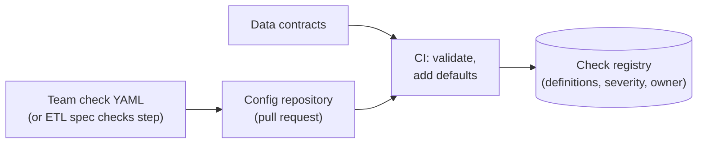
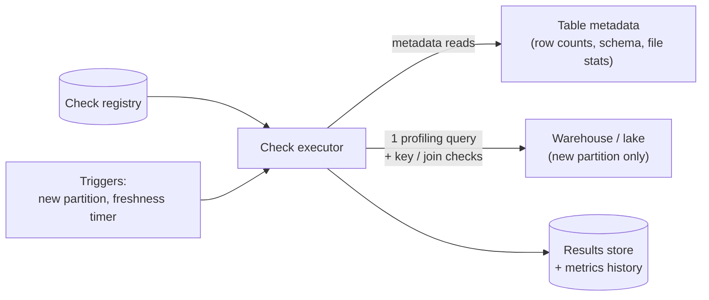
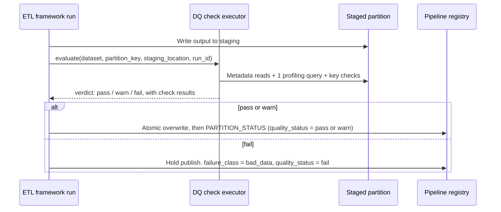
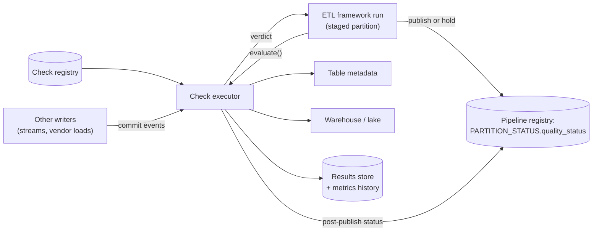
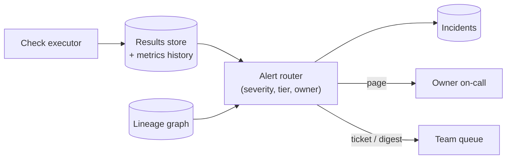
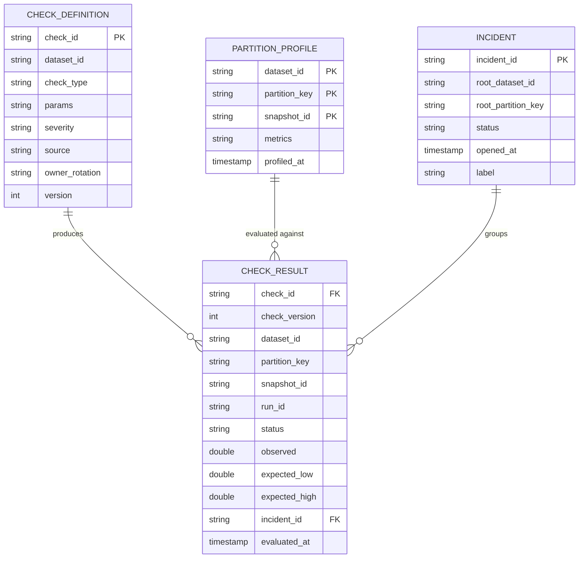
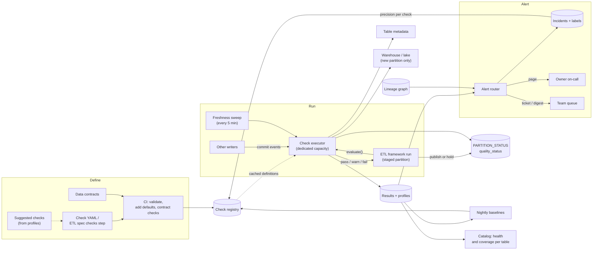

# Design a Data Quality Monitoring Platform

Writing one quality check is easy: a SQL query and a threshold. This breakdown is about running 20,000 of them across 2,000 tables owned by 30 teams, every day, without a huge warehouse bill and without paging people so often they mute you. The interview turns on one question: **which checks stop the data, which ones only warn, and how do you keep the warnings worth reading?**

## Understanding the Problem

The prompt:

> "We have a few hundred production tables today and expect about 2,000 within two years, built by 30 teams. Bad data keeps reaching finance and the product dashboards before anyone notices. Design a platform that monitors data quality across all of them."

A **data quality check** is a rule about a table that can pass or fail: "`payment_id` is never null", "today's row count is within 30% of a normal Monday", "the newest partition is less than 2 hours old". A **data quality platform** is the shared system that stores those rules, runs them when data changes, keeps the results, and tells the right people when one fails. The 30 teams are its customers.

What goes wrong today:

- The payments table loaded 4,000 rows instead of 300,000. The job succeeded, and the CFO found the 98% revenue drop first.
- One team has 400 dbt tests, another has none, and nobody can say which tables are checked.
- The team that added anomaly alerts got 60 a day and muted the channel within a month.

The signals worth checking (freshness, volume, schema, distribution, nulls) and how to set one threshold are in [Monitoring and Alerting](../02-core-concepts/06-monitoring-and-alerting.md); this breakdown assumes them. Four problems decide the design, and they pull against each other:

1. **Check types.** Some checks are free (table metadata), some cost a scan, some need history, some need a second table. Treat them alike and you pay scan prices for a row count.
2. **Scale of checks.** 2,000 tables times about 10 checks is 20,000 rules. Run naively, they cost more than the pipelines they check.
3. **Alert noise.** Thousands of statistical checks produce hundreds of false alarms a day, even when every one is tuned well.
4. **Blocking vs warning.** A **blocking check** stops a bad partition from being published; a **warning check** lets it through and flags it. Blocking protects consumers, but the gate must be fast and reliable, or the platform itself makes data late.

The central tension: **the more checks you run and the more of them can block, the safer the data, and the more cost, noise and lateness the platform causes.** The design is about putting each check in the cheapest place that still catches its failure.

## Requirements

*About 6 minutes.* Ask about the consumers and the existing pipelines before anything else:

> **You:** "How do tables get built today? Is there a shared pipeline framework?"
> **Interviewer:** "About 70% of tables are built by our config-driven ETL framework on Airflow. The rest are streaming jobs, a few teams' own dbt projects, and vendor loads."
> **You:** "When a check fails on the finance tables, would finance rather see yesterday's numbers or today's possibly wrong numbers?"
> **Interviewer:** "Yesterday's, always. For product dashboards, today's with a warning."
> **You:** "Who should own the checks: the platform team or the table owners?"
> **Interviewer:** "Owners. My team is five people."

That 70% is the useful number: most tables already pass through one framework, which writes to a staging location before it publishes ([ETL Framework](07-etl-framework.md)). That is the natural place to block. The other 30% can only be checked after they land. Each table also has a **tier**, a ranking of how much its failure hurts: tier 1 is finance and external reporting, tier 3 is internal exploration.

### Functional requirements

1. **Define checks as code**: each table's checks live in version control next to its pipeline config or contract, reviewed like any change. Every table gets sensible default checks without anyone writing them.
2. **Run checks when data changes**: on every new partition, and on a schedule for freshness (a missing partition never triggers anything).
3. **Block or warn per check**: a blocking check that fails stops the partition from being published and holds downstream pipelines; a warning check publishes and flags it.
4. **Alert the owner once per problem**, with the failing rows or metric, the downstream tables affected, and a runbook link.
5. **Show health**: every table's current quality status and check history, so a consumer can ask "can I trust this today?"

**Below the line (out of scope):** the lineage collector ([Data Lineage](../02-core-concepts/04-data-lineage.md); we read its graph), contract tooling ([Data Contracts](../02-core-concepts/07-data-contracts.md); we read contracts), fixing bad data ([Backfill and Reprocessing](../02-core-concepts/03-backfill-and-reprocessing.md)), row-level validation inside streaming jobs, ML-based root-cause analysis, and the catalog UI.

### Non-functional requirements

Scale first, then the qualities:

- **Scale:** 2,000 tables, about 20,000 check definitions, about 28,000 partition evaluations and 280,000 check executions a day (derived in the next step).
- **Gate latency:** blocking checks add under 5 minutes (p95) to a pipeline run, so the platform does not eat the pipeline's freshness SLA.
- **Detection time:** a post-publish problem (on tables the platform cannot block) is flagged within 15 minutes of the partition landing; a missing partition is flagged within 15 minutes of its expected time.
- **Precision:** at least half of all pages lead to someone doing something (the noise target from [Monitoring and Alerting](../02-core-concepts/06-monitoring-and-alerting.md)), and no team averages more than 2 pages a night.
- **Cost:** check compute under 5% of the warehouse bill.
- **Availability:** the blocking path is as available as the pipelines it gates; a platform outage must not stop every pipeline in the company.

> [!TIP]
> Most candidates forget alert precision as a requirement. A number turns "we'll avoid alert fatigue" into something you can measure.

## Sources & Volume

*About 4 minutes.* The inputs are table changes and check definitions; the volume that matters is how many checks run and how many bytes they read. Use the conversions in [Key DE Numbers](../02-core-concepts/10-key-de-numbers.md).

1. **Tables by update rate.** "Plan for 2,000: about 1,200 daily, 700 hourly and 100 near-real-time tables written by streams, which we evaluate every 15 minutes."
2. **Partition evaluations a day.** "1,200 + 700 × 24 + 100 × 96 = 1,200 + 16,800 + 9,600, about 27,600. Call it 28,000, roughly one every 3 seconds."
3. **Check executions.** "About 10 checks per table: 4 platform defaults, 3 from the contract, 3 written by the owner. 28,000 × 10 is about 280,000 check executions a day."
4. **Bytes of new data.** "Say a daily partition is about 5 GB compressed, an hourly one 200 MB, a 15-minute one 50 MB. That's 6 TB + 3.4 TB + 0.5 TB, about 10 TB of new data a day."
5. **The night peak.** "Most daily partitions land between 01:00 and 05:00, when the warehouse is busiest with the pipelines themselves."
6. **Anomaly evaluations.** "If every table gets 5 automatic anomaly metrics (row count, freshness lag and three column metrics), that's 28,000 × 5 = 140,000 statistical tests a day."

Now say what the numbers imply:

> "Data volume isn't the problem; 10 TB a day is ordinary. Two numbers shape the design. First, 280,000 check executions a day: each must read as little as possible, ideally only the new partition and often nothing at all. Second, 140,000 statistical tests a day. Even a well-tuned 3-standard-deviation band gives a false alarm about 1 time in 370 on healthy data, so roughly 380 false alarms a day before any real incident. The alerting design matters more than the checking design."

## High-Level Design

*About 12 minutes.* Data flow first, as numbered hops:

1. Owners declare checks in version control; CI validates them and loads them into a **check registry**.
2. A new partition (or a timer, for freshness) triggers an evaluation.
3. A check executor reads table metadata and runs as few queries as possible against the new partition.
4. Results and metrics land in a results store.
5. For blocking checks, the verdict goes back to the pipeline, which publishes or holds.
6. Failures are grouped by root cause and routed to the owner.

Build it one requirement at a time.

### 1. What a check is, and where it is declared

The first decision is the check types themselves, because each type has a different cost and a different right threshold. Group them by what they need to read:

| Type | Example | Reads | Threshold | Default severity |
|---|---|---|---|---|
| **Metadata** | Freshness, row count, schema matches contract | Table metadata only | Fixed or seasonal | Block on tier 1 (zero rows, schema break) |
| **Rule** | `payment_id` not null and unique; `currency` in a known list; amount ≥ 0 | The new partition, a few columns | Fixed | Block on keys, warn on the rest |
| **Distribution** | Null rate of `coupon_code`, mean `order_total` | The new partition's profile | Seasonal baseline or band | Warn (ticket) |
| **Cross-table** | Every `customer_id` exists in `dim_customer`; daily revenue reconciles with payments | Two tables, often a join | Fixed tolerance | Block on finance, warn elsewhere |

The middle column is what costs money. Keep it in mind for step 2.

Where the definitions live:

#### Bad Solution: Checks configured in a monitoring UI

The platform ships a web page where anyone can add a check to any table.

It is quick to start. By month six there are 9,000 unreviewed checks, some on renamed tables, with no record of who changed a threshold.

#### Good Solution: Each team keeps its own test suite in its own repository

Teams write dbt tests or scripts next to their code ([dbt](../04-technology-deep-dives/04-dbt.md)). Checks are reviewed, but the platform can't see which tables have none, results land in 30 places, and every team reinvents severity and routing.

#### Great Solution: Declarative check files in one format, with defaults generated for every table

Checks are YAML in the same repository as the pipeline configs, validated in CI against a schema the platform owns. For the 70% of tables built by the ETL framework, the `checks` step in the pipeline spec *is* the check file: same rule names, same place. Other tables get a standalone file in the same format:

```yaml
dataset: payments.settled_daily
owner: payments-data-oncall        # on-call rotation from the registry
tier: 1
checks:
  - not_null: [payment_id, amount_cents]
    severity: block
  - unique: [payment_id]
    severity: block
  - row_count_min: 100000
    severity: block
  - accepted_values: {column: currency, values: [EUR, GBP, USD]}
    severity: warn
  - anomaly: {metric: row_count, baseline: same_weekday_4w}
    severity: warn
  - reconcile:
      metric: sum(amount_cents)
      against: raw.payments_db.transactions
      tolerance_pct: 0.01
    severity: block
```

Rules in the framework's `checks` step default to `severity: block`, because that step already stops the run before publish; a team can mark any rule `warn`.

Three sources feed every table's checks:

- **Platform defaults**, added to every table: freshness against the schedule, row count not zero, a volume anomaly monitor, and schema matches the previous version.
- **Contract-derived**: if the table has a [data contract](../02-core-concepts/07-data-contracts.md), its required fields become not-null checks, its key becomes a unique check, and its allowed values become accepted-values checks.
- **Owner-written**: the business rules only the owner knows, like the reconciliation above.

CI rejects a check file whose owner is not a real rotation, whose columns don't exist, or whose severity is `block` on a tier-3 table with no consumer that asked for it.



### 2. Running 280,000 checks a day without a second warehouse bill

This is where "scale of checks" bites. Assume a scan-priced engine at about $5 per TB scanned ([Key DE Numbers](../02-core-concepts/10-key-de-numbers.md)); on a credit-billed warehouse the ratios are the same.

#### Bad Solution: Each check is its own query over the whole table

`SELECT COUNT(*) FROM payments.settled_daily WHERE payment_id IS NULL`, run against the full table every time.

If the average table holds 2 TB, one check reads 2 TB, about $10. At 280,000 executions a day that is millions of dollars a day. Teams that write this by hand cap themselves at a few tables, which is how you get "400 tests in one team, none in another".

#### Good Solution: Each check queries only the new partition

Every check gets the partition key as a parameter: `WHERE settlement_date = '2026-11-01'`. Columnar storage means a one-column check reads only that column.

Say an average check reads a fifth of the partition. That's 10 checks × 10 TB × 0.2, about 20 TB a day: roughly $100 a day, $3,000 a month. Affordable. It falls short because it is still 280,000 separate queries, about 12,000 of them in the 01:00 to 05:00 window, each with its own startup cost and queue slot, competing with the pipelines. And every anomaly check needs history, so each one re-queries old partitions or has nothing to compare against.

#### Great Solution: Free checks from metadata, one profiling pass per partition, and stored metrics

Split checks by what they read and run each kind the cheapest way:

1. **Metadata checks read nothing.** Table formats keep per-file statistics: Iceberg manifests and the Delta log record row counts, plus null counts and min/max for a limited number of columns by default (the first 100 in Iceberg, the first 32 in Delta; both are table properties you can change, and defaults can differ by version). Warehouses expose row counts and last-modified times as metadata. Freshness, row count and schema checks read these in milliseconds, with no warehouse compute. One catch: the statistics describe data files, so rows removed by merge-on-read deletes (Iceberg delete files, Delta deletion vectors) are still counted until the files are rewritten. For blocking checks on such tables the executor falls back to a query.
2. **One profiling query per partition.** A **data profile** is a set of summary metrics for one partition: row count, null rate per monitored column, approximate distinct counts, min, max and mean of numeric columns, counts per value for low-cardinality columns. The executor generates one `SELECT` that computes all of them in one pass, reading only the monitored columns. Not-null, accepted-values, range and every distribution check become comparisons against the profile, not queries.
3. **Separate queries only where one pass can't answer.** Uniqueness needs a `GROUP BY key HAVING COUNT(*) > 1`; cross-table checks need a join. Run those only where severity justifies them: keys on tier 1 and 2, reconciliation where finance asked for it.
4. **Store every profile.** Each partition's metrics go into a metrics history table. An anomaly check is then a comparison against stored history ("is today's null rate far from the last 4 Mondays?"), reading a few rows instead of four old partitions.

The numbers: 28,000 profiling queries a day instead of 280,000 check queries, each reading the monitored columns once, about 30% of the bytes. That's about 3 TB a day, roughly $15 a day, plus uniqueness and reconciliation queries on a few hundred tables. On a credit-billed warehouse it fits a small dedicated warehouse running a few hours a night, kept separate so checks never queue behind pipelines.

On **sampling**, the usual cost lever: profile a 1% sample of very large partitions for distribution metrics, which it estimates well. Never sample a blocking rule: a 1% sample of a table with one duplicate `payment_id` passes 99 times out of 100.



### 3. Blocking bad data before consumers see it

Finance said "yesterday's numbers, always". So for finance tables a failed check must stop the bad partition from becoming visible. Block, warn and quarantine as behaviors are defined in [Monitoring and SLAs](../01-the-framework/09-monitoring-and-slas.md); the platform question is *where* the gate sits.

#### Bad Solution: Check after publishing, then alert

The pipeline publishes, the platform checks a few minutes later, and on failure it alerts.

For a few minutes (or hours, at 03:00), consumers read the bad partition, and downstream pipelines have already started on it. You now have six bad tables instead of one, and an alert that arrives after the damage.

#### Good Solution: The pipeline runs its own checks before publishing

Each team adds a test task before its publish task. That blocks correctly for teams that do it, but results don't reach the platform, and the gate's behavior on errors (a check query timing out) is whatever each team wrote.

#### Great Solution: Write, audit, publish, with the platform as the auditor

**Write-audit-publish (WAP)** means writing new data somewhere consumers can't see it, auditing it there, and publishing it in one atomic step only if the audit passes. The ETL framework already does the write and publish halves: it writes each run's output to a staging location and then atomically overwrites the target partition ([ETL Framework](07-etl-framework.md)). The platform supplies the audit, through one call in the framework's `checks` step:



What lines up with the framework:

- **The verdict maps to the framework's failure classes.** `fail` (any blocking check failed) becomes `bad_data`: no retry, since it would fail the same way, publish held, owner alerted. `warn` publishes. If the executor itself errors (a check query times out), the verdict is `error`, which the framework treats as `platform`, not `bad_data`: it is the platform's problem, not the team's.
- **`quality_status` on `PARTITION_STATUS`** is how downstream pipelines learn about it. Their wait-for-inputs step requires `quality_status` of `pass` or `warn` by default, so a held partition holds everything downstream without each team adding a sensor.
- **One alert, not two.** The framework passes its `run_id`; the platform's alert router sends the single `bad_data` alert and attaches the run, so the owner doesn't get one page from the framework and another from the platform.

Iceberg can do the same staging inside one table (write to a branch, or to a staged snapshot tagged with `spark.wap.id`, audit it, then fast-forward or cherry-pick it into the main branch; branch support depends on your Iceberg version and engine). That helps for tables written outside the framework by jobs you control.

For the 30% of tables the platform can't gate (streaming tables, vendor loads, teams' own dbt projects), it checks **after** the commit, within the 15-minute detection target, and writes the same `quality_status`. Consumers on the framework still won't start on a `fail` partition. That is **consumer-side gating**: the producer couldn't be stopped, but the damage stops at the first framework pipeline.

And when only a few rows are bad (0.3% of rows with an unknown currency), blocking millions of good rows is wrong. Row-level rules marked `quarantine` let the framework publish the good rows and move the bad ones to a [quarantine table](../03-architecture-patterns/03-medallion-architecture.md), with a warning if the quarantined share passes a threshold such as 1%.



### 4. Turning results into a few alerts

Every result lands in the results store, and most pass silently. For the rest, an **alert router** decides who hears what from three inputs the platform already has: severity, the table's tier and owner, and the lineage graph. Blocking failures on tier 1 and 2 page the owner's rotation; everything else becomes a ticket or a daily digest. Failures are grouped into incidents by root cause, so 40 downstream tables failing after `raw.payments` is one incident, not 41 alerts. Every alert carries the observed value and expected range, up to 100 sample failing rows, the downstream tables affected, and a runbook link. Deep dive 1 covers the noise design.



## Data Model

*About 5 minutes.* The platform's own tables, modeled for the questions it answers: what checks does this table have, did they pass on this partition, what was the value, and is this failure part of something bigger.



Choices worth saying:

- **`CHECK_RESULT` grain: one check, on one version of one partition.** The `snapshot_id` is the table version that was checked (an Iceberg snapshot ID, a Delta version, or the staging run). It answers "was the data consumers are reading the data we checked?", and makes re-evaluation idempotent: checking the same snapshot again overwrites the same result rows. A backfill writes a new snapshot, so it gets new results.
- **`status` has four values: `pass`, `warn`, `fail`, `error`.** Keeping `error` (the check couldn't run) apart from `fail` (the data is bad) routes problems to the platform team, not the table owner.
- **`PARTITION_PROFILE` is the metrics history** anomaly checks read: a map of metric name to value (`null_rate.coupon_code: 0.021`). 28,000 profiles a day at about 30 metrics is under a million values a day: an ordinary table partitioned by day.
- **`INCIDENT.label`** is the owner's verdict on closing: `real`, `expected` (a holiday, a planned migration) or `noise`. Deep dive 1 uses it to measure precision per check.
- **Definitions live in Git;** `CHECK_DEFINITION` is the copy CI writes on merge, like the ETL framework's pipeline registry. `check_version` on each result says which rule version produced it, so a threshold change doesn't look like an incident.

Definitions and incidents are small and transactional: an ordinary Postgres database. Results and profiles are append-heavy, so they live in the warehouse or lake, where teams can query their own quality history.

## Pipeline Design

*About 5 minutes.* Four paths, each triggered differently:

| Path | Trigger | Mode | Why |
|---|---|---|---|
| Blocking evaluation | `evaluate()` call from the framework's checks step | Synchronous, within the 5-minute gate budget | The pipeline is waiting on the verdict |
| Post-publish evaluation | Table commit events from other writers, through a queue | Asynchronous, within 15 minutes | Can't block these writers, so detect fast |
| Freshness sweep | Timer, every 5 minutes, reading metadata only | Batch, metadata-only | A partition that never arrives sends no event |
| Baseline refresh | Nightly | Batch over metrics history | Recompute the expected range for each anomaly metric |

The freshness sweep matters more than it looks: event-driven checks only fire when something happens, and "the payments table didn't update today" is an absence. For framework tables the sweep reads the same `PARTITION_STATUS` and freshness SLA the framework uses, so there is one freshness status, not two.

**Idempotency.** Results are keyed by check, check version and snapshot, so a second evaluation (a retried run, a duplicate commit event) overwrites the first, and alerts are keyed by incident, so it doesn't page again.

**Backfills.** A backfill's checks still run, but results go to whoever started it, not the on-call rotation, and don't feed the baselines until they pass.

**Failure behavior.**

- **A check query fails or times out:** status `error`, retried twice, then reported to the platform team, not the table owner.
- **The executor is overloaded at 03:00:** blocking evaluations get their own queue and capacity, ahead of post-publish checks, so the gate keeps its latency budget while post-publish detection slows.
- **The executor is down entirely:** deep dive 3.

## Potential Deep Dives

*About 12 minutes.* If the interviewer doesn't steer, lead with noise: it is the reason most quality platforms are ignored within a year. How to pick and run deep dives is in [Deep Dives](../01-the-framework/08-deep-dives.md).

### 1. "Your platform sends 400 alerts a day and teams have muted it. Fix it."

This is the arithmetic from Sources & Volume coming true: 140,000 statistical tests a day at 1 in 370 is about 380 false alarms. Threshold mechanics (seasonal baselines, bands) are in [Monitoring and Alerting](../02-core-concepts/06-monitoring-and-alerting.md). The platform question is what you do across 2,000 tables.

#### Bad Solution: Widen every threshold

Move every band from 3 to 5 standard deviations. False alarms drop, and so do real detections: the null rate that crept from 0.1% to 4% now passes. You traded noise for blindness.

#### Good Solution: Route by severity and tier, and group by root cause

- **Only blocking failures on tier-1 and tier-2 tables page.** Anomaly checks are `warn` by default and go to a daily digest per team ("12 anomalies on your tables yesterday"), ranked by downstream reach.
- **Group by root cause with lineage.** The router walks the lineage graph upstream; if an upstream table already has an open incident, this failure joins it. A late extract with 40 downstream tables is one page.

This removes most of the noise, but bad checks stay: one that has fired falsely every Monday for six months keeps doing it in the digest, until people stop reading that too.

#### Great Solution: Measure each check's precision and let the numbers manage the checks

Treat alerts as a product with a quality metric:
- **Label every incident** (`INCIDENT.label`): closing one asks a required one-click question, real, expected or noise.
- **Compute precision per check**: the share of its incidents labelled `real` over the last 90 days. A check below 30% with at least 5 incidents is **demoted automatically**, from page to ticket or ticket to dashboard. The owner is told and can promote it back with a better threshold.
- **Let "expected" teach the baseline.** `expected` incidents (Black Friday, a migration) are excluded from future baselines, so the band doesn't widen around a one-off. Teams can also declare known events ahead of time ("expect 3x volume on 2026-11-27").
- **Require consecutive breaches** on high-frequency tables: an hourly anomaly must hold 2 hours in a row. With a per-hour false rate of 1 in 370, two in a row is about 1 in 137,000.
- **Give each team a noise budget.** A team over 2 pages a night on average gets a review of its checks, not more pages.

> [!TIP]
> Say the trade-off out loud: "Auto-demotion can hide a real problem, so it demotes to a ticket, never to nothing. A check nobody acts on is already hiding problems, just noisily."

### 2. "Who writes checks for 2,000 tables? Most teams won't."

The interviewer is testing whether coverage depends on goodwill.

The platform's defaults (freshness, zero rows, volume anomaly, schema change) cover "did it arrive, and is it the same shape?" for every table on day one, and contracts add keys and allowed values where they exist. What is left is business rules, which need the owner. Make the gap visible and the work small:

- **Coverage by tier, on every table's catalog page.** "Tier 1, 3 checks, no key uniqueness, no owner rules." A **coverage score** per team is the platform's main adoption metric, as escape-hatch share is for the ETL framework.
- **Suggest checks from profiles.** After two weeks, the platform knows a column has never been null and has had 3 distinct values. It opens a pull request proposing `not_null` and `accepted_values`. Accepting a proposed check is a 10-second review; writing one is a context switch nobody makes.
- **Make tier 1 require it.** CI refuses tier 1 unless the table has key checks and one owner-written rule. Tier buys paging and blocking, so the requirement comes with a benefit.
- **Add the check that would have caught it.** A problem a consumer found first asks the owner for the missing check: the postmortem loop from [Monitoring and Alerting](../02-core-concepts/06-monitoring-and-alerting.md), built in.

> [!WARNING]
> Don't promise "ML will learn what's normal for every table". Automatic checks catch arrival and shape problems. They cannot know that `refund_amount` must never exceed `order_amount`; only the owner does.

### 3. "The check executor is down at 02:00. Does every pipeline in the company stop?"

If blocking checks depend on a central service, the platform can make all data late, which breaks the availability requirement.

#### Bad Solution: Fail closed everywhere

**Fail closed** means a gate that can't get an answer blocks; **fail open** means it lets the data through unchecked. Failing closed everywhere means one executor outage holds 1,400 framework pipelines and misses every freshness SLA because of the monitoring system.

#### Good Solution: Fail open everywhere, and check afterwards

If `evaluate()` doesn't answer in 5 minutes, publish anyway with `quality_status = unchecked`, and run the checks after recovery.

Pipelines stay on time, but for finance, wrong is worse than late, and you just published unchecked data.

#### Great Solution: Split the gate from the platform, and choose per tier

Separate the parts that must be up for a pipeline to publish from the parts that can be down for an hour:

- **The gate runs in the pipeline's own path.** The executor is a stateless library and a small worker pool running checks as warehouse queries. It needs only one table's check definitions (cached locally) and the warehouse. If the registry, results store or alert router are down, it still returns a verdict and buffers results.
- **Tier decides the fallback** when even the gate can't run (the warehouse itself is the problem, or the executor pool is gone):

| Tier | If the gate can't answer in 5 minutes | Why |
|---|---|---|
| 1 (finance, external) | Fail closed: hold, page the platform team | Wrong is worse than late; the platform team owns fixing it |
| 2 and 3 | Fail open: publish with `quality_status = unchecked`, re-evaluate on recovery | Late is worse than unchecked; consumers can see the flag |

- **Re-evaluate after recovery.** Unchecked partitions are evaluated as soon as the executor returns; any that fail open an incident like a post-publish failure.

### 4. "A blocking check fails at 03:00 on the finance table, and it's a false alarm. Now what?"

A blocking check was right on 99 nights and is wrong tonight: a new payment provider legitimately added 40% more rows than the 30% tolerance allows, and finance's 07:00 SLA is at risk because of the gate.

Three things make this survivable:

1. **The page says exactly why.** "`row_count` 421,000, expected 240,000 to 390,000, same weekday over 4 weeks. 6 downstream tables held." The owner decides in two minutes, not twenty.
2. **A logged override.** One command overrides this check for this partition, with a reason. The framework publishes the already-staged partition (no re-run), downstream pipelines start, and who, when and why are stored. Override is per partition, never "disable the check", so tomorrow is checked again.
3. **The fix goes in the check, not the habit.** The incident is labelled `expected`, the baseline excludes it, and if the new volume is permanent, the owner raises the threshold in a pull request. Count overrides per check: a check overridden three times a month is a broken check.

Then ask whether this check should block at all. A volume anomaly on a growing business fails on good news. Block on what is never acceptable (null keys, duplicates, zero rows, reconciliation off by more than 0.01%) and warn on what is merely unusual.

## Monitoring & SLAs

*About 4 minutes.* A monitoring platform needs monitoring too, and the most dangerous failure is silence: checks that stopped running look exactly like checks that pass. [Monitoring and SLAs](../01-the-framework/09-monitoring-and-slas.md) covers presenting SLAs.

| SLA | Target | Measured by |
|---|---|---|
| **Gate latency** | p95 under 5 minutes from `evaluate()` to verdict | Executor timings per call |
| **Detection time** | 95% of post-publish failures and missing partitions flagged within 15 minutes | Commit time or expected time vs result time |
| **Evaluation completeness** | 99.9% of expected partition evaluations happen | Expected evaluations (from schedules) vs `CHECK_RESULT` rows |
| **Alert precision** | At least 50% of pages labelled `real`; no team over 2 pages a night | `INCIDENT.label`, pages per rotation |

Behind them:

- **A dead man's switch** (an alert that fires when an expected signal *stops* arriving) on the platform itself: if no check results at all arrive for 15 minutes during the night window, page the platform team. Run it from outside the platform, so it still works when the platform is down.
- **`error` rate per check type**, since errors are the platform's own failures.
- **Coverage per tier**, **overrides per check**, and **check compute cost** per team against the 5% budget (the showback idea from [Log Aggregation](01-log-aggregation.md)).

## Final Design



Follow one bad night through it. At 02:40 the ETL framework stages the `2026-11-01` partition of `payments.settled_daily` and calls `evaluate()`. The executor reads metadata (row count 4,100) and runs one profiling query plus the uniqueness check, all in 40 seconds. `row_count_min: 100000` is blocking, so the verdict is `fail`. The framework holds the publish with `failure_class = bad_data` and sets `quality_status = fail`; the six downstream pipelines keep waiting and finance still sees the last good day. The alert router walks lineage upstream, finds that `raw.payments_db.transactions` already has an open incident from its own volume check at 02:10, and joins this failure to it instead of paging again. The on-call, paged once at 02:10, fixes an expired source credential at 03:15. The extract re-runs, `evaluate()` passes, and the partition publishes at 03:52, ahead of the 06:00 SLA. The incident is closed as `real`.

## What's Expected at Each Level

### Mid-level

You can name the check types (freshness, volume, schema, rules, distribution) and write sensible checks for one table. You read only the new partition, explain block versus warn for a finance table, and alert the table owner, not a shared channel. The interviewer leads the deep dives; on noise you get to grouping and routing. Bar: the Good options in the high-level design, checks as code, and a clear answer for a failed finance check.

### Senior

You drive, and the numbers shape the design: 280,000 check executions push you to metadata checks and one profiling pass per partition, and 140,000 statistical tests a day show alerting matters more than checking. You put the gate in write-audit-publish and line it up with the pipeline framework (verdict as failure class, quality status on the partition, one alert per run). You group by root cause, keep `error` separate from `fail`, raise fail-open versus fail-closed unprompted, and block only on what is never acceptable.

### Staff+

You treat quality as a platform product with trust metrics: coverage by tier, precision and overrides per check, pages per team. You design the feedback loop (labels, auto-demotion, known events) so the system gets quieter as it ages, make coverage the default, and tie tier status to quality requirements. You separate the gate from the rest of the platform so monitoring can never stop the pipelines, and push the cheapest checks upstream to producers through [contracts](../02-core-concepts/07-data-contracts.md).

## Related Lessons

- Framework: [The Delivery Framework](../01-the-framework/02-delivery-framework.md), [Requirements Gathering](../01-the-framework/03-requirements-gathering.md), [Sources and Volume](../01-the-framework/04-sources-and-volume.md), [Deep Dives](../01-the-framework/08-deep-dives.md), [Monitoring and SLAs](../01-the-framework/09-monitoring-and-slas.md)
- Concepts: [Monitoring and Alerting](../02-core-concepts/06-monitoring-and-alerting.md), [Data Contracts](../02-core-concepts/07-data-contracts.md), [Data Lineage](../02-core-concepts/04-data-lineage.md), [Backfill and Reprocessing](../02-core-concepts/03-backfill-and-reprocessing.md), [Key DE Numbers](../02-core-concepts/10-key-de-numbers.md)
- Patterns: [Medallion Architecture](../03-architecture-patterns/03-medallion-architecture.md) (quarantine tables)
- Technology: [dbt](../04-technology-deep-dives/04-dbt.md), [Iceberg](../04-technology-deep-dives/07-iceberg.md), [Delta Lake](../04-technology-deep-dives/06-delta-lake.md)
- Related breakdowns: [ETL Framework](07-etl-framework.md) (the pipeline framework that calls this platform's `evaluate()`), [Log Aggregation](01-log-aggregation.md)
- Previous breakdown: [Feature Store](08-feature-store.md). Next: [Surge Pricing](10-surge-pricing.md)
