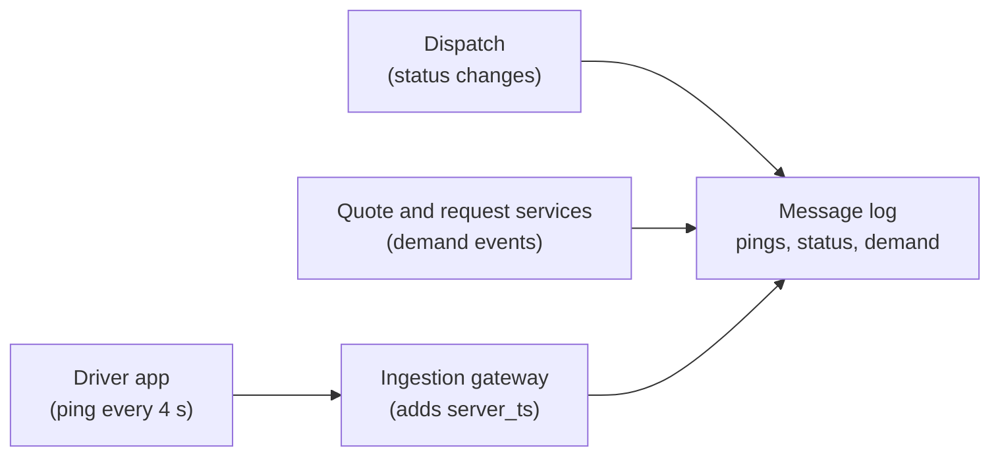
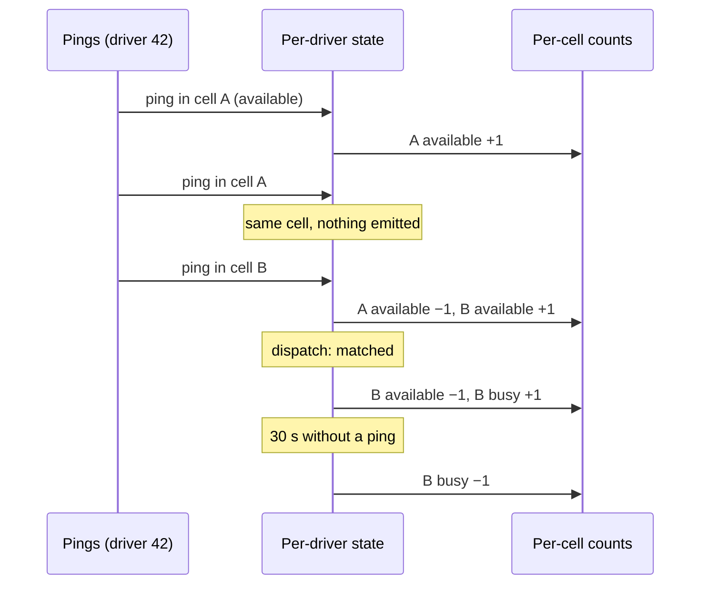
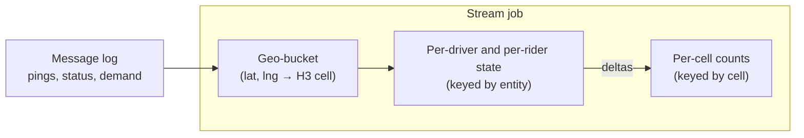
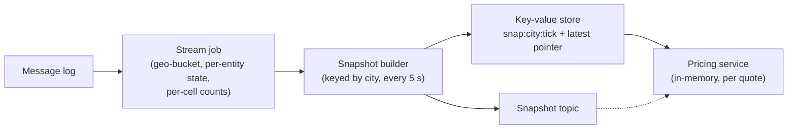
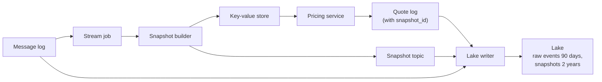

# Design the Data Pipeline Behind Uber-Style Surge Pricing

This breakdown follows the seven steps from [The Delivery Framework](../01-the-framework/02-delivery-framework.md). Surge pricing sounds like a pricing question, and candidates lose time designing the formula. It is a data question: **how do you turn hundreds of thousands of GPS pings a second into a trustworthy count of drivers and riders for every small patch of every city, every few seconds, and hand it to a pricing service that cannot wait?**

## Understanding the Problem

The prompt:

> "We run an Uber-style ride-hailing app in about 600 cities. When demand outruns supply in an area, prices go up to pull drivers in and spread out requests. The pricing team owns the algorithm. Design the pipeline that feeds it."

Picture it on the ground. A concert ends at 23:00, twelve thousand people walk out and open the app, and the 40 drivers nearby are taken within two minutes. If the price there rises now, drivers a few kilometres away head toward the stadium. If it rises five minutes late, they arrive after the crowd has given up.

For each small area, roughly every 5 seconds, the pricing service needs:

- **Supply:** drivers available there right now, and drivers on trips.
- **Demand:** riders looking at prices there, requests, and requests that found no driver.

The central tension has three parts:

1. **Geo-bucketing:** mapping every location to a fixed cell on a map grid, so "area" becomes a key you can group by. Too coarse and a busy downtown averages with an empty suburb; too fine and every count is 0, 1 or 2.
2. **Sub-minute aggregation per cell.** Counts must be correct (distinct drivers, not pings) and seconds fresh, while phones send data late and out of order.
3. **Feeding a pricing service, safely.** The output drives every price quote. A stale or partial count charges real riders the wrong price.

All three are stressed at once at the worst moment, when one cell gets hot.

> [!NOTE]
> Sub-minute aggregation for human viewers, freshness budgets and the exactly-once latency floor are covered in [Real-Time Dashboard](04-real-time-dashboard.md). Here the reader is a machine making money decisions, which changes what "safe" means.

## Requirements

*About 6 minutes.* Ask what the pricing service needs, how often, and what happens when the data is wrong:

> **You:** "Does pricing compute per request, or on a schedule?"
> **Interviewer:** "It recomputes multipliers for every area every few seconds and serves quotes from memory."
> **You:** "How stale can its inputs be before you'd rather not use them?"
> **Interviewer:** "Ten to fifteen seconds is fine. A minute old during a rush is useless."
> **You:** "If the pipeline is behind or missing data, what should pricing do?"
> **Interviewer:** "Fall back to safe prices. A false surge is a news story."
> **You:** "Do you need to explain past prices later?"
> **Interviewer:** "Yes. Support disputes, regulators in some cities, and backtesting."

That third answer shapes the design more than any throughput number: the pipeline must **say when it is unsure**, not just be fast.

### Functional requirements

1. **Geo-bucket** every driver location and demand event into a grid cell.
2. **Per-cell counts every 5 seconds:** available drivers, busy drivers, riders looking, requests in the last minute, unfulfilled requests in the last 5 minutes, plus the same counts summed over each cell's neighbours.
3. **Serve a per-city snapshot** to the pricing service with low latency, with its age and completeness attached.
4. **Keep history:** every snapshot pricing used, for disputes and backtesting.

**Below the line (out of scope):** the pricing algorithm, demand forecasting, dispatch and matching, driver incentives, payments, GPS spoofing detection. Say: "I give pricing clean inputs; how they become a price is their system."

### Non-functional requirements

- **Scale:** about 1.5 million drivers online at the global peak, each pinging every 4 seconds: **375,000 pings a second**. Worked out next.
- **Freshness:** a snapshot per city every 5 seconds, reflecting events up to 10 seconds old (p95, from our servers receiving an event to the snapshot being readable).
- **Read latency:** a city snapshot fetch under 20 ms (p99). Pricing never reads our store per quote.
- **Correctness:** available-driver counts within 2% of an offline recount from the same pings, for 95% of cells with 10 or more drivers.
- **Safety:** a snapshot that is stale (over 15 seconds) or incomplete is marked so, within one tick. Silent undercounts are the failure that matters.
- **Auditability:** every published snapshot kept 2 years, and every quote traceable to the snapshot it used.

> [!TIP]
> In any real-time prompt that feeds an automated decision, ask "what should happen when the data is bad?" Here the answer becomes a completeness flag that drives half the design.

## Sources & Volume

*About 4 minutes.* Three sources:

- **Driver location pings** from the driver app: `driver_id`, latitude, longitude, the phone's timestamp, GPS accuracy. Nearly all the volume, and from phones, so it can be late.
- **Driver status changes** from the dispatch system (online, matched, trip started, trip ended, offline). Dispatch is the source of truth for availability.
- **Demand events** from backend services: `quote_shown` (a rider saw a price for a pickup point), `ride_requested`, `request_expired` (no driver accepted). Our servers, our clocks.

Use [Key DE Numbers](../02-core-concepts/10-key-de-numbers.md):

1. **Pings.** "1.5 million drivers at peak, one ping every 4 seconds: 375,000 a second. The daily average is about a third of that, so roughly 11 billion pings a day."
2. **Bytes.** "About 300 bytes as JSON: 110 MB/s at peak, about 3.3 TB a day."
3. **Demand.** "25 million trips a day at about 6 quotes per trip is 150 million quote events, around 10,000 a second at peak. Status changes add 100 million a day. Small next to pings."
4. **Message log.** "110 MB/s at 10 MB/s per partition needs at least 11 partitions; I'll take 64 for parallelism. Disk: 3.3 TB a day, about 1.1 TB after lz4, 3 days, 3 replicas: about 10 TB."
5. **Cells.** "With cells of about 0.7 km² (next section), 150,000 km² of service area is around 200,000 cells. At peak maybe 100,000 have anyone in them."
6. **Output and state.** "About 100 bytes of counts per cell: 10 MB for the world, 500 KB for the biggest city's 5,000 active cells. Latest state per driver and per looking rider is about 3.5 million entries at 100 bytes: a few hundred MB."

Say what it means:

> "Ingest is moderate, state is small and the output is tiny. This isn't a storage problem. It's about counting the right thing, keying it so no city or cell becomes a bottleneck, and publishing a picture pricing can trust."

## High-Level Design

*About 12 minutes.* The data flow first:

1. Phones and backend services send pings, status changes and demand events through a gateway to a message log.
2. A stream job maps each location to a grid cell and keeps the latest state per driver and per rider.
3. It turns state changes into per-cell counts.
4. A snapshot builder assembles a per-city snapshot every 5 seconds and publishes it to a fast store.
5. Raw events and every published snapshot land in the lake.

Then one requirement at a time.

### 1. Turning a location into a key

#### Bad Solution: Neighbourhood polygons, or the whole city

Price per city, or check which named neighbourhood polygon each ping falls in.

Per city, the stadium and the quiet suburb get the same price. Neighbourhoods range from 0.2 to 20 km², so their counts aren't comparable, and a point-in-polygon test costs far more than a grid calculation at 375,000 pings a second.

#### Good Solution: A square grid, or geohash

Round latitude and longitude into squares, or use **geohash**, a public scheme that encodes a map rectangle as a short string (longer strings, smaller rectangles). Cheap to compute, with stable cell IDs.

Where it falls short: cells are latitude-longitude rectangles, so their real size changes with latitude (narrower in Oslo than in Singapore). And neighbours are uneven: 4 share an edge and 4 touch at a corner, about 1.4 times farther away. That matters when you sum "a cell plus its neighbours" to smooth small counts.

#### Great Solution: A hexagonal grid at a fixed resolution

Use a hexagonal grid such as **H3**, an open-source system that covers the Earth in hexagons at 16 resolutions. Resolution 8 averages about 0.74 km², a few city blocks; resolution 7 is about 5 km², resolution 9 about 0.1 km². A library call turns a location into a 64-bit cell ID in microseconds.

Each hexagon has 6 neighbours (12 special cells per resolution are pentagons; ignore them), all sharing an edge and all at the same distance, so "a cell plus its ring" (7 cells, about 5 km²) is an even smoothing area. Each cell also has an approximate parent at the next coarser resolution, for roll-ups.

Why resolution 8? Count it out. A busy downtown cell on a Friday night has maybe 30 available drivers and 60 looking riders: a stable count. At resolution 9 that splits into about 7 cells of 4 drivers each, where one driver leaving moves the count by 25%. At resolution 7, the stadium averages with the car park and the motorway. Publish resolution-8 counts and the 7-cell sums, and let pricing choose.

> [!TIP]
> One sentence on the grid ("hexagons, because every neighbour is the same distance away") and the rest of your time on the resolution, with numbers. The interviewer wants to hear why 0.7 km² and not 0.1.



The gateway stamps each ping with `server_ts`, when our server received it. Deep dive 2 is built on that field.

### 2. Counting supply and demand per cell

"Available drivers in cell X right now" sounds like a `GROUP BY`. The obvious version is wrong.

#### Bad Solution: Count pings per cell per minute

Map each ping to a cell and count pings in 1-minute tumbling windows (fixed, non-overlapping).

A driver sitting still pings 15 times a minute, and fewer on a weak network, so the count measures signal quality, not drivers. It is up to a minute old when the window closes, and it ignores status: a driver on a trip is in the cell but isn't supply.

#### Good Solution: Distinct available drivers per cell, in a short sliding window

Join pings with status, keep available drivers, and count distinct `driver_id`s per cell over the last 30 seconds, sliding every 5 seconds. Demand likewise: distinct riders with a `quote_shown` in the last 2 minutes.

The units are now right, but **a moving driver counts twice**: one who crossed from cell A to B 10 seconds ago has pings in both windows. At city speed a driver changes resolution-8 cell roughly once a minute, so the double counting concentrates in busy cells, where it matters. And each event lands in 6 overlapping windows, each holding a set of IDs per cell: a lot of work for a question about *now*.

#### Great Solution: Keep the latest state per driver, and emit changes to per-cell counters

Turn the question around: instead of asking each cell who passed through, ask each driver where they are now.

- **Key by driver.** The stream job ([Flink](../04-technology-deep-dives/08-flink.md) or similar) partitions pings and status by `driver_id` and keeps **keyed state** per driver: current cell, status, and the phone timestamp of the last ping used.
- **Emit deltas, not events.** A ping that moves a driver from A to B emits `(A, available, −1)` and `(B, available, +1)`. Dispatch marking her matched emits `(B, available, −1)` and `(B, busy, +1)`. A ping in the same cell with the same status emits nothing.
- **Expire the silent.** No ping for 30 seconds removes the driver from her cell; a phone that stopped reporting isn't reliable supply.
- **Sum per cell.** A second step, keyed by cell, adds the deltas into running counts.

A driver is in exactly one cell, by construction. A duplicate ping, with a phone timestamp no newer than the stored one, is ignored, so the update is **idempotent** (same result however often it arrives). And the per-cell step sees little traffic: a moving driver changes cell about once in 15 pings and a waiting one never, so at most about 50,000 deltas a second against 375,000 pings.

Demand uses the same pattern keyed by `rider_id`: a rider is "looking" in the pickup cell of their latest quote until they request or 2 minutes pass, so ten refreshes are one rider. Requests and expired requests are counted per cell in 5-second buckets, summed over the last 1 or 5 minutes.



The cost is a few hundred MB of state that must survive restarts. **Checkpoints** (the job's periodic snapshots of state and Kafka offsets) cover that.



### 3. Feeding the pricing service

Pricing recomputes multipliers every few seconds and serves quotes from memory. Our job is to hand it inputs that are fast, consistent and honest. This is an **online store** as in [Feature Store](08-feature-store.md): latest values in a fast key-value store, read in a service's hot path. The difference is the shape (a whole city at once) and how much a wrong value costs.

#### Bad Solution: Pricing queries an analytical store per quote

Write counts to a real-time OLAP store and query "this cell and its neighbours" for each quote.

At 10,000 quotes a second, several thousand from one stadium on a big night, an analytical query now sits in the request path of the business, and the store's load scales with riders.

#### Good Solution: The stream job upserts per-cell counts into a key-value store

The per-cell step writes counts into a key-value store such as Redis, one hash per city with a field per cell. Each pricing instance reads its cities every 5 seconds into memory. Reads take a millisecond or two and scale with pricing instances, not riders. Where it falls short:

- **No single "as of".** Cells update independently, so one read mixes ticks, and a half-applied move (left A, not yet in B) can be visible.
- **No quality signal.** If one Kafka partition stalls, a sixty-fourth of the drivers stop updating and time out. The hash still looks fresh, supply looks lower, and pricing surges.
- **No history** of which counts priced which quote.

#### Great Solution: A versioned per-city snapshot, published atomically, with age and completeness

Add a **snapshot builder** keyed by city, after the per-cell step:

- **One tick, one picture.** Every 5 seconds each per-cell subtask emits the cells that changed, labelled with the tick. The builder keeps its city's full cell map (500 KB for the biggest city) and, once it has every subtask's tick-T output, writes one snapshot.
- **Knowing it has everything.** A **watermark** is the stream's running estimate of how far time has progressed, and an operator's watermark is the minimum across its inputs. When the builder's watermark passes T, every upstream subtask has sent tick T ([Late-Arriving Data](../02-core-concepts/08-late-arriving-data.md) explains watermarks).
- **Quality fields.** `as_of` is the time the counts cover; `completeness` is the share of gateway instances heard from recently (deep dive 3). Pricing chooses what to do with a weak snapshot; we make sure it can tell.
- **Atomic publish.** Write the snapshot under `snap:{city}:{tick}`, then move the pointer `snap:{city}:latest`. Readers never see half a city. Old versions expire after an hour.
- **Neighbour sums here.** With the city in memory, summing each cell's 6 neighbours is 35,000 lookups for the biggest city: microseconds. Doing it upstream would send every delta to 7 cells.

Pricing instances read the pointer, or subscribe to a snapshot topic, and load each new snapshot into memory: a few hundred reads a second on our store, however many riders there are.

Keying by city is safe here, and only here: the biggest city sends the builder about 1,000 cell updates a second. Deep dive 1 shows what the same key would do earlier.



### 4. History for audits and backtesting

"Why was this rider charged 2.4 times the normal fare at 23:04 on 14 March?" Two things answer it:

- **Snapshots go to the lake.** A lake writer appends every snapshot to an Iceberg or Delta Lake table, non-empty cells only: about 20,000 rows a second, 1.7 billion a day, roughly 30 to 40 GB of Parquet. Two years is about 25 TB, around $600 a month.
- **Every quote records its snapshot.** The pricing service logs `snapshot_id` with each quote, which turns a dispute into a lookup.

Raw events also land in the lake, kept 90 days, for offline recounts and rebuilding state. This is **feature logging** from [Feature Store](08-feature-store.md): record exactly what the decision-maker saw.



## Data Model

*About 5 minutes.* Model from pricing backwards.

### The city snapshot (the output contract)

| Field | Type | Notes |
|---|---|---|
| `city_id`, `tick` | string, timestamp | `tick` is the start of the 5-second interval. Together they are the snapshot ID. |
| `as_of` | timestamp | The time the counts cover, from the watermark. |
| `published_at` | timestamp | `published_at − as_of` is the pipeline's delay. |
| `completeness` | float | Share of gateway instances heard from within 5 s of `as_of`; 1.0 is healthy. |
| `h3_resolution` | int | 8, so the grid can change without breaking readers. |
| `cells` | list | Per cell: `cell_id`, `available_drivers`, `busy_drivers`, `riders_looking`, `requests_1m`, `expired_requests_5m`, and the same five over the 7-cell neighbourhood. |

All counts, never ratios: pricing computes ratios, and a stored ratio can't be re-aggregated to bigger areas (the point [Real-Time Dashboard](04-real-time-dashboard.md) makes about rates). Treat the schema as a [data contract](../02-core-concepts/07-data-contracts.md): "available means dispatch says available and a ping within 30 seconds" never changes silently, because a definition change looks exactly like a market change.

### Stream job state

Driver state keyed by `driver_id` (cell, status, last phone timestamp, expiry timer: about 150 MB), rider state keyed by `rider_id` (about 200 MB), per-cell counts keyed by `cell_id` (about 40 MB), and per-city maps in the builder (tens of MB). Small state means fast recovery.

### Topics

| Topic | Key | Partitions | Retention |
|---|---|---|---|
| `driver_pings` | `driver_id` | 64 | 3 days |
| `driver_status` | `driver_id` | 16 | 7 days |
| `rider_demand` | `rider_id` | 16 | 7 days |
| `city_snapshots` | `city_id` | 16 | 3 days |

Entity keys keep each driver's pings in order on one partition and spread load evenly. `city_snapshots` is keyed by city because it is small.

### Lake tables

- `raw.driver_pings`, `raw.driver_status`, `raw.rider_demand`: one row per event, partitioned by hour of `server_ts`, 90 days.
- `pricing_inputs.cell_snapshots`: grain is one cell in one snapshot, partitioned by day of `tick`, sorted by `(city_id, tick)`, 2 years. `city_id` is a sort key, not a partition key: 600 cities × 365 days would be 220,000 small partitions a year ([Partitioning](../02-core-concepts/01-partitioning.md)).
- `pricing.quote_log`: the pricing team's, carrying `snapshot_id`.

## Pipeline Design

*About 5 minutes.* Most of this is settled.

| Path | Mode | Why |
|---|---|---|
| Sources → gateway → message log | Continuous | The gateway stamps `server_ts`. |
| Stream job | Streaming, record at a time, checkpoint every 30 s | Per-driver state and expiry timers, 5-second ticks. |
| Snapshot builder | Fires on the watermark each tick | One consistent picture per city. |
| Lake writer | Micro-batch, commit every 5 minutes | Bigger files; audits don't need seconds. |
| Offline recount | Batch, hourly | The 2% correctness check. |

Per-entity timers and 5-second ticks tip this to record-at-a-time streaming; [Micro-Batch vs Streaming](../03-architecture-patterns/08-micro-batch-vs-streaming.md) has the general trade-off.

**Duplicates.** Sources deliver **at least once** (every event one or more times), and that needs no extra dedup step: a duplicate ping isn't newer than the stored one, a duplicate status sets the same value, and snapshots are absolute counts keyed by `(city_id, tick)`, so writing one twice changes nothing. No exactly-once sink, so the checkpoint interval stays out of the latency budget (deep dive 2 of [Real-Time Dashboard](04-real-time-dashboard.md) explains that floor).

**Restarts.** The job restores a few hundred MB of state in seconds and replays up to 30 seconds of input. While it catches up, the builder publishes snapshots for ticks already past; their `as_of` shows it and pricing ignores them. A restart costs about a minute of snapshots flagged stale, not a minute of wrong prices.

**Failure behaviour.**

- **Stream job down:** the `latest` pointer ages past 15 seconds; pricing falls back.
- **One input partition stalled:** the watermark stops there, so snapshots stop for everyone rather than publishing with drivers missing. Deep dive 3 makes that deliberate.
- **Key-value store down:** pricing keeps its last snapshot in memory until it is too old. Run the store with a replica.
- **Bad logic deployed:** fix and replay the last few minutes. Driver state heals itself: every driver pings every 4 seconds and dispatch can restate every status.

## Potential Deep Dives

*About 12 minutes.* If the interviewer leaves it to you, start with the first. How to run deep dives is in [Deep Dives](../01-the-framework/08-deep-dives.md).

### 1. "It's New Year's Eve. One city triples and a few cells near the fireworks get thousands of people. Where does your pipeline get hot?"

A **hot key** gets far more traffic than the rest, so the worker that owns it becomes the bottleneck ([Partitioning](../02-core-concepts/01-partitioning.md) covers hot partitions). Check each stage separately, because each is keyed differently. Assume the biggest city is 8% of global pings and triples tonight while the global peak stays near 375,000 a second (other time zones are asleep).

| Stage | Key | Busiest key tonight | Verdict |
|---|---|---|---|
| Message log, stream job input | `driver_id` | One ping every 4 s | Never hot |
| Per-cell counts | `cell_id` | A few deltas a second from converging drivers; a few hundred demand events a second | Fine |
| Snapshot builder | `city_id` | ~1,000 cell updates a second | Fine |
| Pricing reads | per-city pointer | A few hundred reads a second | Fine |

Nothing is hot, because the design aggregates *before* it keys by geography. Compare the alternatives.

#### Bad Solution: Partition everything by city

Surge is per city, so give each city a partition and a subtask.

Tonight the biggest city sends 8% × 3 × 375,000 ≈ 90,000 pings a second to one partition: about 27 MB/s against a 10 MB/s planning figure, and several times what one core does with state (5,000 to 20,000 updates a second, per [Flink](../04-technology-deep-dives/08-flink.md)). That city's snapshots go stale on the one night surge matters most, while small cities' partitions idle.

#### Good Solution: Partition raw pings by cell

100,000 active cells spread the load far better. But a downtown cell with 2,000 waiting drivers still gets 500 pings a second, a few such cells can share a subtask, and the double counting returns: a driver's pings go to whichever cell she is in, so no worker knows where she is now. If you were stuck here, **local-global aggregation** (each upstream subtask pre-aggregates counts per cell for a second and sends one partial to the owner) caps a cell at one partial per upstream subtask per second, because counts merge. [URL Shortener Analytics](02-url-shortener-analytics.md) shows it for a viral link.

#### Great Solution: Key by entity, emit deltas, key by geography only after aggregation

The design you have; this is where you defend it with numbers:

- **Entity keys are even.** A crowd adds drivers, but each is still one ping every 4 seconds, so 375,000 pings a second spread over 64 partitions and about 40 to 50 cores (at roughly 10,000 stateful updates a second per core).
- **Deltas shrink the traffic.** A crowd of drivers *waiting* in a cell generates almost no deltas.
- **City keys only for output,** when a city is a few thousand rows per tick.

> [!WARNING]
> Don't reach for salting by reflex. Salting (a random suffix that spreads a hot key over partitions) is the fix when a key you can't change is hot. Here the answer is a key that is never hot: "I'd salt if I had to; I don't, and here's the table."

One "hot" problem isn't throughput: 12,000 people in one 0.7 km² cell, with the cell next door nearly empty, is partly an artifact of where the boundary falls. That is why the snapshot carries neighbourhood sums.

### 2. "Phones go through tunnels and upload 90 seconds of pings at once, and some phone clocks are wrong. What does your pipeline do?"

This is [late-arriving data](../02-core-concepts/08-late-arriving-data.md) with a twist: for live supply, late data isn't worth waiting for. It is old news.

Every ping has two timestamps. `device_ts` is the phone's clock when it took the location: **event time**, from a clock you don't control. `server_ts` is when the gateway received it: our clock. Give each a job:

- **`server_ts` is the pipeline's clock.** Ticks, watermarks and expiry timers run on it, with 2 seconds of allowed disorder. A phone set to last Tuesday can't stall a watermark or close a tick early.
- **`device_ts` orders a driver's own pings.** An older ping than the stored one is discarded. If `device_ts` is more than 5 minutes from `server_ts`, trust `server_ts`.
- **Stale pings don't move supply.** If `server_ts − device_ts` exceeds 30 seconds, the ping goes to the lake and refreshes "last heard from", but only the newest ping of a burst may change the driver's cell. Positions from 90 seconds ago are not where she is now.

Count what you ignore: "stale pings per city per minute" is monitored, because a jump (a carrier outage, an app release that broke buffering) shows up as falling supply.

> [!TIP]
> Separate the clocks by purpose: "server time drives the pipeline, device time orders a driver's own events." Waiting for late data is right for a revenue report and wrong for a price valid for 5 seconds.

### 3. "One failure stops a quarter of the ping partitions. Supply in every city drops by a quarter. How do you stop a false surge?"

This is where the pipeline differs from a dashboard. A dashboard with a gap misleads a human who can check. A surge pipeline with a gap overcharges riders.

#### Bad Solution: Publish whatever the counts say

The job expires drivers on wall-clock timers, so 30 seconds later every driver on those partitions vanishes from her cell. Pricing sees demand unchanged, supply down a quarter, and surges every city. Nothing in the snapshot says anything is wrong.

#### Good Solution: Publish freshness, and fall back when it's old

Every snapshot carries `as_of`, and pricing ignores snapshots older than 15 seconds. That catches a stopped pipeline, not a *partly* stopped one: the healthy partitions keep the newest timestamps looking fine.

#### Great Solution: Hold the watermark, measure completeness, sanity-check the market

- **Expire on the pipeline's clock.** Make the 30-second expiry an **event-time timer** (it fires when the watermark passes a time, not when the wall clock does) on `server_ts`. A stalled partition holds the watermark, so its drivers wait with it instead of vanishing, and snapshots stop advancing rather than publishing a hole. Flink's idle-source setting (`withIdleness` on the watermark strategy) would unstick the watermark by ignoring a silent partition, and that is the right fix for a quiet topic. Here it is the wrong one: partitions keyed by driver always carry traffic from many cities, so a silent partition is a failure, not a quiet night. Leave it off, or set it long enough that only a real outage trips it.
- **Measure completeness.** The watermark only sees what reaches the log. Each gateway instance writes a heartbeat carrying its ID into every partition each second; `completeness` is the share of gateway instances heard from within 5 seconds of `as_of`. A dead gateway or a lost region leaves the partitions healthy and the watermark moving, but completeness drops. Pricing uses only snapshots above its threshold and otherwise holds the last good prices or uses standard fares.
- **Sanity-check the market.** Real supply doesn't fall 15% across a whole city in one tick. The builder flags such a snapshot `suspect`, and pricing treats it like incomplete. A stadium emptying moves a few cells, not the city, so false flags are rare, and they err the right way.

Say the choice out loud: the pipeline **fails closed** on publishing (no snapshot rather than a wrong one) so pricing can fail safe on prices. Late rather than wrong.

### 4. "Six weeks later a rider disputes a 2.4x fare. Can you show what pricing saw? And the pricing team wants to test a new formula on last month's data."

#### Bad Solution: Recount from raw pings when asked

Rerun the counting logic for that city and minute.

You get a different answer: the replay sees late pings the live pipeline ignored, and the code has changed since. A recount says what pricing *should have* seen, not what it saw. And raw pings are gone after 90 days.

#### Good Solution: Store every snapshot, log the snapshot ID with every quote

The dispute becomes a join:

```sql
SELECT q.quote_id, q.multiplier, s.cell_id,
       s.available_drivers, s.riders_looking, s.completeness
FROM pricing.quote_log q
JOIN pricing_inputs.cell_snapshots s
  ON s.city_id = q.city_id AND s.tick = q.snapshot_tick AND s.cell_id = q.pickup_cell
WHERE q.quote_id = 'qt_8812345';
```

About 25 TB over 2 years answers every dispute completely.

#### Great Solution: Snapshots for audits, plus a replay path for backtests that checks its seam

A new formula may need a count you never published (riders looking over 5 minutes, or resolution 9). For that, run the counting logic over raw lake events in batch, with the same code where possible (Flink can run a job over bounded input) and the same rules: `server_ts` as the clock, the same staleness cutoff. Then check the seam: recount a week you also have snapshots for, and require 98% of busy cells within 2%. That is the hourly recount from Monitoring, and the offline/online consistency check from [Feature Store](08-feature-store.md).

> [!NOTE]
> Measured demand depends on the price: riders who see 2.4x close the app. A backtest replaying last month's demand into a new formula ignores that loop. It is pricing's problem, but naming it shows you know what your data can't answer.

## Monitoring & SLAs

*About 4 minutes.* One SLA per non-functional requirement. Presentation in [Monitoring and SLAs](../01-the-framework/09-monitoring-and-slas.md); alert design in [Monitoring and Alerting](../02-core-concepts/06-monitoring-and-alerting.md).

| SLA | Target | Measured by |
|---|---|---|
| **Freshness** | 95% of snapshots readable within 10 s of `as_of`; none used past 15 s | `published_at − as_of`, and snapshot age at the pricing service |
| **Completeness** | 99.9% of snapshots with `completeness` = 1.0 | The heartbeat-based field, per snapshot |
| **Correctness** | Available drivers within 2% of an offline recount, 95% of cells with 10+ drivers | Hourly batch recount from lake pings at sampled ticks |
| **Read latency** | Snapshot fetch p99 under 20 ms | Pricing service client metrics |

Behind them:

- **Consumer lag on the worst partition**, not the average: one lagging partition holds every city's snapshots.
- **Snapshots per city per minute:** exactly 12. Zero for one city while others are healthy is a builder bug.
- **Stale pings and driver expirations per city per minute**, against the same time last week. A city-wide spike is a pipeline or carrier problem before it is a market event.
- **Suspect and incomplete snapshots**, with the reason: each one is a time pricing fell back.

## Final Design

```mermaid
flowchart LR
    subgraph SRC["Sources"]
        DA["Driver app<br/>(ping every 4 s)"]
        DS["Dispatch<br/>(status)"]
        QS["Quote and request services"]
    end
    DA --> GW["Ingestion gateway<br/>(server_ts, heartbeats)"]
    GW --> K["Message log<br/>driver_pings 64 partitions,<br/>status, demand"]
    DS --> K
    QS --> K
    subgraph SJ["Stream job (checkpoint 30 s)"]
        G["Geo-bucket<br/>(H3 resolution 8)"] --> DR["Per-driver and per-rider state<br/>(keyed by entity, expiry timers)"]
        DR -- "deltas" --> CC["Per-cell counts<br/>(keyed by cell)"]
        CC --> SB["Snapshot builder<br/>(keyed by city, on watermark,<br/>neighbour sums, completeness,<br/>sanity check)"]
    end
    K --> G
    SB --> KV["Key-value store<br/>snap:city:tick, latest pointer"]
    SB --> ST["city_snapshots topic"]
    KV --> PS["Pricing service<br/>(in-memory snapshot,<br/>falls back if stale)"]
    PS --> QL["Quote log<br/>(snapshot_id)"]
    K --> LW["Lake writer<br/>(5-min commits)"]
    ST --> LW
    QL --> LW
    LW --> L["Lake<br/>raw events 90 days<br/>cell_snapshots 2 years"]
    L --> RC["Hourly offline recount"]
    L --> BT["Backtests and disputes"]
```



Follow one driver and one rider. At 23:04:01 driver 42's phone records a location near the stadium; the gateway stamps it at 23:04:02. The stream job maps it to a cell, sees her stored cell was the one next door, and emits −1 there and +1 here. A second later rider 9001 sees a quote with that cell as pickup and is marked "looking". When the watermark passes the 23:04:05 tick, about 2 seconds later, the city's builder adds neighbour sums, finds completeness 1.0 and a normal city-wide change, writes the snapshot and moves the pointer. Pricing loads it, and rider 9001's next quote logs its ID. Within 5 minutes the snapshot is in the lake, where a support agent can find it two years later.

The bill is modest: a few brokers, a stream job of 40 to 50 cores, a replicated key-value store holding tens of MB, and a lake under 50 TB. The engineering is in counting the right thing and refusing to publish what you can't vouch for.

## What's Expected at Each Level

### Mid-level

You get the shape right: pings into a message log, a stream job that maps locations to grid cells and counts per cell, a fast store in front of pricing. You do the ping math and see that ingest is moderate. With a nudge, you see that counting pings isn't counting drivers. You keep the pricing algorithm below the line. Bar for this problem: a fixed grid with a reason for its size, distinct counts by status, a key-value store in front of pricing, and a freshness SLA.

### Senior

You drive, and you design around the three-part tension. You argue the grid resolution with numbers. You invert counting into per-driver state with deltas and expiry, and explain why that removes double counting and shrinks traffic. You walk the stages for hot keys and show that keying by entity first means nothing gets hot, rather than salting by reflex. You split `server_ts` and `device_ts` by purpose. Your snapshot is versioned, atomic and carries `as_of` and completeness, and you log snapshots for disputes.

### Staff+

You treat the snapshot as a contract between two teams whose mistakes cost money: owned definitions, a versioned grid resolution, a change process. You frame safety as a system property (the pipeline fails closed so pricing can fail safe) and agree the thresholds with the pricing team. You raise the feedback loop between price and measured demand. And you plan for more consumers (a driver-app heatmap, city operations, forecasting) that must never slow down pricing, and for regional pipelines so one region's outage can't touch another's prices.

## Related Lessons

- Framework: [The Delivery Framework](../01-the-framework/02-delivery-framework.md), [Requirements Gathering](../01-the-framework/03-requirements-gathering.md), [Sources and Volume](../01-the-framework/04-sources-and-volume.md), [High-Level Architecture](../01-the-framework/05-high-level-architecture.md), [Deep Dives](../01-the-framework/08-deep-dives.md), [Monitoring and SLAs](../01-the-framework/09-monitoring-and-slas.md)
- Concepts: [Key DE Numbers](../02-core-concepts/10-key-de-numbers.md), [Partitioning](../02-core-concepts/01-partitioning.md) (hot partitions and salting), [Late-Arriving Data](../02-core-concepts/08-late-arriving-data.md), [Data Contracts](../02-core-concepts/07-data-contracts.md), [Monitoring and Alerting](../02-core-concepts/06-monitoring-and-alerting.md)
- Patterns: [Micro-Batch vs Streaming](../03-architecture-patterns/08-micro-batch-vs-streaming.md)
- Technology: [Flink](../04-technology-deep-dives/08-flink.md), [Kafka](../04-technology-deep-dives/02-kafka.md)
- Related breakdowns: [Real-Time Dashboard](04-real-time-dashboard.md) (sub-minute aggregation and freshness budgets for human viewers), [Feature Store](08-feature-store.md) (online serving and feature logging), [URL Shortener Analytics](02-url-shortener-analytics.md) (local-global aggregation for a hot key)
- Previous breakdown: [Data Quality Monitoring](09-data-quality-monitoring.md). Next: the [Module 5 quiz](11-quiz.md)
