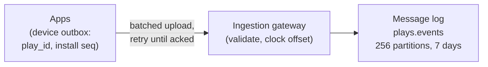
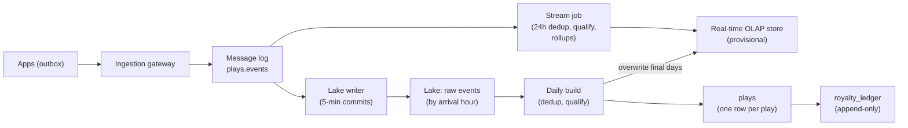
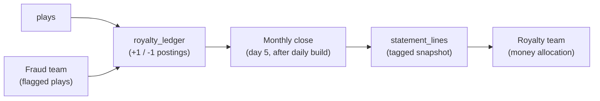
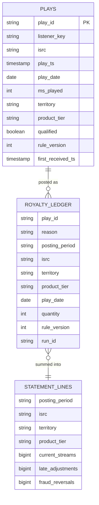
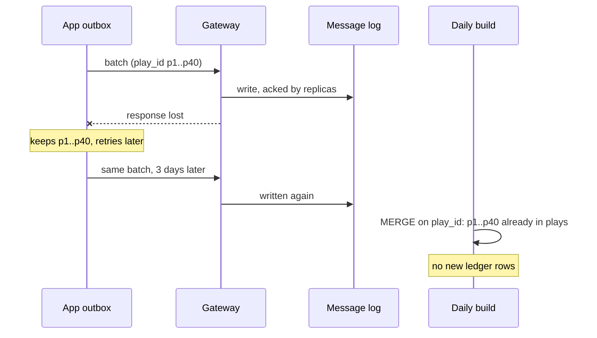
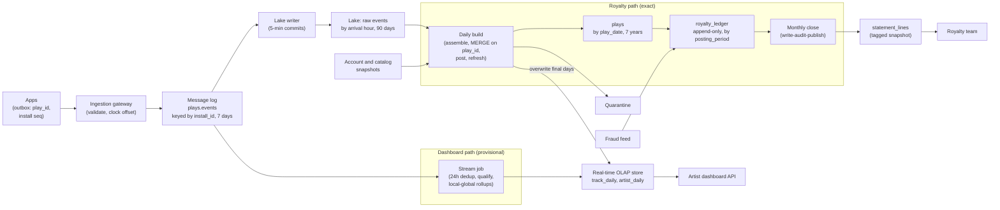

# Design Spotify-Style Listening Analytics and Royalty Counts

This is the first advanced breakdown. It follows the same steps as every breakdown ([The Delivery Framework](../01-the-framework/02-delivery-framework.md)), but the interviewer expects you to see that one stream of events feeds two consumers with opposite needs. "Spotify-style" is only the prompt's framing; nothing here describes how any real company built its system.

## Understanding the Problem

The prompt:

> "We run a music streaming service. Design the data system that counts plays. Artists want a dashboard of how their songs are doing, and we pay royalties to labels and publishers based on those counts."

A **royalty** is the money a streaming service pays the owners of a song each time it is played. Owners are record labels, publishers and distributors, collectively **rights holders**. A common payout model is **pro-rata**: each month, the money available in a market is split by stream share, so a track with 0.01% of the month's streams in Germany gets 0.01% of the German pool.

That model is why this prompt is hard. Under pro-rata, **a counting error on one track moves money from every other rights holder in that market.** A double-counted play is somebody else's money paid to the wrong party.

Three forces pull against each other:

- **Royalty counts must be billing-grade.** Every qualifying play counted once, never twice, reproducible months later, and provable to an auditor.
- **Artist dashboards must be fresh.** An artist who released a single at midnight wants to watch it climb, today, and does not care whether the number is off by 0.3%.
- **The volume is massive, and some of it is late.** Tens of billions of playback events a day, and listeners in offline mode play songs on a plane and upload those plays days or weeks later.

The interview turns on one question: **where do you allow approximation and revision, and where do you forbid it?** Say that out loud in the first two minutes.

## Requirements

*About 7 minutes.* Ask about the money first; it decides the most.

> **You:** "What counts as one play for royalties? Any start, or a minimum listening time?"
> **Interviewer:** "Our licensing contracts say a stream counts once at least 30 seconds of it has been played."
> **You:** "Royalty statements go out how often, and can a statement change after it is sent?"
> **Interviewer:** "Monthly, by the 10th of the following month. Once it's sent, it's sent. Corrections go in a later statement."
> **You:** "Can listeners play offline? How long can a device stay offline?"
> **Interviewer:** "Premium users can. The app must reconnect at least once every 30 days or downloads stop working."
> **You:** "And fake streams, bots playing a track on loop?"
> **Interviewer:** "A separate fraud team flags them. Flagged plays must not be paid."

Each answer becomes a design constraint. "Once it's sent, it's sent" plus "30 days offline" means **plays will arrive after the month they belong to has been closed**, and you need a rule for that before you draw a box.

### Functional requirements

1. **Ingest playback events** from every client (phones, desktop, web, cars, smart speakers), including plays made offline and uploaded later.
2. **Royalty statements:** each month, the count of qualifying streams per recording, per territory, per product tier (free, premium), delivered to the royalty team. Every number must trace back to the individual plays behind it.
3. **Artist dashboards:** streams and unique listeners per track, per day, by country and by source (playlist, album, search), with today's numbers updating through the day.
4. **Corrections:** plays later flagged as fraud, and late offline plays, must be reflected in a future statement without changing past ones.

A **recording** is identified by its **ISRC** (International Standard Recording Code), the industry-wide ID for one specific recording of a song. Labels are paid per ISRC. A **territory** is the country whose royalty pool the play belongs to, here the listener's account country.

**Below the line (out of scope):** turning counts into money (the rights-allocation engine that knows who owns which ISRC in which territory and applies rates), the fraud detection models themselves (we consume their output; see [Fraud Detection](03-fraud-detection.md)), recommendations, ads, and the dashboard UI.

> [!TIP]
> Drawing the line at "counts, not money" is a strong move: you deliver exact, auditable counts and another team multiplies.

### Non-functional requirements

Scale first, derived in the next step:

- **Scale:** 200 million daily listeners, about **5 billion plays a day**, about **30 billion playback events a day**, peaking near **1 million events a second**.

Then the qualities, each with a number:

- **Royalty correctness:** zero duplicates and zero lost qualifying plays among those received. Re-running a closed month's statement returns identical numbers, to the last stream.
- **Statement timeliness:** each month's statement is final by 06:00 UTC on the 5th of the next month, leaving the royalty team about five days before the 10th.
- **Late data:** plays are accepted up to 30 days after they happen, which is the offline limit. Older ones go to manual review.
- **Dashboard freshness:** today's counts within 15 minutes (p95). Yesterday's numbers become final, matching the royalty pipeline's daily counts, by 06:00 UTC.
- **Dashboard latency:** under 1 second (p95), at a few thousand queries a second on a big release day.
- **Retention:** the royalty-grade play records for 7 years (financial records, audits). Raw events for 90 days.

## Sources & Volume

*About 5 minutes.* One source matters: the playback events the apps send. Two lookups join in later: the account service (country, subscription tier at a given time) and the track catalog (track to ISRC to artist).

Using [Key DE Numbers](../02-core-concepts/10-key-de-numbers.md):

1. **Plays.** "200 million daily listeners at about 25 plays each is 5 billion plays a day, about 58,000 a second."
2. **Events.** "Each play sends a start, an end, and a few pauses, seeks or progress events. Call it 6 per play: 30 billion events a day, about 350,000 a second."
3. **Peak.** "Evening peaks around 3x, and new-release Fridays add a spike on top. I'll size ingest for 1 million events a second."
4. **Bytes.** "About 400 bytes per event as JSON: 12 TB a day raw, 400 MB/s at peak."
5. **Message log.** "400 MB/s at 10 MB/s per partition needs at least 40 partitions. I'll take 256 for consumer parallelism. Retention of 7 days for replay: 12 TB a day, about 4 TB after lz4, times 7 days times 3 replicas is roughly 84 TB. That's a cluster of about a dozen brokers, or fewer with tiered storage."
6. **Lake.** "Raw events as Parquet at about 1/8 is 1.5 TB a day, 135 TB for 90 days: about $3,000 a month. One row per play, with a dozen narrow columns, is about 50 bytes compressed: 250 GB a day, about 640 TB over 7 years, on the order of $15,000 a month before moving old years to an archive tier."

Then the numbers that shape the design, about lateness and duplicates. Ask for them, or assume and say so:

7. **Qualifying plays.** "About 70% of plays pass 30 seconds, so 3.5 billion royalty-bearing streams a day, roughly 105 billion a month."
8. **Lateness.** "Say 2% of plays are made offline. Most upload within hours, but the tail runs to 30 days. Assume 99.5% of all plays arrive within a day and 99.95% within 4 days."
9. **What 0.05% means.** "If even 0.05% of a month's 105 billion streams arrive after the statement closes, that's about 50 million streams landing after their month is closed. Not an edge case; a monthly certainty."

Say what it implies:

> "Ingest is big but ordinary: a dozen brokers. Storage is cheap. The design is driven by three facts: tens of millions of plays per month arrive after their month closes, duplicates can arrive weeks apart, and the royalty number can never be revised in place."

## High-Level Design

*About 13 minutes.* The data flow, before boxes:

1. Apps record playback events on the device and upload them in batches.
2. An ingestion gateway writes them to a message log.
3. A lake keeps every raw event.
4. A stream job produces provisional counts for artist dashboards.
5. A daily batch job builds the exact, deduplicated table of plays and posts qualifying ones to a royalty ledger.
6. A monthly close turns the ledger into a statement.

Then build it one requirement at a time.

### 1. Getting plays off millions of devices, including offline ones

A phone is an unreliable network client: it loses signal mid-upload, spends a 12-hour flight in airplane mode, and has a clock that can be wrong by minutes or years.

#### Bad Solution: The app sends each event as it happens, fire and forget

Every event is an HTTP call when it happens. If the call fails, the event is gone.

Offline plays never arrive, so they are never paid, and every flaky connection loses data silently. You also cannot measure the loss.

#### Good Solution: Buffer on the device and retry until acknowledged

The app writes each event to a small local store, uploads in batches every minute or so when online, and deletes events only after the server acknowledges them. Offline plays wait on the device and upload on reconnect.

Nothing is lost while the app is installed. The catch is the retry: if the server wrote the batch but the acknowledgement was lost, the app sends it again, and without an ID the copies look like new plays. This is **at-least-once** delivery, and on a phone network it happens every minute somewhere.

#### Great Solution: A device outbox with IDs and sequence numbers set before the first send

Keep the buffer, and stamp two things on the device, once, before any upload attempt:

- A **`play_id`**: a random UUID created when playback starts. Every event of that play carries it, and it is the **dedup key** for royalties: the field that identifies one real play ([Deduplication at Scale](../02-core-concepts/09-deduplication-at-scale.md)).
- A **`play_ts`**: the device clock plus the offset the app learned at its last server contact. Because it is fixed before the first send, every retry carries the same value.
- A per-install **sequence number** on every event (`install_id`, `seq` 1, 2, 3...). Gaps in the sequence tell you events went missing, so loss becomes a number you can monitor instead of a guess.

The **ingestion gateway** (a fleet of stateless HTTP servers) validates each batch, notes the **clock offset** (server time minus device time) at upload to spot broken clocks, writes the batch to the message log with replicated acknowledgement, and only then returns success. The app deletes events after that.

Partition the topic by `install_id`. It spreads load evenly across 256 partitions and keeps each device's events in order. Keying by track would put a new number-one hit's plays on one partition.

### 2. Deciding what counts as a stream

"At least 30 seconds" sounds simple. Where you apply it matters more than how.

#### Bad Solution: Count `play_start` events

Wrong: it counts skips, and every retried upload adds a play.

#### Good Solution: The app decides, and sends a `stream_counted` event at 30 seconds

Now the rule runs on the device. But the rule now lives in hundreds of app versions on a billion devices. When the contract changes ("31 seconds for tracks shorter than a minute"), half the fleet runs the old rule for a year. You cannot re-apply the rule to past plays, and a modified client can claim anything.

#### Great Solution: The app reports facts; the server applies a versioned rule in one place

The app reports what happened: the `play_end` event carries `ms_played`, the milliseconds of audio actually played (the device is the only party that knows, especially offline). The server applies the qualification rule: `ms_played >= 30000`, the track was licensed in that territory on that date, the account was active. Tier and territory come from the account service as of the play time, not from the app.

Two properties follow:

- **Every qualification records a `rule_version`**, so any count can be explained: "counted under rule v7".
- **The input is kept**, so a rule change can be re-applied to history from the lake, by a deliberate backfill and never by accident.

The rule lives in one shared SQL module that both the stream and batch paths run. That is what keeps the next decision cheap.

### 3. Two consumers, two guarantees

This is the central decision. The artist dashboard wants speed and tolerates revision. The royalty statement wants exactness and forbids revision once sent.

#### Bad Solution: One stream job feeds both; the statement is the sum of its daily counters

A stream job dedups in a 1-hour window, qualifies plays, and keeps per-track daily counters. At month end, sum them.

It fails all three royalty requirements. A duplicate re-uploaded three days later is outside the 1-hour window, so it is counted twice. An offline play from October arriving on November 20 updates October's counter after the statement went out, so the counter no longer matches what was paid. And a bug fix cannot be replayed further back than the message log's 7 days, so you cannot reproduce August when an auditor asks.

#### Good Solution: One nightly batch pipeline feeds both

Every night, a batch job dedups and qualifies the day's plays from the lake and builds both the dashboard tables and the ledger.

Royalties are now exact and reproducible. But the artist with a midnight release sees nothing until morning, missing the 15-minute freshness requirement.

#### Great Solution: A fast provisional path for dashboards, an exact batch path for royalties, sharing one rule

Run two paths on purpose, each built for its consumer:

| | Dashboard path | Royalty path |
|---|---|---|
| Engine | Stream job (Flink) | Daily batch (Spark) on the lake |
| Dedup | 24-hour window on `play_id` | Every `play_id` ever posted, over the full 30-day lateness range |
| Time axis | Play date | Posting period (the statement month a play is reported in) |
| Revisions | Allowed: yesterday is overwritten with the batch result | Never: corrections are new rows in a later period |
| Unique listeners | Approximate (sketches) | Not needed |

This is a [Lambda architecture](../03-architecture-patterns/01-lambda-architecture.md), and you should say so and defend it. The usual objection is two codebases computing the same thing. Here they compute **different things**: one answers "how is my track doing today?", the other "how many paid streams go on October's statement?". That is where Lambda still fits. You keep the cost down by sharing the qualification rule as one SQL module run by both engines, and by having the batch path **overwrite** the dashboard's daily numbers once they are final, so artists see the same daily count the royalty pipeline computed.

### 4. The royalty ledger and the monthly close

A **ledger** here is an append-only table where each row is one posting: "+1 stream for this play, on this statement", or later "-1, reversed as fraud". Rows are never updated or deleted. The statement for a period is simply the sum of the ledger rows posted to it.

Why not a table of counts you update? Because "once it's sent, it's sent". With an append-only ledger, October's statement is `SUM(quantity) WHERE posting_period = '2026-10'`, and nothing posted after the close can change that sum, because new rows go to later periods. Corrections become visible, dated entries instead of silent edits.

On the 5th of each month, once that night's daily build has finished (about 04:00 UTC), the **monthly close**:

1. Closes the previous month's period. Until now two periods were open, and plays posted to their own month, so a play from the 31st that arrived on the 3rd still made the statement.
2. Builds `statement_lines` from the ledger for that period.
3. Runs checks before anyone sees it, using **write-audit-publish** (writing to a hidden snapshot or branch, checking it, then publishing atomically; see [Data Quality Monitoring](../05-breakdowns-core/09-data-quality-monitoring.md)).
4. Tags the published table snapshot `statement-2026-10` so it is kept beyond normal snapshot expiry ([Iceberg](../04-technology-deep-dives/07-iceberg.md)).

### 5. Serving artist dashboards

The dashboard is the click-analytics problem again, solved in [URL Shortener Analytics](../05-breakdowns-core/02-url-shortener-analytics.md): rollups per track per day in a **real-time OLAP store** (ClickHouse, Druid, Pinot), unique listeners as mergeable HyperLogLog sketches, and local-global aggregation for a hot key (here, a superstar's new single taking 50,000 plays a second at midnight). 

The one difference: every dashboard row carries a `provisional` flag, true until the daily build overwrites that day with final numbers.

## Data Model

*About 5 minutes.* Model from the consumers backwards: the statement first, because it is the one that cannot be wrong.

### The playback event (topic and raw lake)

| Field | Type | Notes |
|---|---|---|
| `event_id` | string | `install_id:seq`. Unique per event, set on device. |
| `play_id` | string | UUID set when playback starts. **Royalty dedup key.** |
| `install_id`, `seq` | string, bigint | Per-install sequence, for gap detection. |
| `user_id` | bigint | Account. |
| `track_id` | bigint | Catalog ID; ISRC is joined from the catalog. |
| `event_type` | string | `play_start`, `pause`, `seek`, `play_end`. |
| `client_ts` | timestamp | Raw device clock. |
| `play_ts` | timestamp | Corrected start time, fixed on the device. Source of `play_date`. |
| `clock_offset_ms` | bigint | From the gateway, at upload. Monitoring only. |
| `received_ts` | timestamp | Gateway clock. |
| `ms_played` | int | On `play_end`. |
| `offline`, `context`, `app_version` | | Offline flag, source (playlist, album, search), app build. |

The raw lake table is partitioned by **arrival hour** (`received_ts`). That sounds backwards, but it is what makes the daily build simple: "process everything that arrived yesterday" reads exactly one day of partitions, whatever dates those plays happened on.

### The curated tables

- **`plays`**: grain is one play. Partitioned by `play_date` (the UTC date of `play_ts`), with a bloom filter on `play_id` in each file so dedup lookups skip files that cannot contain the key. About 250 GB a day.
- **`royalty_ledger`**: grain is one posting. The unique key is `(play_id, reason)`, where `reason` is `stream`, `fraud_reversal` or `rule_correction`. `quantity` is +1 or -1. Partitioned by `posting_period` and sorted by ISRC, so a statement reads one partition in order. About 7 TB a month: roughly 150 billion postings at about 50 bytes each, the same as a `plays` row.
- **`statement_lines`**: grain is one ISRC, territory, tier and period. It splits the total into this month's streams, late plays from earlier months, and reversals, so a rights holder can see why a number moved.

`listener_key` is a pseudonymous ID, not the account ID. Seven years of financial records outlive many accounts, and deleting an account's mapping breaks the link to a person while the counts stay intact (**pseudonymization**; confirm with legal, as in [Medallion Data Lake](../05-breakdowns-core/06-medallion-data-lake.md)).

### Dashboard rollups (OLAP store)

`track_daily` (track, play date, country, source): `streams`, `listeners_hll`, `provisional`. `artist_daily` pre-merges an artist's tracks, so a 500-track catalog is one row per day, not 500. Assume about 40 million tracks are played on a given day, so `track_daily` grows by tens of millions of rows a day.

## Pipeline Design

*About 6 minutes.*

| Path | Mode | Why |
|---|---|---|
| Gateway → message log | Continuous | Devices need a fast acknowledgement to clear their outbox. |
| Stream job → OLAP store | Streaming, upserts flushed every minute | 15-minute dashboard freshness. |
| Lake writer → raw events | Micro-batch, 5-minute commits | Large files; raw data can be minutes behind. |
| Daily build | Batch, 02:00 UTC, for everything that arrived the previous UTC day | Exact dedup and posting. |
| Fraud feed → ledger | Batch, daily after the daily build | Reversals of newly flagged plays. |
| Monthly close | Batch, on the 5th after that night's daily build, then a human sign-off | Statement for the previous month. |

The daily build runs in an [orchestrator](../04-technology-deep-dives/03-airflow.md) with three dependencies: the lake writer has committed every file with `received_ts` before midnight (it publishes a per-hour completeness marker), the account and catalog snapshots for that day have landed, and yesterday's build succeeded. It does four things in order:

1. **Assemble plays.** Group yesterday's arrived events by `play_id` into one candidate row per play. Use `play_ts` as stamped on the device. One later than `received_ts`, or more than 30 days older, goes to a **quarantine table** for review instead of being guessed.
2. **Merge into `plays`.** `MERGE` on `play_id`, touching only the `play_date` partitions present in yesterday's arrivals (deep dive 1 explains why that bound is safe). It also completes a play whose end event came in a later upload; until `ms_played` is known the play is not qualified, so it is not posted.
3. **Post to the ledger.** Insert a `stream` row for every qualified play in `plays` that has no `stream` row yet in the ledger (an anti-join on `play_id`, reading only ledger rows for the same play dates). Each gets the posting-period rule from deep dive 2.
4. **Refresh dashboards.** Recompute `track_daily` for every play date that received new plays and overwrite those rows in the OLAP store with `provisional = false`.

**Idempotency.** Each step is safe to rerun. The `MERGE` is an upsert keyed by `play_id`. The ledger insert is an anti-join on its unique key, so a second run finds nothing new to post. Dashboard refresh overwrites whole days. A failed run is simply run again.

**Event time.** Plays use the device-stamped `play_ts`. The stream job uses a 5-minute watermark (its running estimate of how far event time has progressed; see [Late-Arriving Data](../02-core-concepts/08-late-arriving-data.md)), and keeps updating a day's rollups for late plays until 48 hours after it ends. Anything later only reaches dashboards through the daily build's overwrite. The royalty path does not use watermarks at all: it works on arrival days and posting periods, which have no "too late".

**Failure behavior.**

- **Stream job down:** dashboards go stale and say so ("updated 40 minutes ago"); royalties are unaffected.
- **Daily build fails:** rerun it. The message log and lake both still hold the data. A day's delay is harmless until the 5th.
- **Close-time checks fail:** the statement is not published, someone is paged, and the five days before the 10th are the buffer.
- **A bug in qualification is found:** fix the rule, bump `rule_version`, and post the difference as `rule_correction` rows to the current open period. Closed periods stay as sent.

## Potential Deep Dives

*About 12 minutes.* If the interviewer leaves it to you, lead with the first: it is the money. How to choose and run deep dives is in [Deep Dives](../01-the-framework/08-deep-dives.md).

### 1. "A phone uploads the same batch of plays twice, three days apart. How do you make sure the label is paid once?"

A listener on a train uploads 40 plays; the gateway writes them to the message log; the response is lost in a tunnel. Three days later, on hotel wifi, the app uploads them again: same `play_id`s, new message log offsets.

#### Bad Solution: Rely on exactly-once in the stream processor

"Kafka and Flink give exactly-once" is true and irrelevant here. Their guarantee covers a job's own retries and restarts: a message read once is processed once. These are **two different messages** in the log, written three days apart by a client retry. Nothing in the streaming engine knows they are the same play. Only the `play_id` does.

#### Good Solution: Windowed dedup on `play_id` in the stream job

Keep every `play_id` seen in the last 24 hours and drop repeats. At 5 billion plays a day and about 50 bytes per key, that is about 250 GB of state across the job: workable on local disk.

It catches retries within minutes, which is right for dashboards, but misses the three-day retry. Extending the window to 30 days means 150 billion keys, about 7.5 TB of state: too large and slow to checkpoint, as the state table in [Deduplication at Scale](../02-core-concepts/09-deduplication-at-scale.md) shows. Stream dedup is the freshness layer, not the guarantee.

#### Great Solution: Dedup against the full table, bounded by play date

Dedup in the daily build by merging into `plays` on `play_id`. The question is cost: `plays` holds 7 years. The trick is that **every copy of a play carries the same device-stamped `play_ts`**, so the same `play_date`. A duplicate can only collide with a row in the same `play_date` partition. Yesterday's arrivals span at most 31 play dates (the lateness limit), and most of them are yesterday and the day before. The `MERGE` reads only those partitions, and within them, the bloom filter on `play_id` skips most files.

Rough cost: about 250 GB per partition for the two or three busiest play dates, plus small slices of older ones. A few hundred Spark cores do it in well under an hour.

Then make the ledger the second line of defense. A play is posted only if no `stream` row with its `play_id` exists in the ledger. Even if a bug let a duplicate into `plays`, it could not be paid twice. Belt and braces is right when a duplicate is somebody else's money.

> [!WARNING]
> One duplicate the `play_id` cannot catch: an app bug that creates a new ID for the same play (for example a reinstall that loses the outbox's metadata). Add a content check, `(user_id, track_id, play_ts to the second)`, that **flags** matches for review instead of dropping them. Two real plays of the same song in the same second are rare, but a rule that silently drops paid plays is worse than one that asks.

### 2. "October's statement went out on November 5. On November 20 a listener lands after a month offline, with 300 October plays. What happens?"

This is the central tension asked directly: late data meets a number that cannot change.

#### Bad Solution: Reopen October and reissue the statement

Every late upload reopens a closed month and shifts every rights holder's October share (pro-rata), after the money was allocated. With 50 million late streams a month, October is never final.

#### Good Solution: Keep each month open for 30 days, the offline limit

Close October on December 1, after every legal late play has arrived. Exact and simple, but statements are now a month later than the contract allows, and the quarantine tail (bad clocks, edge cases) still arrives after that.

#### Great Solution: Post late plays to the next open period, and show them as adjustments

Every ledger row gets a **posting period** with one rule: the month of its `play_date` if that month is still open, otherwise the earliest open month. The 300 October plays keep `play_date` in October, but post to **November** with a `late_adjustments` count on November's statement lines. The same idea closes accounting months in the [E-Commerce Warehouse](../05-breakdowns-core/03-e-commerce-warehouse.md) breakdown.

Check it against the lateness numbers. With the close on the 5th and 99.95% of plays arriving within 4 days, about 99.95% of each month's streams appear on that month's own statement, and the rest on the next one. Nothing is lost and nothing closed changes. The statement is on time.

Two refinements:

- **Choose the close date from data.** Plot what fraction of a month's plays has arrived by day 1, 3, 5 and 10 of the next month. If day 3 already reaches 99.9%, close earlier; the royalty team gets more time.
- **Know where pro-rata bends.** A late play posted to November takes its share of November's pool, not October's. If contracts require the original month's pool, that is a money-allocation rule; flag it to the royalty team instead of quietly picking one.

### 3. "The fraud team finds a bot farm that streamed one track 2 million times in September. They tell you on October 20. What changes?"

Fraud detection works on patterns across accounts and days, so it is always late. September's statement has gone out; October is open.

The ledger handles it with no new mechanism. The fraud feed delivers flagged `play_id`s, and the daily job posts one row per flagged play: `reason = 'fraud_reversal'`, `quantity = -1`, `posting_period = '2026-10'`, `play_date` in September. October's statement line for that track shows 2 million under `fraud_reversals`, and the royalty team deducts the overpayment from October's payout. September stays as sent, and anyone reading the ledger sees exactly what happened and when.

The anti-join keeps it idempotent: a play is reversed only if it has a `stream` row and no `fraud_reversal` row yet, so a fraud feed delivered twice reverses once. A play flagged **before** it is posted is never posted at all: `qualified = false` with a reason in `plays`, which is cleaner than posting and reversing.

Then overwrite the affected September days of `track_daily` from `plays`, so the dashboard drops the bot streams too. Dashboards show what happened on each play date; statements show what was paid in each period. They differ on purpose.

> [!TIP]
> A big reversal is a business event. Alert the royalty team when one track's reversals exceed, say, 1% of its monthly streams, before the statement goes out.

### 4. "An artist's manager says the dashboard showed 1,204,000 streams for a track in October, but the statement says 1,196,500. Who is right?"

Both, and your design should make that explainable in two minutes. List the differences first:

1. **Different time axes.** The dashboard counts plays by play date. The statement counts by posting period. October plays that arrived after November 5 are on the dashboard's October and November's statement.
2. **Fraud.** Plays reversed after a dashboard day was finalized would leave it too high, unless you re-finalize it, which this design does.
3. **Provisional days.** If the manager looked on October 31, the last day was still a stream-job count.
4. **Qualification.** A dashboard "stream" must use the same 30-second rule. If the product team ever wants "plays" including skips, give it a different name.

Then prove it with data. Because the statement line is a sum of ledger rows, and every ledger row has a `play_id`, you can produce, per day, the exact list of plays behind the number. A reconciliation query lines up three numbers per track and month: dashboard streams by play date, net ledger postings (streams minus reversals) by play date, and statement lines by posting period. The first two must match exactly for finalized days. The gap between the second and third is fully explained by `late_adjustments` and `fraud_reversals`.

The same machinery answers an auditor. "Show me your Q3 counts for our catalog" is a query against the tagged statement snapshots and the ledger behind them. "Re-run September" is the same `SUM` over an immutable partition, and it returns the same answer seven years later because nothing in it can be updated. See [Reconciliation in Lambda Architecture](../03-architecture-patterns/01-lambda-architecture.md) for the stream-versus-batch side of this.

## Monitoring & SLAs

*About 4 minutes.* [Monitoring and SLAs](../01-the-framework/09-monitoring-and-slas.md) covers presenting these; [Monitoring and Alerting](../02-core-concepts/06-monitoring-and-alerting.md) covers alert design.

| SLA | Target | Measured by |
|---|---|---|
| **Statement on time** | Published by 06:00 UTC on the 5th, every month | Close job completion; a [dead man's switch](../02-core-concepts/06-monitoring-and-alerting.md) alert if no statement exists by 07:00 |
| **Royalty exactness** | Zero duplicate `play_id`s in the ledger per reason; statement totals equal ledger sums exactly | Blocking checks in the close's audit step |
| **Dashboard freshness** | Today's counts within 15 minutes (p95); yesterday final by 06:00 UTC | A canary device playing a test track every minute |
| **Completeness** | 99.99% of sent events received | Per-install sequence gaps, sampled daily |

Behind them:

- **Lateness distribution**: the fraction of each month's plays arrived by day N. A shift means an app release changed upload behavior, and it decides whether day 5 is still the right close date.
- **Duplicate rate** caught by the daily build's `MERGE`, by app version. A jump points at a client bug.
- **Stream vs batch gap** per finalized day: provisional dashboard streams versus final ones. A normal gap is a fraction of a percent; a sudden 3% means the two paths have drifted ([Lambda Architecture](../03-architecture-patterns/01-lambda-architecture.md)).
- **Quarantine size** and **fraud reversals per period**, with alerts on sudden jumps.

The close's audit step is blocking: a failed check stops the statement. Everything else alerts but never blocks, because a late dashboard is an annoyance and a wrong statement is a liability.

## Final Design

Follow one play. On October 28 a listener on a flight plays a track for 2 minutes 40 seconds. The app records `play_start` and `play_end` with `play_id` p-77 and `ms_played = 160000` in its outbox. On November 6 the phone reconnects and uploads; the gateway writes the batch to the message log. The stream job counts it in October 28's dashboard row within a minute. The next night the daily build groups the events into one play dated October 28, finds no p-77 in that partition, qualifies it under rule v7, and posts a `stream` row. October closed on November 5, so it posts to November. The dashboard's October 28 is overwritten with the final count, which includes p-77. On December 5, November's statement shows it under `late_adjustments`. If the phone uploads the batch again on December 2, the `MERGE` finds p-77 and nothing new is posted.

## What's Expected at Each Level

### Mid-level

You produce the right shape: events through a message log, raw data in a lake, a stream job for dashboards, and a batch job for royalties. You ask what counts as a stream and use a unique play ID to dedup. You know duplicates come from retries and that late offline plays exist, though the interviewer may have to push you to the period-close problem. Bar for this problem: an event ID set on the device, a dedup step before counting, and a royalty count computed in batch rather than summed from stream counters.

### Senior

You drive, and you name the tension up front: billing-grade counts and fresh dashboards are different products from the same events. You justify two paths as a deliberate Lambda with a shared rule, and you explain why stream exactly-once doesn't solve client-side duplicates. You bound the dedup cost with the play-date partition trick and back it with an idempotent ledger. You design the append-only ledger with posting periods, so late plays and fraud reversals land in future statements without touching closed ones, and you size the late tail with numbers. Your monitoring separates blocking checks on the statement from alerts on everything else.

### Staff+

You treat the counts as a financial system with outside stakeholders. You raise pro-rata effects (a late play changes whose pool it dilutes) and hand those policy choices to the royalty team explicitly rather than encoding one silently. You plan for audits: tagged statement snapshots, 7-year retention of the play-level evidence, and pseudonymous listener keys so privacy deletions don't destroy financial records. You treat the qualification rule as a versioned contract with a change process and a backfill plan. You set the close date from the measured lateness curve and revisit it when the app changes. And you know what to keep simple: the dashboard is solved click analytics, and you spend your time on the ledger.

## Related Lessons

- Framework: [The Delivery Framework](../01-the-framework/02-delivery-framework.md), [Requirements Gathering](../01-the-framework/03-requirements-gathering.md), [Sources and Volume](../01-the-framework/04-sources-and-volume.md), [Deep Dives](../01-the-framework/08-deep-dives.md), [Monitoring and SLAs](../01-the-framework/09-monitoring-and-slas.md)
- Concepts: [Deduplication at Scale](../02-core-concepts/09-deduplication-at-scale.md), [Late-Arriving Data](../02-core-concepts/08-late-arriving-data.md), [Key DE Numbers](../02-core-concepts/10-key-de-numbers.md), [Backfill and Reprocessing](../02-core-concepts/03-backfill-and-reprocessing.md), [Monitoring and Alerting](../02-core-concepts/06-monitoring-and-alerting.md)
- Patterns: [Lambda Architecture](../03-architecture-patterns/01-lambda-architecture.md)
- Technology: [Kafka](../04-technology-deep-dives/02-kafka.md), [Flink](../04-technology-deep-dives/08-flink.md), [Iceberg](../04-technology-deep-dives/07-iceberg.md), [Airflow](../04-technology-deep-dives/03-airflow.md)
- Related breakdowns: [URL Shortener Analytics](../05-breakdowns-core/02-url-shortener-analytics.md) (rollups, HyperLogLog, hot keys), [E-Commerce Warehouse](../05-breakdowns-core/03-e-commerce-warehouse.md) (posting periods for closed months), [Data Quality Monitoring](../05-breakdowns-core/09-data-quality-monitoring.md) (write-audit-publish), [Ad Clickstream](08-ad-clickstream.md) (billing-grade counts for ads)
- Next breakdown: [Video Recommendations](02-video-recommendations.md)
