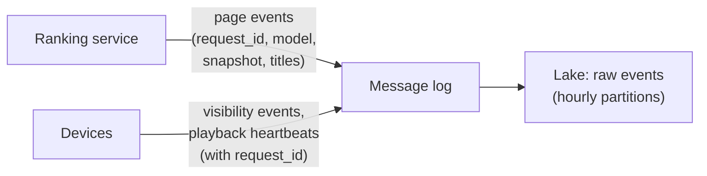
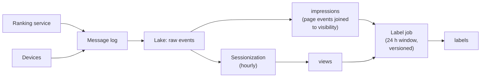
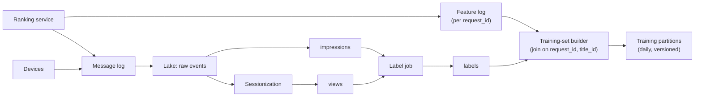
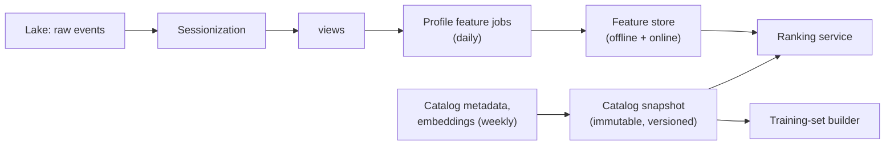
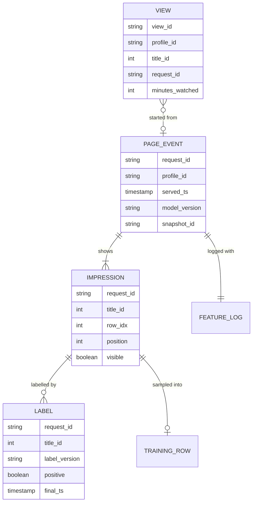
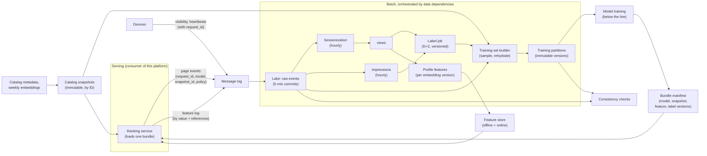

# Design the Data Platform Behind Netflix-Style Video Recommendations

The models that pick which titles you see on a streaming home page are only as good as the rows they were trained on. This breakdown is about building those rows: turning billions of viewing events into training data, and proving that what a model learned from is what it actually sees in production. "Netflix-style" is only the prompt's framing; nothing here describes how any real company built its system.

## Understanding the Problem

The prompt:

> "We run a video streaming service. The home page is a grid of rows, each row a list of titles, ranked per viewer by recommendation models. Design the data platform behind those models: how viewing activity becomes training data, and how we keep training and production consistent."

Two ML terms carry the whole design, and the [Feature Store](../05-breakdowns-core/08-feature-store.md) breakdown defines both: a **feature** is an input value a model uses ("hours of documentaries this profile watched in 30 days"), and a **label** is the outcome it learns to predict ("did the viewer play this title?"). A training example is one row of features plus a label. If those terms, or **training-serving skew**, **point-in-time join** and **online/offline store**, are new to you, read that lesson first; this one builds on it and does not re-teach them.

What is new here is the shape of the data. A **profile** is one viewer inside an account (a household shares an account, each person has a profile). The catalog has about 20,000 titles. That sounds small, until you multiply: 250 million profiles × 20,000 titles is **5 trillion profile-title pairs**. You cannot build a training row for every pair, and you would not want to; most were never shown to anyone. So the platform has to decide which pairs become training rows, and where their labels come from.

The answer starts with an **impression**: one title shown to one profile, at one position on one page, at one moment. A positive example is an impression the viewer then played; a negative is one they scrolled past. Without impressions you know what people watched, never what they ignored.

The central tension:

1. **Training data at catalog scale.** Tens of billions of impressions a day, each needing a label and a full set of features, built daily, affordably.
2. **Offline/online consistency.** Every training row must carry the feature values the ranking model actually saw when it ranked that page, not a recomputation that is slightly different.
3. **Labels that mature slowly.** Whether an impression led to a play is only known hours or days later, and some viewing arrives late from downloaded titles watched offline.

Say the framing early: "This is a training-data platform. The hard parts are joining what we showed to what was watched, and logging what the model saw so we never have to reconstruct it."

> [!NOTE]
> This lesson is about the **data behind** recommendations: events, labels, batch training sets and consistency. Serving-time freshness, candidate generation and near-real-time signals belong to the [Recommendation Engine](06-recommendation-engine.md) breakdown. If the interviewer drifts there, say you'd treat the ranking service as a consumer of this platform and steer back.

## Requirements

*About 7 minutes.* Ask what the models consume, how often they retrain, and what counts as a success:

> **You:** "What does a model learn to predict? A click, a play, a completed title?"
> **Interviewer:** "Mostly 'played it for real': at least 2 minutes. Some teams also want completion."
> **You:** "How often do models retrain, and on how much history?"
> **Interviewer:** "Daily, on the last 28 days. Some experiments go back 90."
> **You:** "When a new model wins offline and loses in an A/B test, how do you investigate today?"
> **Interviewer:** "Painfully. That's half the reason we're asking."

An **A/B test** shows a new model to a random slice of viewers and compares outcomes with the old one. Winning offline and losing there is the symptom this platform exists to prevent.

### Functional requirements

1. **Capture what was shown and what was watched**: every impression with its page context, and every viewing session, linked by shared keys.
2. **Generate labels** for impressions from viewing ("played this title for 2+ minutes within 24 hours"), with versioned label definitions.
3. **Build daily training sets** where each row carries the exact feature values the ranking model used at serving time.
4. **Publish batch features and catalog snapshots** (profile features, title metadata, title embeddings) to serving, versioned so that a model is always served the same versions it was trained on.

**Below the line (out of scope):** the models and how they are trained, candidate generation and the ranking service's real-time path ([Recommendation Engine](06-recommendation-engine.md)), the A/B testing platform, artwork personalization, search, and video delivery. The feature store itself is assumed to exist ([Feature Store](../05-breakdowns-core/08-feature-store.md)); you use it, you don't redesign it.

### Non-functional requirements

- **Scale:** 250 million profiles, 100 million daily active, 20,000 titles, about 40 billion impressions and 12 billion playback events a day.
- **Training-data freshness:** the training partition for impression day D is final by 06:00 UTC on D+2 (a 24-hour label window plus late arrivals), so daily retraining always has data up to two days ago.
- **Consistency:** at least 99.9% of training rows carry the same feature values the serving path logged for that impression; zero rows trained with a different catalog snapshot version than the one served.
- **Build time:** one day's training partition builds in under 2 hours; a 28-day training set is assembled from existing partitions, not rebuilt.
- **Reproducibility:** any training set can be rebuilt bit for bit for 90 days, so a model's results can be explained.
- **Cost:** storage and compute for the platform stay in the low tens of thousands of dollars a month.

> [!TIP]
> Ask how the label is defined before anything else. "A play of 2+ minutes within 24 hours" sets the label window, which sets when a partition is final, which sets the whole training schedule.

## Sources & Volume

*About 5 minutes.* Three sources, all owned by other teams:

- **Playback events** from devices: start, stop, and a **heartbeat** every 60 seconds while a video plays (a small "still playing at position X" event, so a crash or closed lid still leaves a record of how much was watched).
- **Page events** from the ranking service: for each home page it builds, the request ID, the profile, the model version, and the ordered titles per row. The device adds **visibility events** when a tile is actually on screen for at least a second; titles below the fold were ranked but never seen.
- **Catalog data**: title metadata (genre, cast, maturity rating, availability per country) and title **embeddings**, lists of about 128 numbers a model learns for each title so that similar titles get similar numbers. They are rebuilt weekly.

Now the numbers, using [Key DE Numbers](../02-core-concepts/10-key-de-numbers.md). The viewing hours, page loads and play rates below are assumptions; say so out loud and invite correction:

1. **Playback.** "100 million active profiles watching about 2 hours a day is 200 million viewing hours. One heartbeat a minute is 12 billion events a day, about 140,000 a second, roughly 420,000 at the evening peak. At 0.5 KB each that is about 200 MB/s at peak and 6 TB a day raw, 1.2 TB as Parquet." About 20 partitions at 10 MB/s each; take 48 for headroom. Ordinary for a message log.
2. **Impressions.** "Each active profile loads about 10 pages a day, each showing about 40 titles: 1 billion page events and **40 billion impressions** a day. Logged per page (one event listing its 40 titles, about 2 KB), that's 2 TB a day raw."
3. **Positives.** "If about 0.5% of impressions lead to a qualified play, that's 200 million positives and 39.8 billion negatives a day." Training on every negative is wasteful; you'll keep a sample.
4. **What the model saw.** "If we logged every feature for every impression by value, each row repeats about 2 KB of profile features and 1 KB of title features: 40 billion × 3 KB is **120 TB a day** raw." Hold that number. It is the one that shapes the logging design in deep dive 1.

State what the numbers imply:

> "Ingest is routine. The hard parts are the impression-to-play join at 40 billion rows a day, and logging what the model saw without paying for 120 TB a day. The catalog is small; the catalog times the audience is what's huge."

## High-Level Design

*About 13 minutes.* The data flow in numbered hops:

1. Devices send playback and visibility events; the ranking service sends page events. All land in a message log, then in the lake.
2. A **sessionization** job turns heartbeats into `views`: one row per profile per title per viewing session, with minutes watched.
3. A **label job** joins impressions to views and decides, per impression, whether it led to a play.
4. A **training-set builder** joins labels to the features the model saw and writes daily training partitions.
5. Batch jobs compute profile features and catalog snapshots and **publish** them, versioned, to the feature store's online store and to serving.

Then build it per requirement.

### 1. Capturing what was shown and what was watched

The decision is which events you record, and what key ties them together.

#### Bad Solution: Record only plays

Viewing history is already there; train on it. Every play is a positive.

There are no negatives. A model trained only on plays learns which titles are popular, not which title this viewer prefers over the other 39 on the page. You also lose position: a play from row 1 means less than one from row 14, because people mostly look at the top.

#### Good Solution: Log impressions on the device, and join to plays by profile and title

The app logs each tile it shows. A job joins impressions to plays on `(profile_id, title_id)`.

Now you have negatives. It falls short on the consistency requirement: the device doesn't know what the ranking model saw. It knows a tile was on screen, not which model version ranked it, which features it used, or which titles it scored and dropped. Joining on profile and title alone is also ambiguous; the same title can appear on three pages in an evening.

#### Great Solution: The ranking service mints a request ID; every downstream event carries it

When the ranking service builds a page, it generates a `request_id` and logs a page event: profile, timestamp, model version, catalog snapshot version, and the ordered titles with their row and position. It returns the `request_id` to the device with the page. The device stamps it on every visibility event and on any play started from that page.

That one ID is the join key for the whole platform. An impression is `(request_id, title_id)`, and it counts only when the server logged it as ranked and the device confirmed it was seen. Labels attribute plays to the exact page they started from, and the training-set builder (step 3) finds exactly what the model saw for that page.

### 2. Turning viewing into labels

Heartbeats first become views. A **sessionization** job groups one profile's heartbeats for one title into a session, closing it after 30 minutes without a heartbeat, and writes a `views` row: title, start time, minutes watched, the `request_id` it started from (if any), and whether it came from search or "continue watching". It runs hourly over the lake; nothing downstream needs views faster.

A **label** is a function of an impression and the views that followed. The prompt's definition, written down:

> An impression of title T on page R is **positive** if the profile started a view of T that carries R's `request_id`, within 24 hours of R, and watched it for at least 2 minutes.

That is **attribution**: deciding which impression gets credit for a play. A viewer sees a title on Monday's page, doesn't click, then plays it from Tuesday's page. The play carries Tuesday's `request_id`, so Tuesday's impression is positive and Monday's stays negative. Plays with no `request_id` (search, "continue watching") get no impression credit. (Billing-grade attribution, where money depends on it, is its own problem; see [Ad Clickstream](08-ad-clickstream.md).)

The 24 hours is a **label window**: how long after an impression you wait before its label is final. Until then, every "negative" is only "not played yet". That is why the training partition for day D is not final until D+2: impressions from late on day D need their full 24 hours, plus a few hours for late-arriving views. Deep dive 2 handles what arrives after that.

Label definitions change ("let's try 5 minutes"), so each one is versioned: `played_2min_24h_v1`. The label table is keyed by impression and label version, so two definitions can coexist and a model records which one it learned.

### 3. Training rows that match what the model saw

Each impression with a label now needs its features: about 300 of them, describing the profile (watch history, genres, time of day they usually watch), the title (genre, age, popularity, embedding), and the pair (has this profile watched this series before? how far did they get?).

#### Bad Solution: Join labels to today's feature tables

Take the labelled impressions from last week and join today's profile and title features.

That is **data leakage**: a profile that watched the whole series after the impression now has "watched 8 episodes" attached to the impression that started it. The model learns from the future, scores brilliantly offline and disappoints in the A/B test. The [Feature Store](../05-breakdowns-core/08-feature-store.md) breakdown shows this failure in detail.

#### Good Solution: Point-in-time join against the feature store's history

Join each impression to the newest feature values that were available at the impression's timestamp, using the feature store's offline history. No future leaks in.

This is correct for features that live in the feature store. It falls short here because a lot of what the ranking model used at serving time was never in any store:

- **Request context**: device type, time of day, the country's catalog that day, which row the title sat in.
- **Features computed in the ranking service**: "titles already shown higher on this page", similarity of this title to the one the viewer just finished.
- **Values that were defaulted**: the online store timed out and the model got a default. A point-in-time join returns the real value, which the model never saw.

Each is a source of training-serving skew that raises no error.

#### Great Solution: Log what the model saw at serving time, then wait for labels

The ranking service writes a **feature log** for every page: the `request_id` plus the feature values it actually fed the model. The training-set builder joins the feature log to the labels on `request_id` and `title_id`. The feature store lesson calls this **log and wait**: you log features now and join labels when they mature.

Training rows are now what serving saw, by construction, defaults and request context included. Catches:

- **New features have no log.** A feature added today has no logged history. For those, and only those, use the point-in-time join (the Good solution) to backfill, then verify the seam: on a day where both exist, logged and backfilled values must match on 99.9% of rows. The [Feature Store](../05-breakdowns-core/08-feature-store.md) lesson's backfill deep dive covers the mechanics.
- **Logging by value is 120 TB a day.** Deep dive 1 brings it down to about 6.

### 4. Training sets at catalog scale, and publishing what serving reads

**Sampling negatives.** 40 billion labelled impressions a day, 99.5% negative, is far more than any model needs. The builder keeps every positive and a random 2% of negatives: about 200 million + 800 million, so **about 1 billion rows a day**. Each kept negative carries a `sample_weight` of 50, so the model can correct for the sampling. The sampling must be deterministic, a hash of `(request_id, title_id)` below a threshold rather than a random number, so a rebuild picks exactly the same rows.

**Daily partitions, assembled per run.** The builder writes one partition per impression day. A 28-day training set is a list of 28 partition versions, not a new 28-day job. At about 3 KB a row once title features are filled in, a day is 3 TB raw, about 600 GB as Parquet; 28 days is about 17 TB.

**Publishing to serving.** The other direction matters just as much. Batch jobs compute profile features from `views` (daily) and build the **catalog snapshot**: one immutable, versioned file of every title's metadata and current embedding, about 20,000 × 1 KB = 20 MB. Profile features go to the feature store, which materializes them online. The catalog snapshot is small enough that the ranking service loads it whole into memory. Every snapshot has an ID, and the page event logs which snapshot ID the model used. Deep dive 3 explains why that ID is non-negotiable.

## Data Model

*About 5 minutes.* Five tables, all Iceberg or Delta Lake tables on object storage, so writes are atomic and any engine can read them.

### Impressions

**Grain:** one row per title shown on one page: `(request_id, title_id)`. Exploded from page events and joined to visibility events, with `visible` set when the device confirmed the tile was on screen. 40 billion rows a day, about 25 bytes each in Parquet once IDs compress: roughly 1 TB a day. Partitioned by `days(served_ts)` and sorted by `profile_id`, which is the column the label join groups on ([Partitioning](../02-core-concepts/01-partitioning.md)).

### Views and labels

`views`: one viewing session of one title by one profile, about 500 million rows a day, with `request_id` when the play started from a home page. `labels`: one visible impression per label version, with `final_ts` recording when it was settled (deep dive 2 uses it).

### Feature log

**Grain:** one row per page request: `request_id`, the profile-level feature values once, a small block of per-title values (pair features and request context for each of the 40 titles), and references, not copies, for anything shared across requests (`snapshot_id`, feature view versions). Deep dive 1 explains the shape.

### Training rows

**Grain:** one sampled, labelled impression. Columns: keys, label, `sample_weight`, and one column per feature, flattened. Each daily partition is written once and tagged with a dataset version recording its inputs: label version, feature log partitions, snapshot IDs and the builder's code version. A model records the list of partition versions it trained on, which is what makes the reproducibility requirement real.

## Pipeline Design

*About 5 minutes.* Almost everything here is batch. The only streaming piece is landing events in the lake.

| Path | Mode | Schedule and behavior |
|---|---|---|
| Event landing | Streaming, 5-minute commits | Message log to raw lake tables; dedup on event ID |
| Sessionization | Batch, hourly | Reprocesses the last 3 hours each run, so sessions spanning an hour boundary close correctly |
| Impressions | Batch, hourly | Page events joined to visibility events for the same hour plus a 1-hour lookback |
| Label job | Batch, daily | For impression day D, runs at 04:00 on D+2 once views through D+1 are complete |
| Training-set builder | Batch, daily | Right after the label job; writes partition D |
| Profile features, catalog snapshot | Batch, daily and weekly | Publish to feature store and serving |

An orchestrator runs the batch side with data dependencies, not clock times: the label job for day D waits for sessionization to report every hour through D+1 23:00 complete ([Pipeline Design](../01-the-framework/07-pipeline-design.md), [Airflow](../04-technology-deep-dives/03-airflow.md)).

Why batch? Labels can't be final for 24 hours and models retrain daily, so a stream job would compute labels faster than anything could use them. What needs seconds belongs to the serving path in the [Recommendation Engine](06-recommendation-engine.md).

**Idempotency.** Every batch job overwrites exactly the partitions it owns (a **partition overwrite**, from [Pipeline Design](../01-the-framework/07-pipeline-design.md)), so a rerun replaces rather than duplicates. Training partitions are the exception: once published, a version is never overwritten. A rebuild writes a new version, because a model may already have trained on the old one.

**Failure behavior.**

- **Sessionization or label job late:** the daily retrain uses 28 days ending at D-1. Models are a day staler, not wrong.
- **Feature log gap** (the ranking service's logger dropped events for an hour): those impressions have no features and are left out of training, never filled by recomputation. The gap is counted and alerted.
- **Bad catalog snapshot published:** serving rolls back to the previous snapshot ID; training rows record which one each page used, so nothing needs repair.

## Potential Deep Dives

*About 13 minutes.* If the interviewer doesn't steer, lead with deep dive 1: consistency meets volume there. How to run deep dives is in [Deep Dives](../01-the-framework/08-deep-dives.md).

### 1. "You want to log every feature the model saw for 40 billion impressions a day. How do you make that affordable?"

Start from the number: 40 billion rows × (2 KB profile + 1 KB title + about 0.1 KB pair features) is about 120 TB a day raw.

#### Bad Solution: Log one wide row per impression, by value

Simple to join, and enormous. At 1/5 in Parquet, 120 TB is 24 TB a day; 90 days is about 2.2 PB, roughly $50,000 a month in object storage alone, plus 1.4 GB/s of writes from the ranking fleet. Most of it is repetition: each profile's 2 KB copied into 40 rows per page, and the same 20,000 titles' features copied into billions of rows.

#### Good Solution: Log only a sample of requests

Log full features for 5% of pages. Storage drops 20x.

Fine for monitoring, but 95% of impressions now have no features: you train on 5% of your labels or reconstruct the rest, which brings back skew.

#### Great Solution: Log each value at the grain where it varies, and log references for anything shared

Look at where each feature changes:

| Feature kind | Changes per | Log it |
|---|---|---|
| Profile features (watch history summary, genre affinities) | Request | Once per page, by value: about 2 KB |
| Pair features and request context (position, "already watched 3 episodes", similarity to last watched) | Impression | Per title, by value: about 100 bytes × 40 |
| Title features (metadata, embedding, popularity) | Catalog snapshot | By reference: `snapshot_id` only |
| Batch feature views from the feature store | Feature view version and run | By reference to the run, plus the values for any view marked volatile |

That is about 2 KB + 4 KB, roughly **6 KB per page**: 1 billion pages × 6 KB = 6 TB a day raw, about 1.2 TB as Parquet. 90 days is about 110 TB, around $2,500 a month. A 20x reduction, and no information lost.

The training-set builder then **rehydrates**: it joins each row's `snapshot_id` to the catalog snapshot to fill in title features. Because the snapshot is 20 MB, Spark copies it to every executor (a broadcast join) and there is no shuffle at all for the title side ([Spark Internals](../04-technology-deep-dives/01-spark-internals.md)).

The rule that makes references safe: **anything logged by reference must be immutable and kept as long as the log.** A snapshot that is overwritten in place turns every reference into a lie. Snapshots are cheap (20 MB a day), so keep every one for the 90-day reproducibility window.

> [!TIP]
> The sentence that lands in an interview: "The catalog is small and slow-changing, so I log it by reference; the profile and the request are large and volatile, so I log those by value." It shows you sized the problem before designing the log.

### 2. "When is a label final? What do you do with views that arrive after you built the training set?"

Labels move for two reasons. The 24-hour window means an impression at 23:50 on day D can become positive at 23:00 on D+1. And views arrive late: a viewer downloads titles, watches on a flight, and the device uploads the heartbeats two days later.

Measure the lateness first. Suppose 98% of views arrive within an hour of being watched, 99.5% within 24 hours, and 99.9% within 7 days. With the build at 04:00 on D+2, a view at the very end of a late impression's window has only about 4 hours to arrive, and most have a day or more; you will miss roughly 0.3% of positives.

#### Bad Solution: Rewrite training partitions whenever a late view arrives

Every day, rerun the label job for the last 30 days and overwrite the training partitions.

A model trained on Tuesday can't be reproduced on Friday, because its partitions changed underneath it. That breaks reproducibility, and you rebuild 30 days every day for a 0.3% correction.

#### Good Solution: Finalize at a fixed time and accept the small error

Build partition D once at D+2 and never change it. Late positives are lost from training.

Reproducible and cheap. But the 0.3% is not random: it is downloaded viewing, concentrated in certain countries, devices and kinds of title (long films on flights), so the model learns those titles are less appealing than they are.

#### Great Solution: Finalize on schedule, measure the correction, and version when it matters

- **Build partition D once at D+2**, and record each label's `final_ts`.
- **Keep counting.** A daily job counts views that arrive after their impression's partition was finalized, grouped by country and device: the label correction rate.
- **Rebuild as a new version only when it crosses a threshold.** If the correction rate for a partition passes 1% overall, or 5% in any country, the builder writes version 2 of that partition. Models that trained on v1 keep pointing at v1; the next retrain picks up v2. Old versions are never overwritten.
- **Stamp the training row with whether the view could have been late.** A flag for "profile had downloads in progress at impression time" lets the modeling team treat those negatives with care. How they use it is below the line; giving them the column is your job.

The same versioning handles a changed label definition. Moving from 2 minutes to 5 is `label_version = v2`, a backfill over 90 days of impressions and views ([Backfill and Reprocessing](../02-core-concepts/03-backfill-and-reprocessing.md)), and a new set of partition versions beside the old ones. For the general mechanics of lateness, see [Late-Arriving Data](../02-core-concepts/08-late-arriving-data.md).

### 3. "The embedding team retrains title embeddings every week. Why might every model get worse the morning after, and how do you stop it?"

This is the catalog-scale version of training-serving skew, and it fails without a single error.

An embedding is only meaningful relative to the run that produced it. Retraining reshuffles the space: last week, dimension 17 may have roughly meant "dark crime drama"; this week that idea is spread across other dimensions. A model served this week's vectors is reading a language it never learned. Profile features built from embeddings (a "taste vector", the average embedding of what the profile watched) inherit the problem.

#### Bad Solution: Overwrite the embeddings table in place

The embedding job writes the new vectors into the same table. Serving reads it on its next refresh, training reads it on its next build.

The morning after, every ranking model is served vectors it wasn't trained on. Nothing errors; engagement drops a few percent and someone spends a week finding out why.

#### Good Solution: Version every snapshot and record the version on each model

Embeddings go into a new, immutable catalog snapshot with its own ID. A model records which snapshot ID it trained with, and serving is configured to use that one.

The direct mismatch is gone. It falls short because the pieces still drift: profile features are computed daily against "the current" embedding version, so on the day the version changes, the profile features in the online store may already be in the new space while the model is still pinned to the old.

#### Great Solution: Treat the model and its data versions as one deployable bundle

- **A bundle manifest** lists the model artifact, the catalog snapshot ID, the label version, and the version of every feature view whose meaning depends on the embeddings.
- **Dependent features are computed per embedding version.** The profile taste vector is a feature view with the embedding version in its name (`profile_taste_e42`), and for the overlap period both `e41` and `e42` are materialized. The [Feature Store](../05-breakdowns-core/08-feature-store.md) lesson's "version, don't edit" rule, applied to a whole family of features at once.
- **Serving loads bundles, not loose pieces.** A ranking service instance loads one manifest and serves only what it names. A new embedding version goes live only when a model retrained on it is promoted, together with its features.
- **Lineage enforces cleanup.** An old snapshot and its dependent feature views are deleted only when no live bundle references them ([Data Lineage](../02-core-concepts/04-data-lineage.md)).

New titles need the same care. A title added today is not in yesterday's snapshot, so the serving model sees a "missing" embedding and uses a default. Training rows from that day must see the same default, which they do automatically: they rehydrate from the snapshot ID the page logged, where the title is also missing. Logging references to immutable snapshots gives you that for free: cold-start titles (titles too new to have any history) are consistent without special code.

### 4. "Your training data only contains titles the current model chose to show. Isn't that a problem?"

Yes. It is a **feedback loop**: the model decides what is shown, impressions decide what is learned, so a title the model ranks low gets few impressions, few positives, and is ranked lower still. Correcting for it is modeling work, below the line. But the model team cannot correct for anything the data platform didn't record. Your job is to make the data that correction needs exist.

- **Log position, and what was scored but not shown.** Row and position are already on every impression. For a 1% sample of requests, the ranking service also logs the full candidate list it scored (about 500 titles) with scores. That is about 1 billion × 1% × 500 = 5 billion small rows a day, about 50 GB as Parquet; affordable at a sample, ruinous at 100%.
- **Tag an exploration slice.** A small share of page requests, say 1%, is ranked with deliberate randomization among the top candidates, and the page event records `policy = explore` with the probability each title had of being shown at its position. Training jobs can then weight or select those rows. The platform's contract is that the flag and probabilities are always present and correct.
- **Keep the slice joinable.** Exploration requests flow through the same impressions, labels and feature log, just tagged. A separate pipeline would drift from the main one.

> [!WARNING]
> Don't answer this question with modeling ("use inverse propensity weighting", a modeling technique). The interviewer is testing whether you know what to *log*. Without position, the candidate sample and the exploration flag, no modeling fix is possible later.

## Monitoring & SLAs

*About 4 minutes.* Four SLAs, each tied to a requirement. [Monitoring and SLAs](../01-the-framework/09-monitoring-and-slas.md) covers presenting them; [Monitoring and Alerting](../02-core-concepts/06-monitoring-and-alerting.md) covers alert design.

| SLA | Target | Measured by |
|---|---|---|
| **Training-data freshness** | Partition D final by 06:00 UTC on D+2 | Builder completion time per partition |
| **Consistency** | ≥ 99.9% of sampled training rows match the feature log; 0 rows with a snapshot ID different from the page event's | Daily check on a 0.1% sample, comparing training values with the raw feature log and catalog snapshot |
| **Join completeness** | ≥ 99.5% of visible impressions have a page event and a feature log row | Counts per hour, per device platform |
| **Build time** | One day's partition under 2 hours | Builder run durations |

Behind them, the checks that catch silent damage:

- **Positive rate per partition**, by country and device, against the last 4 weeks. A drop from 0.5% to 0.3% on one platform usually means a broken `request_id` on plays from that app version, not viewers losing interest.
- **Visible-to-served ratio.** If a new app version stops sending visibility events, every impression from it looks unseen.
- **Label correction rate** from deep dive 2, per partition and country.
- **Feature log volume per request**, which catches a feature that silently stopped being logged.
- **Bundle consistency at serving**: every serving instance reports the manifest it loaded; more than one manifest per model in production for over an hour is an alert.

The trap specific to this system: **nothing breaks loudly.** Bad training data produces a slightly worse model, which shows up weeks later as an A/B test nobody can explain.

## Final Design

Follow one impression through it. At 21:14 on 3 November, profile p-551 opens the home page. The ranking service, running bundle b-88 (model m-311, catalog snapshot s-1102), builds request r-9f2, logs the page event and a 6 KB feature log row, and returns the page. A documentary sits at row 2, position 4; the device reports it visible. At 22:40 the viewer plays it from that page and watches 47 minutes; sessionization writes a view carrying r-9f2. At 04:00 on 5 November the label job marks `(r-9f2, documentary)` positive under `played_2min_24h_v1`. The builder keeps the row (positives are always kept), fills title features from snapshot s-1102, and writes partition 2026-11-03 v1. The next retrain reads that row with exactly the features m-311 saw at 21:14, and the consistency check sample confirms it.

## What's Expected at Each Level

### Mid-level

You produce the right shape: playback and impression events into a lake, a job that turns viewing into labels, and a daily batch that builds training sets. You know that impressions supply the negatives and that joining today's features to old labels leaks the future. With prompting, you reach a point-in-time join and a fixed label window. Bar for this problem: impressions logged with position, a written label definition with a window, and daily partitioned training data that a model can name.

### Senior

You drive and name the tension early. You introduce a request ID minted at serving as the platform's join key, choose logging what the model saw over reconstruction, and keep the point-in-time join for new features only. You size the feature log and cut it 20x by logging shared, immutable data by reference. You handle label maturity with a finalize-then-version scheme, sample negatives deterministically with weights, and monitor positive rate and join completeness instead of only job success.

### Staff+

You treat this as the contract between the data platform, the ranking service and the modeling teams. You introduce bundle manifests so models, snapshots and dependent features move together, and you see that embedding retrains change the meaning of other features. You raise the feedback loop unprompted and specify what must be logged (position, candidate samples, exploration probabilities) without designing the model. You set reproducibility as a requirement with a cost (immutable versions for 90 days) and defend it. And you watch privacy: viewing history is sensitive, so the feature log and training sets need the lake's deletion path, and a deleted profile must disappear from future training-set versions.

## Related Lessons

- Framework: [The Delivery Framework](../01-the-framework/02-delivery-framework.md), [Requirements Gathering](../01-the-framework/03-requirements-gathering.md), [Sources and Volume](../01-the-framework/04-sources-and-volume.md), [Pipeline Design](../01-the-framework/07-pipeline-design.md), [Deep Dives](../01-the-framework/08-deep-dives.md), [Monitoring and SLAs](../01-the-framework/09-monitoring-and-slas.md)
- Concepts: [Key DE Numbers](../02-core-concepts/10-key-de-numbers.md), [Late-Arriving Data](../02-core-concepts/08-late-arriving-data.md), [Backfill and Reprocessing](../02-core-concepts/03-backfill-and-reprocessing.md), [Partitioning](../02-core-concepts/01-partitioning.md), [Data Lineage](../02-core-concepts/04-data-lineage.md), [Monitoring and Alerting](../02-core-concepts/06-monitoring-and-alerting.md)
- Technology: [Spark Internals](../04-technology-deep-dives/01-spark-internals.md), [Airflow](../04-technology-deep-dives/03-airflow.md)
- Related breakdowns: [Feature Store](../05-breakdowns-core/08-feature-store.md) (point-in-time joins, training-serving skew, online and offline stores), [Recommendation Engine](06-recommendation-engine.md) (serving-time freshness and candidate generation), [Ad Clickstream](08-ad-clickstream.md) (billing-grade attribution)
- Previous breakdown: [Music Streaming Analytics](01-music-streaming-analytics.md). Next: [Fraud Detection](03-fraud-detection.md)
